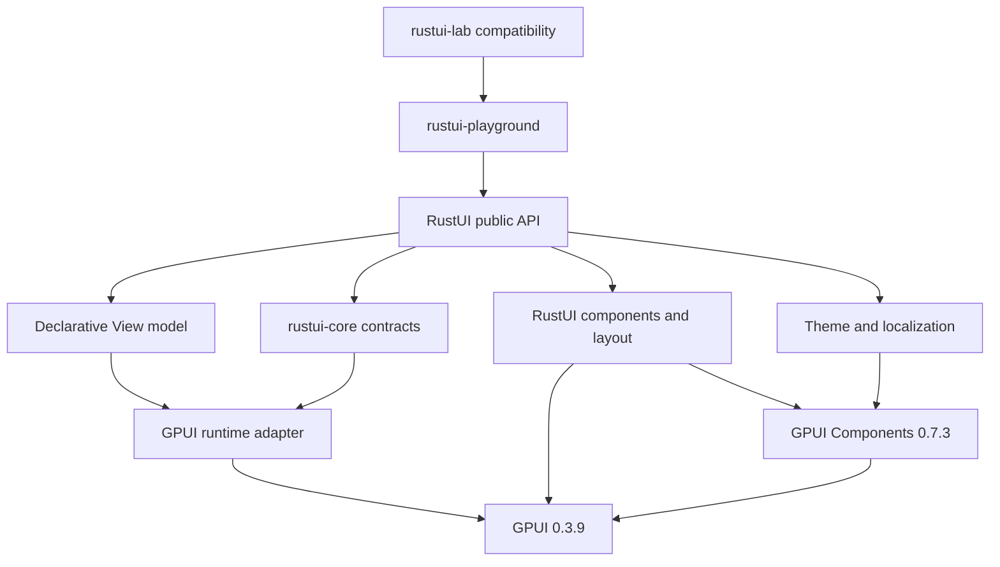

# RustUI architecture

Status: active architecture for the standalone RustUI workspace. Module existence
does not establish feature support; current implementation status is recorded in
`FILE_REGISTRY.md`.

## Invariants

1. RustUI owns its public declarative API and has no Allui dependency or public
   Allui types.
2. GPUI owns entities, rendering, layout execution, windows, notifications,
   scheduling, asynchronous execution, and platform integration.
3. GPUI Components supplies mature control behavior where it satisfies RustUI's
   contract.
4. RustUI does not introduce a second renderer, scheduler, entity store, or
   reactive graph.
5. Stateful controls retain their GPUI entities across body evaluation; temporary
   view descriptions do not own persistent input, selection, list, or navigation
   state.
6. Vendored upstream sources remain immutable. Approved changes use a versioned
   patch process and retain upstream licensing.

## Dependency direction

The approved GPUI packages are Longbridge's `gpui-pre = 0.3.9` packaging of
official Zed revision `93d745668805029476e6d7fbb19652116fed51de`, the matching
platform package, and GPUI Components `0.7.3`.

Chrono `0.4.45` is a direct RustUI public value dependency for `NaiveDate`. It
was already resolved and vendored by the approved GPUI Components stack.

## Layer ownership

| Layer | RustUI owns | Reuses |
| --- | --- | --- |
| Public API | `View`, constructors, modifiers, macros, component semantics | Rust language and GPUI-compatible types where needed |
| Core | Identity, actions, state and binding ergonomics, observation contracts, lifecycle and environment | GPUI entity ownership and notification model |
| Runtime | Component hosting, action dispatch, root mounting, application/window convenience | GPUI `Entity`, `WeakEntity`, `Context`, `Task`, `Subscription`, `App`, and `Window` |
| Components | SwiftUI-inspired public contracts, accessibility expectations, theme resolution | GPUI Components or GPUI primitives |
| Layout | Stack, grid, scroll, keyed content, logical direction contracts | GPUI layout and upstream virtualization |
| Theme | Versioned RustUI documents, semantic roles and typed component styles | GPUI Components theme application and platform rendering |
| I18n | Application locale, messages, formatting, fallback and invalidation | GPUI text shaping and GPUI Components built-in translations |
| Playground | Live stories, source/events, locale and appearance controls, macOS 27 reference catalog | Public RustUI API only |
| RGPE | Measurements and explicitly approved optimizations | Existing GPUI caches and official sources |

## Declarative views

RustUI defines `View::body(&self) -> impl View`. Composite views describe a
temporary tree that is lowered into GPUI elements. Primitive views terminate body
expansion and lower directly into GPUI.

`ComponentHost<V>` is the GPUI entity-backed owner of a root RustUI component.
It supplies rendering services, binds actions to the owning entity, and notifies
GPUI after mutations. The public `ViewHost` name remains an ergonomic re-export.

Conditional and repeated content must preserve explicit identity. Rendering must
not recreate persistent input, collection, selection, navigation, or task state.

## State, actions and invalidation

Component values live in GPUI entities. Generated state accessors and bindings
target that owning entity rather than a separate RustUI store.

- Mutations occur through the component entity's `Context`.
- A successful mutation calls `Context::notify()`.
- Observation uses GPUI observers and subscriptions.
- Async work uses `Context::spawn()` with `WeakEntity<Component>`.
- Lifecycle cleanup uses GPUI release subscriptions and task ownership.
- Equality-based notification is an API policy layered over GPUI, not another
  scheduler.

`#[state]` fields remain ordinary fields on the GPUI-owned component. The macro
generates read, set, update, binding and borrowed-state accessors. Bindings are typed
field lenses that dispatch against that owner; they do not allocate another store.
Actions can invalidate always or report whether a mutation changed state. Current
invalidation is whole-host and uses `Context::notify()`. Root `View` mount/unmount
hooks are connected to GPUI entity creation and release.

## Retained control state

Stateful upstream controls keep editor, focus, selection, undo, IME, popup, and
gesture state in GPUI entities. `ComponentHost` owns a keyed type-erased store of
those entities. A stable RustUI `Identity` retrieves the same typed entity on each
body rebuild; reusing one identity for different entity types is a programmer error.

Bindings carry the value captured by the current body pass. Control events use a
weak reference to the owning `ComponentHost` to write through the binding and call
GPUI `Context::notify()`. External component changes are synchronized back into
the retained entity. Subscriptions live with the retained entry, so no independent
entity store, scheduler, or reactive graph is introduced.

## Components

Every component decision uses this order:

1. Preserve a correct existing RustUI implementation.
2. Wrap GPUI Components when it already provides the required behavior.
3. Compose GPUI primitives for RustUI-specific semantics.
4. Implement new behavior only when neither upstream layer satisfies the contract.
5. Defer speculative components until a real use case and validation workload exist.

GPUI Components types are implementation details unless a deliberate public
interop API is approved.

## Themes

RustUI owns a versioned JSON appearance document. The macOS 27 adapter parses and
validates the platform profile and a typed Button record. Activation resolves Button
metric references, typography, appearance colors, corner radius, and interaction
colors, stores the resolved result in GPUI's application globals, and maps it into
GPUI Components. Button reads the same active result during lowering.

The current source record has appearance-level rules with `interaction: any`; RustUI
derives hover and pressed alpha overlays from that declared base color. This is an
explicit fallback until the JSON contains state-specific rules. Material descriptions
still do not imply native blur or composition.

Runtime theme changes must notify affected views without discarding component
state. Other platform JSON files remain planning records until their adapters and
visual evidence exist.

## Localization

GPUI renders and shapes text but does not own application translations. GPUI
Components owns translations for its built-in strings. RustUI owns application
catalogs, synchronizes its active locale through `gpui_component::set_locale`,
and stores the active catalog/locale/direction in a GPUI application global.

Changing that global notifies every mounted `ComponentHost`, so translated text
is lowered and measured again without replacing component state. Catalog lookup
uses the exact locale, its primary language, the configured fallback locale, and
finally the message identifier. `HStack` reverses logical flow for RTL locales;
`VStack` maps start/end alignment through the active layout direction. GPUI
continues to own text shaping and rendering.

The initial catalog parser intentionally supports comments, blank lines, and
single-line `message-id = value` records. `rustui_i18n::interpolate` applies
named `{name}` text/integer arguments to a resolved message; `{{` and `}}`
represent literal braces. Integers use ordinary decimal output, independent of
locale. Missing arguments and malformed braces are errors. Plural selection,
terms, select expressions, locale-sensitive date/number formatting, Unicode
bidirectional isolation, and font fallback policy remain separate contracts.

## RustUI Playground and Lab compatibility

`rustui-playground` is the canonical component development and manual acceptance
application. Its application code consumes only the public `rustui` crate; direct
GPUI and GPUI Components dependencies stay inside the framework implementation.
The shell keeps the 41-key macOS 27 reference catalog alongside ten live stories:
Button, Text, Layout, Input, List, Table, Tree, Tabs, Breadcrumb, and Navigation.

The shell exposes story source, event history, English/French/Arabic locale
selection, and Light/Dark appearance controls. Layout and performance inspection
remain incomplete, and interaction, visual, accessibility, and GUI acceptance are
pending. A catalog entry or successful compile does not establish acceptance.

`rustui-lab` is a compatibility package that delegates to the same Playground
entry point. It contains no parallel UI or story implementation.

## Performance and platform scope

Measure retained views, invalidation, text caches, scene replay, virtualization,
idle work, scrolling and dragging before adding caches or GPU work. Every approved
optimization needs a correct default path and equivalence evidence.

Support claims are tied to the pinned upstream revision and verified targets.
Platform theme names are design targets, not proof of platform support.

## Scoped GPUI control ownership (R2)

`ComponentHost` owns retained GPUI entities and subscriptions under a key composed
of a private scope path and the control identity. Each render records accessed
keys and explicitly preserved inactive scope prefixes; successful lowering is
followed by removal of entries that match neither. Existing GPUI notifications,
entity scheduling, and rendering continue to perform updates.

`TabView` scopes content by container identity and tab ID. It preserves only
currently declared inactive tabs, allowing active conditional content to be pruned.
`NavigationStack` scopes content by container identity and one full route-prefix
segment per page. Earlier pages are preserved without preserving popped descendants.
Missing destination definitions do not retain their old page controls.

Root-bound application values are independent of retained control entries. Inactive
subtrees reconcile on their next render. Registry removal drops its entity and
subscription references; other GPUI references may delay destruction. Stable explicit
container IDs are required for dynamic containers and unique IDs for siblings.
R2 itself does not add child lifecycle; explicit child hosts are implemented in
F1b below.

## Keyed description composition (F1 first slice)

`KeyedView<V>` pushes `RetentionScope::Key(Identity)` while lowering its child.
`RenderContext::with_element_scope` pairs that registry scope with a private
`ScopedElement` carrying a GPUI element ID. The wrapper forwards the child's
existing LayoutId, prepaint, and paint; it introduces no layout box or accessibility
node of its own. Typed, length-delimited local IDs compose through GPUI ancestors.
Tab/container and navigation/page boundaries use the same paired helper.

A per-render set rejects duplicate keyed paths even for views without retained
controls. Unkeyed stacks do not create identity scopes. Optional children use
`gpui::Empty`; repeated children are eager. Existing R2 inactive-scope preservation
and visible-row pruning remain in effect. This description slice does not create an owner. F1b below adds explicit child
hosts; props reconciliation and environment observation remain future work.

## Retained child hosts (F1b)

`ComponentView<C>` asks the current host's registry for a child at `(scope, key)`.
A separate child map avoids collisions with GPUI control IDs. Each entry owns an
`Entity<ComponentHost<C>>`: matching types reuse it; changing the concrete type
creates a replacement. A per-frame set rejects duplicate child keys regardless of
type. The existing R2 seen/preserved-prefix sweep also prunes child entries.

Native GPUI `Entity::into_any_element` supplies the child identity and rendering
boundary without another layout container. The existing host sets up child-local
weak update callbacks, GPUI notifications, localization observation and lifecycle.
There is no second scheduler or reactive engine. Environment snapshots are inherited at creation and, since F1d, refreshed during
parent lowering. Reused children retain their initialized state; F1c below adds explicit props reconciliation; environment update reconciliation
remains outside this baseline.

Action/binding writes reject a wrong concrete owner type; the lenses remain
owner-relative and do not carry instance identity. Parent-target operations need
an explicit future API. Removing a host also releases its retained descendants and
subscriptions when GPUI drops it; exact release timing remains GUI-unverified.

## Child prop reconciliation (F1c)

Each retained child entry now holds optional type-erased previous props alongside
its GPUI entity. `ComponentPropsView<C, P>` supplies a typed equality comparison and
a stable function-pointer reconciler. New children receive the projection before
host construction and mount. Reused children receive it only when incoming props
change; the existing GPUI host is updated and notified. Child state is not replaced.

Plain `Component` clears this optional comparison baseline. Child type replacement
creates a fresh entry; props type replacement treats the incoming props as new
while retaining the child entity. R2 pruning removes the metadata with its child;
inactive preserved scopes receive changes when rendered next. This is explicit
parent-to-child data projection, with no general observation graph, environment
reconciliation or implicit cross-owner binding mechanism.

## Scoped environment propagation (F1d)

`EnvironmentView<T, V>` clones the current typed environment map, overrides `T`,
and lowers V through a temporary reborrowed RenderContext. That context shares the
same action updater, retained registry, GPUI app and window; only its environment
reference differs. Dropping it restores the outer context without mutating siblings.
`EnvironmentReaderView` builds an owned view from an optional typed value.

Both plain and props-bearing retained child paths refresh the host's inherited
snapshot on reuse before native uncached entity rendering. They do not emit an
unconditional notify for this assignment: the child renders in the same traversal.
GPUI entity identity and existing retained state remain unchanged. Props changes
still use their own equality-based notify rule. Inactive subtrees refresh on next
lowering. This is render-driven propagation, not a dependency-observation system.
External cached child rendering would need a separate invalidation design.
