# Component inventory (R-1)

This is the unmodified release Playground at integration commit `63956b36`, captured in a separate R-1 app with Rust 1.98.0. The old-GPUI and GPUI-Fast comparison apps were left running. The build uses `$HOME/.cache/rustui-target-r1`, not their target directories.

The inventory covers **63 production source files** (58 component/adapter files and five graph/validation support files). Public data models are listed with their owning component rather than counted as additional rendered controls. `NavigationLink` and `LocalizedText` are listed separately below because they are public renderable entry points sharing an implementation file.

## Reading the evidence

Light and dark images are real release-Playground window captures. Shared galleries deliberately reuse one image where several controls are visible together. A screenshot demonstrates the displayed state only; it does not approve hover, focus or editing behavior. The purple capture indicator is macOS screen-sharing UI.

**Reference provenance matters:** `hig/README.md` labels the PNGs under `hig/rustui-images/` as illustrative design concepts, not Apple screenshots or evidence of native behavior. They are shown alongside the captures as the closest matching local owner references, with that label. No matching concept means “no reference.” The original source SVGs used by the runtime/catalog remain in `apps/rustui-playground/references/`; a concept image cannot establish pixel equality with macOS.

“None” in the component-record column means the wrapper does not read its own `themes/macos27.json.components` record. Kit-backed controls still inherit the platform palette/font/radius mapping in [apply_profile](https://github.com/abouzoubaa/rustui/blob/63956b36cb6a1c9347c0241fd928f5625e3c0812/crates/rustui/src/adapters/themes.rs) and the [active-theme bridge](https://github.com/abouzoubaa/rustui/blob/63956b36cb6a1c9347c0241fd928f5625e3c0812/crates/rustui/src/theme/registry.rs#L555). Child RustUI controls read their own records. Caller-supplied sizes are distinct from the fixed defaults listed here. Source links identify actual render paths, not merely JSON record existence.

The gap column is an open review list, not an assertion of visual equivalence. Size, spacing, radius, font, selection, focus ring, hover and editing are reviewed only where the captured state supports it; other states remain owner visual checks.

## Public components

| Component / source | Built on | Component records / tokens read at render | Fixed UI values in RustUI | Release Playground: light / dark | Closest `hig/` concept (not native screenshot) | Gaps / review needed |
| --- | --- | --- | --- | --- | --- | --- |
| [Canvas](https://github.com/abouzoubaa/rustui/blob/63956b36cb6a1c9347c0241fd928f5625e3c0812/crates/rustui/src/components/advanced/canvas.rs#L195) | Own GPUI Canvas element and scene | none; child controls/caller provide appearance  none in this wrapper | none in this wrapper | 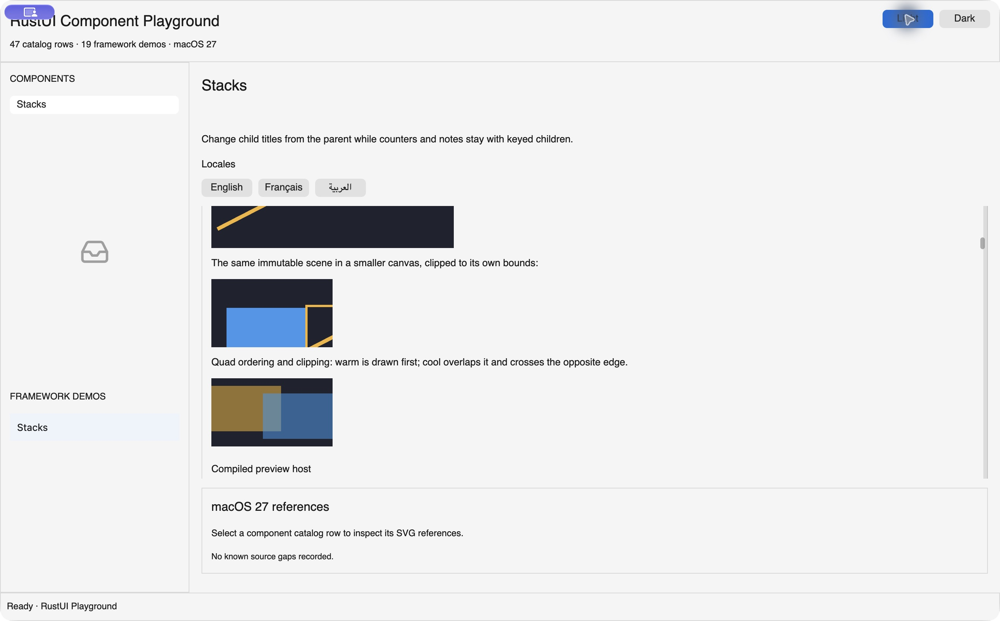 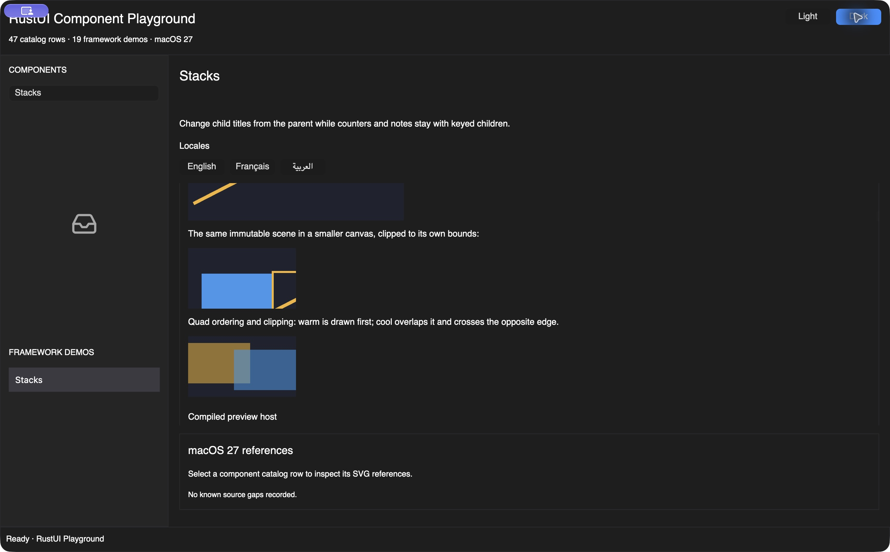 | no reference | No matching local reference. Size, spacing, radius, font and interaction appearance need an owner-supplied target. |
| [CodeEditor](https://github.com/abouzoubaa/rustui/blob/63956b36cb6a1c9347c0241fd928f5625e3c0812/crates/rustui/src/components/advanced/code_editor.rs#L78) | Kit Editor/EditorState | none; inherits native Kit theme  none in this wrapper | [98](https://github.com/abouzoubaa/rustui/blob/63956b36cb6a1c9347c0241fd928f5625e3c0812/crates/rustui/src/components/advanced/code_editor.rs#L98) `height: 240.0,` | 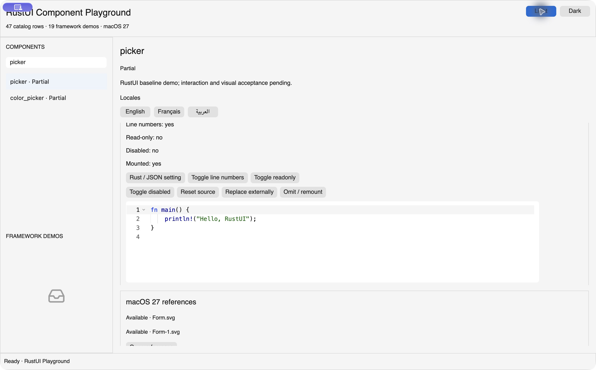 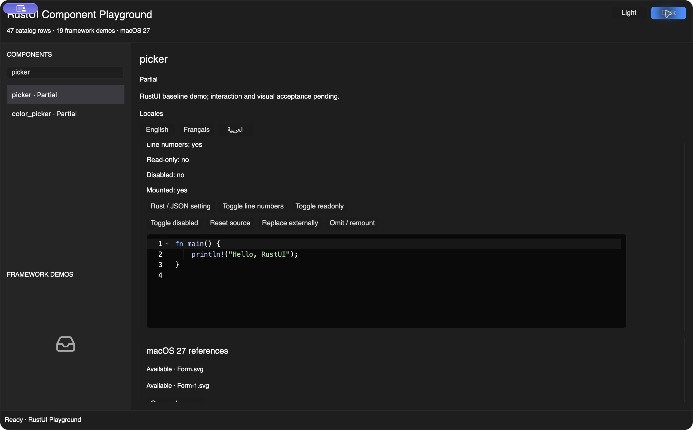 | no reference | Small inventory specimen; no editor component-record mapping. Font/gutters/selection remain Kit defaults. |
| [GraphView](https://github.com/abouzoubaa/rustui/blob/63956b36cb6a1c9347c0241fd928f5625e3c0812/crates/rustui/src/components/advanced/graph_view/interaction.rs#L20) | Own GPUI graph interaction and Canvas rendering | No graph component record; rendering.rs profile palette, native Theme fallback  none in this wrapper | none in this wrapper; [GraphStyle RGB defaults](https://github.com/abouzoubaa/rustui/blob/63956b36cb6a1c9347c0241fd928f5625e3c0812/crates/rustui/src/components/advanced/graph_view/rendering.rs#L91), [24-point disconnect target](https://github.com/abouzoubaa/rustui/blob/63956b36cb6a1c9347c0241fd928f5625e3c0812/crates/rustui/src/components/advanced/graph_view/rendering.rs#L31) | 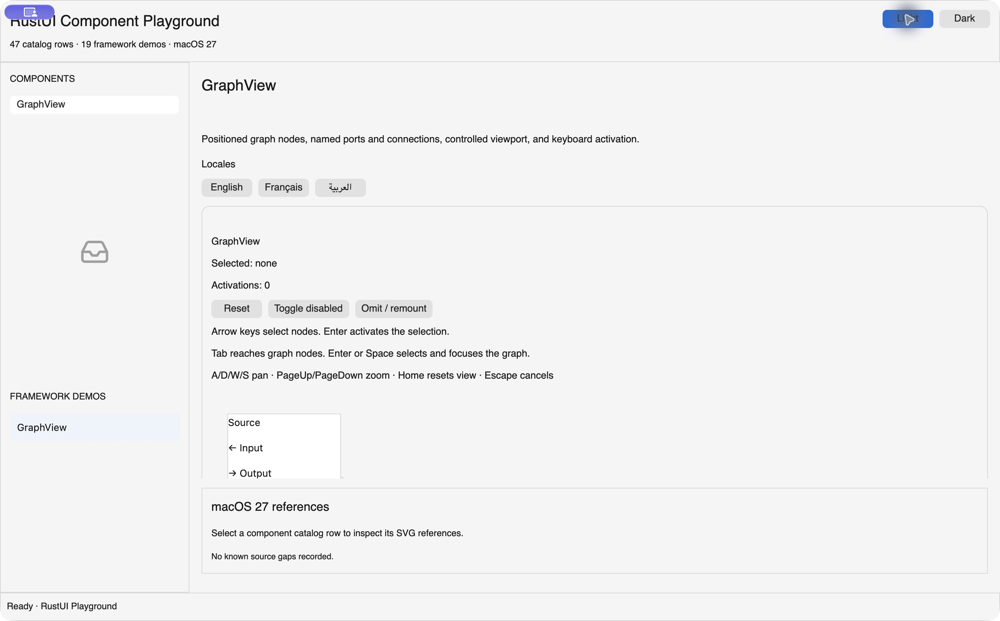 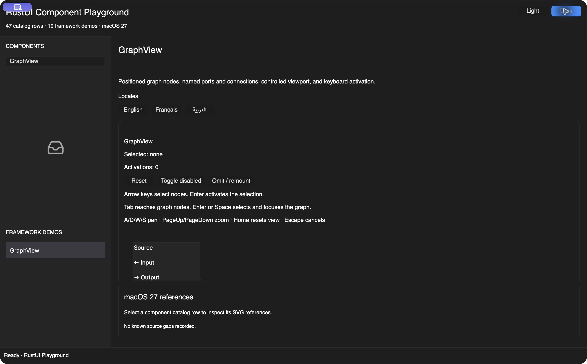 | no reference | No matching local reference. Size, spacing, radius, font and interaction appearance need an owner-supplied target. |
| [NodeEditor](https://github.com/abouzoubaa/rustui/blob/63956b36cb6a1c9347c0241fd928f5625e3c0812/crates/rustui/src/components/advanced/node_editor.rs#L30) | RustUI GraphView composition | none; child controls/caller provide appearance  none in this wrapper | none in this wrapper | 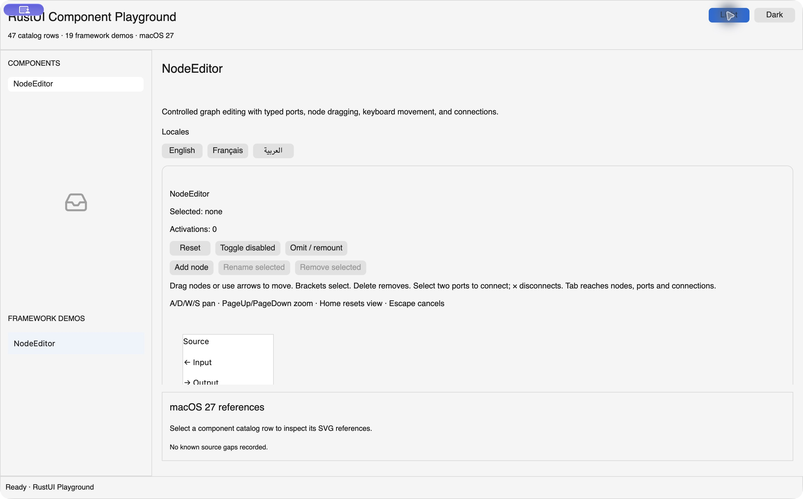 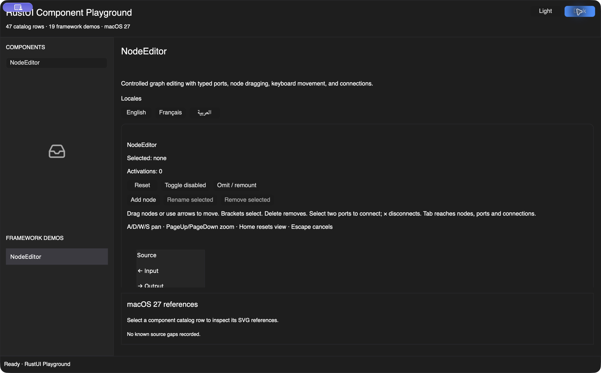 | no reference | No matching local reference. Size, spacing, radius, font and interaction appearance need an owner-supplied target. |
| [PropertyInspector](https://github.com/abouzoubaa/rustui/blob/63956b36cb6a1c9347c0241fd928f5625e3c0812/crates/rustui/src/components/advanced/property_inspector.rs#L165) | Own GPUI rows + RustUI TextField/Stepper/Toggle/Picker | none; inherits native Kit theme  none in this wrapper | [215](https://github.com/abouzoubaa/rustui/blob/63956b36cb6a1c9347c0241fd928f5625e3c0812/crates/rustui/src/components/advanced/property_inspector.rs#L215) `let mut inspector = div().flex().flex_col().gap_2().w_full().max_w(px(600.0));` [223](https://github.com/abouzoubaa/rustui/blob/63956b36cb6a1c9347c0241fd928f5625e3c0812/crates/rustui/src/components/advanced/property_inspector.rs#L223) `div().flex().items_center().justify_between().gap_4();` | 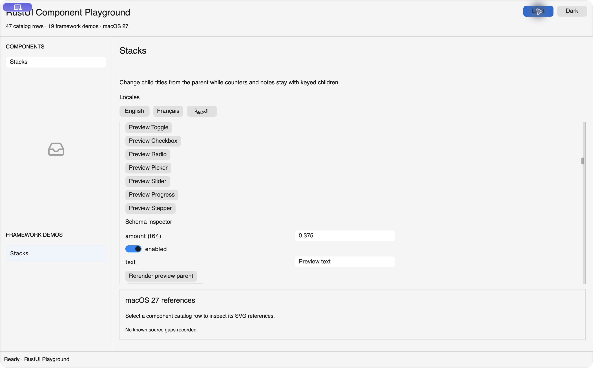 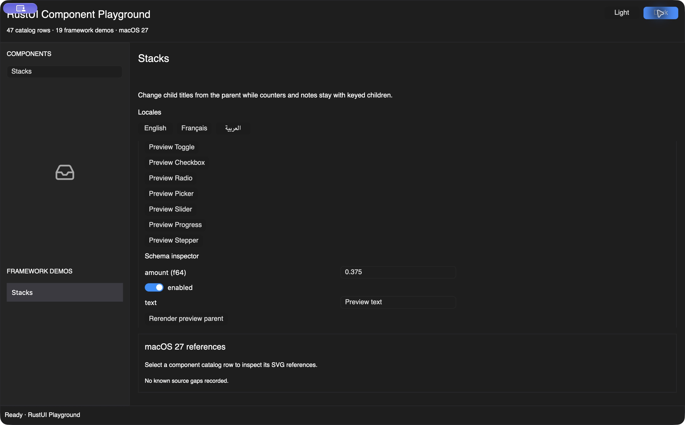 | no reference | No matching local reference. Size, spacing, radius, font and interaction appearance need an owner-supplied target. |
| [ResizablePanel](https://github.com/abouzoubaa/rustui/blob/63956b36cb6a1c9347c0241fd928f5625e3c0812/crates/rustui/src/components/advanced/resizable_panel.rs#L1) | Alias of SplitPanel; rendered by RustUI SplitView | none; child controls/caller provide appearance  none in this wrapper | none in this wrapper | 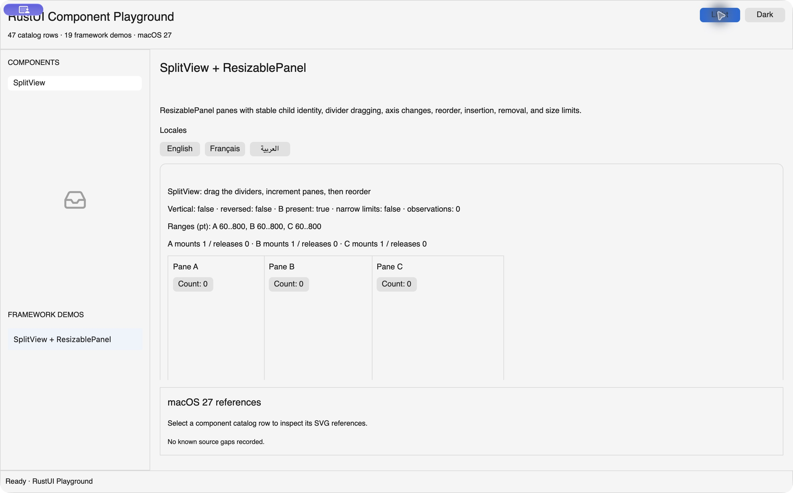 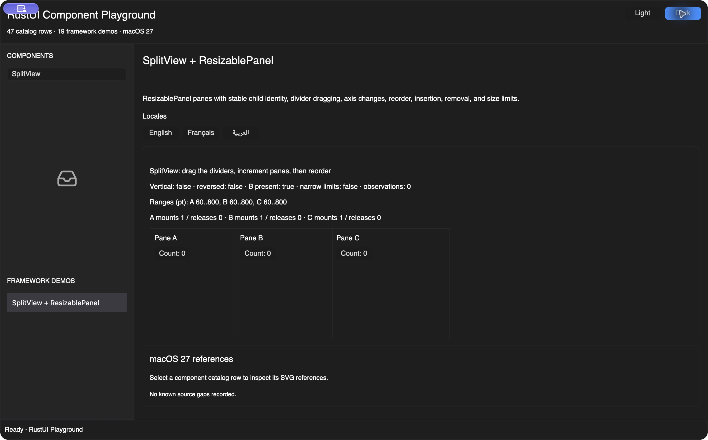 |  | Descriptor has no standalone appearance; split divider/drag target belong to SplitView. |
| [Avatar](https://github.com/abouzoubaa/rustui/blob/63956b36cb6a1c9347c0241fd928f5625e3c0812/crates/rustui/src/components/basic/avatar.rs#L151) | Kit Avatar | none; inherits native Kit theme  none in this wrapper | none in this wrapper | 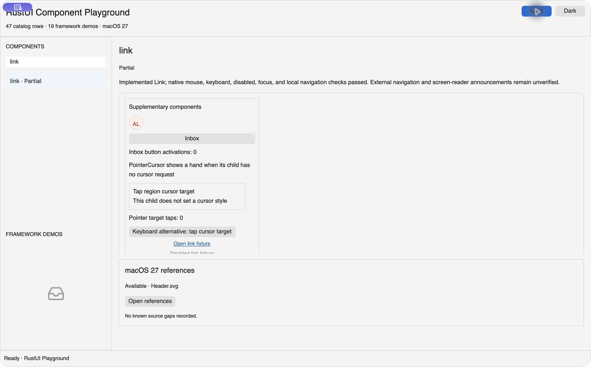 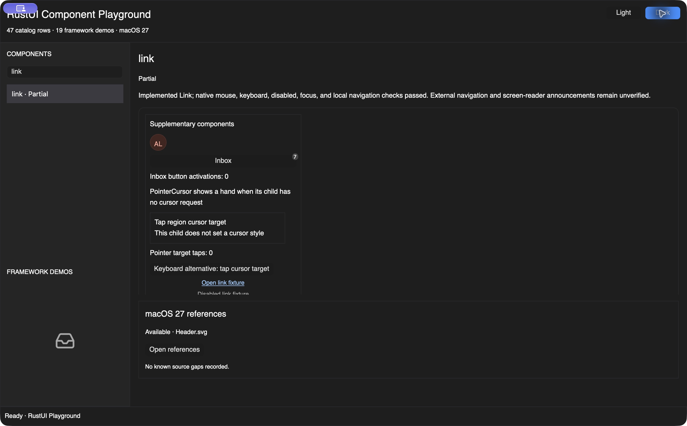 | no reference (no component-specific HIG concept) | Size: profile avatar_size is not read; caller/Kit default wins. Radius and font follow Kit; no avatar component-record styling. Focus/hover are not shown. |
| [Badge](https://github.com/abouzoubaa/rustui/blob/63956b36cb6a1c9347c0241fd928f5625e3c0812/crates/rustui/src/components/basic/badge.rs#L205) | Kit Badge | No badge component record; profile colors.badge_background  [223](https://github.com/abouzoubaa/rustui/blob/63956b36cb6a1c9347c0241fd928f5625e3c0812/crates/rustui/src/components/basic/badge.rs#L223) `if let Some(active) = crate::theme::registry::active_theme(context.app()) {` | [32](https://github.com/abouzoubaa/rustui/blob/63956b36cb6a1c9347c0241fd928f5625e3c0812/crates/rustui/src/components/basic/badge.rs#L32) `Self::Small => Size::Small,` [33](https://github.com/abouzoubaa/rustui/blob/63956b36cb6a1c9347c0241fd928f5625e3c0812/crates/rustui/src/components/basic/badge.rs#L33) `Self::Medium => Size::Medium,` [34](https://github.com/abouzoubaa/rustui/blob/63956b36cb6a1c9347c0241fd928f5625e3c0812/crates/rustui/src/components/basic/badge.rs#L34) `Self::Large => Size::Large,` |   | no reference (no component-specific HIG concept) | Size: Small/Medium/Large are Kit presets rather than badge_size. Only background is explicitly mapped; padding/radius/font remain Kit defaults. |
| [Button](https://github.com/abouzoubaa/rustui/blob/63956b36cb6a1c9347c0241fd928f5625e3c0812/crates/rustui/src/components/basic/button.rs#L548) | Kit Button | button: metrics, role colors, typography; cached button_theme  [48](https://github.com/abouzoubaa/rustui/blob/63956b36cb6a1c9347c0241fd928f5625e3c0812/crates/rustui/src/components/basic/button.rs#L48) `.map(&#124;theme&#124; px(theme.font_size))` [53](https://github.com/abouzoubaa/rustui/blob/63956b36cb6a1c9347c0241fd928f5625e3c0812/crates/rustui/src/components/basic/button.rs#L53) `.font_family(theme.font_family.clone())` [54](https://github.com/abouzoubaa/rustui/blob/63956b36cb6a1c9347c0241fd928f5625e3c0812/crates/rustui/src/components/basic/button.rs#L54) `.font_weight(FontWeight(theme.font_weight));` | none in this wrapper | 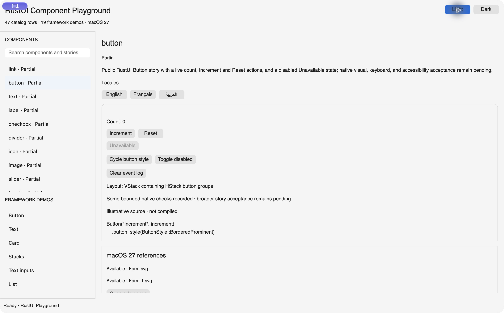 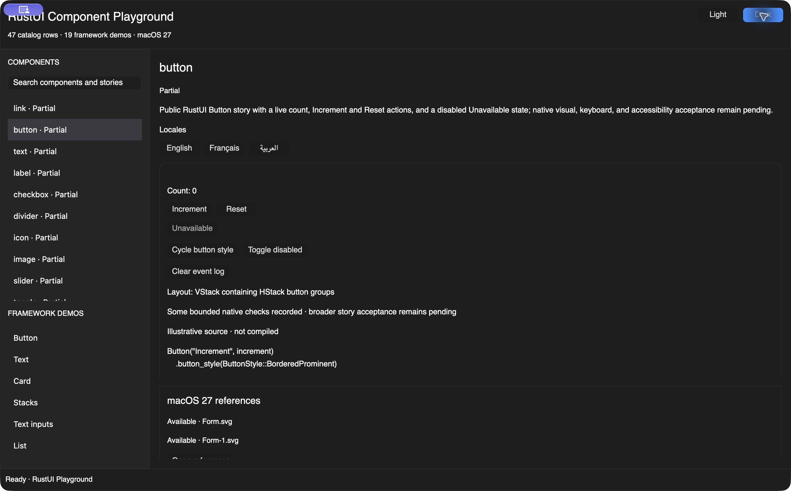 |  | Rendered text/button sizes differ by gallery variant; compare hover/focus and disabled states before visual acceptance. |
| [Divider](https://github.com/abouzoubaa/rustui/blob/63956b36cb6a1c9347c0241fd928f5625e3c0812/crates/rustui/src/components/basic/divider.rs#L34) | Own GPUI Div | divider/list_separator and menubar_separator: color, geometry  [48](https://github.com/abouzoubaa/rustui/blob/63956b36cb6a1c9347c0241fd928f5625e3c0812/crates/rustui/src/components/basic/divider.rs#L48) `required_style_with_artwork(context, "divider", "menubar_separator", &query);` [53](https://github.com/abouzoubaa/rustui/blob/63956b36cb6a1c9347c0241fd928f5625e3c0812/crates/rustui/src/components/basic/divider.rs#L53) `let style = required_style_with_artwork(context, "divider", "list_separator", &query);` | [11](https://github.com/abouzoubaa/rustui/blob/63956b36cb6a1c9347c0241fd928f5625e3c0812/crates/rustui/src/components/basic/divider.rs#L11) `element.w(px(1.)).h_full()` [13](https://github.com/abouzoubaa/rustui/blob/63956b36cb6a1c9347c0241fd928f5625e3c0812/crates/rustui/src/components/basic/divider.rs#L13) `element.w_full().h(px(1.))` | 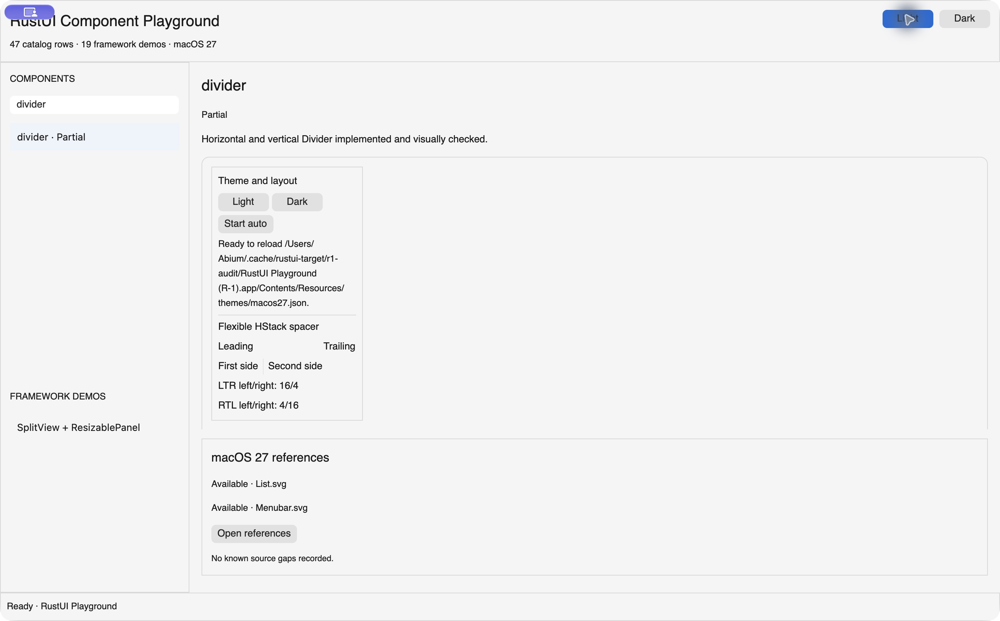 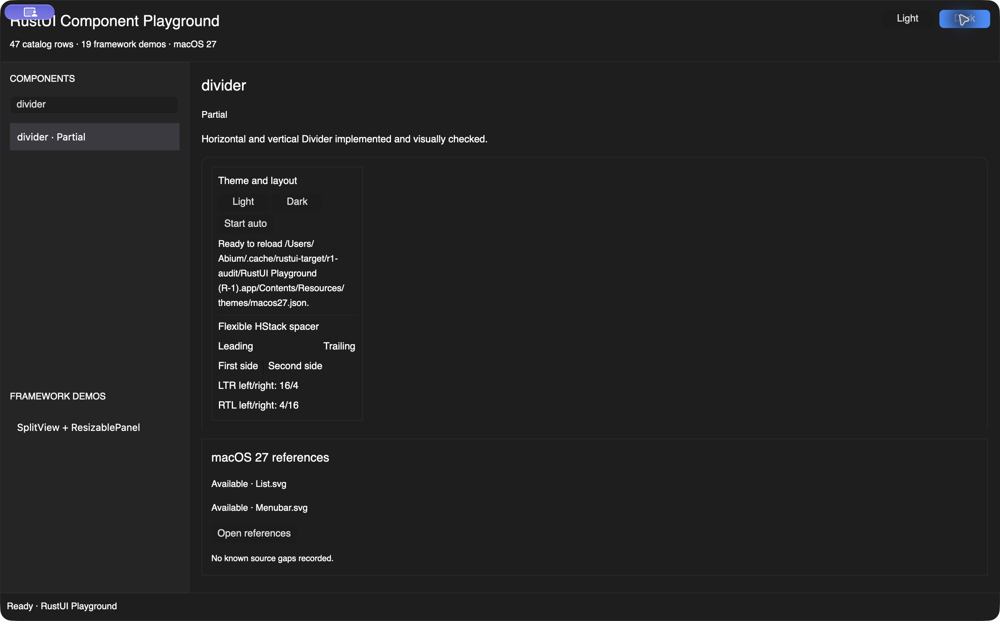 | no reference | 1-point primitive; artwork blend/vector-path metadata is not fully rendered. |
| [Icon](https://github.com/abouzoubaa/rustui/blob/63956b36cb6a1c9347c0241fd928f5625e3c0812/crates/rustui/src/components/basic/icon.rs#L151) | Kit Icon / own SVG data | icon/<variant>: dimensions, tint/background  [174](https://github.com/abouzoubaa/rustui/blob/63956b36cb6a1c9347c0241fd928f5625e3c0812/crates/rustui/src/components/basic/icon.rs#L174) `required_style_with_artwork(context, "icon", part, &style_selector)` [176](https://github.com/abouzoubaa/rustui/blob/63956b36cb6a1c9347c0241fd928f5625e3c0812/crates/rustui/src/components/basic/icon.rs#L176) `required_style(context, "icon", part, &style_selector)` | none in this wrapper | 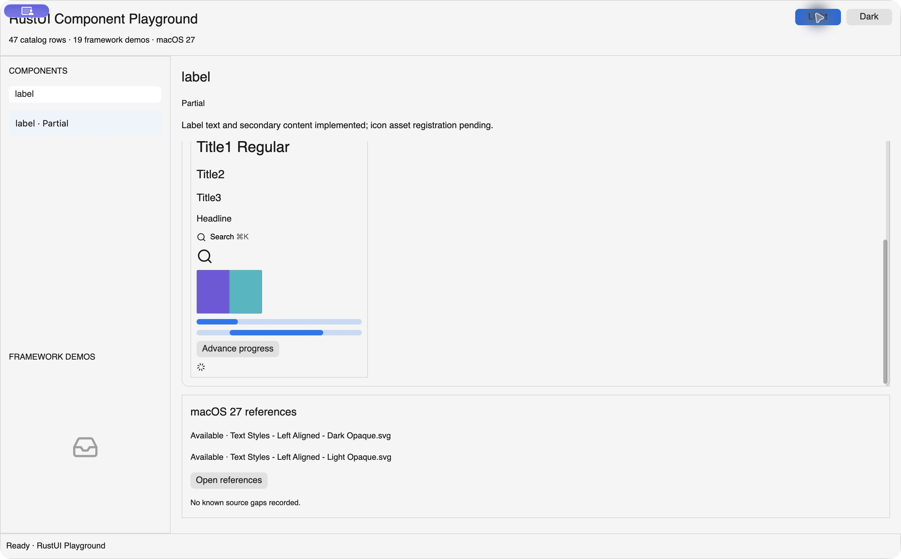 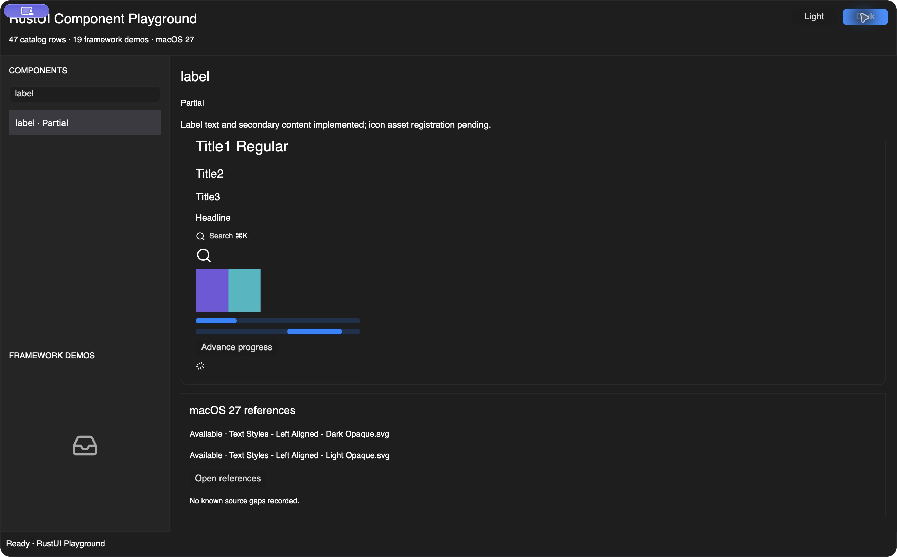 |  | Artwork/tint and dimensions are resolved, but matching registered SVG assets remain variant-dependent. Compare stroke weight and baseline; no editable/selected state. |
| [Image](https://github.com/abouzoubaa/rustui/blob/63956b36cb6a1c9347c0241fd928f5625e3c0812/crates/rustui/src/components/basic/image.rs#L236) | Own GPUI image element | image/<variant>: width, height, radius  [253](https://github.com/abouzoubaa/rustui/blob/63956b36cb6a1c9347c0241fd928f5625e3c0812/crates/rustui/src/components/basic/image.rs#L253) `let style = required_style_with_artwork(context, "image", part, &image_selector);` | none in this wrapper |   |  | Dimensions/radius can come from image records; gallery is a simple sample, without native loading/error/selection appearance. |
| [Label](https://github.com/abouzoubaa/rustui/blob/63956b36cb6a1c9347c0241fd928f5625e3c0812/crates/rustui/src/components/basic/label.rs#L62) | Kit Label + GPUI row | label/<text part>: typography, color  [82](https://github.com/abouzoubaa/rustui/blob/63956b36cb6a1c9347c0241fd928f5625e3c0812/crates/rustui/src/components/basic/label.rs#L82) `let style = required_style(context, "label", &part, &query);` | [102](https://github.com/abouzoubaa/rustui/blob/63956b36cb6a1c9347c0241fd928f5625e3c0812/crates/rustui/src/components/basic/label.rs#L102) `let row = div().flex().items_center().gap(px(6.0));` |   |  | Spacing: fixed 6-point accessory gap. Typography is themed, but secondary content and icon baseline need comparison. |
| [Link](https://github.com/abouzoubaa/rustui/blob/63956b36cb6a1c9347c0241fd928f5625e3c0812/crates/rustui/src/components/basic/link.rs#L204) | Kit Button, link appearance | link/body: typography, foreground  [226](https://github.com/abouzoubaa/rustui/blob/63956b36cb6a1c9347c0241fd928f5625e3c0812/crates/rustui/src/components/basic/link.rs#L226) `let style = required_style(context, "link", "body", &selector(context));` | none in this wrapper | 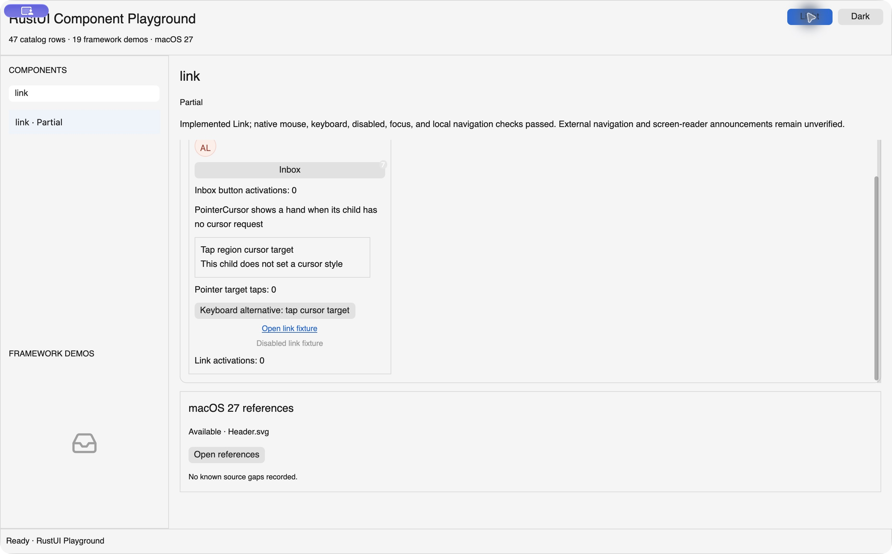 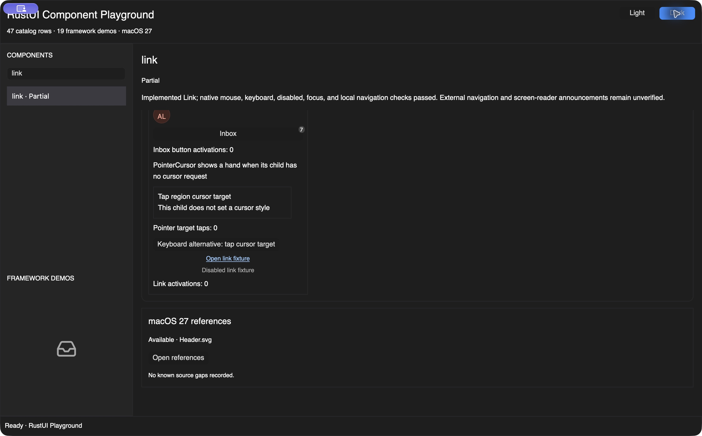 | no reference | Font/color are themed; native browser/external navigation and all focus/hover variants are outside this static capture. |
| [Text](https://github.com/abouzoubaa/rustui/blob/63956b36cb6a1c9347c0241fd928f5625e3c0812/crates/rustui/src/components/basic/text.rs#L134) | Own GPUI styled text | text/<text-style part>: typography, color; profile text font  [205](https://github.com/abouzoubaa/rustui/blob/63956b36cb6a1c9347c0241fd928f5625e3c0812/crates/rustui/src/components/basic/text.rs#L205) `let mode = crate::theme::registry::active_theme(context.app())` [210](https://github.com/abouzoubaa/rustui/blob/63956b36cb6a1c9347c0241fd928f5625e3c0812/crates/rustui/src/components/basic/text.rs#L210) `let typography = crate::theme::registry::active_theme(context.app())` [214](https://github.com/abouzoubaa/rustui/blob/63956b36cb6a1c9347c0241fd928f5625e3c0812/crates/rustui/src/components/basic/text.rs#L214) `context.component_style_with("text", part, query, extras)?` [216](https://github.com/abouzoubaa/rustui/blob/63956b36cb6a1c9347c0241fd928f5625e3c0812/crates/rustui/src/components/basic/text.rs#L216) `required_style(context, "text", part, query)` | none in this wrapper | 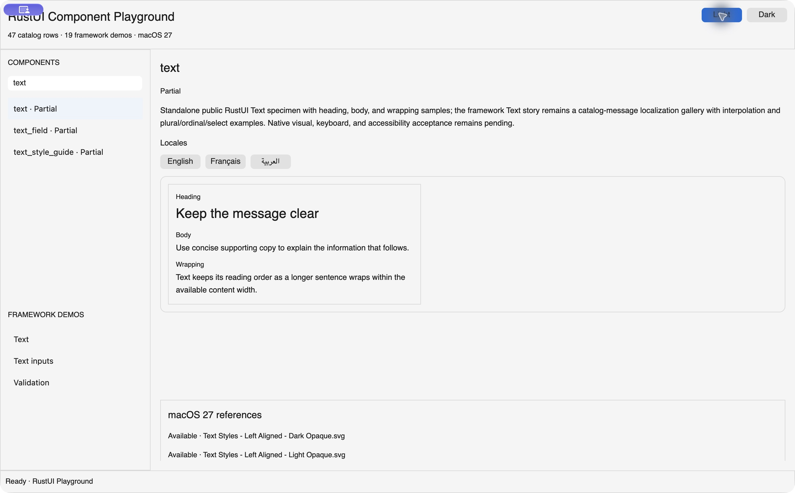 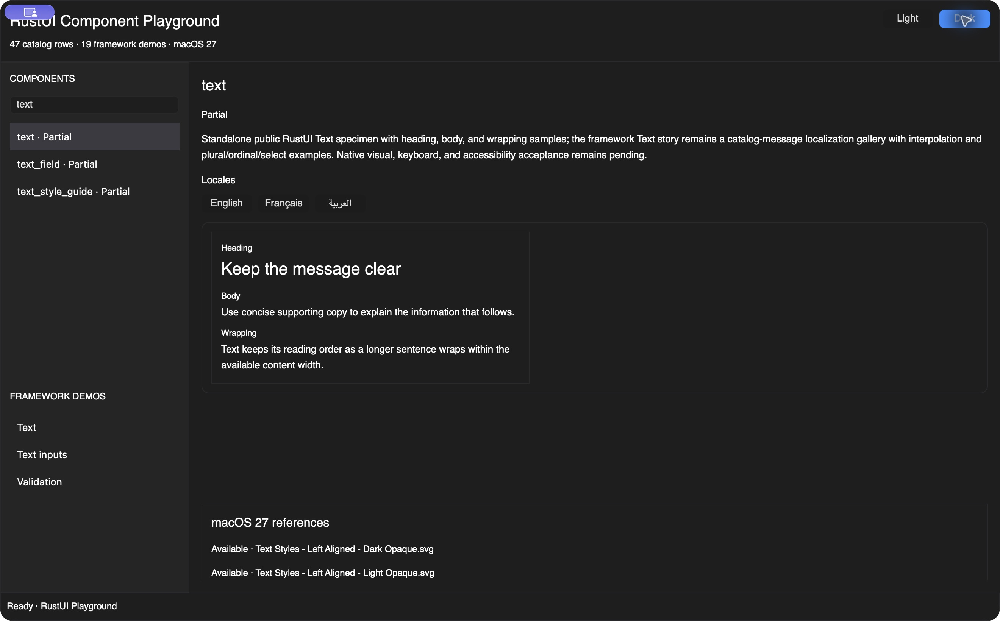 |  | Opaque text parts are rendered; vibrant material text rules are not fully represented. Font truncation and baseline need owner comparison. |
| [Collection](https://github.com/abouzoubaa/rustui/blob/63956b36cb6a1c9347c0241fd928f5625e3c0812/crates/rustui/src/components/data/collection.rs#L66) | GPUI uniform_list + retained RustUI row hosts | none; inherits native Kit theme  none in this wrapper | [670](https://github.com/abouzoubaa/rustui/blob/63956b36cb6a1c9347c0241fd928f5625e3c0812/crates/rustui/src/components/data/collection.rs#L670) `.min_w_0();` | 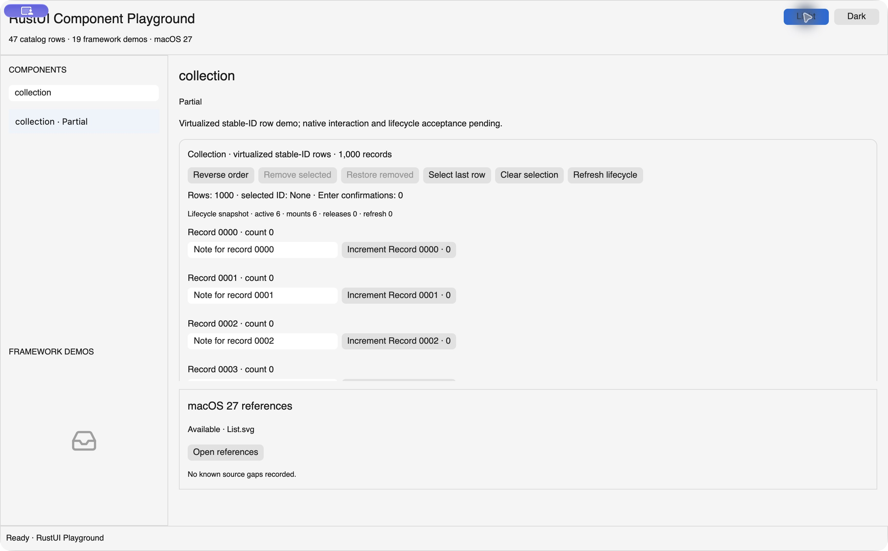 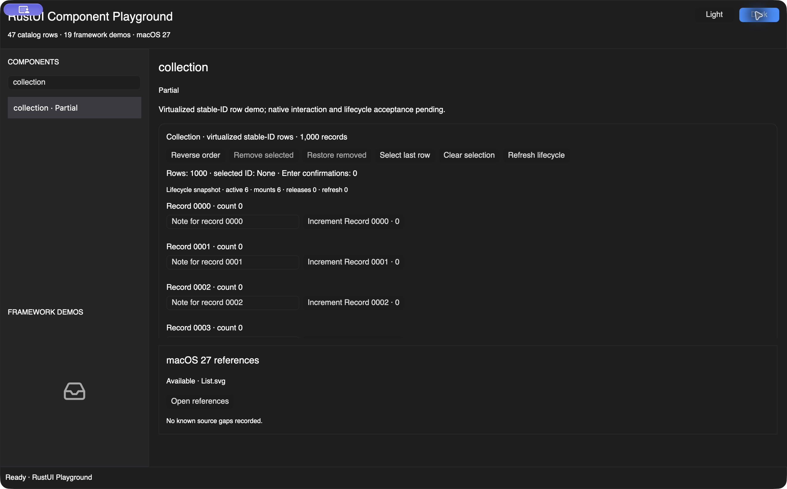 |  | Row sizing comes from caller; no component-record mapping for spacing, selection or focus. Smoothness remains tracked by F0. |
| [DataGrid](https://github.com/abouzoubaa/rustui/blob/63956b36cb6a1c9347c0241fd928f5625e3c0812/crates/rustui/src/components/data/data_grid.rs#L71) | RustUI Table with named accessibility wrapper | none; child controls/caller provide appearance  none in this wrapper | none in this wrapper | 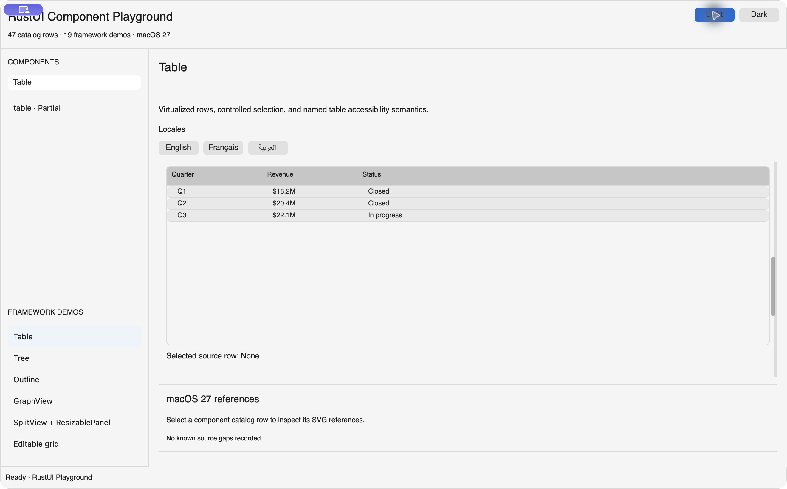 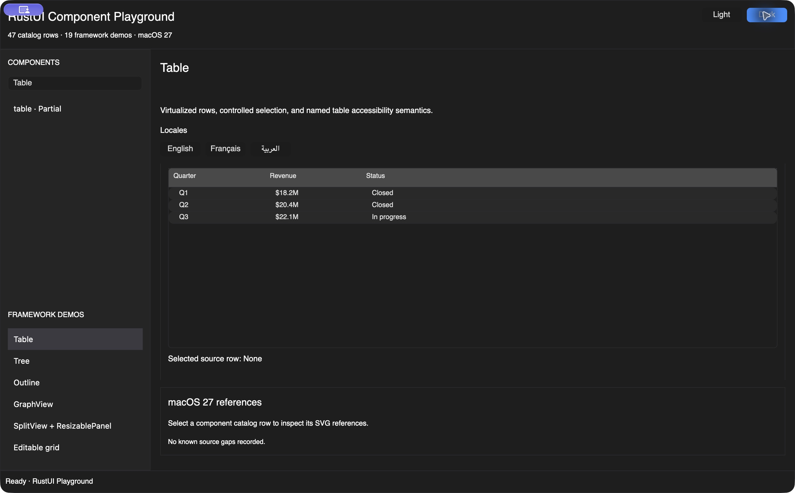 |  | Thin named-accessibility adapter around Table; no independent size/font/selection theme. It inherits Table gaps. |
| [EditableDataGrid](https://github.com/abouzoubaa/rustui/blob/63956b36cb6a1c9347c0241fd928f5625e3c0812/crates/rustui/src/components/data/editable_data_grid.rs#L145) | Kit DataTable/TableState delegate + RustUI TextField | none; inherits native Kit theme  none in this wrapper | [168](https://github.com/abouzoubaa/rustui/blob/63956b36cb6a1c9347c0241fd928f5625e3c0812/crates/rustui/src/components/data/editable_data_grid.rs#L168) `height: 300.0,` [765](https://github.com/abouzoubaa/rustui/blob/63956b36cb6a1c9347c0241fd928f5625e3c0812/crates/rustui/src/components/data/editable_data_grid.rs#L765) `.width(px(160.))` [973](https://github.com/abouzoubaa/rustui/blob/63956b36cb6a1c9347c0241fd928f5625e3c0812/crates/rustui/src/components/data/editable_data_grid.rs#L973) `.min_h(px(28.))` [974](https://github.com/abouzoubaa/rustui/blob/63956b36cb6a1c9347c0241fd928f5625e3c0812/crates/rustui/src/components/data/editable_data_grid.rs#L974) `.p(px(4.))` | 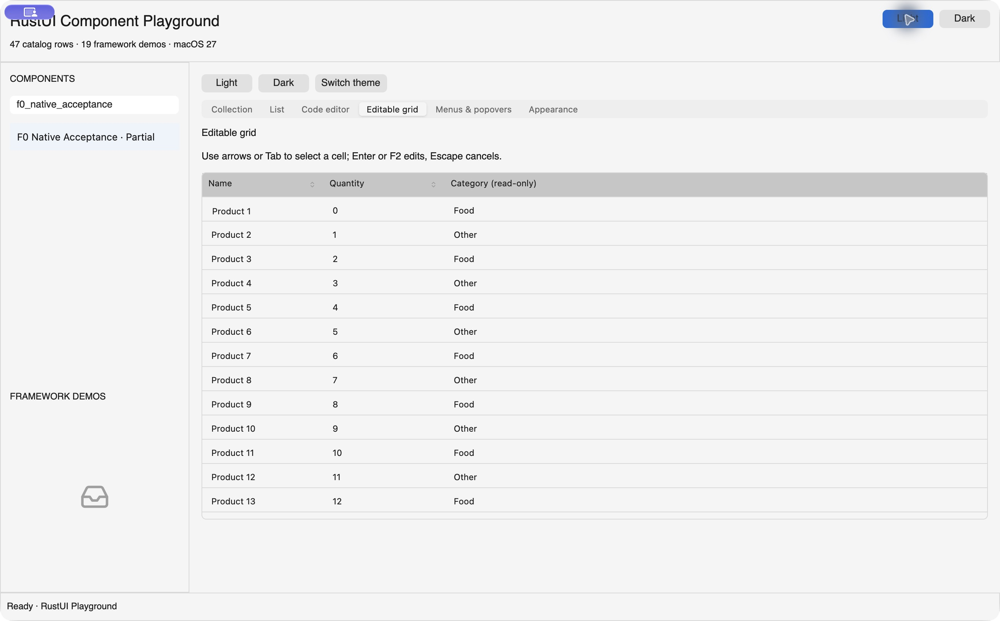 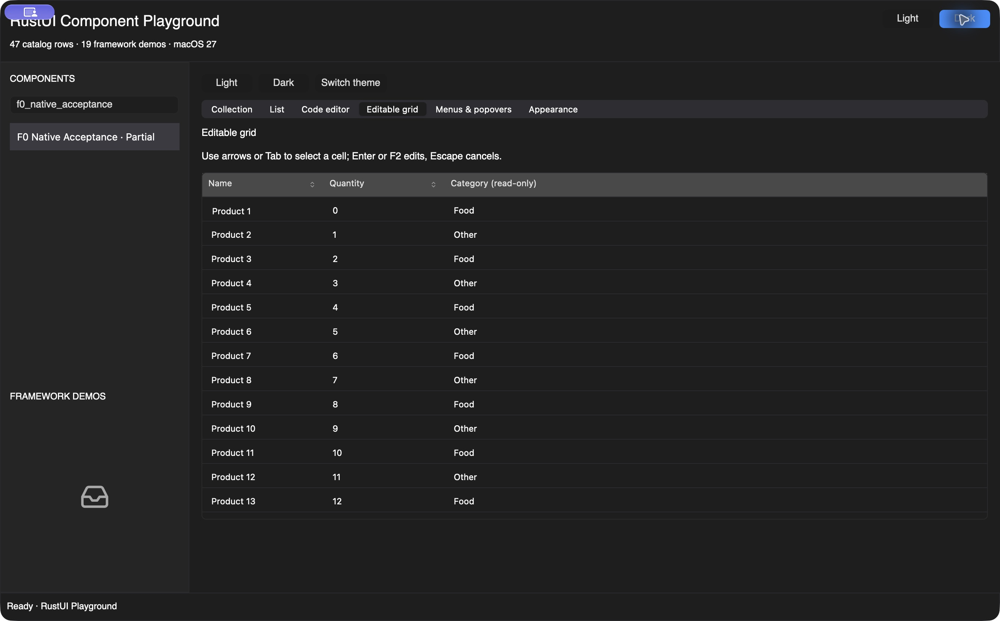 |  | Row/cell size and padding fixed; active border changes content box; editor adds field chrome; no whole-row selection fill. R-1 targets these gaps. |
| [KeyedList](https://github.com/abouzoubaa/rustui/blob/63956b36cb6a1c9347c0241fd928f5625e3c0812/crates/rustui/src/components/data/keyed_list.rs#L532) | Kit List/ListState + keyed RustUI rows | none; inherits native Kit theme  none in this wrapper | [393](https://github.com/abouzoubaa/rustui/blob/63956b36cb6a1c9347c0241fd928f5625e3c0812/crates/rustui/src/components/data/keyed_list.rs#L393) `Some(Edge::Top) => content = content.top(px(-offset)),` [487](https://github.com/abouzoubaa/rustui/blob/63956b36cb6a1c9347c0241fd928f5625e3c0812/crates/rustui/src/components/data/keyed_list.rs#L487) `height: 240.0,` [488](https://github.com/abouzoubaa/rustui/blob/63956b36cb6a1c9347c0241fd928f5625e3c0812/crates/rustui/src/components/data/keyed_list.rs#L488) `row_height: 36.0,` | 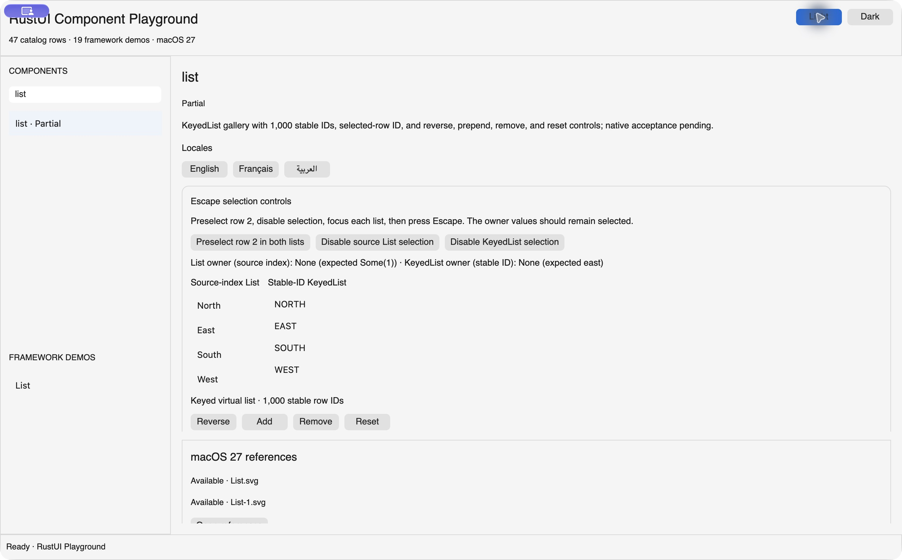 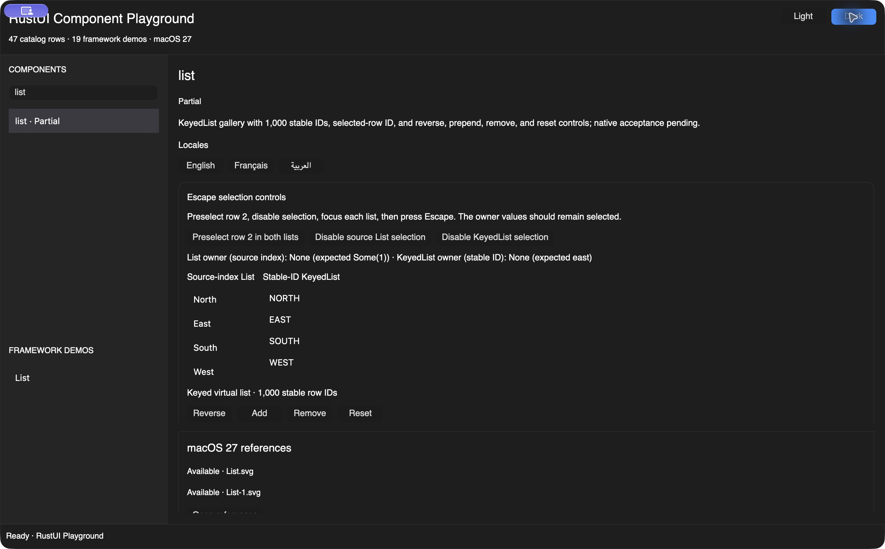 |  | Fixed row/viewport defaults; animated retention and focus need owner visual review. |
| [List](https://github.com/abouzoubaa/rustui/blob/63956b36cb6a1c9347c0241fd928f5625e3c0812/crates/rustui/src/components/data/list.rs#L357) | Kit List/ListState | none; inherits native Kit theme  none in this wrapper | [258](https://github.com/abouzoubaa/rustui/blob/63956b36cb6a1c9347c0241fd928f5625e3c0812/crates/rustui/src/components/data/list.rs#L258) `height: 240.0,` [259](https://github.com/abouzoubaa/rustui/blob/63956b36cb6a1c9347c0241fd928f5625e3c0812/crates/rustui/src/components/data/list.rs#L259) `row_height: 36.0,` | 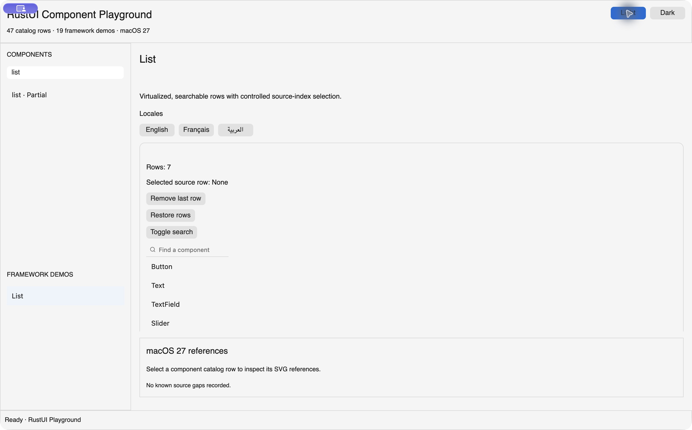 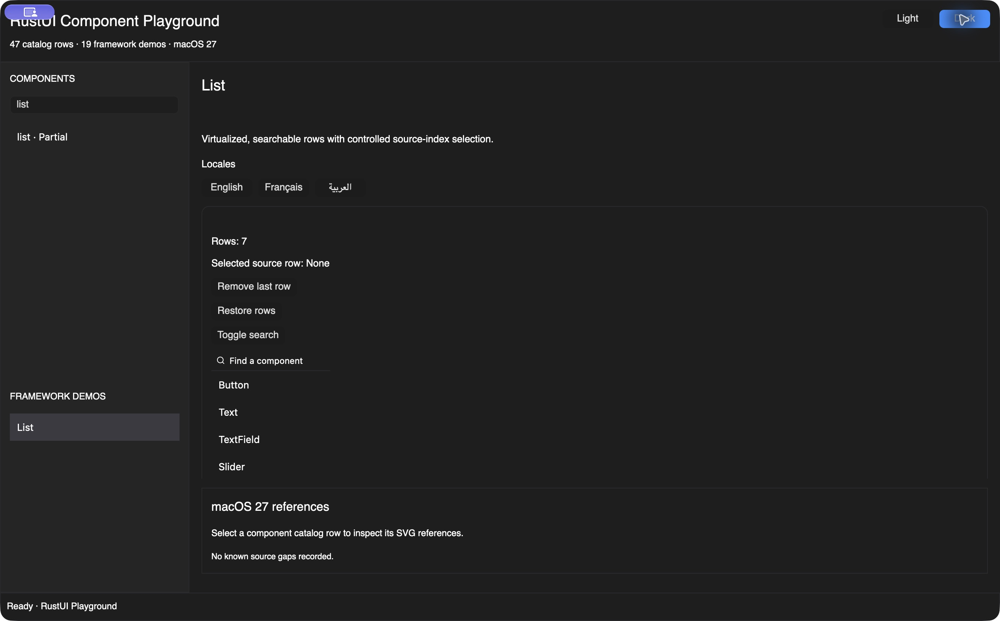 |  | Fixed default row/viewport dimensions; selection/focus rely on Kit rather than list-specific source geometry. |
| [Outline](https://github.com/abouzoubaa/rustui/blob/63956b36cb6a1c9347c0241fd928f5625e3c0812/crates/rustui/src/components/data/outline.rs#L75) | RustUI Tree adapter | outline_view through Tree  none in this wrapper | none in this wrapper | 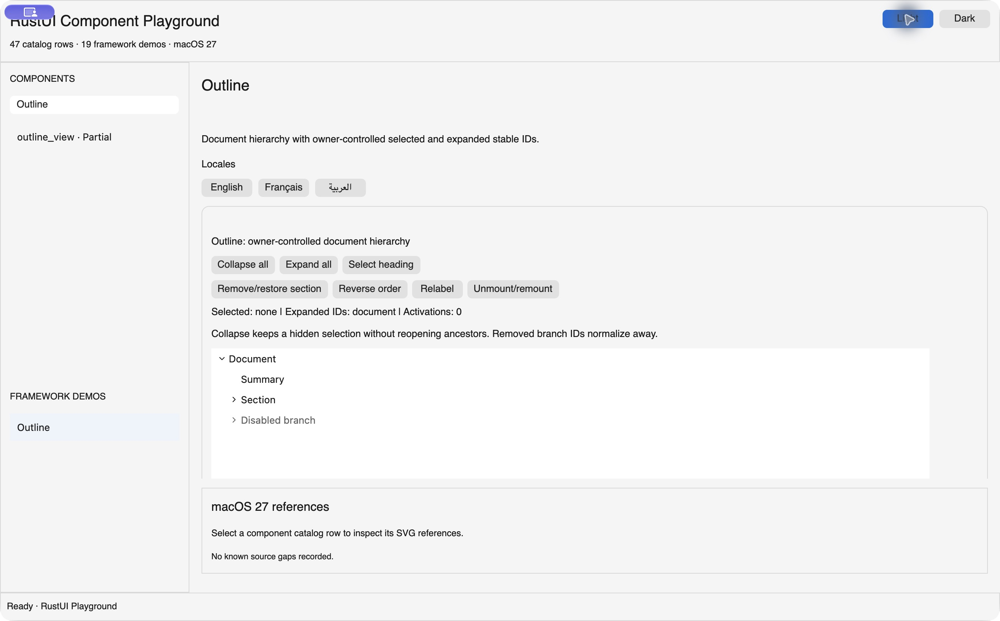 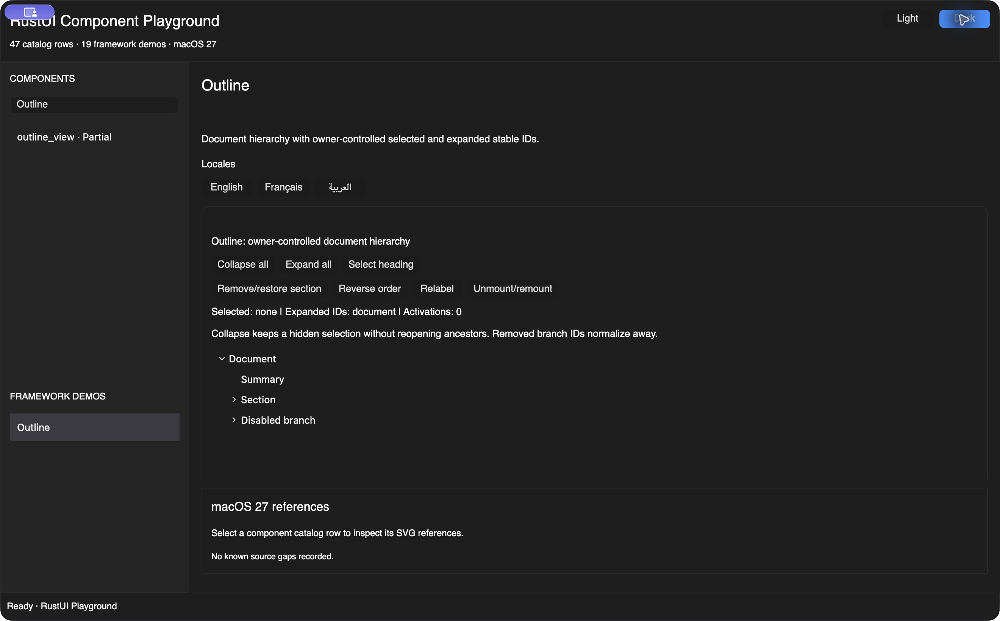 |  | Uses Tree rows and inherits their fixed indentation/icon sizes; no independent outline geometry. |
| [Table](https://github.com/abouzoubaa/rustui/blob/63956b36cb6a1c9347c0241fd928f5625e3c0812/crates/rustui/src/components/data/table.rs#L471) | Kit DataTable/TableState delegate | table/table_rows + table_column_headers: style geometry, typography, colors  [489](https://github.com/abouzoubaa/rustui/blob/63956b36cb6a1c9347c0241fd928f5625e3c0812/crates/rustui/src/components/data/table.rs#L489) `let row_style = required_style(context, "table", "table_rows", &query);` [491](https://github.com/abouzoubaa/rustui/blob/63956b36cb6a1c9347c0241fd928f5625e3c0812/crates/rustui/src/components/data/table.rs#L491) `required_style_with_artwork(context, "table", "table_column_headers", &query);` | [84](https://github.com/abouzoubaa/rustui/blob/63956b36cb6a1c9347c0241fd928f5625e3c0812/crates/rustui/src/components/data/table.rs#L84) `.px_3()` [286](https://github.com/abouzoubaa/rustui/blob/63956b36cb6a1c9347c0241fd928f5625e3c0812/crates/rustui/src/components/data/table.rs#L286) `height: 300.0,` [287](https://github.com/abouzoubaa/rustui/blob/63956b36cb6a1c9347c0241fd928f5625e3c0812/crates/rustui/src/components/data/table.rs#L287) `column_width: 160.0,` | 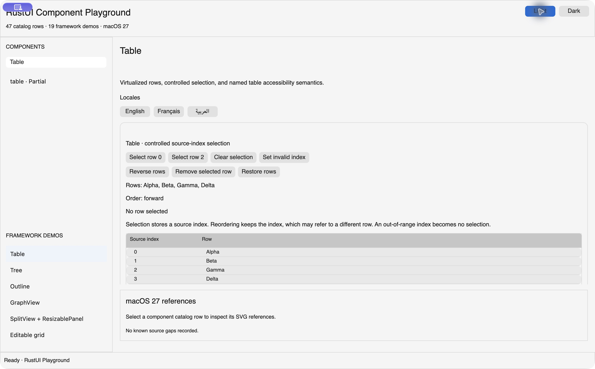 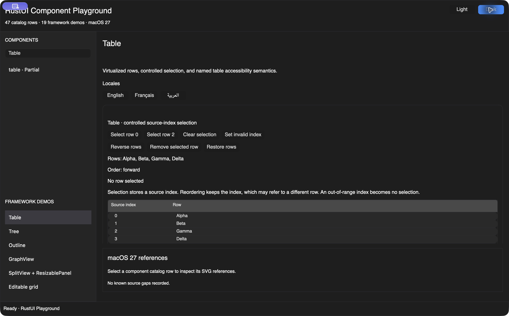 |  | Size/spacing: fixed 300-point viewport, 160-point columns, px_3 cell padding. Row/header styles are resolved, but metric-driven row sizing is incomplete. |
| [Tree](https://github.com/abouzoubaa/rustui/blob/63956b36cb6a1c9347c0241fd928f5625e3c0812/crates/rustui/src/components/data/tree.rs#L551) | Kit Tree + custom GPUI row | outline_view/outline_view: row style; children inherit native tree palette  [564](https://github.com/abouzoubaa/rustui/blob/63956b36cb6a1c9347c0241fd928f5625e3c0812/crates/rustui/src/components/data/tree.rs#L564) `let style = required_style(context, "outline_view", "outline_view", &selector(context));` | [949](https://github.com/abouzoubaa/rustui/blob/63956b36cb6a1c9347c0241fd928f5625e3c0812/crates/rustui/src/components/data/tree.rs#L949) `.with_size(px(12.0))` [952](https://github.com/abouzoubaa/rustui/blob/63956b36cb6a1c9347c0241fd928f5625e3c0812/crates/rustui/src/components/data/tree.rs#L952) `div().w(px(12.0)).flex_none().into_any_element()` [958](https://github.com/abouzoubaa/rustui/blob/63956b36cb6a1c9347c0241fd928f5625e3c0812/crates/rustui/src/components/data/tree.rs#L958) `row.pr(px(8.0 + entry.depth() as f32 * 16.0))` [961](https://github.com/abouzoubaa/rustui/blob/63956b36cb6a1c9347c0241fd928f5625e3c0812/crates/rustui/src/components/data/tree.rs#L961) `row.pl(px(8.0 + entry.depth() as f32 * 16.0))` [970](https://github.com/abouzoubaa/rustui/blob/63956b36cb6a1c9347c0241fd928f5625e3c0812/crates/rustui/src/components/data/tree.rs#L970) `.gap_1()` | 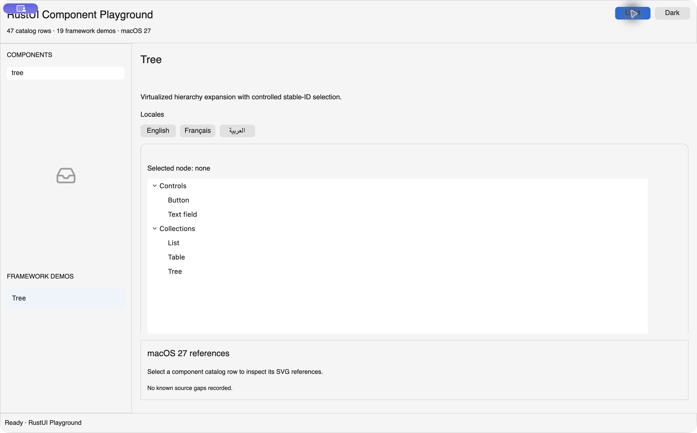 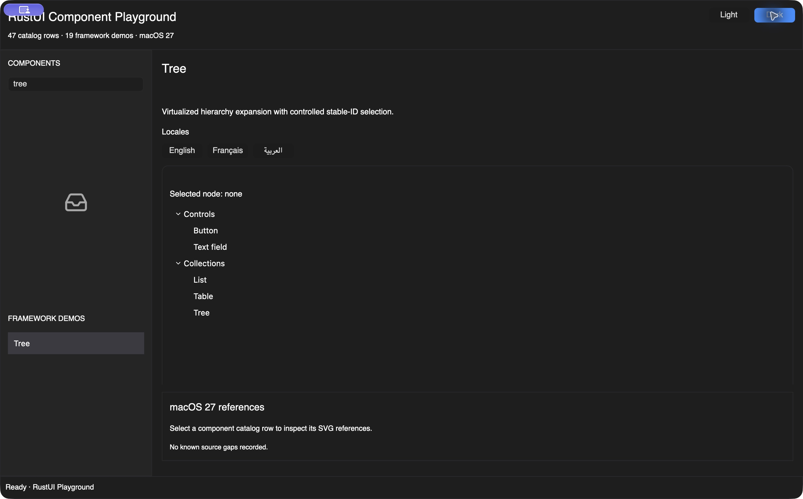 |  | Spacing: fixed 8+16×depth indentation, 12-point icons and gap_1. Row style is themed; expand/selection/focus variants still need owner visual comparison. |
| [EmptyState](https://github.com/abouzoubaa/rustui/blob/63956b36cb6a1c9347c0241fd928f5625e3c0812/crates/rustui/src/components/feedback/empty_state.rs#L137) | Own GPUI Div | No component record; native Theme foreground/muted_foreground  [148](https://github.com/abouzoubaa/rustui/blob/63956b36cb6a1c9347c0241fd928f5625e3c0812/crates/rustui/src/components/feedback/empty_state.rs#L148) `let foreground = theme.colors.foreground;` [149](https://github.com/abouzoubaa/rustui/blob/63956b36cb6a1c9347c0241fd928f5625e3c0812/crates/rustui/src/components/feedback/empty_state.rs#L149) `let muted_foreground = theme.colors.muted_foreground;` | [171](https://github.com/abouzoubaa/rustui/blob/63956b36cb6a1c9347c0241fd928f5625e3c0812/crates/rustui/src/components/feedback/empty_state.rs#L171) `.min_w_0()` [172](https://github.com/abouzoubaa/rustui/blob/63956b36cb6a1c9347c0241fd928f5625e3c0812/crates/rustui/src/components/feedback/empty_state.rs#L172) `.min_h_0()` [175](https://github.com/abouzoubaa/rustui/blob/63956b36cb6a1c9347c0241fd928f5625e3c0812/crates/rustui/src/components/feedback/empty_state.rs#L175) `.gap(px(6.0))` | 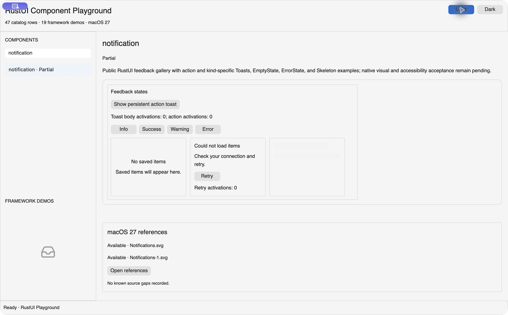 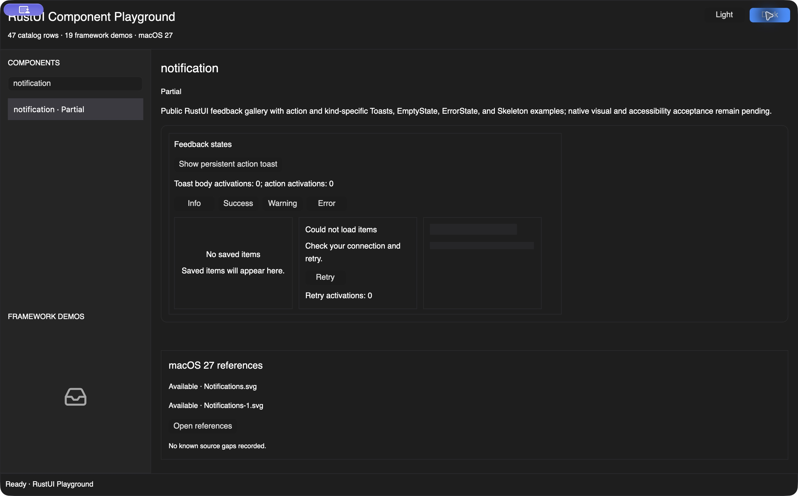 |  | Spacing: fixed 6-point stack gap. Font/radius come from content/native theme, with no empty-state record. |
| [ErrorState](https://github.com/abouzoubaa/rustui/blob/63956b36cb6a1c9347c0241fd928f5625e3c0812/crates/rustui/src/components/feedback/error_state.rs#L144) | Own GPUI Div + RustUI Button | No component record; native Theme danger/muted_foreground  [155](https://github.com/abouzoubaa/rustui/blob/63956b36cb6a1c9347c0241fd928f5625e3c0812/crates/rustui/src/components/feedback/error_state.rs#L155) `let danger = theme.colors.danger;` [156](https://github.com/abouzoubaa/rustui/blob/63956b36cb6a1c9347c0241fd928f5625e3c0812/crates/rustui/src/components/feedback/error_state.rs#L156) `let muted_foreground = theme.colors.muted_foreground;` | [172](https://github.com/abouzoubaa/rustui/blob/63956b36cb6a1c9347c0241fd928f5625e3c0812/crates/rustui/src/components/feedback/error_state.rs#L172) `.gap(px(6.0))` |   |  | Spacing: fixed 6-point gap; danger/muted palette inherited. Retry focus/hover and error wrapping need review. |
| [Progress](https://github.com/abouzoubaa/rustui/blob/63956b36cb6a1c9347c0241fd928f5625e3c0812/crates/rustui/src/components/feedback/progress.rs#L103) | Kit Progress | none; inherits native Kit theme  none in this wrapper | none in this wrapper |   |  | No progress component-record consumption; Kit geometry/radius/animation. Capture shows determinate and indeterminate tracks. |
| [Skeleton](https://github.com/abouzoubaa/rustui/blob/63956b36cb6a1c9347c0241fd928f5625e3c0812/crates/rustui/src/components/feedback/skeleton.rs#L136) | Kit Skeleton | none; inherits native Kit theme  none in this wrapper | none in this wrapper |   |  | No skeleton component-record mapping; Kit default blocks/pulse. Radius and loading motion need owner review. |
| [Spinner](https://github.com/abouzoubaa/rustui/blob/63956b36cb6a1c9347c0241fd928f5625e3c0812/crates/rustui/src/components/feedback/spinner.rs#L98) | Kit Spinner | none; inherits native Kit theme  none in this wrapper | none in this wrapper |   |  | No spinner component record; Kit sizing and stroke. Static capture cannot establish motion or reduced-motion behavior. |
| [Checkbox](https://github.com/abouzoubaa/rustui/blob/63956b36cb6a1c9347c0241fd928f5625e3c0812/crates/rustui/src/components/input/checkbox.rs#L385) | Base Checkbox, own themed checkmark | checkbox/body + profile borders.thin  [395](https://github.com/abouzoubaa/rustui/blob/63956b36cb6a1c9347c0241fd928f5625e3c0812/crates/rustui/src/components/input/checkbox.rs#L395) `let style = required_style_with_artwork(context, "checkbox", "body", &selector(context));` [402](https://github.com/abouzoubaa/rustui/blob/63956b36cb6a1c9347c0241fd928f5625e3c0812/crates/rustui/src/components/input/checkbox.rs#L402) `let active = active_theme(context.app()).expect("checkbox requires an active RustUI theme");` [407](https://github.com/abouzoubaa/rustui/blob/63956b36cb6a1c9347c0241fd928f5625e3c0812/crates/rustui/src/components/input/checkbox.rs#L407) `let border_width = active.profile.borders.thin as f32;` | [441](https://github.com/abouzoubaa/rustui/blob/63956b36cb6a1c9347c0241fd928f5625e3c0812/crates/rustui/src/components/input/checkbox.rs#L441) `this.child(div().text_color(foreground).text_size(px(12.0)).child("✓"))` [459](https://github.com/abouzoubaa/rustui/blob/63956b36cb6a1c9347c0241fd928f5625e3c0812/crates/rustui/src/components/input/checkbox.rs#L459) `.gap_2()` | 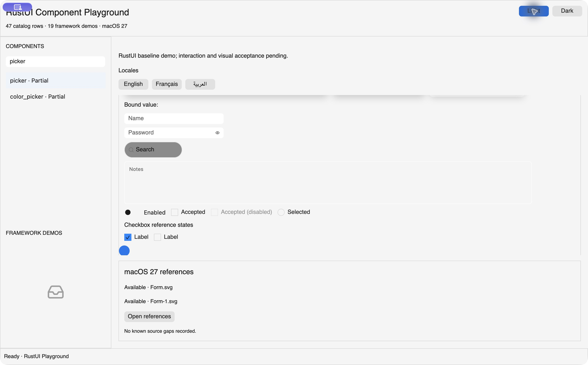 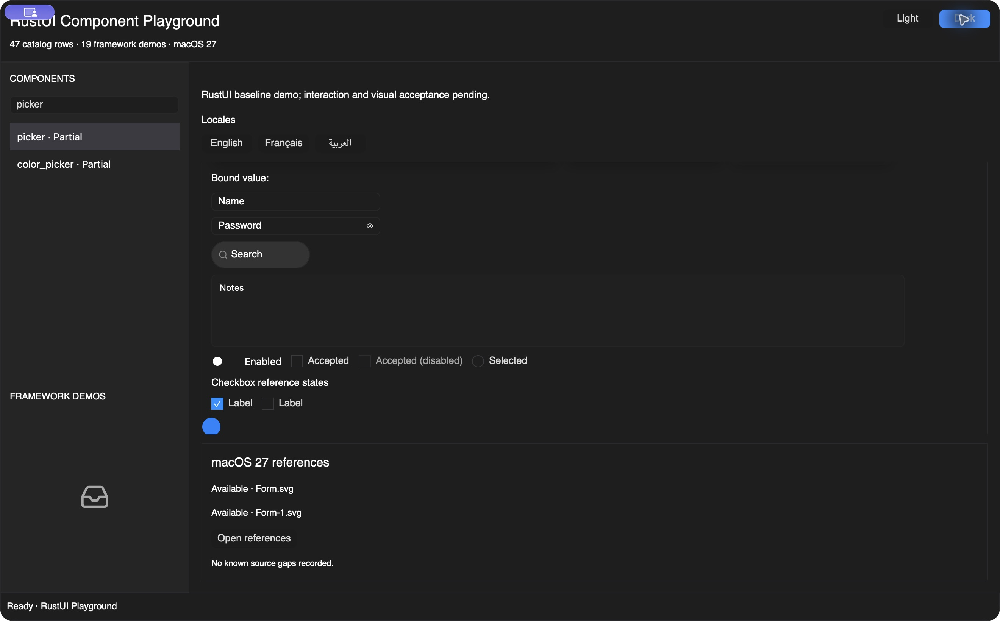 |  | Check glyph is text at 12 points; spacing uses Kit scale rather than full reference artwork. |
| [ColorPicker](https://github.com/abouzoubaa/rustui/blob/63956b36cb6a1c9347c0241fd928f5625e3c0812/crates/rustui/src/components/input/color_picker.rs#L869) | Base ColorPicker + Kit popover/input helpers | color_picker/<part>, color_wheel: geometry/color/artwork  [288](https://github.com/abouzoubaa/rustui/blob/63956b36cb6a1c9347c0241fd928f5625e3c0812/crates/rustui/src/components/input/color_picker.rs#L288) `let style = required_style(context, "color_picker", part, selector);` [344](https://github.com/abouzoubaa/rustui/blob/63956b36cb6a1c9347c0241fd928f5625e3c0812/crates/rustui/src/components/input/color_picker.rs#L344) `required_style_with_artwork(context, "color_picker", "color_wheel", selector);` | [350](https://github.com/abouzoubaa/rustui/blob/63956b36cb6a1c9347c0241fd928f5625e3c0812/crates/rustui/src/components/input/color_picker.rs#L350) `.child(div().w(px(28.0)).h(px(16.0)).rounded(px(4.0)).bg(preview)),` [375](https://github.com/abouzoubaa/rustui/blob/63956b36cb6a1c9347c0241fd928f5625e3c0812/crates/rustui/src/components/input/color_picker.rs#L375) `.gap_1()` [403](https://github.com/abouzoubaa/rustui/blob/63956b36cb6a1c9347c0241fd928f5625e3c0812/crates/rustui/src/components/input/color_picker.rs#L403) `.w(px(288.0))` [404](https://github.com/abouzoubaa/rustui/blob/63956b36cb6a1c9347c0241fd928f5625e3c0812/crates/rustui/src/components/input/color_picker.rs#L404) `.gap_3()` [447](https://github.com/abouzoubaa/rustui/blob/63956b36cb6a1c9347c0241fd928f5625e3c0812/crates/rustui/src/components/input/color_picker.rs#L447) `.gap_1()` [487](https://github.com/abouzoubaa/rustui/blob/63956b36cb6a1c9347c0241fd928f5625e3c0812/crates/rustui/src/components/input/color_picker.rs#L487) `.px_2p5()` [821](https://github.com/abouzoubaa/rustui/blob/63956b36cb6a1c9347c0241fd928f5625e3c0812/crates/rustui/src/components/input/color_picker.rs#L821) `.gap_2()` [822](https://github.com/abouzoubaa/rustui/blob/63956b36cb6a1c9347c0241fd928f5625e3c0812/crates/rustui/src/components/input/color_picker.rs#L822) `.child(div().w(px(92.0)).flex_shrink_0().child(label))` [957](https://github.com/abouzoubaa/rustui/blob/63956b36cb6a1c9347c0241fd928f5625e3c0812/crates/rustui/src/components/input/color_picker.rs#L957) `.w(px(16.0))` [958](https://github.com/abouzoubaa/rustui/blob/63956b36cb6a1c9347c0241fd928f5625e3c0812/crates/rustui/src/components/input/color_picker.rs#L958) `.h(px(16.0))` [959](https://github.com/abouzoubaa/rustui/blob/63956b36cb6a1c9347c0241fd928f5625e3c0812/crates/rustui/src/components/input/color_picker.rs#L959) `.rounded(px(4.0))` [962](https://github.com/abouzoubaa/rustui/blob/63956b36cb6a1c9347c0241fd928f5625e3c0812/crates/rustui/src/components/input/color_picker.rs#L962) `selected.map_or(gpui::hsla(0.0, 0.0, 0.5, 0.5), &#124;color&#124; color.darken(0.2)),` [975](https://github.com/abouzoubaa/rustui/blob/63956b36cb6a1c9347c0241fd928f5625e3c0812/crates/rustui/src/components/input/color_picker.rs#L975) `Size::Small` [977](https://github.com/abouzoubaa/rustui/blob/63956b36cb6a1c9347c0241fd928f5625e3c0812/crates/rustui/src/components/input/color_picker.rs#L977) `Size::Medium` [985](https://github.com/abouzoubaa/rustui/blob/63956b36cb6a1c9347c0241fd928f5625e3c0812/crates/rustui/src/components/input/color_picker.rs#L985) `.gap_2()` | 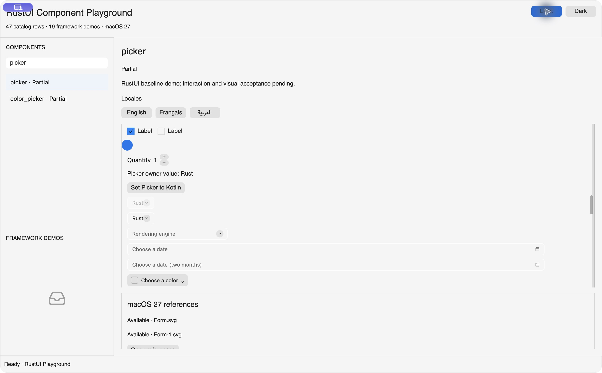 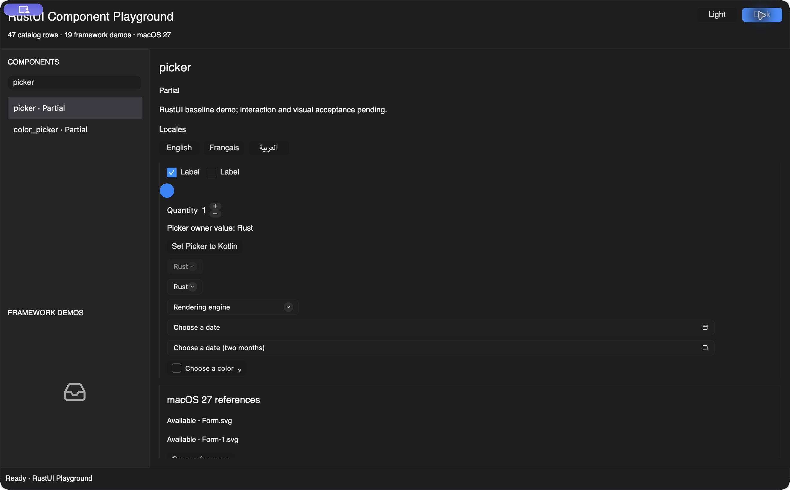 |  | Fixed 288-point panel and swatch geometry; native color-panel appearance is not reproduced. |
| [ComboBox](https://github.com/abouzoubaa/rustui/blob/63956b36cb6a1c9347c0241fd928f5625e3c0812/crates/rustui/src/components/input/combo_box.rs#L255) | Kit Select/SelectState (searchable) | combo_box/body  [419](https://github.com/abouzoubaa/rustui/blob/63956b36cb6a1c9347c0241fd928f5625e3c0812/crates/rustui/src/components/input/combo_box.rs#L419) `let style = required_style(context, "combo_box", "body", &selector(context));` | [431](https://github.com/abouzoubaa/rustui/blob/63956b36cb6a1c9347c0241fd928f5625e3c0812/crates/rustui/src/components/input/combo_box.rs#L431) `let affordance = affordance.child(Icon::new(IconName::ChevronDown).with_size(Size::XSmall));` | 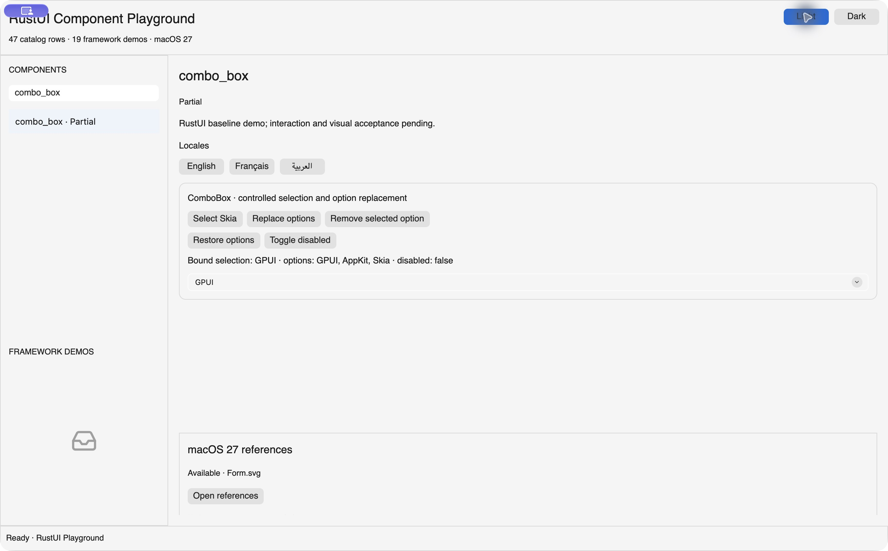 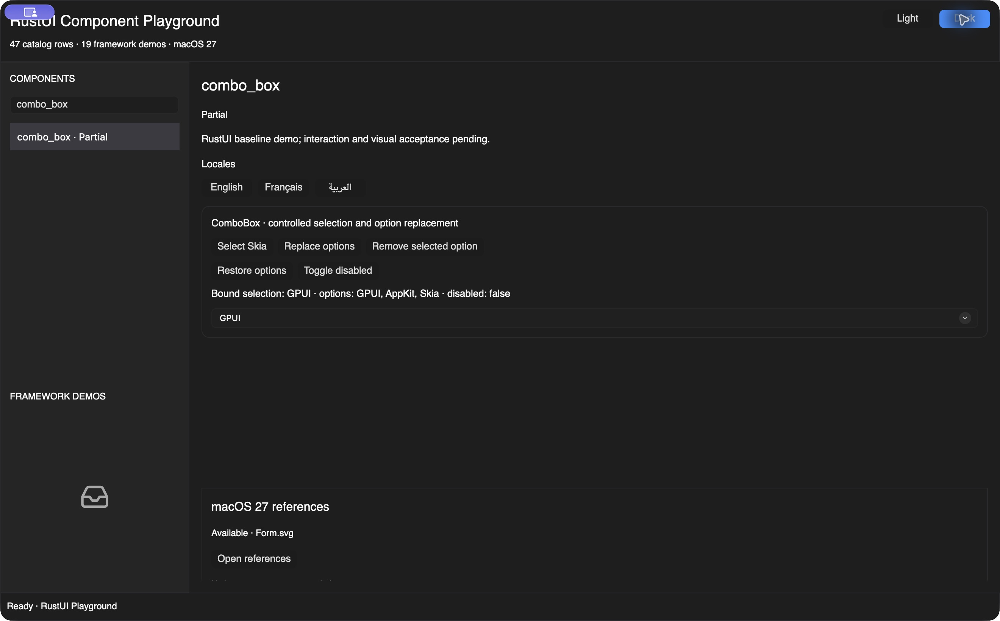 |  | Wrapper reads body style, but trailing affordance uses fixed 9-point inset/XSmall icon. Popup rows retain Kit geometry. |
| [DatePicker](https://github.com/abouzoubaa/rustui/blob/63956b36cb6a1c9347c0241fd928f5625e3c0812/crates/rustui/src/components/input/date_picker.rs#L243) | Kit DatePicker/DatePickerState | none; inherits native Kit theme  none in this wrapper | none in this wrapper |   |  | Uses Kit calendar styling; no date-picker record consumed by wrapper. |
| [Picker](https://github.com/abouzoubaa/rustui/blob/63956b36cb6a1c9347c0241fd928f5625e3c0812/crates/rustui/src/components/input/picker.rs#L205) | Kit Select/SelectState | picker/body  [392](https://github.com/abouzoubaa/rustui/blob/63956b36cb6a1c9347c0241fd928f5625e3c0812/crates/rustui/src/components/input/picker.rs#L392) `let style = required_style(context, "picker", "body", &selector(context));` | [404](https://github.com/abouzoubaa/rustui/blob/63956b36cb6a1c9347c0241fd928f5625e3c0812/crates/rustui/src/components/input/picker.rs#L404) `let affordance = affordance.child(Icon::new(IconName::ChevronDown).with_size(Size::XSmall));` |   |  | Wrapper reads body style, but trailing affordance uses fixed 9-point inset/XSmall icon. Selected popup-row appearance is not shown here. |
| [Radio](https://github.com/abouzoubaa/rustui/blob/63956b36cb6a1c9347c0241fd928f5625e3c0812/crates/rustui/src/components/input/radio.rs#L330) | Base Radio, own themed dot | radio_button/body + profile borders.thin  [341](https://github.com/abouzoubaa/rustui/blob/63956b36cb6a1c9347c0241fd928f5625e3c0812/crates/rustui/src/components/input/radio.rs#L341) `required_style_with_artwork(context, "radio_button", "body", &selector(context));` [356](https://github.com/abouzoubaa/rustui/blob/63956b36cb6a1c9347c0241fd928f5625e3c0812/crates/rustui/src/components/input/radio.rs#L356) `let active = active_theme(context.app()).expect("radio requires an active RustUI theme");` [361](https://github.com/abouzoubaa/rustui/blob/63956b36cb6a1c9347c0241fd928f5625e3c0812/crates/rustui/src/components/input/radio.rs#L361) `let border_width = active.profile.borders.thin as f32;` | [400](https://github.com/abouzoubaa/rustui/blob/63956b36cb6a1c9347c0241fd928f5625e3c0812/crates/rustui/src/components/input/radio.rs#L400) `this.child(div().size(px(6.0)).rounded(px(3.0)).bg(foreground))` [416](https://github.com/abouzoubaa/rustui/blob/63956b36cb6a1c9347c0241fd928f5625e3c0812/crates/rustui/src/components/input/radio.rs#L416) `.gap_2()` |   |  | Dot diameter/radius and label gap are fixed; compare focus ring and selected geometry. |
| [SearchField](https://github.com/abouzoubaa/rustui/blob/63956b36cb6a1c9347c0241fd928f5625e3c0812/crates/rustui/src/components/input/search_field.rs#L14) | RustUI TextField search variant | search_field/list_search through TextField  none in this wrapper | none in this wrapper |   |  | Search part and primary/disabled ink are mapped; suffix/clear sizing inherits Kit. Recent-search menu and focus variants need review. |
| [SecureField](https://github.com/abouzoubaa/rustui/blob/63956b36cb6a1c9347c0241fd928f5625e3c0812/crates/rustui/src/components/input/secure_field.rs#L10) | RustUI TextField secure variant | text_field/body through TextField  none in this wrapper | none in this wrapper |   |  | Shares TextField sizing; visibility icon is XSmall. Password text/caret and focus styles need state-by-state comparison. |
| [Slider](https://github.com/abouzoubaa/rustui/blob/63956b36cb6a1c9347c0241fd928f5625e3c0812/crates/rustui/src/components/input/slider.rs#L223) | Base Slider/Track/Thumb + own tick indicators | slider/sliders + profile palette  [299](https://github.com/abouzoubaa/rustui/blob/63956b36cb6a1c9347c0241fd928f5625e3c0812/crates/rustui/src/components/input/slider.rs#L299) `let style = required_style(context, "slider", "sliders", &selector);` [303](https://github.com/abouzoubaa/rustui/blob/63956b36cb6a1c9347c0241fd928f5625e3c0812/crates/rustui/src/components/input/slider.rs#L303) `active_theme(context.app()).expect("a RustUI component theme requires an active theme");` | [460](https://github.com/abouzoubaa/rustui/blob/63956b36cb6a1c9347c0241fd928f5625e3c0812/crates/rustui/src/components/input/slider.rs#L460) `slider.w(px(self.thumb_width)).h(px(120.0))` [549](https://github.com/abouzoubaa/rustui/blob/63956b36cb6a1c9347c0241fd928f5625e3c0812/crates/rustui/src/components/input/slider.rs#L549) `.when(horizontal, &#124;indicator&#124; indicator.w_full().h(px(6.0)))` [550](https://github.com/abouzoubaa/rustui/blob/63956b36cb6a1c9347c0241fd928f5625e3c0812/crates/rustui/src/components/input/slider.rs#L550) `.when(!horizontal, &#124;indicator&#124; indicator.h_full().w(px(6.0)))` [580](https://github.com/abouzoubaa/rustui/blob/63956b36cb6a1c9347c0241fd928f5625e3c0812/crates/rustui/src/components/input/slider.rs#L580) `.ml(px(-self.thumb_width / 2.0))` [586](https://github.com/abouzoubaa/rustui/blob/63956b36cb6a1c9347c0241fd928f5625e3c0812/crates/rustui/src/components/input/slider.rs#L586) `.mb(px(-self.thumb_height / 2.0))` | 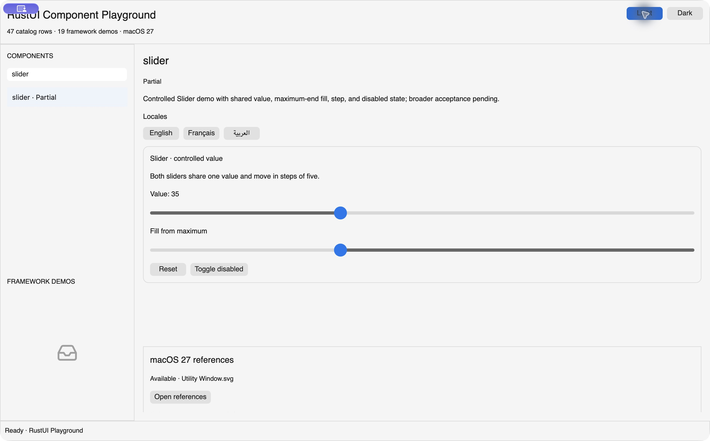 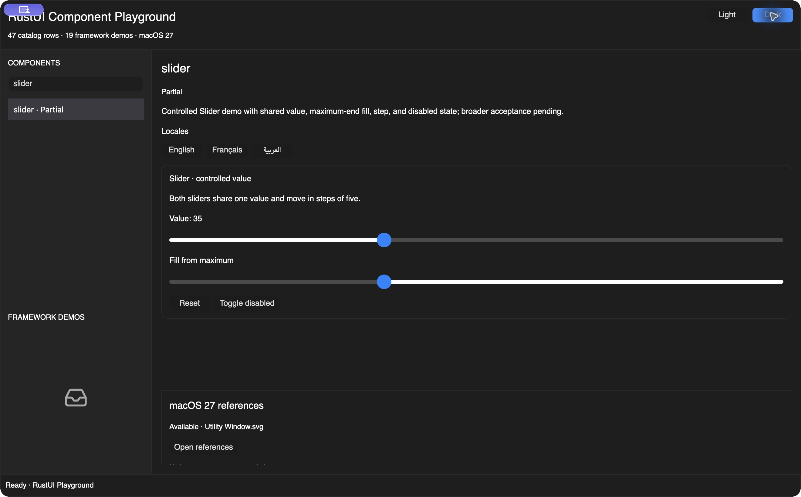 |  | Compare size/spacing/radius/font to the local concept; selection, focus ring, hover and editing states require owner visual acceptance. |
| [Stepper](https://github.com/abouzoubaa/rustui/blob/63956b36cb6a1c9347c0241fd928f5625e3c0812/crates/rustui/src/components/input/stepper.rs#L231) | Kit Button pair | stepper/{increment_button,decrement_button,separator,increment_glyph,decrement_glyph}  [295](https://github.com/abouzoubaa/rustui/blob/63956b36cb6a1c9347c0241fd928f5625e3c0812/crates/rustui/src/components/input/stepper.rs#L295) `let increment_style = required_style(context, "stepper", "increment_button", &selector);` [296](https://github.com/abouzoubaa/rustui/blob/63956b36cb6a1c9347c0241fd928f5625e3c0812/crates/rustui/src/components/input/stepper.rs#L296) `let decrement_style = required_style(context, "stepper", "decrement_button", &selector);` [297](https://github.com/abouzoubaa/rustui/blob/63956b36cb6a1c9347c0241fd928f5625e3c0812/crates/rustui/src/components/input/stepper.rs#L297) `let separator_style = required_style(context, "stepper", "separator", &selector);` [298](https://github.com/abouzoubaa/rustui/blob/63956b36cb6a1c9347c0241fd928f5625e3c0812/crates/rustui/src/components/input/stepper.rs#L298) `let increment_glyph = required_style(context, "stepper", "increment_glyph", &selector);` [299](https://github.com/abouzoubaa/rustui/blob/63956b36cb6a1c9347c0241fd928f5625e3c0812/crates/rustui/src/components/input/stepper.rs#L299) `let decrement_glyph = required_style(context, "stepper", "decrement_glyph", &selector);` [300](https://github.com/abouzoubaa/rustui/blob/63956b36cb6a1c9347c0241fd928f5625e3c0812/crates/rustui/src/components/input/stepper.rs#L300) `let active = active_theme(context.app()).expect("stepper requires an active RustUI theme");` | [87](https://github.com/abouzoubaa/rustui/blob/63956b36cb6a1c9347c0241fd928f5625e3c0812/crates/rustui/src/components/input/stepper.rs#L87) `let row = div().flex().flex_row().items_center().gap_2();` [319](https://github.com/abouzoubaa/rustui/blob/63956b36cb6a1c9347c0241fd928f5625e3c0812/crates/rustui/src/components/input/stepper.rs#L319) `.with_size(Size::XSmall)` [327](https://github.com/abouzoubaa/rustui/blob/63956b36cb6a1c9347c0241fd928f5625e3c0812/crates/rustui/src/components/input/stepper.rs#L327) `.with_size(Size::XSmall)` |   |  | Increment/decrement artwork is themed; XSmall arrows and gap_2 label spacing are fixed. Pressed/focus states are not shown. |
| [TextEditor](https://github.com/abouzoubaa/rustui/blob/63956b36cb6a1c9347c0241fd928f5625e3c0812/crates/rustui/src/components/input/text_editor.rs#L244) | Kit Textarea/TextareaState | none; inherits native Kit theme  none in this wrapper | [107](https://github.com/abouzoubaa/rustui/blob/63956b36cb6a1c9347c0241fd928f5625e3c0812/crates/rustui/src/components/input/text_editor.rs#L107) `height: 120.0,` |   |  | Size: 120-point default height. Uses Kit Textarea without a text-editor record; font, selection, caret and focus are native Kit defaults. |
| [TextField](https://github.com/abouzoubaa/rustui/blob/63956b36cb6a1c9347c0241fd928f5625e3c0812/crates/rustui/src/components/input/text_field.rs#L456) | Kit Input/InputState | text_field/body (plain/secure), search_field/list_search (search); profile disabled_text/primary_text  [729](https://github.com/abouzoubaa/rustui/blob/63956b36cb6a1c9347c0241fd928f5625e3c0812/crates/rustui/src/components/input/text_field.rs#L729) `let style = required_style_with_artwork(context, component, part, &selector);` [747](https://github.com/abouzoubaa/rustui/blob/63956b36cb6a1c9347c0241fd928f5625e3c0812/crates/rustui/src/components/input/text_field.rs#L747) `let theme = crate::theme::registry::active_theme(context.app())` [753](https://github.com/abouzoubaa/rustui/blob/63956b36cb6a1c9347c0241fd928f5625e3c0812/crates/rustui/src/components/input/text_field.rs#L753) `let theme = crate::theme::registry::active_theme(context.app())` | [132](https://github.com/abouzoubaa/rustui/blob/63956b36cb6a1c9347c0241fd928f5625e3c0812/crates/rustui/src/components/input/text_field.rs#L132) `size: TextFieldSize::Small,` [668](https://github.com/abouzoubaa/rustui/blob/63956b36cb6a1c9347c0241fd928f5625e3c0812/crates/rustui/src/components/input/text_field.rs#L668) `TextFieldSize::Small => input.small(),` [669](https://github.com/abouzoubaa/rustui/blob/63956b36cb6a1c9347c0241fd928f5625e3c0812/crates/rustui/src/components/input/text_field.rs#L669) `TextFieldSize::Large => input.large(),` |   |  | Small/large Kit sizing plus wrapper theme; focus and validation geometry need comparison across editing states. |
| [Toggle](https://github.com/abouzoubaa/rustui/blob/63956b36cb6a1c9347c0241fd928f5625e3c0812/crates/rustui/src/components/input/toggle.rs#L315) | Base Switch + own element | toggle/body + colors, borders.medium, spacing.space_2  [336](https://github.com/abouzoubaa/rustui/blob/63956b36cb6a1c9347c0241fd928f5625e3c0812/crates/rustui/src/components/input/toggle.rs#L336) `let style = required_style(context, "toggle", "body", &selector(context));` [350](https://github.com/abouzoubaa/rustui/blob/63956b36cb6a1c9347c0241fd928f5625e3c0812/crates/rustui/src/components/input/toggle.rs#L350) `active_theme(context.app()).expect("a RustUI component theme requires an active theme");` [351](https://github.com/abouzoubaa/rustui/blob/63956b36cb6a1c9347c0241fd928f5625e3c0812/crates/rustui/src/components/input/toggle.rs#L351) `let colors = active_theme.profile.colors(Some(active_theme.mode));` [362](https://github.com/abouzoubaa/rustui/blob/63956b36cb6a1c9347c0241fd928f5625e3c0812/crates/rustui/src/components/input/toggle.rs#L362) `let focus_border_width = active_theme.profile.borders.medium as f32;` [402](https://github.com/abouzoubaa/rustui/blob/63956b36cb6a1c9347c0241fd928f5625e3c0812/crates/rustui/src/components/input/toggle.rs#L402) `label_gap: active_theme.profile.spacing.space_2 as f32,` | none in this wrapper |   |  | Theme supplies body geometry, colors and label gap; thumb and focus painting are RustUI primitives. Compare selected/hover/focus variants. |
| [TokenField](https://github.com/abouzoubaa/rustui/blob/63956b36cb6a1c9347c0241fd928f5625e3c0812/crates/rustui/src/components/input/token_field.rs#L156) | Kit Input/Tag/Button composition | none; inherits native Kit theme  none in this wrapper | [200](https://github.com/abouzoubaa/rustui/blob/63956b36cb6a1c9347c0241fd928f5625e3c0812/crates/rustui/src/components/input/token_field.rs#L200) `.gap_2();` [229](https://github.com/abouzoubaa/rustui/blob/63956b36cb6a1c9347c0241fd928f5625e3c0812/crates/rustui/src/components/input/token_field.rs#L229) `.gap_1()` [246](https://github.com/abouzoubaa/rustui/blob/63956b36cb6a1c9347c0241fd928f5625e3c0812/crates/rustui/src/components/input/token_field.rs#L246) `input = div().min_w(gpui::px(120.0)).child(input).into_any_element();` |   |  | Spacing: gap_2/gap_1 and 120-point minimum input width. Tags/input/buttons inherit Kit; no token-field record consumed. |
| [Breadcrumb](https://github.com/abouzoubaa/rustui/blob/63956b36cb6a1c9347c0241fd928f5625e3c0812/crates/rustui/src/components/navigation/breadcrumb.rs#L103) | Kit Button trail + own GPUI separators | none; inherits native Kit theme  none in this wrapper | none in this wrapper |   |  | Kit button trail, not a native Path Control. Separator spacing, hover/focus and truncation do not read a breadcrumb record. |
| [Disclosure](https://github.com/abouzoubaa/rustui/blob/63956b36cb6a1c9347c0241fd928f5625e3c0812/crates/rustui/src/components/navigation/disclosure.rs#L125) | Kit Collapsible | disclosure_control/<part>  [140](https://github.com/abouzoubaa/rustui/blob/63956b36cb6a1c9347c0241fd928f5625e3c0812/crates/rustui/src/components/navigation/disclosure.rs#L140) `let style = required_style(` | [170](https://github.com/abouzoubaa/rustui/blob/63956b36cb6a1c9347c0241fd928f5625e3c0812/crates/rustui/src/components/navigation/disclosure.rs#L170) `.icon(Icon::new(icon).with_size(Size::XSmall)),` |   | no reference | Themed disclosure body with XSmall icon. Header/content spacing and expanded selection remain Kit behavior. |
| [NavigationSplit](https://github.com/abouzoubaa/rustui/blob/63956b36cb6a1c9347c0241fd928f5625e3c0812/crates/rustui/src/components/navigation/navigation_split.rs#L485) | RustUI SplitView + Sidebar composition | none; child controls/caller provide appearance  none in this wrapper | none in this wrapper |   |  | Composes SplitView and Sidebar. No separate split-navigation record; divider width, selection and collapse visuals are inherited. |
| [NavigationStack](https://github.com/abouzoubaa/rustui/blob/63956b36cb6a1c9347c0241fd928f5625e3c0812/crates/rustui/src/components/navigation/navigation_stack.rs#L301) | Own GPUI destination stack and links | none; child controls/caller provide appearance  none in this wrapper | [353](https://github.com/abouzoubaa/rustui/blob/63956b36cb6a1c9347c0241fd928f5625e3c0812/crates/rustui/src/components/navigation/navigation_stack.rs#L353) `let mut root = div().flex().flex_col().gap_3();` |   |  | Own destination activation through stack; appearance comes from child content. No native navigation-link record. |
| [Sidebar](https://github.com/abouzoubaa/rustui/blob/63956b36cb6a1c9347c0241fd928f5625e3c0812/crates/rustui/src/components/navigation/sidebar.rs#L242) | Kit Sidebar/SidebarMenuItem | sidebar background/foreground tokens; dimensions.sidebar_width  [368](https://github.com/abouzoubaa/rustui/blob/63956b36cb6a1c9347c0241fd928f5625e3c0812/crates/rustui/src/components/navigation/sidebar.rs#L368) `if let Some(theme) = active_theme(context.app()) {` [374](https://github.com/abouzoubaa/rustui/blob/63956b36cb6a1c9347c0241fd928f5625e3c0812/crates/rustui/src/components/navigation/sidebar.rs#L374) `crate::theme::ThemeToken::SidebarBackground,` [375](https://github.com/abouzoubaa/rustui/blob/63956b36cb6a1c9347c0241fd928f5625e3c0812/crates/rustui/src/components/navigation/sidebar.rs#L375) `crate::theme::ThemeToken::SidebarForeground,` [377](https://github.com/abouzoubaa/rustui/blob/63956b36cb6a1c9347c0241fd928f5625e3c0812/crates/rustui/src/components/navigation/sidebar.rs#L377) `sidebar = sidebar.w(px(theme.profile.dimensions.sidebar_width as f32));` | [65](https://github.com/abouzoubaa/rustui/blob/63956b36cb6a1c9347c0241fd928f5625e3c0812/crates/rustui/src/components/navigation/sidebar.rs#L65) `let mut menu = div().id(id.into()).flex().flex_col().gap_2();` |   |  | Theme width and surface colors are mapped; menu gap_2 is fixed. Item hover/selection/focus use Kit geometry. |
| [TabView](https://github.com/abouzoubaa/rustui/blob/63956b36cb6a1c9347c0241fd928f5625e3c0812/crates/rustui/src/components/navigation/tab_view.rs#L190) | Kit Tab/TabBar + retained RustUI panels | tab_bar background/segmented/transparent + foreground; dimensions.control_height  [360](https://github.com/abouzoubaa/rustui/blob/63956b36cb6a1c9347c0241fd928f5625e3c0812/crates/rustui/src/components/navigation/tab_view.rs#L360) `if let Some(theme) = active_theme(context.app()) {` [367](https://github.com/abouzoubaa/rustui/blob/63956b36cb6a1c9347c0241fd928f5625e3c0812/crates/rustui/src/components/navigation/tab_view.rs#L367) `TabViewStyle::Automatic => crate::theme::ThemeToken::TabBarBackground,` [368](https://github.com/abouzoubaa/rustui/blob/63956b36cb6a1c9347c0241fd928f5625e3c0812/crates/rustui/src/components/navigation/tab_view.rs#L368) `TabViewStyle::Segmented => crate::theme::ThemeToken::TabBarSegmentedBackground,` [370](https://github.com/abouzoubaa/rustui/blob/63956b36cb6a1c9347c0241fd928f5625e3c0812/crates/rustui/src/components/navigation/tab_view.rs#L370) `crate::theme::ThemeToken::TabBarTransparentBackground` [373](https://github.com/abouzoubaa/rustui/blob/63956b36cb6a1c9347c0241fd928f5625e3c0812/crates/rustui/src/components/navigation/tab_view.rs#L373) `crate::theme::ThemeToken::TabBarForeground,` [377](https://github.com/abouzoubaa/rustui/blob/63956b36cb6a1c9347c0241fd928f5625e3c0812/crates/rustui/src/components/navigation/tab_view.rs#L377) `.h(px(theme.profile.dimensions.control_height as f32));` | [457](https://github.com/abouzoubaa/rustui/blob/63956b36cb6a1c9347c0241fd928f5625e3c0812/crates/rustui/src/components/navigation/tab_view.rs#L457) `root = root.child(div().pt_3().child(content));` |   |  | Bar height/colors are themed; content top inset is fixed pt_3. Font, selected segment radius and hover/focus use Kit. |
| [Toolbar](https://github.com/abouzoubaa/rustui/blob/63956b36cb6a1c9347c0241fd928f5625e3c0812/crates/rustui/src/components/navigation/toolbar.rs#L152) | Kit Toolbar | toolbar background/foreground; dimensions.toolbar_height; spacing.space_1  [22](https://github.com/abouzoubaa/rustui/blob/63956b36cb6a1c9347c0241fd928f5625e3c0812/crates/rustui/src/components/navigation/toolbar.rs#L22) `profile.dimensions.toolbar_height as f32,` [23](https://github.com/abouzoubaa/rustui/blob/63956b36cb6a1c9347c0241fd928f5625e3c0812/crates/rustui/src/components/navigation/toolbar.rs#L23) `profile.spacing.space_1 as f32,` [168](https://github.com/abouzoubaa/rustui/blob/63956b36cb6a1c9347c0241fd928f5625e3c0812/crates/rustui/src/components/navigation/toolbar.rs#L168) `if let Some(theme) = active_theme(context.app()) {` [174](https://github.com/abouzoubaa/rustui/blob/63956b36cb6a1c9347c0241fd928f5625e3c0812/crates/rustui/src/components/navigation/toolbar.rs#L174) `crate::theme::ThemeToken::ToolbarBackground,` [175](https://github.com/abouzoubaa/rustui/blob/63956b36cb6a1c9347c0241fd928f5625e3c0812/crates/rustui/src/components/navigation/toolbar.rs#L175) `crate::theme::ThemeToken::ToolbarForeground,` | none in this wrapper |   |  | Height, spacing and surface roles are mapped. Item font/radius/focus depend on the supplied content; no native toolbar customization is implied. |
| [Alert](https://github.com/abouzoubaa/rustui/blob/63956b36cb6a1c9347c0241fd928f5625e3c0812/crates/rustui/src/components/overlay/alert.rs#L172) | Kit Alert | none; inherits native Kit theme  none in this wrapper | [230](https://github.com/abouzoubaa/rustui/blob/63956b36cb6a1c9347c0241fd928f5625e3c0812/crates/rustui/src/components/overlay/alert.rs#L230) `.gap(px(4.0))` |   |  | Kit variant colors and shape; fixed 4-point composition gap. No alert record read; multiline spacing and dismiss focus need review. |
| [ContextMenu](https://github.com/abouzoubaa/rustui/blob/63956b36cb6a1c9347c0241fd928f5625e3c0812/crates/rustui/src/components/overlay/context_menu.rs#L39) | Kit ContextMenuExt + PopupMenu | menu_item/body through Menu item renderer  none in this wrapper | none in this wrapper |   |  | Shares menu_item style; popup sizing/selection/hover and contextual placement remain Kit defaults. |
| [Dialog](https://github.com/abouzoubaa/rustui/blob/63956b36cb6a1c9347c0241fd928f5625e3c0812/crates/rustui/src/components/overlay/dialog.rs#L339) | Kit Dialog / tracked-dialog API | none; inherits native Kit theme  none in this wrapper | [420](https://github.com/abouzoubaa/rustui/blob/63956b36cb6a1c9347c0241fd928f5625e3c0812/crates/rustui/src/components/overlay/dialog.rs#L420) `dialog = dialog.title(div().pr(px(32.0)).child(title));` |   |  | Kit dialog with fixed 32-point title trailing inset. No dialog record mapping; modal button spacing and focus need owner comparison. |
| [Drawer](https://github.com/abouzoubaa/rustui/blob/63956b36cb6a1c9347c0241fd928f5625e3c0812/crates/rustui/src/components/overlay/drawer.rs#L349) | Base Root/Sheet host + own GPUI overlay | none; inherits native Kit theme  none in this wrapper | [223](https://github.com/abouzoubaa/rustui/blob/63956b36cb6a1c9347c0241fd928f5625e3c0812/crates/rustui/src/components/overlay/drawer.rs#L223) `.p_3()` [236](https://github.com/abouzoubaa/rustui/blob/63956b36cb6a1c9347c0241fd928f5625e3c0812/crates/rustui/src/components/overlay/drawer.rs#L236) `.min_h_0()` [238](https://github.com/abouzoubaa/rustui/blob/63956b36cb6a1c9347c0241fd928f5625e3c0812/crates/rustui/src/components/overlay/drawer.rs#L238) `.p_3()` |   |  | Own overlay over Base Sheet host; fixed p_3 insets. No drawer record; edge radius and resized content need review. |
| [Menu](https://github.com/abouzoubaa/rustui/blob/63956b36cb6a1c9347c0241fd928f5625e3c0812/crates/rustui/src/components/overlay/menu.rs#L200) | Kit PopupMenu/PopupMenuItem | menu_item/body  [237](https://github.com/abouzoubaa/rustui/blob/63956b36cb6a1c9347c0241fd928f5625e3c0812/crates/rustui/src/components/overlay/menu.rs#L237) `let style = required_style(context, "menu_item", "body", &selector(context));` | none in this wrapper |   |  | menu_item/body applied; popup container/row geometry remain Kit. Disabled/checked/hover appearance needs expanded state review. |
| [Popover](https://github.com/abouzoubaa/rustui/blob/63956b36cb6a1c9347c0241fd928f5625e3c0812/crates/rustui/src/components/overlay/popover.rs#L104) | Kit Popover (default), RustUI native popup opt-in | none; inherits native Kit theme  none in this wrapper | none in this wrapper |   |  | In-window and opt-in native paths differ; shadow, inset and focus return need owner review. |
| [Sheet](https://github.com/abouzoubaa/rustui/blob/63956b36cb6a1c9347c0241fd928f5625e3c0812/crates/rustui/src/components/overlay/sheet.rs#L242) | Kit Sheet via WindowExt | none; inherits native Kit theme  none in this wrapper | none in this wrapper |   |  | Kit Sheet without a sheet-record mapping. Width, inset, title font and focus appearance remain Kit defaults. |
| [Toast](https://github.com/abouzoubaa/rustui/blob/63956b36cb6a1c9347c0241fd928f5625e3c0812/crates/rustui/src/components/overlay/toast.rs#L298) | Kit Notification | none; inherits native Kit theme  none in this wrapper | none in this wrapper |   |  | Compare size/spacing/radius/font to the local concept; selection, focus ring, hover and editing states require owner visual acceptance. |
| [Tooltip](https://github.com/abouzoubaa/rustui/blob/63956b36cb6a1c9347c0241fd928f5625e3c0812/crates/rustui/src/components/overlay/tooltip.rs#L82) | Kit Tooltip | none; inherits native Kit theme  none in this wrapper | none in this wrapper |   |  | Trigger captured; tooltip surface was not exposed during this capture. Owner hover check remains. |
| [NavigationLink](https://github.com/abouzoubaa/rustui/blob/63956b36cb6a1c9347c0241fd928f5625e3c0812/crates/rustui/src/components/navigation/navigation_stack.rs#L102) | Same renderer as NavigationStack | Same record/token path as owning row | Same fixed values as owning row |   | Same reference as owning row | Own destination activation through stack; appearance comes from child content. No native navigation-link record. |
| [LocalizedText](https://github.com/abouzoubaa/rustui/blob/63956b36cb6a1c9347c0241fd928f5625e3c0812/crates/rustui/src/components/basic/text.rs#L140) | Same renderer as Text | Same record/token path as owning row | Same fixed values as owning row |   | Same reference as owning row | Same themed text renderer. Capture does not establish longer localized strings or all font weights. |

## Support-file coverage (not standalone controls)

| File | Public surface / purpose | Theme / fixed geometry | Screenshot context |
| --- | --- | --- | --- |
| [crates/rustui/src/components/advanced/graph_view/mod.rs](https://github.com/abouzoubaa/rustui/blob/63956b36cb6a1c9347c0241fd928f5625e3c0812/crates/rustui/src/components/advanced/graph_view/mod.rs#L1) | Module/re-exports and internal helpers | none in this wrapper | [graph](inventory/graph-light.png); no independent UI |
| [crates/rustui/src/components/advanced/graph_view/model.rs](https://github.com/abouzoubaa/rustui/blob/63956b36cb6a1c9347c0241fd928f5625e3c0812/crates/rustui/src/components/advanced/graph_view/model.rs#L1) | pub enum GraphError {; pub enum GraphPortDirection {; pub struct GraphPort {; pub struct GraphNode {; pub struct GraphEndpoint {; pub struct GraphEdge {; pub struct GraphDocument {; pub enum GraphEdit {; pub struct GraphViewport { | none in this wrapper | [graph](inventory/graph-light.png); no independent UI |
| [crates/rustui/src/components/advanced/graph_view/rendering.rs](https://github.com/abouzoubaa/rustui/blob/63956b36cb6a1c9347c0241fd928f5625e3c0812/crates/rustui/src/components/advanced/graph_view/rendering.rs#L1) | pub struct GraphStyle { | [827](https://github.com/abouzoubaa/rustui/blob/63956b36cb6a1c9347c0241fd928f5625e3c0812/crates/rustui/src/components/advanced/graph_view/rendering.rs#L827) `if let Some(theme) = crate::theme::registry::active_theme(context.app()) {` [828](https://github.com/abouzoubaa/rustui/blob/63956b36cb6a1c9347c0241fd928f5625e3c0812/crates/rustui/src/components/advanced/graph_view/rendering.rs#L828) `let colors = theme.profile.colors(Some(theme.mode));` | [graph](inventory/graph-light.png); no independent UI |
| [crates/rustui/src/components/advanced/graph_view/validation.rs](https://github.com/abouzoubaa/rustui/blob/63956b36cb6a1c9347c0241fd928f5625e3c0812/crates/rustui/src/components/advanced/graph_view/validation.rs#L1) | Module/re-exports and internal helpers | none in this wrapper | [graph](inventory/graph-light.png); no independent UI |
| [crates/rustui/src/components/input/validation.rs](https://github.com/abouzoubaa/rustui/blob/63956b36cb6a1c9347c0241fd928f5625e3c0812/crates/rustui/src/components/input/validation.rs#L1) | Module/re-exports and internal helpers | none in this wrapper | [inputs-core](inventory/inputs-core-light.png); no independent UI |

## Scope and capture limitations

- Tooltip has a trigger capture, not an open tooltip surface; no visual pass is claimed for the popup.
- Native popup placement across displays, hover, every selected/focused variant and editing are not established by this static inventory. Existing test coverage and an owner native session remain separate evidence.
- The inventory row uses **before R-1** grid captures. The final R-1 states and measured layout tests are below.
- Several gallery labels still claim “Partial”; this document reports observed implementation and source reads without changing those labels or product status.

## R-1 editable-grid comparison

The grid now reads `table.metrics.row_height` → `dimensions.navigation_row_height` (30 pt), `table.metrics.spacing` → `spacing.compact` → `space_1` (4 pt horizontal inset), and `table/table_rows` typography (13 pt SF Pro, weight 510). The semantic row-height metric is used rather than the 20-point source-artwork extent. Selection uses the profile's `selected_row_background`; the cell focus outline is absolute and does not consume layout space. Editing reuses TextField through a crate-private frame/style hook, with no independent border or padding. Validation feedback is deferred above clipped cells so it takes no row space.

`references/table-light.png` and `table-dark.svg` are rasterized at their original 1512×982 size from the bundled `List-1.svg` (light) and `List.svg` (dark) source artwork referenced by `hig/full.macos27.json`. They are source design references, not newly captured macOS windows. The raster conversion uses Helvetica Neue where SF Pro is unavailable and has fallback symbol glyphs; use the linked original SVGs for source geometry, and do not treat those fallback glyphs as native typography evidence. The dark HIG table concept in the inventory above is a separate illustrative composition.

| State | RustUI light | Matching light source artwork | RustUI dark | Matching dark source artwork |
| --- | --- | --- | --- | --- |
| Normal |  |  |  |  |
| Selected |  |  |  |  |
| Editing |  |  |  |  |

Implementation: [grid metrics](../crates/rustui/src/components/data/editable_data_grid.rs#L219), [row selection](../crates/rustui/src/components/data/editable_data_grid.rs#L860), [cell layout](../crates/rustui/src/components/data/editable_data_grid.rs#L969), [private TextField hook](../crates/rustui/src/components/input/text_field.rs#L148), and [active metric resolver](../crates/rustui/src/theme/registry.rs#L381).

The focused test `r1_cell_selection_and_editing_preserve_row_and_text_bounds` compares the normal/selected/editing cell and content bounds and the native input's measured text origin. `r1_click_and_keyboard_keep_the_active_row_selected` exercises a real click and Up/Down/Left/Right/Tab/Home/End/PageUp/PageDown, verifying grid focus and whole-row selection. `r1_grid_reads_table_metrics_and_font_after_theme_change` changes the row-height, spacing and typography sources and checks the result. `r1_escape_cancels_edit_before_reaching_the_enclosing_surface` verifies that Escape cancels an active edit first and otherwise reaches the containing surface. Remaining theme/reference differences: the semantic row metric is 30 pt while the source artwork rows are 20 pt, and the current profile selection is gray while the artwork selection is blue. R-1 consumes the existing theme; it does not retune that palette. Owner visual approval is required in addition to test success.
