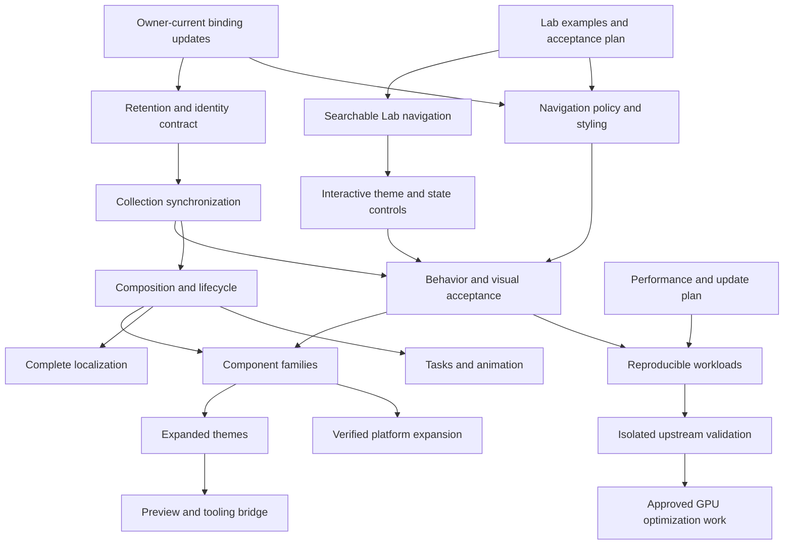

## M1258 — Stage 10: bound P3G cleanup traversal depth

`PinnedDir.remove_tree` now uses iterative traversal with a constant number of
active directory descriptors independent of nesting depth, and identity checks
on descent, ascent, and root removal. The
1,100-level low-descriptor regression and focused filesystem suite passed
22/22; Python bytecode compilation passed. This closes a local cleanup resource
gap only. Candidate execution and later acceptance gates remain open. See
`docs/tasks/M1258_STAGE10_P3G_BOUND_REMOVE_TREE_DEPTH.md`.

## M1257 — Stage 10: require explicit M276 event status

P3M now rejects a hash-bound M276 success event with no `status` field instead
of treating omission as `passed`. The focused aggregate-evidence suite passed
71 tests and Python bytecode compilation passed. This is local evidence-record
consistency only; candidate execution and later acceptance gates remain open.
See `docs/tasks/M1257_STAGE10_P3M_REQUIRE_M276_EVENT_STATUS.md`.

## M1256 — Stage 10: bound P3F artifact rereads

The aggregator now applies P3F's cumulative 4 GiB artifact budget while
rereading validated artifacts for identity checks and reuses the approved
intake bytes from that pass. A growth-after-validation regression is covered
by the 71-test focused aggregate-evidence suite; Python bytecode compilation
passed. Candidate execution and later acceptance gates remain open. See
`docs/tasks/M1256_STAGE10_P3F_BOUND_ARTIFACT_REREADS.md`.

## M1255 — Stage 10: bound P3H pinned manifest inventory depth

P3H pinned manifest hashing now uses iterative traversal with constant active
directory descriptors and identity/metadata checks on descent and ascent. The
1,100-level low-descriptor regression and existing pinned path-swap regression
passed 2/2. This closes a local reporter resource gap only; candidate execution
and later acceptance gates remain open. See
`docs/tasks/M1255_STAGE10_P3H_BOUND_MANIFEST_INVENTORY.md`.

## M1254 — Stage 10: make P3G intake copying depth-safe

`PinnedDir.copy_tree_from` now uses bounded descriptors and an explicit stack,
so deeply nested candidate sources do not fail after inventory succeeds. It
retains P3G's 100,000-entry and 4 GiB streaming limits, no-follow identity
checks, and failed-file cleanup. It closes partial descriptor setup, rejects
overlapping roots, verifies created destination identities, and preserves
sanitized directory modes. The 1,100-level copy regression under a low
file-descriptor limit passed (1/1); all five focused regressions passed in
19.8 seconds. Candidate execution and acceptance remain open. See
`docs/tasks/M1254_STAGE10_P3G_BOUND_INTAKE_COPY_DEPTH.md`.

## M1253 — Stage 10: bound P3G inventory descriptor use at depth

Both snapshot validation and the production pipeline's `PinnedDir.inventory`
now keep one active directory descriptor and ascend with identity-checked
descriptor-relative opens. The 1,100-level low-descriptor regressions passed
for each path, and the `_copy_source` integration regression passed 1/1. This
is local inventory evidence only; candidate execution and later acceptance
gates remain open. See
`docs/tasks/M1253_STAGE10_P3G_BOUND_INVENTORY_DESCRIPTOR_DEPTH.md`.

## M1252 — Stage 10: reject blank P3H enabled feature names

The P3H reporter now rejects empty and whitespace-only enabled feature names,
matching P3J's resolved-graph comparison contract. Its focused regression
passed 1/1 for empty, space-only, and tab-only values. This is malformed
metadata validation only; candidate and later acceptance gates remain open.
See `docs/tasks/M1252_STAGE10_P3H_REJECT_BLANK_ENABLED_FEATURES.md`.

## M1251 — Stage 10: preserve replacement directories during P3K rollback

P3K rollback now carries the original disposable package directory identity
into recursive cleanup and validates child identities before removal. A focused
regression confirms a replacement package and the detached original survive a
path swap during rollback; the focused test passed 1/1. This is local rollback
safety evidence only; candidate execution and later acceptance gates remain
open. See `docs/tasks/M1251_STAGE10_P3K_ROLLBACK_PACKAGE_REPLACEMENT.md`.

## M1250 — Stage 10: reject replacement directories during P3 cleanup

`PinnedDir.remove_tree` now records each directory's device/inode identity before opening it and verifies that identity on the opened descriptor before recursively deleting contents. This prevents cleanup from descending into a replacement directory swapped in between inspection and open. The focused `scripts/tests/test_p3_candidate_fs.py` suite passed 12/12. This closes a local cleanup race only; candidate execution and GUI/performance acceptance, review, approval, and promotion remain open.

See `docs/tasks/M1250_STAGE10_REMOVE_TREE_REPLACEMENT_RACE.md`.

# RustUI implementation roadmap

## M1249 — Stage 11 / apply Web keyboard focus patch and verify Space activation

With user approval, the exact v3 GPUI Web patch is now in `patches/approved/`, applied through a hash-checking helper, and selected through a same-version local Cargo path override. The pristine vendor checksum metadata is unchanged. The optimized Playground Wasm bundle built, and fresh-browser keyboard focus reached the Increment button; Space advanced the counter from 1 to 2. Text-entry and screen-reader acceptance remain open. Evidence: `docs/tasks/M855_STAGE11_WEB_KEYBOARD_FOCUS_PATCH_V3.md` and `target/headstart/evidence/m855-stage11-web-space-activation-20261023.json`.

## M1248 — Stage 11 / reject longer module-script type values

Web packaging preflight accepts exact `module` values, quoted or unquoted, and rejects values such as `modulex`; the regression also confirms the previous bundle is preserved on rejection. Focused packaging check passed. Browser acceptance remains separate. See `docs/tasks/M1248_STAGE11_REJECT_MODULE_TYPE_PREFIX.md`.

## M1247 — Stage 10 / bound P3K package inventory and copy

Descriptor-pinned package inventory and copy now share the existing 100,000-entry and 4 GiB limits, including streaming byte checks. Focused regressions passed 2/2. Candidate execution and GUI/performance acceptance remain open. See `docs/tasks/M1247_STAGE10_BOUND_P3K_PACKAGE_INVENTORY.md`.

## M1246 — Stage 11 / recognize valid HTML module-script attributes

Web package preflight now accepts case-insensitive script/type attribute names and single-quoted `module` values while rejecting `data-type` lookalikes. The focused packaging regression passed. This does not establish fresh-browser acceptance. See `docs/tasks/M1246_STAGE11_MATCH_HTML_MODULE_SCRIPT_ATTRIBUTES.md`.

## M1245 — Stage 10 / bound pinned snapshot inventories

P3G's 100,000-entry and 4 GiB limits now apply during descriptor-pinned pre-copy, post-copy, and destination inventories. The focused budget regression passed (1/1). Candidate execution and acceptance remain open. See `docs/tasks/M1245_STAGE10_BOUND_PINNED_SNAPSHOT_INVENTORIES.md`.

## M1244 — Stage 10 / reject M274 executable suffix aliases

P3M rejects M274 evidence naming an executable whose final component only has a `cargo-headstart` suffix, such as `fake-cargo-headstart`. Focused rejection and compatibility checks passed (3/3). This is record-integrity evidence only; candidate execution and acceptance remain open. See `docs/tasks/M1244_STAGE10_REJECT_M274_EXECUTABLE_SUFFIX_ALIASES.md`.

## M1243 — Stage 10 / enforce snapshot bounds during tree copy

Candidate source-tree copies now enforce the existing P3G limits of 100,000
entries and 4 GiB while streaming, including bytes that appear after preflight.
The in-progress destination file is removed if a copy fails. Five focused copy
and mutation regressions passed. Candidate execution and acceptance remain
open. See `docs/tasks/M1243_STAGE10_ENFORCE_SNAPSHOT_BOUNDS_DURING_COPY.md`.

## M1242 — Stage 4 / reject empty opacity animation identities

`AnimatedOpacity` now rejects empty and whitespace-only animation identities
with `OpacityAnimationError::EmptyIdentity`, while preserving nonblank IDs. The
focused identity test filter passed (3/3; opacity, offset, and spring). Native
animation acceptance remains open. See
`docs/tasks/M1242_STAGE4_REJECT_EMPTY_OPACITY_ANIMATION_IDENTITIES.md`.

## M1241 — Stage 10 / bound approved patch copies

The candidate pipeline now rejects approved patches larger than 32 MiB before
creating their destination copy. The focused regression passed (1/1). This
limits intake copying only; candidate execution and acceptance remain open. See
`docs/tasks/M1241_STAGE10_BOUND_APPROVED_PATCH_COPIES.md`.

## M1240 — Stage 10 / require the P3E prepared snapshot hash

P3E now rejects a missing or malformed prepared-candidate `path_tree_sha256`,
even when the plan binding is also missing. The focused regression passed
(1/1). No candidate pipeline or acceptance run was performed. See
`docs/tasks/M1240_STAGE10_REQUIRE_P3E_PREPARED_SNAPSHOT_HASH.md`.

## M1239 — Stage 6 / preserve RFC 5646 four-letter language subtags

RFC 5646 §2.1 permits four-letter primary language subtags as reserved future
use. The incorrect M1231 rejection was reverted; a focused positive regression
for `abcd` and `ABCD-Latn` passed (1/1). See
`docs/tasks/M1239_STAGE6_PRESERVE_RESERVED_FOUR_CHARACTER_LANGUAGE_SUBTAGS.md`.

## M1238 — Stage 10 / bind P3L command argv to the M274 event step

P3L now requires a command event's argv to match the exact candidate build or
check step. A hash-consistent candidate-build event that records `check` is
rejected; valid linked M274/M276 reconciliation still passes. Focused tests,
`py_compile`, and scoped whitespace checks passed. This is local record
consistency, not proof of process execution or candidate acceptance. See
`docs/tasks/M1238_STAGE10_BIND_P3L_COMMAND_TO_M274_STEP.md`.

## M1237 — Stage 10 / reject unsupported dependency kinds in P3J comparisons

P3J now rejects dependency-kind values outside Cargo's normal, build, and dev
forms. The malformed-kind and two existing comparison regressions passed
(3/3); `py_compile` passed. This validates comparison input, not equivalence
acceptance. See
`docs/tasks/M1237_STAGE10_REJECT_UNKNOWN_P3J_DEPENDENCY_KINDS.md`.

## M1236 — Stage 10 / reject unknown P3H Cargo dependency kinds

P3H now rejects unknown dependency-kind labels and accepts only Cargo's
normal, build, and dev forms. The focused regression passed (1/1). See
`docs/tasks/M1236_STAGE10_REJECT_UNKNOWN_P3H_DEPENDENCY_KINDS.md`.

## M1235 — Stage 10 / reject P3N PNGs without image-data bytes

P3N now rejects CRC-valid PNGs whose IDAT chunks contain no payload bytes. The
focused M287 regression passed; validator and test module `py_compile` passed.
This is structural evidence validation only, not pixel or GUI acceptance. See
`docs/tasks/M1235_STAGE10_REJECT_EMPTY_P3N_PNG_IMAGE_DATA.md`.

## M1234 — Stage 10 / require explicit pass status in P3M events

P3M no longer defaults a missing follow-up event status to `passed`. A
hash-consistent report missing the status is rejected; a valid linked
M274/M276 event remains accepted. Focused tests passed (2/2). This is evidence
integrity, not benchmark/performance acceptance. See
`docs/tasks/M1234_STAGE10_REQUIRE_EXPLICIT_P3M_EVENT_PASS_STATUS.md`.

## M1233 — Stage 10 / bind all path-source files to the P3G tree hash

P3G rejects files directly beneath `path-sources/`, which the aggregate
inventory previously accepted outside the per-package tree hash. The focused
candidate-snapshot suite passed (33/33). Provenance, graph equivalence,
candidate execution, GUI/performance acceptance, review, approval, and
promotion remain separate. See
`docs/tasks/M1233_STAGE10_BIND_ALL_PATH_SOURCE_FILES_TO_TREE_HASH.md`.

## M1232 — Stage 10 / close P3K descriptors on setup failure

Patch-check setup now remains inside the descriptor cleanup scope, so package
descriptors close on setup errors as well as preflight rejection and later
check exits. The focused failure-injection regression passed (1/1). Candidate
execution, GUI/performance acceptance, review, approval, and promotion remain
separate. See
`docs/tasks/M1232_STAGE10_CLOSE_P3K_DESCRIPTORS_ON_SETUP_FAILURE.md`.

## M1231 — Superseded locale-parser correction

The recorded four-letter rejection was incorrect and was reverted under
M1239 after checking RFC 5646 §2.1. See
`docs/tasks/M1231_STAGE6_REJECT_RESERVED_FOUR_CHARACTER_LANGUAGE_SUBTAGS.md`.

## M1230 — Stage 10 / close P3K package descriptors after preflight rejection

Pinned patch application now closes both package-directory descriptors when
preflight validation fails. The regression forces baseline inventory rejection
and confirms both descriptors are closed; it failed before the fix and passed
afterward (1/1). Candidate execution, GUI/performance acceptance, review,
approval, and promotion remain separate. See
`docs/tasks/M1230_STAGE10_CLOSE_P3K_PREFLIGHT_DESCRIPTORS.md`.

## M1229 — Stage 10 / bound P3D visual evidence artifact reads

P3D hashes screenshot/binary artifacts in 1 MiB chunks and caps JSON evidence
records at 1 MiB. The focused bounded-read regression passed (1/1). The
historical M582 capture manifest does not match the current example binary;
current-source visual acceptance and the later candidate/review/approval gates
remain open. See
`docs/tasks/M1229_STAGE10_BOUND_P3D_VISUAL_ARTIFACT_READS.md`.

## M1228 — Stage 10 / close P3 candidate inventory hard-link race

`PinnedDir.inventory()` now validates the opened file's type, link count, and identity against the no-follow directory entry, then rechecks the open descriptor and path identity after hashing. A focused race regression passed (1/1). This is local filesystem hardening; candidate acceptance, approval, and promotion remain open. See `docs/tasks/M1228_STAGE10_RECHECK_INVENTORY_FILE_IDENTITY.md`.

## M1227 — Stage 10 / validate P3I path package source kind

P3I source comparison now rejects path packages whose raw `source` field is not exactly `path`, preventing contradictory package metadata from being normalized as a path source. The focused regression passed (1/1). This is inventory validation, not full dependency-graph or candidate acceptance. See `docs/tasks/M1227_STAGE10_VALIDATE_PATH_PACKAGE_SOURCE_KIND.md`.

## M1226 — Stage 10 / require P3G path tree hashes

P3G snapshot validation now requires `path_tree_sha256` for each snapshot record, so a valid result cannot omit the package-tree binding. The focused missing-field regression passed (1/1). Candidate execution and acceptance gates remain separate. See `docs/tasks/M1226_STAGE10_REQUIRE_PATH_TREE_HASH.md`.

## M1225 — Stage 10 / bound M287 GUI artifact reads

M287 screenshot and accessibility-tree artifacts are now read with a 64 MiB cap before hashing or PNG structure parsing, preventing unbounded memory use from supplied evidence files. The focused regression verifies an oversized hash-bound screenshot is rejected. `python -B -m unittest scripts.tests.test_aggregate_candidate_evidence.AggregateCandidateEvidenceTests.test_m287_artifact_read_is_bounded` passed (1/1). This establishes bounded aggregation only; GUI, performance, review, approval, and promotion gates remain open. See `docs/tasks/M1225_STAGE10_BOUND_M287_GUI_ARTIFACT_READS.md`.

## M1224 — Stage 11 / keep Web loading status announceable

The browser shell no longer marks the body busy while updating its descendant `role="status"` loading message, avoiding a busy ancestor suppressing the live-region announcement. The focused Web package test asserts the status region and loading text exist without `aria-busy`. `sh scripts/tests/test_build_playground_web.sh` passed. This is source/package evidence; browser screen-reader acceptance remains open. See `docs/tasks/X1B_BROWSER_HOST.md`.

## M1223 — Stage 5 / reconcile locale-resolved List rows

ListView now compares retained delegate rows against locale-resolved labels,
and updates the delegate with those resolved labels when they change. This
prevents a render update from replacing localized suffixes with untranslated
source labels. The focused regression passed under the locked Headstart test
command; native visual and locale-switch acceptance remain open. See
`docs/tasks/M1223_STAGE5_RECONCILE_RESOLVED_LIST_ROWS.md`.

## M1222 — Stage 8 / avoid nested TreeItem row semantics

The RustUI Tree renderer now relies on the pinned GPUI base Tree's outer row
for the `TreeItem` role, accessible name, selected, disabled, and expanded
state. It no longer places a duplicate `TreeItem` role and state on the nested
`ListItem`. The focusable Tree root, row label, and leaf activation path are
preserved. The outer row has no per-item `aria-level` API, so level metadata
remains blocked on an approved upstream API or patch. The locked/offline
`rustui` package check passed; no tests or GUI acceptance were run. See
`docs/tasks/M1222_STAGE8_TREEITEM_ROW_SEMANTICS_BOUNDARY.md`.

## M1221 — Stage 10 / independent review of M276 evidence

An independent read-only review found no identity or aggregation discrepancy:
candidate manifest, event, summary, log, harness inputs, and linked M274
evidence hashes match. P3M is `consistent`, with build and correctness passed;
GUI, performance, and promotion remain `not_run`. This is evidence integrity
review only, not candidate acceptance or promotion. See
`docs/tasks/M1221_STAGE10_INDEPENDENT_REVIEW.md`.

## M1220 — Stage 11 / rebuild current Web bundle

Rebuilt `target/headstart/playground-web` from the current shell and packaging
script. The package shell hash matched its source, and the local server served
the shell and reference paths successfully. This is packaging/static-serving
evidence only: fresh-bundle browser interaction, accessibility, and font/glyph
acceptance remain open; the M855 v3 host patch remains behind its approval
gate. See `docs/tasks/M1220_STAGE11_REBUILD_WEB_BUNDLE.md`.

## M1219 — Stage 10 / identity-bound M276 correctness rerun

The locked/offline correctness harness passed 10/10 for candidate
`quad-stable-sort-v2-chain-m272-20261020`. Its M276 event binds the candidate
ID and manifest SHA-256, and P3M aggregation returned `consistent` with build
and correctness passed. GUI, performance, and promotion remain `not_run`; this
closes only the local correctness evidence gap. See
`docs/tasks/M1219_STAGE10_IDENTITY_BOUND_M276_RERUN.md`.

## M1218 — Stage 10 / require M276 success-event identity

The P3M evidence aggregator now requires each M276 correctness event to carry
the same `candidate_id` and `manifest_sha256` as its summary. An identity-free
historical event cannot prove that it belongs to the current candidate source.
Three focused aggregator cases passed; Python compilation and scoped diff
checks passed. No candidate acceptance gate was run. See
`docs/tasks/M1218_STAGE10_REQUIRE_M276_EVENT_IDENTITY.md`.

## M1215 — Stage 3 / record hover exit when hiding the region

The Hover Gallery now counts hiding a currently hovered region as one exit.
The owner clears its hover state before the child unmounts, so a later exit
callback cannot record that transition. Repeated hides do not double-count.
The focused regression passed (1/1); GUI hover acceptance remains open. See
`docs/tasks/M1215_STAGE3_HOVER_EXIT_ON_HIDE.md`.

## M1214 — Stage 10 / require P3D screenshots to be distinct artifacts

P3D validation now rejects a screenshot that reuses the build record, plan, or
candidate binary artifact. The focused regression and validator bytecode
compilation passed. No candidate was run and no visual acceptance is claimed.
See `docs/tasks/M1214_STAGE10_REQUIRE_DISTINCT_P3D_SCREENSHOTS.md`.

## M1213 — Stage 0 / correct the SplitView file-registry status

The file registry now reflects that SplitView is implemented and has bounded
M586 native resize/lifecycle evidence, while keeping broader focus,
accessibility, locale, and platform work open. Inventory paths resolve and the
scoped documentation whitespace check passed. See
`docs/tasks/M1213_STAGE0_SPLIT_VIEW_REGISTRY_STATUS.md`.

## M1212 — Stage 0 / clarify architecture guide acceptance status

The Playground paragraph in the architecture guide now separates bounded GUI
reviews from full-application acceptance and links the detailed Playground
guide. The scoped documentation whitespace check passed. See
`docs/tasks/M1212_STAGE0_ARCHITECTURE_ACCEPTANCE_WORDING.md`.

## M1211 — Stage 4 / preserve turbofish optional-child boundaries

The `view!` parser recognizes turbofish on parenthesized `.then` and
`.then_some` optional children, keeping them separate from adjacent
constructors. The focused regression failed before the fix and passed (1/1).
See `docs/tasks/M1211_STAGE4_TURBOFISH_OPTIONAL_CHILD_BOUNDARY.md`.

## M1210 — Stage 3 / report Window Controls button selection

The Window Controls illustration now shows the selected Close, Minimize, or
Zoom button instead of routing all three through an already-active state
toggle. The focused state test passed 1/1. Native chrome remains unchanged and
GUI acceptance remains open. See
`docs/tasks/M1210_STAGE3_WINDOW_CONTROL_BUTTON_FEEDBACK.md`.

## M1209 — Stage 10 / reject float overflow in evidence aggregation

The Stage 10 aggregation JSON reader now rejects numeric exponents outside the
finite float range, matching the adjacent validator. A regression injects
`1e999` into a hash-bound event and embedded result; the focused test passed
1/1. No candidate was run. Review, approval, promotion, and GUI/performance
acceptance remain open. See
`docs/tasks/M1209_STAGE10_REJECT_FLOAT_OVERFLOW_IN_AGGREGATION.md`.

## M1208 — Stage 3 / report Offset reference-action activation

The Offset story's Reference action button now updates its label after
activation while preserving the fixed layout slot. Its focused state test
passed 1/1; GUI acceptance remains open. See
`docs/tasks/M1208_STAGE3_OFFSET_REFERENCE_ACTION_FEEDBACK.md`.

## M1207 — Stage 0 / clarify Playground acceptance wording

The Playground guide now distinguishes completed focused checks and bounded
GUI reviews from full-application acceptance, which remains pending. A scoped
whitespace check passed. See
`docs/tasks/M1207_STAGE0_PLAYGROUND_ACCEPTANCE_WORDING.md`.

## M1206 — Stage 10 / record candidate pin failures

If the pipeline cannot pin a just-created candidate directory, it now records
the failure through the pinned candidates parent and re-raises the original
error without running candidate steps. The focused regression passed 1/1. No
candidate was executed; review/approval/promotion and GUI/performance
acceptance remain open. See
`docs/tasks/M1206_STAGE10_RECORD_CANDIDATE_PIN_FAILURE.md`.

## M1205 — Stage 3 / report Form Accessories button activation

The Button, Detail, and Detail Info sample controls now update owner state and
show the last activated action in the preview instead of using empty
callbacks. The focused state regression passed 1/1. GUI acceptance remains
open. See `docs/tasks/M1205_STAGE3_FORM_ACCESSORY_BUTTON_FEEDBACK.md`.

## M1204 — Stage 7 / make Slider keyboard accessible

Enabled Sliders now receive keyboard focus; orientation-aware arrow keys adjust
by one step and Home/End select range bounds. Values clamp, irrelevant/modified
keys are ignored, and changes emit the existing binding event. The focused
regression passed 1/1; native/browser keyboard acceptance remains open. See
`docs/tasks/M1204_STAGE7_SLIDER_KEYBOARD_ACCESSIBILITY.md`.

## M1203 — Stage 5 / apply the profile badge background token

RustUI Badge now applies the active profile's `badge_background` token rather
than inheriting the pinned upstream error-color default. When no RustUI theme
is active, the native fallback remains. The focused light/dark regression
passed 1/1. See
`docs/tasks/M1203_STAGE5_APPLY_BADGE_BACKGROUND_TOKEN.md`.

## M1202 — Stage 4 / preserve arguments on try-wrapped constructors

The stack-child parser keeps call arguments attached to constructors wrapped
with `?`, preserving adjacent constructor siblings. The new regression failed
before the fix and passed afterward (1/1). See
`docs/tasks/M1202_STAGE4_TRY_WRAPPED_CONSTRUCTOR_ARGUMENTS.md`.

## M1201 — Stage 6 / stop script detection at BCP 47 extensions

Locale direction detection now stops at BCP 47 singleton boundaries, so
script-shaped values inside Unicode extensions cannot override the language's
direction. The focused regression confirms `ar-u-ca-Latn` remains RTL and
`en-u-ca-Arab` remains LTR. The focused `rustui-i18n` Cargo test passed 1/1.
Full CLDR/ICU/Fluent coverage and native/browser RTL acceptance remain open.
See `docs/tasks/M1201_STAGE6_STOP_SCRIPT_DETECTION_AT_BCP47_EXTENSIONS.md`.

## M1200 — Stage 10 / preserve reused destination descriptors on copy failure

The isolated candidate patch applier now transfers a destination descriptor to
its stream before copying and closes the raw descriptor only if ownership was
not transferred. This prevents failure cleanup from closing an unrelated file
descriptor after the stream has already closed and the OS has reused its
number. The focused regression passed 1/1. No candidate was executed, reviewed,
approved, or promoted; GUI/performance acceptance remains open. See
`docs/tasks/M1200_STAGE10_PRESERVE_REUSED_DESTINATION_DESCRIPTOR.md`.

## M1199 — Stage 10 reject source parent traversal

Snapshot validation now rejects raw `..` source-path components before path
normalization can erase them. The focused regression passed 1/1 for a path
that resolves back inside the candidate root. Candidate execution,
independent review, approval, promotion, and GUI/performance acceptance remain
open. See `docs/tasks/M1199_STAGE10_REJECT_SOURCE_PARENT_TRAVERSAL.md`.

## M1198 — Stage 10 close rename parent descriptors

`PinnedDir.rename` now closes its owned source-parent descriptor when
destination validation fails. The focused failure-path regression passed 1/1.
No candidate execution or promotion was performed. See
`docs/tasks/M1198_STAGE10_CLOSE_RENAME_PARENT_DESCRIPTOR.md`.

## M1197 — Stage 10 validate comparison candidate IDs

The source comparison reader now applies the same bounded candidate-ID rule as
its report producer, rejecting path-like, slash-containing, double-dot, and
overlength IDs. The focused regression passed 1/1. Candidate execution,
independent review, approval, promotion, and GUI/performance acceptance remain
open. See `docs/tasks/M1197_STAGE10_VALIDATE_COMPARISON_CANDIDATE_ID.md`.

## M1196 — Stage 10 close source descriptors on copy failure

`_copy_source` now registers each owned directory handle with its `ExitStack`
as soon as it is opened. Destination-creation failure releases the source and
owned duplicates without closing borrowed descriptors. The focused regression
passed 1/1. Candidate execution, independent review, approval, promotion, and
GUI/performance acceptance remain open. See
`docs/tasks/M1196_STAGE10_CLOSE_SOURCE_DESCRIPTORS_ON_COPY_FAILURE.md`.

## M1195 — Stage 10 validate inherited candidate IDs

The evidence validator now applies the candidate pipeline's bounded,
single-component ID rule in inherited file-descriptor mode. The focused
regression passed 1/1, covering a valid ID and nested, whitespace, double-dot,
and overlength IDs. Candidate execution, independent review, approval,
promotion, and GUI/performance acceptance remain open. See
`docs/tasks/M1195_STAGE10_VALIDATE_INHERITED_CANDIDATE_ID.md`.

## M1194 — Stage 3 add an interactive Menu Bar sidebar

The View menu now toggles the illustrative Favorites/Downloads sidebar,
updates its action label, and reports the resulting state. The focused source
regression dispatches the generated component `Action`, checks its owner
notification result, and passed 1/1; the rendered Menu event path is not
exercised. Visual, keyboard, and accessibility acceptance for the illustrative
composition remain open; a native menu-bar renderer is outside this task's
scope. See
`docs/tasks/M1194_STAGE3_INTERACTIVE_MENU_BAR_SIDEBAR.md`.

## M1193 — Stage 7 name a TextEditor with a blank placeholder

The rendered TextEditor now always receives its resolved accessible name. A
blank placeholder with no override therefore uses the existing `Text editor`
fallback instead of relying on the upstream placeholder-derived name. The
focused regression passed 1/1. Native accessibility-tree, screen-reader, and
cross-platform acceptance remain open. See
`docs/tasks/M1193_STAGE7_TEXTEDITOR_DEFAULT_ACCESSIBLE_NAME.md`.

## M1182 — Stage 7 / fall back from unresolved Stepper action names

Stepper action labels now use the existing English fallback when localization
returns an error, blank text, or the untranslated message key. The focused
regression passed 1/1; scoped `git diff --check` passed. Valid translated
labels remain unchanged. Native screen-reader acceptance is still open. See
`docs/tasks/M1182_STAGE7_STEPPER_UNRESOLVED_ACTION_LABELS.md`.

## M1181 — Stage 5 / choose contrasting filled-button foreground

The theme adapter now derives the accent-button foreground from the accent
surface using its existing contrast helper. The focused light/dark macOS 27
palette regression passed 1/1; scoped `git diff --check` passed. This is
source-level role mapping, not native visual/accessibility acceptance. See
`docs/tasks/M1181_STAGE5_ACCENT_BUTTON_FOREGROUND_CONTRAST.md`.

## M1180 — Stage 2 / reject stack gap span overflow before rounding

Stack gap validation now converts the exact `usize` gap count to `f64` before
checking the aggregate against `f32::MAX`. A focused large-count regression
reproduced the previous undercount and passed 1/1; scoped `git diff --check`
passed. Animation timing and retargeting remain separately gated. See
`docs/tasks/M1180_STAGE2_STACK_GAP_COUNT_ROUNDING.md`.

## M1179 — Stage 6 / verify explicit Adlam script direction

The existing locale-direction resolver already classifies the Adlam script
(`Adlm`) as right-to-left in the shared worktree. Added an explicit
`und-Adlm` regression to the script-override test; the focused test passed
1/1, and scoped `git diff --check` passed. This adds source-level direction
coverage, not full CLDR or native RTL acceptance. See
`docs/tasks/M1179_STAGE6_ADLAM_SCRIPT_DIRECTION.md`.

## M1178 — Stage 10 / validate build-log provenance metadata

The cache-comparison provenance validator now requires the recorder's
`build_log` object and validates its path, SHA-256, byte count, and
`parsed_for_success: false` marker. The focused malformed-record regression
passed 1/1, and scoped `git diff --check` passed. This validates record shape;
it does not rehash a retained log or accept a candidate. See
`docs/tasks/M1178_STAGE10_VALIDATE_BUILD_LOG_PROVENANCE.md`.

## M1177 — Stage 4 / preserve adjacent `then_some` optional children

The stack-child parser now recognizes `.then_some(...)` alongside `.then(...)`
as a parenthesized optional-child boundary, keeping the optional view separate
from adjacent constructor siblings. The focused macro regression passed 1/1.
No broad macro or native GUI acceptance was run. See
`docs/tasks/M1177_STAGE4_THEN_SOME_CHILD_BOUNDARY.md`.

## M1176 — Stage 10 / reject duplicate build-provenance input paths

The cache-comparison validator now rejects malformed, duplicate, or unexpected
build-input path inventories before accepting captured hashes. The focused
regression passed 1/1. See
`docs/tasks/M1176_STAGE10_REJECT_DUPLICATE_BUILD_INPUT_PATHS.md`.

## M1175 — Stage 1 / contain wrong-owner component action dispatch

Component actions now return no invalidation rather than panicking when
dispatched to an owner of another type. The focused regression passed 1/1. See
`docs/tasks/M1175_STAGE1_WRONG_OWNER_ACTION_DISPATCH.md`.

## M1174 — Stage 4 / preserve chained constructor call arguments

The stack-child parser now preserves later argument groups in chained
constructor calls such as `make_view()("label")` while keeping a following
constructor child separate. The focused regression passed 1/1. See
`docs/tasks/M1174_STAGE4_CHAINED_CALL_CONSTRUCTOR_ARGUMENTS.md`.

## M1160 — Stage 11 / preserve module scripts after inline HTML comments

The Web shell scanner now removes inline HTML comments while retaining markup
that follows them on the same line. A focused fixture failed before the fix and
passes now, along with packaging-script syntax checks. This closes a packager
false rejection only; browser runtime and accessibility acceptance remain
open. See `docs/tasks/M1160_STAGE11_INLINE_HTML_COMMENT_SCANNER.md`.

## M1161 — Stage 1 / allocate toast announcement identity per dispatch

Each invocation of a reusable Toast action now allocates a distinct semantic
scope identity, avoiding collisions between queued announcements. The focused
identity regression passed 1/1. Native screen-reader behavior remains open.
See `docs/tasks/M1161_STAGE1_UNIQUE_TOAST_ANNOUNCEMENT_IDENTITIES.md`.

## M1163 — Stage 6 / recognize the Elymaic RTL script

The locale direction resolver now recognizes the explicit `Elym` script as
right-to-left. Its focused script-direction regression passed. This extends
the resolver's explicit-script coverage; it does not establish full CLDR
coverage or native RTL GUI acceptance. See
`docs/tasks/M1163_STAGE6_ELYMAIC_RTL_SCRIPT_DIRECTION.md`.

## M1164 — Stage 9 / announce rejected Stepper inspector values

When the inspector rejects an `i64` value outside Stepper's `i32` range, its
status now reaches the polite live region while the mounted preview remains
unchanged. The focused regression failed before the fix and passed afterward.
Native screen-reader acceptance remains open. See
`docs/tasks/M1164_STAGE9_STEPPER_INTEGER_REJECTION_ANNOUNCEMENT.md`.

## M1167 — Stage 4 / parse parenthesized macro callables

The view parser now consumes call arguments following a parenthesized macro
expression as part of that child, while preserving the adjacent optional-child
boundary. Both focused parser regressions passed. See
`docs/tasks/M1167_STAGE4_PARENTHESIZED_MACRO_CALLABLES.md`.

## M1173 — Stage 7 / reject blank basic-component identities

Icon, Image, and Badge now reject empty and whitespace-only explicit IDs,
matching neighboring component builders. The focused identity tests passed
16/16. This validates builder input only; native and browser accessibility-tree
acceptance remain open. See
`docs/tasks/M1173_STAGE7_BASIC_COMPONENT_ID_VALIDATION.md`.

## M1159 — Stage 10 / normalize P3I Cargo feature selectors

P3I now tokenizes Cargo feature selectors on commas and whitespace, drops empty
tokens, then compares sorted unique feature names. Focused regressions passed
for equivalent separators and empty selectors. This normalizes requested
feature names; it does not prove source provenance or resolved graph equality.
See `docs/tasks/M1159_STAGE10_P3I_NORMALIZE_CARGO_FEATURE_SELECTORS.md`.

## M1158 — Stage 10 / bound P3L command-event logs

P3L now limits each hash-bound command log to 64 MiB; P3F validator output
retains the tighter 1 MiB cap. A self-consistent oversized log previously
passed aggregation. The focused P3L regressions passed 4/4. This is an input
resource bound, not candidate acceptance or promotion. See
`docs/tasks/M1158_STAGE10_BOUND_P3L_COMMAND_LOGS.md`.

## M1157 — Stage 10 / reject P3E artifacts changed during hashing

P3E now checks descriptor identity and metadata before and after hashing, then
reopens the artifact path to ensure it still names the same file version. A
deterministic replacement race previously yielded `valid`; the full focused
P3E suite passed 14/14 after the fix. This does not lock or promote candidate
artifacts. See
`docs/tasks/M1157_STAGE10_P3E_REJECT_ARTIFACT_CHANGED_DURING_HASH.md`.

## M1156 — Stage 10 / bound P3M follow-up event records

P3M now applies the existing 1 MiB record limit to hash-bound M274 and M276
event JSON. Oversized, correctly rehashed events previously closed gates; the
focused aggregator suite now passes 61/61 and leaves those gates `not_run`.
This does not accept candidates or close review/approval gates. See
`docs/tasks/M1156_STAGE10_BOUND_P3M_EVENT_RECORDS.md`.

## M1155 — Stage 10 / split P3K unified diffs on LF only

P3K now treats only LF as a physical diff-line separator, preserving Unicode
NEL inside source lines. The focused patch-applier suite passed 44/44, including
an exact-byte regression. No candidate was applied, run, or promoted. See
`docs/tasks/M1155_STAGE10_P3K_LF_ONLY_DIFF_LINE_SPLITTING.md`.

## M1154 — Stage 10 / reject blank P3H package identity fields

The P3H source reporter now rejects empty and whitespace-only Cargo package
names and versions instead of emitting incomplete normalized graph identities.
The focused regression and valid-graph smoke test passed. No candidate was
run or accepted. See
`docs/tasks/M1154_STAGE10_REJECT_BLANK_PACKAGE_IDENTITY.md`.

## M1153 — Stage 10 / reject hard-linked P3D artifacts

P3D now rejects evidence artifacts with hard-link aliases before and after
hashing and after reopening their recorded paths. The focused artifact
stability tests passed 2/2, including outside-root alias and path-replacement
cases. This is artifact-integrity evidence, not visual acceptance. See
`docs/tasks/M1153_STAGE10_REJECT_P3D_HARDLINKED_ARTIFACTS.md`.

## M1152 — Stage 10 / validate structure of P3N screenshot PNGs

P3N now checks PNG chunk framing and CRCs, required IHDR/IDAT/IEND structure,
and basic header values before accepting an M287 screenshot. The signature-only
fixture previously passed and now fails; the focused aggregation module passed
59/59. This is structural validation, not pixel or visual verification. See
`docs/tasks/M1152_P3N_PNG_STRUCTURE_VALIDATION.md`.

## M1151 — Stage 4 / parse calls on parenthesized stack constructors

The stack parser now consumes the immediate call arguments for a parenthesized
callable while preserving constructor and sibling parsing. The new case failed
before the fix; focused parenthesized macro tests passed 3/3. Formatting still
reports pre-existing changes in the dirty file. See
`docs/tasks/M1151_STAGE4_PARENTHESIZED_CALLABLE_STACK_CHILD.md`.

## M1150 — Stage 7 / give Slider a fallback accessible name

Slider now supplies the accessible name `Slider` when no explicit name is set,
while preserving explicit accessible-name resolution. Its focused regression
passed 1/1. Native screen-reader and cross-platform acceptance remain open.
See `docs/tasks/M1150_STAGE7_SLIDER_DEFAULT_ACCESSIBLE_NAME.md`.

## M1149 — Stage 5 / reject whitespace-only theme profile IDs in the schema

The theme JSON Schema now rejects whitespace-only profile IDs to match
`ThemeProfile::validate`. Its focused regression passed 1/1. Broader native
visual, accessibility, and cross-platform theme acceptance remain open. See
`docs/tasks/M1149_STAGE5_PROFILE_ID_SCHEMA_NONEMPTY.md`.

## M1148 — Stage 11 / ignore HTML comment text in Web bootstrap parsing

The Web package guard now tracks JavaScript template literals only inside an
executable module script. A focused HTML-comment backtick regression failed
before the fix and passed after it. Browser runtime, input, accessibility, and
font/glyph acceptance remain open. See
`docs/tasks/M1148_STAGE11_IGNORE_HTML_COMMENT_TEMPLATES.md`.

## M1147 — Stage 8 / consume Tree arrows with no enabled destination

TreeView now consumes Up/Down actions when no enabled row is available,
preventing the pinned GPUI fallback from selecting a disabled raw index. The
focused regression passed 1/1. See
`docs/tasks/M1147_STAGE8_CONSUME_TREE_ARROW_WITH_NO_ENABLED_ROW.md`.

## M1146 — Stage 7 / support explicit accessible names on ComboBox

ComboBox now accepts a blank visible label when given a non-empty explicit
accessible name, and localized-name fallback preserves that explicit name.
Focused ComboBox tests passed 9/9. See
`docs/tasks/M1146_STAGE7_COMBOBOX_ACCESSIBLE_NAME.md`.

## M1145 — Stage 7 / allow an accessible name on indicator-only Stepper

`StepperView::new` now accepts an empty visible label when a non-empty
accessible name is supplied. Validation applies to the resolved accessible
name, so an unnamed indicator-only Stepper still fails. Focused regressions
passed. See
`docs/tasks/M1145_STAGE7_INDICATOR_ONLY_STEPPER_ACCESSIBLE_NAME.md`.

## M1144 — Stage 7 / allow an accessible name on indicator-only Toggle

`ToggleView::new` now accepts an empty visible label when the caller supplies
a non-empty accessible name. Rendering still rejects an empty resolved name.
The focused regression passed 1/1. See
`docs/tasks/M1144_STAGE7_INDICATOR_ONLY_TOGGLE_ACCESSIBLE_NAME.md`.

## M1143 — Stage 7 / allow an accessible name on indicator-only Radio

`RadioView::new` now accepts an empty visible label when the caller supplies a
non-empty accessible name. Rendering still rejects an empty resolved name. The
focused regression passed 1/1. See
`docs/tasks/M1143_STAGE7_INDICATOR_ONLY_RADIO_ACCESSIBLE_NAME.md`.

## M1142 — Stage 8 / omit an empty Breadcrumb navigation landmark

An empty Breadcrumb now renders no navigation landmark. The focused regression
command exited 0. See
`docs/tasks/M1142_STAGE8_EMPTY_BREADCRUMB_LANDMARK.md`.

## M1141 — Stage 6 / reject malformed decimals for plural category selection

Plural category selection now checks decimal arguments against the formatter's
decimal-literal grammar before inspecting integer operands. Malformed decimal
strings therefore fall back to `other` instead of selecting French `one` or
Arabic `zero`. The focused regression passed 1/1. See
`docs/tasks/M1141_STAGE6_REJECT_MALFORMED_DECIMAL_PLURALS.md`.

## M1140 — Stage 7 / allow an explicit accessible name on indicator-only Checkbox

`CheckboxView::new` now accepts an empty visible label so indicator-only
checkboxes can supply `.accessibility_label(...)`. Rendering still requires a
non-empty resolved accessible name. The focused regression passed 1/1; native
screen-reader acceptance remains open. See
`docs/tasks/M1140_STAGE7_INDICATOR_ONLY_CHECKBOX_ACCESSIBLE_NAME.md`.

## M1139 — Stage 4 / preserve component cfg on generated impls

The `#[component]` macro now applies the component's effective `cfg` presence
predicate to its generated `Default` and inherent impls. The focused regression
passed 1/1. See `docs/tasks/M1139_STAGE4_COMPONENT_CFG_IMPLS.md`.

## M1138 — Stage 9 / preserve ColorPicker channels when clearing preview color

PreviewInspector now restores the saved hue, saturation, lightness, and alpha
values when a ColorPicker specimen's optional color is re-enabled. The direct
clear/export/import/restore regression passed (1 test). Broader UI Studio
composition and native acceptance remain open. See
`docs/tasks/M1138_STAGE9_PRESERVE_COLOR_PICKER_PREVIEW_CHANNELS.md`.

## M1137 — Stage 11 / allow HTML comment text inside Web module scripts

The Web packager now applies HTML-comment scanning only outside executable
module-script content, matching the HTML script-data boundary. The focused
packaging harness passes, including the new positive fixture and existing
rejection cases. This is packaging evidence, not browser acceptance. See
`docs/tasks/M1137_STAGE11_SCRIPT_COMMENT_BOUNDARY.md`.

## M1136 — Stage 8 / order horizontal SplitView panels by layout direction

Horizontal SplitView now reverses physical panel order under RTL while keeping
retained sizes associated with each panel ID; vertical order is unchanged.
The focused ordering/reconciliation regression passed (1 test), with scoped
formatting and diff checks passing. Native resize and RTL acceptance remain
open. See `docs/tasks/M1136_STAGE8_SPLITVIEW_RTL_PANEL_ORDER.md`.

## M1135 — Stage 6 / validate placeholders within each expression branch

Catalog contracts now preserve argument names at each plural/select branch,
so moving a required placeholder to a different branch is detected even when
the global argument set is unchanged. The direct regression failed before
the fix and passed afterward (1 test); scoped diff check passed. Full CLDR,
Fluent/ICU, and native localization acceptance remain open. See
`docs/tasks/M1135_STAGE6_VALIDATE_BRANCH_PLACEHOLDERS.md`.

## M1134 — Stage 9 / avoid duplicate Choice editor labels

PropertyInspector now recognizes the Choice editor's own visible Picker
label, so it does not add a duplicate row label. The focused regression now
covers Choice and passed (1 test). Broader UI Studio composition and native
accessibility acceptance remain open. See
`docs/tasks/M1134_STAGE9_CHOICE_EDITOR_LABEL.md`.

## M1133 — Stage 1 / expose Toast announcement labels

Toast `Status` and `Alert` semantics now publish the announcement text as the
accessible label as well as the live value. The focused regression passed
(1 test), and the scoped diff check passed. Native screen-reader acceptance
remains open. See
`docs/tasks/M1133_STAGE1_TOAST_ANNOUNCEMENT_LABEL.md`.

## M1132 — Stage 1 / keep unresolved Alert keys out of accessibility labels

An unresolved Alert title or message key now falls back to the resolved title
and then the validated alert identity instead of exposing a localization key
to assistive technology. The focused Alert tests passed 11/11, and scoped
formatting and diff checks passed. Native screen-reader acceptance remains
open. See `docs/tasks/M1132_STAGE1_ALERT_ACCESSIBLE_NAME_FALLBACK.md`.

## M1131 — Stage 11 / keep Web catalog selection tied to its rendered filter

Playground story row bindings now retain the filtered row mapping from the
render that created them. A stale row event therefore cannot select a
different story after the query changes. The direct regression passed (1
test), and the scoped diff check passed. Browser runtime acceptance remains
open. See `docs/tasks/M1131_STAGE11_PIN_STORY_ROW_FILTER_MAPPING.md`.

## M1130 — Stage 7 / localize TokenField action names

TokenField Add and Remove controls now resolve accessible names from the
English, French, and Arabic catalogs, with visible-language fallbacks and a
distinct label for an empty token. The focused regression passed (1 test),
and scoped formatting and locale diff checks passed. Native screen-reader and
locale-switching acceptance remain open. See
`docs/tasks/M1130_STAGE7_LOCALIZE_TOKEN_FIELD_ACTION_NAMES.md`.

## M1129 — Stage 10 / bind pristine snapshot hash to baseline source

Snapshot validation now compares every declared `pristine_path_tree_sha256`
with the captured baseline path-source package hash and rejects a pristine
hash when the snapshot has no unique path-source package. The direct forged
candidate-hash regression passed (1 test). This is snapshot-integrity
evidence; no candidate was executed, and review, approval, and promotion
remain open. See `docs/tasks/M1129_STAGE10_BIND_PRISTINE_HASH_TO_BASELINE.md`.

## M1128 — Stage 11 / explain unsupported module scripts at startup

The Web shell now uses its existing live status region to tell users when
their browser cannot run JavaScript module scripts. The focused packaging
harness passed and asserts that the fallback survives packaging. No browser
runtime or accessibility acceptance was run. See
`docs/tasks/M1128_STAGE11_MODULE_SCRIPT_FALLBACK.md`.

## M1127 — Stage 10 / reject candidate ID path traversal

Pinned candidate patch application now validates the inherited candidate ID
before opening its directory beneath the candidates parent. A focused
regression confirms a traversal ID cannot create patch-check output outside
that root (1 test passed). Candidate execution, review, approval, and
promotion remain open. See
`docs/tasks/M1127_STAGE10_REJECT_CANDIDATE_ID_TRAVERSAL.md`.

## M1126 — Stage 7 / keep a controlled DatePicker year selectable

DatePicker now sets the pinned calendar's year range around its selected year
when creating retained state and syncing a changed controlled value. The
focused regression passed (1 test). Native calendar interaction and
accessibility acceptance remain open. See
`docs/tasks/M1126_STAGE7_DATE_PICKER_SELECTED_YEAR_RANGE.md`.

## M1125 — Stage 10 / validate the M287 screenshot signature

M287 evidence aggregation now rejects screenshot artifacts that do not begin
with the PNG signature, even when their declared hashes match. The focused
regression passed 1 test. This does not validate decoded pixels or complete
GUI acceptance; candidate execution, review, approval, and promotion remain
open. See `docs/tasks/M1125_STAGE10_VALIDATE_M287_PNG_SIGNATURE.md`.

## M1124 — Stage 11 / ignore escaped backticks in Web shell checks

The Web packager now treats escaped backticks as literal content while
searching for the executable module import and initializer. A regression with
decoy bootstrap code after an escaped backtick is rejected while preserving
the existing bundle. Shell syntax checks and the focused packaging harness
passed. Browser runtime and acceptance remain open. See
`docs/tasks/M1124_STAGE11_ESCAPED_BACKTICK_WEB_GUARD.md`.

## M1121 — Stage 4 / keep field postfixes on stack constructors

The stack DSL now consumes named and tuple field accesses as postfixes on the
preceding constructor, so they stay with that child before the next sibling.
Constructor attributes on the field expression, including `cfg`, remain
preserved. The focused regression failed before the parser fix and passed
afterward (1 passed, 0 failed). `rustfmt --check` reports pre-existing
formatting differences elsewhere in this dirty file; no broad formatting
rewrite was applied. See
`docs/tasks/M1121_STAGE4_STACK_FIELD_SUFFIXES.md`.

## M1122 — Stage 5 / count significant digits before exponent expansion

Theme integer parsing now accepts an in-range integer whose decimal spelling
has many leading fractional zeroes before exponent expansion. The regression
uses `0.` followed by 32 zeroes and `1e34`, which equals 10. The focused theme
parse test passed (1 passed, 0 failed), and scoped `git diff --check` passed.
Broader visual and accessibility acceptance remains open. See the follow-up
in `docs/tasks/STAGE5_EXACT_INTEGER_JSON_NUMBERS.md`.

## M1123 — Stage 7 / normalize ColorPicker hue endpoints for swatch selection

ColorPicker now treats hue 0 and hue 1 as the same color when identifying the
selected featured swatch. The focused regression command exited successfully,
and scoped `git diff --check` passed. Native interaction and accessibility
acceptance remain open. See
`docs/tasks/M1123_STAGE7_COLOR_PICKER_HUE_ENDPOINT_SELECTION.md`.

## M1119 — Stage 3 / search Playground coverage in the active locale

The Playground catalog filter now searches localized coverage labels from the
existing catalogs, so rows can be found by the French or Arabic status text
shown in the interface. The focused French filtering and selection regression
passed 1/1. Browser acceptance remains open. See
`docs/tasks/M1119_STAGE3_LOCALIZED_COVERAGE_FILTER.md`.

## M1120 — Stage 7 / reconcile rejected Picker confirmations

The retained Picker now records a confirmed selection before invoking its
current owner writer. If the owner rejects the write, the next render detects
the mismatch and restores the controlled value. The focused regression command
exited successfully; its pass count was not available from the tool output.
Native interaction and accessibility acceptance remain open. See
`docs/tasks/M1120_STAGE7_PICKER_REJECTED_CONFIRMATION.md`.

## M1118 — Stage 7 / match Slider accessibility and pointer step rounding

Slider accessibility `SetValue` now uses GPUI's `f32` divide/round/multiply
path when snapping to a step, matching pointer interaction at half-step
boundaries. The focused regression passed 1/1. Native interaction and
accessibility acceptance remain open. See
`docs/tasks/M1118_STAGE7_SLIDER_ACCESSIBILITY_STEP_ROUNDING.md`.

## M1117 — Stage 11 / ignore template-literal decoys in Web shell checks

The Web packager's import and initializer checks now ignore matching text
inside multiline JavaScript template literals, preventing a false-positive
package from satisfying the browser bootstrap contract. The focused regression
failed before the fix and passed afterward; shell syntax checks passed. Browser
acceptance remains open. See `docs/tasks/M1117_STAGE11_IGNORE_TEMPLATE_LITERAL_DECOYS.md`.

## M1116 — Stage 10 / constrain candidate process exit statuses

P3F now accepts only process exit statuses from 0 through 255, matching the
build-provenance contract and rejecting impossible values such as 256. The
focused validator suite passed 20 tests. Candidate execution and acceptance
remain open. See `docs/tasks/M1116_STAGE10_BOUND_EVIDENCE_EXIT_STATUS.md`.

## M1115 — Stage 6 / preserve exact-zero plural branch precedence

Exact decimal plural matching now recognizes an all-zero mantissa before
bounded exponent conversion, so `=0` still wins when the exponent exceeds
`i64`. The focused regression passed 1/1. Broader localization acceptance
remains open. See `docs/tasks/M1115_STAGE6_EXACT_ZERO_BRANCH_LARGE_EXPONENT.md`.

## M1114 — Stage 10 / recheck candidate inputs after P3F

The candidate pipeline now rechecks candidate identity, manifest hashes, and
source inventories after P3F. Mutations are recorded as
`P3G-post-P3F-integrity` failures instead of leaving a partial-success result.
Three focused tests passed. Candidate execution and acceptance remain open. See
`docs/tasks/M1114_STAGE10_RECHECK_INPUTS_AFTER_P3F.md`.

## M1113 — Stage 11 / require initialization in the importing module script

The Web packager now requires the awaited Wasm initializer to follow its import
inside the same module script, preventing publication of a shell that fails at
startup due to isolated module bindings. The focused packaging regression and
shell syntax checks passed. Browser build and runtime acceptance remain open.
See `docs/tasks/M1113_STAGE11_REQUIRE_INITIALIZER_IN_IMPORTING_SCRIPT.md`.

## M1112 — Stage 10 / distinguish artifact replacement from hard-link gain

P3F now reports an artifact identity or link-state change during hashing as
changed evidence, while reserving the hard-link finding for an increased link
count. Its focused suite passed (19 tests). No candidate was run or accepted.
See `docs/tasks/M1112_STAGE10_CLASSIFY_ARTIFACT_REPLACEMENT.md`.

## M1111 — Stage 10 / reject a symlinked candidate root

P3G now rejects a symlink used as the final candidate-root path while
preserving supported parent path aliases. The focused suite passed (29 tests).
No candidate was run or accepted. See
`docs/tasks/M1111_STAGE10_REJECT_SYMLINKED_CANDIDATE_ROOT.md`.

## M1110 — Stage 10 / require the M274 follow-up event schema

P3L now requires M274 follow-up records to contain the exact integer schema
version `1` before they can satisfy the build gate. The focused rejection
regression and existing positive build test passed. Candidate execution,
review, GUI/performance evidence, approval, and promotion remain open. See
`docs/tasks/M1110_STAGE10_REQUIRE_M274_EVENT_SCHEMA.md`.

## M1109 — Stage 10 / reject blank P3H dependency metadata

P3H now rejects blank resolved dependency-kind and target strings while
continuing to accept optional `null` fields. Its focused script suite passed
(21 tests). No candidate was run or accepted. See
`docs/tasks/M1109_STAGE10_REJECT_BLANK_RESOLVED_DEPENDENCY_FIELDS.md`.

## M1108 — Stage 6 / preserve Arabic zero for unrepresentable exponents

Arabic decimal plural selection now recognizes an all-zero mantissa before
parsing its exponent, so exact zero remains in the `zero` category even when
the exponent exceeds `i64`. The focused regression passed (1/1). Broader
localization acceptance remains open. See
`docs/tasks/M1108_STAGE6_ARABIC_ZERO_PLURAL_LARGE_EXPONENT.md`.

## M1107 — Stage 7 / reconcile rejected ComboBox confirmations

The retained ComboBox records a confirmed selection before calling the current
owner binding writer. If the owner rejects the change and retains its previous
value, the next render now detects the mismatch and restores the controlled
selection. The focused regression passed (1/1); native interaction and
accessibility acceptance remain open. See
`docs/tasks/M1107_STAGE7_COMBO_BOX_REJECTED_CONFIRMATION.md`.

## M1106 — Stage 6 / preserve exact decimal operands for French plurals

French decimal plural selection now examines the exact integer digits instead
of rounding arbitrary-precision decimals through `f64`. A value immediately
below two previously rounded to two and selected the wrong category. The
focused regression reproduced the failure before the fix and passed afterward.
See `docs/tasks/M1106_STAGE6_EXACT_FRENCH_DECIMAL_PLURAL.md`.

## M1105 — Stage 3 / encode Playground Web reference filenames

The Web Playground now percent-encodes each reference filename as one URL
path segment, so spaces and plus signs do not corrupt links. The focused
regression resolved all 85 declared references and checked both encodings;
the test passed. No browser acceptance was run. See
`docs/tasks/M1105_STAGE3_ENCODE_WEB_REFERENCE_FILENAMES.md`.

## M1104 — Stage 8 / constrain divider movement by the adjacent panel

`SplitView` now computes divider minimum movement from the immediate right
panel, matching GPUI's resize behavior instead of counting unused capacity in
later panels. The focused three-panel regression passed. Native visual,
keyboard, and accessibility acceptance remain open. See
`docs/tasks/M1104_STAGE8_ADJACENT_PANEL_DIVIDER_RANGE.md`.

## M1103 — Stage 9 / clear ephemeral secure values after preview type changes

After a successful descriptor import switches the preview component, the
inspector now clears any retained secure-field value. The focused Playground
regression passed. Broader native inspector acceptance, including selection,
IME, and retention without blur, remains open. See
`docs/tasks/M1103_STAGE9_CLEAR_SECURE_PREVIEW_ON_TYPE_CHANGE.md`.

## M1102 — Stage 5 / align component theme schema with required runtime fields

The published component-theme schema now requires `rustui_type` and `parts`
and assigns their runtime types, matching Rust deserialization; `styles`
remains optional. The focused schema-contract regression passed. Native visual
and accessibility acceptance remain separate. See
`docs/tasks/M1102_STAGE5_REQUIRE_COMPONENT_THEME_FIELDS.md`.

## M1101 — Stage 11 / bind the awaited Wasm initializer to its import

The Web packager now requires the awaited initializer to match the imported
default export, rejecting bundles that import one name and call another. The
focused shell regression passed and confirmed the previous bundle is preserved.
No Wasm build or browser acceptance was run. See
`docs/tasks/M1101_STAGE11_MATCH_WASM_INITIALIZER_IMPORT.md`.

## M1100 — Stage 10 / bind snapshot candidate identity to the pinned root

The inherited snapshot validator now rejects a manifest candidate ID that
differs from the ID bound to the pinned candidate directory. The focused
regression passed. No candidate was run; Stage 10 evidence, review, approval,
and promotion remain open. See
`docs/tasks/M1100_STAGE10_BIND_SNAPSHOT_CANDIDATE_ID.md`.

## M1099 — Stage 10 / reject hard-linked follow-up artifacts

The evidence aggregator's shared file reader now rejects follow-up artifacts
with hard-link aliases, including links outside the pinned candidate root. The
focused M287 screenshot regression passed. No candidate was run; Stage 10
evidence, review, approval, and promotion remain open. See
`docs/tasks/M1099_STAGE10_REJECT_FOLLOWUP_ARTIFACT_HARDLINKS.md`.

## M1098 — Stage 10 / reject blank Cargo package identity fields

The source comparator now rejects whitespace-only package names and versions.
The focused regression passed for both identity fields. See
`docs/tasks/M1098_STAGE10_REJECT_BLANK_PACKAGE_IDENTITY.md`.

## M1097 — Stage 10 / require an integer source-manifest schema version

Evidence aggregation now requires the source manifest's schema version to be
the exact integer `1`; boolean `true` is rejected. The focused regression
reproduced the defect before the fix and passed afterward; Python bytecode
compilation passed. No candidate was run. See
`docs/tasks/M1097_STAGE10_REQUIRE_INTEGER_SOURCE_MANIFEST_SCHEMA.md`.

## M1096 — Stage 10 / report a rolled-back package as absent

Pinned multi-file patch application now reports `output_package: null` after
a failed application and successful rollback removes the package directory.
The focused pinned-descriptor regression passed. No candidate was run; Stage
10 evidence, review, approval, and promotion remain open. See
`docs/tasks/M1096_STAGE10_REPORT_ROLLED_BACK_PACKAGE_AS_ABSENT.md`.

## M1095 — Stage 0 / describe the Playground asset provider accurately

The architecture guide now describes the public RustUI API together with the
Playground's upstream `gpui-kit-assets` provider and RustUI embedded asset
helper. The focused static source/manifest check passed; the app still keeps
direct GPUI and GPUI Components APIs inside framework crates. See
`docs/tasks/M1095_STAGE0_PLAYGROUND_ASSET_PROVIDER_ARCHITECTURE.md`.

## M1094 — Stage 10 / reject transient Cargo manifest mutations

P3H now compares Cargo manifest hashes and file/directory versions before and
after Cargo metadata collection, rejecting manifests changed and restored in
between. The focused regression passed 1/1. No candidate was run; Stage 10
evidence/review/approval gates remain open. See
`docs/tasks/M1094_STAGE10_REJECT_TRANSIENT_CARGO_MANIFEST_MUTATION.md`.

## M1093 — Stage 5 / reject unknown theme root fields

The published theme JSON Schema now rejects unknown root properties, matching
`ThemeDocument` deserialization. The focused locked/offline regression passed
1/1. Native visual and accessibility acceptance remain separate. See
`docs/tasks/M1093_STAGE5_REJECT_UNKNOWN_THEME_ROOT_FIELDS.md`.

## M1092 — Stage 11 / require the Web shell to initialize Wasm

The Web packager now rejects a module shell that imports the generated
Playground module but never calls `await init()`, preserving the previous
bundle on failure. The focused packaging harness passed. Wasm build and
browser acceptance remain open. See
`docs/tasks/M1092_STAGE11_REQUIRE_WASM_INITIALIZATION.md`.

## M1091 — Stage 4 / keep indexed constructor postfixes in stack children

The stack parser now keeps indexed constructors such as `make_views()[0]`
attached as one child before parsing the next sibling, including cfg-gated
outer attributes. The focused parser regression passed 1/1. See
`docs/tasks/M1091_STAGE4_INDEXED_STACK_CHILD_CONSTRUCTORS.md`.

## M1090 — Stage 10 / derive the source tree digest from the captured inventory

Each source snapshot now records its file map and `tree_sha256` from one
captured inventory. The focused alternating-inventory regression passed 1/1.
No real candidate was executed; candidate evidence, review, approval, and
promotion remain open. See
`docs/tasks/M1090_STAGE10_SINGLE_CAPTURED_SOURCE_INVENTORY.md`.

## M1089 — Stage 5 / match component theme schema to runtime rules

The published `componentTheme` schema now requires the runtime style-rule
shape and constrains all selector fields, including `appearance`. The focused
locked/offline schema regression passed 1/1; JSON parsing and scoped diff
checks passed. Native visual and accessibility acceptance remain separate.
See `docs/tasks/M1089_STAGE5_COMPONENT_THEME_SCHEMA_SHAPE.md`.

## M1088 — Stage 4 / explain unsupported loop control flow

The stack macro's boundary diagnostic now names `while` and `loop` alongside
`for` and `match`. The focused locked/offline diagnostic regression passed
1/1. The grammar boundary is unchanged. See
`docs/tasks/M1088_STAGE4_CONTROL_FLOW_GUIDANCE.md`.

## M1087 — Stage 3 / require a preview route for every catalog item

The Playground regression requires every catalog item to reach either a
catalog demo or a framework story. The focused locked library test passed 1/1.
Native visual, keyboard, and accessibility acceptance remains open. See
`docs/tasks/M1087_STAGE3_CATALOG_ROUTE_COVERAGE.md`.

## M1086 — Stage 6 / reject empty dotted message ID segments

`MessageId::parse` rejects trailing and consecutive dots while preserving
valid dotted IDs. The focused locked/offline regression passed 1/1. Locale
direction, formatting, fallback, runtime switching, RTL layout, and native
screen-reader acceptance remain open. See
`docs/tasks/M1086_STAGE6_MESSAGE_ID_SEGMENTS.md`.

## M1085 — Stage 10 / protect captured build provenance inputs

The provenance recorder rejects `--force` output paths that would replace
captured workspace inputs or sources, the selected binary, or the build log.
The focused overwrite regression passed 1/1; the existing hard-link log test
and `git diff --check` passed. This protects record integrity only. Candidate
execution, independent build/correctness and GUI/performance evidence, review,
approval, and promotion remain open. See
`docs/tasks/M1085_STAGE10_PROVENANCE_OUTPUT_PROTECTION.md`.

## M1084 — Stage 7 / validate featured ColorPicker channels

`ColorPicker::featured_colors` now rejects HSLA channels that are non-finite or
outside the unit interval before storing custom swatches. The focused boundary
regression passed (1/1). Native popup and color-selection acceptance remain
separate. See `docs/tasks/M1084_STAGE7_VALIDATE_FEATURED_COLOR_CHANNELS.md`.

## M1083 — Stage 8 / reject blank Link destinations

`Link` now rejects empty or whitespace-only destinations before storing the
URL for activation. The focused constructor regression passed (1/1). Native
link opening remains unverified. See
`docs/tasks/M1083_STAGE8_REJECT_BLANK_LINK_DESTINATION.md`.

## M1082 — Stage 6 / classify the explicit Avestan script as RTL

Locale direction now recognizes `Avst` as an explicit right-to-left script,
including for an undetermined language tag. The focused direction regression
passed (1/1). See
`docs/tasks/M1082_STAGE6_AVESTAN_SCRIPT_DIRECTION.md`.

## M1081 — Stage 5 / constrain known component appearance selectors

The canonical theme schema now applies the shared `any`, `light`, or `dark`
appearance enum to the 40 known non-Button component records, matching the
runtime selector contract while preserving custom component records. The
focused schema regression passed (1/1). See
`docs/tasks/M1081_STAGE5_KNOWN_COMPONENT_APPEARANCE_SCHEMA.md`.

## M1080 — Stage 11 / require the Web shell to load its module import

The Web packager now accepts the generated JavaScript import only inside an
executable `type="module"` script, rejecting matching text in inert script
blocks while preserving the previous bundle on failure. The focused packaging
harness passed. Browser runtime, input, and accessibility acceptance remain
open. See `docs/tasks/M1080_STAGE11_REQUIRE_MODULE_SCRIPT_IMPORT.md`.

## M1079 — Stage 4 / explain the supported boundary for control-flow children

Unsupported `for` and `match` children now explain that these branches must be
expanded before the stack macro. A focused regression covers top-level `for`
and nested `match` diagnostics (1/1). This preserves the established macro
grammar boundary. See
`docs/tasks/M1079_STAGE4_CONTROL_FLOW_DIAGNOSTIC_GUIDANCE.md`.

## M1078 — Stage 10 / recheck patch bytes after application

The P3K patch applier now rereads patch files through the pinned candidate
directory after application and checks the approved digest. The focused
mutation regression confirmed rejection and rollback (1/1). No candidate
was run or promoted. See
`docs/tasks/M1078_STAGE10_RECHECK_PATCH_BYTES_AFTER_APPLICATION.md`.

## M1077 — Stage 10 / stabilize evidence-record reads

Evidence record loading now rejects hard-link aliases and verifies descriptor
identity/version plus the reopened path before accepting parsed bytes. The
focused hard-link race and valid-record cases passed 2/2. No candidate was
executed or promoted. See
`docs/tasks/M1077_STAGE10_STABILIZE_EVIDENCE_RECORD_READS.md`.

## M1076 — Stage 6 / honor the explicit Latn script in Arabic number formatting

`ar-Latn` now formats with Latin digits and Latin grouping/decimal symbols,
while preserving the signed-number direction mark. Numbering-system override
behavior for `ar-EG-u-nu-latn` remains unchanged. Focused regression passed
1/1. See `docs/tasks/M1076_STAGE6_AR_LATN_NUMBER_FORMATTING.md`.

## M1075 — Stage 10 / require exit status for failed command evidence

Evidence aggregation rejects failed command-backed events without a nonzero
integer process exit status while preserving commandless internal failures.
The focused invalid/valid evidence cases passed 2 tests. No candidate was run.
See `docs/tasks/M1075_STAGE10_REQUIRE_EXIT_STATUS_FOR_FAILED_COMMAND_EVENTS.md`.

## M1074 — Stage 10 / reject detached snapshot source directories

Snapshot validation reopens recorded paths after inventory and rejects a
source whose device/inode identity changed, including when an ancestor was
moved after descriptor open. The focused race regression passed 1/1. No
candidate was executed. See
`docs/tasks/M1074_STAGE10_REJECT_DETACHED_SNAPSHOT_SOURCE.md`.

## M1073 — Stage 10 / record candidate pipeline interruption failures

Candidate pipeline cleanup now records `KeyboardInterrupt` failure evidence
before re-raising the original interruption. The focused lifecycle regression
passed 1/1; no candidate was executed or promoted. See
`docs/tasks/M1073_STAGE10_RECORD_KEYBOARD_INTERRUPT_FAILURE.md`.

## M1072 — Stage 3 / resolve virtualized list suffixes by active locale

`ListView::localized_suffixes` resolves row suffix messages through the active
locale without replacing the existing virtualized list path. The Playground
catalog now localizes coverage labels in English, French, and Arabic. The
focused regression passed 1/1. Native GUI acceptance remains open. See
`docs/tasks/M1072_STAGE3_LOCALIZE_LIST_SUFFIXES.md`.

## M1071 — Stage 0 / yield during the Playground task delay

The task-release demo now awaits a GPUI executor timer rather than blocking a
background worker with `thread::sleep`. The focused pending-future regression
passed 1/1. See
`docs/tasks/M1071_STAGE0_TASK_DEMO_YIELD_DURING_DELAY.md`.

## M1070 — Stage 9 / avoid duplicate property editor labels

The property inspector no longer repeats visible labels already owned by
Toggle and Integer/Stepper editors. Its focused regression passed 1/1. Broader
UI Studio composition and acceptance remain open. See
`docs/tasks/M1070_STAGE9_PROPERTY_INSPECTOR_DUPLICATE_EDITOR_LABELS.md`.

## M1069 — Stage 7 / reject slider steps with non-finite snapped endpoints

Slider step validation now checks quotient and rounded-product finiteness at
both range endpoints. Focused subnormal-step and large-value overflow
regressions passed 2/2. Native interaction and accessibility acceptance remain
open. See `docs/tasks/M1069_STAGE7_SLIDER_FINITE_STEP_SNAPPING.md`.

## M1068 — Stage 4 / ignore cfg-disabled fields in accessor collision checks

The macro collision precheck now considers only state fields without
`cfg`/`cfg_attr` conditions. Rust handles potential collisions among
conditionally generated accessors after applying the active configuration.
The focused regression passed 1/1, with formatting and scoped whitespace
checks passing. See
`docs/tasks/M1068_STAGE4_IGNORE_CFG_DISABLED_ACCESSOR_FIELDS.md`.

## M1067 — Stage 5 / align Button appearance schema with runtime

The published theme JSON schema now restricts Button appearance selectors to
`any`, `light`, or `dark`, matching runtime validation. The focused regression
passed 1/1 and checks the published enum as well as rejection of `system`.
JSON parsing and scoped whitespace checks passed. Native visual,
accessibility, and cross-platform theme acceptance remain open. See
`docs/tasks/M1067_STAGE5_BUTTON_SCHEMA_APPEARANCE_ENUM.md`.

## M1066 — Stage 8 / propagate TabView navigation when no tab is enabled

TabView now stops Previous/Next/Home/End key propagation only when an enabled
tab is available to focus. With no target, the event can reach ancestor
handlers. The focused no-target regression passed 1/1; scoped formatting and
whitespace checks passed. Native keyboard/accessibility acceptance remains
open. See `docs/tasks/M1066_STAGE8_PROPAGATE_UNHANDLED_TAB_NAVIGATION.md`.

## M1065 — Stage 10 / reject hard-linked candidate evidence artifacts

Candidate evidence validation now rejects artifacts with external hard-link
aliases, checking the link count at open, after hashing, and after reopening the
path. The focused hard-link and symlink-escape regressions passed 2/2. No
candidate was executed or approved, and no patch was promoted. See
`docs/tasks/M1065_STAGE10_REJECT_HARDLINKED_EVIDENCE_ARTIFACTS.md`.

## M1064 — Stage 10 / bind inherited snapshot parent to the repository

The snapshot validator now verifies that its inherited candidate-parent FD is
the repository's `target/headstart/candidates` directory before accepting the
candidate root. Focused valid-identity and external-parent regressions passed
2/2. No candidate was executed or approved, and no patch was promoted. See
`docs/tasks/M1064_STAGE10_BIND_INHERITED_SNAPSHOT_PARENT_TO_REPO.md`.

## M1063 — Stage 5 / reject unsupported Button appearance selectors

Button theme validation now rejects appearance selectors outside `any`,
`light`, and `dark`, preventing serialized rules that runtime resolution
cannot select. The focused regression passed 1/1 and scoped whitespace
validation passed. Native visual, accessibility, and cross-platform acceptance
remain open. See
`docs/tasks/M1063_STAGE5_VALIDATE_BUTTON_APPEARANCE_SELECTORS.md`.

## M1062 — Stage 10 / close temporary evidence-directory owners

Evidence validation now duplicates the opened child directory descriptor and
closes its temporary owning `PinnedDir`, avoiding one descriptor leak per
directory component. The new ownership regression, valid-record test, and
symlink-swap test passed (3 tests). No candidate was executed or approved, and
no patch was promoted. See
`docs/tasks/M1062_STAGE10_CLOSE_TEMPORARY_EVIDENCE_DIRECTORY_OWNER.md`.

## M1061 — Stage 7 / keep TokenField identity stable across placeholder changes

TokenField's implicit retained identity now uses its stable component kind
instead of the visible placeholder, preserving parent and child TextField
identity across placeholder localization while keeping sibling slots distinct.
The focused regression passed 1/1. Native focus, keyboard, IME, and
screen-reader behavior remain unverified. See
`docs/tasks/M1061_STAGE7_TOKEN_FIELD_STABLE_IDENTITY.md`.

## M1060 — Stage 10 / isolate candidate pipeline filesystem context per invocation

The candidate pipeline now stores pinned directory descriptors and the child
environment in an invocation-local `ContextVar`, preventing concurrent runs
from cross-wiring filesystem capabilities. The focused concurrent-run
regression passed 1/1. No candidate was executed or approved, and no patch was
promoted. See `docs/tasks/M1060_STAGE10_THREAD_LOCAL_PIPELINE_FD_CONTEXT.md`.

## M1059 — Stage 8 / record Tree row accessibility ownership gap

Source inspection confirmed that GPUI Components wraps callback rows in a
`TreeItem` while RustUI also applies `TreeItem` to the callback child. A
semantics-preserving fix needs metadata support on GPUI's outer row; the pinned
public API does not expose it. No source change was made. A focused existing
helper test passed 1/1 but does not verify composed runtime semantics or native
screen-reader behavior. See
`docs/tasks/M1059_STAGE8_TREE_ITEM_ROLE_OWNERSHIP.md`.

## M1057 — Stage 10 / make snapshot reconciliation type-strict

Candidate evidence aggregation now compares parsed JSON recursively with
type-sensitive semantics, so Boolean values cannot match integer values in
source/candidate file maps. The focused regression passed 1/1. This verifies
snapshot reconciliation only; candidate acceptance, independent build and
correctness evidence, GUI/performance evidence, review, and patch approval or
promotion remain separate gates. See
`docs/tasks/M1057_STAGE10_TYPE_STRICT_SNAPSHOT_RECONCILIATION.md`.

## M1056 — Stage 5 / reject invalid component appearance selectors

Typed component-theme validation now accepts only `any`, `light`, and `dark`
appearance selectors, rejecting values runtime appearance resolution cannot
select. The focused Divider regression passed 1/1. Native visual,
accessibility, and cross-platform theme acceptance remain open. See
`docs/tasks/M1056_STAGE5_REJECT_INVALID_COMPONENT_APPEARANCES.md`.

## M1054 — Stage 6 / reject Boolean locale schema versions

The locale metadata validator now requires `schema_version` to be an actual
integer before comparing it with version 1; Python otherwise treats `True` as
equal to `1`. The focused validator tests passed 2/2. Native locale output,
RTL layout, and screen-reader acceptance remain open. See
`docs/tasks/M1054_STAGE6_REJECT_BOOLEAN_LOCALE_SCHEMA_VERSION.md`.

## M1051 — Stage 8 / reject blank Link identities

`LinkView::id` now rejects whitespace-only explicit identities, preserving the
label-and-URL fallback for usable IDs. Its focused regression passed 1/1.
Broader Link behavior, GUI focus/activation, and screen-reader acceptance remain
open. See `docs/tasks/M1051_STAGE8_REJECT_BLANK_LINK_IDENTITY.md`.

## M1050 — Stage 3 / resolve nested Playground reference assets

Reference lookup now tries the canonical flattened asset name, then the
catalog-relative nested path, matching the packager's directory-tree copy.
Focused flat and nested lookup regressions passed 2/2. Native GUI and packaged
app launch acceptance remain open. See
`docs/tasks/M1050_STAGE3_NESTED_REFERENCE_LOOKUP.md`.

## M1049 — Stage 1 / reject blank FocusScope accessible labels

`FocusScopeView::label` now rejects whitespace-only accessible names while
preserving nonblank values. The focused regression passed 1/1. Native GUI and
assistive-technology acceptance remain open. See
`docs/tasks/M1049_STAGE1_REJECT_BLANK_FOCUS_SCOPE_LABEL.md`.

## M1048 — Stage 0 / guard every keyed retention scope against duplicate siblings

The duplicate sibling-scope guard now covers `Tabs`, `Tab`, `NavigationSplit`,
and `Page`, closing four omissions from the list of keyed retention scopes. The
focused regression passed 1/1. Native navigation, tab interaction, and
lifecycle acceptance remain open. See
`docs/tasks/M1048_STAGE0_GUARD_ALL_KEYED_RETENTION_SCOPES.md`.

## M1047 — Stage 7 / keep Toggle, Checkbox, and Radio identities stable across label localization

Toggle, Checkbox, and Radio implicit retained identities now use the stable
control kind within their owner/sibling slot instead of the visible label. A
locale change therefore preserves the same control identity, while sibling
slots remain distinct. Focused regressions passed 3/3. SearchField already
delegates to TextField's kind-based identity; its placeholder-localization and
sibling-identity regression passed 1/1. Native focus, interaction, and
accessibility acceptance remain open. See
`docs/tasks/M1047_STAGE7_STABLE_SIMPLE_CONTROL_IDENTITIES.md`.

## M1046 — Stage 9 / reject duplicate SpringOffset sibling identities

`SpringOffset` identities name its GPUI x/y spring animations, but duplicate
sibling IDs were not covered by the retained-scope collision guard. The
`SpringOffset` retention scope is now checked like `SpringOpacity`. The focused
regression passed 1/1. Native animation timing, retargeting, and broader
lifecycle acceptance remain open. See
`docs/tasks/M1046_STAGE9_REJECT_DUPLICATE_SPRING_OFFSET_SIBLINGS.md`.

## M1045 — Stage 7 / keep ColorPicker identity stable across label localization

ColorPicker's implicit retained identity now depends on its owner slot and
component kind, rather than its visible label. A locale change therefore keeps
the same retained picker state, while sibling slots remain distinct. The
focused regression passed 1/1. Native popup continuity, focus, and accessibility
acceptance remain open. See
`docs/tasks/M1045_STAGE7_COLOR_PICKER_LOCALIZED_IDENTITY.md`.

## M1044 — Stage 10 / bind P3D artifact paths to hashed bytes

P3D validation now reopens each artifact through the pinned no-follow path
after hashing and rejects replacement or mutation of its named path. This
prevents accepting a screenshot whose manifest path points to different bytes
than the descriptor that was hashed. The focused replacement-race regression
passed 1/1. This is structural evidence only; visual review, native input and
accessibility, performance criteria, independent review, approval, and
promotion remain open. See
`docs/tasks/M1044_STAGE10_BIND_P3D_ARTIFACT_PATH.md`.

## M1043 — Stage 5 / reject ambiguous Button selectors

Theme validation now rejects equal-specificity Button style rules whose
selectors overlap, including conflicts limited to non-default variants that
the light/dark base validation did not query. The focused locked/offline
regression reproduced the runtime ambiguity and verified schema rejection;
1 test passed. Native visual, accessibility, and cross-platform theme
acceptance remain open. See
`docs/tasks/M1043_STAGE5_REJECT_AMBIGUOUS_BUTTON_SELECTORS.md`.

## M1042 — Stage 8 / fall back from unresolved Menu label keys

Localized Menu actions now use their original visible label when the active
message resolver returns the message key, including a whitespace-padded echo.
The focused regression passed 1/1 and scoped rustfmt passed. Native menu
accessibility-tree and screen-reader acceptance remain open. See
`docs/tasks/M1042_STAGE8_MENU_LOCALIZATION_KEY_ECHO.md`.

## M1041 — Stage 10 / bind inherited evidence-validator root to repository

The P3F validator now resolves the inherited repository descriptor and
confirms the candidate-parent descriptor identifies the repository's
`target/headstart/candidates` directory. This closes a path-binding gap where a
matching decoy parent/candidate pair could otherwise pass descriptor checks.
The focused evidence-validator suite passed 16/16. GUI/performance acceptance,
independent evidence review, approval, and promotion remain open. The existing
Quad V2 candidate record is partial: P3E–P3K/P3F steps passed, the M274 build
gate passed, and M276 correctness passed 10/10. See
`docs/tasks/M1041_STAGE10_BIND_EVIDENCE_VALIDATOR_ROOT.md`.
## M1040 — Stage 7 / rebuild retained Picker state when searchable mode changes

When a retained Picker changes its public searchable setting, it now creates a
replacement `SelectState` from the current options and selection and attaches
confirmation handling to the replacement. The focused searchable-mode helper
regression passed 1/1 and scoped rustfmt passed. This does not establish native
search interaction, keyboard/focus, or screen-reader acceptance. See
`docs/tasks/M1040_STAGE7_PICKER_SEARCHABLE_MODE_RECONCILIATION.md`.

## M1039 — Stage 1 / localize the semantics gallery Region name

The Playground semantics example Region now uses a dedicated accessible name
in English, French, and Arabic instead of reusing the Close action label. The
focused catalog-contract regression passed 1/1. Rendered Playground
accessibility-tree and screen-reader acceptance remain open. See
`docs/tasks/M1039_STAGE1_LOCALIZE_SEMANTICS_REGION_NAME.md`.

## M1038 — Stage 10 / reject unsafe run IDs before candidate creation

The candidate pipeline now validates an optional P3K run ID before creating
the candidate directory. Previously, an unsafe value such as `bad/run-id`
raised an error only after directory creation, leaving an orphaned candidate
without a pipeline failure record. The focused regression verifies rejection
and absence of the candidate directory; it passed 1/1. GUI/performance acceptance, independent evidence review, approval,
and promotion remain open for the existing partial Quad V2 candidate. See
`docs/tasks/M1038_STAGE10_REJECT_INVALID_RUN_ID_ORPHAN.md`.

## M1037 — Stage 1 / serialize Navigation semantics name

Added a regression around the production `semantic_scoped_element` wrapper. It
checks the Navigation role and writes the accessible name through GPUI's
element accessibility hook. The focused locked/offline RustUI test passed 1/1.
This is source-level node serialization evidence, not native accessibility-tree
or screen-reader acceptance. See
`docs/tasks/M1037_STAGE1_NAVIGATION_SEMANTIC_NAME_SERIALIZATION.md`.

## M1036 — Stage 10 / verify opened source directory identity

Candidate tree copying now verifies an opened child directory is still the
directory observed by the initial no-follow stat before recursing. A
deterministic race regression moves a real directory from outside the pinned
source tree into the entry immediately before open; copying rejects it without
copying its payload. The focused filesystem suite passed 8/8. Candidate
execution, review, approval, and promotion remain open. See
`docs/tasks/M1036_STAGE10_VERIFY_OPENED_SOURCE_DIRECTORY.md`.

## M1035 — Stage 10 / reject hard-link swaps during source copying

Descriptor-relative candidate tree copying now rechecks an opened file's type,
device/inode identity, and link count against its initial no-follow stat before
copying. A deterministic regression swaps a source entry for a hard link to an
outside file between stat and open, then verifies rejection and an empty
destination. The focused filesystem suite passed 7/7. Candidate execution,
review, approval, and promotion remain open. See
`docs/tasks/M1035_STAGE10_REJECT_HARDLINK_SWAP_DURING_COPY.md`.

## M1034 — Stage 11 / preserve delegated Web asset sources

The embedded-asset regression now wraps a nonempty base source and verifies
that an unrelated base asset still loads and remains listed alongside the
Playground's embedded PNG. The focused locked/offline RustUI test passed 1/1.
This source-level test does not establish browser asset-fetch or runtime
acceptance. See `docs/tasks/M1034_STAGE11_PRESERVE_WEB_ASSET_SOURCE.md`.

## M1033 — Stage 10 / pin candidate pipeline filesystem operations

Candidate pipeline paths could be redirected by swapping a named directory
after validation and restoring it before final checks. Added descriptor-relative
filesystem operations and carried pinned repository, candidate, and source
roots through runner, patch application, validators, provenance, and P3D
evidence tooling. Child Python tools launch from the pinned repository
descriptor; Cargo launches from the pinned workspace. Persisted manifest paths
remain stable relative paths rather than ephemeral `/dev/fd` names.

Deterministic pathname-swap regressions exercise the runner, patch applier,
source reporter, validators, P3E, P3D, and filesystem helper. The combined
focused suites passed 265 tests; Python compilation and whitespace checks
passed. This implementation milestone does not run an approved candidate or
complete evidence review, approval, or promotion. See
`docs/tasks/M1033_STAGE10_PIN_CANDIDATE_PIPELINE_FILESYSTEM.md`.

## M1032 — Stage 10 / reject duplicate enabled candidate-source features

The candidate source reporter rejects duplicate enabled feature names rather
than silently deduplicating them. Focused validation passed all 18 tests in
`scripts/tests/test_report_candidate_sources.py`. This implementation record
does not complete the candidate-run or evidence-approval gates.

`docs/tasks/M1032_STAGE10_REJECT_DUPLICATE_ENABLED_FEATURES.md`.

## M1031 — Stage 10 / follow Cargo resolve edges in dependency-boundary checks

The dependency-boundary verifier now traverses Cargo's `resolve.nodes[].deps`
graph edges when checking reachable package declarations, while retaining
direct-declaration checks for `--no-deps` metadata. A focused regression for a
transitively reachable optional Allui declaration passed; the focused module
passed 5 tests. Candidate runs and broader review/promotion remain open. See
`docs/tasks/M1031_STAGE10_FOLLOW_CARGO_RESOLVE_EDGES.md`.

## M1030 — Stage 10 / reject build-provenance output hard links

Build-provenance `--force --output` now rejects an existing hard-link alias of
the supplied build log, preventing truncation of the log after its hash was
captured. The focused preservation regression passed 1/1. Candidate runs and
broader review/promotion remain open. See
`docs/tasks/M1030_STAGE10_REJECT_PROVENANCE_HARDLINK_ALIAS.md`.

## M1029 — Stage 11 / ignore Web imports inside HTML comments

The browser bootstrap guard now ignores import-looking lines inside HTML
comments, preventing a commented-out import from satisfying the Web package
check. The focused shell harness reproduced the false pass before the fix and
passed afterward, including preservation of the previous bundle and staging
cleanup on rejection. Browser runtime, rendering, input, assets, accessibility,
and platform acceptance remain open. See
`docs/tasks/M1029_STAGE11_REJECT_HTML_COMMENTED_WEB_IMPORT.md`.

## M1028 — Stage 0 / reject duplicate Navigation retention scopes

`RetainedEntities` now rejects duplicate sibling identities for navigation
stack scopes, matching the existing checks for other retained component
scopes. The focused regression failed before the guard and passed after; the
locked Headstart test and scoped whitespace check passed. This closes one
identity-collision case only; broader lifecycle and native acceptance remain
open. See `docs/tasks/M1028_STAGE0_REJECT_DUPLICATE_NAVIGATION_SCOPES.md`.

## M1027 — Stage 3 / remove duplicate Close label from Alert gallery

The Alert gallery no longer renders a separate localized Close label beside
the Alert's own localized Close button. The focused Playground package check
passed. Native visual, keyboard, and full accessibility acceptance remain
open. See `docs/tasks/M1027_STAGE3_REMOVE_DUPLICATE_ALERT_CLOSE_LABEL.md`.

## M1026 — Stage 5 / reject boolean theme format versions in validation

The theme validator now distinguishes JSON booleans from integer version
`1`, matching Rust's runtime theme deserializer and preventing malformed
runtime-shaped documents from being silently classified as valid packs to
skip. The focused regression passed 1/1; scoped whitespace validation passed.
Native visual theme acceptance remains open. See
`docs/tasks/M1026_STAGE5_REJECT_BOOLEAN_THEME_FORMAT_VERSION.md`.

## M1025 — Stage 10 / verify candidate patch output paths after pinned-FD operations

The candidate patch applier now confirms that the patch-check root, run output,
and package output paths still identify the directories pinned by their file
descriptors before it reports success. A focused output-directory swap
regression failed before the fix and passed after (1 test). No candidate was
run; build/correctness, GUI/performance evidence, review, approval, and
promotion remain open. See
`docs/tasks/M1025_STAGE10_VERIFY_CANDIDATE_OUTPUT_PATHS.md`.

## M1024 — Stage 10 / reject duplicate Cargo package IDs in source reports

The candidate-source comparator now rejects duplicate Cargo package IDs in a
report marked valid, matching the source reporter's inventory validation. The
focused comparator suite passed 28 tests. No candidate was run;
build/correctness, GUI/performance evidence, review, approval, and promotion
remain open. See
`docs/tasks/M1024_STAGE10_REJECT_DUPLICATE_SOURCE_PACKAGE_IDS.md`.

## M1023 — Stage 10 / reject P3G manifest mutation during reads
P3G now compares manifest descriptor identity and size/mtime/ctime before and after the bounded read, rejecting a manifest changed during intake. The focused mutation regression passed 1/1. No candidate was run; build/correctness, GUI/performance evidence, review, approval, and promotion remain open. See `docs/tasks/M1023_STAGE10_REJECT_P3G_MANIFEST_MUTATION.md`.

## M1022 — Stage 10 / bind visual evidence to its workload plan
P3D now requires the referenced plan to match the evidence manifest's `32-leaf` workload (32 leaves, 12 text lines). The focused mismatch regression failed before the fix and passed afterward (1/1); the scoped whitespace check passed. This closes a consistency false pass only; native screenshot, accessibility, drag, frame, and GPU acceptance remain open. See `docs/tasks/M1022_STAGE10_BIND_P3D_PLAN_WORKLOAD.md`.

## M1021 — Stage 10 / bind M276 success events to candidate identity
P3M now rejects an M276 success event when its explicit `candidate_id` or `manifest_sha256` conflicts with the summary; legacy events omitting those fields remain compatible. The focused two-case regression failed before the fix and passed after. No candidate was run; candidate correctness, GUI/performance evidence, review, approval, and promotion remain open. See `docs/tasks/M1021_STAGE10_BIND_M276_SUCCESS_EVENT_IDENTITY.md`.

## M1020 — Stage 6 / add confirmed RTL language defaults
Locale direction now defaults `ars`, `ks`, `lrc`, `mid`, `mzn`, and `rhg` to RTL while an explicit `Latn` script keeps them LTR. The focused regression passed 1/1, and formatting plus the scoped whitespace check passed. Broader locale/script, native RTL, screen-reader, and cross-platform acceptance remain open. See `docs/tasks/M1020_STAGE6_ADDITIONAL_RTL_LANGUAGE_DEFAULTS.md`.

## M1019 — Stage 11 / validate the Web keyboard patch proposal
The existing v3 proposal routes canvas and IME-mirror keyboard events through guarded window listeners. Its isolated checker passed exact source/patch hashes, no-fuzz application, routing invariants, postimage hashes, and rustfmt. The proposal remains unapplied; review and approval are required before applying it, followed by browser interaction and accessibility acceptance. See `docs/tasks/M1019_STAGE11_WEB_KEYBOARD_PATCH_PROPOSAL_CHECK.md`.

## M1018 — Stage 10 / bind recorded evidence to the validator path
P3M now rejects a command that points to an external validator with the same basename as the expected validator. The focused spoof-path regression passed 1/1. This hardens evidence provenance only; no candidate build or acceptance run was performed. Candidate correctness, GUI/performance evidence, review, approval, and promotion remain open. See `docs/tasks/M1018_STAGE10_BIND_RECORDED_VALIDATOR_PATH.md`.

## M1017 — Stage 7 / release ComboBox writer borrow before confirmation
ComboBox now clones the current retained binding writer and releases its `RefCell` borrow before invoking it, so a synchronous rerender can safely replace the writer slot. The focused reentrancy regression passed 1/1. Retained Select behavior across option replacement/removal and disabled-state changes remains uncovered; broader keyboard, focus, VoiceOver, and cross-platform acceptance remain open. See `docs/tasks/M1017_STAGE7_COMBOBOX_REENTRANT_CONFIRMATION.md`.

## M1016 — Stage 6 / recognize the Syriac RTL default
Locale direction now defaults the primary language `syr` (Syriac) to RTL while an explicit `Latn` script keeps the locale LTR. The focused `syr`/`syr-Latn` regression passed 1/1. Broader script/language, native RTL GUI, and cross-platform acceptance remain open. See `docs/tasks/M1016_STAGE6_SYRIAC_RTL_DEFAULT.md`.

## M1015 — Stage 3 / add the standalone Text specimen
The Playground `text` catalog item now opens a standalone public-RustUI Text specimen with heading, body, and wrapping examples, while the framework Text story retains its localization gallery. Focused catalog and specimen checks passed (9 total), as did formatting and scoped whitespace checks. Native visual, keyboard, and accessibility acceptance remain open. See `docs/tasks/M1015_STAGE3_STANDALONE_TEXT_SPECIMEN.md`.

## M1014 — Stage 2 / reject overflowing Grid gap spans
Grid now validates cumulative horizontal and vertical gap spans before lowering, rejecting finite spacing whose aggregate would exceed the finite `f32` range. The focused regression passed 1/1, and the scoped whitespace check passed. Native visual and cross-platform geometry acceptance remain open. See `docs/tasks/M1014_STAGE2_GRID_GAP_SPAN_OVERFLOW.md`.

## M1013 — Stage 7 / keep TextField identity stable across placeholder changes
TextField's implicit identity now uses the field kind within its owner/sibling slot instead of the visible placeholder, preserving retained editor state across localization while keeping sibling fields distinct. The focused regression passed. Native focus, IME, locale-switching, and accessibility acceptance remain open. See `docs/tasks/M1013_STAGE7_TEXTFIELD_STABLE_IMPLICIT_IDENTITY.md`.

## M1012 — Stage 3 / add the Text Style Guide gallery
The `text_style_guide` catalog entry now opens a dedicated public-RustUI typography gallery using the existing eight reference size and regular/bold weight samples. The general Text localization story remains unchanged. Focused route/catalog and sample checks passed (4 total), with formatting and scoped whitespace checks. Native visual, keyboard, and accessibility acceptance remain open. See `docs/tasks/M1012_STAGE3_TEXT_STYLE_GUIDE_GALLERY.md`.

## M1011 — Stage 4 / keep `.await` with a stack child
The view-builder parser now keeps a postfix `.await` suffix with its constructor before the next adjacent child, including conditional-attribute handling. Focused macro regression passed 1/1. Broader macro and native Playground acceptance remain open. See `docs/tasks/M1011_STAGE4_KEEP_AWAIT_SUFFIX_WITH_STACK_CHILD.md`.

## M1010 — Stage 11 / reject string-only Web module imports
The Web packager now accepts only the expected executable default-import statement for `rustui_playground.js`; matching text inside a JavaScript string no longer satisfies the bootstrap guard. The focused package harness and shell syntax checks passed. Browser startup, rendering, input, asset loading, accessibility, and platform acceptance remain open. See `docs/tasks/M1010_STAGE11_REJECT_STRING_ONLY_WEB_IMPORT.md`.

## M1009 — Stage 8 / ignore IME candidate keys in Sidebar navigation

Sidebar keyboard navigation now skips events marked as IME composition, so
arrow keys used to move through text candidates do not change the selected
navigation item. The focused regression passed 1/1. Native IME and assistive
technology acceptance remain open. See
`docs/tasks/M1009_STAGE8_SIDEBAR_IME_KEY_GUARD.md`.

## M1008 — Stage 7 / keep ComboBox identity stable across label changes

ComboBox implicit identity now uses a stable component key, so changing a
localized visible label does not replace retained selection/search state.
Explicit IDs still take precedence; the focused sibling/label regression
passed. Native interaction, focus, and accessibility acceptance remain open.
See `docs/tasks/M1008_STAGE7_COMBOBOX_STABLE_IDENTITY.md`.

## M1007 — Stage 8 / constrain splitter range by measured prefix panels

`SplitView` now subtracts the measured widths of panels before a divider when
computing its feasible range; only panels to the right contribute their
configured capacities. A three-panel regression exercises the mismatched
prefix case. Focused test passed 1/1. Native drag, keyboard, screen-reader,
and visual acceptance remain open. See
`docs/tasks/M1007_STAGE8_SPLITTER_MEASURED_PREFIX_RANGE.md`.

## M1006 — Stage 11 / reject block-commented browser imports

The Web packager now ignores generated-module imports inside JavaScript block
comments. The focused package harness and shell syntax checks passed. Browser
startup, rendering, input, asset loading, accessibility, and platform
acceptance remain open. See
`docs/tasks/M1006_STAGE11_REJECT_BLOCK_COMMENTED_WEB_IMPORT.md`.

## M1005 — Stage 3 / describe the Text catalog route accurately

The Text catalog row now describes the catalog-message localization gallery,
its interpolation and plural/ordinal/select examples, and the missing
standalone Text specimen. The focused catalog assertion passed 1/1. Native
interaction and visual acceptance remain open. See
`docs/tasks/M1005_STAGE3_TEXT_CATALOG_ACCURACY.md`.

## M1004 — Stage 3 / describe the Button catalog route accurately

The Button catalog row now describes the public story’s live count, Increment
and Reset actions, and disabled state. The focused assertion passed 1/1.
Native visual, keyboard, and accessibility acceptance remain open. See
`docs/tasks/M1004_STAGE3_BUTTON_CATALOG_ACCURACY.md`.

## M1003 — Stage 3 / describe the ColorPicker route accurately

The ColorPicker catalog row now describes its public control and retained
binding in the shared Text inputs story. The focused catalog assertion passed
1/1. Native visual, keyboard, and accessibility acceptance remain open. See
`docs/tasks/M1003_STAGE3_COLOR_PICKER_CATALOG_ACCURACY.md`.

## M1002 — Stage 3 / clarify the Text Style Guide catalog route

The `text_style_guide` row now describes the shared Text localization story
that its route opens and records that the dedicated gallery is not implemented.
The focused catalog assertion passed 1/1. Native visual, keyboard, and
accessibility acceptance remain open. See
`docs/tasks/M1002_STAGE3_TEXT_STYLE_GUIDE_CATALOG_ACCURACY.md`.

## M1001 — Stage 1 / preserve fixed cached component bounds

Fixed-size cached children and normal-lowering fallbacks now prevent flex
shrink, preserving the requested width and height. The focused tests passed
3/3. Broader visual and cross-platform layout acceptance remain open. See
`docs/tasks/M1001_STAGE1_PRESERVE_FIXED_COMPONENT_BOUNDS.md`.

## M1000 — Stage 4 / preserve postfix try operators on stack children

The view-builder parser now keeps postfix `?` attached to its constructor
across the adjacent-child boundary, with `Expr::Try` constructor and attribute
handling. The focused regression passed 1/1. Broader macro behavior and Stage 4
acceptance remain open. See
`docs/tasks/M1000_STAGE4_TRY_OPERATOR_VIEW_CHILD_BOUNDARY.md`.

## M999 — Stage 9 / omit trimmed localized key echoes from semantics

`SemanticText::resolve` now omits an unresolved translation when it echoes a
whitespace-padded message key. The focused regression passed 1/1. Native
screen-reader, visual, keyboard, and cross-platform acceptance remain open.
See `docs/tasks/M999_STAGE9_TRIM_LOCALIZED_SEMANTIC_KEY_ECHO.md`.

## M998 — Stage 3 / describe the Table catalog route accurately

The `table` catalog note now matches the controlled public Table story and its
DataGrid accessibility example. The focused catalog assertion passed 1/1.
Native visual, keyboard, and accessibility acceptance remain open. See
`docs/tasks/M998_STAGE3_TABLE_CATALOG_DESCRIPTION.md`.

## M997 — Stage 10 / bind the copied P3E plan into the P3F record

The P3F evidence record now includes the preserved approved patch plan and its
approved digest. The focused synthetic regression passed 1/1; no candidate
validators or builds ran. Candidate correctness, GUI/performance, review,
approval, and promotion remain open. See
`docs/tasks/M997_STAGE10_PIN_P3E_PLAN_IN_P3F_RECORD.md`.

## M996 — Stage 3 / describe the Outline View’s Tree story accurately

The `outline_view` catalog note now matches its route to the controlled Tree
gallery, including stable IDs, hierarchy expansion, branch removal/restoration,
reordering, and relabeling. The focused catalog assertion passed 1/1. Native
interaction and accessibility acceptance remain open. See
`docs/tasks/M996_STAGE3_OUTLINE_VIEW_CATALOG_DESCRIPTION.md`.

## M995 — Stage 10 / bind the P3D replacement-race test mock correctly

The screenshot replacement-race regression now autospecs the patched
`Path.read_bytes` method, preserving descriptor binding so the side effect
receives the artifact path and reaches the validator’s replacement check. The
focused regression passed 1/1. This is test-harness evidence only; candidate
execution, review, approval, and promotion remain open. See
`docs/tasks/M995_STAGE10_P3D_REPLACEMENT_TEST_BINDING.md`.

## M994 — Stage 3 / describe the Tab Bar public composition accurately

The `tab_bar` catalog entry now identifies its existing `TabBarReferenceGallery`
and public TabView composition with Overview, Activity, and Settings. The
focused catalog assertion passed 1/1. Native visual, keyboard, and accessibility
acceptance remain open. See
`docs/tasks/M994_STAGE3_TAB_BAR_CATALOG_DESCRIPTION.md`.

## M993 — Stage 10 / reject empty P3K unified-diff hunks

P3K strict patch application now rejects unified-diff hunks that consume and
produce zero rows, such as `@@ -0,0 +0,0 @@`. The focused regression failed
before the guard and passed afterward (1/1). No candidate was run; review,
approval, and promotion remain open. See
`docs/tasks/M993_STAGE10_REJECT_EMPTY_PATCH_HUNKS.md`.

## M992 — Stage 4 / reject conditionally nested component state attributes

The component macro now detects `#[state(...)]` nested directly or recursively
inside `#[cfg_attr(...)]` and reports the unsupported state placement at the
macro boundary instead of forwarding it as an unknown downstream field
attribute. The focused regression passed; scoped whitespace check passed.
See `docs/tasks/M992_STAGE4_CFG_ATTR_STATE_BOUNDARY.md`.

## M991 — Stage 10 / enforce portable P3D artifact paths

P3D artifact validation now rejects Windows drive-qualified paths, backslash
paths, and dot/traversal segments under its portable relative-path contract.
The focused regression passed 1/1. No candidate was run; review, approval, and
promotion remain open. See
`docs/tasks/M991_STAGE10_PORTABLE_ARTIFACT_PATHS.md`.

## M990 — Stage 9 / name SearchField when its placeholder is blank

SearchField now uses `Search` as its accessible-name fallback when the
placeholder is blank or whitespace-only; nonblank placeholders remain the
accessible name. The focused regression passed 1/1, and rustfmt plus scoped
whitespace checks passed. Native screen-reader acceptance remains open. See
`docs/tasks/M990_STAGE9_SEARCH_FIELD_ACCESSIBLE_NAME.md`.

## M989 — Stage 10 / revalidate artifact paths after P3M descriptor reads

P3M artifact reading now verifies descriptor identity/version around the read
and reopens the leaf through its pinned parent directory to ensure the path
still names the opened file. A deterministic M287 screenshot-replacement
regression and the normal M287 aggregation test passed (2/2). No candidate was
run; review, approval, and promotion remain open. See
`docs/tasks/M989_STAGE10_P3M_ARTIFACT_PATH_REVALIDATION.md`.

## M988 — Stage 10 / reject hard-linked duplicate patch artifacts in P3E

P3E patch-plan validation now binds each patch digest to the opened file’s
device/inode identity and rejects duplicate artifacts that alias the same
patch through hard links. The focused hard-link and bounded-hashing tests
passed (2/2). This is validator integrity only; candidate execution, review,
approval, and promotion remain open. See
`docs/tasks/M988_STAGE10_REJECT_HARDLINK_PATCH_ALIASES.md`.

## M987 — Stage 3 / describe the notification feedback gallery accurately

The `notification` catalog entry now identifies its existing public feedback
gallery: Toast action/kind variants, EmptyState, ErrorState, Skeleton, and
Buttons. The focused catalog assertion passed 1/1. Native visual and
accessibility acceptance remain open. See
`docs/tasks/M987_STAGE3_NOTIFICATION_CATALOG_DESCRIPTION.md`.

## M986 — Stage 10 / reject blank dependency aliases in P3H reports

The P3H source reporter now rejects empty and whitespace-only Cargo dependency
aliases rather than emitting an incomplete source report. The focused
regression passed 1/1. This hardens report input validation only; candidate
execution, review, approval, and promotion remain open. See
`docs/tasks/M986_STAGE10_REJECT_BLANK_DEPENDENCY_ALIASES.md`.

## M985 — Stage 3 / describe the Menu Item reference accurately

The `menu_item` catalog entry now describes its existing public Menu gallery,
including action, separator, disabled-item, and owner-action behavior. A
focused catalog assertion passed 1/1; scoped whitespace checks passed. Native
visual and accessibility acceptance remain open. See
`docs/tasks/M985_STAGE3_MENU_ITEM_CATALOG_DESCRIPTION.md`.

## M984 — Stage 10 / reject blank enabled feature names in P3H reports

P3H source-graph validation now rejects empty and whitespace-only enabled
feature names before comparing candidate feature sets. The focused regression
passed 1/1. This hardens comparison input validation only; candidate execution,
review, approval, and promotion remain open. See
`docs/tasks/M984_STAGE10_REJECT_BLANK_FEATURE_NAMES.md`.

## M983 — Stage 3 / describe the Form reference composition accurately

The `form` catalog entry now identifies its existing Form Accessories
public-API composition and lists its filter, detail, info, and action controls.
The focused catalog route test passed 1/1; scoped whitespace checks passed.
Native visual and accessibility acceptance remain open. See
`docs/tasks/M983_STAGE3_FORM_CATALOG_DESCRIPTION.md`.

## M982 — Stage 10 / require integer schema versions in performance evidence

The quad-sort performance evidence validator now requires `schema_version` to
have exact integer type, rejecting floating-point values such as `2.0` that
compare equal to integer `2` in Python. The focused regression passed 1/1.
This is evidence parsing hardening only; candidate execution, review, approval,
and promotion remain open. See
`docs/tasks/M982_STAGE10_REQUIRE_INTEGER_SCHEMA_VERSION.md`.

## M981 — Stage 7 / keep Stepper identity stable across label changes

Implicit Stepper identity now uses the owner- and sibling-scoped slot rather
than its visible label. Button identities therefore survive localization or
label edits while sibling Steppers remain distinct. The focused identity test
passed 1/1; rustfmt and scoped whitespace checks passed. Native focus and
keyboard acceptance remain open. See
`docs/tasks/M981_STAGE7_STEPPER_STABLE_IDENTITY.md`.

## M980 — Stage 1 / keep Divider lines from shrinking

Horizontal and vertical one-pixel Divider lines now set flex shrink to zero,
preserving their declared thickness in constrained stacks. The focused
regression passed 1/1. See
`docs/tasks/M980_STAGE1_DIVIDER_NO_SHRINK.md`.

## M979 — Stage 9 / omit unresolved localized semantics text

Semantic labels, descriptions, and live-region values now omit blank resolved
text and untranslated message-key echoes rather than exposing identifiers to
assistive technology. Empty literal live-region values remain valid clears.
The focused semantics suite passed 16/16. Native screen-reader acceptance
remains open. See
`docs/tasks/M979_STAGE9_OMIT_UNRESOLVED_SEMANTIC_TEXT.md`.

## M978 — Stage 2 / reject non-finite LazyGrid aggregate row spans

LazyGrid now validates both the per-row height-plus-gap extent and the
aggregate virtual row span against the finite `f32` range. The focused overflow
regression passed 1/1. GUI acceptance remains separate. See
`docs/tasks/M978_STAGE2_LAZYGRID_ROW_SPAN_RANGE.md`.

## M977 — Stage 4 / recognize parenthesized macro view constructors

The view macro now classifies parenthesized constructor expressions as
constructors, preserving them as child views and keeping outer `cfg` attributes
on the generated child call. The focused regression passed 1/1. See
`docs/tasks/M977_STAGE4_PARENTHESIZED_VIEW_CONSTRUCTOR.md`.

## M976 — Stage 8 / keep the current Breadcrumb from navigating to itself

Breadcrumb rendering now attaches a supplied action only to non-final crumbs;
the final crumb represents the current page and is not exposed as a navigation
action. The focused regression passed 1/1, and rustfmt plus scoped whitespace
checks passed. Native keyboard and screen-reader acceptance remain open. See
`docs/tasks/M976_STAGE8_CURRENT_BREADCRUMB_NOT_ACTIONABLE.md`.

## M975 — Stage 6 / default Dari locales to right-to-left

Locale direction now treats Dari (`prs`) as right-to-left by default while
honoring an explicit Latin script override (`prs-Latn`) as left-to-right.
The focused direction regression passed 1/1. This is a bounded language
classification, not full CLDR locale-direction coverage. See
`docs/tasks/M975_STAGE6_DARI_DEFAULT_DIRECTION.md`.

## M974 — Stage 10 / bind P3F command provenance to the pipeline invocation

P3F records now include the canonical resolved intake path and `--root` value,
plus an explicitly supplied `--run-id`. This prevents recorded evidence from
describing a different invocation than the candidate pipeline actually ran.
The focused pipeline regression passed 1/1. Its later validator results were
synthetic; no candidate was executed or promoted. Candidate review, approval,
and promotion remain open. See
`docs/tasks/M974_STAGE10_P3F_BIND_INVOCATION_PROVENANCE.md`.

## M973 — Stage 10 / reject evidence JSON numbers outside finite float range

Candidate evidence parsing now rejects JSON numeric tokens that overflow to
non-finite Python floats, including tokens inside permissive provenance data.
The focused regression passed 1/1. This closes the parsing-integrity defect
only; candidate execution, review, approval, and promotion remain open. See
`docs/tasks/M973_STAGE10_P3D_REJECT_FLOAT_OVERFLOW.md`.

## M972 — Stage 10 / detect directory changes during snapshot inventory

P3G snapshot inventory now detects directory metadata changes while scanning,
including a file added after directory enumeration. The focused regression
passed 1/1. No candidate outputs were run; candidate review, approval, and
promotion remain open. See
`docs/tasks/M972_STAGE10_P3G_DETECT_DIRECTORY_MUTATION.md`.

## M956 — Stage 11 / require the browser shell to load the generated module

The Web packager now rejects a nonempty `index.html` that omits the generated
`rustui_playground.js` module import, preventing publication of an inert shell.
The focused packaging harness verified rejection, preservation of the previous
bundle, and staging cleanup; shell syntax checks passed. Browser startup,
rendering, input, asset loading, accessibility, and platform acceptance remain
open. See `docs/tasks/M956_STAGE11_WEB_MODULE_BOOTSTRAP_GUARD.md`.

## M957 — Stage 3 / compose the Segmented Control reference

The `segmented_control` catalog entry now routes to a four-mode Finder view
selector composed from mutually exclusive public Buttons. The selected mode
is displayed, and the catalog identifies this as a Button composition rather
than a dedicated renderer. The focused composition/catalog checks passed 3/3;
formatting and scoped diff checks passed. Native visual, keyboard, and
accessibility acceptance remain open. See
`docs/tasks/STAGE3_SEGMENTED_CONTROL_REFERENCE_COMPOSITION.md`.

## M958 — Stage 5 / use the resolved disabled Button colors

The shared Button renderer now selects `disabled_background` and
`disabled_foreground` from the resolved theme for disabled Automatic and
Bordered buttons. The focused disabled-versus-enabled background regression
passed 1/1. Native visual and cross-platform theme acceptance remain open. See
`docs/tasks/M958_STAGE5_DISABLED_BUTTON_THEME_BACKGROUND.md`.

## M959 — Stage 6 / ignore private-use subtags for Indian grouping

The locale-aware number formatter now removes extensions before searching for
the `IN` region, so `en-IN` keeps Indian grouping while `en-x-in` uses standard
three-digit grouping. The focused integer/decimal regression passed 1/1. Full
CLDR and broader locale/RTL acceptance remain open. See
`docs/tasks/M959_STAGE6_IGNORE_PRIVATE_USE_FOR_INDIAN_GROUPING.md`.

## M960 — Stage 8 / skip disabled Sidebar boundary selections

Up/Down from a disabled row at either list boundary now falls back to an
enabled row rather than leaving the disabled selection in place. The focused
regression passed 1/1. Native keyboard-routing and accessibility acceptance
remain open. See
`docs/tasks/M960_STAGE8_SIDEBAR_DISABLED_BOUNDARY_NAVIGATION.md`.

## M961 — Stage 9 / verify Dialog body semantics

The focused Dialog regression now inspects the emitted typed semantic body
element and proves it has `Role::Dialog` and the expected accessible label; it
passed 1/1. This does not establish role or focus ownership on the pinned host.
Native accessibility acceptance remains open. See
`docs/tasks/M961_STAGE9_DIALOG_BODY_SEMANTIC_REGRESSION.md`.

## M962 — Stage 10 / reject non-standard JSON in candidate manifests

P3K candidate-manifest parsing now rejects Python's non-standard `NaN`,
`Infinity`, and `-Infinity` constants. The focused patch-application suite
passed 37/37. This hardens manifest parsing only; candidate correctness/build,
GUI/performance, review, approval, and promotion remain open. See
`docs/tasks/M962_STAGE10_REJECT_NONSTANDARD_CANDIDATE_JSON.md`.

## M963 — Stage 3 / compose interactive Menu Bar reference controls

The `menu_bar` route now uses six public RustUI `Menu` controls for File, Edit,
View, Item, Window, and Help, with each action updating visible owner state.
Finder and date/time remain labels; native titlebar menus, icons, and
visual/accessibility acceptance remain open. The focused test passed 2/2. See
`docs/tasks/M963_STAGE3_INTERACTIVE_MENU_BAR_REFERENCE.md`.

## M964 — Stage 11 / reject commented-out browser module imports

The Web packager now rejects a commented-out `rustui_playground.js` import;
comment text no longer satisfies the bootstrap guard. The focused packaging
harness confirms rejection while preserving the previous bundle and cleaning
staging output. Browser startup, rendering, input, asset loading, and
accessibility acceptance remain open. See
`docs/tasks/M964_STAGE11_REJECT_COMMENTED_BROWSER_IMPORT.md`.

## M965 — Stage 5 / apply disabled theme text to Links

Disabled Link controls now use the active platform theme's `disabled_foreground`
instead of retaining their link foreground. Enabled Links keep the resolved
component color. The focused regression passed 1/1; Rust formatting and scoped
whitespace checks passed. Native visual and cross-platform theme acceptance
remain open. See `docs/tasks/M965_STAGE5_DISABLED_LINK_COLOR.md`.

## M966 — Stage 6 / honor Unicode region overrides for English grouping

The bounded English grouping formatter now uses a valid Unicode `u-rg-…zzzz`
region override before the locale's base region. `en-US-u-rg-inzzzz` receives
Indian grouping, while `en-IN-u-rg-uszzzz` receives western grouping. The
focused integer/decimal regression passed 1/1. This does not provide full
CLDR formatting. See `docs/tasks/M966_STAGE6_UNICODE_REGION_OVERRIDE.md`.

## M967 — Stage 8 / expose hierarchical Tree row semantics

Tree rows now emit `TreeItem` role, one-based hierarchy level, selected and
disabled state, and folder expansion state. The focused AccessKit regression
passed 1/1; scoped whitespace checks passed. Two whole-file formatting reports
were pre-existing and outside this change. Native keyboard and screen-reader
acceptance remain open. See `docs/tasks/M967_STAGE8_TREE_ITEM_SEMANTICS.md`.

## M968 — Stage 7 / keep Picker identity stable across label changes

Implicit Picker identity now uses its owner-scoped sibling slot rather than
its visible label, so localization or label edits do not discard retained
state while same-label sibling Pickers remain distinct. The focused identity
tests passed 3/3; formatting and scoped whitespace checks passed. Native
keyboard, focus, VoiceOver, RTL, and visual acceptance remain open. See
`docs/tasks/M968_STAGE7_PICKER_STABLE_IDENTITY.md`.

## M969 — Stage 1 / allow blank literal Text content

`Text` now accepts empty and whitespace-only literal display content; the
renderer omits an accessible label for that content. Blank localized message
IDs remain rejected. The focused regression passed 1/1; formatting and scoped
whitespace checks passed. See
`docs/tasks/M969_STAGE1_ALLOW_BLANK_LITERAL_TEXT.md`.

## M970 — Stage 9 / announce Toasts through live-region semantics

Toast content now carries a polite `Status` live region for informational,
success, and warning notifications, and an assertive `Alert` live region for
errors. The announcement value uses the title and message with a nonblank
fallback. The focused Toast suite passed 7/7; formatting and scoped whitespace
checks passed. Native screen-reader announcement acceptance remains open. See
`docs/tasks/M970_STAGE9_TOAST_LIVE_ANNOUNCEMENT.md`.

## M971 — Stage 8 / scope NavigationSplit detail semantics to each owner

NavigationSplit detail-region identities now include both the owning split ID
and route, using length-prefixed fields to avoid delimiter ambiguity. This
prevents sibling split views from reusing one semantic identity. The focused
regression passed 1/1; scoped whitespace checks passed. Native AX/VoiceOver,
focus, breakpoint, RTL, and cross-platform acceptance remain open. See
`docs/tasks/M971_STAGE8_NAVIGATION_SPLIT_DETAIL_IDENTITY.md`.

## M955 — Stage 10 / require ASCII unified-diff hunk numbers

The P3K unified-diff hunk-header parser now accepts ASCII decimal digits only;
Python's Unicode-aware `\d` had accepted Arabic-Indic numerals outside the
diff grammar. The regression confirms the malformed patch is rejected and a
failure `result.json` is retained. The focused P3K suite passed 36/36. This
is patch-input validation only; candidate correctness/build, GUI/performance,
review, approval, and promotion remain open. See
`docs/tasks/P3K_CANDIDATE_PATCH_APPLICATION.md`.

## M954 — Stage 3 / compose the Tab Bar reference with public TabView

The `tab_bar` catalog entry now routes to a public-API TabView composition with
Overview, Activity, and Settings tabs, stable identity, an accessibility group
label, and owner-bound selection. The focused catalog and selection tests passed
2/2. Native visual, keyboard, and accessibility acceptance remain open. See
`docs/tasks/M954_STAGE3_TAB_BAR_REFERENCE_COMPOSITION.md`.

## M953 — Stage 8 / bound interior Splitter range to reachable capacity

The interior Splitter maximum now holds measured preceding panels fixed and
subtracts only the configured minimum sizes of panels to its right, matching
GPUI's resize algorithm. A three-panel regression for the previously
overstated maximum passed 1/1; formatting and scoped diff checks passed.
VoiceOver and native resize acceptance remain open. See
`docs/tasks/M953_STAGE8_SPLITTER_ACCESSIBLE_RANGE.md`.

## M950 — Stage 6 / align Arabic exponent expectation with directional signs

The existing decimal-formatting test now expects the Arabic Letter Mark that
M927 adds before the signed scientific exponent. This is a stale regression
expectation repair; formatter behavior did not change. The focused offline test
passed 1/1. See `docs/tasks/M950_STAGE6_ARABIC_EXPONENT_ASSERTION.md`.

## M949 — Stage 3 / reconcile the Search Field catalog expectation

The aggregate catalog test now checks the expanded `search_field_examples`
coverage documented by its current catalog note, rather than requiring the
obsolete generic baseline note. The focused offline test passed 1/1. This
aligns regression expectations with documented coverage; native visual and
accessibility acceptance remain open. See
`docs/tasks/M949_STAGE3_RECONCILE_SEARCH_CATALOG_EXPECTATION.md`.

## M948 — Stage 9 / announce rejected ColorPicker inspector values

The compiled-preview inspector's polite live-region filter now matches the
ColorPicker rejection message actually emitted for non-finite or out-of-range
channel values. The focused regression performs the invalid edit, checks the
announcement text, and confirms the preview value and stamp do not change; it
passed. Native screen-reader acceptance remains open. See
`docs/tasks/M948_STAGE9_ANNOUNCE_COLOR_INSPECTOR_REJECTIONS.md`.

## M947 — Stage 11 / reject an empty browser shell

The Web packaging script now rejects an empty copied `index.html` before it
publishes the staged bundle. The focused fake-tool packaging harness verified
that an empty shell is rejected, the previous bundle remains intact, and the
staging directory is cleaned up. This closes a package-readiness gap only;
browser startup, rendering, input, asset loading, accessibility, and broader
platform acceptance remain open. See
`docs/tasks/M947_STAGE11_WEB_SHELL_ARTIFACT_GUARD.md`.

## M946 — Stage 10 / reject non-standard P3D JSON constants

P3D now rejects non-standard `NaN`, `Infinity`, and `-Infinity` constants in
the primary visual-evidence record and referenced build/plan JSON. The focused
regression passed 1/1; `py_compile` passed for the validator and its test
module. This closes an evidence-parser integrity gap only. Candidate
correctness, build, GUI, performance, review, approval, and promotion remain
open. See `docs/tasks/M946_STAGE10_P3D_REJECT_NONSTANDARD_JSON_CONSTANTS.md`.

## M945 — Stage 3 / compose the Button Group reference

The Playground `button_group` entry now routes to a public-API composition of
three labeled Buttons in a rounded horizontal group. Activating a button
updates visible last-action state, and the catalog note describes this bounded
composition. The focused `button_group` filter passed 2/2; scoped diff and
format checks passed. The stale aggregate catalog search expectation discovered
during this slice was reconciled in M949. Native visual, keyboard, and
accessibility acceptance remain open. See
`docs/tasks/M945_STAGE3_BUTTON_GROUP_COMPOSITION.md`.

## M944 — Stage 5 / resolve wildcard appearance styles consistently

Table header colors and Menu backgrounds now use the shared component-style
resolver for the active appearance, so `any` rules work in light and dark
modes. The focused regressions passed 2/2; the locked/offline RustUI library
check passed. Scoped diff checks passed; file-wide rustfmt reports pre-existing
import ordering. Native visual and cross-platform theme acceptance remain
open. See `docs/tasks/STAGE5_TABLE_WILDCARD_APPEARANCE_RESOLUTION.md`.

## M943 — Stage 3 / add public-API Text Style samples

The Text Styles gallery now includes five more reference size/weight pairs
that `Text` can express: regular Large Title, Title1, Title2, and Title3, plus
bold Headline. The focused complete-list regression passed 1/1; scoped
formatting and diff checks passed. Arbitrary font families/weights, native
visual fidelity, and accessibility acceptance remain open. See
`docs/tasks/STAGE3_TEXT_STYLE_PUBLIC_API_SAMPLES.md`.

## M942 — Stage 10 / reject duplicate keys in P3D evidence JSON

P3D now rejects duplicate JSON object keys in primary visual evidence and
referenced build/plan provenance, preventing ambiguous last-value-wins
interpretation. The focused P3D validator suite passed 15/15; Python
compilation and scoped diff checks passed. This is evidence-parser integrity
only; candidate correctness, build, GUI/performance, review, approval, and
promotion remain open. See
`docs/tasks/M942_STAGE10_P3D_REJECT_DUPLICATE_JSON_KEYS.md`.

## M941 — Stage 0 / align localization capability documentation

The README, architecture guide, and current file-registry entry now describe
the implemented bounded plural/select/ordinal expressions, locale-aware
integer/decimal formatting, and catalog argument validation. They continue to
mark full CLDR, date formatting, Fluent terms, and broader locale behavior as
unsupported. Scoped diff checks passed; no runtime code or acceptance status
changed. See `docs/tasks/STAGE0_LOCALIZATION_ARCHITECTURE_TRUTH.md`.

## M940 — Stage 3 / document the Window Controls renderer gap

The Playground catalog now records that its Close/Minimize/Zoom text preview
does not match the traffic-light controls shown in the reference, and that
RustUI has no public titlebar renderer. A focused catalog regression passed
1/1. Native chrome remains a separately gated capability; no native or visual
acceptance was claimed. See
`docs/tasks/STAGE3_WINDOW_CONTROLS_REFERENCE_GAP.md`.

## M939 — Stage 3 / complete Menu Bar reference labels

The Menu Bar catalog preview now includes Finder, File, Edit, View, Item,
Window, Help, and the reference date/time labels in order. Its focused
composition regression passed 1/1 and scoped diff checks passed. Native menu
chrome, icon and popover behavior, visual fidelity, and platform acceptance
remain open. See `docs/tasks/STAGE3_MENU_BAR_REFERENCE_COMPOSITION.md`.

## M938 — Stage 7 / reconcile Picker only after owner or option changes

Retained Picker state now resynchronizes when its options or controlled owner
selection changes, preventing unchanged unmatched values from repeatedly
resetting searchable queries or local selection. The focused regressions passed
1/1 each; formatting and scoped diff checks passed. Native keyboard, focus,
VoiceOver, and cross-platform acceptance remain open. See
`docs/tasks/PICKER_OWNER_SELECTION_RECONCILIATION.md`.

## M937 — Stage 8 / propagate Sidebar keys without enabled rows

The Sidebar Tree now leaves Up/Down/Home/End unhandled when it has no enabled
row, allowing ancestor handlers to receive them. The focused locked/offline
regression passed 1/1 and scoped diff checks passed. Whole-file rustfmt still
reports unrelated existing differences in the shared source. Native keyboard
routing and accessibility acceptance remain open. See
`docs/tasks/SIDEBAR_NO_ENABLED_KEY_PROPAGATION.md`.

## M936 — Stage 9 / announce owner-task state changes

The Playground owner-task story exposes Idle, Loading, Success, and Error
through the existing polite live-region API. The focused status regression
passed 1/1; scoped formatting and diff checks passed. Native accessibility-tree,
spoken announcement, and cross-platform acceptance remain open. See
`docs/tasks/STAGE9_OWNER_TASK_STATUS_LIVE_REGION.md`.

## M935 — Stage 4 / respect generic constructor boundaries in stack macros

Stack macro parsing now keeps nested generic arguments together when function
pointer types contain parenthesized groups and `->`. The focused view-builder
suite passed 17/17; formatting and scoped diff checks passed. This is parser
and expansion evidence only; Playground compilation and native acceptance
remain separate. See `docs/tasks/STAGE4_GENERIC_CONSTRUCTOR_BOUNDARY.md`.

## M934 — Stage 10 / reject blank P3J dependency aliases

P3J now rejects empty and whitespace-only normalized dependency aliases,
including in a self-consistent schema-v2 report with a recomputed graph digest.
The focused P3I/P3J suite passed 26/26; Python syntax validation and scoped
diff checks passed. This closes a report-integrity check only; candidate source
provenance, builds, correctness, GUI/performance, approval, and promotion remain
open. See `docs/tasks/M934_STAGE10_P3J_REJECT_BLANK_DEPENDENCY_ALIASES.md`.

## M933 — Stage 5 / reject empty theme selector values

Theme schema validation now rejects blank and whitespace-only values across
the eight component style selector fields. The focused regression passed 1/1;
the locked/offline RustUI library check passed. Scoped diff checks passed.
File-wide rustfmt still reports pre-existing differences outside this change.
Theme visual, interaction, accessibility, and cross-platform acceptance
remain open. See `docs/tasks/STAGE5_THEME_SELECTOR_NONEMPTY.md`.

## M932 — Stage 11 / reject incomplete generated Web bundles

The Web packaging script now verifies that generated JavaScript and Wasm
entrypoints are non-empty before publication, preserving an existing bundle if
generation reports success without producing them. The focused fake-tool
packaging harness passed, including failure and cleanup behavior; shell syntax
and scoped diff checks passed. Browser runtime and accessibility acceptance
remain open. See
`docs/tasks/M932_STAGE11_WEB_GENERATED_ARTIFACT_GUARD.md`.

## M931 — Stage 9 / announce delayed preview rerender failures

Delayed parent rerender failures now feed the compiled-preview gallery's
existing polite live region. The focused regression passed 1/1 and the scoped
diff check passed. A full-file rustfmt check reports pre-existing differences
elsewhere in the shared file; they remain untouched. Native screen-reader and
cross-platform acceptance remain open. See
`docs/tasks/STAGE9_PREVIEW_RERENDER_FAILURE_ANNOUNCEMENT.md`.

## M930 — Stage 8 / leave empty Collection navigation keys unhandled

Empty Collections no longer consume Up/Down/Home/End or clear selection when
there is no row; Escape retains its existing selection-clear behavior. The
focused locked/offline regression passed 1/1, along with scoped formatting and
diff checks. Native keyboard propagation and accessibility acceptance remain
open. See `docs/tasks/COLLECTION_EMPTY_NAVIGATION_PROPAGATION.md`.

## M929 — Stage 3 / show Text Style reference samples

The primitive gallery now renders Large Title, Title1, and Body samples at
the reference sizes and weights through the public `Text` API. The focused
locked/offline regression passed 1/1; scoped formatting and diff checks passed.
Native visual and accessibility acceptance remain open. See
`docs/tasks/M929_STAGE3_TEXT_STYLE_REFERENCE_SAMPLES.md`.

## M928 — Stage 3 / compose the Save Dialog with reference controls

The Playground `save_dialog` now contains editable Save As and Tags fields
plus a File Format ComboBox; Save feedback reflects the selected name and
format. The focused owner-binding regression passed 1/1 and formatting passed.
Native visual and accessibility acceptance remain open. See
`docs/tasks/M928_STAGE3_SAVE_DIALOG_CONTROLS.md`.

## M927 — Stage 6 / mark signed scientific exponents directionally

The bounded locale decimal formatter now inserts the active locale and
numbering-system directional mark before signed scientific exponent signs,
matching the existing mantissa-sign behavior. The focused regression passed
1/1 and scoped formatting/diff checks passed. Native RTL and full CLDR
acceptance remain open. See
`docs/tasks/M927_STAGE6_DIRECTIONAL_EXPONENT_SIGNS.md`.

## M926 — Stage 3 / regress Search Field recipient TokenField bindings

The Search Field reference gallery already uses the controlled public
`TokenField` added by M899. A focused regression now verifies that draft-query
and recipient-token binding updates reach the gallery state. The locked,
offline regression passed 1/1. Native token entry/removal, visual, and
accessibility acceptance remain open. See
`docs/tasks/M926_STAGE3_SEARCH_FIELD_RECIPIENT_BINDINGS.md`.

## M925 — Stage 11 / expose browser startup busy state accessibly

The Web shell now sets `aria-busy` only while JavaScript/Wasm startup is
running, then clears it on both success and failure. This avoids a permanently
busy state when JavaScript is disabled. The focused browser-package shell
harness passed. This is startup-state semantics only; browser runtime,
keyboard, per-control accessibility, and platform acceptance remain open. See
`docs/tasks/M925_STAGE11_BROWSER_STARTUP_ACCESSIBILITY.md`.

## M924 — Stage 3 / add representative Utility Window tab controls

The five Utility Window tabs now show representative RustUI controls: Color
Picker panels for Color Wheel, Swatches, and Crayons; accessible Red, Green,
and Blue sliders; and the embedded sample image with an accessible name. The
focused tab-to-panel mapping regression passed 1/1 and formatting passed.
Native rendering, keyboard, and accessibility acceptance remain open. See
`docs/tasks/M924_STAGE3_UTILITY_WINDOW_CONTROLS.md`.

## M923 — Stage 10 / prepare no-focus cache gallery measurements

The Playground cache gallery now has keyboard controls for parent ticks, counter reset/sampling, and separate accessibility sampling without shifting focus. The focused source regression passed 1/1. M117 native cache-lowering acceptance remains open. See `docs/tasks/M923_STAGE10_CACHE_GALLERY_NOFOCUS_CONTROLS.md`.

## M922 — Stage 3 / mirror Utility Window reference categories

The Utility Window catalog preview now renders the reference title and five named category tabs using public RustUI APIs. The focused regression passed 1/1. Native visual, keyboard, and accessibility acceptance remain open. See `docs/tasks/M922_STAGE3_UTILITY_WINDOW_TABS.md`.

## M921 — Stage 7 / keep implicit TextEditor identity stable across localization

TextEditor implicit identity now uses a stable base plus its owner/sibling slot instead of the mutable placeholder, allowing M806's retained-state placeholder refresh to run after locale changes. The focused regression passed 1/1; formatting and scoped diff checks passed. Native localization, keyboard, IME, and accessibility acceptance remain open. See `docs/tasks/M921_STAGE7_TEXTEDITOR_LOCALIZED_IDENTITY.md`.

## M920 — Stage 8 / propagate Tree arrow keys when no enabled row is available

Tree Up/Down capture now stops propagation only when an enabled target row exists. The focused source regression passed 1/1 (790 filtered). Native keyboard routing and broader accessibility acceptance remain open. See `docs/tasks/M920_STAGE8_TREE_ARROW_EVENT_PROPAGATION.md`.

## M919 — Stage 11 / include embedded font licenses in the Web bundle

The Playground Web package script now copies the bundled font license texts to `licenses/fonts/` beside the embedded Wasm font assets. The focused packaging harness and shell syntax checks passed. Browser runtime, visual, input, and accessibility acceptance remain open. See `docs/tasks/M919_STAGE11_BUNDLE_FONT_LICENSES.md`.

## M918 — Stage 10 / reject invalid UTF-8 in referenced P3D provenance

Referenced P3D build and plan JSON with invalid UTF-8 now returns `InvalidEvidence` instead of escaping as `UnicodeDecodeError`. The focused regression passed 1/1, and the scoped diff check passed. This closes the provenance decode boundary only; candidate build/correctness, GUI/performance, review, approval, and promotion remain open. See `docs/tasks/M918_STAGE10_P3D_PROVENANCE_UTF8.md`.

## M916 — Stage 9 / initialize Boolean inspector rows from mounted properties

Ordinary Boolean inspector rows now initialize from the mounted property's value instead of shared gallery state. The Badge `dot` regression exercises a false mounted value while unrelated gallery state is true. The focused locked/offline regression passed 1/1: `./scripts/cargo-headstart test -p rustui-playground --lib stories::compiled_preview_gallery::tests::boolean_inspector_reads_the_mounted_property --locked --offline`. Native inspector rendering and broader accessibility acceptance remain open. See `docs/tasks/M916_STAGE9_BOOLEAN_INSPECTOR_INITIAL_VALUE.md`.

## M915 — Stage 3 / show checked and unchecked checkbox reference states

The Input story now includes separate checked and unchecked Checkbox specimens with independent state bindings. The earlier focused initial-state regression passed 1/1. The independent-binding regression passed 1/1 with `CARGO_TARGET_DIR=target/headstart/verification/stage3-m915`; a shared-target attempt first stopped before the test runner with `E0463` while compiling `rustui`. Native visual, interaction, and accessibility acceptance remain open. See `docs/tasks/M915_STAGE3_CHECKBOX_REFERENCE_STATES.md`.

## M914 — Stage 9 / initialize optional Toast title inspector values

Missing optional `Toast.title` values now initialize the inspector binding to an empty string instead of unrelated shared gallery text. The focused regression passed 1/1 with `./scripts/cargo-headstart test -p rustui-playground --lib stories::compiled_preview_gallery::tests::optional_toast_title_inspector_initial_value_does_not_use_shared_text --locked --offline`. Native inspector rendering, keyboard/focus, and accessibility acceptance remain open. See `docs/tasks/M914_STAGE9_TOAST_OPTIONAL_TITLE_INITIAL_VALUE.md`.

## M913 — Stage 10 / bind source snapshot maps to candidate manifest

Candidate evidence aggregation now requires baseline and candidate file maps in the source-hash manifest to match the candidate manifest, and validates each source snapshot tree hash against its sorted file map. The file-map mismatch and tree-hash mismatch focused regressions each passed 1/1. Candidate build/correctness, GUI/performance, review, approval, and promotion gates remain open. See `docs/tasks/M913_STAGE10_BIND_SOURCE_SNAPSHOT_MAPS.md`.

## M912 — Stage 3 / complete Form Accessories reference composition

The Input gallery now includes all 11 groups shown in `references/Form.svg`, with the reference defaults and public RustUI components; the radio controls share exclusive selection state. Focused Form Accessories gallery tests passed 4/4. Native appearance, visual, interaction, and accessibility acceptance remain open. See `docs/tasks/M912_STAGE3_FORM_ACCESSORIES_REFERENCE_COMPOSITION.md`.

## M910 — Stage 3 / cover the Dark Search Field state matrix

The Input gallery now includes the six Dark Search Field combinations: disabled,
focused, and idle, each with and without text. It retains M905's populated-
disabled specimen and removes the now-covered catalog gap rows. The focused
gallery module passed 2/2; the catalog-route regression passed 1/1; the
obsolete-gap-list regression exited successfully. Dark appearance and manual
focus still require native visual/accessibility acceptance. See
`docs/tasks/M910_STAGE3_DARK_SEARCH_FIELD_MATRIX.md`.

## M911 — Stage 10 / bind P3E snapshot hash to candidate tree

Candidate intake now checks the P3E plan's `candidate.snapshot_sha256` against
the prepared manifest's candidate `path_tree_sha256`; P3G continues to verify
that tree against source files. The mismatch regression, M909 parent-manifest
regression, pipeline happy path, schema-3 intake test, and Python syntax
compilation passed. Candidate build/correctness, GUI/performance, review,
approval, and promotion gates remain open. See
`docs/tasks/M911_STAGE10_BIND_PLAN_TO_CANDIDATE_SNAPSHOT.md`.

## M909 — Stage 10 / bind P3E plan to its exact source manifest

Candidate intake now checks the P3E plan's declared parent-manifest SHA-256
against the exact prepared source-manifest bytes before proceeding. The stale
parent-hash regression and existing pipeline happy-path regression passed;
Python syntax compilation passed. Candidate build/correctness, GUI/performance,
review, approval, and promotion gates remain open. See
`docs/tasks/M909_STAGE10_BIND_PLAN_TO_MANIFEST.md`.

## M908 — Stage 9 / add a controlled TokenField preview specimen

The compiled-preview gallery now exposes TokenField's editable token values,
draft, and placeholder through the inspector, while binding the decoded token
array to the public controlled component. Invalid JSON and invalid imported
descriptors are rejected without losing the mounted specimen. The focused
locked/offline round-trip and validation regression passed 1/1. The D1c
coverage record now includes 53 implemented APIs and 74 specimens; native
rendering, interaction, accessibility, locale/theme, and cross-platform
acceptance remain open. See
`docs/tasks/D1C_COMPONENT_CATALOG_COVERAGE.md`.

## M907 — Stage 10 / bound candidate intake JSON reads

Candidate intake JSON is now read with a `MAX_JSON_BYTES + 1` limit matching
P3G's 32 MiB manifest cap; oversized input is rejected before full loading.
The boundary regression and existing pipeline happy-path regression passed,
and Python syntax compilation passed. Candidate build/correctness,
GUI/performance, review, approval, and promotion gates remain open. See
`docs/tasks/M907_STAGE10_BOUND_JSON_INTAKE.md`.

## M906 — Stage 10 / bound candidate pipeline source inventory

The candidate intake runner now reuses P3G's descriptor-relative, no-follow
source inventory with its 100,000-entry and 4 GiB limits, bounding hashing
before the later P3G validation. Focused entry-budget, byte-budget, and existing
pipeline happy-path regressions passed; Python syntax compilation passed.
Candidate build/correctness, GUI/performance, review, approval, and promotion
gates remain open. See
`docs/tasks/M906_STAGE10_BOUNDED_SOURCE_INVENTORY.md`.

## M905 — Stage 3 / show a populated disabled Search Field reference state

The Stage 3 Input gallery now includes a disabled Search Field with a query,
covering the `Text=True, State=Disabled` case named by the Stage 3 Search Field
reference task M888. The existing gallery state regression now asserts the
initial query; the focused test passed 1/1. This adds one reference state only;
dark-appearance rendering, focused states, and full visual/accessibility
acceptance remain open.

## M904 — Stage 10 / require observations for incomplete P3D captures

P3D visual evidence now requires reviewer, visibility, AX, and native-drag
observations whenever a failed or inconclusive state includes a screenshot,
matching the per-capture evidence contract. The focused regression passed 1/1.
This is structural evidence validation only; native visual, input/accessibility,
performance, review, approval, and promotion gates remain open.

## M903 — Stage 3 / make Form Accessories filtering interactive

The Playground now routes the Form Accessories catalog item to a public-API
composition with a working case-insensitive filter over a small form-item list,
plus detail, information, and action controls. The focused catalog-route and
filter regressions passed 1/1 each; the new module passed `rustfmt --check`.
The catalog remains Partial: native visual/accessibility acceptance and the
full reference combinations remain open. See
`docs/tasks/M903_STAGE3_FORM_ACCESSORIES_GALLERY.md`.

## M902 — Stage 10 / keep a losing candidate run out of another run's evidence

The local candidate pipeline now writes failure evidence only when the current
invocation successfully created and owns the destination directory. This closes
a race where a competing invocation could create the same candidate ID after
the initial existence check and then have its directory overwritten by the
losing run's failure record. The focused simulated-race regression passed 1/1.
Candidate provenance, build/correctness, GUI/performance, review, approval,
and promotion gates remain open. See
`docs/tasks/M902_STAGE10_DESTINATION_CREATION_RACE.md`.

## M901 — Stage 5 / require TreeView theme rules for both appearances

Theme validation now requires the `outline_view/outline_view` rule to resolve
for light and dark appearances, matching TreeView's renderer lookup. The
focused regression passed 1/1. Broader native visual, accessibility, and
cross-platform theme acceptance remain open. See
`docs/tasks/M901_STAGE5_OUTLINE_VIEW_THEME_RULE_COVERAGE.md`.

## M900 — Stage 7 / prepare Slider accessibility-name patch proposal

A review-only proposal adds an accessible-name setter to the pinned GPUI
Components Slider and forwards it through the existing BaseSlider ARIA label.
The isolated checker passed source/package hashes, exact disposable patch
application, postimage invariants, and formatting. It is unapplied; explicit
review/approval, RustUI integration, and runtime accessibility acceptance
remain open. See
`docs/tasks/M900_STAGE7_SLIDER_ACCESSIBLE_NAME_PATCH_PROPOSAL.md` and
`scripts/check_gpui_component_slider_accessibility_label_patch.py`.

## M899 — Stage 3 / add a controlled TokenField component

RustUI now exposes a controlled `TokenField` with an explicit Add action and
accessible per-token remove actions. The Input story uses it for editable
recipient tokens; the catalog remains Partial for unrepresented reference
combinations. Focused RustUI tests passed 4/4 and the Input gallery test passed
1/1. Native visual and accessibility acceptance remain open. See
`docs/tasks/M899_STAGE3_TOKEN_FIELD.md`.

## M898 — Stage 10 / normalize invalid UTF-8 P3D evidence

The P3D validator now converts invalid UTF-8 while decoding the evidence file
into `InvalidEvidence`, so malformed input follows the validator's normal
error path. Its focused regression passed 1/1. This validates input handling
only; candidate provenance, build/correctness, GUI/performance acceptance,
review, approval, and promotion remain open. See
`docs/tasks/M898_STAGE10_P3D_INVALID_UTF8.md`.

## M897 — Stage 4 / stop bracket-delimited macro children at their boundary

The view-builder parser now treats a bracket group immediately following `!`
as the end of a macro constructor, so a following DSL child remains a separate
sibling. The focused parser regression passed 1/1; `rustfmt --check` and a
scoped diff check passed. Broader macro and workspace acceptance remains open.
See `docs/tasks/M897_STAGE4_BRACKET_MACRO_CHILD_BOUNDARY.md`.

## M896 — Stage 5 / require Stepper theme rules for both appearances

Theme validation now requires `increment_button`, `decrement_button`,
`separator`, `increment_glyph`, and `decrement_glyph` rules to resolve in both
light and dark appearances (or through an `any` rule). The focused regression
passed. Broader theme visual and accessibility acceptance remains open. See
`docs/tasks/M896_STAGE5_STEPPER_THEME_RULE_COVERAGE.md`.

## M894 — Stage 11 / route Web keyboard events across focus targets

The v3 GPUI Web keyboard proposal routes keyboard events from the canvas and
hidden IME textarea through a guarded window listener while retaining textarea
focus for text and IME input. Its isolated patch checker passed. The patch is
not applied; GPUI compilation and browser keyboard, text, IME, and accessibility
acceptance remain open, as does required explicit review approval. See
`docs/tasks/M894_STAGE11_WEB_KEYBOARD_ROUTING_PROPOSAL.md`.

## M893 — Stage 10 / reject manifest ancestor symlink swaps

P3G manifest loading now walks from the filesystem anchor using descriptor-relative `O_NOFOLLOW` directory opens, closing an ancestor-component symlink-swap gap. The focused validator suite passed 22/22. Candidate provenance, build/correctness, GUI/performance acceptance, review, approval, and promotion remain open. See `docs/tasks/M893_STAGE10_MANIFEST_ANCESTOR_SYMLINK_RACE.md`.
## M892 — Stage 3 / expand Search Field examples

The Input story presents six reference specimens: empty and active/clear Search Fields, selectable recent searches with clearing, recipient badges with an editable query, editable ComboBox, and disabled controls. At M892 recipient badges were visual only. M899 adds a public controlled TokenField and wires editable token behavior into this gallery. Focused tests passed; native visual/accessibility acceptance remains open. See `docs/tasks/M892_STAGE3_SEARCH_FIELD_GALLERY.md` and `docs/tasks/M899_STAGE3_TOKEN_FIELD.md`.

## M891 — Stage 5 / require SearchField theme renderer requirements

Theme validation now requires SearchField `list_search` rules for light/dark
and small/large combinations, including all properties consumed by the
renderer. The focused regression passed 1/1. Native visual, accessibility, and
cross-platform theme acceptance remain open. See
`docs/tasks/M891_STAGE5_SEARCHFIELD_THEME_REQUIREMENTS.md`.

## M890 — Stage 6 / format English India numbers with Indian grouping

Integer and decimal formatting for `en-IN` now uses a three-digit rightmost
group followed by two-digit groups. The focused regression passed 1/1.
Structural locale support and broader locale/platform acceptance remain open.
See `docs/tasks/M890_STAGE6_EN_IN_NUMBER_GROUPING.md`.

## M889 — Stage 10 / require pipeline-result scope strings

The evidence aggregator rejects a non-string pipeline-result `scope`, which
could previously reach a `consistent` report despite the producer's string
contract. The focused regression passed 1/1. Candidate provenance, build and
correctness, GUI/performance acceptance, review, approval, and promotion remain
open. See `docs/tasks/M889_STAGE10_PIPELINE_RESULT_SCOPE_TYPE.md`.

## M888 — Stage 3 / clarify Search Field example coverage

The catalog marks `search_field_examples` Partial and routes it to the shared
Text inputs story, explicitly naming the six Dark Search Field combinations
it does not reproduce. The focused route test passed 1/1. Native visual and
accessibility acceptance remain open. See
`docs/tasks/M888_STAGE3_SEARCH_FIELD_EXAMPLES_PARTIAL.md`.

## M887 — Stage 3 / route Form Accessories as partial coverage

The catalog now marks `form_accessories` Partial and routes it to the existing
Input story, which demonstrates related controls and explicitly lacks a
dedicated FormAccessory specimen. The focused route test passed 1/1 (129
filtered), and scoped diff checking passed. Native visual and accessibility
acceptance remain open. See
`docs/tasks/M887_STAGE3_FORM_ACCESSORIES_PARTIAL_ROUTE.md`.

## M886 — Stage 7 / localize Toggle's accessible name

Toggle now resolves a localized accessible-name message through the active
RenderContext and uses the visible label when the translation is missing or
blank. The focused accessibility suite passed 6/6 and scoped diff checking
passed. Broader native accessibility, interaction, and cross-platform
acceptance remain open. See
`docs/tasks/M886_STAGE7_TOGGLE_LOCALIZED_ACCESSIBILITY_NAME.md`.

## M885 — Stage 5 / require TextField theme rules for renderer combinations

Theme validation now requires `text_field/body` for each light/dark ×
small/large combination consumed by the renderer. The focused regression
passed 1/1 and scoped diff checking passed. Broader theme visual and
accessibility acceptance remains open. See
`docs/tasks/M885_STAGE5_TEXT_FIELD_RENDERER_THEME_COMBINATIONS.md`.

## M884 — Stage 9 / expose ColorPicker properties in the preview inspector

The compiled-preview ColorPicker inspector now exposes all six editable
schema properties; `has_color` writes through the color feedback binding
without changing unrelated gallery state. The focused regression passed 1/1
and scoped diff checking passed. Native inspector and broader UI Studio
acceptance remain open. See
`docs/tasks/M884_STAGE9_COLOR_PICKER_INSPECTOR_PROPERTIES.md`.

## M883 — Stage 3 / route the Menu Separator catalog entry

The Playground now marks `MenuItem::separator()` as Partial and routes
`menu_separator` to the existing Menu gallery. The focused catalog route test
passed 1/1 (127 filtered). This establishes a usable composition preview, not
native menu acceptance. See
`docs/tasks/M883_STAGE3_MENU_SEPARATOR_CATALOG_ROUTE.md`.

## M882 — Stage 11 / review Web keyboard focus proposal

Review found v2 did not route keyboard events across canvas and hidden IME focus. M894 adds a v3 window-listener proposal and its isolated checker now passes. The proposal remains unapplied pending review and approval; browser runtime acceptance remains open. See `docs/tasks/M882_STAGE11_WEB_KEYBOARD_FOCUS_REVIEW.md` and `docs/tasks/M894_STAGE11_WEB_KEYBOARD_ROUTING_PROPOSAL.md`.

## M881 — Stage 4 / preserve docs-only cfg_attr on child expressions

The view-builder macro hoists `cfg_attr` onto a generated child-builder
binding only when it contains a `cfg` condition. Documentation-only attributes
stay on the child expression. The focused macro-expansion test passed 1/1;
downstream compiler-warning behavior was not verified. Broader macro and
workspace acceptance remains open. See
`docs/tasks/M881_STAGE4_VIEW_BUILDER_DOC_CFG_ATTR.md`.

## M880 — Stage 6 / accept private-use-only locale tags

The BCP 47 parser now accepts and normalizes private-use-only tags such as
`X-Company-Tag`, preserves them through `primary()` and
`without_extensions()`, and rejects empty or overlong payloads. The focused
regression passed 1/1. This is structural parsing, not full registry or
ICU/CLDR validation. See
`docs/tasks/M880_STAGE6_PRIVATE_USE_ONLY_LOCALE_TAGS.md`.

## M879 — Stage 5 / require Checkbox and Radio body styles

Theme validation now rejects Checkbox and Radio records without a `body`
style, matching the styles required by both renderers. The focused regression
passed 1/1 (779 filtered). Broader native visual and accessibility acceptance
remains open. See
`docs/tasks/M879_STAGE5_CHECKBOX_RADIO_BODY_STYLE_REQUIRED.md`.

## M878 — Stage 5 / require the Icon clear style

Theme validation now requires the `icon/clear` rule consumed by the Icon
renderer. Its focused regression passed 1/1 after reproducing the prior
validator hole; scoped diff checking passed. Broader native visual and
accessibility acceptance remains open. See
`docs/tasks/M878_STAGE5_ICON_CLEAR_STYLE_REQUIRED.md`.

## M877 — Stage 10 / normalize P3D NUL artifact-path failures

The P3D artifact resolver reports embedded-NUL path resolution failures as
`InvalidEvidence` instead of leaking the platform path exception. The focused
regression passed 1/1. Candidate-wide acceptance remains open. See
`docs/tasks/M877_STAGE10_P3D_NUL_ARTIFACT_PATH.md`.

## M876 — Stage 10 / reject malformed P3D root and state shapes

The P3D evidence validator now rejects non-object JSON roots before field
access and checks each state `status` is a string before membership tests.
Malformed records return `InvalidEvidence` instead of leaking `AttributeError`
or `TypeError`. The focused validator suite passed 11/11, Python compilation
passed, and scoped diff checks passed. Candidate-wide acceptance remains open.
See `docs/tasks/M876_STAGE10_P3D_MALFORMED_SHAPES.md`.

## M875 — Stage 10 / require exact JSON types in P3D fixed records

The P3D evidence validator now compares fixed workload and capture-layout
records with exact JSON types as well as values. Integral floats such as
`32.0` and `8.0` no longer pass integer fields. The validator suite passed
9/9, Python compilation passed, and scoped diff checks passed. Malformed
evidence-root/state-shape handling and candidate-wide acceptance remain open.
See `docs/tasks/M875_STAGE10_P3D_EXACT_JSON_TYPES.md`.

## M874 — Stage 5 / require Menu renderer background

Theme validation now requires `background` on each `menu/body` rule. The
activation path already required this property, so malformed themes now fail
validation instead of passing until activation. The focused regression and
scoped diff check passed. Whole-file rustfmt still reports pre-existing
formatting differences elsewhere in the dirty schema file; it was left
untouched. See `docs/tasks/M874_STAGE5_MENU_RENDERER_BACKGROUND.md`.

## M873 — Stage 4 / remove disabled-field bounds from generated Default

The component macro now encodes conditional default-field requirements through
private type aliases inside an anonymous const. Disabled fields no longer add
an unconditional `T: Default` bound; enabled fields retain the bound. The
focused locked/offline integration fixture passed 1/1, and an independent
downstream consumer probe confirmed the public `Default` impl remains usable.
Scoped formatting and diff checks passed. See
`docs/tasks/M873_STAGE4_CONDITIONAL_DEFAULT_BOUNDS.md`.

## M872 — Stage 10 / reject Boolean values in performance evidence integers

The M276 performance validator now requires exact integers for process exit
codes, cold iteration counts, summary build exit status, and provenance
verified-row pair indices. Python Boolean values can no longer pass as
integers. Four focused rejection regressions passed, and a valid-summary
baseline passed 1/1. Candidate provenance, correctness, GUI/performance
acceptance, review, approval, and promotion remain open. See
`docs/tasks/M872_STAGE10_REJECT_BOOLEAN_PERFORMANCE_INTEGERS.md`.

## M871 — Stage 6 / reject unclassified core locale subtags

Locale parsing now rejects mixed or otherwise unclassified core subtags such
as `en-a1b`, `en-a123`, and `en-12a`, while continuing to accept corresponding
extension/private-use payload values. The focused locked/offline regression
and scoped `git diff --check` both exited successfully. This is structural
validation, not full registry or ICU/CLDR validation. See
`docs/tasks/M871_STAGE6_UNCLASSIFIED_CORE_SUBTAGS.md`.

## M870 — Stage 10 / reject Boolean P3D schema versions

The P3D visual-evidence validator now requires `schema_version` to be an exact
integer. This rejects JSON `true`, which Python otherwise compares equal to
integer `1`. The regression reproducing that acceptance passed 1/1. This closes
record-type validation only; candidate provenance, correctness, GUI/performance
acceptance, review, approval, and promotion remain open. See
`docs/tasks/M870_STAGE10_P3D_BOOLEAN_SCHEMA_VERSION.md`.

## M869 — Stage 5 / require Label renderer theme properties

Theme validation now requires `foreground` and `typography` on Label style
rules, matching the properties consumed by the Label renderer. The focused
regression passed 1/1; scoped `git diff --check` passed. Native visual and
accessibility acceptance remain open. See
`docs/tasks/M869_STAGE5_LABEL_RENDERER_THEME_REQUIREMENTS.md`.

## M868 — Stage 3 / add primitive-composition catalog previews

The Playground catalog now routes `utility_window`, `form`, `menu_bar`, and
`window_controls` to explicit primitive-composition previews instead of the
pending placeholder. The focused route test passed 1/1 (126 filtered), and
`git diff --check` passed. The `window_controls` example is composition-only;
it does not claim native window chrome. See
`docs/tasks/M868_STAGE3_COMPOSITION_PREVIEWS.md`.

## M867 — Stage 10 / reconcile candidate pipeline commands with gate steps

The candidate evidence aggregator now checks command-backed events against
the validator expected for each P3E–P3K step. A hash-refreshed command-tampering
regression was added; the focused regression passed 1/1 and the aggregator
suite passed 46/46. Candidate acceptance, build/correctness, GUI/performance,
review, approval, and promotion remain open. See
`docs/tasks/M867_STAGE10_RECONCILE_EVENT_COMMANDS.md`.

## M866 — Stage 5 / require Link renderer theme fields

Theme validation now requires the `foreground` and `typography` properties
consumed by the Link renderer on every `link/body` rule. The focused
locked/offline regression command exited successfully; scoped diff validation
passed. See `docs/tasks/M866_STAGE5_LINK_RENDERER_THEME_REQUIREMENTS.md`.

## M865 — Stage 4 / preserve conditional attributes on generated accessors

Component macros now carry field-level `cfg` and `cfg_attr` conditions to all
five generated state accessors. The focused expansion regression passed 1/1;
scoped diff validation passed. See
`docs/tasks/M865_STAGE4_CFG_GENERATED_ACCESSORS.md`.

## M864 — Stage 6 / enforce extlang position and count

Locale parsing now allows up to three three-letter extlang subtags only after
a two- or three-letter primary language and before other core subtags. The
focused locale parser suite passed 8/8; scoped `git diff --check` passed.
Unicode-extension and private-use payloads remain unaffected. See
`docs/tasks/M864_STAGE6_EXTLANG_POSITION_AND_COUNT.md`.

## M863 — Stage 9 / route the Menu Item catalog entry

The `menu_item` catalog entry now opens the existing Menu gallery, which
demonstrates enabled and disabled menu actions. Its focused route regression
passed 1/1; scoped `git diff --check` passed. Native interaction and
accessibility acceptance remain open. See
`docs/tasks/M863_STAGE9_MENU_ITEM_CATALOG_ROUTE.md`.

## M862 — Stage 9 / route the Text Style Guide catalog item

The `text_style_guide` catalog entry now routes to the existing Text framework
story, and a focused regression covers selecting it from the catalog. The
locked/offline focused test passed 1/1; scoped `git diff --check` passed.
Native preview interaction and accessibility acceptance remain open. See
`docs/tasks/M862_STAGE9_TEXT_STYLE_GUIDE_ROUTE.md`.

## M861 — Stage 10 / reject hard links added after candidate snapshot

The P3F final source-closure inventory now rejects hard-linked files and
checks file identity, size, timestamps, and link count before and after
hashing. A regression adds an external hard link after P3G during mocked P3H
work and verifies final integrity fails. The focused candidate-pipeline
suite passed 35/35. This closes source-closure integrity only; candidate
build/correctness, GUI/performance acceptance, review, approval, and
promotion remain open. See
`docs/tasks/M861_STAGE10_FINAL_SOURCE_HARDLINK_RACE.md`.

## M860 — Stage 5 / require ColorPicker wheel fill and radius

Theme validation now requires `corner_radius` and `background` on the
`color_picker/color_wheel` renderer style. The focused regression passed 1/1
and scoped diff validation passed. Whole-file rustfmt still reports existing
unrelated differences in the dirty schema file. Native visual and
accessibility acceptance remain open. See
`docs/tasks/M860_STAGE5_COLOR_WHEEL_THEME_REQUIREMENTS.md`.

## M859 — Stage 6 / reject invalid two-character core subtags

`Locale::parse` rejects invalid two-character core subtags such as `en-12`
and `en-a1`, while continuing to accept numeric values in Unicode-extension
and private-use positions. The focused regression passed 1/1 with scoped
formatting and diff checks. Full locale-data coverage, VoiceOver, RTL, and
cross-platform acceptance remain open. See
`docs/tasks/M859_STAGE6_REJECT_INVALID_TWO_CHARACTER_CORE_SUBTAGS.md`.

## M858 — Stage 10 / reject snapshot mutation during hashing

P3G now rejects regular files whose device, inode, size, modification time, or
change time differs before and after snapshot hashing. A focused regression
mutates a 2 MiB file during hashing; the validator suite passed 21/21,
including the existing hard-link checks. This closes local snapshot integrity
only. Candidate provenance, build/correctness, native GUI/performance
acceptance, review, approval, and promotion remain open. See
`docs/tasks/M858_STAGE10_REJECT_SNAPSHOT_MUTATION_DURING_HASH.md`.

## M857 — Stage 4 / preserve conditional stack children

`VStack!` and `HStack!` now move outer `#[cfg]` and `#[cfg_attr]` attributes
from child expressions onto the generated builder-extension statement. This
ensures a disabled child omits its entire `.child(...)` call instead of
leaving an invalid zero-argument call. The focused macro regression passed
1/1, including the Button shorthand rewrite; scoped formatting and diff checks
passed. See `docs/tasks/M857_STAGE4_CFG_STACK_CHILDREN.md`.

## M856 — Stage 4 / preserve conditional attributes on generated component items

The component macro now carries field-level cfg/cfg_attr attributes to generated Default initializers and state accessors, preventing disabled fields from leaving unresolved references. The focused regression checks both cfg and cfg_attr on generated items. Focused check passed 1/1; scoped diff check passed. A separate full crate/doctest run reported a Rust compiler mismatch, so broad doctest acceptance remains open. See docs/tasks/M856_STAGE4_CFG_GENERATED_ITEMS.md.

## M855 — Stage 11 / correct Web keyboard host patch proposal

M855 v3 was approved by the user, applied through the hash-checking helper and same-version local Cargo override, and verified in a fresh browser for canvas keyboard focus and Space activation. The optimized bundle build passed. Text entry/IME, broader keyboard navigation, screen-reader/browser accessibility, and the remaining Stage 11 checks are still open. See `docs/tasks/M855_STAGE11_WEB_KEYBOARD_FOCUS_PATCH_V3.md` and M1249 evidence.

## M854 — Stage 7 / preserve DatePicker identity across localized labels

Implicit DatePicker identity now follows the owner slot rather than the
visible label, so a locale-driven label change retains calendar state. The
focused DatePicker suite passed 14/14; scoped rustfmt and diff checks passed.
Native selection, VoiceOver, popup accessibility, keyboard/IME, and
cross-platform acceptance remain open. See
`docs/tasks/M854_STAGE7_DATE_PICKER_LOCALIZED_IDENTITY.md`.

## M853 — Stage 7 / preserve implicit Slider identity across reconfiguration

Implicit Slider identity now follows its retained owner slot instead of range
and step values. This lets owner rerenders retain the Slider entity and apply
the existing range/step refresh path. The focused identity regression passed
1/1. Native dragging, keyboard, accessibility, and platform acceptance remain
open. See `docs/tasks/M853_STAGE7_SLIDER_RECONFIGURATION_IDENTITY.md`.

## M852 — Stage 5 / require Checkbox and Radio renderer typography

Theme validation now requires the `typography` property consumed by the
Checkbox and Radio label renderers. A focused regression removes the property
from each component and confirms rejection. The locked/offline test passed
1/1; scoped diff check passed. Native appearance and accessibility acceptance
remain open. See `docs/tasks/M852_STAGE5_CHECKBOX_RADIO_TYPOGRAPHY.md`.

## M851 — Stage 8 / start Tree arrow navigation at enabled edge without a selection

Tree arrow navigation now starts from the first enabled row on Down and the
last enabled row on Up when no row is selected. The focused regression covers
both directions, disabled-row skipping, wrapping, and the all-disabled case.
The locked/offline focused test passed 1/1; scoped formatting and diff checks
passed. Native keyboard and accessibility acceptance remain open. See
`docs/tasks/M851_STAGE8_TREE_INITIAL_ARROW_SELECTION.md`.

## M850 — Stage 10 / reject non-integer mixed-batch evidence counts

The quad-sort performance validator now requires the mixed-batch and oracle
counts to be exact nonnegative integers before comparing them. This rejects
matching JSON strings and booleans as measurement evidence. The focused
regression passed 1/1. Candidate correctness, native GUI/performance
acceptance, review, approval, and promotion remain open. See
`docs/tasks/M850_STAGE10_MIXED_BATCH_COUNT_TYPES.md`.

## M849 — Stage 11 / reject invalid Web keyboard host patch proposals

The isolated proposal checker now requires the canvas key-up route and the
`Rc<Self>` receiver needed by the IME mirror helper. Python syntax compilation
passed; running the checker rejects proposed v1 on both missing invariants. The
checker does not compile GPUI or establish browser behavior. The proposal was
not changed or applied; a corrected host patch still requires approval and
browser acceptance. See `docs/tasks/M786_STAGE11_WEB_KEYBOARD_FOCUS_BOUNDARY.md`.

## M848 — Stage 7 / cover non-finite TextEditor heights

Added the missing focused regression for the existing height guard: NaN and
both infinities are rejected, while finite values preserve the 40-point minimum
and larger values. The focused locked/offline test passed 1/1. Native editing,
accessibility, and platform acceptance remain separate gates.

## M847 — Stage 6 / reject duplicate Unicode extension attributes

The locale parser now rejects duplicate Unicode-extension attributes
case-insensitively before the first two-character key. A same-spelled value
after a key remains valid. The focused locked/offline regression passed 1/1.
This does not expand CLDR behavior; native locale switching, VoiceOver, RTL, and
cross-platform acceptance remain open.

## M846 — Stage 10 / reuse the existing Cargo patch table

Quad-sort candidate preparation now redirects the existing `gpui-pre` entry in
`[patch.crates-io]` instead of appending an invalid duplicate table. The focused
regression passed and the rewritten workspace manifest parsed with one patch
table. Candidate build/correctness, GUI/performance acceptance, review,
approval, and promotion remain open. See
`docs/tasks/M846_STAGE10_QUADSORT_PATCH_TABLE.md`.

## M845 — Stage 10 / verify the copied Dialog candidate patch

Dialog candidate preparation now rechecks the approved patch before copying
and verifies the copied bytes against the approved hash. The focused
replacement regression passed. Candidate correctness, build, GUI/performance
acceptance, review, approval, and promotion remain open. See
`docs/tasks/M845_STAGE10_DIALOG_CANDIDATE_APPROVED_PATCH_COPY_HASH.md`.

## M843 — Stage 10 / recheck the full candidate source closure

After P3G/P3H/P3I-J/P3K, the pipeline now verifies the source-hash manifest and re-inventories both complete copied source trees. Drift records a failed `P3G-final-source-integrity` event, sets the P3F invocation exit status to 1, and makes the terminal pipeline status `failed`. The focused drift regression passed and the pipeline suite passed 34/34. This is provenance integrity only; build/correctness, GUI/performance acceptance, review, approval, and promotion remain open. See `docs/tasks/M843_STAGE10_FINAL_SOURCE_CLOSURE_RECHECK.md`.

## M844 — Stage 10 / reject P3F artifact replacement during validation

P3F now verifies the evidence file's descriptor did not change while hashing and then reopens the no-symlink path to ensure it still identifies the same file version. The focused validator suite passed 14/14, including replacement-during-read. This is local evidence integrity only; candidate build/correctness, GUI/performance acceptance, review, approval, and promotion remain open. See `docs/tasks/M844_STAGE10_P3F_REJECT_ARTIFACT_PATH_REPLACEMENT.md`.

## M841 — Stage 10 / reject no-op P3K patches

The strict P3K patch applicator now rejects validated hunks that leave the target bytes unchanged, preventing legacy schema 1/2 context-only patches from passing without changing the candidate. The focused regression passed (1 test) and confirms rejected `result.json` retention. This is synthetic patch-integrity evidence only; candidate provenance, build/correctness, GUI/performance acceptance, review, approval, and promotion remain open. See `docs/tasks/M841_STAGE10_P3K_REJECT_NOOP_PATCH.md`.

## M842 — Stage 10 / canonicalize P3J graph digests

P3J now canonicalizes node, dependency, dependency-kind, and feature array order before checking schema-v2 graph digests, matching the comparator's semantic set comparison. The focused reversed-node-order regression passed, and the comparator suite passed 25/25. This resolves report normalization only; it does not establish source provenance, build, runtime, GUI, performance, or candidate acceptance. See `docs/tasks/P3J_CANONICAL_GRAPH_DIGEST_M842.md`.

## M840 — Stage 10 / bind P3D visual evidence to its build and binary

P3D visual evidence now requires its plan to reference the same build record, requires plan/build binary identities to agree, and hashes the referenced binary itself. The focused validator suite passed 7 tests. This closes evidence-record provenance only; candidate GUI acceptance, pixel equivalence, native input/accessibility, performance acceptance, review, approval, and promotion remain open. See `docs/tasks/M840_STAGE10_P3D_BUILD_BINARY_BINDING.md`.

## M839 — Stage 10 / reject hard-linked P3G candidate manifests

The P3G snapshot validator now rejects candidate manifests whose opened file descriptor has multiple hard links, checking before and after its bounded read. The focused outside-root hard-link regression passed (1 test). This closes a local snapshot-integrity gap only; candidate provenance, correctness, GUI/performance acceptance, review, approval, and promotion remain open. See `docs/tasks/M839_STAGE10_P3G_MANIFEST_HARDLINK.md`.

## M838 — Stage 10 / require integer schema versions in performance evidence

The M276 performance evidence validator now rejects boolean schema versions in both the summary and run index; Python otherwise treats `True == 1`. Focused regressions cover both records. This is measurement-integrity hardening only; candidate provenance, correctness, GUI/performance acceptance, review, approval, and promotion remain open. See `docs/tasks/M838_STAGE10_QUADSORT_STRICT_SCHEMA_VERSION.md`.

## M837 — Stage 10 / reject P3F evidence root as record path

P3F now rejects using the evidence root itself as the record path, returning the structured invalid JSON result instead of an uncaught `IndexError`. Focused validator suite passed (13 tests). This closes malformed-path handling only; candidate provenance, correctness, GUI/performance acceptance, review, approval, and promotion remain open. See `docs/tasks/M837_STAGE10_P3F_ROOT_DIRECTORY_RECORD_PATH.md`.

## M836 — Stage 10 / reject unterminated P3K unified-diff rows

P3K now rejects decoded unified-diff lines without an LF terminator, preventing an incomplete final row from applying as valid patch data. Focused regression passed (1 test) and verifies the failure `result.json` is retained. Structural diff validation only; candidate provenance, build/correctness, GUI/performance acceptance, review, approval, and promotion remain open. See `docs/tasks/M836_STAGE10_P3K_UNTERMINATED_DIFF_ROW.md`.

## M835 — Stage 10 / reject overlapping P3G snapshot roots

P3G now rejects equal or ancestor/descendant baseline and candidate roots, preventing two snapshots from sharing a mutable subtree. Focused snapshot validator suite passed (19 tests). Snapshot integrity only; candidate build/correctness, GUI/performance acceptance, review, approval, and promotion remain open. See `docs/tasks/M835_STAGE10_P3G_NONOVERLAPPING_SNAPSHOT_ROOTS.md`.

## M834 — Stage 10 / reject screenshot claims for P3D not-run states

P3D now rejects screenshot references when a visual state is `not_run`; captured, failed, and inconclusive states retain their existing artifact checks. Focused regression passed (1 test). This validates evidence consistency only; native visual, interaction, accessibility, performance, review, approval, and promotion remain open. See `docs/tasks/M834_STAGE10_P3D_NOT_RUN_SCREENSHOT_IDENTITY.md`.

## M833 — Stage 10 / reject Cargo manifest drift during P3H metadata inspection

P3H now hashes candidate-local workspace `Cargo.toml` files before and after `cargo metadata` and rejects changed contents or manifest inventory. A mocked path-dependency manifest drift regression passed (1 test). Valid P3H path packages are confined to the selected workspace; source provenance, candidate correctness, GUI/performance acceptance, review, approval, and promotion remain open. See `docs/tasks/P3H_CARGO_MANIFEST_HASH_DRIFT.md`.

## M832 — Stage 10 / reject NUL bytes in candidate source comparison paths

P3J now rejects NUL characters in `workspace_root` and package `manifest_path` values before path normalization; `PurePosixPath` otherwise accepts them as ordinary characters. Focused regression passed (1 test). This closes a report-input boundary only; candidate provenance, correctness, GUI/performance acceptance, review, approval, and promotion remain open. See `docs/tasks/P3J_NUL_PATH_BOUNDARY.md`.

## M831 — Stage 10 / avoid P3K default run ID collisions

The pipeline now adds a UUID suffix to its timestamp-based P3K run ID, so
separate runs started within one second do not collide in the exclusive
`patch-checks/<run_id>` directory. The focused deterministic regression passed
(1 test). This closes default run-ID uniqueness only; candidate acceptance and
build/correctness, GUI/performance, review, approval, and promotion remain open.
See `docs/tasks/M831_STAGE10_P3K_RUN_ID_COLLISION.md`.

## M830 — Stage 10 / recheck Cargo config hashes after metadata

P3H now rechecks candidate Cargo config-chain paths and hashes after `cargo metadata`; changes during metadata inspection invalidate the source report instead of leaving it with a stale config hash. The focused drift regression passed. This is source-report integrity evidence only; candidate acceptance, build/correctness, GUI/performance, review, approval, and promotion remain open. See `docs/tasks/M830_STAGE10_P3H_CARGO_CONFIG_HASH_DRIFT.md`.

## M829 — Stage 9 / route Divider to its Playground catalog demo

The implemented Divider catalog entry now opens the existing horizontal/vertical Divider demonstration instead of the pending state. The focused catalog-route regression passed (1/1). Native visual and accessibility acceptance remain open. See `docs/tasks/PLAYGROUND_DIVIDER_CATALOG_ROUTE.md`.

## M825 — Stage 10 / check P3D screenshot identity for incomplete captures

P3D validation now checks that screenshot files attached to failed and inconclusive states are distinct, preserving the four-state evidence identity rule for incomplete captures. The focused regression passed. This is structural validation only; native visual and performance acceptance remain open. See `docs/tasks/M825_STAGE10_P3D_INCOMPLETE_SCREENSHOT_IDENTITY.md`.

## M824 — Stage 10 / normalize oversized patch hunk errors

P3K now converts Python's oversized-integer conversion failure for a malformed unified-diff hunk line number into the normal patch rejection error, so the rejected run can retain its `result.json`. The focused patch-application suite passed 33/33. Candidate builds, correctness, GUI/performance acceptance, review, approval, and promotion remain open. See `docs/tasks/P3K_CANDIDATE_PATCH_APPLICATION.md`.

## M823 — Stage 10 / compare Cargo feature selections as sets

P3I/P3J source-report comparison now canonicalizes Cargo's selected feature list as a sorted set before matching baseline and candidate requests, so equivalent selections do not fail solely because argument order differs. The focused regression and comparison suite passed 23/23. Candidate correctness, build, GUI/performance, review, approval, and promotion gates remain open. See `docs/tasks/M823_STAGE10_CARGO_FEATURE_SET_COMPARISON.md`.

## M822 — Stage 9 / route WindowChrome catalog preview

The Playground's implemented WindowChrome catalog item now opens a composed preview using the existing Toolbar gallery instead of falling through to the pending placeholder. The focused locked/offline route regression passed 1/1. Native visual and accessibility acceptance remain open. See `docs/tasks/M822_STAGE9_WINDOW_CHROME_CATALOG_PREVIEW.md`.

## M821 — Stage 10 / reject hard-linked P3H package manifests

The P3H candidate source reporter now rejects package manifest files with more than one hard link, preventing a `Cargo.toml` inside a candidate from aliasing an outside file. Regression: `test_rejects_manifest_hard_link_to_file_outside_candidate`. The dedicated source-report suite passed 14/14 tests. This closes one source-integrity defect; candidate acceptance, build/correctness, GUI/performance evidence, review, approval, and promotion remain open. See `docs/tasks/M821_STAGE10_P3H_MANIFEST_HARDLINK.md`.

## M820 — Stage 5 / validate Checkbox and Radio artwork geometry

Theme validation now checks Checkbox and Radio artwork against the renderer's supported rectangle path, finite coordinates, closure, positive bounds, and identity transform. Focused regressions for unsupported commands, malformed coordinates, and transformed artwork passed. Native visual and accessibility acceptance remain open. See `docs/tasks/M820_STAGE5_CHOICE_ARTWORK_GEOMETRY.md`.

## M819 — Stage 10 / enforce candidate ID format in evidence aggregation

The evidence aggregator now rejects pipeline candidate IDs that fail the shared safe-identifier format or contain `..`. The focused regression passed, and the aggregator suite passed 45 tests. This validates evidence identity only; provenance, candidate correctness, GUI/performance acceptance, review, approval, and promotion remain open. See `docs/tasks/M819_STAGE10_AGGREGATE_CANDIDATE_ID.md`.

## M818 — Stage 5 / validate Icon clear artwork path data

Theme validation now requires each Icon clear-button style to provide nonblank string data at `vector_path.value.data`, matching the renderer's direct lookup. Focused locked/offline regression passed; native visual and accessibility acceptance remain open. See `docs/tasks/M818_STAGE5_ICON_CLEAR_PATH_DATA.md`.

## M817 — Stage 5 / validate Toggle renderer requirements

Theme validation now requires each Toggle style rule to provide the `background`, `width`, `height`, and `corner_radius` properties read by its renderer. The focused locked/offline regression passed; native visual and accessibility acceptance remain open. See `docs/tasks/M817_STAGE5_TOGGLE_RENDERER_REQUIREMENTS.md`.

## M810 — Stage 10 / require exact types in cache workload evidence

The cache calibration and comparison checkers now compare decoded JSON values with exact types, so Python's `True == 1` and `False == 0` behavior cannot make malformed evidence pass. Focused regressions cover cache counters, schema versions, and list entries. See `docs/tasks/M810_STAGE10_EXACT_CACHE_EVIDENCE_TYPES.md`.

## M811 — Stage 10 / require string platform identifiers in P3D evidence

The P3D visual-evidence validator now requires `platform`, `appearance`, and `display` to be nonblank strings, preventing nonfinite JSON values such as `NaN` from being accepted as platform metadata. The focused manifest regression passed. See `docs/tasks/M811_STAGE10_P3D_PLATFORM_TYPES.md`.

## M812 — Stage 10 / reject overflowing quad-sort evidence integers

The quad-sort performance validator now converts `math.isfinite` overflow on oversized JSON integers into its normal invalid-evidence result. The focused regression passed. See `docs/tasks/M812_STAGE10_QUAD_SORT_INTEGER_OVERFLOW.md`.

## M813 — Stage 4 / normalize raw identifiers in collision checks

Component-macro validation now normalizes raw identifiers before checking generated-helper and cross-field accessor collisions. A focused regression covering `r#action` and `r#value_binding` passed under Headstart. See `docs/tasks/M813_STAGE4_RAW_IDENTIFIER_COLLISIONS.md`.

## M814 — Stage 5 / require Checkbox and Radio artwork paths

Theme validation now requires `vector_path` for Checkbox and Radio style rules because both renderers index the path directly. The focused locked/offline regression passed; unrelated pre-existing formatting differences remain in the dirty schema file. See `docs/tasks/CHECKBOX_RADIO_THEME_ARTWORK_REQUIREMENT.md`.

## M815 — Stage 6 / reject duplicate Unicode locale keys

Locale parsing now rejects duplicate Unicode-extension keys case-insensitively, preventing ambiguous numbering-system overrides from silently selecting the first value. The duplicate-key and valid-override regressions passed. See `docs/tasks/M815_STAGE6_REJECT_DUPLICATE_UNICODE_KEYS.md`.

## M816 — Stage 5 / require Slider renderer dimensions

Theme validation now requires `width` and `height` for every `slider/sliders` style rule, matching properties indexed by the Slider renderer. The focused locked/offline malformed-theme regression passed. See `docs/tasks/SLIDER_THEME_DIMENSIONS_REQUIREMENT.md`.

## M809 — Stage 7 / lock DatePicker minimum month count

Added a focused regression pinning the RustUI builder contract that zero requested months becomes one. This matches the pinned GPUI Calendar behavior and prevents a future builder change from exposing an invalid count. The focused test passed. See `docs/tasks/M809_STAGE7_DATEPICKER_MINIMUM_MONTH_COUNT.md`.

## M808 — Stage 10 / reject string-valued P3D scale factors

The P3D visual-evidence validator now requires numeric scale factors and reports overflow as invalid evidence instead of coercing strings. Focused validator tests passed (2 tests). Native visual and performance acceptance remain open. See `docs/tasks/M808_STAGE10_P3D_SCALE_FACTOR_TYPES.md`.

## M807 — Stage 5 / require ColorPicker renderer dimensions

Theme validation now rejects ColorPicker style rules missing `width` or `height`, which the renderer indexes directly. The focused renderer-requirements test suite exited successfully. See `docs/tasks/M807_STAGE5_COLOR_PICKER_THEME_DIMENSIONS.md`.

## M806 — Stage 7 / refresh retained TextEditor placeholders

TextEditor now refreshes its retained textarea placeholder when the owner’s placeholder changes. The focused change-detection regression passed. See `docs/tasks/M806_STAGE7_TEXTEDITOR_PLACEHOLDER_REFRESH.md`.

## M805 — Stage 10 / keep P3H diagnostics out of its JSON report

The candidate pipeline now keeps merged stdout/stderr in its evidence log while writing only stdout to the P3H JSON report. Focused report and symlink-output regressions passed (2 tests). See `docs/tasks/M805_STAGE10_P3H_STDOUT_REPORT.md`.

## M804 — Stage 9 / route the Notification catalog demo

The Playground’s implemented Notification catalog entry now opens the existing Feedback Gallery demo instead of falling through to the pending placeholder. A focused runtime-route regression passed. See `docs/tasks/M804_STAGE9_NOTIFICATION_CATALOG_ROUTE.md`.

## M803 — Stage 5 / validate Checkbox and Radio renderer requirements

Theme validation now requires Checkbox background/foreground roles and Radio background/foreground/geometry properties that their renderers index directly. Focused schema regressions cover missing Checkbox background and Radio corner radius. See `docs/tasks/M803_STAGE5_CHECKBOX_RADIO_THEME_REQUIREMENTS.md`.

## M802 — Stage 8 / skip disabled Tree rows during arrow navigation

Tree Up/Down navigation now wraps across enabled visible rows, anchors from a disabled selected row’s position, preserves directional scrolling, and stops propagation when no rows are enabled. The focused regression passed (1 passed, 761 filtered). See `docs/tasks/M802_STAGE8_TREE_DISABLED_ARROW_NAVIGATION.md`.

## M801 — Stage 8 / anchor Sidebar arrows at disabled selected rows

Sidebar Up/Down navigation now locates the selected row by ID even when that row is disabled, then advances to the nearest enabled row in the requested direction. The focused regression passed. See `docs/tasks/M801_STAGE8_DISABLED_SELECTION_ARROW_ANCHOR.md`.

## M800 — Stage 5 / reject text themes missing renderer-required roles

Theme validation now rejects text style rules without the `foreground` color role or `typography` required by the Text renderer, avoiding a render-time panic from accepted theme data. The focused schema regression passed. See `docs/tasks/M800_STAGE5_TEXT_THEME_RENDERER_REQUIREMENTS.md`.

## M799 — Stage 4 / normalize raw keyword state accessor names

The component macro now strips the `r#` spelling prefix when deriving state accessor names, so `#[state] r#type` generates valid `set_type`, `update_type`, and binding/state helpers while preserving the raw field identifier for access. The focused macro regression passed. See `docs/tasks/M799_STAGE4_RAW_IDENTIFIER_STATE_ACCESSORS.md`.

## M798 — Stage 9 / preserve Playground references when packaging promotion fails

Native Playground reference packaging now retains the installed SVG tree if promotion of staged references fails. A focused failure-injection package test verifies the prior SVG remains and the failed update is not published. This covers resource rollback only; packaged GUI acceptance remains open. See `docs/tasks/PLAYGROUND_REFERENCE_PACKAGING.md`.

## M797 — Stage 7 / localize Stepper action accessible names

Stepper’s derived increment and decrement button names now resolve through the active locale and include the Stepper’s accessible name. English, French, and Arabic messages were added. The focused regression passed 1/1 and locale validation passed for all three catalogs. Native screen-reader acceptance remains open. See `docs/tasks/STEPPER_LOCALIZED_ACTION_ACCESSIBLE_NAMES.md`.

## M796 — Stage 5 / align Slider theme roles with runtime support

Theme validation now rejects Slider role mappings that the renderer does not support, preventing typed theme profiles from reaching a panic during role lookup. The focused schema regression passed 1/1. Broader native visual acceptance remains open. See `docs/tasks/SLIDER_THEME_ROLE_SCHEMA_RUNTIME_ALIGNMENT.md`.

## M795 — Stage 7 / refresh retained TextField placeholders

TextField now synchronizes a changed placeholder into its retained GPUI
`InputState` instead of keeping only the initial value. The focused regression
passed 1/1. See `docs/tasks/TEXTFIELD_PLACEHOLDER_REFRESH.md`.

## M794 — Stage 10 / reject malformed P3H package IDs

The P3H report comparator now rejects missing, blank, or non-string Cargo
package IDs rather than treating them as valid report metadata. Its focused
boolean-ID regression passed. This is comparison-input validation only; it
does not accept or promote a candidate. See
`docs/tasks/M794_STAGE10_REJECT_NONSTRING_P3H_PACKAGE_ID.md`.

## M793 — Stage 4 / reject component helper accessor collisions

`#[component]` now reports a source-spanned error when a state field named
`action` or `action_if_changed` would collide with a generated component
helper. The focused macro regression passed 1/1. See
`docs/tasks/M793_STAGE4_COMPONENT_RESERVED_HELPER_COLLISIONS.md`.

## M792 — Stage 8 / prevent Enter from reactivating a disabled Sidebar row

Sidebar same-selection Enter activation now requires the selected destination
to remain present and enabled. The focused regression passed; native keyboard
and screen-reader acceptance remain open. See
`docs/tasks/M792_STAGE8_SIDEBAR_DISABLED_ENTER_ACTIVATION.md`.

## M791 — Stage 10 / reject invalid P3H package containers

P3H now returns its invalid-report diagnostic for malformed Cargo `packages`
containers rather than raising a traceback while iterating `null`, objects,
integers, or strings. The focused reporter regression is recorded in
`docs/tasks/M791_STAGE10_REJECT_INVALID_PACKAGES_CONTAINER.md`. This hardens
local report generation only; candidate acceptance and promotion gates remain
open.

## M790 — Stage 10 / reject malformed Cargo source metadata

P3H now rejects non-null `packages[].source` values unless they are strings, before constructing normalized package identities. Malformed list, object, or integer values produce validation errors instead of an unhashable-value traceback. The focused P3H report suite passed 12/12. See `docs/tasks/M790_STAGE10_REJECT_NONSTRING_P3H_SOURCE.md`.

## M789 — Stage 4 / reject colliding generated state accessors

The component macro now detects state fields whose generated accessor names collide across fields (for example, `count` and `set_count`) and reports a source-spanned diagnostic before emitting duplicate methods. The focused locked/offline regression passed 1/1; scoped formatting and whitespace checks passed. See `docs/tasks/M789_STAGE4_STATE_ACCESSOR_COLLISIONS.md`.

## M788 — Stage 7 / reconcile TextEditor after canceled IME preedit

TextEditor now detects when a previously active marked range clears and restores the unchanged owner value after composition cancellation. External owner updates during composition still apply, and ordinary local edits remain authoritative. The focused locked/offline TextEditor suite passed 12/12; scoped formatting and whitespace checks passed. Native IME and cross-platform acceptance remain open. See `docs/tasks/M788_STAGE7_TEXTEDITOR_COMPOSITION_CANCEL_RECONCILIATION.md`.

## M787 — Stage 5 / reject fractional JSON values despite f64 rounding

Theme integer fields now validate the exact JSON decimal/exponent spelling through `serde_json::RawValue`, preventing a value such as `1.0000000000000000001` from rounding to an accepted integer through `f64`. Integral forms such as `1.0` and `1e0` remain accepted. The focused locked/offline theme schema suite passed 19/19. Native visual, accessibility, and cross-platform theme acceptance remain open; see `docs/tasks/STAGE5_EXACT_INTEGER_JSON_NUMBERS.md`.

## M786 — Stage 11 / characterize Web keyboard focus boundary

In the running browser bundle, pointer activation updated the Playground counter, the packaged Form SVG link opened successfully, and selecting Arabic switched layout to RTL. Explicitly focusing the GPUI canvas and pressing Space did not activate the selected Button. The browser canvas has `tabindex=-1`; pinned GPUI routes keyboard events through its hidden IME textarea. No RustUI-only fix was verified. Browser keyboard and screen-reader acceptance remain open pending an approved host-level change. See `docs/tasks/M786_STAGE11_WEB_KEYBOARD_FOCUS_BOUNDARY.md`.

## M785 — Stage 6 / localize finite decimal spellings beyond f64 range

`format_decimal` now recognizes finite decimal syntax lexically rather than relying on `f64::is_finite`, so values such as `1e400` still receive locale-specific grouping and digit shaping. Non-number spellings remain unchanged. The focused locked/offline RustUI i18n test passed 1/1; scoped formatting and whitespace checks passed. This does not add full CLDR/ICU behavior or close locale, RTL, accessibility, and cross-platform acceptance. See the Stage 6 formatter regression in `crates/rustui-i18n/src/formatting.rs`.

## M784 — Stage 10 / atomically rewrite failed P3F evidence

When P3F rejects its evidence record, the pipeline now rewrites it through an atomic replacement. A path swapped to a symlink during validation is replaced as a directory entry rather than followed to its target. The focused symlink-replacement and P3H output-path regressions passed 2/2; Python compilation and scoped whitespace checks passed. This is local report-path integrity only; candidate provenance, build/correctness, GUI/performance, approval, and promotion remain open. See `docs/tasks/M784_STAGE10_ATOMIC_P3F_RECORD_REWRITE.md`.

## M783 — Stage 10 / refuse symlinked P3H report outputs

The candidate pipeline now creates P3H baseline and candidate reports exclusively, so a pre-existing symlink cannot redirect report output to another file. The focused symlink regression passed 1/1. This is pipeline output integrity only; candidate provenance, build/correctness, GUI/performance, approval, and promotion gates remain open. See `docs/tasks/M783_STAGE10_EXCLUSIVE_P3H_REPORT_OUTPUT.md`.

## M779 — Stage 5 / accept integral JSON numbers for profile and weight fields
Theme deserialization now accepts integral JSON decimals for profile version bounds, typography weights, and text-style weights, matching the published schema. Fractional and out-of-range values remain rejected. The focused regression and scoped diff check passed; rustfmt still reports pre-existing formatting differences in the dirty schema file. Broader native visual acceptance remains open. `docs/tasks/M779_STAGE5_ACCEPT_INTEGRAL_PROFILE_AND_WEIGHT_NUMBERS.md`.

## M778 — Stage 8 / cover Popover padded-key fallback with a regression
Added a focused regression proving whitespace-padded localized message-key echoes fall back to the visible trigger label. The focused test passed 1/1 and scoped `git diff --check` passed. `rustfmt --check` still reports pre-existing import-order differences in the dirty file. Native accessibility and cross-platform acceptance remain open. `docs/tasks/M778_STAGE8_POPOVER_PADDED_KEY_ECHO_REGRESSION.md`.

## M777 — Stage 8 / make Toolbar action identities collision-safe
Toolbar action IDs now length-delimit the toolbar and item identifiers, preventing different ID pairs from mapping to one button. Focused collision regression passed (1 passed, 752 filtered). The scoped rustfmt check still reports pre-existing formatting differences in this dirty file. Native keyboard and accessibility acceptance remain open. `docs/tasks/M777_STAGE8_COLLISION_SAFE_TOOLBAR_ACTION_IDS.md`.

## M776 — Stage 10 / keep candidate snapshot descriptor open for link check
Snapshot inventory now checks hard-link count while the opened file descriptor remains live, so valid baseline/candidate pairs pass instead of failing on a closed descriptor. The focused validator suite passed 18/18; Python compilation and scoped whitespace checks passed. Candidate provenance, build/correctness, GUI/performance, approval, and promotion remain open. `docs/tasks/M776_STAGE10_KEEP_SNAPSHOT_FD_OPEN_FOR_LINK_CHECK.md`.

## M775 — Stage 8 / preserve Sidebar row identity across reordering
Sidebar menu rows now use identities derived from the Sidebar ID and item ID, so reordering does not transfer retained identity to a different item. Focused Sidebar checks, scoped formatting, and whitespace checks passed. Native accessibility and full keyboard acceptance remain open. `docs/tasks/M775_STAGE8_SIDEBAR_STABLE_ROW_IDENTITIES.md`.

## M774 — Stage 2 / keep conditional siblings' retained identities stable
Implicit retained identities now count occurrences per base, so an unrelated conditional child no longer renumbers later retained children. Same-base siblings still follow occurrence order; explicit IDs are needed if that order can change. Focused locked/offline regression passed 1/1; scoped formatting and whitespace checks passed. See `docs/tasks/M774_STAGE2_STABLE_CONDITIONAL_RETAINED_IDS.md`.

## M773 — Stage 5 / align theme version parsing with the published schema
Theme runtime parsing now accepts integral JSON number forms such as `1.0`, matching the schema's `const: 1`, while rejecting fractional/out-of-range values. Focused regression passed 1/1 and scoped whitespace check passed; existing dirty rustfmt differences remain untouched. Broader theme acceptance remains open. See `docs/tasks/M773_STAGE5_THEME_VERSION_SCHEMA_ALIGNMENT.md`.

## M772 — Stage 8 / fall back from unresolved Dialog trigger labels
Dialog now falls back to its visible trigger for blank or padded message-key translation results while preserving valid translations. Focused locked/offline regression passed 1/1; scoped whitespace check passed. Native focus containment and broader accessibility remain open. See `docs/tasks/M772_STAGE8_DIALOG_TRIGGER_KEY_FALLBACK.md`.

## M771 — Stage 6 / place directional marks with localized number signs
Number signs now follow the active numbering system, including `nu` overrides, and apply direction marks to positive and negative integer/decimal output. Focused locked/offline regression passed 1/1; scoped formatting and whitespace checks passed. Broader locale coverage remains open. See `docs/tasks/M771_STAGE6_DIRECTIONAL_NUMBER_SIGNS.md`.

## M770 — Stage 8 / give implicit NavigationStacks distinct retained identities
Implicit NavigationStacks now use the render context's retained-identity slot, so sibling stacks receive distinct stable scopes while explicit IDs remain intact. Focused locked/offline regression passed 1/1; scoped formatting and whitespace checks passed. Native interaction acceptance remains open. See `docs/tasks/M770_STAGE8_NAVIGATION_STACK_IMPLICIT_IDENTITY.md`.

## M769 — Stage 4 / reject duplicate component state attributes
The component macro now reports a targeted error for duplicate `#[state(...)]` attributes on one field. The focused macro regression passed 1/1; scoped rustfmt and whitespace checks passed. Broader macro integration acceptance remains open. See `docs/tasks/M769_STAGE4_REJECT_DUPLICATE_STATE_ATTRIBUTES.md`.

## M768 — Stage 8 / fall back from unresolved Sheet trigger labels
Sheet now falls back to its visible trigger label for blank or message-key translation results, including padded echoes, while preserving valid translations. The focused regression passed 1/1; scoped formatting and whitespace checks passed. Native accessibility and cross-platform acceptance remain open. See `docs/tasks/M768_STAGE8_SHEET_TRIGGER_KEY_FALLBACK.md`.

## M767 — Stage 9 / keep Playground owner-task delays nonblocking
The Playground owner-task examples now await `BackgroundExecutor::timer` futures via `OwnerTask::start_with_executor` instead of blocking GPUI background workers with `thread::sleep`. The helper remains generic over `Send + 'static` futures and adds no Playground GPUI dependency. Scoped formatting, whitespace, and locked/offline Playground library compile checks passed. Native story interaction and GUI acceptance remain open. See `docs/tasks/M767_STAGE9_NONBLOCKING_OWNER_TASK_DELAYS.md`.

## M766 — Stages 7–9 / close localized key-echo fallback gaps
Button, Avatar, Checkbox, ColorPicker, Icon, Image, Picker, Slider, NavigationSplitView, Sidebar, Toolbar, Popover, and Alert's localized close action now treat blank output or whitespace-padded message-ID echoes as unresolved and use their existing fallback. Slider and Toolbar resolvers now receive the message ID; actual translations remain verbatim. Scoped `git diff --check` passed. No tests, build, or GUI acceptance were run. Native accessibility-tree, VoiceOver, locale/RTL, keyboard, and cross-platform acceptance remain open. See `docs/tasks/M766_STAGE7_TO_9_LOCALIZED_KEY_ECHO_AUDIT.md`.

## M765 — Stage 7 / fall back on padded Stepper localization key echoes
Stepper now treats whitespace-padded message-ID echoes as unresolved, preserving the explicit or visible-label fallback for its accessible name and action labels. The focused regression passed (1/1); scoped diff check passed. Native accessibility, VoiceOver, locale-switching, and cross-platform acceptance remain open. See `docs/tasks/M765_STAGE7_STEPPER_PADDED_KEY_ECHO.md`.

## M764 — Stage 7 / fall back on padded Radio localization key echoes
Radio now treats whitespace-padded message-ID echoes as unresolved and preserves the explicit or visible-label fallback. The focused regression passed (1/1); scoped diff check passed. Native accessibility, VoiceOver, locale-switching, and cross-platform acceptance remain open. See `docs/tasks/M764_STAGE7_RADIO_PADDED_KEY_ECHO.md`.

## M763 — Stage 8 / fall back on padded TabView localization key echoes
TabView now treats whitespace-padded message-ID echoes as unresolved for both group and individual-tab accessible names, using the documented `Tabs` or visible-label fallback while preserving translations. Focused regressions passed 1/1 each; scoped formatting and diff checks passed. Native accessibility-tree, VoiceOver, locale-switching, RTL, keyboard, and cross-platform acceptance remain open. See `docs/tasks/M763_STAGE8_TABVIEW_PADDED_KEY_ECHO.md` and `docs/tasks/D1C_TABVIEW_KEYBOARD_AX.md`.

## M762 — Stage 8 / fall back on padded SplitView splitter key echoes
The SplitView splitter accessible name now treats whitespace-padded localization-key echoes as unresolved and returns the documented `Resize divider` fallback. The focused locked/offline regression passed 1/1; scoped diff check passed. Native accessibility-tree, VoiceOver, locale-switching, keyboard-resize, and cross-platform acceptance remain open. See `docs/tasks/M762_STAGE8_SPLITTER_PADDED_KEY_ECHO.md` and `docs/tasks/SPLIT_VIEW_IMPLEMENTATION.md`.

## M761 — Stage 8 / fall back on padded Badge localization key echoes
Badge accessible-name resolution now treats whitespace-padded message-ID echoes as unresolved, preserving its explicit or default fallback. The focused locked/offline regression filter passed 2 tests; rustfmt and scoped diff check passed. Native accessibility-tree, screen-reader, locale-switching, and cross-platform acceptance remain open. See `docs/tasks/M761_STAGE8_BADGE_PADDED_KEY_ECHO.md`.

## M760 — Stage 7 / fall back on padded Skeleton localization key echoes
Skeleton accessible-name resolution now treats whitespace-padded message-ID echoes as unresolved and preserves its explicit or default fallback. The focused locked/offline test passed 1/1; scoped formatting and diff checks passed. Native accessibility-tree, screen-reader, locale-switching, and cross-platform acceptance remain open. See `docs/tasks/M760_STAGE7_SKELETON_PADDED_KEY_ECHO.md`.

## M759 — Stage 7 / fall back on padded ErrorState localization key echoes
ErrorState accessible-name resolution now treats whitespace-padded message-ID echoes as unresolved and preserves the explicit-label or visible-title fallback. The focused locked/offline test passed 1/1; scoped diff check passed. Native accessibility-tree, screen-reader, locale-switching, and cross-platform acceptance remain open. See `docs/tasks/M759_STAGE7_ERROR_STATE_PADDED_KEY_ECHO.md`.

## M758 — Stage 9 / fall back on padded Icon localization key echoes
Icon accessible-name resolution now treats whitespace-padded message-ID echoes as unresolved and preserves its explicit fallback. The focused locked/offline localization test filter passed 2 tests (Icon and Image); scoped diff check passed. Native accessibility-tree, screen-reader, locale-switching, and cross-platform acceptance remain open. See `docs/tasks/M758_STAGE9_ICON_PADDED_KEY_ECHO.md`.

## M757 — Stage 7 / fall back on padded Progress localization key echoes
Progress accessible-name resolution now treats whitespace-padded message-ID echoes as unresolved and uses the explicit or default label. Focused localization filter passed (2 tests covering Progress and Spinner); scoped diff check passed. Native accessibility, screen-reader, locale-switching, and cross-platform acceptance remain open. See `docs/tasks/M757_STAGE7_PROGRESS_PADDED_KEY_ECHO.md`.

## M756 — Stage 7 / fall back on padded Spinner localization key echoes
Spinner accessible-name resolution now treats whitespace-padded message-ID echoes as unresolved and uses the explicit or default label. Focused regression passed 1/1; scoped diff check passed. Native accessibility, screen-reader, locale-switching, and cross-platform acceptance remain open. See `docs/tasks/M756_STAGE7_SPINNER_PADDED_KEY_ECHO.md`.

## M755 — Stage 10 / pin the exact P3 intake bytes parsed
Candidate intake validation verifies hashes against the exact source-manifest and patch-plan bytes parsed, closing the gap between separate hash and parse reads. The focused race-simulation and valid-pipeline regressions passed 2/2. This is intake integrity evidence only; candidate provenance, build/correctness, GUI/performance acceptance, approval, and promotion remain open. See `docs/tasks/M755_STAGE10_PIN_PARSED_INTAKE_BYTES.md`.

## M754 — Stage 11 / omit native reference launcher in WebAssembly
The Playground WebAssembly reference panel retains packaged browser links and omits the native-only action that invokes the operating-system `open` command. The locked/offline Wasm check and scoped diff check passed. Browser link clicks and asset fetches remain unverified. See `docs/tasks/M754_STAGE11_WASM_REFERENCE_ACTION.md` and `docs/tasks/X1B_BROWSER_HOST.md`.

## M753 — Stage 7 / fall back on padded EmptyState localization key echoes
EmptyState accessible-name resolution now treats whitespace-padded message-ID echoes as unresolved and preserves the explicit-label or visible-title fallback. The focused locked/offline regression passed 1/1; scoped rustfmt and diff checks passed. Native accessibility-tree, screen-reader, locale-switching, and cross-platform acceptance remain open. See `docs/tasks/M753_STAGE7_EMPTY_STATE_PADDED_KEY_ECHO.md`.

## M752 — Stage 8 / fall back on padded TextEditor localization key echoes

TextEditor accessible-name resolution now treats a localized value as
unresolved when its trimmed text equals the message ID, then uses the
preserved literal label, visible placeholder, or default name under the
existing contract. The focused locked/offline regression passed (1 passed,
743 filtered). Native accessibility-tree, screen-reader, locale-switching,
and cross-platform acceptance remain open. See
`docs/tasks/M752_TEXTEDITOR_PADDED_KEY_ECHO.md`.

## M751 — Stage 7 / detect padded DatePicker localization key echoes

DatePicker now trims localized text before detecting an untranslated message
key, preserving its explicit or visible-label fallback for padded echoes.
Nonblank translations remain unchanged. The focused locked/offline DatePicker
suite passed 13/13. Native trigger/accessibility, VoiceOver, popup, and
cross-platform acceptance remain open. See
`docs/tasks/M751_DATEPICKER_PADDED_KEY_ECHO.md`.

## M750 — Stage 7 / detect padded ComboBox localization key echoes

ComboBox accessible-name resolution now trims localized text before detecting
an untranslated key echo, then uses its constructor-label fallback. Valid
translations remain verbatim. The focused locked/offline regression passed
(1 passed, 740 filtered). Native accessibility and locale-switching acceptance
remain open. See `docs/tasks/M750_COMBOBOX_PADDED_KEY_ECHO.md`.

## M749 — Stage 7 / detect padded TextField localization key echoes

TextField accessible-name resolution now compares trimmed catalog text and
the message key when detecting an untranslated key echo. Blank and padded
key-echo results use the existing placeholder/explicit-name fallback, while
genuine translations are returned verbatim. The focused locked/offline
regression passed 1/1. Native accessibility and locale-switching acceptance
remain open. See `docs/tasks/M749_TEXTFIELD_PADDED_KEY_ECHO.md`.

## M747 — Stage 8 / preserve Tooltip literal fallback for localization

Tooltip now retains its original literal as the popup and accessible-description
fallback across repeated localization overrides. Blank or key-echo results use
the literal; resolved translations remain preferred. The focused
locked/offline regression passed (1 passed, 739 filtered). Native hover, touch,
assistive-technology, locale, RTL, and cross-platform acceptance remain open.
See `docs/tasks/M747_STAGE8_TOOLTIP_LOCALIZATION_FALLBACK.md`.

## M748 — Stage 8 / fall back from padded Sheet key echoes

Sheet accessible-name resolution now trims localized results before detecting
an untranslated key echo, then continues through the explicit-name, visible
title, trigger, and identity fallback order. The focused locked/offline Sheet
suite passed 19/19. Native accessibility-tree, VoiceOver, and cross-platform
acceptance remain open. See `docs/tasks/M748_SHEET_PADDED_KEY_ECHO.md`.

## M746 — Stage 7 / reject blank Picker option names

Picker now rejects empty and whitespace-only options before building Select
state because each option is also its visible and accessible label. Nonblank
options remain unchanged. The focused locked/offline regression passed 1/1.
Native option announcements, VoiceOver, keyboard/focus, RTL, and
cross-platform acceptance remain open. See
`docs/tasks/M746_PICKER_OPTION_NAMES.md`.

## M743 — Stage 8 / resolve padded Dialog localization-key echoes

Dialog accessible-name resolution now trims localized values before testing
whether they echo the message key, so padded untranslated keys fall back to
the visible title. The focused locked/offline regression passed (1 passed, 736
filtered). Native accessibility-tree, screen-reader, locale, RTL, and
cross-platform acceptance remain open. See
`docs/tasks/M743_STAGE8_DIALOG_PADDED_KEY_ECHO.md`.

## M741 — Stage 7 / reject blank ComboBox option names

ComboBox now rejects empty and whitespace-only option strings before building
Select state because each option is also its visible and accessible label.
Nonblank strings remain unchanged. The focused locked/offline regression
passed 1/1. Native popup, VoiceOver, keyboard/focus, RTL, and cross-platform
acceptance remain open. See `docs/tasks/M741_COMBOBOX_OPTION_NAMES.md`.

## M732 — Stage 10 / reject external hard links in P3G snapshots

P3G snapshot inventory now rejects regular files with additional hard links
outside the paired baseline/candidate snapshots. Existing paired-inode
rejection and its diagnostic remain intact. The focused Python suite passed
17/17; `py_compile` passed. Candidate build, correctness, GUI, performance,
and approval/promotion gates remain open. See
`docs/tasks/M732_P3G_REJECT_EXTERNAL_HARDLINKS.md`.

## M731 — Stage 7 / name TextField clear actions when placeholder is blank

A blank or whitespace-only TextField placeholder now yields the clear action's
fallback name, “Clear text field”; nonblank placeholders keep “Clear {placeholder}”.
The focused locked/offline regression passed (1 passed, 734 filtered). Native
accessibility-tree and screen-reader acceptance remain open. See
`docs/tasks/M731_STAGE7_TEXTFIELD_CLEAR_PLACEHOLDER_FALLBACK.md`.

## M730 — Stage 7 / resolve Link localized key echoes

Link accessible-name resolution now trims localized values before detecting a
message-key echo, so padded untranslated keys use the explicit or visible
fallback. The focused locked/offline regression passed (1 passed, 733 filtered).
Native accessibility-tree, screen-reader, locale-switching, and cross-platform
acceptance remain open. See `docs/tasks/M730_STAGE7_LINK_KEY_ECHO_FALLBACK.md`.

## M728 — Stage 6 / localize scientific exponent digits

Locale-aware decimal formatting now applies the selected numbering system to
scientific exponent digits as well as mantissa digits; Arabic `1e+21` renders
as `١e+٢١`. The focused locked/offline formatter regression passed. Full CLDR,
native locale switching, RTL GUI, and cross-platform acceptance remain open.
See `docs/tasks/M728_STAGE6_SCIENTIFIC_EXPONENT_DIGITS.md`.

## M729 — Stage 8 / fall back from untranslated Alert titles

An Alert whose localized title resolves to its message key now uses the Alert
message as its accessible group name instead of exposing the untranslated key.
Translated titles preserve the existing title-name and message-description
behavior. The focused locked/offline regression passed (1 passed, 733 filtered). Native
accessibility-tree and screen-reader acceptance remain open. See
`docs/tasks/M729_ALERT_LOCALIZED_TITLE_FALLBACK.md`.

## M727 — Stage 9 / expose Container padding in preview

The Container preview specimen now exposes bounded `padding` (0–32, default
12) and forwards imported values through the public `.padding(...)` builder.
Its focused locked/offline regression checks bounds, default, and descriptor
round-trip; it passed 1/1. Native appearance and accessibility acceptance
remain open. See `docs/tasks/D1C_CONTAINER_PREVIEW_SPECIMEN.md`.

## M726 — Stage 2 / reject overflowing aggregate stack gaps

HStack and VStack now validate the aggregate span across child gaps when
spacing or child count changes, including children inserted through Group.
The focused locked/offline regression passed 2/2. This is a source-level
numeric guard; GUI layout acceptance remains open. See
`docs/tasks/M726_STAGE2_STACK_GAP_SPAN.md`.

## M722 — Stage 3 / validate allowed string lengths

Component schema registration now rejects allowed string values that violate
the property's `min_length` or `max_length`, using the same Unicode character
count as imported values. The focused locked/offline regression passed (1 passed, 730 filtered).
Native Playground acceptance remains open. See
`docs/tasks/D1B_COMPILED_PREVIEW_HOST.md`.

## M725 — Stage 9 / expose Progress indeterminate state in preview

The Progress preview now exposes the public `indeterminate` setting, default
false, and wires it through the factory. Focused locked/offline descriptor
coverage verifies the schema/default and round-trips `true`; the check passed.
GUI and native accessibility acceptance remain open. See
`docs/tasks/D1C_PROGRESS_PREVIEW_SPECIMEN.md`.

## M724 — Stage 9 / expose Icon size in the preview inspector

The Icon preview inspector now exposes the public size property, bounded to
8–64 with a default of 24; the factory uses the imported value. Its focused
descriptor test round-trips 36. The locked/offline regression passed 1/121;
scoped diff check passed. Native visual acceptance remains open. See
`docs/tasks/D1C_ICON_PREVIEW_SPECIMEN.md`.

## M723 — Stage 5 / validate theme metadata object shapes

`ThemeDocument::validate` now requires `source`, `token_sources`, and
`derivation` to be JSON objects, matching the published schema. The focused
locked/offline regression passed 1/729; scoped diff check passed. Native theme
appearance acceptance remains open. See `docs/tasks/MACOS27_THEME_ADAPTERS.md`.

## M721 — Stage 9 / expose SplitView first-panel size in preview

The SplitView preview inspector now exposes the first panel's initial size as
a bounded `first_size` property (120–360, default 180), wired to the public
`SplitPanel::initial_size`. Its descriptor test round-trips 250; the focused
locked/offline regression passed 1/121. Native GUI resizing acceptance remains
open. See `docs/tasks/D1C_SPLITVIEW_PREVIEW_SPECIMEN.md`.

## M720 — Stage 6 / recognize Central Kurdish text direction

The bounded RTL-language fallback now treats `ckb` as right-to-left while
preserving left-to-right for explicit `ckb-Latn-IQ`. The focused locked/offline
regression passed 1/52. This does not claim complete RTL-language/script
coverage or native RTL, screen-reader, or cross-platform acceptance. See
`docs/tasks/I1B_SCRIPT_DIRECTION.md`.

## M719 — Stage 9 / cover Label preview descriptor round-trips

The Label preview specimen now has focused import/export coverage for its
text, secondary, and vibrant properties. The locked/offline regression passed
1/121; scoped source diff check passed. Native rendering and accessibility
acceptance remain open. See `docs/tasks/D1C_LABEL_PREVIEW_SPECIMEN.md`.

## M717 — Stage 9 / cover Skeleton preview descriptor round-trips

The Skeleton preview specimen now has focused coverage for importing and
exporting its editable `secondary` Boolean property. The locked/offline
regression passed 1/120; scoped source diff check passed. Native rendering and
accessibility acceptance remain open. See
`docs/tasks/D1C_SKELETON_PREVIEW_SPECIMEN.md`.

## M716 — Stage 5 / reject empty theme-role maps

`ThemeDocument::validate` now rejects empty `theme_roles` maps, matching the
published JSON Schema's `minProperties: 1`. The focused locked/offline
regression passed 1/728; scoped diff check passed. This closes the runtime
schema-alignment gap only; native theme appearance acceptance remains open.
See `docs/tasks/MACOS27_THEME_ADAPTERS.md`.

## M715 — Stage 11 / sync browser document locale metadata

The Playground locale selector now updates the browser document `lang` and
`dir` after a locale change, using RustUI's existing locale-direction policy.
The focused English/French/Arabic direction regression, locked/offline Wasm
Playground check, rustfmt, and scoped diff checks passed. Browser screen-reader
behavior remains unverified. See `docs/tasks/X1B_BROWSER_HOST.md`.

## M714 — Stage 9 / verify Divider preview orientation descriptors

The Divider preview specimen now has focused coverage for importing a
vertical-orientation descriptor and preserving it through export. The focused
locked/offline regression passed 1/118; scoped source diff check passed.
Native rendering and accessibility acceptance remain open. See
`docs/tasks/D1C_DIVIDER_PREVIEW_SPECIMEN.md`.

## M713 — Stage 9 / verify Spinner preview accessibility-label descriptors

The Spinner preview specimen now has focused coverage for mounting and
round-tripping a custom accessibility label. Whitespace remains valid in the
descriptor and the factory preserves its documented `Loading` fallback.
Focused locked/offline regression passed 1/1; scoped diff check passed. Native
rendering and accessibility acceptance remain open. See
`docs/tasks/D1C_SPINNER_PREVIEW_SPECIMEN.md`.

## M712 — Stage 3 / correct Action owner-mismatch wording

Corrected the stale F1B Action claim to match M530: dispatch to a different
owner type returns Invalidation::None and leaves that owner unchanged.
Documentation-only; runtime behavior did not change. Scoped diff check passed.
See docs/tasks/F1B_OWNER_DIAGNOSTICS.md.

## M711 — Stage 11 / bundle the Playground sample image as an asset

The Primitive gallery now uses an application asset name for its sample PNG.
RustUI's `with_embedded_asset` composes compile-time bytes with the existing
GPUI Kit asset source. The focused asset resolution regression and locked,
offline Wasm Playground check passed; rustfmt and scoped diff checks passed.
Browser interaction, selected-story asset loading, accessibility, and broader
Stage 11 acceptance remain open. See `docs/tasks/X1B_BROWSER_HOST.md`.

## M710 — Stage 5 / require object-valued component theme records

Runtime validation now rejects non-Button component theme records that are
not JSON objects, matching the published schema. Opaque object-valued
extensions and typed M596 validation remain supported. The focused
locked/offline regression passed 1/1; the scoped diff check passed. See
docs/tasks/M710_STAGE5_THEME_COMPONENT_OBJECTS.md.

## M709 — Stage 9 / seed preview mount properties from component schemas

The compiled-preview mount helper now seeds common values only for properties
declared by the selected component schema, preserving component-specific
values. This fixes Tooltip specimen mounting. The focused locked/offline
regression passed (1 passed, 116 filtered out); scoped diff check passed.
The import rejection preserves the mounted snapshot. See
docs/tasks/D1C_TOOLTIP_PREVIEW_SPECIMEN.md.

## M708 — Stage 10 / reject empty ordered patch series at binding

The candidate pipeline now rejects empty ordered patch lists in either the
P3E plan or schema-3 source manifest before P3K application. The focused
regression passed 1/1; the scoped whitespace check passed. Provenance, real
upstream patch application, candidate build/correctness, GUI/performance
evidence, and approval/promotion remain open. See
docs/tasks/P3K_MULTI_FILE_PATCH_ORCHESTRATION.md.

## M703 — Stage 11 / package browser reference links

The Web bundle includes the Playground's existing SVG references; the
reference pane opens them through RustUI links, resolving nested catalog
paths to packaged basenames. The focused path regression and Wasm check
passed. Browser fetch/navigation, keyboard interaction, accessibility, and
broader Stage 11 acceptance remain open. See
docs/tasks/X1B_BROWSER_HOST.md.

## M702 — Stage 7 / make TextEditor owner-sync decisions explicit

TextEditor now models whether a changed owner value should replace the editor value separately from whether its owner snapshot must advance. A focused regression covers an incoming value already matching retained editor state, then confirms later local input remains authoritative. Focused locked/offline test passed 1/1; rustfmt and scoped diff checks passed. Native IME and cross-platform acceptance remain open. See `docs/tasks/TEXTEDITOR_IME_OWNER_SYNC.md`.

## M701 — Stage 6 / preserve Arabic plural operands beyond f64 range

Arabic decimal plural selection now uses exact string operands for values outside `f64` range; English and French retain their finite-`f64` behavior. The focused `decimal_plural` filter passed 5/5; rustfmt and scoped diff checks passed. Full CLDR, native locale switching, RTL, and cross-platform acceptance remain open. See `docs/tasks/M597_ARABIC_DECIMAL_PLURAL_EXACTNESS.md`.

## M700 — Stage 4 / reject blank Avatar identities

`AvatarView::id(...)` now rejects whitespace-only identities before assigning a
GPUI element ID. Its focused locked/offline regression passed 1/1. This closes
the source-level identity-validation gap only; native accessibility-tree,
screen-reader, and cross-platform acceptance remain open. Evidence:
`target/headstart/evidence/m700-avatar-identity-test.log`. See
`docs/tasks/AVATAR_ACCESSIBILITY_NAME.md`.

## M699 — Stage 5 / align published framework-version schema

Rust runtime validation already rejected leading zeroes in framework-version
components under M635; the published JSON Schema still accepted them. Updated
`themes/theme.schema.json` so its `framework.version` pattern now matches the
runtime rule. The schema JSON parsed, and a focused seven-case pattern check
passed, along with a scoped whitespace check. This closes the schema/runtime
syntax mismatch only; broader theme and platform acceptance remain open.

## M698 — Stage 4 / preserve intrinsic size for ordinary images

`Image` now leaves ordinary images at GPUI's decoded intrinsic dimensions when
`.size(...)` is omitted. Explicit dimensions still size both the image and its
wrapper; `.utility()` images retain their theme dimensions. The focused locked,
offline RustUI regression passed 1/1. This verifies the source-level size
contract only; runtime loading, visual fit, and accessibility-tree behavior
remain open. Contract: `docs/tasks/C4_IMAGE.md`.

## M697 — Stage 8 / fall back from unresolved Sheet accessible names

Sheet now skips blank or unresolved localized accessible-name and title candidates, preserving the documented fallback to the next visible name and then trigger label. The focused locked/offline regression passed (1 test). Native accessibility, locale switching, focus, screen-reader, and visual acceptance remain open.

## M695 — Stage 6 / require catalogs for every runtime locale

Locale validation now requires each runtime locale record to have both a framework catalog and a Playground catalog. A focused regression rejects a catalog group missing a shipped locale. The focused Python test and the three-locale repository validation passed. This closes the metadata/catalog directory parity check only; full CLDR, native locale switching, RTL GUI, and cross-platform acceptance remain open.

## M694 — Stage 10 / preserve schema-3 ordered patch series

The P3K candidate pipeline now copies `approved.patch` through the legacy single-patch path only when there is no ordered `patches` list. Schema-3 patch series therefore copy each declared patch once, including when the first entry is named `approved.patch`. The schema-3 end-to-end fixture covers that collision. The focused pipeline test, Python bytecode compilation, and scoped whitespace check passed. Candidate approval, execution, and promotion gates remain open; see `docs/tasks/P3K_MULTI_FILE_PATCH_ORCHESTRATION.md`.

## M693 — Stage 8 / fall back from unresolved Popover trigger localization

Popover now treats an unresolved localization key echoed as its own text as missing and uses the validated visible trigger label. Focused locked/offline regression passed (1 test); native accessibility, keyboard/focus, localization, and visual acceptance remain open.

## M692 — Stage 11 / prevent implicit browser favicon request

The WebAssembly shell now declares an empty data favicon, avoiding the browser's implicit `/favicon.ico` 404 without adding an asset or dependency. Focused HTML and JavaScript syntax checks and scoped diff check passed. Browser runtime confirmation and pointer, keyboard, asset, accessibility, font coverage remain open.

## M691 — Stage 9 / announce preview import rejections

The compiled-preview inspector now exposes additional rejected descriptor values through its live region, including case-insensitive rejection statuses, finite-number prompts, and invalid color-channel messages. Focused locked/offline regression passed (1 test); native accessibility acceptance remains open.

## M690 — Stage 5 / apply sidebar and toolbar theme opacity

The GPUI theme adapter now applies the validated sidebar and toolbar opacity fields to their corresponding background tokens, including toolbar-backed tab, table, title, status, and secondary surfaces. Focused locked/offline regression passed (1 test). Native theme appearance and cross-platform acceptance remain open.

## M689 — Stage 0 / isolate cache diagnostics display updates

Moved cache counter and accessibility readouts into a retained diagnostics child.
Sampling now refreshes that child to display the result instead of rerendering
the cache gallery parent, so the measurement step no longer perturbs the
parent-only cache probe. This removes one source of baseline contamination;
native AX-inactive cache-hit acceptance remains open. The locked/offline
Playground package check passed; log: `target/headstart/m689-cache-gallery-check.log`.

## M688 — Stage 11 / bundle browser fallback fonts and verify first render

The Web bootstrap registers licensed Noto Sans, Noto Sans Arabic, and Fira Mono assets from the pinned local font source before GPUI Components initialization, and selects Fira Mono through the public theme API. The focused Wasm check passed using the existing generated Headstart Wasm sysroot and an isolated target directory; the optimized browser bundle rebuilt. A cache-bypassing Chrome reload rendered the Playground canvas; shell, JavaScript, and Wasm requests returned 200, with only the absent favicon returning 404. Pointer and keyboard interaction, broad asset loading, browser accessibility, font weight/glyph coverage, and cross-platform acceptance remain open. Evidence: `target/headstart/evidence/m688-web-first-render.json`.

## M687 — Stage 9 / add bounded GeometryReader preview specimen

The compiled-preview catalog now exposes `GeometryReader` with descriptor-bound
width and height and a factory-rendered measured-size label. The focused
descriptor round-trip and catalog coverage regressions passed. Native layout,
resize, accessibility, and cross-platform acceptance remain open. See
`docs/tasks/D1C_GEOMETRY_READER_PREVIEW_SPECIMEN.md`.

## M686 — Stage 5 / align published radius schema with runtime validation

Changed `themes/theme.schema.json` so all five profile radii use `positiveMeasure`, matching M556 and M567 runtime validation, which rejects zero radii before theme metrics reach GPUI. Added a focused zero-radius regression in `crates/rustui/src/theme/schema.rs`. Native visual acceptance remains unverified.

## M685 — Stage 9 / add bounded HoverRegion preview specimen

The compiled-preview catalog now exposes a HoverRegion specimen with a bounded label and owner-bound enter/exit signal actions. Its descriptor round-trip regression passed 1/1; no closure or runtime state is serialized. Native hover timing, pointer behavior, accessibility, and cross-platform acceptance remain open.

## M684 — Stage 9 / add bounded SpringOpacity preview specimen

The compiled-preview catalog now previews `SpringOpacity` with a target opacity bounded to 0–1 and fixed documented spring defaults `(170, 26, 1)`; runtime animation state is not serialized. The focused round-trip and invalid-range regression passed. Native motion, reduced-motion, visual, and accessibility acceptance remain open.

## M683 — Stage 4 / expose Tooltip text as an accessibility description

The Tooltip wrapper now exposes its resolved text as the description of a semantic group around its child, while preserving the child accessible name. A focused AccessKit serialization regression passed. Native hover/touch behavior and assistive-technology announcement remain open.

## M682 — Stage 5 / reject positive theme opacity underflow

Theme material opacity validation now rejects positive `f64` values that convert to zero at the `f32` GPUI boundary, matching the adapter's representability contract. The focused regression passed 1/1 and covers zero, `f32::MIN_POSITIVE`, and 1.0. Native theme/render acceptance remains open.

## M681 — Stage 9 / add bounded TapRegion preview specimen

The compiled-preview catalog now exposes a `TapRegion` specimen with bounded label and enabled properties plus an empty-payload tap event bound to the existing owner action. Its descriptor round-trip and invalid-property regression passed 1/1. The specimen covers pointer activation only; focus, gesture arbitration, native accessibility, and cross-platform acceptance remain open.

## M680 — Stage 8 / fall back unresolved Picker accessible names

Picker's localized accessible-name resolver now treats a translation equal to its message key as unresolved and uses the explicit accessible label. The focused locked/offline regression passed 1/1. Native screen-reader acceptance remains open.

## M679 — Stage 6 / normalize decimal integer leading zeroes

`format_decimal` now removes redundant leading zeroes from the integer part before locale grouping, preserving one zero for zero values, the explicit sign, and fractional digits. The focused regression passed 1/1. Full CLDR behavior and native locale, RTL, accessibility, and cross-platform acceptance remain open.

## M678 — Stage 9 / add bounded Frame width preview property

The compiled-preview Frame specimen now exposes a bounded width property (80–320 points, default 240) while keeping height and content fixed. Its focused descriptor round-trip and invalid-width regression passed 1/1. GUI dimensions, inspector interaction, accessibility, RTL, and cross-platform acceptance remain open.

## M677 — Stage 9 / add bounded Semantics preview specimen

The inspector now previews public `Semantics` with a fixed named child and an allowlisted role property (`group`, `region`, `section`, or `navigation`), without events. The focused descriptor round-trip and invalid-role regression passed 1/1. Native accessibility-tree and spoken-output acceptance remain open.

## M676 — Stage 9 / add bounded Border compiled-preview specimen

The inspector now previews public `Border` with a bounded width and allowlisted existing color tokens. The focused descriptor round-trip regression passed 1/1. Native visual and accessibility acceptance remain open.

## M675 — Stage 9 / add bounded Background compiled-preview specimen

The inspector now previews public `Background` with an allowlisted surface token and bounded label. The focused descriptor round-trip regression passed 1/1. Native visual, theme, and accessibility acceptance remain open.

## M674 — Stage 9 / expose Spacer in the preview gallery controls

Spacer’s bounded descriptor and mount action were implemented in M666, but its preview button was missing. The gallery now exposes the existing action alongside the other layout specimens. The locked/offline Stage 11 target check passed in 3.63s with no unused-action warning. GUI layout acceptance remains open.

## M673 — Stage 9 / add bounded Frame compiled-preview specimen

The inspector now previews public `Frame` with a bounded text label and width plus a fixed height, without serializing runtime state. The focused Headstart regression passed 1/1. GUI dimensions, interaction, RTL, screen-reader, and cross-platform acceptance remain open.

## M672 — Stage 8 / reject Tree writes queued under a superseded owner

Tree now snapshots the owner selection with each queued selection request, so a later rerender cannot make an old write appear current. The focused regression passed 1/1; `rustfmt --check` and scoped `git diff --check` passed. Broad R3 acceptance remains open.

## M671 — Stage 9 / add bounded AnimatedOpacity compiled-preview specimen

The inspector now previews public `AnimatedOpacity` with bounded start/end opacity values and a fixed duration, without events. The descriptor round-trip and invalid/default bounds regression passed 1/1. Native animation and reduced-motion acceptance remain open.

## M670 — Stage 8 / prevent stale List events from overriding owner selection

The retained List event subscriber now ignores queued selection events whose index no longer matches `ListState::selected_index()`, preserving a newer owner selection after rerender. The focused regression passed 1/1. This advances R3a List synchronization; broader collection and native acceptance remain open.

## M669 — Stage 9 / add bounded Group compiled-preview specimen

The compiled-preview inspector now mounts a `Group` containing two bounded labels, without events, and round-trips its descriptor. The focused Headstart regression passed 1/1. The catalog records the preview scope; GUI rendering, layout, and accessibility acceptance remain open.

## M668 — Stage 11 / preflight the WebAssembly standard library

The Web/Wasm build launcher now checks the selected Headstart compiler’s `wasm32-unknown-unknown` target library and gives an actionable error before Cargo runs when it is missing. `bash -n` passed; the target library is present on this host. No browser build or runtime acceptance was performed.

## M667 — Stage 11 / report browser JavaScript requirement

The Web/Wasm host shell now displays an actionable `<noscript>` message when JavaScript is disabled and sets its loading status before importing the browser module. The existing shell remains unverified in a browser; this does not establish Web/Wasm runtime support.

## M666 — Stage 9 / add bounded Spacer compiled-preview specimen

The compiled-preview gallery gained a Spacer descriptor with horizontal/vertical axis and bounded minimum length, corresponding stack rendering, and a round-trip regression (1/1). Its gallery button was missing and is recorded as fixed in M674. Native layout and interaction acceptance remain open.

## M782 — Stage 10 / report candidate artifact read errors as invalid evidence

P3F now converts an `OSError` raised while reading an already-opened regular artifact into the validator's invalid-evidence report instead of escaping with a traceback. A focused simulated read-I/O regression passed 1/1. See `docs/tasks/M782_STAGE10_REPORT_ARTIFACT_READ_ERRORS.md`.

## M781 — Stage 11 / register variable and Hebrew Web fonts

The Wasm runtime now registers the existing licensed Inter variable font and Noto Sans Hebrew face from the pinned cosmic-text font set. Web theme selects Inter for the variable weight range; native theme selection is unchanged. The focused registration test and locked/offline Playground Wasm check passed. This improves packaged face coverage but does not prove browser weight selection, glyph rendering, or screen-reader behavior. See `docs/tasks/M781_STAGE11_WEB_FONT_COVERAGE.md`.

## M780 — Stage 10 / bound source-hash manifest reads

P3L now reads `source-hash-manifest.json` with the existing 32 MiB P3G snapshot-manifest limit. A regression updates the recorded digest for an oversized sparse file and confirms the size limit rejects it before digest validation or JSON parsing. The focused aggregation test passed 1/1. This closes the unbounded allocation path only; candidate provenance, build/correctness, GUI/performance, approval, and promotion gates remain open. See `docs/tasks/M780_STAGE10_BOUND_SOURCE_HASH_MANIFEST_READ.md`.

## M665 — Stage 10 / preserve P3J dependency-kind multiplicity

Normalized candidate graph comparison now preserves duplicate Cargo dependency-kind/target rows, so duplicate-row differences are reported instead of collapsed. The focused comparison suite passed 21 tests; `py_compile` and `git diff --check` passed. This is comparison tooling evidence only and does not accept or promote a candidate.

## M664 — Stage 9 / add a LazyGrid compiled-preview specimen

The compiled-preview inspector now mounts a fixed-item `LazyGrid` specimen with bounded column and spacing properties and verifies descriptor export/import round-tripping. The focused regression passed 1/1, and the locked/offline Playground all-targets check and scoped diff check passed. The catalog completeness assertion includes the new specimen; its focused test command exited successfully. This adds source-level preview coverage; native interaction and accessibility acceptance remain open.

## M663 — Stage 10 / align P3F exit status with pipeline failure

When a local validation stage fails, the candidate pipeline now records `exit_status: 1` in the P3F evidence record even if writing that record succeeds. A focused regression for failed P3G snapshot reconciliation passed (1 test). Broader candidate pipeline and approval gates remain unchanged.

## M662 — Stage 8 / reject blank Dialog titles

`DialogView::title` now rejects whitespace-only strings, matching the existing
Sheet title contract. The focused locked/offline regression passed 2/2, and the
scoped `git diff --check` passed. Rustfmt reports unrelated formatting hunks in
the already-dirty Dialog accessible-name resolver and Sheet title assertion.

## M661 — Stage 8 / disambiguate TabView retained focus identities

TabView now length-prefixes the view identity and tab ID when deriving retained focus identities, preventing delimiter-containing pairs across distinct views from colliding. The focused collision regression passed; native focus and screen-reader acceptance remain open.

## M660 — Stage 8 / route Sidebar Enter through its owner binding

When a selection exists, Enter now requests the controlled owner update with the current selected ID. Unchanged navigation and Enter with no selection remain no-ops. The focused regression passed; native keyboard and accessibility acceptance remain open.

## M659 — Stage 8 / document Avatar and Badge accessible-name localization

`PUBLIC_API.md` now documents explicit and localized accessible names for Avatar and Badge, including nonblank message keys and visible/count-based fallback behavior. Existing source-level component coverage is unchanged; native screen-reader acceptance remains open.

## M658 — Stage 8 / reject blank Disclosure labels

`Disclosure(id, label, is_open, content)` now rejects blank or whitespace-only visible labels, preserving the label as a usable default accessible name. Added a focused regression; the targeted Headstart test passed. Native disclosure interaction and screen-reader acceptance remain open.

## M657 — Stage 5 / group explicitly signed decimal values

`format_decimal` now separates and preserves a leading `+` or `-` before grouping integer digits. Added a regression for `+1234.5` formatting as `+1,234.5`; the focused formatter test passed. Broader locale and platform acceptance remains open.

## M656 — Stage 7 / preserve dialog accessible-name fallback

When a literal dialog accessibility label is followed by an unresolved localized override, the dialog now retains the literal as its accessible-name fallback. Setting a later literal label clears the old fallback. No test or build was run; native screen-reader acceptance remains open.

## M655 — Stage 8 / reject blank literal Sheet titles

`SheetView::title` now rejects whitespace-only visible titles, matching its localized-title key and the D1c Sheet specimen's nonblank-title contract. Added a focused regression; broader native overlay accessibility acceptance remains open.

## M654 — Stage 9 / reject blank Alert title localization keys

`AlertView::localized_title` now rejects empty and whitespace-only catalog keys, matching localized-message validation. Scoped whitespace check passed; native localization and accessibility acceptance remain open.

## M653 — Stage 4 / reject blank literal Tooltip text

`TooltipView::new` now rejects whitespace-only literal descriptions so the component cannot render an empty tooltip. Scoped whitespace check passed; runtime and assistive-technology acceptance remain open.

## M652 — Stage 8 / reject blank Breadcrumb labels

`BreadcrumbItem::new` now rejects empty or whitespace-only labels while preserving nonblank caller text. This matches the D1c Breadcrumb specimen's nonblank-label requirement and prevents unlabeled navigation entries. Scoped whitespace check passed; runtime and accessibility acceptance remain open.

## M651 — Stage 11 / announce browser startup while Wasm loads

The browser shell now exposes a centered `role="status"` message while the generated JavaScript module and Wasm app initialize, then removes it on success or before showing the existing startup alert. Browser runtime and screen-reader announcement acceptance remain open.

## M650 — Stage 8 / reject non-finite List dimensions

`ListView::height` and `ListView::row_height` now reject non-finite values before they reach layout, matching the existing KeyedList dimension contract. Scoped whitespace check passed; runtime and native layout acceptance remain open.

## M649 — Stage 7 / reject non-finite TextEditor heights

`TextEditorView::height` now rejects non-finite values before applying its existing 40-point minimum. The public API documents the finite-input and minimum-height behavior. No test or build was run in this coding pass; native editor layout acceptance remains open.

## M648 — Stage 11 / restore the previous browser bundle when publication fails

Wasm bundle publishing now moves the existing output aside before installing the completed sibling staging directory. If installation fails, the exit cleanup restores the previous bundle. No browser runtime or packaging-failure injection check was run in this coding pass.

## M647 — Stage 10 / reject malformed nested quad-sort thresholds cleanly

The quad-sort performance validator now converts malformed nested threshold data into its standard invalid-report result instead of leaking `AttributeError`. A focused regression was added; the targeted validator suite passed 7/7.

## M646 — Stage 11 / catch browser module loading failures

The WebAssembly browser shell now performs the generated JavaScript module import inside its startup `try` block, so fetch and parse failures reach the visible startup alert. Embedded-module syntax and scoped whitespace checks passed. Browser runtime acceptance remains open.

## M645 — Stage 10 / bound candidate manifest loading

P3L now applies P3G's documented 32 MiB limit when loading the candidate manifest and rejects an oversized manifest. The focused regression passed 1/1; `py_compile` and scoped whitespace checks passed. The larger source-hash manifest remains governed by its separate producer contract.

## M638 — Stage 0 / preserve fixed bounds on cached-child fallback

`ComponentView` and props-driven component fallback rendering now keep the fixed-width and fixed-height wrapper used by the cached paths. Added a fallback bounds regression; the focused test passed 1/1. This is source-level layout coverage, not native cache-reuse acceptance.

## M639 — Stage 11 / show browser startup failures

The X1b browser shell now reports WebAssembly startup failures in a visible `<pre role="alert">` as well as the console. The extracted module passed `node --check --input-type=module`, and the scoped whitespace check passed. Browser runtime acceptance remains open.

## M640 — Stage 9 / ignore stale Boolean preview bindings before feedback

D1C Boolean property writes now reject stale binding stamps before calling preview-host feedback. A stale Checkbox callback leaves the current status and value unchanged. The focused Playground regression passed 1/1, and the scoped diff check passed. Native inspector interaction acceptance remains open.

## M641 — Stage 10 / bound P3F validator output records

P3L now caps hash-bound P3F validator JSON output at the existing 1 MiB record limit before parsing. The focused oversized-output regression passed 1/1. Candidate execution and approval remain separate gates.

## M642 — Stage 8 / normalize non-finite Table dimensions

Table `.height()` and `.column_width()` now map non-finite inputs to the existing 1px minimum. The focused regression, scoped formatting check, and diff check passed. This covers builder input normalization, not full Table interaction or accessibility acceptance.

## M643 — Stage 7 / expose Button pressed state

`ButtonView::toggled(bool)` now opts into the pinned GPUI Components Button pressed-state API; the default remains unset for ordinary push buttons. The focused opt-in/true/false regression, scoped formatting check, and diff check passed. Native accessibility acceptance remains open.

## M644 — Stage 11 / stage WebAssembly bundle before publishing

The browser packaging script now generates Wasm bindings and copies the shell into a fresh sibling staging directory, publishing the bundle only after both steps succeed. `bash -n` and a scoped whitespace check passed. Browser runtime acceptance remains open.

## M637 — Stage 9 / ignore stale preview text bindings before validation

The compiled-preview inspector now checks its captured stamp against the current preview before validating or reporting a text edit. A stale blank-label callback therefore leaves both status and the mounted value unchanged. The focused Playground regression passed 1/1.

## M636 — Stage 2 / cover matching-owner action dispatch contracts

Added a focused core regression for `Action::new` and `Action::new_if_changed`: unconditional notification and mutation, conditional no-change without mutation, and conditional change with notification and mutation. The targeted test passed 1/1. Runtime behavior was already implemented; this closes the source-level contract coverage gap.

## M635 — Stage 5 / reject leading zeroes in theme versions

The theme schema now rejects framework-version numeric components with leading zeroes, as required by the SemVer core version form. The focused regression passed 1/1, and the scoped whitespace check passed.

## M634 — Stage 11 / pin the browser binding CLI check

The Playground WebAssembly packaging script now checks that the installed `wasm-bindgen` CLI matches the locked 0.2.129 version before building. Shell syntax and the mismatched-version rejection path passed focused checks. This prevents generating bindings with an incompatible CLI; browser launch and runtime acceptance remain open.

## M633 — Stage 10 / bound P3L pipeline event records

P3L now applies the 1 MiB record limit to pipeline event JSON before decoding, matching the existing metadata-record bound. A focused regression updates the event digest and confirms oversized event records are rejected; the focused test passed 1/1. This bounds local aggregation input and does not run or approve a candidate.

## M632 — Stage 7 / fall back from unresolved Dialog accessible names

Dialog accessible-name resolution now skips blank translations and unresolved localization keys before considering the next candidate: explicit accessible label, title, localized-or-visible trigger, then stable Dialog identity. A focused regression passed 1/1. This source behavior does not establish native screen-reader acceptance.

## M631 — Stage 10 / apply patches to read-only copied targets

P3K now temporarily grants owner-write permission to a read-only file in its disposable copied package before applying the candidate patch, then restores the original mode. A regression confirmed the output bytes and both prepared/copied modes; the focused patch-application suite passed 32/32. No candidate was run or promoted.

## M630 — Stage 7 / reject blank Spinner identities

`SpinnerView::id` now rejects whitespace-only stable identities, matching its neighboring accessibility-input validation and Progress identity handling. The focused regression passed 1/1. This source check does not establish native accessibility or cross-platform acceptance.

## M629 — Stage 11 / build the release WebAssembly browser bundle

The browser packaging script now builds the optimized Playground Wasm binary and generates its web bindings into `target/headstart/playground-web`. Its linker discovery uses the installed Rust 1.97.1 host tools; `wasm-bindgen` 0.2.129 is kept under the repository's ignored `target/headstart/tools`. The 34 MB Wasm release bundle build passed. Browser launch, rendering, input, assets, and accessibility remain unverified. Contract: `docs/tasks/X1B_BROWSER_HOST.md`. Evidence: `target/headstart/evidence/m627-stage11-web-release-bundle-build-20261022.log`.

## M628 — Stage 8 / distinguish implemented data components from Outline scaffold

Corrected `crates/rustui/src/components/data/mod.rs` to name the implemented collection, list, table, and tree modules while retaining the explicit planned status of Outline. Scoped `git diff --check` passed. Documentation correction only; no runtime or accessibility claim is added.

## M627 — Stage 11 / add the WebAssembly browser start path

The canonical Playground binary now exports a Wasm start entry and calls its existing `run()` path. RustUI initializes GPUI's browser logging on Wasm, and the Playground selects the GPUI Kit Wasm asset source. A minimal browser page and packaging script are in place. The focused Headstart Wasm target check passed. This is compile evidence only; generated bundle, browser startup, rendering, input, assets, and accessibility remain open. Contract: `docs/tasks/X1B_BROWSER_HOST.md`. Evidence: `target/headstart/evidence/m627-stage11-playground-wasm-check-20261022.log`.

## M626 — Stage 10 / time-bound local candidate pipeline steps

Local pipeline steps now time out after 600 seconds. A timeout records exit
status 124 and preserves partial stdout in the stage log. The focused timeout
regression passed. No candidate was run as part of this change.

## M625 — Stage 10 / reject empty dependency-kind source edges

P3H metadata validation now rejects resolved dependency edges with an empty
`dep_kinds` list, matching P3J's report-reader contract. The focused source
report suite passed 11/11.

## M624 — Stage 10 / bound P3L metadata record reads

P3L now caps pipeline metadata records at 1 MiB and rejects oversized input
before decoding or parsing. The focused oversized-record regression passed
1/1. This bounds local aggregation input; it does not run or approve a
candidate.

## M623 — Stage 4 / reject blank Tooltip localization keys

`Tooltip::localized` now rejects whitespace-only message IDs, matching the
nonempty-key contract used by other localized overlays. The focused Tooltip
tests passed 2/2. This is source-level input validation; native accessibility
acceptance remains separate.

## M622 — Stage 8 / cover duplicate NavigationStack routes

Added a focused regression for the existing NavigationStack constructor guard
that rejects duplicate destination route IDs. The targeted test passed 1/1.
This records the source invariant and does not establish broader native
navigation acceptance.

## M621 — Stage 10 / bound P3F referenced artifact hashing

The P3F evidence validator now applies a 4 GiB aggregate byte budget to the
command log and supporting evidence. It rejects oversized descriptor-reported
files before hashing and checks streamed bytes against the remaining budget to
catch growth after the size check. The focused suite passed 11/11. Evidence:
`target/headstart/evidence/p3f-artifact-byte-budget-m621-20261021.log`. No
candidate was run or approved.

## M620 — Stage 2 / verify generated state updater contract

The macro integration suite now verifies a generated `update_*` method both
returns its closure result and commits the updated field. The focused
`component_state` integration test and scoped rustfmt check passed. It does not
assert change-detection semantics for arbitrary closure outputs.

## M619 — Stage 6 / preserve numbering overrides in plural pound formatting

The existing cardinal plural `#` formatting regression now covers Unicode
numbering-system overrides for Arabic Latin digits and English Arabic digits.
The focused `rustui-i18n` test and scoped rustfmt check passed. This adds
coverage for the existing formatter path; full CLDR and native locale
acceptance remain open.

## M618 — Stage 7 / localize SecureField visibility control in Playground

The compiled preview SecureField specimen now uses its existing localized
visibility-toggle accessible-name API. English, French, and Arabic Playground
catalogs provide the message. Locale validation and the locked/offline
Playground all-targets check passed. Native AX and screen-reader acceptance
remain open.

## M617 — Stage 7 / localized Skeleton accessible names

Labeled Skeletons now support `.localized_accessibility_label(message_id)`. The active catalog value is used, with explicit-label or `Loading` fallback for blank and key-echo results; blank message IDs are rejected. Generated accessibility identity is derived from the message key, while explicit `.id` continues to win. Unlabeled Skeletons remain decorative. Focused tests passed 11/11; scoped rustfmt and diff checks passed. Native AX, live locale switching, VoiceOver, RTL, and cross-platform acceptance remain open. Contract: `docs/tasks/C9_SKELETON.md`; evidence: `target/headstart/evidence/m617-stage7-skeleton-localized-name-tests-20261021.log`.

## M616 — Stage 10 / bound P3G snapshot inventory

P3G snapshot inventory now caps each snapshot at 100,000 filesystem entries and 4 GiB of regular-file content. It rejects excess entries during enumeration and checks file-size and streamed-byte totals before accepting hashes, while retaining descriptor-relative no-follow checks. Focused snapshot tests passed 16/16, including simulated file growth after the size check; Python compilation passed. This bounds local inventory work only; candidate execution and promotion gates remain separate. Contract: `docs/tasks/P3G_CANDIDATE_SNAPSHOT_VALIDATOR.md`; evidence: `target/headstart/evidence/m616-stage10-snapshot-budget-tests-20261021.log` and `target/headstart/evidence/m616-stage10-snapshot-budget-pycompile-20261021.log`.

## M615 — Stage 2 / reject stale Binding update contexts

Added a regression proving `Binding::update_on` returns `false` and leaves the owner unchanged when its captured-context writer rejects a stale revision after the update closure reports a change. Focused binding tests passed 4/4; scoped rustfmt and diff checks passed. Contract: `docs/tasks/R1_BINDING_UPDATES.md`; evidence: `target/headstart/evidence/m615-stage2-update-on-stale-writer-20261021.log`.

## M614 — Stage 6 / verify ordinal pound locale formatting

Added a regression showing ordinal `#` substitution uses active-locale number formatting for English, French, and Arabic. The locked/offline `rustui-i18n` suite passed 50 unit tests and 8 catalog-contract tests; locale validation, scoped rustfmt, and scoped diff checks passed. Full CLDR and native locale/RTL acceptance remain open. Contract: `docs/tasks/M598_STAGE6_ORDINAL_SELECT.md`; evidence: `target/headstart/evidence/m614-stage6-ordinal-locale-test-20261021.log`.

## M613 — Stage 6 / verify escaped pound in ordinal branches

Added a focused regression proving `\#` stays literal and `#` substitutes the
active ordinal value, while a pound outside the branch remains literal. The
locked/offline `rustui-i18n` suite passed 49 unit tests and 8 catalog-contract
tests; locale validation and scoped formatting passed. Updated the localization
capability note to describe bounded ordinal support. This does not establish
full CLDR or native locale/RTL acceptance. Contract and evidence:
`docs/tasks/M598_STAGE6_ORDINAL_SELECT.md` and
`target/headstart/evidence/m613-stage6-ordinal-pound-suite-20261021.log`.

## M612 — Stage 7 / localized Link accessible name

`Link::localized_accessibility_label` now resolves through the active RustUI
catalog, falling back to the explicit literal name or visible link label when
the localized value is blank or echoes its key. The canonical Playground Link
sample and English, French, and Arabic catalogs exercise the API. Link tests,
catalog translation test, locale validation, and locked/offline Playground
all-targets check passed. Native AX, live locale switching, VoiceOver, and
cross-platform acceptance remain open. Contract: `docs/tasks/LINK_ACCESSIBILITY_NAME.md`.

## M611 — Stage 10 / bound P3G manifest input

The P3G snapshot validator now reads at most 32 MiB plus one byte from its
already-opened no-follow manifest descriptor and rejects oversized manifests
before UTF-8 decoding or JSON parsing. The limit accommodates existing local
candidate manifests of about 17.6 MB. Focused tests passed 13/13 and both
validator files passed Python compilation. This is local input-bound evidence;
it does not run or approve a candidate. Contract and evidence:
`docs/tasks/P3G_CANDIDATE_SNAPSHOT_VALIDATOR.md` and the two M611 logs under
`target/headstart/evidence/`.

## M610 — Stage 8 / Collection keyboard event eligibility

Extracted Collection's existing focus, character-input, IME, and modifier
guards into a pure eligibility helper and retained the same event behavior.
The focused Collection test group passed 10/10, and the locked/offline
RustUI all-targets check passed with existing example warnings and the pinned
`block` future-incompatibility notice. This verifies guard decisions, not
native event delivery, IME handling, screen-reader behavior, or cross-platform
acceptance. Contract and evidence: `docs/tasks/M83_COLLECTION_KEYBOARD.md` and
the two M610 logs under `target/headstart/evidence/`.

## M609 — Stage 8 / localized per-tab accessible names

`TabItem::localized_accessibility_label` resolves tab names through the active locale catalog. Missing, blank, or key-echo results fall back to the explicit literal name or visible tab label, and the selected TabPanel receives the same resolved name as its tab. The canonical Tabs story demonstrates the API with English, French, and Arabic catalog entries. The focused TabView suite passed 21/21, catalog parity passed 1/1, locale validation and the locked/offline Playground all-targets check passed, and scoped formatting passed. Native locale switching, AX, screen-reader, RTL, and cross-platform acceptance remain open. Contract: `docs/tasks/D1C_TABVIEW_KEYBOARD_AX.md`.

## M608 — Stage 9 / D1c component catalog status alignment

The catalog now marks `Outline` as a planned scaffold because its module has no
public type or runtime behavior. The D1c coverage note confirms all 52 currently
implemented public component APIs have specimens; the focused gallery suite
passed 70/70 and the locked/offline Playground all-targets check passed. This
does not implement planned scaffolds or close native preview acceptance.
Evidence: `docs/tasks/D1C_COMPONENT_CATALOG_COVERAGE.md` and its two M608 logs.

## M607 — Stage 7 / localized EmptyState accessible name

`EmptyState::localized_accessibility_label` resolves a message key from the
active locale and preserves the previous explicit label or visible title as
fallback. Blank keys and blank or key-echo results use the fallback without
changing visible content. The focused suite passed 9/9 and scoped formatting
checks passed. Native AX, screen-reader, and cross-platform acceptance remain
open. Contract: `docs/tasks/EMPTY_STATE_ACCESSIBILITY_NAME.md`.

## M606 — Stage 7 / localized ErrorState accessible name

`ErrorState::localized_accessibility_label` resolves a message key through the
active locale, retaining the explicit name or visible title as fallback. Blank
keys, blank results, and key-echo results use that fallback. The focused suite
passed 7/7; native accessibility-tree, screen-reader, and cross-platform
acceptance remain open. Contract: `docs/tasks/ERROR_STATE_ACCESSIBILITY.md` and
`target/headstart/evidence/m606-error-state-localized-accessibility-tests-20261021.log`.

## M605 — Stage 7 / localized Spinner accessible name

`SpinnerView::localized_accessibility_label` resolves its message key through
the active locale, using an explicit label or the existing `Loading` name as
fallback and rejecting blank keys. The focused Spinner suite passed 5/5, and
scoped formatting and diff checks passed. Native AX, screen-reader, and
cross-platform acceptance remain open. Contract: `docs/tasks/SPINNER_ACCESSIBILITY_NAME.md`.

## M604 — Stage 10 / P3G paired-snapshot inode isolation

P3G now rejects regular files that share device/inode identity across the
baseline and candidate snapshot inventories, preventing a write through one
snapshot path from mutating the other. The focused suite passed 12/12. Python
syntax validation and scoped diff checks passed. This remains local snapshot
integrity evidence; it does not establish provenance, builds, approval, or
candidate acceptance. Contract: `docs/tasks/P3G_CANDIDATE_SNAPSHOT_VALIDATOR.md`.

## M603 — Stage 8 / TabView position-in-set metadata

RustUI now serializes each tab's one-based `position_in_set` and the full
`size_of_set`, including disabled tabs. The AccessKit serialization regression
passed 1/1, the TabView suite passed 19/19, and the locked/offline RustUI library
check and scoped formatting passed. Native accessibility-tree exposure,
announcements, and cross-platform acceptance remain open. Evidence:
`docs/tasks/D1C_TABVIEW_KEYBOARD_AX.md` and the three `m603-tabview-*` logs.

## M602 — Stage 7 / localized Progress accessible name

`ProgressView::localized_accessibility_label` resolves its message key from the
active locale, falling back to the explicit label or the existing `Progress`
default. Blank keys are rejected; blank or unresolved messages use the fallback.
The focused suite passed 9/9, the locked/offline RustUI all-targets check passed,
and scoped formatting passed. Native accessibility-tree, screen-reader, and
cross-platform acceptance remain open. Evidence:
`docs/tasks/PROGRESS_ACCESSIBILITY_NAME.md` and the two `m602-progress-*` logs.

## M601 — Stage 10 / P3F distinct evidence artifact files

P3F now rejects duplicate underlying files across the command log and supporting evidence records, including hard-link aliases. Device and inode identity comes from the descriptor used for the bounded SHA-256 read; separate files with identical contents remain valid. The focused synthetic validator suite passed 9/9 and Python syntax validation passed. No candidate ran or was approved. Evidence: `target/headstart/evidence/p3f-distinct-artifact-files-m601-20261021.log` and `target/headstart/evidence/p3f-distinct-artifact-pycompile-m601-20261021.log`; contract: `docs/tasks/P3F_CANDIDATE_EVIDENCE_VALIDATOR.md`.

## M600 — Stage 6 / localized ordinal Playground sample

The canonical Localization story now displays `selectordinal` examples from
the English, French, and Arabic catalogs. Its regression passed 1/1, the
locked/offline Playground library suite passed 100/100, the Playground build
and locale validation passed, and scoped rustfmt passed. This validates the
localized source sample and catalog contracts; native locale switching,
VoiceOver, full CLDR, RTL, and cross-platform acceptance remain open. Contract
and evidence: `docs/tasks/M600_STAGE6_ORDINAL_PLAYGROUND_SAMPLE.md` and its
three `target/headstart/evidence/m600-*` logs.

## M599 — Stage 9 / D1b no-blur TextField selection retention

On macOS 27, the canonical validation Playground retained the selected `cd`
range in a focused `abcdef` TextField across a delayed parent rerender without
blur. Typing `x` afterward produced `abxef` in both the field and bound owner.
Generation/revision counters were not exposed, and active IME composition,
VoiceOver, broader focus traversal, and cross-platform acceptance remain open.
The disposable validation app was quit, confirmed absent, and removed. Evidence:
`docs/tasks/M599_D1B_TEXTFIELD_SELECTION_RETENTION.md` and
`target/headstart/evidence/m599-d1b-textfield-selection-retention-20261021.json`.

## M598 — Stage 6 / bounded ordinal selection

The formatter now supports `selectordinal`, exact integer branches, `#`
substitution, and the bounded English, French, and Arabic rules for shipped
locales. Focused ordinal regressions passed 3/3; the locked/offline
`rustui-i18n` suite passed 48 unit and 7 catalog-contract tests; scoped
formatting passed. Full CLDR, other locales' ordinal rules, VoiceOver, RTL, and
cross-platform acceptance remain open. M600 adds the localized Playground
sample. Contract and
evidence: `docs/tasks/M598_STAGE6_ORDINAL_SELECT.md`,
`target/headstart/evidence/m598-selectordinal-focused-20261021.log`, and
`target/headstart/evidence/m598-rustui-i18n-suite-20261021.log`.

## M595 — Stage 7 / ColorPicker hex-field accessibility

The RustUI-owned hex input in the ColorPicker HSLA popup now receives an
accessible name from the active catalog (`color_picker.hex_value`) with the
English fallback `Hex color value`; the Playground English, French, and Arabic
catalogs provide translations. This does not name the upstream HSLA sliders or
close native popup accessibility, VoiceOver, locale-switching, RTL, or
cross-platform acceptance. The RustUI library suite passed 681/681, the
locked/offline workspace all-targets check and Playground build passed, locale
validation passed, and native accessibility-tree checks observed all three
localized names. The four upstream sliders remained unnamed. Contract and
evidence: `docs/tasks/M595_COLOR_PICKER_HEX_ACCESSIBILITY.md` and
`target/headstart/evidence/m595-colorpicker-accessibility-native-20261021.json`.

## M596 — Stage 5 / typed non-Button theme validation

Load-time theme validation now checks typed non-Button records using the same
selector specificity and common-property rules as runtime resolution. It
validates all style rules, rejects undeclared parts and tied overlaps, and
preserves opaque custom components, unknown properties, and typed empty-style
records. Focused tests passed 11/11, the RustUI library suite passed 681/681,
and the locked/offline workspace all-targets check passed. Native theme visual
acceptance remains open. Contract: `docs/tasks/M596_THEME_TYPED_COMPONENT_VALIDATION.md`.

## M597 — Stage 6 / exact Arabic decimal plural operands

Arabic decimal plural categories now use exact decimal-string integer and
modulo-100 operands instead of rounded `f64` arithmetic; exponent notation is
handled. Focused regression passed 1/1 and `rustui-i18n` passed 45 unit plus 7
catalog-contract tests. The locked/offline workspace all-targets check passed.
Full CLDR, ordinals, wider RTL, VoiceOver, and cross-platform acceptance remain
open. Contract: `docs/tasks/M597_ARABIC_DECIMAL_PLURAL_EXACTNESS.md`.

This roadmap reflects the current repository rather than the original scaffold.
Work proceeds by coherent capabilities; an authorized capability may update all
related files required for implementation, validation and documentation.

| Stage | Capability | Completion outcome |
| --- | --- | --- |
| 0 | Architectural truth | Documentation, file registry, public API status, Lab roles and zero-Allui boundary match the source. |
| 1 | Runtime ownership | ComponentHost, correct root lowering, application bootstrap, window bootstrap, GPUI Components initialization and root mounting. |
| 2 | State and identity | Stable component identity, state access, binding, actions, observation, invalidation, environment and lifecycle contracts backed by GPUI. |
| 3 | Lab story system | Canonical catalog, isolated stories, variants, state controls, event log, source examples and verification status. |
| 4 | First component contracts | Harden Text, Button, VStack and HStack with identity, layout, focus, keyboard, accessibility and documented macro grammar. |
| 5 | Typed theme resolution | Resolve macOS 27 component styles, beginning with Button; support state and variant metrics with explicit material fallbacks. |
| 6 | Localization foundation | Locale identifiers, initial catalog subset, messages, fallback, logical direction, GPUI Components synchronization and redraw/layout invalidation. |
| 7 | Inputs and selection | TextField, SecureField, TextEditor, SearchField, Toggle, Checkbox, Radio, Slider, Stepper, Picker and ComboBox with persistent entities. |
| 8 | Collections and navigation | Keyed content, upstream virtualization, lists, tables, trees, navigation, tabs, sidebars, menus and overlays. |
| 9 | Framework capabilities | Async tasks, animation, accessibility tooling, preview, live data reload, serialization bridge and UI Studio integration. |
| 10 | Measurement and optimization | Reproducible RGPE workloads, profiling, approved optimizations and correct fallbacks. |
| 11 | Platform expansion | Separately verified platform adapters, themes and presentation behavior. |

## Roadmap ID naming

- **Stages 0–11** are broad capability areas. A stage can contain multiple implementation and acceptance milestones.
- **M-numbers** (for example, M121) are chronological, evidence-backed delivery milestones; they do not identify roadmap stages.
- **R/L/F/C/I/T/D/P/X IDs** identify workstreams and dependency-ordered work items. P1–P4 are the performance workstream: plan, reproducible workloads, isolated upstream candidate validation, then separately approved GPU/rendering optimization.
- **P3** is the performance workstream's isolated upstream-candidate validation design (`docs/tasks/P3_PATCH_VALIDATION_DESIGN.md`). Legacy cache/diagnostics tasks also use P3-prefixed IDs, so the prefix alone does not identify that workflow. Use each full title or filename:
  - **P3A** — opt-in host lowering diagnostics (`P3A_HOST_DIAGNOSTICS.md`).
  - **P3B** — an existing ID collision: fixed-bounds retained-child cache pilot (`P3B_CACHED_CHILD.md`) and native drag/reorder correctness probe (`P3B_CACHE_DRAG_PROBE.md`). Always include the full title/filename.
  - **P3C** — cache workload CPU/RSS calibration (`P3C_CACHE_CALIBRATION.md`).
  - **P3D** — paired retained-subtree comparison (`P3D_CACHE_COMPARISON.md`).
  - **P3E** — read-only patch-plan manifest validator (`P3E_PATCH_PLAN_VALIDATOR.md`).
  - **P3F** — read-only candidate evidence validator (`P3F_CANDIDATE_EVIDENCE_VALIDATOR.md`).
  - **P3G** — paired candidate snapshot validator (`P3G_CANDIDATE_SNAPSHOT_VALIDATOR.md`).
  - **P3H** — effective candidate Cargo source report (`P3H_CANDIDATE_SOURCE_REPORT.md`).
  - **P3I** — baseline/candidate package-source inventory comparison (`P3I_CANDIDATE_SOURCE_COMPARISON.md`).
  - **P3J** — normalized candidate dependency-graph comparison (`P3J_CANDIDATE_GRAPH_COMPARISON.md`).
  - **P3K** — exact candidate patch application check, including ordered multi-file schema 3 orchestration (`P3K_CANDIDATE_PATCH_APPLICATION.md`, `P3K_MULTI_FILE_PATCH_ORCHESTRATION.md`).

## Current verified status (2026-10-21)

The milestone sections below are chronological records; later executed evidence
supersedes earlier pending labels for the same bounded case. They do not imply
that the entire stage or framework is accepted.

| Area | Latest evidence and remaining work |
| --- | --- |
| Tests | Latest broad locked/offline workspace all-targets test run passed 763 tests across 20 result groups with 0 failures on 2026-10-21 (`target/headstart/evidence/roadmap-broad-regression-after-m526-m541-20261021.log`). This supersedes the 2026-10-20 broad run and includes the source state after M526–M541. The automated M532 root-lowering regression remains unverified: enabling GPUI `test-support` failed offline because `futures-concurrency` is absent from `vendor/`. The M536 native probe rendered the custom root but does not verify the accessibility label or replace the automated regression. Evidence: `target/headstart/evidence/m532-component-host-primitive-root-lowering-tests-20261021.log` and `target/headstart/evidence/m532-component-host-test-support-resolution-20261021.log`. |
| P3D comparison validation | Current-source 32-leaf Finder/CUA comparison completed 12 unique native processes (one warmup pair, five measured pairs); correctness and AX/drag guards passed. Median cached/uncached ratios: attached CPU 0.07248 (range 0.07128–0.07524), elapsed 0.12448, maximum sampled RSS 0.98840. Cached parent workload recorded 0 child lowerings versus 3,200 uncached; final mutation lowered 32 children in each mode. Process-level evidence only. Next gate: paired native screenshots at initial and post-mutation states with input, accessibility, and drag observations; frame/GPU criteria need review. Audit manifest: `target/headstart/evidence/p3d-current-source-20261021-audit.json`; details: `docs/tasks/P3D_CACHE_COMPARISON.md`. |
| P3 diagnostics overhead | The two earlier rejected captures remain preserved and excluded. A fresh current-source 32-leaf Finder/CUA session completed 12 processes (one warmup pair, five measured pairs); correctness passed in all runs, PIDs were unique, and AX/drag stayed false. Median paired diagnostics-on/off ratios: attached CPU 0.995855 (range 0.982688–1.002083), elapsed 0.990446 (0.989967–1.000772), maximum sampled RSS 1.000000 (0.994326–1.002659), median sampled RSS 0.999155 (0.994317–1.000242). CPU spread crosses 1.0, so the observed small difference is inconclusive; this is process-level evidence, not a general overhead or performance claim. Details and evidence: `docs/tasks/P3_DIAGNOSTICS_OVERHEAD_RESULTS.md`. |
| Workspace check | The latest recorded locked/offline workspace all-targets check is the M439–M447 check; it exited 0 (`target/headstart/evidence/roadmap-workspace-all-targets-m439-m447-20261021.log`). It predates M526–M531 and does not validate those later changes. Earlier workspace checks remain historical evidence. |
| Builds and dependency reuse | Latest M78 Playground build exited 0 (`target/headstart/milestone78-final-playground-build.log`). Earlier M66–M68 and M69–M71 builds passed with all three pinned GPUI dependencies fresh. P3D example build passed with all three dependencies fresh; freshness is reuse evidence, not a performance claim. |
| Localization | M581 observed `1.5 notes`, `1,5 note`, `١٫٥ ملاحظة` in the canonical Playground Text story. Follow-up retained build provenance and AX value snapshots across English/French/Arabic and return to English. VoiceOver, follow-up screenshots, full RTL visual, and cross-platform acceptance remain open. See `target/headstart/evidence/m581-provenance-ax-followup-20261021.json` and `target/headstart/evidence/stage6-decimal-plural-native-20261021.json`. |
| Focus/editor | M52 FocusScope and M53 CodeEditor bounded native interactions are recorded. FocusScope removal follows the caller-owned binding-clearing contract; parser-feature approval, syntax highlighting, and full accessibility remain open. |
| Layout | M74 Frame native acceptance verified retained text in Center/Stretch/Baseline, Stretch background expansion, Undo across mode change, cycle retention, and framed button action. Inner width 160 with horizontal Stretch fixed Input percent-width collapse; outer alignment cycle unchanged. Limits: no exact pixels/caret-selection/full keyboard-AX/RTL/platform acceptance, and no peer-baseline claim. See `target/headstart/milestone74-frame-gui.json`. M54/M55/M58/M61/M62/M63/M64 bounded results and their remaining limits are in the task contracts. |
| Collections | M75 Tree native checks covered replacement expansion retention/change, branch removal/restoration, stable-ID selection through reorder, selection clearing on removal, and selected-descendant auto-expansion. M76 Table checks covered invalid-index normalization, index-based reorder/removal, native row selection, repeat-click, and clear. M126 additionally observed Escape preserving selection for non-selectable source List and KeyedList, visible virtualized KeyedList row names, and DataGrid Table/Row semantics with controlled row selection. Limits: full keyboard/AX/screen-reader, RTL, cross-platform, and performance acceptance; Table notification counts and ABA provenance were not measured. See `docs/tasks/R3A_COLLECTION_SYNC.md` and `target/headstart/evidence/r3-list-datagrid-acceptance-20261019.json`. |
| Interaction | M56 scoped keyboard shortcuts and M59 HoverRegion received bounded native acceptance. M253 additionally verified one Secondary-Shift-A owner update in the keyboard gallery while focused inside its scope, continued typing inside/outside, and no outside-scope activation. The refresh call was not independently measured. `PointerCursor` wraps a RustUI child with GPUI’s pointing-hand cursor; source/API implementation and the canonical Playground example in `supplementary_gallery.rs` are recorded at M154. Its focused wrapper-style unit test passes under the default RustUI test setup. Effective rendered-frame cursor precedence and native hover remain unverified; testing precedence with GPUI’s test host is blocked by the unavailable vendored `futures-concurrency` dependency. Shortcut conflict precedence, pointer-only hover dwell, nested scopes/regions, and full keyboard/screen-reader coverage also remain open. |
| Animation | M57 child-retention identity passed bounded native sibling-gallery checks (bundle SHA-256 `bc184cdda3d2e0f0e3d134f288a3e808153ee4febc74ac2defbe6410826f8dbd`). M60 normal and reduced-motion SpringProbe verification passed; counts are RustUI root host lowerings, not GPUI frames, alpha, or velocity continuity. Exact alpha, animation trajectory, velocity continuity, and performance remain unmeasured. |
| Ownership/tasks | M72 native owner-task acceptance passed restart/cancel/error/same-ID terminal restart and pending-child removal/restore. The removed worker finished but delivered no result; restore was Idle with two mounts. Arbitrary blocking-work interruption and private registry allocation cleanup were not established; cross-platform, keyboard-only and full screen-reader acceptance remain. See `target/headstart/milestone72-owner-tasks-gui.json`. |
| Display controls | Link/Badge/Avatar and feedback native slices accepted. M268 registers the already-locked GPUI Kit default icon bundle in the canonical Playground, enabling its Search and Spinner artwork; custom RustUI apps still choose their own asset source. |
| Playground acceptance | M535 recorded partial native coverage of the canonical Playground's ten framework demos, including Button disabled-action no-op/re-enable, input binding, List search/selection, Tabs, Breadcrumb, NavigationStack, and locale changes. A bounded catalog search no-match/recovery probe confirmed both lists empty on an unmatched query, then restored with Button still selected (`target/headstart/evidence/m535-l1-catalog-search-native-20261021.json`). Focus, keyboard, hover, broader search/scroll, full RTL/translation, theme, and broader visual/accessibility acceptance remain open. See `target/headstart/evidence/playground-l1-native-20261021.json`. |
| Inputs | M78 bounded ComboBox native checks fixed the options-replacement popup mismatch and covered selection, disabled blocking, owner updates, and missing-option rendering. M121 Picker native acceptance confirmed owner writeback, disabled popup blocking, external owner updates while disabled, and correct selection after re-enable (`target/headstart/evidence/picker-acceptance-20261019.json`). Full keyboard/focus, VoiceOver, pixel, cross-platform, and performance acceptance remain open. The pinned DatePicker builder cannot name its focused trigger; see `docs/tasks/DATE_PICKER_ACCESSIBILITY.md`. Slider AX SetValue remains focused native evidence only. See `docs/tasks/C10_COMBO_BOX_SELECT.md`. |
| Navigation | M78 bounded native routing checks passed: None/unknown hide the detail while preserving the sidebar and allowing native Settings/Files recovery; bound Files updates, reorder, selected-item removal, and restoration were observed. M125 native AX inspection also observed the `Workspace navigation` outline and `Files details`/`Settings details` containers as selection changed. M580 localizes the existing SplitView `Splitter` accessible name in en/fr/ar; the catalog contract, locale validation, and RustUI compile check passed. M586 verified named native splitter nodes, horizontal/vertical drag and arrow resizing, parent-observation retention, keyed reorder, axis reset, and B release/remount. Exact AX bounds, VoiceOver, locale switching, full focus behavior, broader platform acceptance, and runtime allocation-release instrumentation remain pending. See `target/headstart/milestone78-navigation-gui.json`, `target/headstart/evidence/d1b-preview-host-acceptance-20261019.json`, and `docs/tasks/SPLIT_VIEW_IMPLEMENTATION.md`. |
| Cache pilot | Three no-AX fixed-bounds workloads proved cache reuse and self-invalidation; environment, removal, locale, and theme logical scenarios passed. M141 adds bounded native drag-fallback and idle-reuse evidence; broader visual cases remain. No frame, GPU, or speed claim. |
| Themes/tooling | Validated normalized theme JSON export and read-only Playground inspection accepted. M65 observed opt-in polling apply a valid edit, preserve the last good theme on invalid JSON, recover after repair, respect outer appearance selection, stop while disabled, and cease activation after story removal. Exact counters/quiescence, performance, missing-file/permission and multi-root cases remain unverified. D1a schema/codec, D1b signal-only compiled host and D1c schema-driven Playground inspector are implemented. D1c locked/offline all-targets check and Playground build passed; M144 verified Boolean and fractional `f64` inspector edits, schema rejection, remount binding, and descriptor round-trip on macOS 27. Broader catalog, VoiceOver, IME, theme/locale, RTL, and cross-platform acceptance remain open. D1b focused tests were included in the later workspace --lib run of 335 tests across six result groups. Bounded native checks passed typed edits, binding feedback, action dispatch, teardown/remount, rejection probes and NavigationSplit naming. M128 observed caret-position retention across parent rerender plus keyboard blur/refocus; selection retention through focus traversal and rerender is recorded in the consolidated D1b evidence; active IME composition remains open; M599 verifies ordinary TextField selection retention across a focused no-blur parent rerender. See `target/headstart/evidence/d1b-preview-host-acceptance-20261019.json` and `docs/tasks/D1C_PLAYGROUND_PREVIEW_INSPECTOR.md`. |
| Upstream | Pins unchanged; GPUI Fast remains disabled. Isolated quad-sort harness passed 9 tests (7 algorithm, 2 integration), and baseline/candidate production builds succeeded. The upstream full-library test build remains failed; paired probes are building, with native visual and performance validation pending. Candidate promotion is not approved. See `docs/tasks/QUAD_SORT_PATCH_PROPOSAL.md`. |
| Dialog candidate | M77a manual native checks on the isolated revised tracked-Dialog patch observed keyed middle removal/focus retention, callback-opened dialogs, deferred-confirm rebase, bottom removal, Escape focus restoration, and backdrop/native Close focus restoration. The updated counter capture shows 15/15 weak probe `InputState` entities retired/released, not every allocation. This remains partial evidence: automated/race variants, stale IDs, broader entity-release/callback counts, and baseline native comparison remain; no normal dependency promotion or full Dialog acceptance. See `docs/tasks/O7_DIALOG_KEYED_FOCUS_REBASE_REVIEW.md` and `target/headstart/candidates/dialog-focus-rebase-20261018-a/evidence/milestone77a-native-dialog.json`. |

**M66–M68 closeout:** source contracts and Playground examples are present. The suite passed 221 tests across 12 binaries and the M66–M68 build succeeded with all three pinned GPUI dependencies fresh. M66's bounded native pointer evidence is recorded in `target/headstart/milestone66-drag-drop-gui.json`; M142 verifies keyboard-only Copy and Transfer alternatives. M146 verified whole-gallery child-owner removal before native drag release; no stale target update or crash was observed, and the app restored afterward. A surviving independent receiver, screen-reader, cross-platform, and broader accessibility acceptance remain open. Bounded M67 native acceptance is recorded in `target/headstart/milestone67-shadow-gui.json`: Dark and Light appearance, independent retained A/B values, style/offset/parent changes, owner action, omission/restoration, and Arabic RTL/English restoration were observed. Exact pixels, native shadow-disable behavior, full keyboard/AX speech, and performance remain unverified. Bounded M68 native acceptance is recorded in `target/headstart/milestone68-card-gui.json`: equal 260-point gallery widths, independently editable same-ID children, custom style and parent updates, omission/restoration, Light appearance, and Arabic RTL/English restoration were observed. Gallery width is not intrinsic Card sizing; exact pixels/padding, undo, full accessibility/keyboard, and performance remain unverified. M148 verified removal of the target subtree during a held native drag while the gallery owner remained mounted; the destination stayed empty through release and target restoration plus a fresh Copy drag succeeded. See `target/headstart/evidence/m66-target-removed-during-held-drag-m148-20261020.json`.

## M83 — Collection keyboard decision tests

Added a focused regression test for Collection navigation, Escape clearing, Enter gating, and ignored key inputs. The RustUI all-targets check passed. This is helper-level coverage only; native key dispatch, focus/IME behavior, and assistive-technology acceptance remain open. See `docs/tasks/M83_COLLECTION_KEYBOARD.md`.

## M84 — bounded Collection keyboard acceptance

The existing Playground Collection demo passed bounded native arrow/Home/End navigation, Escape clearing, and Enter confirmation-gating checks. Its accessibility tree exposes the list and named selectable rows. Screen-reader speech, IME filtering, modified shortcuts, cross-platform behavior, and performance remain open. The test app and app-specific build outputs were removed after testing. Evidence: `target/headstart/milestone84-collection-keyboard-gui.json`.

## Implemented baseline

- Cargo workspace and locked, vendored GPUI stack
- Persistent Headstart build cache and dependency reuse evidence
- `View` and `ViewHost`
- `#[component]`, `VStack!`, and `HStack!`
- `Text`, `Button`, `VStack`, and `HStack`
- Basic component actions and whole-host notification
- macOS 27 theme parsing, validation and global GPUI Components application
- Locale/catalog validation, fallback, localized text, RTL stack behavior and runtime switching
- Live Lab Button demo
- Playground catalog, search, appearance switching and reference comparison shell

## Dependency order

Runtime entity ownership precedes state handles. State and identity precede
stateful controls. The Lab story contract precedes a broad component catalog.
Typed component theme resolution follows stable component public APIs.
Localization follows environment and invalidation. Performance work follows
functional behavior and reproducible workloads.

## Current milestone

**Supplemental refresh 2026-10-23 through M1222:** M664 is the historical
Stage 9 LazyGrid compiled-preview specimen. Stage 8 M1222 removes the duplicate
TreeItem role/state from the inner row; the outer GPUI row still lacks a
per-row `aria-level` API, and native accessibility acceptance remains open.
Stage 10 M276 correctness evidence is identity-bound and independently
reviewed, but GUI, performance, approval, and promotion remain open. Stage 11
bundle rebuild/static serving is recorded; fresh browser interaction,
accessibility, font/glyph, and platform acceptance remain open. The per-stage
summary below was last reconciled through M1199; it is not the latest
chronological milestone list.

**Status refreshed 2026-10-23 through M1199.** The latest recorded source
milestones by stage are 0/M1095, 1/M1175, 2/M1180, 3/M1194, 4/M1177,
5/M1191, 6/M1189, 7/M1193, 8/M1190, 9/M1192, 10/M1199, and 11/M1160.
These IDs track implementation increments, not percentage complete; each stage
has separate implementation and acceptance gates, so there is no defensible
single roadmap completion percentage.

- **Stage 11, Web/Wasm:** M1160 fixes same-line HTML-comment handling in the
  packager. The bundle and first browser render exist; selected-story assets,
  keyboard activation, browser accessibility, and broader font/glyph coverage
  remain open. Space does not activate the selected Button through GPUI's
  current Web focus path. M855 v3 is applied; focused Space activation passed, with broader browser acceptance pending
  explicit approval.
- **Stage 10, candidate pipeline:** M1199 rejects source parent traversal
  before normalization. M1198 closes the source-parent descriptor on rename
  destination-validation failure. M1197 validates IDs in the source
  comparison reader. M1196 closes owned directory descriptors on copy setup
  failure. M1195 applies the safe candidate ID contract to inherited-descriptor
  validation. M1178 validates build-log provenance
  metadata; M1176 rejects duplicate or mismatched build-input inventories;
  M1159 normalizes P3I feature selectors. Candidate
  execution, build/correctness results, GUI/performance evidence, independent
  review, approval, and promotion remain open.
- **Stage 9, UI Studio:** M1192 maps the compiled-preview SearchField control
  through its declared `query` property. M1164 announces rejected Stepper
  inspector values.
  D1a-D1c implement a versioned descriptor/codec, signal-only compiled preview
  host, and bounded Playground inspector. Broader composition editing requires
  an architecture decision; native inspector acceptance remains open.
- **Stage 8, accessibility and navigation:** M1190 gives each Collection list
  root an identity derived from its caller-owned Collection ID. M1147 consumes
  Tree arrows when no enabled destination exists; M1142 omits an empty
  Breadcrumb navigation landmark; M1136 makes horizontal SplitView order follow RTL while
  retaining panel sizes by ID. TreeItem outer-row
  metadata still has no semantics-preserving path through the pinned GPUI
  wrapper; other native accessibility and interaction evidence remains open.
- **Stage 7, controls:** M1193 gives TextEditor a `Text editor` accessible-name
  fallback when its placeholder is blank. M1182 falls back when Stepper action-message
  localization is unresolved; M1173 rejects blank explicit IDs for Icon,
  Image, and Badge. Native keyboard and screen-reader acceptance remains open.
- **Stage 6, localization:** M1189 recognizes legacy Yiddish language tag
  `ji` as right-to-left. M1186 covers the Unicode 17 assigned-letter R/AL
  script set (including M1183 `Armi` and M1179 `Adlm`). Full CLDR/ICU/Fluent runtime behavior and native locale acceptance remain open;
  the dependency/data strategy is unresolved. See
  `docs/tasks/STAGE6_FULL_LOCALE_RUNTIME_GAP_AUDIT.md`.
- **Stage 5, themes:** M1191 applies custom profile font families to the GPUI
  theme while preserving native and Web system-font aliases. M1185 requires
  positive scrollbar dimensions while preserving zero radius/opacity; M1181
  selects a contrast-derived filled-button foreground. Broader visual and
  accessibility acceptance remains open.
- **Stage 4, macros:** M1177 preserves the adjacent `.then_some(...)` optional
  child boundary; M1174 preserves chained constructor call arguments.
  Remaining macro contract and generated-code
  checks continue.
- **Stage 3, Playground catalog:** M1194 adds an interactive View-menu action
  that toggles the illustrative Favorites/Downloads sidebar. M1188 corrects the utility-window story
  header to match its catalog-described “Utility Panel” title. M1187 makes the
  `window_chrome` preview
  create and close a sample document with owner-driven title and body updates;
  it explicitly remains illustrative and does not create a native titlebar or
  control a system window. M1184 adds interactive illustrative window controls,
  and M1119 matches filtering to localized coverage labels. Native/browser
  acceptance remains open.
- **Stage 2:** M1180 rejects stack gap overflow when `f32` conversion would
  undercount the gap span; M1014 rejects overflowing Grid gap spans. Animation
  timing, retargeting, and broader lifecycle acceptance remain open.
- **Stage 1:** M1175 contains component actions sent to the wrong owner without
  panicking; M1161 gives each Toast announcement a fresh identity. Native
  screen-reader acceptance remains open.
- **Stage 0:** M1095 is the latest recorded source milestone.

Broader native visual, keyboard, screen-reader, RTL, cross-platform, and
performance acceptance also remains open across the roadmap.

Milestone 7A established retained GPUI entity ownership and the controlled
`TextField`, `SecureField`, and `SearchField` path. Milestone 7B adds retained
multiline `TextEditor` plus controlled `Toggle`, `Checkbox`, and `Radio`.
Milestone 7C adds retained `Slider` and bounded numeric `Stepper`. The Lab input
story exposes all nine controls through live RustUI bindings. Milestone 7D adds
controlled string `Picker` and searchable `ComboBox` backed by retained upstream
selection entities; the Lab story now exposes all eleven controls. Milestone 7E adds
retained single-date and color selection; the Lab story now exposes all thirteen
controls.

The Stage 7 component baseline is implemented. Interaction and visual acceptance
remain pending.

Milestone 8A adds a retained, searchable, virtualized string `List` with controlled
source-index selection and a dedicated Lab story. Milestone 8B adds a retained,
virtualized string `Table` with validated row shape, controlled row selection, and a
dedicated Lab story. Milestone 8C adds a retained, virtualized `Tree` with unique node
IDs, hierarchy expansion, and controlled stable-ID selection. General keyed row
builders, sidebars, menus, and overlays remain pending. Milestone
8D adds `TabView` with unique stable IDs, controlled selection, upstream tab behavior,
and selected RustUI child composition. Milestone 8E adds ordered `Breadcrumb` items
with optional RustUI component actions over the upstream breadcrumb control.

Milestone 8F adds RustUI-owned `AnyView` erasure and uses it in `TabItem`, allowing
heterogeneous tab content while keeping GPUI elements behind the lowering boundary.
Milestone 8G adds `NavigationStack`, `NavigationDestination`, and `NavigationLink`
with a bound string route path, heterogeneous destinations, and back navigation.

**M75–M76 collection closeout:** bounded native Tree and Table interaction checks
are recorded in `docs/tasks/R3A_COLLECTION_SYNC.md`. Tree expansion survives
replacement when the declaration is unchanged, explicit changes apply, and a
selected descendant causes GPUI to expand ancestors. Table selection remains
source-index based and invalid indices normalize to `None`. The combined workspace
run passed 248 tests across 12 binaries; the final Headstart build exited 0 with
GPUI and GPUI Components fresh. Exact pixels, complete keyboard/AX/screen-reader,
RTL, platform, and performance acceptance remain open.

## Coding delivery plan — 2026-10-18

The existing baseline is retained. Work is split into independent workstreams,
with dependencies between later tasks made explicit. A task is not accepted merely
because its files exist. No additional component expansion precedes the runtime
and Lab acceptance work below.

### Model and coordination policy

- Use `gpt-6-luna`, low effort, for bounded inventory, documentation, and mechanical
  example corrections. This is the available budget model choice; no exact price
  comparison is claimed because the tools expose no billing rates.
- Use `gpt-6-sol`, medium effort, for Rust ownership, type-erased callbacks, retained
  entity behavior, and integration defects. Use Luna for smaller follow-up edits
  once the contract is settled. Escalate only a concrete unresolved problem.
- High effort is reserved for a demonstrated need in lifecycle, invalidation, or
  rendering correctness. Astra is not assigned to this delivery.
- Root coordinates and reviews. The available tools cannot change the running
  root chat's model/effort mid-turn; agent assignments explicitly set both.
- At most three agents work alongside root. Each owns disjoint files. Root owns
  this roadmap, shared registry/public documentation integration, and compilation.
- Future task assignments below are queues, not claims that agents are already
  implementing the entire framework. Dependent tasks start after their inputs
  and architectural decisions are resolved.

### Wave 1: dispatched independent tasks

| ID / agent | Deliverable and owned files | Dependency | Model / effort | Risk | Status |
| --- | --- | --- | --- | --- | --- |
| R1 / `runtime_binding` | Owner-current binding mutation; NavigationLink push and Back pop. Owns `crates/rustui-core/src/binding.rs`, `crates/rustui/src/view.rs`, `crates/rustui/src/components/navigation/navigation_stack.rs`, `docs/tasks/R1_BINDING_UPDATES.md`. | Existing Binding and GPUI host updater | Sol / medium | Medium | Implemented; formatting and workspace check passed; interaction pending |
| L1 / `lab_readiness` | Correct displayed API examples and define Lab acceptance work. Owns `apps/rustui-lab/src/code_preview.rs`, `docs/tasks/L1_LAB_ACCEPTANCE.md`. | Existing Lab stories and public API | Luna / low | Low | Delivered; formatting and workspace check passed; snippets are display strings |
| P1 / `performance_plan` | Evidence-based RGPE and upstream candidate pipeline task plan. Owns `docs/tasks/P1_PERFORMANCE_PLAN.md` only. | Existing build scripts, audit and patch records | Luna / low | Low for planning | Plan delivered; implementation gated |

R1 acceptance: navigation mutations read the owner's current value when invoked,
preserve constructor signatures, and route through existing GPUI ownership and
notification. Inspect the shared mutation path and compile the workspace. Rapid
interaction behavior remains pending until executed in Lab.

L1 acceptance: displayed examples match supported action syntax, and the task
document distinguishes source inspection, compilation, manual interaction,
visual comparison, and accessibility evidence. Documentation is not GUI acceptance.

P1 acceptance: all claimed existing infrastructure has source references; unknown
capabilities remain unknown; approval gates and last-validated fallback are explicit.
No optimization, upstream upgrade, or automated promotion is enabled by this task.

### Wave 2: correctness and a usable acceptance application

| ID / responsible agent | Work and candidate files | Depends on | Acceptance outcome | Model / effort |
| --- | --- | --- | --- | --- |
| R1a / runtime_binding | Reuse owner-current mutation for `components/input/stepper.rs`, preserving bounds and disabled semantics. | R1 | Repeated callbacks compose with intervening owner updates; bounds are evaluated consistently. | Luna / low for the bounded change; Sol / medium if range semantics require redesign |
| R2 / runtime_binding + collection_sync | Implement scoped retained entity/subscription ownership in `runtime/component_host.rs` and `view.rs`; integrate tabs and navigation. | R1; mixed retention policy approved | Inactive declared tabs and covered pages retain controls; removed controls/pages release registry ownership; same local ID allowed in distinct scopes. Source and workspace check complete; GUI acceptance pending. | Sol / medium for both agents |
| R3 / runtime_binding | Review controlled collection synchronization in `components/data/{list,table,tree}.rs`; eliminate event feedback and document stable IDs for dynamic data. | R2 | External selection changes and user events converge without update loops; reorder/delete behavior is specified. | Sol / medium |
| L2 / lab_readiness | Reuse useful Playground shell behavior for searchable, scrollable Lab story navigation; edit `component_catalog.rs`, `main.rs`, and `canvas.rs` as needed. Keep the current visual metrics. | L1 | Every implemented story is reachable in a small window; unsupported stories are explicitly unavailable. | Luna / low initially; Sol / medium only if GPUI integration requires it |
| L3 / lab_readiness | Implement theme/appearance selection, state/property controls and evidence display using existing Lab panels. | L2; current theme resolver | Demonstrations expose normal, hover, pressed, disabled and focus states; theme/locale selections persist as designed. | Sol / medium |
| N1 / runtime_binding | Set explicit unknown-route behavior, localized Back label, and navigation theme policy in `navigation_stack.rs`; clarify action examples in Breadcrumb. | R1; L1; agreed route policy | Unknown routes are observable and recoverable; navigation controls obey the selected RustUI theme and locale. | Sol / medium |
| A1 / lab_readiness | Perform manual component acceptance and record evidence through existing Lab status/reporting modules. | R3, L3, N1; user-requested verification | Click, repeated action, keyboard, focus, disabled, locale/RTL and appearance checks have reproducible steps and actual outcomes. Visual comparisons use Playground metrics. | Sol / medium for diagnosis; Luna / low for evidence indexing |

R2 and L2 can proceed independently. R3 and N1 share the runtime owner and run in
sequence. L3 and N1 must agree on the existing theme contract before changing shared
theme code. Root alone integrates cross-workstream public exports and documentation.

### Later dependent deliveries

| ID / queued owner | Scope and principal paths | Prerequisites / decisions | Acceptance contract | Minimum suitable starting model |
| --- | --- | --- | --- | --- |
| F1 / runtime_binding | Conditional/repeated content, nested component identity/lifecycle, environment and observation; `view.rs`, `runtime/`, `rustui-core/`, `rustui-macros/`. | R2–R3; explicit nested ownership design | State survives supported reorder; unmount and subscription cleanup have defined behavior; invalidation uses GPUI. | Sol / medium; escalate design only if needed |
| C1 / runtime_binding | Remaining core layouts/controls, then sidebars, menus and overlays; `components/`, `layout/`, `modifiers/`. | F1, A1; per-component upstream audit | Each component has public syntax, stable identity, theme/localization integration and a Lab story. Implement one coherent family at a time. | Luna / low for mechanical wrappers; Sol / medium for retained controls |
| I1 / lab_readiness | Complete translation/formatting/fallback/font/bidi contracts; `rustui-i18n/`, `rustui/src/localization/`, `text/`, `locales/`. | F1; catalog and formatting dependency decisions | Parameterized/plural messages, formatting, runtime locale switching and RTL are validated; distinguish GPUI shaping from translation responsibilities. | Sol / medium |
| T1 / lab_readiness | Expand semantic themes, component variants and live theme data reload; `theme/`, `themes/`, Lab selectors. | C1 by component family; versioned schema decision | Runtime packs validate, apply consistently and report unsupported effects; platform labels do not imply platform support. | Sol / medium |
| F2 / runtime_binding | Async tasks, cancellation, derived state, navigation expansion and animation; `runtime/tasks.rs`, `rustui-core/`, `animation/`, navigation modules. | F1; scheduling/ownership decisions | Background results enter GPUI safely; dropped owners cancel or ignore work; animation uses GPUI scheduling. | Sol / medium |
| D1 / lab_readiness | Preview, live data/theme updates, serialization bridge and UI Studio integration contracts. Candidate paths chosen after schema/API design. | F1, T1; serialization boundary decision | General-purpose external tooling works without Chorus dependencies; data reload is distinguished from Rust recompilation. | Sol / medium for design; Luna / low for documented adapters |
| P2 / performance_plan | Workload and artifact provenance records, dependency reuse reporting, per-optimization inventory. | P1; A1 provides reproducible functional workloads | Compiler/dependency/features/profile/cache inputs accompany measurements; benchmark conclusions follow evidence. | Luna / low for inventory; Sol / medium for measurement code |
| P3 / performance_plan | Isolated upstream candidate and patch validation workflow; `patches/`, `scripts/`. | P1–P2; approved pipeline design and candidate revisions | Failed candidates cannot replace validated sources or cache; promotion requires explicit approval. | Sol / medium |
| P4 / performance_plan | GPUI Fast integration, drag-aware retention, damage/surface/presentation optimizations and native composition. | P2–P3; separate phase approval and verified upstream compatibility | Independently configurable optimizations, correctness/visual/performance evidence and safe full-frame fallback. | Specialist model/effort selected after audit; not dispatched |
| X1 / performance_plan | Platform expansion and backend capability matrix. | Accepted framework baseline; per-platform scope approval | Build/runtime/accessibility evidence exists on each claimed target; future backends remain proposals. | Luna / low for inventory; implementation difficulty assessed later |

All source paths above are relative to this workspace; ownership is assigned before
each queued task starts. Do not pre-create speculative modules. Shared paths such as
`view.rs`, `prelude.rs`, `main.rs` and theme resolution must never have concurrent
writers. Cross-cutting tasks are serialized when their ownership overlaps.

### Evidence and milestone reporting

Report each completed milestone with changed files, actual checks, known limits,
and its next dependency. Root serializes compilation using
`./scripts/cargo-headstart check --workspace --all-targets --locked` and preserves
the persistent cache. No new tests or test execution is included in this dispatch;
test cases are planned for a requested verification pass. No GUI acceptance or
benchmark success is inferred from compilation. Only the executing agent/root may
mark its delivered task complete after reviewing actual output.

Git metadata is absent in this workspace as inspected on 2026-10-18. Do not
initialize a repository or manufacture a commit baseline. Record file scope and
evidence directly and preserve pre-existing work.

### Wave 1 integration evidence

- All three dispatched agents completed their bounded assignments. Root reviewed
  the changed callback path, matched the Breadcrumb fragment to the Lab source,
  and corrected a performance-plan source attribution.
- `rustfmt --check --edition 2024 crates/rustui-core/src/binding.rs crates/rustui/src/view.rs crates/rustui/src/components/navigation/navigation_stack.rs apps/rustui-lab/src/code_preview.rs`: exit 0.
- `./scripts/cargo-headstart check --workspace --all-targets --locked`: exit 0,
  finished in 2.83 seconds. Raw output: `target/headstart/roadmap-wave1-check.log`.
- Cargo reported the existing future-incompatibility warning for `block 0.1.6`.
- No test execution, native-window interaction, accessibility, visual comparison,
  or benchmark was performed. `check --all-targets` type-checks test targets but
  does not run them. This evidence does not prove dependency artifact reuse or
  end-to-end interaction correctness.

## Milestone 2 — current-value controls, Lab navigation, build evidence

Implementation authorized by the user's request to proceed with the roadmap.
The three tasks below can run independently and have exclusive file ownership.

| Task | Agent / model / effort | Owned files | Status |
| --- | --- | --- | --- |
| R1a | `stepper_updates` / Luna / low | `components/input/stepper.rs`, `docs/tasks/R1A_STEPPER_UPDATES.md` | Implemented; formatting and workspace check passed |
| L2 | `lab_readiness` / Luna / low | Lab `main.rs`, `docs/tasks/L2_STORY_BROWSER.md` | Implemented; formatting and workspace check passed; GUI pending |
| P2a | `performance_plan` / Luna / low | `scripts/record_build_provenance.py`, `docs/tasks/P2A_BUILD_PROVENANCE.md` | Implemented; help/syntax checks passed; actual build evidence recorded |

P2a implements evidence capture only. Benchmark workloads and performance claims
still depend on functional acceptance; this preparatory utility does not enable
GPU work, GPUI Fast or dependency promotion. Root owns integration and the shared
compile check. R2's inactive-control retention choice has been presented to the
user; no retention semantics change is included in this milestone.

### Milestone 2 integration evidence

- Initial check failed with E0308 on Stepper's reference-valued `clamp` calls;
  both were corrected to clamp `(*value)`. Review also restored pre-existing
  accessibility labels, control order and spacing. Initial diagnostics remain in
  `target/headstart/roadmap-milestone2-check.log`.
- The Lab list uses canonical `StoryId::label()` strings and source-index selection;
  all ten story bodies and their bindings remain wired.
- Final `./scripts/cargo-headstart check --workspace --all-targets --locked`:
  exit 0; output in `target/headstart/roadmap-milestone2-check-final.log`.
  Only the existing `block 0.1.6` future-compatibility warning remains.
- Owned Rust files passed `rustfmt --check --edition 2024 --config skip_children=true`.
  The initial unscoped Lab rustfmt invocation may have reordered an import in
  `locale_selector.rs`; no baseline Git metadata exists to establish its origin.
  Subsequent formatting explicitly avoids recursive module traversal.
- `record_build_provenance.py --help` and Python syntax compilation passed.
  The recorder was used on the final successful check, producing
  `target/headstart/evidence/build-provenance-20261018T031827.922751Z-15919.json`.
  The record labels workspace hashes as capture-time observations, and build
  command/exit/profile as caller-supplied facts. Compiler strings remain unknown;
  dependency reuse was not evaluated by this utility.
- No tests, GUI interactions, accessibility checks, visual comparisons or
  performance benchmarks were executed.

## Milestone 3 — navigation presentation and collection synchronization

| Task | Agent / model / effort | Exclusive files | Status |
| --- | --- | --- | --- |
| N1 | `runtime_binding` / Sol / medium | `navigation_stack.rs`, framework en/fr/ar catalogs, `docs/tasks/N1_NAVIGATION_POLICY.md` | Implemented; formatting and workspace check passed; GUI pending |
| L3a | `lab_readiness` / Luna / low | Lab `main.rs`, `theme_selector.rs`, `docs/tasks/L3A_APPEARANCE_CONTROLS.md` | Implemented; formatting and workspace check passed; GUI pending |
| R3a | `collection_sync` / Sol / medium | Data `list.rs`, `table.rs`, `tree.rs`, `docs/tasks/R3A_COLLECTION_SYNC.md` | Bounded selection guards implemented; formatting and workspace check passed; interaction checks pending |

N1 uses RustUI Button for navigation controls and shows an explicit unavailable
destination instead of silently displaying the root for an unknown route. Back
remains available and the path is unchanged until an action mutates it. L3a exposes
light/dark modes of the existing macos27 runtime pack only. R3a handles confirmed
selection feedback independently of retention lifetime; identity/pruning and
expansion policy changes remain in R2 and the remaining R3 work.

### Milestone 3 integration evidence

- NavigationLink and Back now lower through RustUI Button and its existing
  AppAction bridge. English, French and Arabic framework catalogs include Back
  and unavailable-destination messages. Unknown routes preserve the path and
  display the missing route instead of displaying the root.
- Lab Light/Dark buttons reuse the same parsed macos27 document as startup.
  Existing theme activation refreshes windows through GPUI Components. Activation
  errors are reported to stderr. Additional theme packs, active-mode indication,
  and in-window error presentation are not implemented by L3a.
- List/Table/Tree event handlers compare with the current bound owner before
  writing. Table also records the last reconciled owner value and ignores an event
  whose payload no longer matches TableState or whose owner changed before event
  delivery. Newer external owner state wins until reconciliation. Value-only
  selection still cannot distinguish an owner value that changed away and back
  before delivery; R3a does not introduce state revision tracking.
- Final `./scripts/cargo-headstart check --workspace --all-targets --locked`:
  exit 0, 2.80 seconds. Log: `target/headstart/roadmap-milestone3-check-final.log`.
  Existing `block 0.1.6` future-compatibility warning remains.
- All six changed Rust files passed non-recursive edition-2024 rustfmt checking.
- Evidence record:
  `target/headstart/evidence/build-provenance-20261018T032518.564526Z-20070.json`.
- No tests, GUI interactions, visual comparisons, accessibility checks or
  performance measurements were executed. These are implementation milestones,
  not acceptance of the full runtime or complete optimization roadmap.

## Milestone 4 — scoped control retention (R2)

The user approved the mixed retention policy. Two Sol / medium agents completed
independent runtime and composition tasks:

- `runtime_binding`: scoped entity/subscription keys, per-render visitation,
  duplicate identity detection, and pruning after successful root lowering.
- `collection_sync`: inactive-tab preservation and navigation page scopes keyed
  by the full route prefix, including repeated routes at different depths.

Switching tabs preserves controls in currently declared inactive tabs. Pushing a
page preserves earlier pages still in the path. Popping/replacing a page, removing
a tab, or removing a control from rendered content releases its registry entry.
Bound root component values remain independent of those entries. An inactive
subtree is reconciled when rendered again. GPUI/frame references may delay actual
entity destruction after registry removal.

Dynamic containers require stable explicit IDs; sibling containers must have
unique IDs. Root mount/unmount callbacks remain root-only. Arbitrary repeated-row
composition and nested component lifecycle callbacks remain future work.

### Milestone 4 integration evidence

- `./scripts/cargo-headstart check --workspace --all-targets --locked`: exit 0,
  3.09 seconds. Log: `target/headstart/roadmap-milestone4-check.log`.
- Non-recursive edition-2024 rustfmt checking passed for the four changed Rust files.
- Evidence: `target/headstart/evidence/build-provenance-20261018T034731.380295Z-29320.json`.
- Existing `block 0.1.6` future-compatibility warning remains.
- No tests, GUI interactions, accessibility checks, or benchmarks were run.
  Runtime behavior acceptance remains pending; compilation does not establish it.

Details: `tasks/R2_RUNTIME_RETENTION.md` and `tasks/R2_COMPOSITION_RETENTION.md`.
The retention decision is resolved. Subsequent nested identity/lifecycle work must
preserve this policy. Advanced GPU/native-composition and upstream revision gates
remain intact.

## Milestone 5 — Lab retention exercises and dependency evidence

Two independent tasks were delegated at the lowest suitable starting settings:

- **L3b / lab_retention_controls / Sol medium:** separate root-bound text editors
  in Tabs and NavigationStack; remove/restore the Details tab; show/hide an extra
  editor on the visible Overview/root page; contextual controls and event records.
  Stable container IDs and repeated local editor IDs exercise R2 scope isolation.
- **P2b / dependency_reuse_report / Luna low:** optional structured JSON report
  from the existing Cargo reuse checker, with log SHA-256, artifact metadata,
  missing/rebuilt/fresh package status, and source-log overwrite protection.

Integration made editors compact, disabled show/hide controls on covered pages,
kept Button property controls specific to the Button story, and supplied concrete
public API examples. Bound text persistence is distinct from retained cursor/undo
state. Entity retention does not promise automatic keyboard focus restoration.

### Milestone 5 integration evidence

- Initial workspace check failed on bare local variables inside the current stack
  macro. Supported method-call expressions now compose those controls and apply
  their spacing. An intermediate block-expression workaround compiled with brace
  warnings; it was replaced rather than suppressing diagnostics.
- `./scripts/cargo-headstart check --workspace --all-targets --locked --message-format=json`
  passed with exit 0 in 2.33 seconds. Final logs:
  `target/headstart/roadmap-milestone5-check-accepted.{jsonl,log}`.
- Non-recursive edition-2024 rustfmt checking passed for the four changed Rust
  source files. Python syntax parsing and the report CLI help completed successfully.
- The reporter executed against that final Cargo log with exit 0. All five recorded
  artifacts for `gpui-pre`, `gpui-pre-platform`, and `gpui-component` were fresh.
  Report: `target/headstart/evidence/roadmap-milestone5-reuse.json`.
- Provenance: `target/headstart/evidence/build-provenance-20261018T035827.188846Z-35201.json`.
- This proves reuse of check artifacts only. No executable build-cache claim,
  benchmark, or Headstart speedup is inferred. The existing `block 0.1.6`
  future-compatibility warning remains.
- No tests or GUI/accessibility interactions were run. L3/A1 behavior acceptance,
  general property inspection, and the Lab root scrolling limitation remain open.

Task notes: `tasks/L3B_RETENTION_CONTROLS.md` and
`tasks/P2B_DEPENDENCY_REUSE_REPORT.md`. F1 nested identity/lifecycle design and
advanced RGPE phases remain separate roadmap work.

## Milestone 6 — vertical viewport and next ownership design

Three independently owned tasks were delegated:

- **C1a / scroll_view_primitive / Luna low:** the minimal `ScrollView(content)`
  adapter over GPUI's native vertical overflow, with stable identity, bounded size,
  optional validated height, non-shrinking content, and public exports.
- **L3c / lab_scroll_host / Luna low:** wrap the current Lab root in that viewport,
  retaining its internal layout, bindings, story browser and contextual controls.
- **F1 design / nested_ownership_design / Sol medium:** inspect existing ownership
  and propose the next conditional/keyed composition slice. No F1 source change.

C1a is the narrow layout prerequisite for L3, not completion of the broader C1
component catalog. Custom scrollbars, horizontal modes and virtualization remain
outside this baseline. F1 requires coordinated retained-control and native GPUI
identity boundaries; independent child state/props/actions/lifecycle remains a
later, explicitly designed slice.

### Milestone 6 integration evidence

- Root review corrected ID conversion, viewport sizing and generated style-method
  assumptions before compilation. The initial check then identified missing GPUI
  interactive trait imports; these were added without suppressing diagnostics.
- `./scripts/cargo-headstart check --workspace --all-targets --locked --message-format=json`
  passed with exit 0 in 1.87 seconds. Evidence:
  `target/headstart/roadmap-milestone6-check-final.{jsonl,log}`.
- Non-recursive edition-2024 rustfmt checking passed for all four changed Rust files.
- Reuse reporting completed with exit 0; required GPUI/Platform/Components artifacts
  were all fresh. Report: `target/headstart/evidence/roadmap-milestone6-reuse.json`.
- Provenance: `target/headstart/evidence/build-provenance-20261018T040733.267910Z-40261.json`.
- These are check artifacts, not a full executable rebuild or speed benchmark.
  Existing upstream `block 0.1.6` future-compatibility warning remains.
- No tests or GUI/accessibility checks ran. Small-window reachability, wheel/trackpad
  scrolling, nested scrolling, and keyboard/focus acceptance remain pending.

Next foundation proposal: `tasks/F1_NESTED_OWNERSHIP_DESIGN.md`. Resolve layout
semantics and identity boundaries for the first keyed composition slice before
implementing independently stateful child hosts. Advanced RGPE gates remain intact.

## Milestone 7 — optional and keyed composition

Completed the first F1 implementation slice through three independent tasks:

- **keyed_runtime / Sol medium:** `Keyed`, optional views, duplicate-key rejection,
  and a GPUI element identity wrapper that reuses the child's layout node.
- **keyed_composition / Luna low:** eager stack `.children(...)` and paired native
  identity/retention scopes for tabs and navigation pages.
- **keyed_lab / Luna low:** reorder/remove/restore demonstration with independent
  root-bound editor values and repeated local editor IDs.

The layout-boundary decision from Milestone 6 is resolved: the wrapper adds no
layout box. Duplicate keys are scoped to logical retention paths, not unkeyed
stack containers. R2 pruning and inactive tab/page retention remain in place.
Independent child component state, props and lifecycle are still pending in F1.

### Milestone 7 integration evidence

- First workspace check failed because Lab omitted the `Keyed` import; corrected.
  Preserved logs: `target/headstart/roadmap-milestone7-check.{jsonl,log}`.
- Final command: `./scripts/cargo-headstart check --workspace --all-targets --locked
  --message-format=json`; **exit 0**, **0.82s**. Logs:
  `target/headstart/roadmap-milestone7-check-final.{jsonl,log}`.
- Scoped `rustfmt --check` passed for all 13 owned Rust files.
- Existing upstream `block 0.1.6` future-incompatibility warning remains.
- Reuse report: `target/headstart/evidence/roadmap-milestone7-reuse.json` confirms
  GPUI, platform and Components check artifacts fresh; no speedup claim.
- Provenance: `target/headstart/evidence/build-provenance-20261018T043037.119724Z-51587.json`.
- No tests, GUI acceptance, accessibility checks or performance measurements ran.

GPUI Fast remains queued at **P4**, after reproducible functional/performance
workloads (P2) and an isolated patch validation/fallback workflow (P3), with separate
phase approval and pinned-revision compatibility review. The audit is complete;
Fast patches and advanced GPU/native composition changes remain disabled. The
remaining component catalog is not a prerequisite for starting that approved phase.

## Milestone 8 — retained child components

Completed the initialized-child baseline of F1 through three independent tasks:

- **child_host_runtime / Sol medium:** explicit `Component(key, initializer)`,
  retained GPUI child hosts, duplicate-key rejection, type replacement, R2 pruning,
  child-local actions/bindings and existing host lifecycle integration.
- **child_owner_diagnostics / Luna low:** wrong-type action and binding writes now
  fail clearly; no-change updates and optional read probes preserve their semantics.
- **child_host_lab / Luna low:** labeled Alpha/Beta child counters/editors, using
  existing Layout reorder/remove controls beside the root-bound keyed example.

Initializer captures and inherited environment are creation-time values. Live
props, environment reconciliation and parent-target operations remain pending.
No vendor/dependency changes, GPUI Fast enablement or advanced RGPE work occurred.

### Milestone 8 integration evidence

- `./scripts/cargo-headstart check --workspace --all-targets --locked
  --message-format=json`: **exit 0**, **3.48s**.
- Logs: `target/headstart/roadmap-milestone8-check.{jsonl,log}`.
- Scoped `rustfmt --check` passed for the 10 owned Rust files.
- Existing upstream `block 0.1.6` future-incompatibility warning remains.
- `target/headstart/evidence/roadmap-milestone8-reuse.json` confirms all requested
  GPUI/Components/platform check artifacts fresh; this is not a speedup benchmark.
- Provenance: `target/headstart/evidence/build-provenance-20261018T043755.007227Z-56067.json`.
- No tests, GUI/focus/lifecycle acceptance or performance benchmarks ran.

F1 remains open for live props/environment contracts and runtime acceptance.
P2/P3 preparation can progress independently; P4 requires the separately approved
performance phase and verified patch compatibility.

## Milestone 9 — live child props and Fast pipeline design

Completed three independent tasks:

- **child_props_runtime / Sol medium:** explicit `.props(value, reconcile)`,
  initial projection before mount, equality-based updates and child notification,
  comparison metadata cleanup and props/type transition behavior.
- **child_props_lab / Luna low:** parent-driven title changes beside independently
  owned child counters and notes in the Layout story.
- **fast_pipeline_design / Luna low:** P3 candidate-validation design, reviewed for
  immutable input records versus append-only outcomes, copied workspace isolation,
  candidate-only patched path sources and preservation of pristine vendor checksums.

P3 is a concrete design, not an implemented pipeline. The P2 workload and numerical
acceptance thresholds remain to be defined; no benchmark was run. GPUI Fast,
upstream patch application, dependency changes and advanced GPU work remain off.
See `tasks/P3_PATCH_VALIDATION_DESIGN.md` for proposed script/layout and gates.

### Milestone 9 integration evidence

- `./scripts/cargo-headstart check --workspace --all-targets --locked
  --message-format=json`: **exit 0**, **4.24s**.
- Logs: `target/headstart/roadmap-milestone9-check.{jsonl,log}`.
- Scoped `rustfmt --check` passed for all eight owned Rust files.
- Existing upstream `block 0.1.6` future-incompatibility warning remains.
- `target/headstart/evidence/roadmap-milestone9-reuse.json` confirms requested
  GPUI/Components/platform check artifacts fresh; no speedup is inferred.
- Provenance: `target/headstart/evidence/build-provenance-20261018T044343.530398Z-59513.json`.
- No tests, GUI/focus/lifecycle acceptance or benchmarks ran.

F1 live props are now implemented. Environment reconciliation, explicit
parent-target operations and runtime acceptance remain open. Fast integration
still depends on the baseline, implemented validation workflow and separate phase
approval; finishing the whole component catalog is not a prerequisite.

## Milestone 10 — scoped environments and workload proposal

Completed three independent tasks:

- **environment_runtime / Sol medium:** `Environment` and `EnvironmentReader`,
  scoped typed overrides without a layout box or owner, and inherited child
  snapshots refreshed during parent lowering without unconditional notifications.
- **environment_lab / Luna low:** shared typed display-mode demo alongside child
  counters, notes, props, reorder and removal controls.
- **fast_workload_plan / Luna low:** P2 native macOS workload proposal based on
  existing Lab state/props/reorder, editing and virtual-list scenarios. It identifies
  missing measurement instrumentation and separates runtime metrics from build reuse.

P2 workload thresholds are proposals requiring baseline calibration, not measured
results. P3 remains a design; GPUI Fast, patches and advanced GPU work remain off.
Neither finishing the component catalog nor inventing benchmark results is required
before preparing this instrumentation. Source: `tasks/P2_WORKLOAD_PLAN.md`.

### Milestone 10 integration evidence

- Initial shared check failed on a missing `Environment` import in Lab canvas;
  corrected. Failure logs retained at
  `target/headstart/roadmap-milestone10-check.{jsonl,log}`.
- Final `./scripts/cargo-headstart check --workspace --all-targets --locked
  --message-format=json`: **exit 0**, **2.30s**.
- Final logs: `target/headstart/roadmap-milestone10-check-final.{jsonl,log}`.
- Scoped `rustfmt --check` passed on all eight owned Rust files. Lab's earlier
  invalid `--skip-children` invocation failed before formatting; the corrected
  `--config skip_children=true` invocation completed.
- Existing upstream `block 0.1.6` future-incompatibility warning remains.
- `target/headstart/evidence/roadmap-milestone10-reuse.json` confirms requested
  GPUI/Components/platform check artifacts fresh; no runtime speedup is inferred.
- Provenance: `target/headstart/evidence/build-provenance-20261018T045549.644024Z-66339.json`.
- No tests, GUI/lifecycle/focus checks or benchmarks ran.

Environment propagation now follows parent renders. Fine-grained observation,
explicit cross-owner callbacks/bindings and runtime acceptance remain open.
Next performance preparation can implement the scoped workload-recording harness;
actual measurements and Fast integration retain their respective authorization and
evidence requirements.

## Milestone 11 — restore Playground as the canonical app

Corrected the app direction to match the user's original Playground request and
explicit requirement that it use only the new RustUI framework.

- **playground_stories / Sol medium:** moved all ten story implementations and
  locale catalogs from Lab into `apps/rustui-playground/src/stories/` and `locales/`;
  embedded their host in Playground and removed duplicate navigation/theme shells.
- **playground_catalog / Luna low:** preserved all 41 catalog rows and SVG mappings,
  corrected baseline coverage notes, updated current docs and launch defaults.
- **playground_framework_layout / Sol medium:** added generic Container/surface
  styling, stack fill/grow and window size/title/material builders within RustUI.
- **Root integration:** rebuilt Playground's existing three-column shell with the
  public RustUI View API, connected both catalog and framework-demo selection, and
  reduced Lab to a compatibility launcher for the same implementation.

Playground's only direct Rust dependency is now `rustui`. Direct GPUI, GPUI platform,
Components and serde_json dependencies were removed from its manifest. The local
Lab-to-Playground launcher dependency changed; all external package identities and
checksums in Cargo.lock remain unchanged. No vendor sources were modified.

The macos27 JSON theme, 1320×820 logical window, 250px sidebar, 300px reference panel,
41 catalog keys and 31 original SVG reference files are retained. This does not
claim pixel-perfect equivalence. Unsupported catalog items have explicit messages.
`playground` and `dev` launch the canonical app; `lab` launches its compatibility
entry point. Canonical and compatibility macOS bundles were updated atomically,
without replacing executable bytes in place while older instances were running.

### Milestone 11 evidence

- Final check: `./scripts/cargo-headstart check --workspace --all-targets --locked
  --offline --message-format=json`, exit 0, **3.56s**;
  `target/headstart/playground-consolidation-check-final.{jsonl,log}`.
- Playground build: `./scripts/cargo-headstart build -p rustui-playground --offline
  --locked --message-format=json`, exit 0, **5.68s**;
  `target/headstart/playground-consolidation-build.{jsonl,log}`.
- `./scripts/cargo-headstart test -p rustui-playground --lib --offline --locked`:
  **5 passed, 0 failed**; `target/headstart/playground-consolidation-tests.log`.
- Compatibility package build exited 0; scoped formatting, shell syntax and locale
  validation passed. The existing upstream `block 0.1.6` warning remains.
- Dependency/source boundary evidence:
  `target/headstart/evidence/playground-consolidation-boundary.json`.
- GPUI/Components/platform check artifacts fresh:
  `target/headstart/evidence/playground-consolidation-reuse.json`.
- Provenance:
  `target/headstart/evidence/build-provenance-20261018T051212.689368Z-76298.json`.
- Native CUA smoke record:
  `target/headstart/evidence/playground-consolidation-native.json`. Observed Button
  count update, story selection, child title/environment update and reorder with
  Alpha count 1 and Beta count 0 retained, plus central preview scrolling.
- GUI observations are a smoke check only: full keyboard/accessibility, all story
  interactions, editing/removal, theme/locale switching and visual equivalence
  remain pending. No performance measurement or Fast enablement occurred.

A before-change source/config snapshot is retained at
`target/headstart/playground-consolidation-before/`. Earlier Lab milestone records
refer to the implementation's historical location; current work belongs in
Playground. See `RUSTUI_PLAYGROUND.md` for current usage.

# Milestone 12 — External runtime process measurements

Completed 2026-10-18. Three independent tasks delivered the standard-library
process collector (Sol Medium), per-run summarizer (Luna Low), and pinned GPUI
timing-hook review (Luna Low).

- `scripts/collect_runtime_metrics.py` samples an existing PID with native `ps`,
  checks process identity, and preserves complete or partial JSON evidence.
- `scripts/runtime_metrics.py` supplies shared validation and exclusive output
  creation. Existing files and symlinks are rejected.
- `scripts/summarize_runtime_metrics.py` validates records and reports process CPU,
  RSS, and sampling overhead separately for each run.
- Final Python integration log: `target/headstart/runtime-metrics-tests-accepted.log`;
  **17 tests passed**. Both CLI help commands succeeded.
- Live collector smoke: five samples from the running Playground, recorded in
  `target/headstart/performance/process-milestone12-idle.json`; final report in
  `target/headstart/performance/summary-milestone12-idle-final.json`.

The one-second idle smoke validates collection, not a calibrated baseline or W1.
CPU is limited by `ps` display precision; RSS is not physical footprint or GPU
memory. Frame, cycle, and main-thread timings remain unavailable. A supplied
build-provenance hash is a reference, not proof of process/binary correspondence.
The hook review found callback cadence and submission timings, not confirmation
that a frame reached the display. See `docs/tasks/P2C_GPUI_TIMING_HOOKS.md`.

No Rust source, manifest, dependency, or vendor changes were required; Cargo was
not rerun. Next: deterministic W1 reset/action recording, repeated accepted
baseline, and calibrated comparison thresholds. P3 remains a design; GPUI Fast
remains disabled and upstream patches require separate approval.

## Milestone 13 — Manually paced W1 scenario runner

Implemented 2026-10-18 in Playground's Layout story. Sol Medium implemented the
initial runner; after a model capacity failure the coordinator completed its
integration. Luna Low performed the independent read-only review.

- Reset starts a fresh child-key epoch; six Next Step actions request Alpha/Beta
  increments, toggle the title prefix, then reverse and restore keyed order.
- Existing public `Component.props` reconciliation delivers idempotent one-shot
  increments. Child keys stay stable within the run; normal manual controls remain.
- The UI displays expected counts and parent-state checks. Event-panel and stdout
  JSON records describe dispatch. Operator visual pass/fail is explicit manual
  attestation; it is not child readback or presentation confirmation.
- Exact files/semantics: `docs/tasks/P2D_W1_WORKLOAD.md`.

Validation: the initial Cargo check found a stack-expression parser error; fixed.
Final `./scripts/cargo-headstart check -p rustui-playground --locked --offline`
exited 0 (`target/headstart/w1-workload-check-accepted.log`). Scoped Rust 1.97.1
rustfmt exited 0 (`target/headstart/w1-workload-format.log`). A source import scan
found no direct GPUI/Components imports in the three changed story files.
Read-only review found the sequence, epoch reset, and idempotence coherent.
No new tests, GUI interaction, or benchmark ran for this slice. Cargo retains an
upstream future-incompatibility warning for `block 0.1.6`; no dependency changed.

This closes the scenario-runner slice, not the complete P2 performance gate.
Automatic scheduling, child readback, a measured completion boundary, repeated
baseline, and calibrated comparison thresholds remain pending. GPUI Fast stays
disabled; candidate patches and advanced GPU/native composition remain gated.

## Milestone 14 — W1 native acceptance and calibrated baseline

Completed 2026-10-18. W1 native screenshot acceptance passed for reset, counters,
title changes, notes, keyed ordering, and operator-result controls. A compact W1
view keeps both children visible; their accessible control labels expose mounted
state for repeated assertions.

Three fresh launches of the same dev binary each ran three warm-up cycles and
30 measured cycles. All **90 measured cycles / 630 state observations passed**.
CPU totals were **33.64, 34.12 and 34.73 seconds**; median RSS was approximately
**124 MiB**. The observed gross CPU range was **3.19%** of the median; the separately
labeled idle-adjusted estimate had a **1.17%** range. This is a same-build CPU/RSS
calibration, not frame timing, a speedup claim, or an automatic acceptance threshold.

Evidence, protocol, limits and exact commands: `docs/tasks/P2E_W1_ACCEPTANCE_BASELINE.md`.
Machine-readable result: `target/headstart/performance/w1-calibration-report-final.json`.
GUI record: `target/headstart/performance/w1-gui-acceptance.json`.

Validation: final native build and scoped formatting exited 0; **18 metric tests
passed**; driver JS syntax checked; all six live captures/report generation passed;
three rejection probes caught altered child traces, source hashes and PID evidence.
Canonical bundle updated; isolated verification window remains available. No
upstream dependency, vendor source or optimization patch changed.

This supersedes Milestone 13's pending W1 GUI/CPU-RSS baseline status. Frame,
main-thread, GPU and presented-frame measurements remain separate future work.
The GPUI Fast fork is not a dependency: planned optimization features belong in
RustUI or controlled versioned upstream patches, with their own implementation gates.

## Milestone 15 — Owner callbacks, theme reload, and logical layout

Implemented and checked on 2026-10-18. Explicit `OwnerAction` targets distinguish same-type parents; native per-click observations verified independent parent/local counts. ThemeFile retains its last successful document, supports explicit transactional reload, and skips unchanged bytes/mode. Playground demonstrated first Light activation, unchanged Light, and Dark switching using canonical `themes/macos27.json`. Spacer and horizontal/vertical Divider were visually inspected. LogicalInsets validates and resolves start/end during lowering; bidi isolation is opt-in; explicit locale scripts override primary-language direction.

Evidence: `target/headstart/milestone15-owner-callback-gui.json`, `milestone15-theme-layout-gui.json`, focused tests and workspace checks. Native verification does not establish full multilingual input/shaping acceptance, automatic filesystem watching, or stale escaped owner callback acceptance. Playground presents independent additions in foundation tabs, excluding compact W1 runs.

## Milestone 16 — Cancellable owner background tasks

`OwnerTaskReader` and `AsyncState` use existing GPUI hosts and executors. Start/restart/cancel uses exact weak owners and monotonic generations; host-owned handles are dropped on release. Deferred terminal cleanup removes finished registry entries without dropping a currently polling task. Unit and workspace runtime tests cover task generations and terminal cleanup.

M16 native evidence covers Loading/success/error/cancel/restart and stale-result suppression. M72 native acceptance on a rebuilt binary passed restart, cancel, error, restart after a completed ID, pending-child removal, and restoration to Idle. On removal the pending worker finished, delivered no completion, and unmounted once; restore showed two mounts. `target/headstart/milestone72-build.log` exited 0; detailed interactions are in `target/headstart/milestone72-owner-tasks-gui.json` and `docs/tasks/F2_OWNER_TASKS.md`.

The observed delivery suppression does not prove interruption of arbitrary blocking work, and private registry allocation cleanup was not directly observed. Cross-platform, keyboard-only, and full screen-reader acceptance remain open. Switching tabs retains owners and is not evidence of release. Documentation tests fail because the installed Headstart compiler has no matching rustdoc; see `docs/tasks/HEADSTART_RUSTDOC.md`. Full runtime-test command uses `--lib --tests` and is reported separately from doctests.

## Next integration — Grid and ZStack

Real native GPUI Grid/ZStack implementations and exports added; workspace all-targets check and focused runtime tests executed. Native examples/visual acceptance are being integrated. LazyGrid virtualization is still pending and must not be inferred from Grid support. No upstream revision, vendored source, GPUI Fast fork, or advanced GPU optimization changed.

## Milestone 17 — Fixed Grid and ZStack native acceptance

Grid and ZStack reuse GPUI's Taffy layout, with validated gap/index bounds and logical RTL column placement. Workspace unit/integration tests passed: **35 tests across 12 test binaries**, zero failures (`target/headstart/milestone17-runtime-tests.log`). Native M17 Grid Review verified three-column/two-row placement in English and Arabic, and centered back-to-front overlay painting. Final Playground build exited 0 (`target/headstart/milestone17-grid-demo-build-accepted.log`).

This supersedes the preceding pending native-example status for the fixed-grid/centered-overlay slice. It does not establish LazyGrid virtualization, custom grid tracks/spans, every overlay alignment, or full roadmap completion. Evidence: `target/headstart/milestone17-grid-overlay-gui.json` and `docs/tasks/C2_GRID_ZSTACK.md`. Basic Icon/Label work has been assigned next; Fluent/ICU additions await dependency approval.

## Milestone 18 — Basic display and feedback components (in progress)

Icon, Label, Image, Progress and Spinner implementations/exports are integrated. Workspace all-targets check and 47 unit/integration tests passed; native M18 Review verified PNG file rendering, Label text/secondary content, image accessibility name and determinate Progress transitions 25/50/75/100/0 with matching AX numeric values.

M73 added and verified the indeterminate `Progress(id, value).indeterminate(true)` mode, which delegates to the pinned GPUI Components loading mode and defaults to determinate. Three focused tests passed; the expanded workspace suite passed 237 passed, 0 failed across 12 binaries (Cargo exit 0), the locked/offline all-targets check exited 0, and the M73 build exited 0. Native CUA screenshots showed visibly different moving-fill positions; the same review changed determinate value from 25 to 50 and observed labels for both modes. Reduced motion was checked in upstream source only; no OS/UI toggle was tested. Exact pixels, cross-platform behavior, animation timing/performance, keyboard-only interaction and full screen-reader acceptance remain unverified. Evidence: `target/headstart/milestone73-progress-gui.json`, `target/headstart/milestone73-progress-tests.log`, `target/headstart/milestone73-build.log`.

**Remaining acceptance:** M268 wires the already-locked `gpui-kit-assets 0.7.3` default icon source into the canonical Playground, enabling named Search and Spinner artwork there. Other applications still register an asset source through `RustUI::assets`. Native visual acceptance and broader icon coverage remain open. Earlier evidence: `target/headstart/milestone18-partial-gui.json`.

## Milestone 19 — Link, Badge and Avatar native acceptance

Completed 2026-10-18 for the exercised native interaction slice. Avatar initials
“AL” and its image name appeared; the count badge “7” preserved the child button
action from 0 to 1. Enabled Link mouse activation advanced 0→1→2; clicking the
disabled Link left the count at 1 and Safari unchanged. Shift+Tab focused the enabled
Link and skipped the disabled Link; Enter advanced 2→3 and Space 3→4, matching the
pinned GPUI Components Button Link behavior. A local file fixture opened in Safari
with the expected title.

Evidence: `target/headstart/milestone19-links-gui.json`, `docs/tasks/C6_LINK_DESIGN.md`,
and `docs/tasks/C7_BADGE_AVATAR.md`. External navigation, screen-reader announcements,
other badge variants, and broader avatar image/loading behavior remain unverified.

## Milestone 20 — Opt-in host lowering diagnostics

Completed the recording/snapshot/clear slice using a GPUI App global, with no second runtime or background timer. Native checks verified disabled-by-default, enabled per-type counts/durations, and no continued collection after disable and clear. Workspace unit/integration suite passed 61 tests at this integration point; doctests retain the previously recorded matching-rustdoc limitation.

Evidence: `target/headstart/milestone20-host-diagnostics-gui.json`, `milestone19-tests.log`, `docs/tasks/P3A_HOST_DIAGNOSTICS.md`. Timing excludes layout, paint, GPU and presentation; raw microseconds are verification observations, not calibrated performance claims. Milestone 18's icon asset source approval remains pending.

## Milestone 21 — Feedback and loading visuals

The M22 native Review verified that EmptyState rendered its title and detail,
with AX name “Saved items are empty” and Help “Saved items will appear here.”
ErrorState rendered a red title and detail, with AX name “Item loading failed”
and Help “Check your connection and retry.” The retry count changed from 0 to
1. In the dark third card, Skeleton bars were visible and the accessibility tree
contained two ProgressIndicator nodes named “Loading item title” and “Loading
item details.”

The final unit/integration run passed 77 tests across 12 binaries;
`target/headstart/milestone21-22-tests-final.log`. C8 and C9 details are recorded
in `docs/tasks/C8_EMPTY_ERROR.md` and `docs/tasks/C9_SKELETON.md`. M21 evidence:
`target/headstart/milestone21-feedback-gui.json`. The M22 native observations
above do not claim VoiceOver announcements or announcement cadence.

## Milestone 23 — Playground Quit controls

Completed native Quit Review. The Playground built successfully
(`target/headstart/milestone23-quit-build.log`). Cmd+Q terminated owned PID 51285
and the menu Quit command terminated owned PID 51464; both were confirmed absent
with `ps` exit status 1. Theme and locale controls were present. Evidence:
`target/headstart/milestone23-quit-gui.json`. Other platforms and close-window
behavior remain unverified.

## Milestone 22 — Fixed-bounds cache pilot (in progress)

The opt-in `cached_fixed(width, height)` path reuses official GPUI's cached
entity API, with uncached fallbacks for typed environments, active native drags,
and active accessibility. The accessibility fallback was checked natively: both
child buttons stayed in the AX tree, and the cached-pilot child counter changed
from 0 to 1 while the control stayed at 0. This is fallback acceptance, not proof
of cache reuse. Equal lowering counts in the earlier active-AX workload do not
establish a performance gain. Later controlled no-AX workloads verified
cache-hit lowering avoidance, child self-invalidation, typed-environment,
theme and locale invalidation, and removal/restoration. These are bounded
logical/lowering results, not pixel, drag/reorder, or performance-speed
acceptance. The M129 Playground keyboard/focus probe was excluded because AX
was active; no-AX cache-hit keyboard/focus behavior remains open. No GPUI Fast
fork or upstream patch was introduced.

Evidence: `target/headstart/milestone22-cache-partial-gui.json`,
`target/headstart/milestone22-23-tests.log`, and
`docs/tasks/P3B_CACHED_CHILD.md`, and
`target/headstart/evidence/p3b-keyboard-focus-m129-20261019.json`.

## Milestone 24 — Direct catalog access to existing display demos

Link, Label, Icon and Image catalog rows now open their existing RustUI galleries
instead of the pending-demo placeholder. This reuses the same demos available
under the foundation layout page. Native clicks verified all four routes; the
workspace unit/integration suite passed 78 tests across 12 binaries.

Evidence: `target/headstart/milestone24-catalog-gui.json`,
`target/headstart/milestone24-catalog-tests.log`, and
`target/headstart/milestone24-catalog-build.log`. Icon/Spinner pixels remain
pending the separately requested icon asset dependency approval; routing does
not imply new component acceptance.

## Cache workload validation — three isolated repetitions

The opt-in `cache_benchmark` example completed three fresh process runs without
active accessibility: each used 10 warmups followed by 100 parent updates,
recording cached lowering count 0 versus uncached 100. Mutating the cached child
then re-lowered it once; both children ultimately rendered logical value 1.
Each run exited through GPUI and emitted its own JSON record. This validates
cache reuse and local invalidation for this fixed-bounds workload; full P3B
interaction/theme/locale/removal acceptance remains pending. Counts are not
CPU, frame, GPU, or presentation speed measurements.

Evidence: `target/headstart/milestone22-cache-workload-repetitions.json` and
`target/headstart/evidence/milestone22-cache-workload-build.json`.

## Milestone 26 — Validated theme-document JSON export

`theme::serialize_theme` validates a typed ThemeDocument before pretty JSON
export. All 36 schema model types now support serialization. Four executed
tests verify typed round-trip, arbitrary JSON metadata preservation, invalid
document rejection, and unknown typed-field rejection. Normalization can change
whitespace, object ordering and explicit optional fields; this is not byte-wise
source preservation or a general UI/state serialization bridge.

The workspace unit/integration run passed 82 tests across 12 binaries
(`target/headstart/milestone25-26-tests.log`). API details and limits:
`docs/tasks/T1B_THEME_SERIALIZATION.md`. No dependencies or vendor code changed.

## Milestone 25 — Owner-release task acceptance

The native conditional-removal exercise released a child while its task ran.
After background completion, its result was not delivered (started 1 / results
1 / delivered 0, releases 1). Restoration created a fresh Idle owner; a new
task then completed normally (started 2 / results 2 / delivered 1). The blocking
worker itself was not preempted. This closes the M16 owner-release result
suppression gap, not a guarantee of canceling external effects.

Evidence: `target/headstart/milestone25-owner-release-gui.json` and
`docs/tasks/M16_OWNER_RELEASE_ACCEPTANCE.md`. The public RustUI `App` re-export
allows lifecycle hook signatures without a Playground GPUI dependency.

## Milestone 28 — ComboBox accessible search and confirmation

The single-selection ComboBox now adapts the pinned searchable Select API while
retaining RustUI's public constructors and controlled binding. Its trigger
exposes a name and selected value; native search to Skia and Enter confirmation
changed GPUI to Skia. Evidence: `target/headstart/milestone28-combobox-gui.json`
and `docs/tasks/C10_COMBO_BOX_SELECT.md`. Disabled/external replacement cases
remain unverified; DatePicker naming remains unresolved; Slider AX SetValue is implemented and focused-tested, with native accessibility acceptance pending.

## Milestone 27 — Read-only Playground theme inspector

The Theme foundation page loads the on-disk macos27 theme through public RustUI
APIs, shows normalized JSON preview and Light/Dark resolved Button metrics, and
provides explicit read-only reload. Native layout and data checks passed.
The latest unit/integration suite passed 83 tests across 12 binaries. Evidence:
`target/headstart/milestone27-theme-inspector-gui.json` and
`target/headstart/milestone27-28-tests-final.log`. This is a theme-document
consumer, not general view serialization or UI Studio integration.

## Milestone 29 — Navigation retention and pointer locale checks

Confirmed root and Details notes survived covered-page navigation in the native
app. Direct pointer French selection changed Locales to Langues and Back to
Retour. Earlier indexed accessibility clicks did not activate locale controls;
that discrepancy remains unisolated and is not evidence of a localization
runtime failure. Unknown-route recovery, native keyboard locale activation and
full cursor/undo/removal acceptance remain pending. Evidence:
`target/headstart/milestone29-navigation-locale-gui.json`.

## Milestone 30 — Menu action adapter

Menu now uses the pinned upstream dropdown with RustUI-owned labels and actions,
explicit trigger identity, unique action IDs and separators. Native keyboard and
pointer Increment, Reset, disabled callback suppression and ordinary Button
smoke checks passed. Workspace unit/integration validation passed 86 tests
across 12 binaries, zero failures. Evidence:
`target/headstart/milestone30-menu-gui.json` and
`target/headstart/milestone30-menu-tests-accepted.log`.

This completes the bounded action-menu slice. Disabled rows can still receive
keyboard selection and dismiss on Enter; callbacks are suppressed. Upstream row
identity is positional. Open-popup owner removal, live label refresh, submenus
and full accessibility acceptance remain pending. See `docs/tasks/O1_MENU_DROPDOWN.md`.

## Milestone 32 — Theme-reference validation

Format-v1 document validation now resolves Button styles for both Light and Dark before accepting parse/export. Missing token aliases, missing appearance rules and metric mismatches are covered by executed rejection tests. Workspace validation passed 90 tests across 12 binaries, zero failures (`target/headstart/milestone31-32-tests-fixed.log`). Arbitrary custom-component metadata remains supported. Scope: `docs/tasks/T1C_THEME_REFERENCE_VALIDATION.md`.

## Milestone 31 — Tooltip implementation; hover acceptance pending

`Tooltip(text, content).id(...)` composes arbitrary RustUI content using GPUI tooltip state. The Menu catalog page contains text, clickable Button and disabled Button examples. Native layout and child click (0 to 1) passed; hover popup display/dismissal and assistive descriptions remain unverified because available pointer actions do not provide mouse-move dwell. Click and mouse-drag attempts are inconclusive for this GPUI path. This milestone remains open.

## Milestone 33 — Repeatable cache CPU/RSS workload baseline

Added a stdlib macOS runner for the existing fixed workload, one excluded warmup process plus five measured fresh processes. All runs validated cache reuse and self-invalidation with AX inactive. Whole-process CPU median 0.452508 s (10.41% min/max range relative to median); peak RSS median 114868224 bytes. Raw samples, workload JSON and binary/input hashes are retained in `target/headstart/milestone33-cache-calibration.json`. This establishes an initial dev-profile baseline, not cached-vs-uncached CPU causality, frame latency or GPU/presentation performance. Details: `docs/tasks/P3C_CACHE_CALIBRATION.md`.

## Milestone 34 — Stable-ID virtualized string selection

`KeyedList` adds controlled string-ID selection without changing the existing index-based List API. Native 1000-row checks preserved selection through reversal, prepend, filtering and offscreen/back scrolling; removing the selected source item normalized the owner binding. Keyboard confirmation selected the filtered ID. Both string List adapters now expose readable text in native accessibility rows. Per-binary evidence: `target/headstart/milestone34-keyed-list-gui.json`. Tests passed 97 across12 binaries, zero failures (`target/headstart/milestone34-35-tests-accepted.log`).

This accepts stable string selection and observed native naming, not arbitrary stateful cell virtualization or a rendering speed claim. Upstream outer row paths remain position-based; exact rendering-call bounds and full screenreader testing remain pending.

## Milestone 35 — Opacity bridge implemented; frame acceptance pending

`AnimatedOpacity::new` validates opacity endpoints/duration and uses GPUI's one-shot animation scheduling. The Playground Menu page offers restart by new keyed identity and app-level motion controls. Unit validation/interpolation tests passed with the 97-test suite. Native restart and normal/reduced-motion endpoint captures were observed; CUA waits for UI stability, so intermediate frame progression was not captured or accepted. Evidence: `target/headstart/milestone35-opacity-gui.json`. Dynamic target transitions, springs, OS preference synchronization and full animation acceptance remain roadmap work.

## M36–M39 continuation (2026-10-18)

- M36 Popover: native text entry including literal Space, controlled actions, inherited state, live locale updates, close/reopen release, Escape/outside dismissal, owner removal/restoration accepted in the final review binary. Full keyboard/focus and screen-reader acceptance remain pending.
- M37 Sidebar: pointer selection, owner-driven selection, reorder/relabel, disabled suppression, remove/restore ID rematching accepted. Keyboard navigation remains pending.
- M35 animation probe: initial execution failed; startup measurement and verifier corrections are in progress. No presented-frame or GPU performance claim.
- M38 Disclosure and M39 Toast: implemented; compilation and native acceptance in progress.
- Last completed workspace suite for M36/M37: 102 passed, 0 failed across 12 test binaries (`target/headstart/milestone36-37-tests.log`). Later integration compile failures remain recorded in their original logs.

## Milestones 35–44 continuation evidence

- M35 scheduling acceptance: final verifier `target/headstart/opacity-probe-verification-31323-1792319071087036000.json` passed normal and reduced-motion fresh processes. Static startup stabilizes before animation mount; samples never request frames. This proves host-lowering progress/quiescence, not GPU/presented-frame timing or pixel alpha. Initial failed runs remain retained.
- M38 Disclosure bounded native lifecycle/disabled/external-control checks accepted; see `target/headstart/milestone38-disclosure-gui.json`. Keyboard and screen-reader acceptance remain pending.
- M39 Toast bounded action/body separation and visible action naming accepted; see `target/headstart/milestone39-toast-gui.json`. Upstream close naming, variants/replacement and keyboard acceptance remain pending.
- M40 Toolbar bounded pointer action/reorder/disabled checks accepted; see `target/headstart/milestone40-toolbar-gui.json`. Keyboard, locale and full accessibility acceptance remain pending.
- M41 inline Alert: upstream close div replaced by an adapter-owned localized focusable Button. Bounded native observations confirmed named Close dismissal, French `Fermer`, external Hide/Show, and green Success/amber Warning/red Error appearance; see `target/headstart/milestone41-alert-gui.json`. Default/Info appearance, icon pixels, keyboard focus/activation, and full alert screen-reader announcement remain pending.
- M42 Text font fallback: caller-owned ordered policy implemented on Text and LocalizedText; invalid lists rejected. API tests pass; new multilingual Playground sample awaits native inspection. No installed-font or cross-platform fallback guarantee.
- M43 ContextMenu: shared MenuItem validation/lowering, distinct retention scope, weak owner callbacks and Playground owner-removal story implemented. Source passes the 119-test suite; right-click, disabled and owner-removal native checks pending.
- M44 cache drag/reorder correctness probe: separate opt-in example implemented; compile/native acceptance pending. AX-active execution must be excluded from cache reuse claims. GPUI Fast, advanced GPU work and native composition remain separately gated.

## Latest continuation status (M43–M45)

- Current source suite: 120 passed, 0 failed across 12 binaries; `target/headstart/milestone43-45-tests.log`.
- GPUI dependency artifact reuse confirmed for all three pinned packages by `target/headstart/milestone43-45-reuse-report.json`. No speedup claim.
- M41 bounded close/hide/show, French Close label, and Success/Warning/Error appearance checks accepted; `target/headstart/milestone41-alert-gui.json`. Remaining Default/Info/icon/keyboard/screen-reader gates stay open.
- M42 bounded ordered-font-policy API and Latin/Arabic/Chinese/French sample checks accepted; `target/headstart/milestone42-text-fallback-gui.json`. Actual per-glyph platform font provenance and wider platform coverage are unverified.
- M43 bounded ContextMenu actions, disabled suppression, reorder, in-popup owner removal, and fresh owner restoration accepted; `target/headstart/milestone43-context-menu-gui.json`. Detached stale-action calls, long press, and full keyboard/accessibility coverage remain pending.
- M45 static Container opacity API validation and native 1.0/0.5 comparison accepted; `target/headstart/milestone45-static-opacity-gui.json`. No exact pixel-alpha measurement or hit-test claim.
- M44 real drag/drop preserved the mutated A value, final B/A/C order, and one mount per ID under AX; `target/headstart/milestone44-cache-drag-gui.json`. Overall cache evidence is excluded_ax_active. No-AX active-drag fallback, sampled native movements, and post-drag cache reuse remain pending.
- D1a descriptor schema/codec and D1b's signal-only local compiled preview host are implemented. The user selected the signal-only event contract on 2026-10-19; the proposal records that boundary. Arbitrary view/state serialization, external transport, and UI Studio integration remain unfinished.

## Milestones 46–50 — resizable layout, effects, actions and animation cadence

- M46 SplitView: keyed child owner retention, remove/reinsert, orientation changes,
  native vertical resizing and parent-update persistence observed. Range-only
  changes now rebuild/clamp native sizes; narrowed/restored A kept its counter and
  mount count. Horizontal/post-range drag continuity and keyboard/screenreader
  acceptance remain pending. Evidence: `target/headstart/milestone46-split-view-gui.json`.
- M47 Container shadow: validated native outer shadow and bounded Light visual
  comparison accepted. Exact pixel geometry, clipping and cross-platform coverage
  remain pending. Evidence: `target/headstart/milestone47-container-shadow-gui.json`.
- M48 Text accessibility: duplicate literal labels, multilingual labels and live
  locale updates accepted in the earlier native binary; screenreader announcement
  acceptance remains pending. Evidence: `target/headstart/milestone48-text-accessibility-gui.json`.
- M49 public runtime actions: reduced motion, explicit window refresh and named
  diagnostics actions use existing GPUI app context. Native Enable/Clear/Sample/
  Disable and targeted owner refresh accepted; no cache gain inferred with AX
  active. Evidence: `target/headstart/milestone49-runtime-actions-gui.json`.
- M50 optional native animation update limit: all four isolated normal/reduced/
  limited/limited-reduced probes completed and quiesced. Host-lowering deltas were
  40 unrestricted and 10 limited in this workload. These are not presented FPS or
  GPU/CPU gains. Evidence: `target/headstart/opacity-probe-verification-90647-1792326980117436000.json`.
- Current suite: 135 passed, zero failed across 12 binaries in
  `target/headstart/milestone46-50-tests.log`. Final Playground build succeeded;
  pinned dependency reuse confirmed in `target/headstart/milestone46-50-final-reuse-report.json`.
- M51 accessibility grouping is the next implementation. General serialization,
  Fluent/ICU dependency choices, asset dependency and isolated upstream patch
  validation still await their previously requested decisions. No approval inferred.

## Milestone 51 — structural accessibility groups

`Semantics(id, child)` supports Group/Region/Section metadata with literal and
localized labels/descriptions. Child layout, native roles and names remain
independent. Dedicated identity scopes reject duplicate siblings. No metadata
means no new AX node. Native group naming/description, child Increment, locale
updates and passthrough observed in `target/headstart/milestone51-semantics-gui.json`.
143 tests passed, zero failed, final build and pinned dependency reuse passed.
Screenreader/keyboard and coordinated accessibility-hiding/focus remain pending.
The SplitView measurement-readiness guard also passed: prepaint placeholders
are not treated as measured preferences; genuine measured100 remains valid.

## Milestones 52–55 — focus scopes, CodeEditor, LazyGrid, and Frame

### Milestone 52 — native focus scopes

`FocusScope(id, focused, child)` retains a GPUI focus handle, uses a named native
Group, and binds scope focus in/out to the caller's Boolean binding. Bounded native
interactions covered requesting A and B, descendant text entry, pointer focus,
conditional blur, child state reset on removal/restoration, and preservation of
bound text. Evidence: `target/headstart/milestone52-focus-scope-gui.json`; reviewed
binary SHA-256 `05fabb23fc5780056a01adeca40eab671a2704a740ba428638aab531d027ab9a`.
The report observed a transient A=true/B=true state before the following native
focus event settled it. Removing a scope does not clear the caller binding; the
gallery clears it explicitly, and callers removing a focused scope own that
cleanup. Automatic clearing through a lifecycle API would require a future
contract and design. Optional tab-stop and screen-reader acceptance, and
targeting private focus handles inside child controls remain open. Contract:
`docs/tasks/FOCUS_SCOPE.md`.

### Milestone 53 — controlled native CodeEditor

`CodeEditor(id, Binding<String>)` retains upstream `EditorState`, synchronizes
changed values/settings, and exposes language, placeholder, line-number, height,
disabled, readonly, tab-index, and accessibility-label settings. Native editing
observed binding updates, language/line-number changes without buffer loss,
readonly and disabled suppression, external replacement, and remove/remount.
Evidence: `target/headstart/milestone53-code-editor-gui.json`; same reviewed
binary hash as M52. Syntax grammars remain disabled pending parser-feature
approval; no syntax highlighting or LSP support is accepted. Undo coalescing,
history across remount, large-file behavior, and full accessibility remain
unverified. Contract: `docs/tasks/CODE_EDITOR.md`.

### Milestone 54 — corrected LazyGrid row width and native acceptance

`LazyGrid` virtualizes rows through pinned GPUI `uniform_list`; columns remain
eager equal-width cells with logical RTL order. The first native review exposed
AX cells while the viewport painted blank. The accepted correction makes each
row full-width before distributing zero-basis cells. The corrected native run
painted three columns for a 2,400-item snapshot and observed stable cell state
through scrolling, reverse, prepend, removal/restoration, and grid removal. Arabic
placement and live French locale updates were also observed. Evidence:
`target/headstart/milestone54-lazy-grid-gui.json` (accepted binary hash
`316b268732146400e3f6efecb788317a509f3f11c8b48bff6dd764afd30bea7f`); the
earlier blank-viewport binary hash remains in the report. Factory counts include
measurement/repeated renders and make no overscan or benchmark claim. Positional
native IDs, keyboard/screen-reader coverage, visited-cell memory growth,
environment/task propagation, and stale detached callbacks remain limitations.
Contract: `docs/tasks/LAZY_GRID_IMPLEMENTATION.md`.

### Milestone 55 — bounded Frame acceptance

The public `Frame` modifier forwards finite nonnegative fixed/min/max dimensions
and child alignment to native GPUI layout. Native screenshots showed LTR Start
left and End right, Arabic Start right and End left, centered content, a visibly
narrower requested-240/max-160 sample, a zero-width sample without a crash, and
a framed child button changing 0→1 with its count retained across a locale
switch. Evidence: `target/headstart/milestone55-frame-gui.json`, reviewed with
the same M54–M55 binary hash. These are qualitative visual observations, not
exact dimension measurements. Stretch, Baseline, full keyboard, and screen-reader
acceptance remain open. Contract: `docs/tasks/FRAME_MODIFIER.md`.

### M74 — Frame stretch and retained editing state

Native CUA verification on the final Frame Review bundle showed Center retained typed text; Stretch expanded the background while preserving the value; Baseline rendered and retained text; Command-Z restored prior text across a mode change; returning to Center kept the value; and the framed button count changed 0→1. A stable inner Frame width of 160 with horizontal Stretch resolved the collapsed Input holder without changing the outer mode cycle. The initial tiny editor and width-160-only variants failed and remain documented as failed attempts, not accepted states. Build: `target/headstart/milestone74-inner-stretch-build.log` exited 0. The final workspace suite passed 238 tests, 0 failed across 12 binaries (Cargo exit 0); the locked/offline all-targets check exited 0. Evidence: `target/headstart/milestone74-frame-gui.json`, `target/headstart/milestone74-workspace-tests.log`, and `target/headstart/milestone74-all-targets-check.log`.

This single-child case establishes no peer-baseline placement. Exact pixels, caret/selection, full keyboard/AX/screen-reader, RTL and cross-platform acceptance remain unverified. Private identity lifetime counters were not added; Undo is bounded editing-state evidence only.

### Shared M54–M55 verification

The accepted paint suite reports 161 passed, 0 failed across 12 binaries in
`target/headstart/milestone54-55-paint-tests.log`. Artifact reuse for
`gpui-component 0.7.3`, `gpui-pre 0.3.9`, and `gpui-pre-platform 0.3.9` is
confirmed by `target/headstart/milestone54-55-paint-reuse-report.json`. The final workspace
all-targets check passed in `target/headstart/milestone55-all-targets-check.log`.
These results do not close the individual keyboard, screen-reader, measurement,
syntax, performance, or lifecycle limits listed above.

## Milestones 56–57 — scoped keyboard shortcuts and spring opacity

### Milestone 56 — bounded keyboard shortcut acceptance

`KeyboardShortcuts(id, child)` scopes single-stroke command/control actions to
focused descendants. The native Playground run observed Cmd-Shift-K and
Cmd-Shift-J activation inside the scope, optional-action suppression when disabled,
ordinary typing while focused, no activation from the outside field, and native
Cmd-Z editing without changing shortcut counts. Evidence:
`target/headstart/milestone56-keyboard-gui.json`. The reviewed M56/M57 Review.app
bundle SHA-256 is
`ede2a1525425256ab1d665c44165ebe50148bf0cf8fc62f7dcc03dc44f03c322`.

Acceptance is bounded. No competing built-in shortcut was defined, so conflict
precedence was not separately GUI-tested. AppAction execution, nested scopes,
repeat suppression, real IME, sibling retained-state isolation, and full platform
keyboard/screen-reader coverage remain unverified. This scoped single-chord API is
not an application menu keymap. See `docs/tasks/KEYBOARD_SHORTCUTS.md`.

### Milestone 57 — bounded SpringOpacity acceptance

The native Playground run observed the initial full-opacity target, visible changes
to the 0.15 target, a clickable child whose activity state advanced and remained
retained through retargeting, and a reduced-motion endpoint on a later observation.
Evidence: `target/headstart/milestone57-spring-gui.json`, reviewed with the same
bundle SHA-256 above. These observations are qualitative: exact alpha, frame samples,
latency, interruption velocity continuity, and scheduler quiescence were not
measured. Reduced-motion immediate timing is not proved, and not all custom physics,
`from`, or epsilon configurations were GUI-tested. No CPU/GPU performance claim is
made. See `docs/tasks/SPRING_OPACITY.md`.

### Shared M56–M57 verification

The Headstart test log reports 167 passed and 0 failed across 12 binaries in
`target/headstart/milestone56-57-tests.log`. Test compilation emitted an unused
`StatefulInteractiveElement` import warning in `crates/rustui/src/interaction/keyboard.rs`;
the warning did not fail the suite. The M56/M57 build passed in
`target/headstart/milestone56-57-build.log`; `target/headstart/milestone56-57-reuse-report.json`
confirms all three pinned GPUI dependencies were fresh. No GUI or performance
acceptance beyond the bounded observations above is implied.

## Milestones 58–59 — geometry reader and hover region

### Milestone 58 — bounded GeometryReader native acceptance

`GeometryReader` and `GeometrySize` are implemented and exported through the
public prelude. The size-only factory receives resolved logical container width
and height; the parent must provide bounds because generated content does not
establish intrinsic size. Zero dimensions are valid, and factories may run during
layout/prepaint even when dimensions do not change. Keep factories free of owner
mutations and give generated children stable IDs. This is not a position or
coordinate-space observer. The final GUI bundle observed readable input at
540×240; callbacks and typing; persistent state across the 280/540 width toggle;
wide-only branch release/remount; external bound-text replacement; Arabic
translation; and child-state release/remount when the reader was omitted and
reinserted. Evidence: `target/headstart/milestone58-geometry-gui.json`, SHA-256
`b71b44e00a76a4771eaeda22e0f89767c3d46950ca6250805caeb3f0e6346b39`.

Only explicit widths 280 and 540 and height 240 were GUI-tested. Intrinsic,
unbounded, and zero-size behavior, exact pixels, stale callback rejection,
sibling isolation, theme/environment/task propagation, keyboard/screen-reader
behavior, and performance remain unverified. The initial narrow-input failure is
preserved in `target/headstart/milestone58-geometry-initial-gui.json` (SHA-256
`639a9799d484394a7deee59a98e2cb896a4c151bd0717fe83e846997ff0084e5`). See
`docs/tasks/GEOMETRY_READER.md`.

### Milestone 59 — bounded HoverRegion native acceptance

`HoverRegion` wraps a RustUI child subtree and reports GPUI enter/exit transitions.
The Playground run observed pointer-click entry/exit, typing that changed native
keyboard modality and exited hover, child-button activation, text retained through
removal/restoration, and explicit owner hover-state clearing when removed while
hovered. Evidence: `target/headstart/milestone59-hover-gui.json`; reviewed M58/M59
bundle SHA-256
`639a9799d484394a7deee59a98e2cb896a4c151bd0717fe83e846997ff0084e5`.

Acceptance is bounded: CUA clicks moved the pointer, so pointer-only hover dwell
was not tested. No exit callback is promised on removal. AppAction callbacks,
nested regions, stale-owner callbacks, and full keyboard, screen-reader, and
platform coverage were not independently GUI-tested. Contract and details:
`docs/tasks/HOVER_REGION.md`.

### Shared M58–M59 verification

The repaired Headstart test log reports 180 passed and 0 failed across 12 binaries
in `target/headstart/milestone57-59-repairs-tests.log`. The earlier failed
compile, caused by the missing GPUI `InteractiveElement` trait for the hover
wrapper's `.id(...)`, remains preserved in `target/headstart/milestone58-59-tests.log`.
The build passed in `target/headstart/milestone57-59-repairs-build.log`; the reuse
report confirms all three pinned GPUI dependencies were fresh.

### M57 identity repair and M60 SpringOpacity probe

The M57 animation identity gallery passed bounded native sibling isolation in
`target/headstart/milestone57-animation-identity-gui.json`, bundle SHA-256
`bc184cdda3d2e0f0e3d134f288a3e808153ee4febc74ac2defbe6410826f8dbd`. Two
SpringOpacity and two AnimatedOpacity wrappers used the same explicit child
TextField ID. Edits stayed separate through parent updates; omitting/restoring A
and externally replacing A left B intact; native Undo/Redo in Spring B affected
only B. Undo grouping and per-field entity lifecycle counts were not measured.

The M60 SpringProbe verifier passed in
`target/headstart/spring-opacity-verification-63179-1792336863069682000.json`;
the final log is `target/headstart/milestone60-probe-verification-final.log`.
Normal-mode root host lowerings were `3, 13, 15, 26, 42, 42`, with growth in both
passive windows and a flat final quiescence window. Reduced-motion counts were
`1, 1, 2, 2, 2, 2`, with flat passive windows and final quiescence. The initial
exact-float verifier failure and run artifacts remain preserved in
`target/headstart/milestone60-probe-verification.log`,
`target/headstart/spring-opacity-scheduling-61162-1792336586290106000.json`, and
`target/headstart/spring-opacity-scheduling-61210-1792336591264139000.json`; the
final verifier accepts f32 values within tolerance. All four tests in
`scripts/test_verify_spring_probe.py` passed.

The four existing `AnimatedOpacity` modes (normal, reduced motion, limited, and
limited reduced motion) also passed after `--spring` integration and typed-scope
changes. Evidence: `target/headstart/milestone60-existing-opacity-regression.log`
and `target/headstart/opacity-probe-verification-69223-1792337724122695000.json`.
This regression result makes no performance or displayed-FPS claim.

These probes count RustUI root host lowerings only. They do not measure GPUI
frames, presented alpha, or velocity continuity. The latest Headstart build
passed and confirmed all three pinned dependencies fresh in
`target/headstart/milestone57-60-final-build.log` and
`target/headstart/milestone57-60-final-reuse-report.json`. The latest recorded
test suite remains 180 passed, 0 failed across 12 binaries. The final M57–M60
locked/offline all-targets check passed with exit 0 in
`target/headstart/milestone57-60-final-all-targets-check.log`; its warnings are
summarized in the current status table above.

### Milestone 61 — bounded Canvas native acceptance

The native CUA review observed the filled blue rectangle, amber outline and
diagonal line; the same scene clipped to a smaller canvas; clip-toggle motion
clipped cleanly at both canvas bounds; descriptive accessibility group labels;
and the outer preview scrolling to the gallery. Evidence:
`target/headstart/milestone61-canvas-gui.json`, bundle SHA-256
`ba2979d96f69ed94c6dc1edd1fba285c65e529d452f6154c5016acaf79f5ebce`. This
accepts the basic drawing, clipping and group-label slice only. Exact pixels,
scale-factor variation, screen-reader speech, per-shape accessibility and
performance remain unverified. The suite passed 190 tests with 0 failures across
12 binaries (`target/headstart/milestone61-62-tests-repaired.log`). Build/reuse
and all-targets evidence: `target/headstart/milestone61-62-reuse-report.json`
and `target/headstart/milestone61-62-all-targets-check.log`. See
`docs/tasks/CANVAS.md` and
`apps/rustui-playground/src/stories/canvas_gallery.rs`.

### Milestone 62 — ScrollView axes implementation

`ScrollView` now supports vertical, horizontal, and both-axis scrolling, bounded
width/height requests, retained native scroll handles, and optional upstream
overlay scrollbars. Axis sizing, wheel policy, content identity separation,
offset retention/clamping, and lifecycle rules are documented in
`docs/tasks/SCROLL_AXES.md`. The suite passed 191 tests with 0 failures across
12 binaries (`target/headstart/milestone62-sizing-tests.log`). Bounded native
observations in `target/headstart/milestone62-scroll-gui.json` include Both-axis
size 1100×560 and max offset (580, 360), vertical wheel content movement with
ancestor propagation, horizontal scrollbar drag, retained offsets across parent
updates and bar toggles, axis coordinate clearing, shrink clamping, bound text
through removal/restoration, and Arabic translation/logical order. CUA horizontal
wheel input emitted zero delta; horizontal trackpad input, standalone/nested
horizontal gestures, shell sidebar/reference-pane wheel regressions, diagonal
movement, and full keyboard/screen-reader acceptance remain unverified. Native
ancestor propagation is preserved. This is not virtualized, and no
platform-wide or performance claim is made. Build/reuse passed with all three
pinned dependencies fresh (`target/headstart/milestone62-final-reuse-report.json`);
the locked/offline all-targets check passed
(`target/headstart/milestone61-62-final-all-targets-check.log`). See
`apps/rustui-playground/src/stories/scroll_gallery.rs`.

### Milestones 63–65 — bounded acceptance recorded

- **M63 Group:** `Group` is an ordered child-list builder. `.group(...)` splices
  children directly into HStack, VStack, Grid, and ZStack. Nested groups flatten
  in order; Group is intentionally not a `View` and creates no layout or
  identity node. Dynamic children need `Keyed` when stable retention across
  reordering is required. Native review observed matching qualitative direct
  and grouped placement, keyed state across reorder, and B release/restoration
  counts. Exact pixels, macro grammar extension, RTL matrix, native undo and
  full accessibility remain unverified. See `docs/tasks/GROUP.md` and
  `apps/rustui-playground/src/stories/group_gallery.rs`.
- **M64 Background/Border:** public identity-scoped wrappers add native themed
  surface-fill and border boxes. They do not add padding, clipping, or event
  behavior; border width participates in layout, and corner rounding does not
  clip descendants. The FocusRing token is color only. Native review observed
  independent same-ID editor values across sibling scopes, style/theme/Arabic
  direction updates, a bordered Button action, and root-value preservation
  across removal/restoration. Exact pixels, layout impact, native undo, full
  keyboard and screen-reader speech remain unverified. See
  `docs/tasks/VIEW_DECORATION.md` and
  `apps/rustui-playground/src/stories/decoration_gallery.rs`.
- **M65 theme data polling:** Playground's Theme and Layout story has opt-in
  350 ms polling through GPUI's timer, transactional `ThemeFile` reload, current
  effective `ActiveTheme.mode`, last-good-theme preservation, explicit stop, and
  unmount cancellation. `RUSTUI_THEME_RELOAD_PATH` selects an isolated file for
  this story. Native review observed valid edit application, invalid JSON
  preservation, repair recovery, appearance-mode control, disabled behavior and
  no later activation after leaving the story. It reloads theme data only; this
  is not Rust code hot reload or a filesystem watcher. Exact activation counts,
  unchanged-poll quiescence, large-file latency/CPU, missing-file/permission
  native behavior, and multi-root isolation remain unverified. See
  `docs/tasks/AUTO_THEME_RELOAD.md`.

All three milestones share native bundle SHA-256
`e917a357fbe391eb428d0cb029d87fecb41cf7aba6e9dc128804618a4dd5d678`.
The M63–M65 suite passed 200 tests across 12 binaries; the build passed with all
three pinned dependencies fresh; and the locked/offline all-targets check exited
0. Evidence: `target/headstart/milestone63-65-final-tests.log`,
`target/headstart/milestone63-65-reuse-report.json`, and
`target/headstart/milestone63-65-all-targets-check.log`. These bounded outcomes
do not establish full accessibility, exact-pixel, performance or platform-wide
acceptance.

`docs/tasks/SERIALIZATION_BRIDGE_PROPOSAL.md` is a proposal awaiting the user's
architecture decision. It is not an accepted ADR and authorizes no schema,
runtime, dependency or application implementation.

### Milestones 66–68 — source contracts and bounded native observations

- **M66 typed same-process drag/drop:** `DragSource` and `DropTarget` use pinned GPUI typed drag events and an owner binding for `DropEvent<T>` with Copy/Transfer intent. Bounded native pointer evidence in `target/headstart/milestone66-drag-drop-gui.json` records copy/drop, transfer, reordering, disabled source/target, incompatible numeric payload, and target removal/restoration. M142 verifies keyboard-only Copy and Transfer alternatives; M146 verified whole-gallery owner removal while a native drag remained held; no stale update or crash was observed after release, and restore succeeded. A surviving independent receiver remains untested. AX unchanged on rejected drops is bounded negative evidence, not an event trace or broad accessibility result. This does not cover external files, cross-window payloads, touch, or GPU optimization. See `docs/tasks/DRAG_AND_DROP.md`. M148 separately covers surviving gallery-owner target removal during a held drag, normal release, and successful restored-target retry; internal cancellation and event tracing remain unverified.
- **M67 native Shadow:** bounded native acceptance is complete and recorded in `target/headstart/milestone67-shadow-gui.json` (bundle SHA-256 `a00fcb2482c3ac63122228d7b704e53a264763df078bd7aca1386f5f9848f4f4`). Dark and Light shadows, independent retained A/B fields, explicit style/offset/parent updates, owner action, omission/restoration, Arabic RTL, and English LTR restoration were observed. Exact pixels, native shadow-disable behavior, full keyboard/AX speech, and performance remain unverified. No inset or custom GPU path is included. See `docs/tasks/SHADOW_MODIFIER.md`.
- **M68 themed Card:** bounded native acceptance is complete and recorded in `target/headstart/milestone68-card-gui.json` (corrected bundle SHA-256 `c19a89cd2fe3597cf1cd487bcf352486afb6debc3c8c036c53a28a0c1661fe25`). Independently editable same-ID children, custom style and parent updates, omission/restoration, Light appearance, and Arabic RTL were observed. The equal 260-point width is gallery layout, not intrinsic Card sizing. Exact pixels/padding, cursor/undo, full keyboard/AX speech, and performance remain unverified. See `docs/tasks/CARD.md`.

M66 owner destruction in an in-flight native drag closed by M146: the parent reported child-owner removal while the native left button remained down at the target; release completed without a stale update or crash, and restore succeeded. This covers removal of the whole gallery owner, not delivery to a surviving independent receiver. M67 M68 bounded native acceptance complete limits listed above. M148 adds target-only removal while the drag is held and the gallery owner remains mounted; the release had no destination update, restoration succeeded, and retry copied A. Evidence: `target/headstart/evidence/m66-target-removed-during-held-drag-m148-20261020.json`.

### Milestones 69–71 — bounded native acceptance complete

The expanded M69–M71 workspace test run passed 236 tests across 12 binaries
(`target/headstart/milestone71-expanded-tests.log`). The locked/offline
all-targets check exited 0 (`target/headstart/milestone69-71-all-targets-check.log`).
The Headstart build succeeded and all three pinned GPUI dependencies were fresh
(`target/headstart/milestone71-expanded-build.log`,
`target/headstart/milestone71-expanded-reuse-report.json`). M69 conditional
branches and M70 TapRegion pointer behavior have bounded native acceptance
records in `target/headstart/milestone69-conditional-stacks-gui.json` and
`target/headstart/milestone70-tap-region-gui.json`; their accessibility,
keyboard, visual, and performance limits remain as stated in their task pages.
M71 PropertyInspector bounded native acceptance is recorded in
`target/headstart/milestone71-property-inspector-gui.json`: the Name TextField's
row label was exposed as its native accessibility name; sibling identity
isolation, binding updates, reorder, disabled guards, and resumed editing were
observed. Native cursor/undo, inspector removal, full
keyboard/AX speech, locale/theme coverage, and performance remain unverified.
These checks provide no benchmark result.

### Isolated quad-sort validation checkpoint

The corrected standalone harness passed 9 tests: 7 quad algorithm tests and 2
Scene integration tests (`target/headstart/candidates/quad-stable-sort-20261018-a/evidence/harness-tests-rerun.log`). Baseline and candidate production builds both succeeded; their raw logs are registered under the isolated candidate root. The upstream full-library test build remains failed and executed zero quad tests. Paired probes are still building. This is a correctness/build checkpoint only: native visual review and performance measurement remain pending, and candidate promotion is not approved. Workspace pins and normal dependency resolution remain unchanged.

### M77a — isolated tracked-Dialog native checkpoint

Manual CUA checks on the isolated revised Dialog patch observed that closing middle
dialog B in A→B→C left C usable with its text selection/focus intact; closing C and
then A restored typing to A and the background. B's native OK and Cancel callbacks
could open C without C being closed by B's dismissal. Deferred Confirm on B followed
by ordinary close of A and opening C left C usable, and closing C restored background
typing. Removing bottom A preserved C; Escape on B restored background typing. The
native screenshots and primary structured record are under
`target/headstart/candidates/dialog-focus-rebase-20261018-a/evidence/`.

This remains partial isolated-patch evidence, not full acceptance or promotion.
Automated correctness and race variants, stale/repeated IDs, entity release and
callback counts, baseline native comparison, and other dismissal paths remain open.
Normal dependency resolution and vendor sources are unchanged.

### M78 — bounded ComboBox and NavigationSplit routing closeout

The M77 ComboBox before-fix probe showed that after selecting Skia and replacing
the options with `[Skia, Metal, CoreGraphics]`, the binding and closed trigger
remained Skia while the open popup incorrectly selected CoreGraphics at the old
source index 2. On the M78 binary, the popup selected Skia after replacement.
Native checks also observed Metal selection updating the binding, disabled state
blocking popup open, an external owner update changing the disabled trigger to
Skia, and re-enabling opening the popup on Skia. Removing the selected option
left the binding at CoreGraphics and the popup blank; restoring options and
selecting Skia recovered. This adds no missing-option normalization contract.
`Picker` shares the corrected source path but was not separately checked in the
native app. Full keyboard/focus, accessibility, and broad visual acceptance
remain open. The source binary and packaged review executable have matching
SHA-256 `df0d1e92f50d116aef04478fe1363c77d0444d14f1e5a0aa25596a1629d71025`.
The M78 workspace run passed 252 tests across 12 binaries; the final viewport
all-targets check and Playground build exited 0. Evidence: `target/headstart/milestone77-combobox-before-fix.json`,
`target/headstart/milestone77-combobox-popup-mismatch.png`,
`target/headstart/milestone78-combobox-gui.json`,
`target/headstart/milestone78-combobox-popup-fixed.png`,
`target/headstart/milestone78-final-workspace-tests.log`,
`target/headstart/milestone78-viewport-all-targets.log`,
`target/headstart/milestone78-final-playground-build.log`, and
`target/headstart/verification/milestone78-navigation-combo-box-review.json`.

The initial NavigationSplit probe with an unbounded gallery parent found that
`None` or an unknown selection collapsed the entire split, including its
sidebar. The final gallery uses the bounded 560×300 parent required by
`SplitView`, and bounded native routing checks then passed: None/unknown hid the
detail but retained the sidebar; native Settings/Files selection restored a
detail; bound Files text/count updates and reorder preserved state; removing
selected Files kept the owner selection, emptied the detail, and left the
sidebar available; restoration recovered the bound text/count. The earlier
routing and disabled-item observations remain valid for the same framework
source. Resize dragging, keyboard navigation, locale switching, full
accessibility review and direct native allocation-release instrumentation
remain pending; M358 implements adaptive single-column collapse at source level, while M480 records bounded native wide/narrow and mode-retention observations; the exact breakpoint and broader acceptance remain open. This does
not close the full component acceptance gate. Evidence:
`target/headstart/milestone78-navigation-before-fix.json`,
`target/headstart/milestone78-navigation-empty-collapsed.png`,
`target/headstart/milestone78-navigation-gui.json`,
`target/headstart/milestone78-navigation-final.png`,
`target/headstart/verification/M78 Final Navigation Review.app`, and
`target/headstart/verification/milestone78-final-navigation-review.json`.

## Milestone 81 — dependency-reuse verifier event ordering

The dependency-reuse verifier now rejects any nonblank Cargo JSON event after `build-finished`. This prevents a malformed log from confirming artifact freshness using events that could not belong to the completed build. Two focused fixture tests passed: a fresh artifact before `build-finished` confirms reuse, and an artifact after it fails verification. The existing accepted Cargo log still confirms fresh artifacts for `gpui-component`, `gpui-pre`, and `gpui-pre-platform`; this is not a speedup claim. Evidence: `target/headstart/milestone81-dependency-reuse-tests.log`, `target/headstart/milestone81-dependency-reuse-verifier.log`, and `target/headstart/milestone81-dependency-reuse-report.json`.

## Milestone 82 - Collection mutation and restoration

Fixed the Playground catalog filter so each query receives a fresh virtualized List viewport; a filtered match remains visible after searching from a prior scroll position. Collection removal now saves stable neighboring row IDs and the current order direction, allowing restore to place the row correctly after reversing the remaining records. The row's caller-owned note and counter remain associated with its stable ID. Native acceptance observed selection clear on removal, row count change from 1,000 to 999 and back, correct placement after reversal, and preserved row values. Lifecycle counters recorded row release and remount during the sequence.

Validation: three focused Collection gallery tests passed; Playground all-targets check passed; Playground built and launched. Native evidence was captured through the standalone RustUI Playground accessibility tree. Source/package executable SHA-256: f44b6120476b8d0ed6df360dd6aa46a9bb42ce62690cb38255b3e8aa3eb6dbb7. Evidence: target/headstart/milestone82-collection-tests.log, target/headstart/milestone82-collection-check.log, target/headstart/milestone82-collection-playground-build.log, and target/headstart/milestone82-collection-mutation-gui.json.

Limits: this milestone does not establish keyboard-only acceptance, screen-reader announcements, cross-platform behavior, or performance. The standalone test window and app bundle were closed and removed after the run; shared GPUI dependencies remain cached.

## Milestone 85 — standalone dependency boundary guard

Added `scripts/verify_dependency_boundary.py` to check Cargo metadata for forbidden Allui dependencies and local path dependencies outside this standalone workspace. The check traverses resolved workspace dependency graphs and inspects each reachable package's declarations, including inactive optional dependencies; vendored crates inside RustUI remain allowed. Four focused Python tests passed, and the checker passed against the current locked workspace. See `docs/tasks/M85_DEPENDENCY_BOUNDARY.md`. This milestone protects repository independence and does not diagnose or change theming.

## Milestone 86 — roadmap status reconciliation

Corrected stale completion records in `docs/tasks/ROADMAP_COMPLETION_GATES.md` and
`docs/tasks/ROADMAP_REMAINING_AUDIT.md` using current source, task notes, and
recorded evidence. M65 theme-file reload is implemented. The trigger-driven Dialog
wrapper and Playground story are implemented; native GUI acceptance remains pending.
The selected render-observed Table precedence contract has bounded evidence, while
broader accessibility, keyboard, platform, and performance limits remain open.
`Collection` and `NavigationSplitView` are implemented; `DataGrid` and `Outline`
remain candidates requiring a concrete use case. M72 owner-task GUI evidence is
bounded and does not establish private registry cleanup.

DatePicker native popup accessible naming remains unresolved and appears to require
the proposed upstream patch, which has not been applied. Slider AX SetValue was
unresolved at this milestone; see M87 for implementation and focused checks.

This milestone changed roadmap documentation only. No source implementation, Cargo
check, test, or GUI run was performed for the reconciliation.

## Milestone 87 — Slider accessibility SetValue

Implemented Slider accessibility SetValue in the RustUI adapter. Disabled sliders
now expose a disabled AccessKit node and omit SetValue, Increment, and Decrement
actions. Focused tests cover disabled-node state and rejection of disabled or invalid
SetValue payloads. `rustfmt --edition 2024 --check
crates/rustui/src/components/input/slider.rs`,
`./scripts/cargo-headstart check -p rustui`, and the focused Slider test filter
passed (5 passed, 0 failed; 273 filtered). Native screen-reader acceptance remains
pending. No vendored code or dependency revisions changed; no GUI was launched.

## Milestone 88 — macOS 27 muted foreground role

Corrected the RustUI GPUI Components theme adapter so `muted_foreground` resolves to the macOS 27 `secondary_foreground` palette color. The previous mapping used `disabled_text`, which made Label secondary text and other GPUI Components consumers appear disabled. Added a focused regression test using the actual macOS 27 theme profile.

Validation: `rustfmt --edition 2024 --check crates/rustui/src/adapters/themes.rs` passed; `./scripts/cargo-headstart test -p rustui --lib adapters::themes::tests::muted_foreground_matches_macos27_secondary_foreground_role -- --exact` passed (1 test); `./scripts/cargo-headstart check -p rustui --locked` exited 0. No GUI was launched, so visual acceptance remains pending. This corrects one shared color-role mismatch; the separate `blend_mode`/`filter` limitations and uncovered theme-rule coverage still require follow-up.

## Milestone 90 -- quad-sort isolated native resize recheck
Rechecked the isolated baseline and V1 candidate bundles. At their initial sizes both showed matching translucent overlaps, nested clipped layers, mixed paths/quads, and text. Full-screen mode retained the same artwork, but is not ordinary resize evidence. Corner-drag attempts did not prove the window dimensions changed; resize-clipping acceptance remains unverified. No patch promotion or dependency-source change occurred.

Evidence: `target/headstart/candidates/quad-stable-sort-20261018-a/evidence/0008-native-resize-recheck.json`. Cleanup recorded both disposable app bundles and embedded executables removed, source snapshots and shared Cargo cache preserved, and no Cargo command run.

## Milestone 91 -- NavigationSplitView accessibility label
Added an optional `NavigationSplitView::accessibility_label` builder and forwarded it to its Sidebar tree, reusing the existing Sidebar accessibility-label API. A focused unit test covers unset and explicit labels. Source audit also confirmed the existing sidebar handles Up/Down, Home/End, and Enter, skips disabled entries, and exposes Tree/TreeItem roles, row names, and selected state through the pinned GPUI Components implementation. Native keyboard and screen-reader acceptance remain unverified; the builder also requires applications to provide a localized label when they need a named tree.

Validation: `rustfmt --edition 2024 --check crates/rustui/src/components/navigation/navigation_split.rs` passed. An initial test invocation placed `--locked` after the test-harness separator and failed; the corrected command `./scripts/cargo-headstart test -p rustui --lib --locked --quiet components::navigation::navigation_split::tests::accessibility_label_is_optional_and_can_be_set_for_navigation_tree -- --exact` exited 0. No GPUI/vendor changes or GUI run for this milestone.

## Milestone 92 -- Dialog bounded native interaction recheck
Built and launched the canonical RustUI Playground, reached the `save_dialog` story, and observed the accessibility-tree result change to `Confirmed: action accepted.` after Return and `Cancelled: no action taken.` after Escape. The screenshot remained on the Button story while the accessibility tree changed, so the Dialog's visible rendering, modal focus behavior, accessibility semantics, theme appearance, and locale behavior remain unverified. This is partial interaction evidence, not full Dialog GUI acceptance.

Evidence: `target/headstart/dialog-gui-acceptance.json` (Playground build exited 0). The disposable bundle and standalone executable were removed, shared Cargo cache was preserved, and no Playground process remained.

## Milestone 93 — Build provenance records Cargo feature selection

Extended `scripts/record_build_provenance.py` with `--features`, recorded under
`build_facts_declared_by_caller.features`. This lets a provenance record include
the Cargo feature selection associated with a build while keeping it clearly
separate from values captured from the current workspace. It is caller-reported
metadata and does not prove which flags produced an existing build log.

Validation: `python3 -m unittest scripts.tests.test_record_build_provenance`
passed (1 test). No Cargo build, benchmark, or GUI run was part of this change.
Details: `docs/tasks/P2A_BUILD_PROVENANCE.md`.

## Milestone 94 — Dialog bounded Playground acceptance

On the canonical `dev.rustui.playground` bundle, the `save_dialog` story visibly
rendered the Dialog and its result states. Confirm and Cancel clicks worked;
Return confirmed and Escape cancelled. Tab moved a visible focus outline to
Cancel. The accessibility snapshot listed the prompt and buttons but did not
expose a dialog role/container and still reported the root window as focused.
The displayed appearance was dark with English text; theme and locale switching
were not exercised. This is bounded native acceptance, not full accessibility,
focus, theme, or locale acceptance.

Evidence: `target/headstart/evidence/dialog-gui-acceptance-20261019.json`.
The canonical disposable app bundle and standalone executable were removed, and
no Playground process remained. No source change or Cargo build was part of
this milestone.

## Milestone 95 — Trigger-opened Sheet foundation

Implemented `Sheet` as a RustUI adapter over the pinned GPUI Components side
sheet. It uses the upstream default placement and supports a trigger, optional
title, and arbitrary RustUI body content. The public prelude exports `Sheet` and
`SheetView`; the canonical Playground has a public-API story and catalog entry.
The implementation does not add controlled visibility or claim Drawer behavior.

Validation passed: `rustfmt --edition 2024 --check` on the five changed files;
`./scripts/cargo-headstart test -p rustui --lib sheet::tests` (2 passed); and
`./scripts/cargo-headstart check -p rustui-playground --locked` (exit 0). Existing
warnings remain in unrelated modules. No GUI run has verified the Sheet story.
Source: `crates/rustui/src/components/overlay/sheet.rs` and
`apps/rustui-playground/src/stories/sheet_gallery.rs`.

## Milestone 96 — Cache benchmark workload matrix

Added actual workload variation to `crates/rustui/examples/cache_benchmark.rs`:
`small`, `medium`, and `large` render 1, 8, and 32 keyed cached children per side,
with an equal uncached set. The JSON evidence records scenario and child count;
calibration validates expected lowering counts per scenario. The Python runner
now defaults to the full matrix and accepts a single-scenario selection.

Validation passed: focused Python tests (4 passed), Python syntax compilation,
calibrator `--help`, `rustfmt --edition 2024 --check`, and
`./scripts/cargo-headstart build -p rustui --example cache_benchmark` (exit 0).
No measurement or GUI run occurred; the prior one-workload CPU/RSS results remain
the only performance evidence. Details: `docs/tasks/P3C_CACHE_CALIBRATION.md`.

## Milestone 97 — Sheet bounded Playground acceptance

The canonical Playground built and launched with the new `sheet` story. The
panel appeared at the right edge with title “Details” and its RustUI body text;
Escape dismissed it. The accessibility snapshot exposed the body but omitted
the visible title and Sheet role/container. This is a bounded visual and
keyboard check, not full accessibility, theme, locale, or platform acceptance.

Evidence: `target/headstart/evidence/sheet-gui-acceptance-20261019.json`.
The canonical disposable bundle and executable were removed, no Playground
process remained, and the shared Cargo cache was preserved.

## Milestones M98–M99 — calibrated workloads and keyboard acceptance

- **M98:** Fixed the cache benchmark's missing active-theme setup. The calibrated small, medium, and large scenarios completed 18/18 valid records. Whole-process CPU medians were 0.462208 s, 0.665370 s, and 1.329313 s; peak-RSS medians were 124,747,776 B, 125,353,984 B, and 126,746,624 B. These are mixed-workload process baselines, not cached-versus-uncached speedup or frame/GPU results. See `docs/tasks/P3C_CACHE_CALIBRATION.md` and `target/headstart/evidence/cache-calibration-scenario-matrix-20261019-fixed.json`.
- **M99:** Canonical Playground keyboard acceptance for NavigationSplitView passed the bounded path. Up/Down and Home/End selected enabled destinations; keyboard movement and a click skipped disabled Archive; Return preserved the current selected ID and detail as specified in the public contract. Evidence: `target/headstart/evidence/navigation-split-keyboard-acceptance-20261019.md`.

## M100 — Menu owner removal and dependency boundaries

The canonical Playground Menu check confirmed that removing the owner while its popup is open removes the Menu and popup from the accessibility tree immediately. The stale-action callback was not activatable in the observed state; component-entity destruction was not instrumented. Evidence: `target/headstart/evidence/menu-owner-removal-20261019.json`.

A read-only workspace audit found no Allui or Chorus package in workspace manifests or resolved dependencies; Playground uses the public `rustui` crate, GPUI dependencies remain in the framework crate, and `rustui-lab` delegates to Playground. This source/metadata audit is bounded to the inspected workspace.

## Milestones M101–M103 — isolated patch review and build gates

- **M101:** Prepared a review-only PopupMenu disabled-confirmation patch for the pinned `gpui-component 0.7.3` source. Exact-context `git apply --check` passed; no vendored code or dependency pin changed. Proposal and patch are recorded in `docs/tasks/POPUP_MENU_DISABLED_CONFIRM_PROPOSAL.md` and `patches/proposed/`; applying it remains unapproved. Commit `3ce99ade` was pushed to `origin/main`.
- **M102:** Reconciled the already completed isolated Dialog-focus validation: candidate package check, 19 scripted focus/ownership assertions, and native scenario observations are recorded under `target/headstart/candidates/dialog-focus-rebase-20261018-a/evidence/`. Broader race, cross-window, accessibility, and release-count coverage remain open; no dependency promotion. No app was launched for this review.
- **M103:** Approved isolated Quad-sort V1 candidate passed `./scripts/cargo-headstart check --workspace --all-targets --locked --offline` and `./scripts/cargo-headstart build -p rustui-playground --locked --offline`, using its candidate-only target. Raw logs are in `target/headstart/candidates/quad-stable-sort-20261018-a/evidence/20261019-{workspace-all-targets-check,playground-build}.log`. The upstream quad test build still fails before running tests; native resize acceptance remains open and the five largest release workloads regressed. V1 remains isolated; no promotion or V2 validation occurred. No application was launched.
- **M104:** Reopened the isolated V1 candidate visual probe. The initial rendering showed the expected translucent overlaps, borders, clipped layers, paths, and text. Ordinary resize was not verified: control actions entered full-screen mode without establishing dimensions. The process and disposable app bundle were removed. Record: `target/headstart/candidates/quad-stable-sort-20261018-a/evidence/20261019-native-resize-attempt.md`. V1 remains unpromoted.

## Milestone 105 — Collection contract audit

List and Table source matched their documented contracts; neither audit established a code defect. Tree already rejected duplicate IDs, but nested duplicates lacked a focused regression check, so added `duplicate_ids_are_rejected_across_nested_nodes`. The exact Headstart test exited 0 and `git diff --check` passed. No GUI acceptance was run. List search, scroll, pointer, keyboard, focus, and accessibility behavior, plus broader collection keyboard, screen-reader, RTL, platform, and performance acceptance, remain open. Merged and pushed to `main` as `e4ff4497`.

## M106 — Native List acceptance

The canonical Playground List story passed bounded native checks for visible rows, viewport scrolling, filtering, source-index selection mapping, and Up/Down selection. Accessibility exposed a named list, settable search field, and named selectable rows. Exact child focus, screen-reader speech, Home/End behavior, RTL, cross-platform, pixel-comparison, and performance acceptance remain open. No Rust source changed. Evidence: `target/headstart/evidence/list-native-acceptance-20261019.md`. The Playground process was closed; its disposable app bundle and standalone executable were removed while shared Cargo caches were preserved.

## M107 — Native Tree acceptance

The canonical Playground Tree story passed bounded native checks for visible hierarchy rows, controlled selection/binding, Up/Down traversal, and Left/Right collapse/expand of a nested folder. The CUA accessibility snapshot exposed named selectable rows under outline controls. Direct pointer disclosure behavior, expanded-state reporting, focused-row reporting, screen-reader speech, RTL, cross-platform, pixel-comparison, theme/locale switching, and performance acceptance remain unverified. No Rust source changed. Evidence: `target/headstart/evidence/tree-native-acceptance-20261019.md`. The Playground process was quit and its disposable canonical bundle and standalone executable were removed; shared Cargo caches were preserved.

## Milestone 108 — Dialog accessibility source trace

The missing Dialog node is traced to the pinned `gpui-base 0.7.3` `FocusTrapContainer<E>` wrapper. Dialog assigns a role before `focus_trap`, but the wrapper forwards layout, prepaint, and paint without forwarding its three accessibility hooks. GPUI defaults to no role and no node properties, so the host Dialog node is skipped while child buttons remain. Dialog naming is a separate gap: its title text element has neither an accessibility ID nor a label.

Prepared a review-only candidate forwarding role, node properties, and synthetic children in `patches/proposed/gpui-base-focus-trap-accessibility-v1.patch`; source and patch hashes and constraints are in `docs/tasks/FOCUS_TRAP_ACCESSIBILITY_PROPOSAL.md`. No vendor source or dependency lock changed. Zero-fuzz isolated application, candidate `gpui-base` check, Playground build, and bounded native probe passed. The tree exposed a Dialog node, title text, and action buttons; Escape dismissed it and recorded cancellation. Explicit accessible-name semantics, focus containment/restoration, nested dialogs, synthetic-child behavior, and patch promotion remain open. The disposable process, bundle, and standalone executable were removed; shared caches were preserved.

## M109 — Native List Escape cancellation

The canonical Playground List story passed a bounded native check: after selecting `TextField` (bound source index `Some(2)`), Escape cleared the owner-bound selection to `None` and the row was no longer selected. This covered no active search query. Search-field focus behavior, repeated Escape on an empty selection, child-focus ownership, screen-reader announcements, RTL, cross-platform, pixel comparison, and performance remain unverified. No source or dependency pin changed. Evidence: `target/headstart/evidence/list-escape-acceptance-20261019.md`. The Playground was quit and the disposable bundle and standalone executable were removed; shared Cargo caches were preserved.

## M110 — Sheet accessible title and dialog content semantics

RustUI now exposes the visible Sheet title as a labeled GPUI element and wraps Sheet body content in a uniquely identified, named `Dialog` accessibility node. Focused Sheet unit tests passed (3/3), the canonical Playground check and build/package steps exited 0, and a native accessibility snapshot exposed `dialog Details` containing the body text. Escape removed the Sheet and its semantic node. The native screenshot showed the title and body in the right-side panel. This is bounded RustUI-level semantics: GPUI Components does not expose the actual Sheet host element, so the dialog node is inside the body and the upstream close button remains unnamed. Focus restoration, screen-reader speech, theme/locale, RTL, cross-platform, and pixel comparison remain unverified. Evidence: `target/headstart/evidence/sheet-accessibility-rustui-20261019.json`. The Playground process was quit; its disposable bundle and standalone executable were removed, preserving shared Cargo caches.

## M111 — Preview descriptor schema/codec status reconciliation

The versioned `rustui.preview` descriptor and component-catalog schema/codec are already implemented and publicly exported by `rustui::preview`; this corrects the stale D1 proposal and completion-gate entries that described D1a as unimplemented. The focused preview test filter passed 10 tests (0 failed). This slice validates descriptor data only: it does not mount compiled components, serialize arbitrary Rust views/state/closures, or provide UI Studio integration. D1b, a local compiled preview host, remains a separate architecture decision. No source or dependency changes were made for this status reconciliation.

## M112 — Dialog visual and action-routing acceptance

The canonical Playground build and package command exited 0. In `save_dialog`, the modal rendered visibly over a dimmed window; the AX tree exposed its visible title/body and Cancel, Confirm and Close controls. Confirm and Escape each dismissed it and displayed the corresponding story result. The AX tree still lacked a Dialog role/name. After opening and pressing Tab, CUA continued to report the root window as focused, so dialog focus entry/containment/restoration are not accepted. Screen-reader speech, theme/locale and cross-platform behavior remain unverified. Evidence: `target/headstart/evidence/dialog-a11y-native-20261019.json`. The app was quit, its disposable bundle and executable removed, and shared Cargo caches preserved. No source or dependency changed.

## M113 — Props-driven fixed-bounds cache freshness

Fixed a stale first-frame result when changed props were reconciled during parent lowering after GPUI's pending invalidations had already been drained. Changed-props frames now lower through a fixed-size `div`; GPUI subtree caching resumes while props remain unchanged. The `small`, `medium`, and `large` no-AX workloads each passed: parent-only cached/uncached child lowerings were `0/100`, `0/800`, and `0/3200`; changed-props lowerings were `100/100`, `800/800`, and `3200/3200`; both paths observed every value from 1 through 100. This is host-lowering and freshness evidence only, not a frame/GPU/presentation or performance-speedup claim. Validation: `rustfmt --edition 2024 --check` and `./scripts/cargo-headstart check -p rustui --example cache_benchmark --locked --offline`, plus the three instrumented workload runs after `./scripts/cargo-headstart build -p rustui --example cache_benchmark --locked --offline`. Evidence: `target/headstart/evidence/props-cache-acceptance-20261019.json` and the raw JSON records referenced by `docs/tasks/P3B_CACHED_CHILD.md`. No GPUI dependency, vendored source, or GPUI Fast change. The benchmark app processes exited, its disposable executable was removed, and shared Cargo caches were preserved. Broader P3B acceptance remains open for keyboard, focus, accessibility, theme/locale/font changes, removal/restoration, and performance comparison. M141 covers one bounded native drag-fallback and idle-reuse case; it makes no general performance claim.

## M114 — Paired cache comparison workload sizing
Extended the existing paired retained-subtree comparison with a selectable `32-leaf` workload while preserving `8-leaf` as the default. Both keep four columns, twelve text views per leaf, 210 × 220 logical-pixel leaf bounds, ten warmup updates, one hundred measured updates, and one mutation per leaf. Plans, per-run configs, summaries, and correctness checks now include the selected workload and scale leaf counts accordingly. The focused comparison/calibration Python suite passed 28 tests, Rust formatting and Python syntax checks passed, and `./scripts/cargo-headstart check -p rustui --example cache_comparison --locked --offline` exited 0. Existing native CPU/RSS measurements still cover only the eight-leaf case; the new 32-leaf option has not been measured or visually accepted. No app was launched, and no dependency or vendored source changed.

## M115 — 32-leaf retained-subtree comparison acceptance

The standalone cache comparison now activates the bundled macOS 27 theme before
rendering RustUI components. This fixes the probe's startup panic; the shared
framework theme contract remains unchanged. Rust formatting, 24 focused Python
comparison tests, and `./scripts/cargo-headstart build -p rustui --example
cache_comparison --locked --offline` passed. A fresh immutable plan then drove
12 Finder/CUA launches: one correctness-only warmup pair and five measured
cached/uncached pairs. All correctness checks passed; AX and native drag were
not observed. Cached runs lowered no children during the 100 parent updates;
uncached runs lowered 3,200. Both modes lowered 32 children after local
mutation and produced 32 expected values and mounts.

Median paired attached CPU ratio was 0.0729 (range 0.0718–0.0759); median
maximum-sampled RSS ratio was 0.9873. The CPU ratio spread was 5.6% of its
median. These measurements cover this opt-level-0 process workload only. They
do not establish frame/GPU performance, visual acceptance, or generalized
speedup. Raw plan, summary, build log, and provenance are recorded in
`docs/tasks/P3D_CACHE_COMPARISON.md`. The temporary app bundle and copied
executable were removed; shared Cargo caches were preserved. No dependency or
vendored source changed.

## M116 — Playground story verification status

The Playground status panel now distinguishes stories with some bounded native
observations, stories with a recorded bounded native check, and stories still
awaiting interaction and visual verification. The mapping follows the recorded
Button, Input, Layout, List, Table, Tree, and Navigation evidence. Every
non-pending label states that broader acceptance remains pending. A focused
mapping test passed; no GUI acceptance was claimed by this source change.

## M117 — Stepper boundary arithmetic coverage

Extracted the existing owner-current clamp and saturating step calculation to
one private helper and added focused coverage for out-of-range owner values,
normal increments/decrements, configured bounds, and `i32` limits. The two
Stepper tests passed. The change verifies the helper's current behavior; native
keyboard, focus, and accessibility acceptance remain separate.

## M118 — Localized NavigationSplit accessibility name

Added `NavigationSplitView::localized_accessibility_label` alongside the
literal label builder. The localized key resolves through the active RustUI
message catalog during lowering, matching localized destination labels. The
focused `navigation_split` unit filter passed 4 tests; rustfmt passed. This
validates builder selection and routing, not native rendering, locale switching,
screen-reader speech, or broader accessibility acceptance. No GPUI or vendored
source changed.

## M119 — Explicit Dialog accessible name

Added literal and localized accessible-name builders to `DialogView`. The
semantic Dialog body now prefers the explicit name, then the visible title,
then the trigger label. The canonical Playground story demonstrates an
explicit name, and the public API guide documents the fallback order. Four
focused Dialog unit tests passed and the Playground package check passed.
The canonical macOS Playground story rendered the modal; its accessibility
tree exposed a named `dialog` node, title, body, and actions. Focus entry,
containment, restoration, screen-reader speech, theme, and locale acceptance
remain open. Evidence: `target/headstart/evidence/dialog-name-m119-20261019.json`.

## M120 — Sheet accessible-name builders

Added literal and localized accessible-name builders for the semantic Dialog
node inside `SheetView`, with explicit name → visible title → trigger label
fallback. The Playground Sheet story demonstrates an explicit name without
changing its visible title or trigger. Four focused Sheet tests, Rust formatting,
the Playground package check, and scoped whitespace checks passed. The canonical
macOS Playground exposed a `dialog` node named “Details and sheet contents,” its
visible title and body; closing it removed the node. Focus, screen-reader,
locale switching, theme, RTL, and cross-platform acceptance remain open. Evidence:
`target/headstart/evidence/roadmap-m120-m123-native-20261019.json`.

## M121 — Preview event-contract wording correction

Clarified that D1a `EventSchema` declares payload-property shapes. The missing
decision is whether event instances carry values and how they reach runtime
actions; the descriptor and runtime action model do not provide a per-event
payload dispatch contract. D1b remained gated at this point in the chronology;
M125 records the resolved signal-only design and source implementation,
superseding this pending status. No preview implementation or public API changed.

## M122 — KeyedList non-selectable Escape behavior

Escape now preserves owner-controlled requested selection when `KeyedListView`
is configured with `.selectable(false)`; selectable lists retain the existing
cancellation behavior. Two focused tests cover both paths, and the KeyedList
unit filter passed five tests. Rust formatting and scoped diff checks passed.
Native acceptance was not run at M122; M126 later verified the disabled List
and KeyedList Escape paths and named DataGrid row selection. Broader keyboard,
screen-reader, RTL, cross-platform and performance acceptance remain open.
See `docs/tasks/R3B_KEYED_LIST.md` and
`target/headstart/evidence/r3-list-datagrid-acceptance-20261019.json`.

## M123 — SpringOpacity initial-value remount example

Added a public-API Playground sample using `.from(0.0)` and a changing `Keyed`
identity to demonstrate initial opacity on remount while preserving the
existing stable-identity retargeting sample. Focused SpringOpacity tests passed
3/3, the Playground all-targets check and build passed, and formatting and
whitespace checks passed. Native Playground observation confirmed the identity
increments on remount, target changes preserve identity, targets visibly
retarget, and a reduced-motion remount shows the target. Exact alpha, velocity,
and presented-frame timing remain unmeasured. Evidence:
`target/headstart/evidence/roadmap-m120-m123-native-20261019.json`.

## M124 — source-index List non-selectable Escape behavior

Escape now preserves the controlled owner selection and pending request when
`ListView` is configured with `.selectable(false)`; selectable Lists retain the
existing cancel behavior. Focused List unit tests passed 4/4, formatting and
scoped whitespace checks passed. No GUI was run. See
`docs/tasks/R3A_COLLECTION_SYNC.md`.

## M125 — D1b preview host and accessibility slices

This later chronological entry supersedes M121's then-pending D1b architecture gate and assigns this work M125; the separate SpringOpacity example retains M123. Implemented the signal-only compiled preview registry/host, stamped property edits and action dispatch, stale callback rejection, and a Playground specimen gallery for Text, Button and TextField. Added captured-context binding and owner-action helpers through existing GPUI ownership. Added a named Table role wrapper with a caller-settable stable identity and integrated its controlled-selection story; NavigationSplit names its selected detail region and Playground navigation tree. Workspace library tests later passed 335 tests across six result groups (`target/headstart/roadmap-workspace-library-tests-20261019.log`). Rust formatting, scoped diff checks, the earlier workspace all-targets check, and the post-identity targeted check passed; the workspace library tests later passed; doctests were not part of that run. Playground build and packaging succeeded. Native checks verified typed edits and binding feedback; the retained TextField accepted two successive edits in generation 1 (revision 0→14→29), and rejected a 201-character value at the 200-character schema limit while owner and field both showed the accepted 200-character value. The recorded generation change was not isolated to the parent-rerender action; allowlisted Button activation, teardown/remount generations, stale/type rejection, and NavigationSplit's named tree/detail containers. M128 observed caret-position retention across the parent rerender plus keyboard blur/refocus sequence; selection, IME composition, and no-blur retention remain unverified. DataGrid column/cell semantics and resizable-divider accessibility remain unavailable through the pinned upstream APIs. See `docs/tasks/D1B_COMPILED_PREVIEW_HOST.md`, `docs/tasks/DATA_GRID_ACCESSIBILITY.md`, `docs/tasks/NAVIGATION_SPLIT_ACCESSIBILITY.md` and `target/headstart/evidence/d1b-preview-host-acceptance-20261019.json`.
## M126 — R3 List Escape and DataGrid native checks

The canonical Playground catalog route `list · Partial` mounted the KeyedList gallery. With row 2 preselected and selection disabled on both the source-index List and stable-ID KeyedList, clicking the selected East/EAST rows and pressing Escape preserved owner values `Some(1)` and `east`; AX retained the selected rows and exposed North/East/South/West and NORTH/EAST/SOUTH/WEST row labels. The 1,000-row KeyedList exposed visible AX row names `Item row-0000` through `Item row-0013`. The Table framework story exposed a native Table named `Quarterly revenue` with row nodes; clicking the first DataGrid row changed owner selection from `None` to `Some(0)`. Evidence: `target/headstart/evidence/r3-list-datagrid-acceptance-20261019.json`. This is bounded macOS evidence, not full screen-reader, RTL, cross-platform or performance acceptance; pinned GPUI Components still lacks explicit DataGrid `ColumnHeader` and `Cell` roles.

## M127 — bounded Dialog focus observation

The existing `save_dialog` route received a bounded macOS keyboard-focus probe. Tab cycled visible focus through Cancel, Confirm, Close, and back to Cancel without an outside Playground control receiving focus. Reverse Shift+Tab wrapped from Cancel to Close, then moved through Confirm and Cancel with visible focus rings. Escape dismissed the dialog and reported cancellation; pressing Return immediately without Tab or pointer input reopened it, showing keyboard activation returned to the Open dialog trigger. The accessibility API did not identify a focused child control. Screen-reader speech remains unverified. Evidence: `target/headstart/evidence/dialog-focus-m127-20261019.json`; see `docs/tasks/DIALOG_PLAYGROUND_STORY.md`.

## M128 — D1b TextField caret position across parent rerender

In the canonical macOS Playground, the compiled preview TextField contained
`abcdef`; Home and three Right presses placed the insertion point between `c`
and `d`. The Rerender preview parent action was activated through keyboard
focus traversal. After Tab traversal returned to the field, typing `X` produced
`abcXdef` in both the field and owner value (generation 1, revision 13; one
parent rerender). This is bounded evidence that the insertion position
survived the parent action and blur/refocus sequence. It does not verify text
selection, IME composition, or retention without focus leaving the field.
The Playground process exited and its disposable app bundle and executable
were removed; absence checks passed. Evidence:
`target/headstart/evidence/d1b-caret-m128-20261019.json`.

## M129 — excluded P3B native cache/focus probe

A macOS Playground session reported GPUI accessibility active and equal
`CachedLeaf`/`UncachedLeaf` lowering counts (4/4) after a parent-only update.
The AX-active fallback makes this an ineligible cache-hit sample. A cached
child mouse activation changed its local count from 0 to 1; a subsequent Tab
changed neither count. Mouse activation of the uncached child changed its count
from 0 to 1; Shift+Tab returned to the component search field rather than the
cached child. Space/Return after keyboard re-entry was not established. The
no-AX cache-hit and keyboard/focus acceptance gates remain open. Evidence:
`target/headstart/evidence/p3b-keyboard-focus-m129-20261019.json`.

## M130 — bounded Picker and ComboBox keyboard observations

In the canonical macOS Playground Inputs story, Down and Return changed the
Picker owner value from `Rust` to `Swift`; Down followed by Escape left `Swift`
selected. The searchable ComboBox filtered to `Skia` and Return committed it.
A `no-match` query produced no selectable result; Escape closed the popup and
the rendered trigger remained `Skia`. This is bounded keyboard behavior, not
full focus traversal, VoiceOver, pixel, cross-platform, or performance
acceptance. Evidence:
`target/headstart/evidence/picker-combobox-keyboard-m130-20261019.json`.

## M131 — excluded no-AX Playground cache/focus probe

Native Quartz `CGEventPost` input reached the canonical Playground Cache story;
the story's own status control reported GPUI accessibility inactive before
and after input. Cached and uncached lowering counters remained equal in the
sampled parent-tick sequence, so this did not establish a cache hit. Tab plus
Return reached an unrelated Stacks row-order control, leaving cached-child
keyboard activation unverified. This confirms a viable native-input route for
a follow-up, not cache correctness or performance acceptance. The test app
was quit and its disposable bundle removed. Evidence and input recipe:
`target/headstart/evidence/p3b-cgevent-noax-probe-20261019.json` and adjacent
hashed artifacts; details are in `docs/tasks/P3B_CACHED_CHILD.md`.

## M132 — excluded anchored Cache keyboard probe

A second native `CGEventPost` attempt scrolled the canonical Cache story into
view and established a visible focus ring on `Enable diagnostics`; the story
reported GPUI accessibility inactive before the keyboard attempt. After one
parent tick, cached and uncached lowering counts were 4/4, which is not cache
reuse evidence. The first Tab opened the macOS app switcher instead of moving
the visible focus ring; the attempt stopped without child activation. The
cached-child count remained 0, and accessibility state was not resampled after
Finder became foreground. The owned Playground process was terminated and its
disposable bundle removed. This is excluded and leaves the keyboard/cache gate
open. Evidence: `target/headstart/evidence/p3b-cgevent-followup-excluded-20261019.json`;
details in `docs/tasks/P3B_CACHED_CHILD.md`.

## M133 — excluded anchored Cache Tab traversal

With the Cache story fully visible and `Enable diagnostics` showing a focus
ring, one modifier-cleared Tab moved the visible focus ring to `English` rather
than `Clear counters`. The story reported GPUI accessibility inactive and the
Playground remained foreground. No additional key or child activation was
sent; no cache-hit counter sample was taken. This is excluded and leaves the
cache-pilot keyboard/focus gate open. Screenshot hashes and the input record:
`target/headstart/evidence/p3b-cgevent-retry-excluded-20261019.json`.

## M134 — bounded cached-child keyboard focus and activation

A fresh no-AX-inspection Playground run used native CGEvents to reach
`Stacks > Cache`, focus `Enable diagnostics`, and traverse one Tab per
screenshot. Fifteen visible focus stops reached `Increment cached child`;
Space changed its local count from 0 to 1, uncached child stayed 0, and the
story-local accessibility sample after activation reported false. The
pre-keyboard AX status was not sampled. The `Sample counters` step recorded
visible local counts 0/0, but the button was only focused, not activated; no
host lowering counts were displayed. Therefore M134 confirms keyboard focus
and activation only. It does not establish parent-only cache reuse or
performance; the no-focus cache-hit gate remains open. The app process and
disposable bundle were removed. Evidence and screenshot hashes:
`target/headstart/evidence/p3b-cgevent-keyboard-focus-m134-20261019.json`.

## M135 — native Playground cache-counter probe (inconclusive)

A fresh disposable Playground session used only native CGEvent input and
story-local accessibility sampling. GPUI accessibility read false both before
and after one parent-only action; cached and uncached local child counts stayed
0. Lowering snapshots changed from 2/2 to 6/6 (`CachedLeaf`/`UncachedLeaf`),
with one parent tick. The visible focus ring moved between controls during the
sampling sequence, so focus-driven full-window refreshes are present and the
equal +4/+4 deltas do not isolate the parent-only cache path. This probe is
inconclusive for cache reuse and performance; the no-focus native P3B gate
remains open. The app process and disposable bundle were removed. Screenshots,
hashes, observations, and the input recipe:
`target/headstart/evidence/p3b-noax-playground-m135-20261019.json`.

## M136 — Sheet keyboard focus return

The canonical macOS Playground sheet story opened from its visibly keyboard-focused trigger with Return. Escape dismissed the Sheet, and the visible focus ring remained on Open sheet; an immediate Return reopened it without Tab or pointer input. The accessibility API continued to report the Playground window as focused, so this verifies the trigger keyboard path but not Sheet child focus ownership or focus containment. VoiceOver, theme/locale, RTL, and cross-platform acceptance remain open. Screenshots were inspected during the live probe but were not persisted. Evidence: target/headstart/evidence/sheet-focus-return-m136-20261019.json.

## M137 — NavigationSplit native resize-drag acceptance
On macOS 27, the canonical `dev.rustui.playground` bundle opened the `navigation_split` story. Native pointer drags moved the divider in both directions within the bounded 560 × 300 story; after selecting Settings, a further divider drag changed the split while the Settings detail container and controls remained available. The inspected AX tree exposed the named navigation outline, selected Settings row, and named Settings details region; it did not expose a divider node. This closes only the bounded pointer resize case. Keyboard divider operation, divider AX semantics, native acceptance of adaptive collapse, locale, full accessibility, and cross-platform acceptance remain open. The app process was absent after the run; the disposable bundle and standalone executable were removed, with Cargo caches retained. Evidence: `target/headstart/evidence/navigation-split-resize-m137-20261019.json` (executable SHA-256 `8d005f4d22bf9acf700f9dedfeb3293cfd03048d9c52929ac5617a37b9d0842b`).

## M138 — D1c preview inspector keyboard traversal

On macOS 27, Tab from the inspector field reached Rerender, Teardown, Import, and Export in order. Return on Export updated the normalized descriptor with the live `Keyboard value`. Tab then entered the JSON Textarea. Import was reached by keyboard focus but its keyboard activation was not confirmed; after entering the editor, its Tab indentation binding prevents traversing back to Import. Keyboard import after editing, text selection, IME, accessibility, locale, and cross-platform behavior remain open. Evidence: `target/headstart/evidence/d1c-keyboard-m138-20261019.json` (executable SHA-256 `f2235313993442768e381e1bcd47baef137585d59a27311bfdd3564634e42619`).

## M139 — L3B Playground retention acceptance

On macOS 27, separate Overview and Details tab values survived switching; removing selected Details fell back to Overview, and restoring Details retained its value. The conditional Overview editor and conditional NavigationStack root editor each retained bound text across hide/show. NavigationStack preserved distinct root, Details, and Inspector values across forward/back navigation, including reopening the popped Inspector route. The story event log showed the exercised actions. Cursor/undo history, focus restoration, screen-reader, theme/locale, and cross-platform behavior remain open. Evidence: `target/headstart/evidence/l3b-retention-m139-20261019.json` (executable SHA-256 `f2235313993442768e381e1bcd47baef137585d59a27311bfdd3564634e42619`).

## M140 — D1c keyboard Import from the descriptor editor

Added an owner-scoped `secondary-shift-enter` shortcut to the descriptor editor. On macOS 27, Command-Shift-Return rejected malformed JSON without changing the mounted generation, then imported a valid descriptor, preserved preview ID `compiled-gallery`, advanced to generation 2, and updated the owner and compiled TextField to `Keyboard Import`. The Playground all-targets check and locked/offline build passed. The disposable bundle and executable were moved to Trash after the run; no Playground process remained. Evidence: `target/headstart/evidence/d1c-keyboard-import-m140-20261019.json`. Text selection, IME, accessibility, locale, and cross-platform acceptance remain open.

## M141 — P3B native drag fallback and idle cache reuse

The cache drag probe now activates the bundled macOS theme before rendering. Check and build for `cache_drag_benchmark` passed. On macOS 27, a direct Quartz mouse run with accessibility inactive dragged A onto B: final order B/A/C, A local value 166 retained, all mount counts one, 441 move samples, and 357 active-frame samples. Active native-drag fallback was observed; a separate idle parent update lowered the root once and children zero times. The raw result is `complete` and cache eligible, with no accessibility activation. Evidence: `target/headstart/evidence/p3b-cache-drag-m141-20261019.json` and raw `target/headstart/cache-drag-benchmark-16398-1792453262573662000.json` (probe SHA-256 `57f8e240559c54f7d05b5f07f6a8116226a75170246b7587dc62562565bf3f44`). This is interaction and host-lowering evidence, not a speed or GPU claim. Broader P3B keyboard/focus/accessibility and performance acceptance remain open.

## M142 — M66 keyboard alternatives and gallery reachability

Added the existing typed drag/drop gallery to the canonical Playground catalog and split its management controls into two visible rows after native inspection found Reset clipped at the window edge. On macOS 27, keyboard activation of Copy first preserved source A and added A to the destination; after keyboard reset, Transfer first removed A from the source and added it once to the destination. The first-item alternatives are verified; screen-reader behavior, cross-platform acceptance, and owner destruction during an in-flight pointer drag remain open. Evidence: `target/headstart/evidence/m66-keyboard-alternatives-m142-20261019.json`.

## M143 — Sheet keyboard focus containment

On macOS 27, Tab cycled among the Sheet close control, body field, and body
action, and Shift+Tab returned from the action to the field. Escape dismissed
the Sheet and restored the trigger focus ring; immediate Return reopened it.
The native accessibility API continued to report window focus, so child focus
ownership and VoiceOver remain unverified. Theme/locale, RTL, and
cross-platform acceptance remain open. See
`docs/tasks/SHEET_PLAYGROUND_STORY.md` and
`target/headstart/evidence/sheet-focus-containment-m143-20261020.json`.

## M144 — D1c typed preview inspector properties

The canonical macOS 27 Playground accepted Boolean toggle and fractional
`f64` edits through schema-driven inspector rows. The value
`0.12345678901234566` appeared unchanged in owner state and normalized JSON;
import preserved the Boolean and number while advancing the preview generation.
A number above the schema maximum was rejected without changing the accepted
host value. After remount, a new-generation numeric edit was accepted at
revision 1; generation-scoped inspector row identities prevent a retained
editor from using its previous mount's stamp lease. The locked/offline
Playground all-targets check and build passed. VoiceOver, IME, selection,
theme/locale, RTL, cross-platform, and broader catalog acceptance remain open.
Evidence: `target/headstart/evidence/d1c-typed-inspector-m144-20261020.json`.

## M145 — stale numeric draft callback guard

`write_amount_draft` now compares its captured preview stamp with the exact currently mounted stamp before mutating owner draft text. Stale generation or revision callbacks return without changing the draft; current valid values still pass through schema-validated binding feedback. Locked/offline Playground all-targets check and build passed, as did `git diff --check`. The old callback was not natively replayed after remount; this is a source-level correction, not native race acceptance. Evidence: `target/headstart/evidence/d1c-stale-draft-guard-m145-20261020.json`.

## M146 — M66 owner destruction during a held native drag

On macOS 27, the canonical `drag_drop` story removed its gallery child component owner after the parent timer fired while a native left-button drag was held at the String target. The parent accessibility tree showed the released-owner placeholder before mouse-up; the live probe then released the pointer. The app remained responsive, no stale target update or crash was observed, and restoring the gallery succeeded. The probe removes source and target together, so it does not test payload delivery to a surviving independent receiver. Evidence: `target/headstart/evidence/m66-owner-destroyed-during-drag-m146-20261020.json`.

## M147 — D1b TextField IME preedit reconciliation

`TextField` now retains the last owner value beside its GPUI `InputState`. During
marked preedit, a parent rerender preserves input state while the owner remains
unchanged; a changed external owner value still synchronizes through
`InputState::set_value`. Committed `InputEvent::Change` writeback is unchanged.
Six focused TextField tests passed and
`./scripts/cargo-headstart check -p rustui --all-targets --locked --offline`
exited 0. Native active-IME and no-blur focus acceptance remain unverified.
Evidence: `target/headstart/evidence/d1b-ime-rerender-m147-20261020.json`.

## M148 — M66 target subtree removal during held native drag

On macOS 27, the canonical Playground removed only the drop-target subtree after a three-second owner task while a native left-button drag was held over it. The gallery owner remained mounted; the accessibility tree reported the target absent, source A still present, and an empty destination while the drag process was live and CoreGraphics reported the left button down. After normal mouse-up, the app remained responsive with no destination update. Restoring the target and retrying the drag copied A. This is bounded negative evidence, not an internal GPUI cancellation or event trace. The disposable app bundle and temporary helper were moved to Trash; the Playground process was absent and shared Cargo artifacts were preserved. Evidence: `target/headstart/evidence/m66-target-removed-during-held-drag-m148-20261020.json`.

## M149 — D1c stale numeric-draft callback replay

The canonical macOS 27 Playground captured the actual amount `Binding<String>` at generation 1/revision 0, imported the normalized descriptor to remount generation 2/revision 0, accepted a current-generation amount of `0.246813579` at revision 1, then replayed the retained generation-1 binding with `0.987`. `Binding::write_to` returned false; the visible draft, owner amount, and compiled preview value remained `0.246813579` at generation 2/revision 1. A new generation-2 edit to `0.13579` succeeded and advanced revision to 2. The replay control deterministically invoked the captured D1c writer; naturally queued GPUI event dispatch and races remain unverified. Locked/offline Playground all-targets check and build exited 0; rustfmt and `git diff --check` passed. No tests were run. The app process was stopped, its canonical disposable bundle moved to Trash, and shared Cargo artifacts were preserved. Evidence: `target/headstart/evidence/d1c-stale-draft-replay-m149-20261020.json`.

## M150 — R3 source-index List keyboard follow-up

On macOS 27, selecting `Text` then pressing Down changed source-index owner selection to `Some(2)` and the native tree marked `TextField` selected. Home and End left `Some(2)` unchanged; pinned GPUI Components List binds Up/Down but not Home/End, so this is not a RustUI defect and no Home/End support is claimed. Escape cleared owner selection and native selected rows. The window-level AX focus report does not establish child-focus ownership. Bounded native evidence: `target/headstart/evidence/r3-source-list-keyboard-m150-20261020.json`; remaining screen-reader, RTL, cross-platform, visual, and performance acceptance is open.

## M151 — Sheet localized trigger, title, and accessible name

`SheetView::localized_trigger` and `localized_title` now mirror Dialog's active-catalog message-key behavior, and the Sheet story uses English, French, and Arabic catalog entries. Six focused Sheet tests, one all-catalog key test, the Playground check/build, formatting, and diff checks passed. In the canonical macOS 27 Playground, switching to French then opening the Sheet showed `Ouvrir le panneau`, title `Détails`, and a native dialog named `Détails et contenu du panneau`, with the body field and action present. Evidence: `target/headstart/evidence/sheet-localized-native-m151-20261020.json`. Arabic rendering, VoiceOver speech, focus ownership, locale changes while open, RTL, and cross-platform behavior remain open; Sheet host role and close-button naming remain unavailable in the pinned API.

## M149 ordered replay follow-up

The M149 native sequence was repeated after M150 with no generation-2 edit before stale replay: generation 1/revision 0 callback captured, descriptor import mounted generation 2/revision 0 at `0.246813579`, then old callback `0.987` returned false while draft, owner, and preview stayed at generation 2/revision 0. A current edit to `0.13579` then succeeded at revision 1. The prior run (where a valid generation-2 edit preceded replay) is retained in the same evidence JSON. The replay still invokes the captured binding writer deterministically and does not establish a naturally queued GPUI event race. Evidence: `target/headstart/evidence/d1c-stale-draft-replay-m149-20261020.json`.

## M152 — P3B keyboard activation re-entry

Canonical macOS 27 Playground showed a visible focus ring on the cached-child
button, Space activation (local count 0→1), Tab/Shift+Tab focus return, a second
Space activation (1→2), and Return activation (2→3). The uncached child stayed
at 0. GPUI accessibility was active, so this is keyboard/focus evidence only;
it does not establish cache eligibility, cache reuse, or performance. The
Playground process and app bundle were removed after the run; shared Cargo
artifacts were preserved. Evidence: `target/headstart/evidence/p3b-keyboard-reentry-m152-20261020.json`.

## M153 — R3b KeyedList stale selection event guard

The retained stable-ID KeyedList adapter now captures the owner selection when
it receives a native selection event, then rejects writeback if the owner has
changed since that capture or the ListState selected index no longer matches
the event. A regression covers selection A, queued B, owner rerender to C, then
updater delivery; C remains selected. The focused KeyedList suite passed 8/8,
formatting and diff checks passed. This source-level guard does not establish
native queued-event race acceptance. See `docs/tasks/R3B_KEYED_LIST.md`.

## M154 — GPUI-backed PointerCursor modifier

Implemented public `PointerCursor`/`PointerCursorView` in
`crates/rustui/src/modifiers/interaction.rs` and exported both names from the
crate root and prelude. GPUI resolves nested cursor requests by hitbox, so an
inner component that requests its own cursor takes precedence; the standard
Button requests Arrow. The Playground example wraps a cursor-neutral
`TapRegion` child, with a separate keyboard-accessible Button alternative, in
`apps/rustui-playground/src/stories/supplementary_gallery.rs`. API docs state
this cursor-request boundary. The focused wrapper-style unit test runs through
the existing default RustUI test setup and passes. It does not test effective
rendered-frame cursor precedence. Testing that precedence through GPUI's test
host would require `gpui/test-support`, which depends on the absent vendored
`futures-concurrency` package; pinned dependencies remain unchanged. The
locked/offline Playground check, rustfmt check, and `git diff --check` pass.
Native hover and TapRegion/Button event/focus acceptance remain unverified.

## M155 — R3 Tree Enter confirmation binding

RustUI binds Enter to the existing GPUI Components `Confirm` action within the
`Tree` key context. The upstream action toggles a selected folder's expansion;
leaf activation is not implemented and the public RustUI Tree API has no leaf
activation callback. The focused source test verifies the Enter keystroke
mapping. Native keyboard acceptance remains open; see
`docs/tasks/R3A_COLLECTION_SYNC.md`.

## M156 — R3 Tree Enter native keyboard acceptance

On macOS 27 in the canonical Playground Tree story, selecting `Archive` and pressing Enter collapsed it and hid `Archived item`. Return collapsed it as well; Right expanded it again. This confirms Enter against existing Tree expansion controls. It does not add leaf activation. Screen-reader speech, cross-platform behavior, RTL, and broader accessibility acceptance remain open. Evidence: `target/headstart/evidence/r3-tree-enter-m156-20261020.json`; executable SHA-256 `4ad52d366d00f48b8782c402cda6aba4ce2082d2fcb768fac352802529e0f378`.

## M157 — Live status role default

Literal and localized live-region builders now assign `Status` automatically; a later explicit `.role(...)` still overrides the default. The focused builder and AccessKit writer tests passed, the locked/offline Playground check passed, and formatting plus `git diff --check` passed. Native VoiceOver announcements remain unverified. Evidence: `target/headstart/evidence/semantics-live-region-test-m157-20261020.log` and `target/headstart/evidence/semantics-live-region-playground-check-m157-20261020.log`.

## M158 — NavigationSplit localized detail region name

The selected detail region now reuses the resolved destination label for its accessible name. This removes the literal English `details` suffix from labels whose destination is localized. The focused `navigation_split` regression test passed 1/1 and `./scripts/cargo-headstart check -p rustui --all-targets --locked --offline` exited 0. Logs: `target/headstart/evidence/navigation-split-localized-region-m158-tests.log` and `target/headstart/evidence/navigation-split-localized-region-m158-check.log`. This is source-level contract evidence; native VoiceOver announcement and cross-platform acceptance remain open.

## M159 — State-driven translation animation

Added public `SpringOffset` with independent GPUI-retained X/Y pixel springs, typed child-retention identity, stable-ID retargeting, and a Playground Offset-gallery sample. The focused coordinate test passed 1/1; the locked/offline Playground all-targets check exited 0; rustfmt and `git diff --check` passed. Logs: `target/headstart/evidence/spring-offset-focused-test.log` and `target/headstart/evidence/spring-offset-playground-check.log`. This source contract follows GPUI layout, translated hit-test/accessibility bounds, and native clipping behavior; no GUI run was performed, so native frame trajectory, exact pixels, interrupted velocity continuity, screen-reader geometry, and performance remain unaccepted. See `docs/tasks/SPRING_OFFSET.md`.

## M160 — Named localization interpolation

Added `rustui_i18n::interpolate` for `{name}` placeholders with typed text and
integer arguments. `{{` and `}}` escape literal braces; missing arguments and
malformed placeholders return explicit errors. Integer rendering is ordinary
decimal and intentionally locale-independent. This applies after catalog
resolution and does not alter catalog fallback. Focused formatter tests and the
locked/offline crate test run passed; plurals, terms, select expressions, and
locale-sensitive number/date formatting remain open.

The canonical Playground Text story now compares resolved English, French, and
Arabic messages using the formatter and shows a malformed-template error. Its
catalog-presence regression check and fresh isolated Playground check passed.

## M161 — Retained overlay names follow locale changes

Dialog and Sheet semantic content nodes now reconcile their resolved accessible
name when the active catalog changes, rather than retaining the first rendered
label. Focused overlay tests passed (25 tests). Native locale switching while
an overlay remains mounted is still unverified; child-focus ownership,
screen-reader, RTL, and cross-platform acceptance remain open.

## M162 — Alert accessibility role

Added `SemanticsRole::Alert` mapped to the pinned AccessKit `Role::Alert` and a
public-API save-error example in the canonical Semantics story. The fresh
workspace all-targets test run passed, including the role mapping regression.
Native alert announcement behavior remains unverified.

## M163 — Toggle compiled-preview specimen

The D1c compiled-preview catalog now includes an opt-in Toggle with only its
editable `label` and `checked` properties, a mount-scoped owner binding, and
descriptor import mapping. The focused Toggle schema/feedback test passed. The
fresh isolated workspace all-targets check and test run passed (361 tests
across nine nonempty result groups). Native Toggle interaction and accessibility
acceptance remain open. Logs: `target/headstart/evidence/d1c-toggle-preview-test-20261020.log`,
`target/headstart/evidence/roadmap-workspace-all-targets-toggle-check-20261020.log`,
and `target/headstart/evidence/roadmap-workspace-all-targets-toggle-tests-20261020.log`.

The default shared `target/headstart` check still reuses Oct 19 RustUI
localization metadata from a removed candidate worktree and reports E0432 for
exports present in the current source. No shared cache files were removed; the
integration was checked in `target/headstart/localization-preview-check`.

## M164 — Locale extension and private-use tags

`Locale::parse` now accepts extension and private-use subtag sequences,
normalizes their casing, and rejects dangling or duplicate extension
singletons. Added syntax-level guidance to `docs/PUBLIC_API.md`. Focused
locale tests passed (13 unit tests and 1 catalog contract); integrated locked
and offline workspace validation later passed 365 tests across 18 result
groups. This does not validate tags against the IANA registry. See
`target/headstart/evidence/roadmap-final-fresh-tests-20261020.log`.

## M165 — Slider accessible name

Added optional `.accessibility_label(...)` to the public Slider wrapper,
applied it to the semantic slider root, and named the canonical Input story's
control. A focused regression passed; the locked and offline Playground
all-targets check passed. No GUI or screen-reader acceptance was run. The
fresh-target workspace run passed 366 tests across 18 result groups. See
`target/headstart/evidence/slider-accessibility-label-test-20261020.log`,
`target/headstart/evidence/slider-accessibility-playground-check-20261020.log`,
and `target/headstart/evidence/roadmap-final-fresh-tests-20261020.log`.

## M166 — Checkbox compiled-preview specimen

D1c now registers an opt-in Checkbox using its `label` and `checked`
properties and the existing stamp-validated owner binding. The focused
schema/feedback test and locked and offline Playground all-targets check
passed. No native Checkbox interaction or accessibility acceptance was run.
The fresh-target workspace run passed 366 tests across 18 result groups. See
`docs/tasks/D1C_PLAYGROUND_PREVIEW_INSPECTOR.md` and
`target/headstart/evidence/roadmap-final-fresh-tests-20261020.log`.

## M167 — Accessible text-input clear action

Cleanable TextField and SearchField now render a RustUI-owned clear button
named `Clear {placeholder}`. Activation clears the owner binding and returns
focus to the input. The focused accessible-name test passed before the final
focus-retention addition, and the locked/offline Playground all-targets check
passed after it. No native clear-button keyboard or screen-reader acceptance
was run. The fresh-target locked/offline workspace check passed and its test
run passed 366 tests across 18 result groups. A reused target separately hit a
Headstart incremental-compilation ICE; no cache was deleted. See
`docs/tasks/TEXT_ACCESSIBILITY.md`,
`target/headstart/evidence/roadmap-final-fresh-check-20261020.log`, and
`target/headstart/evidence/roadmap-final-fresh-tests-20261020.log`.
## M168 — Candidate-local Cargo cache isolation

The Headstart launcher defaults workspaces under
`target/headstart/candidates/<id>/` to that candidate's own `target/` directory
and rejects explicit cache locations outside the candidate, including symlink
escapes and dangling or non-directory final symlinks. Normal workspace defaults
remain unchanged. Eight focused launcher regressions passed; shell syntax and
`git diff --check` passed. This closes only the launcher cache-isolation guard;
candidate snapshotting, provenance, patch application, correctness, GUI and
performance gates, and promotion remain separate unfinished work. See
`docs/tasks/P3_PATCH_VALIDATION_DESIGN.md` and
`target/headstart/evidence/candidate-target-isolation-tests-m170-20261020.log`.

## M169 — Read-only candidate evidence validator

Added `scripts/validate_candidate_evidence.py` and its standard-library tests.
The validator checks the P3 evidence fields, raw artifact hashes, root-contained
paths, duplicate JSON keys, and rejects a passing gate without a zero exit
status, valid log and evidence artifacts. Five focused tests passed. It performs
no candidate intake, fetch, Cargo run, patch application or promotion. Its
limits around append-only history, provenance truth and human GUI acceptance
are explicit in `docs/tasks/P3F_CANDIDATE_EVIDENCE_VALIDATOR.md`. Raw test output:
`target/headstart/evidence/p3f-evidence-validator-tests-20261020.log`.

## M170 — Candidate identifier contract alignment

Aligned the cache-isolation launcher and P3E patch-plan validator on candidate
IDs: one to 64 ASCII characters matching
`[A-Za-z0-9][A-Za-z0-9._-]*`, with `..` rejected. The launcher now accepts safe
uppercase, underscore and dot characters while rejecting double-dot IDs. Eight
launcher tests and nine P3E validator tests passed; shell syntax and
`git diff --check` passed. Evidence:
`target/headstart/evidence/candidate-target-isolation-tests-m170-20261020.log`
and `target/headstart/evidence/p3e-validator-tests-20261020-id-alignment.log`.

## M171 — Constrained Picker in compiled preview

D1c now renders nonempty string `allowed_values` through RustUI's Picker editor,
not a free-text field. The opt-in specimen covers `compact`, `comfortable` and
`spacious`, keeps the stamp-validated owner binding, rejects invalid values and
preserves selection through descriptor export/import. The focused inspector and
preview round-trip tests each passed 1/1; the fresh-target locked/offline
Playground check exited 0. Native Picker interaction and accessibility remain
pending. See `docs/tasks/D1C_PLAYGROUND_PREVIEW_INSPECTOR.md` and
`target/headstart/evidence/d1c-picker-focused-tests-20261020.log` plus
`target/headstart/evidence/picker-playground-check-20261020.log`.

## M172 — Disabled Checkbox acceptance fixture

The canonical Input story now places a disabled Checkbox beside the enabled
control, with the explicit accessible name `Accepted option (disabled)` and a
shared binding so accidental activation is observable. The fresh-target
Playground check exited 0 with the fixture present. Native role/name, keyboard
focus and disabled-action acceptance remain pending; no stale running app was
used as current-source evidence. See `docs/tasks/CHECKBOX_ACCESSIBILITY.md` and
`target/headstart/evidence/picker-playground-check-20261020.log`.
## M173 — Disabled text in themed buttons

Resolved the selected platform profile's `disabled_text` color into the
RustUI button theme and apply it to the visible label when the RustUI button is
disabled. This keeps the shared GPUI `muted_foreground` mapped to secondary
text. Removed the unused adapter palette field that produced a compiler
warning. The focused resolver test passed (1/1), and the locked/offline RustUI
package check and current workspace all-targets check passed after the adapter cleanup; see `target/headstart/evidence/roadmap-workspace-all-targets-check-m173-m176-20261020.log`. Full RustUI test compilation
hit the known Headstart incremental compiler ICE in unrelated theme/example
code; this does not replace the successful focused test. Toggle and Checkbox labels now map the same platform token in M180 and M182; other controls remain unassessed. See `crates/rustui/src/theme/resolver.rs` and
`crates/rustui/src/components/basic/button.rs`.
## M174 — Checkbox accessible-name validation

Checkbox now rejects whitespace-only visible labels and explicit accessible
name overrides, avoiding an unnamed native Checkbox. Three focused tests
passed; formatting and `git diff --check` passed. This source-level guard does
not establish native Checkbox role/name/value, focus, activation, or disabled
behavior. See `docs/tasks/CHECKBOX_ACCESSIBILITY.md`.
## M175 — Paired candidate snapshot validator

Added read-only P3G validation for prepared baseline/candidate snapshots. Four
focused tests passed during the initial implementation, and existing quad-sort
and Dialog-focus snapshots matched their inventories (42,483 and 42,752 files
per snapshot). The validator checks local inventory hashes, path containment,
symlinks, and the permitted source-delta boundary. It does not resolve Cargo
sources, create snapshots, build, run GUI/performance gates, or promote
candidates. See `docs/tasks/P3G_CANDIDATE_SNAPSHOT_VALIDATOR.md` and the
M175 evidence under `target/headstart/evidence/`.
## M176 — Reject symlinked candidate snapshot paths

Review found that P3G did not reliably reject a symlinked snapshot root or a
symlinked parent component, and absolute paths also need to tolerate macOS's
`/var` alias for `/private/var`. The validator now anchors a lexical path at
the candidate root, rejects symlink components beneath that root, then checks
the resolved path remains contained. Six focused tests pass, including root
and parent symlink regressions. Both prepared candidate snapshots validate
against their manifests (42,483 and 42,752 files per side). The workspace
all-targets check, Python syntax check, and `git diff --check` pass. Evidence:
`target/headstart/evidence/p3g-snapshot-validator-tests-m176-20261020.log`,
`target/headstart/evidence/p3g-quad-snapshot-validation-m176-20261020.json`,
`target/headstart/evidence/p3g-dialog-snapshot-validation-m176-20261020.json`,
and `target/headstart/evidence/roadmap-workspace-all-targets-check-m173-m176-20261020.log`.

## M177 — Toggle and Radio accessible-name validation

Toggle and Radio now reject whitespace-only visible labels and explicit
accessible-name overrides, matching Checkbox's M174 source-level guard. Focused
tests cover default names and both rejection paths for each control. The
locked/offline RustUI all-targets check passes with the existing isolated target
and two existing example warnings. Its initial default-target failure came
from a stale cached `rustui_i18n` rlib; the source exports are correct. Native
roles, values, focus, keyboard interaction, grouping, and screen-reader
behavior remain open. See `docs/tasks/TOGGLE_RADIO_ACCESSIBILITY.md` and
`target/headstart/evidence/toggle-radio-accessibility-check-isolated-m177-20261020.log`.

## M178 — Isolated effective Cargo source report

P3H now runs locked, offline Cargo metadata from a temporary working directory
outside the repository, explicitly loads the candidate's Cargo configuration,
and isolates Cargo home and target output. This prevents ancestor repository
configuration from redirecting the candidate source report. It also checks
macOS `/var` and `/private/var` path aliases without weakening symlink checks.
Six focused tests passed. The prepared Quad candidate resolved 804 packages
(8 path and 796 registry-vendor), all inside its snapshot; the candidate lock
hash remained unchanged. This is not a baseline graph comparison, build,
correctness, GUI, performance, provenance, or promotion result. See
`docs/tasks/P3H_CANDIDATE_SOURCE_REPORT.md` and
`target/headstart/evidence/p3h-quad-source-resolution-20261020.json`.

## M179 — Baseline/candidate package source inventory comparison

Added `scripts/compare_candidate_sources.py` to compare two valid P3H
locked-offline reports with matching feature/platform selections. The Quad-sort
baseline and candidate each resolved 804 packages; this inventory comparison
found no added or removed package identities. The opaque P3H graph digests
differ, and P3I does not interpret them as a graph comparison: P3H v1 does not
expose dependency edges or per-package features. Five focused tests, Python
syntax validation, and the live report comparison passed. Package inventory
equality does not establish dependency-graph equivalence, provenance, build or
correctness, GUI, performance, approval, or promotion. See
`docs/tasks/P3I_CANDIDATE_SOURCE_COMPARISON.md` and
`target/headstart/evidence/p3i-quad-source-inventory-comparison-20261020.json`.

## M180 — Platform disabled text for Toggle labels

Disabled Toggle labels now use the active platform profile's `disabled_text`
color, extending M173's mapping from Button labels. Enabled labels retain
`primary_text`; the disabled thumb retains its existing `secondary_text`
mapping. The focused Toggle tests passed (4/4) for both light and dark profile
modes. No GUI acceptance was performed; native disabled appearance and
accessibility remain open. See `crates/rustui/src/components/input/toggle.rs`
and `target/headstart/evidence/toggle-disabled-theme-m180-20261020.log`.

## M181 — Normalized candidate dependency graph comparison

Extended the read-only P3H effective-source report to schema version 2 with
absolute-path-free package identities, resolved dependency aliases and
kind/target metadata, enabled per-package features, and a digest of that
normalized graph. The P3I comparator now compares graph data only when both
reports are valid schema v2; schema v1 and mixed-version pairs remain
inventory-only. The Quad-sort baseline and candidate each resolve 804 packages
and have equal normalized graph digests, no edge changes, and no feature
changes under the recorded locked-offline selection. Nine reporter tests and
eleven comparator tests pass. The reporter explicitly overrides the candidate
`[build] target-dir` with a temporary path after loading candidate Cargo
configuration; this milestone ran Cargo metadata only, with no build, GUI,
performance run, patch application, or promotion. See
`docs/tasks/P3J_CANDIDATE_GRAPH_COMPARISON.md` and the P3J evidence listed there.

## M182 — Platform disabled text for Checkbox labels

Disabled Checkbox labels now use the active platform profile's `disabled_text`
color in light and dark modes. The existing 0.5 opacity remains on the
indicator, preserving its disabled mark, fill, and border treatment without
dimming the label token. All seven focused Checkbox tests pass, including the
existing accessible-name and semantic-role checks. No GUI acceptance was run;
native disabled appearance and accessibility remain open. See
`crates/rustui/src/components/input/checkbox.rs` and
`target/headstart/evidence/checkbox-disabled-theme-m182-20261020.log`.

## M183 — List out-of-range selection normalization

When the owner-controlled source-index selection falls beyond the current List
item count, List now defers a guarded write of `None`, matching Table's
positional selection behavior. A valid source index hidden by search filtering
remains selected. All six focused List tests pass, including removal
normalization and preservation of a newer owner selection; they do not exercise
a native event or GUI update cycle. The locked/offline RustUI all-targets check
and formatting check pass. No GUI acceptance was run. See
`docs/tasks/R3A_COLLECTION_SYNC.md`,
`target/headstart/evidence/r3-list-invalid-selection-m183-tests-20261020.log`,
and `target/headstart/evidence/r3-list-invalid-selection-m183-check-20261020.log`.

## M184 — Isolated Quad candidate workspace checks

Revalidated the prepared Quad-sort baseline/candidate pair before compiling:
P3G reports both snapshots valid with 42,483 files each and only the intended
`path-sources/gpui-pre-0.3.9/src/scene.rs` delta. The manifest patch, baseline
preimage, and candidate postimage hashes match the recorded V1 identities. The
fresh P3H schema-v2 reports and P3J comparison show matching locked-offline
selections, 804 identical package identities, and equal normalized dependency
graphs with no edge or feature changes. Both root Cargo.lock files are byte-
identical and retain SHA-256
`0d64fcc7a621953c1d0674669d67dbcf629adc37713ce38544ca52542b7301e3`.

Locked/offline `check --workspace --all-targets --profile headstart` passed for
both snapshots (exit 0), each using its own `baseline/target` or
`candidate/target` directory. The logs contain the same existing unused
variable warning in the `cache_drag_benchmark` example and future-incompatibility
notice for `block 0.1.6`. Post-check P3G validation still reports unchanged
snapshot inventories and the single intended patch delta. This is compile
evidence only: candidate correctness tests, production build, GUI acceptance,
controlled performance comparison, and promotion remain open. See the M184
records under `target/headstart/evidence/p3-m184-quad-*`.

## M185 — Paired extracted-algorithm and Scene integration harness

Ran the same locked, offline nine-test harness against both prepared source
snapshots, with separate snapshot-local targets and the same harness source,
Cargo.lock, and dev profile. Each run passed all nine tests: seven exercise the
byte-extracted candidate sorter implementation; two exercise actual GPUI
`Scene` insertion, `finish`, replay, clear, stable translucent ordering, and
batch behavior from the respective baseline or candidate package. The baseline
harness copy changes only its GPUI and vendored-source paths; its algorithm
tests and Cargo.lock are byte-identical to the candidate harness.

This is bounded extracted-algorithm and GPUI integration-harness evidence, not
a full candidate production-correctness gate: the seven sorter tests execute
the isolated extracted helper, not the candidate's private production helper.
The direct filtered upstream `gpui-pre` unit-test build remains blocked before
execution by missing font assets and test-support dependencies, so its seven
embedded tests did not run. No GUI, performance, or promotion gate was run.
P3G post-test validation confirms the snapshots remain unchanged. Raw logs,
commands, timings, and hashes are recorded in
`target/headstart/evidence/p3-m185-quad-{baseline,candidate}-harness-correctness-20261020.{log,json}`;
the earlier upstream test-build failure is recorded in
`target/headstart/candidates/quad-stable-sort-20261018-a/candidate/quad-library-tests.log`
and `target/headstart/candidates/quad-stable-sort-20261018-a/evidence/0005-upstream-unit-test-build-failure.json`.

## M186 — Exact isolated candidate patch application

P3K applies the approved Quad patch to a fresh copy of the baseline package in a
new run directory. It verifies the prepared manifest and source-tree hashes,
the patch SHA-256, the baseline `scene.rs` preimage, exact hunk positions without
fuzz or offsets, and the output SHA-256 against the candidate postimage. Seven
focused Python tests passed. The live Quad application passed; the post-check
P3G report still validates both 42,483-file snapshots with only the intended
`scene.rs` source delta. Neither prepared snapshot or the active `vendor/` tree
was modified. This proves exact patch reproduction in a disposable copy only;
it does not prove candidate provenance, build/correctness, GUI behavior,
performance, acceptance, or promotion. See
`docs/tasks/P3K_CANDIDATE_PATCH_APPLICATION.md` and
`target/headstart/candidates/quad-stable-sort-20261018-a/patch-checks/m186-exact-r2-20261020/result.json`.

## M187 — Active-localization interpolation

`ActiveLocalization::message_with_arguments` resolves the active locale and
catalog fallback, then applies the existing named text/integer interpolation
and returns its typed error. Two focused tests cover requested-locale and
fallback resolution plus missing-argument reporting; the locked/offline RustUI
test command passed. This integrates the existing formatter but does not add
plural selection, Fluent terms/select expressions, or locale-sensitive
number/date formatting. See `crates/rustui/src/localization/mod.rs` and
`locales/README.md`.

## M188 — Breadcrumb navigation landmark

Breadcrumb now exposes a navigation landmark with an optional accessible name;
whitespace-only names are rejected. Two focused tests passed, and the locked,
offline Playground all-targets check passed. No native GUI or screen-reader run
was performed, so spoken naming and broader accessibility remain open. See
`crates/rustui/src/components/navigation/breadcrumb.rs` and
`target/headstart/evidence/breadcrumb-navigation-accessibility-test-20261020.log`.

## M189 — Menu action accessible names

Menu actions now use the pinned native text item that exposes accessible labels;
blank trigger/action labels are rejected and the disabled callback guard remains
in place. Six focused tests and an isolated locked/offline RustUI all-targets
check passed. The custom styled child item could not be named through the pinned
API, so the native item changes row presentation; visual parity requires GUI
review. No GUI acceptance was run. See
`crates/rustui/src/components/overlay/menu.rs` and
`target/headstart/evidence/menu-accessibility-tests-20261020.log`.

## M190 — Toolbar action accessible names

Toolbar literal action labels and localized message keys now reject
whitespace-only values, and resolved labels are checked before creating the
button. Four focused tests passed, as did the locked/offline RustUI all-targets
check and Playground all-targets check. Formatting and `git diff --check`
passed. This guards source-level names only; native speech, keyboard, visual,
and cross-platform acceptance remain open. See
`crates/rustui/src/components/navigation/toolbar.rs` and
`target/headstart/evidence/toolbar-accessibility-tests-m190-20261020.log`.

## M191 — Menu labels validated at construction

Menu action builders now reject whitespace-only literal labels and localization
keys immediately, while retaining render-time validation for resolved labels.
The focused Menu test group passed 8 tests; only the existing `block 0.1.6`
future-incompatibility warning was reported. This closes the builder-time input
gap, not native spoken-name or visual-parity acceptance. See
`crates/rustui/src/components/overlay/menu.rs` and
`target/headstart/evidence/menu-builder-label-validation-m191-20261020.log`.

## M192 — Ordered P3 patch-series reproduction

P3K schema 2 now applies an ordered list of hash-pinned patches to a disposable
baseline package copy, checking each declared source preimage and output
postimage while preserving schema 1 single-patch manifests. Eleven focused
tests passed, including a synthetic two-patch application, out-of-order content
rejection, intermediate-postimage rejection and patch-hash mismatch rejection.
The live one-patch Quad candidate also passed through the retained schema 1 path.
These checks do not establish candidate intake, production correctness,
GUI/performance gates or promotion. See
`docs/tasks/P3K_CANDIDATE_PATCH_APPLICATION.md` and
`target/headstart/evidence/p3k-ordered-patch-series-tests-m192-20261020.log`.

## M193 — Tab accessible-name input validation

`TabItem::new` now rejects empty and whitespace-only visible labels. The pinned
GPUI Components Tab already uses its visible label as the default native
accessibility label, so RustUI needed to prevent unnamed tabs rather than set a
redundant second label. Two focused tests and the isolated locked/offline Playground
all-targets check passed; the check reported two existing unused-item warnings
and the known `block 0.1.6` future-incompatibility warning. Native accessibility
tree and screen-reader acceptance were not run. See
`crates/rustui/src/components/navigation/tab_view.rs` and
`target/headstart/evidence/tab-accessibility-label-tests-m193-20261020.log`.

## M194 — P3K manifest and failure-record hardening

P3K now rejects Boolean schema versions and unknown schema-2 patch entry fields,
describes multi-patch runs as an ordered series, and retains a rejection
`result.json` if a prepared patch disappears during post-check integrity
verification. Fourteen focused tests and Python syntax compilation passed. The
prepared one-patch Quad manifest still reproduces successfully through schema 1.
See `docs/tasks/P3K_CANDIDATE_PATCH_APPLICATION.md`,
`target/headstart/evidence/p3k-patch-series-hardening-tests-m194-20261020.log`,
and `target/headstart/candidates/quad-stable-sort-20261018-a/patch-checks/m194-postcheck-hardening-20261020/result.json`.

## M195 — Compiled-preview Radio specimen

The canonical compiled-preview gallery now offers one opt-in Radio specimen
with editable `label` and `selected` Boolean properties. Changes use the
existing stamp-checked binding path, and descriptor export/import preserves
the property values and generation-scoped preview identity. The event map stays
empty under the signal-only D1b decision. Its focused Playground test passed
1/1; an isolated locked/offline Playground all-targets check also passed. This
is one Radio control, not a radio group, and native interaction/accessibility
remain unverified. See `apps/rustui-playground/src/stories/compiled_preview_gallery.rs`,
`target/headstart/evidence/radio-preview-test-m195-20261020.log`, and
`target/headstart/evidence/radio-preview-all-targets-check-m195-20261020.log`.

## M196 — Active-locale text interpolation

`RenderContext` and `LocalizedText::with_arguments` now resolve the message in
the active locale with catalog fallback before interpolating named arguments.
The runtime API preserves typed interpolation errors; the visible Text path
renders a diagnostic string when interpolation fails. The Playground
localization story uses this runtime path and includes a missing-argument
example. Four focused runtime tests and the isolated locked/offline Playground
all-targets check passed. The isolated test-profile rebuild later hit a
Headstart incremental compiler ICE, so no complete fresh isolated test run is
claimed. Plural/select expressions, locale-sensitive number/date formatting,
and native visual/screen-reader acceptance remain open. See
`crates/rustui/src/localization/mod.rs`, `crates/rustui/src/view.rs`,
`crates/rustui/src/components/basic/text.rs`,
`apps/rustui-playground/src/stories/localization_gallery.rs`,
`apps/rustui-playground/src/stories/code_preview.rs`, `docs/PUBLIC_API.md`,
`locales/README.md`, and `target/headstart/evidence/localization-runtime-tests-m196-20261020.log`.

## M197 — Reject blank tab identities

`TabItem::new` now rejects empty and whitespace-only IDs, matching the stable
identity contract and neighboring navigation/collection APIs. The focused tab
test group passed 4/4, including both existing M193 label checks; scoped
formatting passed. Native interaction/accessibility was not run. See
`crates/rustui/src/components/navigation/tab_view.rs` and
`target/headstart/evidence/tab-item-id-tests-m197-20261020.log`.

## M198 — Local candidate intake and validation chain

Added a local-only P3 runner for an already-prepared, hash-pinned baseline and
candidate pair. It validates the P3E plan and binds its ordered patch hashes to
the prepared manifest before copying source bytes, then runs the existing P3G,
P3H, P3I/J, P3K, and P3F checks when their inputs are available. Missing or
invalid plans stop source intake and preserve failure evidence. The 13-test
synthetic suite and Python syntax check passed; downstream stages were mocked,
and no end-to-end run against the prepared Quad candidate was performed. Build,
correctness, GUI, performance, and promotion remain `not_run`. See
`docs/tasks/P3_LOCAL_CANDIDATE_INTAKE.md` and the two
`target/headstart/evidence/run-candidate-pipeline-*-20261020.log` files.

## M199 — Compiled-preview Slider specimen

Added an opt-in signal-only Slider specimen with a bounded numeric `value`, a
mount-scoped stamp-checked binding, accessible name, and descriptor
round-trip. Schema-valid `f64` imports such as `0.1` now render through the
Slider's `f32` control binding while the descriptor retains its original value
until interaction. Two focused tests and an isolated locked/offline Playground
all-targets check passed. No GUI acceptance was run; native interaction and
screen-reader acceptance remain open. See
`target/headstart/evidence/d1c-slider-preview-tests-20261020.log` and
`target/headstart/evidence/d1c-slider-inexact-import-check-20261020.log`.

## M200 — Compiled-preview Stepper specimen

Added schema-level `Integer` properties backed by signed 64-bit descriptor
values and a retained integer editor in `PropertyInspector`. The canonical
compiled-preview gallery now includes an opt-in signal-only Stepper specimen
with bounded integer value feedback, a mount-scoped generation/revision guard,
and descriptor import/export round-trip. The schema and codec preserve integer
values without routing through floating-point conversion. Fifteen focused
preview-core tests, five PropertyInspector integer-editor tests, and the
Stepper specimen test passed. The first PropertyInspector test invocation
failed to compile due to a missing `AppContext` import and a test borrow
conflict; the recorded rerun passed all five tests. An isolated locked/offline
Playground all-targets check passed with existing unused-item and
future-incompatibility warnings; a separate shared-target attempt failed with
localization export errors, so the isolated result is the applicable check
evidence. No GUI acceptance was run;
native Stepper interaction, accessibility, and broader catalog acceptance
remain open. See `target/headstart/evidence/integer-preview-core-tests.log`,
the PropertyInspector test log, and
`target/headstart/evidence/d1c-stepper-playground-check-isolated-m200-20261020.log`.

## M201 — ErrorState accessible-name validation

`ErrorState` now rejects a whitespace-only visible title and a whitespace-only
explicit accessibility label. The title remains the default alert name, and a
non-empty explicit label remains supported. The focused ErrorState test group
passed 5/5 with the locked/offline RustUI library test command; scoped Rust 2024
formatting and `git diff --check` passed. No GUI or native accessibility check
was run. This closes the source-level blank-name gap only; native AX-tree,
screen-reader, and cross-platform acceptance remain open. See
`docs/tasks/ERROR_STATE_ACCESSIBILITY.md`.

## M202 — Correct approved-intake provenance binding

The P3F candidate evidence record now uses the SHA-256 of the exact approved intake bytes parsed by the pipeline for `provenance.approved_intake_sha256`. The same bytes are preserved as `approved-intake.json` and listed as a hash-checked evidence artifact. The focused pipeline suite passed 13/13 and Python syntax compilation passed. Downstream validators remain mocked; no end-to-end candidate run was performed. See `docs/tasks/P3_LOCAL_CANDIDATE_INTAKE.md` and the M202 evidence logs.

## M203 — Clarify Tree retained identity

Clarified that arbitrary root-topology replacement preserves retained `TreeState`
only when callers provide a stable explicit `.id(...)`. Without one,
`TreeView::identity()` derives its fallback from the root count and first root ID;
changing either can remount the tree and reset retained expansion, focus, and
scroll state. Source behavior is unchanged because an anonymous Tree cannot
infer an identity that survives arbitrary topology changes while distinguishing
multiple Trees in one retention scope. Updated the public API, R3a boundary,
and completion gate to state this precondition. This documentation correction
does not add test or GUI acceptance evidence. See
`crates/rustui/src/components/data/tree.rs:225-232`.

## M204 — Compiled-preview Progress specimen

The canonical D1c gallery now includes an opt-in determinate Progress specimen
with editable label and numeric value properties bounded to 0–100. The signal-only
schema uses generation-stamped preview-host feedback and descriptor import/export.
The public Progress API accepts `f32`; rendering adapts the validated descriptor
`f64` without changing its serialized value. The focused specimen test passed 1/1,
and the isolated locked/offline Playground all-targets check passed with existing
warnings. The shared-target check resolved stale localization metadata (M207); an isolated RustUI all-targets check passed; no GUI
acceptance was run. Native interaction, accessibility, indeterminate-mode editing,
and cross-platform acceptance remain open. See `docs/tasks/D1C_PLAYGROUND_PREVIEW_INSPECTOR.md`,
`target/headstart/evidence/d1c-progress-preview-tests-20261020.log`, and
`target/headstart/evidence/d1c-progress-preview-check-20261020.log`.

## M205 — Disabled input label theme alignment

Radio, Stepper, and TextField now select the active light/dark platform
profile's `disabled_text` token for disabled visible labels or values while
preserving enabled foregrounds and each control's existing indicator, button,
placeholder, and background behavior. Slider has no visible label; its
declared disabled role and track/thumb dimming already match its API. Focused
Radio tests passed 5/5, Stepper token tests passed, and TextField token and
Slider regression checks passed 1/1 and 6/6. Formatting and scoped diff checks
passed. No GUI acceptance was run; native appearance and accessibility remain
open. See `docs/tasks/RADIO_DISABLED_THEME.md`,
`docs/tasks/STEPPER_DISABLED_THEME.md`, and
`docs/tasks/TEXTFIELD_SLIDER_DISABLED_THEME.md`.

## M206 — TextField accessible-name validation

Whitespace-only explicit TextField accessible-name overrides are rejected;
nonblank labels are retained verbatim, and empty placeholders remain allowed.
The focused validation tests passed 2/2 with formatting and diff checks. This
is source-level input validation only; native accessibility acceptance remains
open. See `docs/tasks/TEXTFIELD_ACCESSIBILITY_NAME.md`.

## M207 — DatePicker accessible-name source audit

The pinned GPUI Components DatePicker keeps its focused Base DatePicker private and does not forward the low-level `.aria_label(...)` capability. A RustUI wrapper cannot name the focused ComboBox; bypassing the Components renderer would require rebuilding its private popup lifecycle and selection behavior. The audit corrected the completion-gate wording and recorded exact source and validation evidence. The filtered test command selected zero tests; no GUI acceptance ran. The shared-target E0432 came from stale Headstart metadata; an isolated locked/offline RustUI all-targets check passed. No implementation, vendored source, or dependency changed. See `docs/tasks/DATE_PICKER_ACCESSIBILITY.md` and `target/headstart/evidence/date-picker-accessible-name-audit-20261020.json`.

## M208 — SearchField preview placeholder property

The canonical D1c SearchField specimen now exposes its public placeholder and
controlled query as separate editable string properties. Placeholder edits
recreate the generation-scoped input identity; both fields participate in
stamp-checked feedback and descriptor round-trip. The focused SearchField test,
isolated locked/offline Playground all-targets check, formatting, and scoped
diff checks passed. No GUI acceptance ran; native clear-button interaction,
accessibility, localization, and cross-platform behavior remain open. See
`docs/tasks/D1C_SEARCHFIELD_PREVIEW_SPECIMEN.md`.

## M209 — Progress accessible-name validation

`ProgressView::accessibility_label` now rejects whitespace-only names and keeps
nonblank caller text unchanged. The focused locked/offline RustUI library filter
passed 7/7 tests; rustfmt and scoped diff checks passed. This is source-level
validation only; native AX-tree, screen-reader, and cross-platform acceptance
remain open. See `docs/tasks/PROGRESS_ACCESSIBILITY_NAME.md`.

## M210 — Picker accessible-name validation

`PickerView::new` rejects a whitespace-only visible label before it can become
the default accessible name, and `.accessibility_label(...)` rejects blank
overrides while preserving valid strings verbatim. The isolated locked/offline
RustUI test filter passed 5/5; the isolated locked/offline RustUI all-targets check passed. Formatting and
scoped diff checks passed. Native name announcement, keyboard
focus, VoiceOver, RTL, and cross-platform acceptance remain open. See
`docs/tasks/PICKER_ACCESSIBILITY_NAME.md`.

## M211 — ColorPicker accessible-name validation

`ColorPickerView::new` now rejects blank visible labels used as default
accessible names. Explicit accessible-name overrides also reject whitespace
while preserving valid text exactly. Three focused locked/offline tests and the
isolated RustUI all-targets check passed; rustfmt and scoped diff checks passed.
This is source-level validation; native trigger naming, popup accessibility,
keyboard behavior, RTL, and cross-platform acceptance remain open. See
`docs/tasks/COLOR_PICKER_ACCESSIBILITY_NAME.md`.

## M212 — TextEditor preview specimen

The canonical D1c gallery now includes an opt-in public-API TextEditor specimen
with serializable `placeholder` and multiline string `value` properties. Its
signal-only schema uses the existing generation-stamped feedback and descriptor
round-trip. The focused test passed 1/1, and an isolated locked/offline
Playground all-targets check passed with existing warnings. Rustfmt and scoped
diff checks passed. No GUI acceptance ran; native multiline editing,
accessibility, locale/theme, and cross-platform behavior remain open. See
`docs/tasks/D1C_TEXTEDITOR_PREVIEW_SPECIMEN.md`.

## M213 — ComboBox accessible-name validation

The ComboBox constructor now rejects whitespace-only labels before forwarding
the label as the accessible name, and preserves nonblank labels verbatim. Two
focused locked/offline tests and the isolated all-targets check passed;
rustfmt and scoped diff checks passed. Native name announcement, keyboard
focus, VoiceOver, RTL, and cross-platform acceptance remain open. See
`docs/tasks/COMBO_BOX_ACCESSIBILITY_NAME.md`.

## M214 — ComboBox preview specimen

The canonical D1c gallery now includes an opt-in ComboBox with a constrained
string selection, fixed nonblank label, generation-stamped identity, and the
existing signal-only feedback and descriptor import/export path. Its focused
test passed 1/1 and the isolated locked/offline Playground all-targets check
passed. Native interaction, accessibility, localization, and cross-platform
acceptance remain open. See `docs/tasks/D1C_COMBOBOX_PREVIEW_SPECIMEN.md`.

## M215 — Dialog accessible-name validation

Dialog now rejects whitespace-only literal accessible-name overrides while
preserving nonblank input. Optional title/trigger fallback and localized-name
resolution remain unchanged. Seven focused locked/offline tests and an isolated
RustUI all-targets check passed; rustfmt and scoped diff checks passed. The
shared-target check encountered stale `rustui_i18n` metadata. Native AX-tree and
screen-reader acceptance remain open. See
`docs/tasks/DIALOG_ACCESSIBILITY_NAME.md`.

## M216 — Sheet accessible-name validation

Sheet now rejects whitespace-only literal accessible-name overrides while
preserving nonblank input. Optional title/trigger fallback and localized-name
resolution remain unchanged. Nine focused locked/offline tests and the isolated
RustUI all-targets check passed; rustfmt and scoped diff checks passed. Native
sheet/close-button semantics and screen-reader acceptance remain open. See
`docs/tasks/SHEET_ACCESSIBILITY_NAME.md`.

## M217 — SecureField preview specimen

The canonical D1c gallery now includes an opt-in public-API SecureField with a
serializable placeholder and signal-only schema. Its controlled value remains
ephemeral: it is excluded from preview properties, descriptor export, status,
and owner summaries, and is cleared on remount/import/teardown. The focused
specimen test passed 1/1 and the isolated locked/offline Playground all-targets
check exited 0 with existing warnings. No GUI or native data-privacy acceptance
was run; masking/reveal behavior, accessibility, locale/theme, and
cross-platform behavior remain open. See
`docs/tasks/D1C_SECUREFIELD_PREVIEW_SPECIMEN.md`.

## M218 — Avatar accessible-name validation

Explicit `AvatarView::accessibility_label` overrides now reject whitespace-only
text and preserve nonblank text verbatim. The existing normalized-name and
anonymous `User avatar` fallbacks remain unchanged. Nine focused locked/offline
tests, an isolated RustUI all-targets check, Rust 2024 rustfmt, and scoped diff
checks passed. This is source-level validation; native AX-tree, screen-reader,
and cross-platform acceptance remain open. See
`docs/tasks/AVATAR_ACCESSIBILITY_NAME.md`.

## M219 — NavigationSplit label validation

NavigationSplit items and views now reject blank visible labels, literal
accessible names, and localization keys. The focused regression passed 1/1;
the isolated locked/offline RustUI all-targets check, rustfmt, and scoped diff
check passed. This establishes source-level input validation only; native
accessibility-tree, localized spoken labels, divider discoverability, and
cross-platform acceptance remain open. See
`docs/tasks/NAVIGATION_SPLIT_ACCESSIBILITY.md`.

## M220 — P3 pipeline special-file rejection

The P3 local candidate pipeline now opens JSON inputs as nonblocking regular
files and rejects FIFO intake, source-manifest, and patch-plan inputs before
reading them. The synthetic pipeline suite passed 16/16, Python syntax
compilation passed, and scoped diff checks passed. This tightens local input
handling only; no full prepared-candidate run or downstream candidate gate was
executed. See `docs/tasks/P3_LOCAL_CANDIDATE_INTAKE.md`.

## M221 — Menu trigger identity validation

`MenuView::id` now rejects empty and whitespace-only stable identities before
lowering. The focused locked/offline regression passed 1/1 and the scoped diff
check passed. Rustfmt reports only pre-existing import ordering in the broader
dirty Menu source diff, which was left untouched. This source check does not
verify native popup identity or full accessibility behavior. See
`docs/tasks/MENU_TRIGGER_ID_VALIDATION.md` and the controlling
`docs/tasks/O1_MENU_DROPDOWN.md` contract.

## M222 — Text accessible-name input validation

`Text` now rejects blank literal labels, and `LocalizedText` rejects blank
message IDs before lowering either value to GPUI's label semantics. The focused
locked/offline regression passed 1/1; rustfmt and scoped diff checks passed.
This is source-level validation only; native accessibility-tree and
screen-reader acceptance remain open. See
`docs/tasks/TEXT_NONEMPTY_ACCESSIBLE_NAME.md` and the broader
`docs/tasks/TEXT_ACCESSIBILITY.md` contract.

## M223 — ColorPicker preview specimen

The opt-in D1c gallery now exposes the public `ColorPicker` through bounded
serializable normalized HSL/alpha properties plus an optional-value flag. Color
feedback validates all channels and updates the preview properties atomically
under the current stamp; export/import round-trips both present and unset
colors. No event payloads or actions are registered. Focused regression passed
1/1; the isolated locked/offline Playground all-targets check, rustfmt, and
scoped diff checks passed. No GUI or native accessibility acceptance was run.
See `docs/tasks/D1C_COLORPICKER_PREVIEW_SPECIMEN.md`.

## M224 — P3 descriptor-pinned source copying

The local candidate intake copy now recurses through already-open directory
descriptors, opens child entries with no-follow flags, and copies regular files
through checked descriptors. A path-swap regression verifies that replacing a
verified directory with an outside symlink cannot copy its secret file; the
changed source closure is then rejected. The focused pipeline suite passed
20/20, Python syntax compilation passed, and scoped no-index diff checks passed.
No full candidate intake or downstream candidate gate ran. See
`docs/tasks/P3_LOCAL_CANDIDATE_INTAKE.md` and
`target/headstart/evidence/run-candidate-pipeline-m224-20261020.log`.

## M225 — Tree accessible-name validation

`TreeNode::new` now rejects empty and whitespace-only labels before they reach
the native Tree row's accessible name. Its focused locked/offline regression
passed 1/1 and rustfmt passed; raw output is recorded in
`target/headstart/evidence/tree-accessible-name-m225-test-20261020.log`. No GUI
or native accessibility acceptance ran. See `docs/tasks/TREE_ACCESSIBILITY_NAME.md`.

## M226 — P3 no-follow patch and plan copying

The local candidate runner now copies its checked patch plan and approved
patch files through the no-follow regular-file helper, closing a path-swap
symlink race. The focused pipeline suite passed 21/21, Python syntax
compilation and scoped whitespace checks passed. No full candidate intake or
downstream candidate gate ran. See `docs/tasks/P3_LOCAL_CANDIDATE_INTAKE.md`
and `target/headstart/evidence/run-candidate-pipeline-local-input-copy-followup-20261020.log`.

## M227 — D1c Dialog preview specimen

The signal-only preview catalog now includes the public Dialog with a
serializable trigger label, compiled title/body, and empty-payload Confirm and
Cancel signals routed through the allowlisted owner action. The focused test
passed 1/1; an isolated locked/offline Playground all-targets check, rustfmt,
and scoped diff check passed. No GUI acceptance ran. See
`docs/tasks/D1C_DIALOG_PREVIEW_SPECIMEN.md` and its focused evidence logs.

## M228 — DataGrid table accessibility roles

RustUI's Table delegate now exposes the header row and per-column header/cell
roles through GPUI's public delegate hooks. Blank column labels receive a
stable spoken fallback of `Column N`. The isolated locked/offline RustUI
all-targets check, formatting, and scoped diff checks passed. Native
accessibility-tree, screen-reader, and cross-platform acceptance remain open.
See `docs/tasks/DATA_GRID_ACCESSIBILITY.md`.

## M229 — D1b IME and selection reconciliation regressions

The existing D1b text-field reconciliation preserves a focused selection when
the owner value is unchanged and avoids replacing active marked text; when
composition is canceled, the unchanged owner remains authoritative. Added
focused regressions and source-trace guidance; no runtime code change was
needed. The locked/offline focused suite passed 12/12, with raw output in
`target/headstart/evidence/d1b-ime-reconciliation-tests-m229-20261020.log`.
Formatting and scoped whitespace checks passed. Native active-composition and
selection-while-focused acceptance remain open; see
`docs/tasks/D1B_COMPILED_PREVIEW_HOST.md`.

## M230 — Image accessible-name validation

`Image::accessibility_label` now rejects empty and whitespace-only names while
preserving meaningful labels verbatim. The focused locked/offline Image suite
passed 7/7, with raw output in
`target/headstart/evidence/image-accessibility-tests-20261020.log`; rustfmt and
scoped diff checks passed. This is source-level validation; native
accessibility-tree and screen-reader acceptance remain open. See
`docs/tasks/IMAGE_ACCESSIBILITY_NAME.md`.

## M231 — D1c Avatar preview specimen

The signal-only D1c catalog now includes the public Avatar with bounded,
serializable normalized name and diameter properties, an empty event catalog,
and descriptor round-trip. The focused regression passed 1/1; the isolated
locked/offline Playground all-targets check, rustfmt, and scoped diff checks
passed. No GUI/native acceptance ran. See
`docs/tasks/D1C_AVATAR_PREVIEW_SPECIMEN.md` and its focused evidence logs.

## M232 — P3K schema 3 ordered multi-file patch orchestration

P3K now reproduces an ordered set of hash-pinned patches across multiple
existing package files in a disposable baseline copy, while retaining schema 1
single-patch and schema 2 same-file compatibility. The focused application
suite passed 18/18 and the schema-3 candidate-intake suite passed 22/22,
including synthetic two-file application, path/hash/preimage/postimage checks,
path traversal rejection, rollback, and source-manifest bindings. This is
synthetic orchestration evidence only: no real multi-file candidate, provenance
acceptance, build/correctness, GUI, performance, or promotion gate is closed.
See `docs/tasks/P3K_MULTI_FILE_PATCH_ORCHESTRATION.md` and the raw logs
`target/headstart/evidence/p3k-multi-file-patch-tests-20261020.log` and
`target/headstart/evidence/p3k-schema3-candidate-intake-tests-20261020.log`.

## M233 — Isolated Quad V2 release probe

The V2 stable-sort patch was applied and built only in the isolated candidate;
the active vendor and V1 fallback remain unchanged. Snapshot/patch validation,
the extracted-code harness (9/9), candidate all-targets check, and production
Playground build passed. Five fresh baseline/candidate release pairs covered
40 cases and 200 paired ratios. Median case ratio was 0.98534874 and median
pair ratio was 0.97819485, but median within-case spread was 0.26950231, case
medians ranged from 0.23704258 to 1.73561411, and the ordered 131,071-element
case regressed to 1.73561411. These noisy CPU measurements do not support
promotion. The upstream unit-test build failed before tests ran because
required font assets and test-support dependencies/APIs were unavailable.
Native visual acceptance and any promotion decision remain open. See
`docs/tasks/QUAD_SORT_V2_PROPOSAL.md` and the candidate evidence directory
`target/headstart/candidates/quad-stable-sort-v2-20261020-a/evidence/`.
## M234 — P3K schema-3 end-to-end candidate application

P3K now has focused regression coverage for repeated-file hash chaining and
rollback after an injected staged-write failure. The applicator suite passed
20/20. A full synthetic pipeline fixture then exercised schema-3 intake and
real two-file patch application in the disposable candidate; the 23-test P3
pipeline suite passed, and both prepared snapshots remained unchanged. The
schema-3 intake suite remains 22/22. This is fixture-backed orchestration
evidence only; no real upstream multi-file candidate or downstream build,
correctness, GUI, performance, or promotion gate is closed. See
`docs/tasks/P3K_MULTI_FILE_PATCH_ORCHESTRATION.md` and
`target/headstart/evidence/p3k-schema3-multifile-pipeline-tests-20261020.log`.
## M235 — DatePicker accessible-name capability

RustUI DatePicker now supports an explicit nonblank accessible name, defaults
to its nonblank visible label, and forwards the name to the focused upstream
ComboBox trigger through a versioned GPUI Components patch. The patch helper
verifies the expected source preimage/postimage; pristine checksum metadata is
unchanged and the pinned package remains 0.7.3. Candidate and integrated
focused tests passed 4/4; candidate RustUI/Playground all-targets checks passed,
and the integrated locked/offline workspace all-targets check exited 0. No
native accessibility-tree or VoiceOver acceptance was run; selected-date name
and value announcements, popup contents, and platform behavior remain open.
See `docs/tasks/DATE_PICKER_ACCESSIBILITY.md` and
`target/headstart/evidence/date-picker-integrated-workspace-check-20261020.log`.
## M236 — D1c DatePicker preview specimen

The canonical compiled-preview gallery now includes an opt-in signal-only
DatePicker specimen with a visible label and an optional canonical ISO date
property. Selection and clearing feed back through the mounted preview stamp;
malformed, noncanonical, and out-of-range dates are rejected before import
replaces the mounted preview. Its event map is empty. The focused regression
passed 1/1; the isolated locked/offline Playground all-targets check, rustfmt,
and scoped diff check passed. No GUI or native accessibility acceptance was
run. See `docs/tasks/D1C_DATEPICKER_PREVIEW_SPECIMEN.md` and
`target/headstart/evidence/d1c-datepicker-preview-tests-20261020.log`.

## M237 — Property Inspector accessible row labels

Property Inspector construction now rejects whitespace-only row labels with a
row-indexed error, preventing its controlled editors from receiving blank
accessible names. The focused regression passed 1/1. Native accessibility-tree
and screen-reader acceptance remain open. See
`docs/tasks/PROPERTY_INSPECTOR_ACCESSIBILITY.md`.

## M238 — D1c Link preview specimen

The canonical preview gallery includes a bounded Link specimen whose
activation emits only the signal-only preview event. A new opt-in Link builder
setting suppresses platform URL opening for this local specimen while leaving
the default behavior enabled for existing links. Link tests passed 7/7, the
gallery regression passed 1/1, and the isolated locked/offline Playground
all-targets check passed. No GUI acceptance was run. See
`docs/tasks/D1C_LINK_PREVIEW_SPECIMEN.md`.

## M239 — Stepper accessible names and disabled label theme

Stepper now rejects blank labels, protecting the derived Increase/Decrease
control names. Its visible label also resolves enabled and disabled text color
from the active light/dark theme profile. Focused tests passed 6/6, and the
locked/offline RustUI all-targets check passed. Native accessibility and GUI
rendering acceptance remain open. See
`docs/tasks/STEPPER_ACCESSIBILITY_NAME.md` and
`docs/tasks/STEPPER_DISABLED_THEME.md`.

## M240 — Icon and Badge accessible-name overrides

Icon and Badge now reject whitespace-only explicit accessibility-label
overrides while preserving nonblank caller text verbatim. Focused source tests
and the locked/offline RustUI all-targets check passed. Native accessibility
tree and screen-reader acceptance remain open. See
`docs/tasks/ICON_ACCESSIBILITY_NAME.md` and
`docs/tasks/BADGE_ACCESSIBILITY_NAME.md`.

## M241 — KeyedList accessible row names

`KeyedListItem` construction now rejects empty and whitespace-only labels,
preventing virtualized rows from receiving blank accessible names. The focused
suite passed 9/9. Native accessibility-tree and screen-reader acceptance
remain part of collection acceptance. See
`docs/tasks/KEYED_LIST_ACCESSIBILITY_NAME.md`.

## M242 — Sidebar accessible names

Sidebar rejects blank item labels, localization message IDs, and navigation
tree accessibility labels. Blank resolved translations fall back to the
original visible label. Focused tests passed 9/9; native accessibility-tree
and screen-reader acceptance remain open. See
`docs/tasks/SIDEBAR_ACCESSIBILITY_NAME.md`.

## M243 — Toast accessible names

Toast actions now reject blank labels, and notifications require either a
nonblank title or message. A titled toast may still use an empty message.
Focused tests passed 6/6; native accessibility-tree and screen-reader
acceptance remain open. See `docs/tasks/TOAST_ACCESSIBILITY_NAME.md`.

## M244 — List row accessible names

`ListView` rejects blank item labels before rendering virtualized rows while
preserving nonblank label text. Both focused regressions passed; formatting and
the scoped diff check passed. Native collection accessibility acceptance
remains open. See `docs/tasks/LIST_ACCESSIBILITY_NAME.md`.

## M245 — Tree node accessible names

`TreeNode::new` rejects blank labels, including nested nodes. The focused
regression passed 1/1; formatting and the scoped diff check passed. Native
accessibility acceptance remains open. See
`docs/tasks/TREE_ACCESSIBILITY_NAME.md`.

## M246 — Overlay accessible-name fallbacks

Dialog and Sheet now resolve the first nonblank explicit label, title, or
trigger, then fall back to their validated identity. Alert falls back from a
blank localized message to its resolved title and then identity; Popover falls
back to its validated visible trigger label. Focused suites passed (Dialog
9/9, Sheet 11/11, combined overlay 50/50). Native accessibility and
screen-reader acceptance remain open. See
`docs/tasks/OVERLAY_ACCESSIBILITY_NAME_RESOLUTION.md` and
`docs/tasks/OVERLAY_ALERT_POPOVER_ACCESSIBILITY.md`.

## M247 — D1c Stepper preview specimen

The canonical compiled-preview gallery now includes an opt-in signal-only
Stepper specimen. Its serialized label is bounded, its integer value is
restricted to 0–10, and invalid imports leave the mounted preview and stamp
unchanged. Focused specimen test passed 1/1; isolated locked/offline Playground
all-targets check and formatting checks passed. No GUI or native accessibility
acceptance was run. See `docs/tasks/D1C_STEPPER_PREVIEW_SPECIMEN.md` and
`target/headstart/evidence/d1c-stepper-preview-specimen-test-20261020.log`.

## M248 — Localized navigation label fallbacks

NavigationSplit and Toolbar now retain constructor-provided labels when a
nonblank localization key resolves to whitespace. NavigationSplit also keeps a
literal tree name or falls back to `Navigation`. Blank labels and localization
keys remain rejected. Focused checks passed: localized fallback 5/5, navigation
module 28/28, and Menu 12/12; rustfmt and scoped diff checks passed. Native
accessibility acceptance remains open. See
`docs/tasks/LOCALIZED_NAVIGATION_FALLBACKS.md`.

## M249 — Menu action accessible-name fallbacks

Menu actions retain their original nonblank labels when runtime localization
resolves to whitespace; valid translated labels still take precedence. Blank
visible labels, localization keys, and trigger IDs are rejected. Menu actions
use GPUI Components' labeled native menu item so the menu row has an accessible
name. At M249, RustUI's `menu_item` typography/foreground override was not
applied because the pinned API had no native-row label style hook. M353 now
styles the child label inside the public `ElementItem` wrapper; visual
acceptance remains unverified. Focused Menu and overlay suites passed 12/12 and
53/53. Fresh isolated locked/offline RustUI and Playground all-targets checks
passed. Native screen-reader acceptance remains open. See
`docs/tasks/MENU_ACCESSIBLE_NAME_FALLBACKS.md`.

## M250 — D1c Badge preview specimen

The canonical preview gallery now exposes an opt-in signal-only Badge specimen
with a bounded label, integer count, and dot mode. Its focused round-trip test
passed 1/1, and the isolated locked/offline Playground all-targets check,
rustfmt, and scoped diff check passed. No GUI or accessibility acceptance was
run. See `docs/tasks/D1C_BADGE_PREVIEW_SPECIMEN.md` and the evidence logs listed
there.

## Fresh workspace integration validation — 2026-10-20

After M247–M250, the locked/offline workspace all-targets check passed. The
locked/offline all-targets workspace test run passed 504 tests across 18 result
groups with zero failures. These checks include the current Stepper and Badge
preview specimens and the navigation/menu changes. Logs:
`target/headstart/evidence/roadmap-m250-workspace-check-20261020.log` and
`target/headstart/evidence/roadmap-m250-workspace-tests-20261020.log`.

## M251 — D1c EmptyState preview specimen

The canonical compiled-preview gallery now includes an opt-in signal-only
EmptyState specimen with a nonblank title bounded to 120 characters and optional
detail bounded to 240 characters. The preview constrains the component's
`size_full()` root to a 320 × 180 frame. Invalid blank-title imports preserve the
mounted preview; whitespace-only detail is omitted. The isolated locked/offline
Playground library suite passed 41 tests with zero failures, including the new
round-trip and rejection regression. Evidence:
`docs/tasks/D1C_EMPTYSTATE_PREVIEW_SPECIMEN.md` and
`target/headstart/evidence/roadmap-validation-m251-playground-lib.log`. No GUI or
native accessibility acceptance was run.

## M252 — D1c ErrorState preview specimen

The compiled-preview gallery now includes an opt-in signal-only ErrorState
specimen with a nonblank title bounded to 120 characters and optional detail
bounded to 240 characters. Blank-title imports preserve the mounted preview and
whitespace-only detail is omitted. The same isolated Playground library run
passed 41 tests with zero failures, including the new ErrorState regression.
Evidence: `docs/tasks/D1C_ERRORSTATE_PREVIEW_SPECIMEN.md` and
`target/headstart/evidence/roadmap-validation-m251-playground-lib.log`. No GUI or
native accessibility acceptance was run.

## M253 — M56 explicit AppAction shortcut scenario

The focus-scoped keyboard gallery now binds Secondary-Shift-A to an owner
`AppAction` that increments the visible primary counter and then refreshes
windows. This covers source compilation and component-action composition through
the public AppAction path. The isolated locked/offline Playground library suite
passed 41 tests with zero failures. A later bounded native check pressed
Secondary-Shift-A once with focus inside the scope and observed `Primary hits: 1 ·
Optional hits: 0`. Typing continued (`inside` → `insidex`); typing `z` in the
outside field worked, and the same shortcut left the primary count at 1. The
owner update was observed; the refresh call was not independently measured. The
locked/offline Playground build passed in `target/headstart/roadmap-validation-20261020`.
The disposable process, bundle, and standalone executable were removed; existing
PID 20036 was left untouched. Evidence: `docs/tasks/KEYBOARD_SHORTCUTS.md`,
`target/headstart/evidence/roadmap-validation-m251-playground-lib.log`, and
`target/headstart/evidence/m253-keyboard-appaction-native-20261020.json`.

## M254 — D1c Badge gallery reachability correction

A workspace check showed that the Badge schema and mount method existed but no
visible gallery control called the mount method. The compiled-preview gallery
now includes a `Preview Badge specimen` control beside Avatar and ColorPicker.
The isolated locked/offline workspace all-targets check passed, and the
Playground library suite passed 41 tests with zero failures. This corrects
M250's reachability claim: the specimen was registered before this milestone,
but the visible entrypoint was added here. Evidence:
`target/headstart/evidence/roadmap-m254-workspace-check-20261020.log`,
`target/headstart/evidence/roadmap-m254-playground-lib-20261020.log`, and
`docs/tasks/D1C_BADGE_PREVIEW_SPECIMEN.md`. No GUI or native accessibility
acceptance was run.

The validation used the separate target directory
`target/headstart/roadmap-validation-20261020` because the shared target selected
a stale `rustui-i18n` artifact whose dependency metadata pointed into an older
candidate snapshot. The isolated build used current workspace sources and passed
without source or dependency changes.

## M255 — M56 AppAction native acceptance

The focus-scoped keyboard gallery accepted one Secondary-Shift-A press inside the scope (`Primary hits: 1 · Optional hits: 0`) while typing continued (`inside` to `insidex`). Outside the scope, typing `z` worked and the shortcut left the primary count at 1. The owner update was observed; the `refresh_windows()` call was not independently measured. The locked/offline Playground build passed. The disposable validation app and executable were removed; existing Playground PID 20036 was untouched. Evidence: `docs/tasks/KEYBOARD_SHORTCUTS.md` and `target/headstart/evidence/m253-keyboard-appaction-native-20261020.json`.

## M256 — D1c Alert native acceptance

The Warning Alert rendered its title and message. Dismissal wrote visibility false; normalized export preserved false and import restored it in a new generation. Inspector visibility feedback showed the Alert again, and its dismiss button hid it. The capture did not retain raw AXRole/AXSubrole attributes, so native role exposure is unverified; VoiceOver was not captured. Pinned AccessKit maps Role::Alert to AXGroup with AXApplicationAlert subrole, so the CUA container label alone cannot confirm or refute the mapping. Alert accessibility acceptance remains open. Evidence: `docs/tasks/D1C_ALERT_PREVIEW_SPECIMEN.md` and `target/headstart/evidence/d1c-alert-native-acceptance-20261020.json`.

## M257 — D1c Popover preview specimen

The compiled-preview gallery now provides an opt-in signal-only Popover specimen with a bounded trigger label and controlled Boolean `open` property. The focused locked/offline regression passed 1/1 for open/close feedback, descriptor round-trip, and invalid-import preservation. Native trigger, dismissal, keyboard/focus, and accessibility acceptance remain open. Evidence: `docs/tasks/D1C_POPOVER_PREVIEW_SPECIMEN.md` and `target/headstart/evidence/d1c-popover-specimen-test-20261020.log`.

## M258 — D1c Alert native AX retest and control reachability

The compiled-preview gallery now stacks specimen mount controls vertically so the full set remains reachable in the Playground. A fresh macOS AX snapshot exposed one named Alert container (`Connection issue`) with `Connection lost` help text, plus `Close` and `Dismiss alert` controls. The native CUA snapshot omitted raw AXRole/AXSubrole, so native role exposure is unverified; VoiceOver was not tested. Pinned AccessKit maps Role::Alert to AXGroup with AXApplicationAlert subrole, so the container label alone does not prove a role defect. Alert-role and spoken-announcement acceptance remain open. The disposable app and bundle were removed; the pre-existing Playground PID 20036 was untouched. Focused Alert regression, Playground binary build, rustfmt, and scoped diff checks passed. Evidence: `docs/tasks/D1C_ALERT_PREVIEW_SPECIMEN.md`, `target/headstart/evidence/d1c-alert-native-ax-retest-20261020.json`.

## M259 — R3 native List focus probe

On the current Playground binary (SHA-256 `217a85d8222e0932a81f2d7b41068f14b8c9f11fbf499154ac47e91c8c9ce1a4`), selecting Text changed the controlled source index to `Some(1)` and native AX marked Text selected. Pressing Down changed it to `Some(2)` and marked TextField selected. AX reported only the root window as focused, so List/row focus ownership remains open. VoiceOver was not tested. No source change was justified by this probe. Evidence: `docs/tasks/R3A_COLLECTION_SYNC.md`, `target/headstart/evidence/r3-source-list-focus-probe-20261020.json`.

## M260 — R3 DataGrid native AX retest

Rebuilt the locked/offline Playground and inspected the Table story in the single disposable validation bundle on macOS 27.0. The native CUA tree exposed named Table `Quarterly revenue`, row nodes, named column-header cells, and body cell nodes; screenshot showed all rendered values. Body cell text was not present in the returned tree. Plain Table row/header/body nodes were present in the same window. This supersedes the earlier probe's missing-node observation for the current binary. Accessibility Inspector and VoiceOver were not captured, so screen-reader value announcements remain open. Evidence: `docs/tasks/DATA_GRID_ACCESSIBILITY.md`, `target/headstart/evidence/r3-datagrid-native-ax-retest-20261020.json`.

## M261 — R3 explicit Table/DataGrid body-cell accessible names

`StringTableDelegate` now gives each `Role::Cell` an accessible name in the form `<column name>: <cell value>`, using the existing `Column N` fallback for blank headers. Header and cell naming share that fallback. This source change preserves visible cell text and does not change dependencies or upstream code. M260's native CUA snapshot showed body cell nodes but did not retain their text; that observation alone did not establish a screen-reader defect. Native Accessibility Inspector and VoiceOver acceptance remains open for the `Quarterly revenue` DataGrid and the plain Table comparison.

## M262 — D1c Label preview specimen

The compiled-preview gallery now registers a signal-free Label specimen with
editable primary text, optional secondary text, and a vibrant-style switch. A
visible mount control makes it reachable. Whitespace-only primary text uses a
safe display fallback. The pinned API and dependencies are unchanged. Native
appearance, accessibility, keyboard, localization, and VoiceOver acceptance
remain open. See `docs/tasks/D1C_LABEL_PREVIEW_SPECIMEN.md`.

## M263 — D1c Tooltip preview specimen

The compiled-preview gallery now registers a signal-free Tooltip specimen
with bounded tooltip text and child label properties. The wrapper receives a
generation-specific stable identity; tooltip text supplements rather than
replaces the child's accessible name. Native hover, dismissal, keyboard,
accessibility, localization, and cross-platform acceptance remain open. See
`docs/tasks/D1C_TOOLTIP_PREVIEW_SPECIMEN.md`.

## M264 — Compile warning hygiene

Marked Dialog/Sheet accessible-name accessors and the theme-catalog length
constant as test-only, and named the retained canvas Table binding as an
intentional lifetime holder. The locked/offline Playground build now reports
no crate dead-code warnings. The pinned `block` crate still emits a future-
incompatibility notice; vendored code remains unchanged. No runtime behavior changed. Evidence: `target/headstart/evidence/m264-warning-cleanup-build-20261020.log`.

## M265 — D1c Spinner preview specimen

The compiled-preview gallery now registers a signal-free Spinner with one
bounded accessible-name property and generation-specific identity. Whitespace-
only values use the API's safe `Loading` fallback. Native visual, accessibility
role/name, keyboard, localization, platform, and VoiceOver acceptance remain
open. See `docs/tasks/D1C_SPINNER_PREVIEW_SPECIMEN.md`.

## M266 — D1c Divider preview specimen

The compiled-preview gallery now registers a signal-free Divider with an
editable orientation. Text children give horizontal and vertical variants
visible parent geometry. Native orientation and sizing acceptance remain
open. See `docs/tasks/D1C_DIVIDER_PREVIEW_SPECIMEN.md`.

## M267 — D1c Skeleton preview specimen

The compiled-preview gallery now registers a signal-free Skeleton with a
secondary-color switch, fixed geometry, accessible progress label, and
generation-specific identity. Native rendering, role/name, keyboard,
localization, platform, and VoiceOver acceptance remain open. See
`docs/tasks/D1C_SKELETON_PREVIEW_SPECIMEN.md`.

## M268 — M18 Playground icon assets

The canonical Playground now registers the already-locked GPUI Kit default
asset bundle through RustUI's existing asset-source builder. The bundle
contains the Search SVG used by the named Search icon and Loader SVG used by
the pinned Spinner. No package revision, vendored source, or RustUI runtime
behavior changed. Custom applications still select and register their own
asset source. The isolated locked/offline Playground all-targets check passed; see `target/headstart/evidence/m268-icon-assets-playground-check-20261020.log`. Native icon rendering and broader icon coverage remain open.

## M269 — R3 Tree disabled accessibility state

The approved paired `gpui-pre 0.3.9` / `gpui-base 0.7.3` patch now forwards
`TreeItem::is_disabled()` into AccessKit. The additive GPUI API sets or clears
the disabled property; RustUI's existing `TreeNode::disabled(bool)` contract
and pointer behavior are unchanged. Exact-hash candidate application, helper
apply/reverse/check, package checksums/licenses, and locked/offline Playground
all-targets compilation passed. The focused AccessKit regression was added but
its standalone GPUI test build is blocked before execution by missing embedded
fonts and test-support dependencies plus unrelated existing test compile
errors. Native AX/VoiceOver, pointer, keyboard, and focus acceptance remain
open. See `docs/tasks/TREE_ARIA_DISABLED_PROPOSAL.md`,
`patches/README.md`, and
`target/headstart/evidence/m269-tree-disabled-playground-check-20261020.log`.

## M270 — D1c Menu preview specimen closeout

The canonical compiled-preview gallery now has a reachable, opt-in Menu
specimen with a bounded trigger label and a payload-free `select` signal mapped
to its allowlisted action. The regression covers schema bounds, dispatch,
stale-signal rejection, and descriptor round-trip; the focused test and isolated
Playground all-targets check passed. Native Menu selection, keyboard behavior,
accessibility, localization, and cross-platform acceptance remain open. See
`docs/tasks/D1C_MENU_PREVIEW_SPECIMEN.md`,
`target/headstart/evidence/d1c-menu-preview-tests-20261020.log`, and
`target/headstart/evidence/d1c-menu-preview-check-20261020.log`.

## M271 — D1b no-blur IME probe trigger

The compiled-preview Playground adds a delayed, owner-task parent update so a
tester can refocus the TextField and start IME composition before the update
fires. It awaits GPUI's background-executor timer without blocking a worker;
`OwnerTask::start_with_executor` supplies the executor while the existing
`start` API delegates to the same task lifecycle. Fresh isolated locked/offline
Playground all-targets check and rustfmt checks passed. This is probe support
only; native composition retention and commit behavior remain unverified. See
`docs/tasks/D1B_COMPILED_PREVIEW_HOST.md`,
`target/headstart/evidence/m271-d1b-no-blur-timer-check-20261020.log`, and
`target/headstart/evidence/m271-d1b-no-blur-probe-check-20261020.log`.

## M272 — Stage 10 / P3 local candidate intake

Ran the approved local candidate chain against the prepared Quad V2 snapshots.
P3E plan validation and patch binding, P3G snapshot validation, both P3H source
reports, P3I/J comparison, P3K exact patch reproduction, and P3F evidence
validation all passed with exit status 0. The overall pipeline status is
`partial`. Build, correctness, GUI, performance, and promotion gates are
`not_run`; this does not accept or promote the candidate. Evidence:
`target/headstart/evidence/quad-v2-intake-m272-20261020.log` and
`target/headstart/candidates/quad-stable-sort-v2-chain-m272-20261020/evidence/pipeline-result.json`.

## M273 — Stage 9 / D1c Icon preview specimen

The canonical compiled-preview gallery adds an opt-in, signal-free Search Icon
specimen using the public RustUI Icon API, with an editable accessible name,
fixed 24-point size, generation-specific identity, and visible mount control.
M273 native inspection showed the Search glyph and a native AX image named
Search. It exposed a stale inspector string value, fixed under M281. The rebuilt
app showed `accessibility_label = Search` and image Search. Keyboard/focus,
VoiceOver, localization, theme, RTL, and cross-platform acceptance remain open.
See `docs/tasks/D1C_ICON_PREVIEW_SPECIMEN.md` and
`target/headstart/evidence/m273-icon-native-acceptance-20261020.json`.

## M274 — Stage 10 / P3 paired candidate build gate

The copied Quad V2 baseline and candidate each passed locked/offline
`check --workspace --all-targets` and `build --workspace --all-targets` with
separate candidate-local target directories. This closes the bounded build
gate for these snapshots; no correctness tests were run. GUI, performance, and
promotion remain open, and the M272 intake result remains a point-in-time
`partial` record. See
`target/headstart/candidates/quad-stable-sort-v2-chain-m272-20261020/evidence/m274-build-gate-summary.json`.

## M275 — Stage 8 / R3 disabled Tree keyboard expansion proposal

The R3 audit found that disabled Tree folders remain keyboard navigable and
selectable, but Confirm/Left/Right can still expand or collapse them through a
shared GPUI `toggle_expand` path. A separate proposed exact-hash patch adds one
disabled guard and a focused regression for unchanged expansion state, visible
entries, and events. The isolated patch/preimage/postimage check and rustfmt
passed; the Rust regression was not compiled or run, and the patch is not
applied to active vendor source. A focused locked/offline compile attempt against
a disposable patched source copy stopped during dependency resolution because
`gpui-fast` is absent from the configured vendor directory; no test code
compiled. The active vendor remains unchanged. Native keyboard, pointer, and accessibility
acceptance remain open. See
`docs/tasks/TREE_DISABLED_KEYBOARD_PROPOSAL.md` and
`scripts/check_gpui_tree_disabled_keyboard_patch.py`.

## M276 — Stage 10 / P3 production correctness regression

An isolated locked/offline test harness bound to the M272 candidate GPUI source
passed 10/10 test-target tests. The new production `Scene::finish` regression
orders 1,024 dense, permuted Quads and compares every payload field against a
stable stock sort. The build and focused correctness gates are passed for this
pair; GUI, performance, and promotion remain open. A first unfiltered test
command also passed all test-target tests but failed afterward in unrelated
doctests because host rustdoc 1.97.1 could not consume the Headstart artifact;
the recorded `--tests` run passes without doctests. See
`target/headstart/candidates/quad-stable-sort-v2-chain-m272-20261020/evidence/m276-build-correctness-gate-summary.json`.

## M277 — Stage 10 / P3 translucent Quad visual fixture

The Playground Canvas gallery now includes a public-API specimen with two
translucent, overlapping Quads extending beyond opposite canvas edges. The
overlap makes authored paint order visible; the overhang exercises Canvas
clipping. `rustfmt --check` and a locked/offline Playground all-targets check
passed in an isolated Headstart target. On 2026-10-20, the rebuilt disposable
Playground visibly rendered the overlap and opposite-edge clipping; its
accessibility tree exposed the specimen label and container, and the app
remained responsive. This is bounded fixture-level GUI evidence only; no
persistent screenshot artifact was saved. The disposable app and process were
removed after inspection; the canonical Playground process was left untouched.
Paired performance acceptance and candidate promotion remain open. Check log:
`target/headstart/candidates/m277-playground-check/check.log`.

## M278 — Stage 9 / D1b delayed rerender callback regression

Added a focused unit regression for the delayed rerender callback: Loading and
Idle preserve status and render count, Success increments exactly once, and
Error reports its message without incrementing. The isolated locked/offline
Playground test passed 1/1; this does not establish native IME behavior or the
five-second timer interaction. Native no-blur composition and commit acceptance
remain open. Evidence:
`target/headstart/candidates/m277-playground-check/m278-d1b-delayed-rerender-test.log`.

## M279 — Stage 9 / D1c constrained TabView preview specimen

Added an opt-in public `TabView` specimen to the canonical compiled-preview
gallery. Its signal-free descriptor exposes the string `selection`, constrained
to three stable tab IDs; selection feedback uses the existing generation-stamped
binding path and normalized descriptor import/export. The focused regression
passed 1/1 and the locked/offline Playground all-targets check passed in an
isolated Headstart target. Rustfmt and scoped diff checks passed. Native tab
interaction, accessibility, keyboard, locale, theme, RTL, and cross-platform
acceptance remain open. See `docs/tasks/D1C_TABVIEW_PREVIEW_SPECIMEN.md` and the
evidence logs under
`target/headstart/candidates/tab-view-preview-validation/evidence/`.

## M280 — Stage 9 / D1c TabView native round-trip

On the rebuilt disposable Playground, native selection changed the owner value
and rendered content across Overview, Activity, and Settings. Export while
Settings was selected contained `"selection": "settings"`; importing it
remounted generation 3 with Settings selected and matching content visible.
The disposable validation app and bundle were removed; the canonical
Playground process was left untouched. Keyboard, accessibility, locale, theme,
RTL, and cross-platform acceptance remain open.

M276's fresh isolated paired release rerun completed 40 cases/200 pair ratios
with both builds and all ten probe processes passing. Median case and pair
ratios were 1.0033 and 1.0032; within-case spread remained high (0.3728). The
ordered 131,071-element case again regressed (median 1.7302; pair range
1.6973–1.9653). This supports neither performance acceptance nor promotion;
no numeric thresholds are defined. Rerun summary SHA-256:
`3d097f97a5fbc600e01858b78f4f7603f685c04d973331f5aa42cd0d92fd798d`; run-index
SHA-256: `26baf48d8f397a714596a2fcdd42fb7936ad8bb5a83c31f27f14766c82c69206`.
See `docs/tasks/QUAD_SORT_V2_PROPOSAL.md` and fresh evidence under
`target/headstart/candidates/quad-stable-sort-v2-20261020-a/evidence/m276-release-20261020-b/`.

## M281 — Stage 9 / D1c descriptor-backed string inspector values

Native M273 inspection found that a newly mounted Icon preview rendered and
exported its `Search` accessible name while the inspector displayed the previous
Text preview's `Preview text`. String inspector rows now initialize from the
active descriptor and read its string property only while the binding lease
matches the mounted generation. The regression covers the Icon default, edited
descriptor value, and stale-generation read isolation. The Playground library
suite passed 46/46; locked/offline all-targets check and build passed, as did
rustfmt and scoped diff checks. A rebuilt disposable Playground confirmed the
inspector and native image both report Search. See
`docs/tasks/D1C_INSPECTOR_STRING_PROPERTY_VALUES.md` and the M273 evidence.

## M282 — Stage 9 / D1c TabView keyboard and accessibility observation

The native AX tree exposed the TabView as a tab group with named Overview,
Activity, and Settings tabs and selected-state values. The focus report remained
at the Playground window root. Tab and Right produced no selection/content
change from Overview. This is a negative observation, not keyboard acceptance:
the pinned GPUI Base tab primitive does not participate in keyboard focus and
documents compound navigation as TODO. RustUI-owned keyboard adaptation,
screen-reader speech, locale, theme, RTL, and cross-platform acceptance remain
open. The disposable app and bundle were removed; canonical Playground PID
20036 remained running. See `docs/tasks/D1C_TABVIEW_KEYBOARD_AX.md` and
`target/headstart/evidence/m282-tabview-keyboard-ax-20261020.json`.

## M283 — Stage 10 / P3 paired native visual comparison

Built disposable baseline/candidate copies with identical M277 overlap/clipping
and direct-Canvas-route overlays. Both rendered the same gold-first translucent
overlap and opposite-edge Canvas clipping; both native trees exposed the
specimen label and Canvas container. M287 retained identical paired window
screenshots, closing M283's bounded visual evidence gate. The overlays changed
only disposable copies, not the prepared M272 snapshots. M276 performance
acceptance and promotion remain open. Evidence: `docs/tasks/P3_PAIRED_NATIVE_VISUAL_COMPARISON.md`
and `target/headstart/candidates/m283-p3-gui/evidence/m283-paired-visual-comparison-20261020.json`.

## M284 — Stage 9 / D1c RustUI TabView keyboard adapter

Added RustUI-owned focus and automatic-activation keyboard handling to
`TabView`: enabled-aware Left/Right navigation wraps and follows locale
direction; Home/End select the enabled edges. IME/character input, modified
shortcuts, and keys in focused child content are left alone. Pointer activation
focuses the group, which receives a caller label or uses stable fallback
`Tabs`. The pinned TabBar still does not expose per-tab focus handles, so
roving focus, Enter/Space manual activation, and native focus/announcement
acceptance remain open. See
`docs/tasks/D1C_TABVIEW_KEYBOARD_AX.md` and the M284 focused validation logs.

M284 focused tests passed 7/7; locked/offline Playground all-targets check
passed. A disposable native Playground run observed Right, End, and wrapped
Right selection changes plus disabled-tab skipping. Its native tree continued
to report the Playground window root as focused; native focus/announcement
acceptance remains open. Evidence: `target/headstart/evidence/m284-tabview-keyboard-test-20261020.log`,
`target/headstart/evidence/m284-tabview-keyboard-check-20261020.log`, and
`target/headstart/evidence/m284-tabview-keyboard-native-20261020.json`.

## M285 — Stage 9 / D1c stable TabView group name

The TabView focus group now uses stable fallback label `Tabs` so its name does not change with selection or duplicate the selected tab's accessible name. A caller-supplied `.accessibility_label(...)` still overrides the fallback. The focused regression passed 8/8 and the locked/offline Playground all-targets check passed. Native focus and screen-reader acceptance remain open. Evidence: `docs/tasks/D1C_TABVIEW_KEYBOARD_AX.md`, `target/headstart/evidence/m285-tabview-stable-group-name-test-20261020.log`, and `target/headstart/evidence/m285-tabview-stable-group-name-check-20261020.log`.

## M286 — Stage 9 / D1c controlled Disclosure preview specimen

The compiled-preview gallery now includes an opt-in controlled Disclosure with a bounded nonblank label and serializable `open` Boolean. Its `toggle` event is signal-only (empty payload), maps to an allowlisted action, and accepted feedback is guarded by the mounted generation/revision stamp. Content is compiled locally and is not serialized. The focused regression passed 1/1 and the locked/offline Playground all-targets check passed; native activation, keyboard/focus, accessibility, localization, and cross-platform acceptance remain open. Evidence: `docs/tasks/D1C_DISCLOSURE_PREVIEW_SPECIMEN.md`, `target/headstart/evidence/m286-disclosure-specimen-test-20261020.log`, and `target/headstart/evidence/m286-disclosure-specimen-check-20261020.log`.

## M287 — Stage 10 / P3 retained paired visual screenshots

Sequential targeted window captures of the disposable M283 baseline and candidate show identical pixels for the M277 overlap/clipping fixture. Both PNGs are 2732 × 1732 and share SHA-256 `55f8cdc3dc33a224ac2b11d96cdd54981fbfe95c6ea0bf89468aaf6d8515ad9f`. The native trees exposed the fixture label and Canvas container. This closes the screenshot gap for M283's bounded visual comparison; it does not exercise the candidate counting path or close M276 performance acceptance. The canonical Playground process and prepared M272 snapshots remain untouched. Evidence: `docs/tasks/P3_PAIRED_NATIVE_VISUAL_COMPARISON.md` and `target/headstart/candidates/m283-p3-gui/evidence/m287-baseline.png`, `m287-candidate.png`, and `m283-paired-visual-comparison-20261020.json`.

## M288 — Stage 10 / P3 candidate dispatch-boundary experiment

A fresh isolated V2 candidate lowers only the counting-path upper bound to 16,384, routing larger inputs to stock stable sorting for this experiment. The 16,384 boundary is exploratory, not an acceptance threshold. Updated focused candidate correctness passed 9/9, including 16,383 → Counting and 16,384 → Stock boundary assertions through the full-payload oracle; both rebound locked/offline release-probe builds passed. Timing was deferred before any pair started because repeated host observations showed material unrelated WindowServer, cloudd, and Graphify watcher CPU load. No run index or comparison exists, so M276 performance acceptance remains open. The active vendor source and dependency pins remain unchanged. Evidence: `docs/tasks/QUAD_SORT_V2_PROPOSAL.md`, `target/headstart/candidates/quad-stable-sort-v2-m288-20261020-a/evidence/m288-focused-test-boundary-retest.json`, and the M288 build/timing-deferred records.

## M289 — Stage 9 / D1c two-action Toolbar preview specimen

The compiled-preview gallery now includes an opt-in two-action Toolbar with bounded label properties, a secondary disabled-state Boolean, and separate signal-only empty-payload events mapped to allowlisted actions. Focused regression passed 1/1; locked/offline Playground all-targets check passed. Native toolbar semantics, keyboard traversal, accessibility, localization, and cross-platform acceptance remain open. Evidence: `docs/tasks/D1C_TOOLBAR_PREVIEW_SPECIMEN.md`, `target/headstart/evidence/m289-toolbar-preview-test-20261020.log`, and `target/headstart/evidence/m289-toolbar-preview-check-20261020.log`.

## M290 — Stage 9 / D1c bundled Image preview specimen

The compiled-preview gallery now includes an opt-in public Image specimen backed by the checked-in Playground sample asset. Its descriptor stores a bounded accessibility label and allowlisted public fit choice; arbitrary asset paths are not serialized. The focused regression passed 1/1 and the locked/offline Playground all-targets check passed. Native appearance, image AX naming, localization, and cross-platform acceptance remain open. Evidence: `docs/tasks/D1C_IMAGE_PREVIEW_SPECIMEN.md`, `target/headstart/evidence/m290-image-preview-test-20261020.log`, and `target/headstart/evidence/m290-image-preview-check-20261020.log`.

## M291 — Stage 9 / D1c fixed Breadcrumb preview specimen

The compiled-preview gallery now includes an opt-in two-level Breadcrumb with bounded scalar parent/current labels and one parent-navigation event. The empty-payload signal maps to an allowlisted action; arbitrary path arrays are not serialized. Focused regression passed 1/1 and locked/offline Playground all-targets check passed. Native navigation semantics, keyboard/focus, accessibility, localization, and cross-platform acceptance remain open. Evidence: `docs/tasks/D1C_BREADCRUMB_PREVIEW_SPECIMEN.md`, `target/headstart/evidence/m291-breadcrumb-preview-test-20261020.log`, and `target/headstart/evidence/m291-breadcrumb-preview-check-20261020.log`.

## M292 — Stage 9 / D1c fixed ContextMenu preview specimen

The compiled-preview gallery now includes an opt-in fixed one-action ContextMenu. Its descriptor stores only bounded nonblank target and action labels; the single public `MenuItem::action` emits an empty-payload signal mapped to an allowlisted action. Focused locked/offline regression passed 1/1 and the locked/offline Playground all-targets check passed. Native right-click/long-press behavior, keyboard/focus, accessibility, localization, and cross-platform acceptance remain open. Evidence: `docs/tasks/D1C_CONTEXTMENU_PREVIEW_SPECIMEN.md`, `target/headstart/evidence/m292-contextmenu-preview-test-20261020.log`, and `target/headstart/evidence/m292-contextmenu-preview-check-20261020.log`.

## M293 — Stage 9 / D1c signal-free Text preview specimen

The compiled-preview gallery now includes an opt-in Text specimen whose descriptor stores only a bounded, nonblank string. The compiled factory constructs the public Text view; no view, style, event, or action is serialized. The focused locked/offline regression and Playground all-targets check passed, with formatting and scoped diff checks passing. Native appearance/wrapping, accessibility, keyboard/focus, VoiceOver, localization, and cross-platform acceptance remain open. Evidence: `docs/tasks/D1C_TEXT_PREVIEW_SPECIMEN.md`, `target/headstart/evidence/m293-focused-test.log`, and `target/headstart/evidence/m293-playground-all-targets-check.log`.

## M294 — Stage 10 / P3 ordered-Quad cutoff experiment

A fresh isolated candidate changes only the exclusive counting-path cutoff from 131,072 to 131,071, routing the reproduced ordered 131,071-Quad case to stock stable sorting. Candidate correctness passed 10/10, including full-payload assertions for 131,071 → Stock and 1,024 dense → Counting; the locked/offline release check passed. A full `cargo test` run's library tests passed, but doctests failed with E0514 because Headstart-built GPUI metadata is incompatible with host rustdoc; available Headstart stage0 rustdoc also failed, and the wrapper's expected stage1 rustdoc is absent. This is a correctness/build experiment only: no timing ran, and M276 performance acceptance and promotion remain open. Evidence: `docs/tasks/QUAD_SORT_V2_PROPOSAL.md` and `target/headstart/candidates/quad-stable-sort-v2-m294-20261020-a/evidence/`.

## M295 — Stage 9 / D1c Toast preview specimen

The compiled-preview gallery now includes an opt-in Toast specimen with bounded nonblank message and optional title strings. Its compiled factory fixes Info kind and automatic dismissal; the `show` event is empty-payload and maps to an allowlisted action. The focused locked/offline regression passed 1/1 and the locked/offline Playground all-targets check passed, with formatting and scoped diff checks passing. Native delivery/appearance, dismissal, accessibility, keyboard/focus, localization, and cross-platform acceptance remain open. Evidence: `docs/tasks/D1C_TOAST_PREVIEW_SPECIMEN.md`, `target/headstart/evidence/m295-focused-test.log`, and `target/headstart/evidence/m295-playground-all-targets-check.log`.

## M296 — Stage 9 / D1c signal-free Sheet preview specimen

The compiled-preview gallery now includes an opt-in Sheet specimen with bounded trigger, title, and body strings; the factory constructs its body as public Text content. Its descriptor has no events or actions. The focused locked/offline regression passed 1/1 and the locked/offline Playground all-targets check passed, with formatting and scoped diff checks passing. Native appearance, activation/dismissal, keyboard/focus, accessibility, VoiceOver, localization, and cross-platform acceptance remain open. Evidence: `docs/tasks/D1C_SHEET_PREVIEW_SPECIMEN.md`, `target/headstart/evidence/m296-focused-test.log`, and `target/headstart/evidence/m296-playground-all-targets-check.log`.

## M297 — Stage 10 / P3L candidate evidence aggregation

Added a read-only evidence reconciler for P3 pipeline results. It checks
hash-bound records, artifact paths, event contents, and P3F gate agreement;
invalid or missing evidence leaves all gates `not_run`, and promotion is
always `not_run`. Focused Python tests passed 10/10, syntax validation passed,
and the M272 smoke reported `consistent` with 8 events and all gates
`not_run`. This checks record consistency only and does not accept or promote
a candidate. Evidence: `docs/tasks/P3L_CANDIDATE_EVIDENCE_AGGREGATION.md`,
`target/headstart/evidence/m297-p3l-tests.log`,
`target/headstart/evidence/m297-p3l-pycompile.log`, and
`target/headstart/evidence/m297-p3l-m272-smoke.json`.

## M298 — Stage 9 / D1c Sidebar preview specimen

Added an opt-in public Sidebar specimen with two fixed rows, bounded labels,
and stamped selected-value feedback. Events and actions remain empty. Live
feedback and import reject whitespace-only labels before construction and preserve the mounted
snapshot. Focused regression passed 1/1 and the locked/offline Playground
all-targets check passed. Native selection, keyboard/focus, accessibility,
localization, and cross-platform acceptance remain open. Evidence:
`docs/tasks/D1C_SIDEBAR_PREVIEW_SPECIMEN.md`,
`target/headstart/evidence/m298-focused-test.log`, and
`target/headstart/evidence/m300-m301-playground-all-targets-check.log`.

## M299 — Stage 9 / D1c KeyedList preview specimen

Added an opt-in public KeyedList specimen with two stable item IDs, bounded
labels, controlled stamped selection feedback, the public 240 px default
height, and search disabled. Events and actions remain empty. Focused
regression passed 1/1 and the locked/offline Playground all-targets check
passed. Native selection/identity, keyboard/focus, accessibility, localization,
and cross-platform acceptance remain open. Evidence:
`docs/tasks/D1C_KEYEDLIST_PREVIEW_SPECIMEN.md`,
`target/headstart/evidence/m299-focused-test.log`, and
`target/headstart/evidence/m300-m301-playground-all-targets-check.log`.

## M300 — Stage 9 / D1c DataGrid preview specimen

Added an opt-in public DataGrid specimen with a fixed two-column, three-row
fixture, bounded accessible label, and restricted `none`/row selection values.
Selection flows through generation/revision-stamped property feedback; events
and actions remain empty. Live feedback and import reject blank labels; import
also rejects invalid selections before replacing the mounted preview. Focused
regression passed 1/1 and the
locked/offline Playground all-targets check passed. Native table roles and
cell/header exposure, keyboard/focus, screen-reader behavior, localization,
and cross-platform acceptance remain open. Evidence:
`docs/tasks/D1C_DATAGRID_PREVIEW_SPECIMEN.md`,
`target/headstart/evidence/m300-focused-test.log`, and
`target/headstart/evidence/m300-m301-playground-all-targets-check.log`.

## M301 — Stage 9 / D1c Tree preview specimen

Added an opt-in public Tree specimen with a fixed four-node hierarchy, unique
hard-coded IDs, bounded labels, and a restricted selection enum. The factory
expands the fixed parents, while selection uses stamped property feedback;
events and actions remain empty. Live feedback and import reject blank labels;
import also rejects invalid IDs without replacing the mounted preview. Focused
regression passed 1/1 and the
locked/offline Playground all-targets check passed. Native expansion and
selection, keyboard/focus, accessibility, localization, and cross-platform
acceptance remain open. Evidence: `docs/tasks/D1C_TREE_PREVIEW_SPECIMEN.md`,
`target/headstart/evidence/m301-focused-test.log`, and
`target/headstart/evidence/m300-m301-playground-all-targets-check.log`.

## M302 — Stage 9 / D1c Tree specimen native interaction observation

On macOS 27, the disposable Playground mounted `tree-specimen` at generation
2. Its native accessibility tree exposed an `outline` with named rows
`Project`, `src`, `README.md`, and `tests`; selected state was reported, but
focused/expanded state was not. Clicking `src` updated the inspector's
`selected_id`; Down moved through `README.md` and `tests` with accepted stamped
feedback. Left/Right collapsed and restored the root and `src` branches. No
defect was observed in the exercised interactions. This is partial native
acceptance: VoiceOver speech/focus, focused/expanded AX state, broader keyboard
behavior, localization/RTL, visual comparison, and other platforms remain
open. The disposable app and executable were removed; the existing Playground
process was untouched. Evidence: `docs/tasks/D1C_TREE_PREVIEW_SPECIMEN.md`,
`target/headstart/evidence/m302-tree-native-observation-20261020.json`, and
`target/headstart/evidence/m302-tree-native-build.log`.

## M303 — Stage 9 / D1c DataGrid specimen native interaction observation

On macOS 27, the rebuilt disposable Playground mounted `data-grid-specimen`
at generation 3. Native accessibility exposed the named `Quarterly revenue`
table, its header row, and Q1–Q3 data rows with Quarter and Revenue cells.
Clicking Q2 changed stamped `selected_id` feedback to `row-1` at revision 1;
Down changed it to `row-2` at revision 2. The selected Q3 row rendered with
selection feedback. AX did not report a selected row or focused row. This is
partial native acceptance: VoiceOver, focus semantics, broader keyboard
behavior, localization/RTL, visual comparison, and other platforms remain
open. Evidence: `docs/tasks/D1C_DATAGRID_PREVIEW_SPECIMEN.md`,
`target/headstart/evidence/m303-datagrid-native-build.log`, and
`target/headstart/evidence/m303-datagrid-native-observation-20261020.json`.

## M304 — Stage 9 / D1c Sidebar native observation and sizing correction

On macOS 27, the Sidebar specimen initially exposed an empty outline. Source review found that the focus-scope wrapper did not carry the frame's definite height, so the upstream full-height Sidebar/list could not resolve its viewport. Adding `.size_full()` to the wrapper restored both visible rows in the 240×240 fixture. The native accessibility tree exposed Home and Settings; clicking Settings updated stamped `selected_id=settings` at revision 1. This is partial acceptance; VoiceOver, focus announcements, broader keyboard navigation, localization/RTL, visual comparison, and other platforms remain open. Locked/offline Playground build passed. Disposable bundle/executable removed; PID 20036 untouched. Evidence: `docs/tasks/D1C_SIDEBAR_PREVIEW_SPECIMEN.md`, `target/headstart/evidence/m304-sidebar-native-build.log`, and `target/headstart/evidence/m304-sidebar-native-observation-20261020.json`.

## M305 — Stage 9 / D1c KeyedList native selection observation

On macOS 27, the native tree exposed First item and Second item in the mounted KeyedList. Clicking Second item updated stamped `selected_id=second` at revision 1. This is partial acceptance; VoiceOver, keyboard/focus behavior, localization/RTL, visual comparison, and other platforms remain open. The locked/offline Playground build passed; the disposable bundle/executable were removed and PID 20036 was untouched. Evidence: `docs/tasks/D1C_KEYEDLIST_PREVIEW_SPECIMEN.md`, `target/headstart/evidence/m304-sidebar-native-build.log`, and `target/headstart/evidence/m305-keyedlist-native-observation-20261020.json`.

## M306 — Stage 10 / P3M follow-up gate evidence aggregation

Extended the read-only candidate evidence aggregator with repeatable, hash-bound
M274 build and linked M276 correctness follow-up summaries. The M274 checks
validate candidate/manifest identity and four successful build/check event-log
pairs; M276 requires the exact supplied M274 path and digest and validates its
success event and raw-log digest. Focused tests passed 17/17 and syntax
validation passed. A read-only M272 reconciliation was consistent with build
and correctness passed while GUI, performance, and promotion remained
`not_run`. This verifies record consistency only; it does not accept or promote
a candidate. Evidence: `docs/tasks/P3M_FOLLOWUP_GATE_EVIDENCE_AGGREGATION.md`,
`target/headstart/evidence/m306-p3m-tests-20261020.log`,
`target/headstart/evidence/m306-p3m-pycompile-20261020.log`, and
`target/headstart/evidence/m306-p3m-linked-followup-smoke-20261020.json`.

## M307 — Stage 9 / D1c public List preview specimen

Added an opt-in public List specimen with a fixed three-row fixture and a
serializable `selected_id` restricted to `none` or one of the three row IDs.
Selection uses stamped property feedback; event and action maps are empty. The
focused regression passed 1/1 and the locked/offline Playground all-targets
check passed. The first regression run found unrelated generic default
properties in the mounted document; a List-specific mount branch now
initializes only the declared property. Native appearance/selection,
keyboard/focus, accessibility/VoiceOver, localization/RTL, visual, and
cross-platform acceptance remain open. Evidence:
`docs/tasks/D1C_LIST_PREVIEW_SPECIMEN.md`,
`target/headstart/evidence/d1c-list-preview-focused-test-followup.log`,
`target/headstart/evidence/d1c-list-preview-playground-all-targets-check.log`,
and the preserved initial failure
`target/headstart/evidence/d1c-list-preview-focused-test.log`.

## M308 — Stage 9 / D1c public Table preview specimen

Added an opt-in public Table specimen with fixed Task/Status columns, three
rows, and only bounded `selected_id` descriptor state. Selection uses the
existing stamped feedback bridge; event and action maps are empty. The focused
regression passed 1/1 and the locked/offline Playground all-targets check
passed. Native table appearance/semantics, selection, keyboard/focus,
accessibility/VoiceOver, localization/RTL, visual comparison, and other-platform
acceptance remain open. Evidence:
`docs/tasks/D1C_TABLE_PREVIEW_SPECIMEN.md`,
`target/headstart/evidence/m308-table-preview-focused-test-20261020.log`, and
`target/headstart/evidence/m308-table-preview-all-targets-check-20261020.log`.

## M309 — Stage 9 / D1c preview controls layout correction

Replaced the long horizontal compiled-preview control row with a vertical stack after `.flex_wrap()` failed to compile on `HStack`. The locked/offline follow-up all-targets check passed, and the rebuilt macOS 27 gallery visibly kept its List and Table controls in view. Evidence: `docs/tasks/D1C_PLAYGROUND_PREVIEW_INSPECTOR.md`, `target/headstart/evidence/m309-preview-controls-wrap-check.log`, `target/headstart/evidence/m309-preview-controls-wrap-check-followup.log`, `target/headstart/evidence/m309-preview-controls-native-build.log`, and `target/headstart/evidence/m309-preview-controls-native-package.log`.

## M310 — Stage 9 / D1c List preview native observation

On macOS 27, the List specimen rendered three rows and clicking Second item updated stamped `selected_id=row-1` at revision 1. AX reported a selectable list row and marked Second item selected. Partial native acceptance only; broader accessibility, keyboard/focus, localization/RTL, visual comparison, and other platforms remain open. Evidence: `docs/tasks/D1C_LIST_PREVIEW_SPECIMEN.md` and `target/headstart/evidence/m310-list-native-observation-20261020.json`.

## M311 — Stage 9 / D1c Table preview native observation

On macOS 27, the Table specimen rendered Task/Status headers and three rows. Clicking Implement updated stamped `selected_id=row-1` at revision 1. AX reported row and cell roles but no selected-row state. Partial native acceptance only; broader accessibility, keyboard/focus, localization/RTL, visual comparison, and other platforms remain open. Evidence: `docs/tasks/D1C_TABLE_PREVIEW_SPECIMEN.md` and `target/headstart/evidence/m311-table-native-observation-20261020.json`.

## M312 — Stage 9 / D1c NavigationSplitView preview specimen

Added an opt-in public NavigationSplitView specimen with fixed Files and
Settings destinations, static compiled detail text, and a `selected_id` schema
restricted to `none`, `files`, and `settings`. Selection uses the existing
generation/revision-stamped binding path; descriptor actions and schema events
are empty. The focused regression passed 1/1, and the isolated locked/offline
Playground all-targets check passed. No GUI run was performed. Native
selection, keyboard/focus, accessibility/VoiceOver, localization/RTL, visual,
and cross-platform acceptance remain open. Evidence:
`docs/tasks/D1C_NAVIGATION_SPLIT_PREVIEW_SPECIMEN.md`,
`target/headstart/diagnostics/d1c-navigation-split-m312-focused-test.log`, and
`target/headstart/diagnostics/d1c-navigation-split-m312-all-targets-check.log`.

## M313 — Stage 9 / D1c NavigationStack preview specimen

Added an opt-in public NavigationStack specimen with one fixed `details`
destination and a scalar `selected_id` schema restricted to `none` and
`details`. The root NavigationLink pushes the compiled destination and the
stack Back control returns to the root through a bounded adapter between the
scalar descriptor value and `Binding<Vec<String>>`. Descriptor actions and
schema events are empty. The focused regression passed 1/1, covering push,
Back, descriptor round-trips, and preservation after invalid paths/imports;
the combined locked/offline RustUI and Playground all-targets check passed.
Native push/back interaction, keyboard/focus, accessibility/VoiceOver,
localization/RTL, visual, and cross-platform acceptance remain open. Evidence:
`docs/tasks/D1C_NAVIGATION_STACK_PREVIEW_SPECIMEN.md` and
`target/headstart/diagnostics/d1c-navigation-stack-m313/`.

## M314 — Stage 7 / Slider localized accessibility labels

Added a localized Slider accessibility-label builder. It uses an explicit
literal label as the translation fallback, falls back to `Slider` when no
literal was supplied or the resolved message is blank, and rejects blank
message IDs. Focused Slider localization regressions passed 3/3; the combined
locked/offline RustUI and Playground all-targets check passed. No GUI
acceptance was run; native accessible-name resolution, VoiceOver, locale
switching while mounted, and cross-platform acceptance remain open. Evidence:
`docs/tasks/SLIDER_ACCESSIBILITY_LABEL_VALIDATION.md`,
`target/headstart/diagnostics/d1c-navigation-stack-m313/slider-focused-test.log`,
and `target/headstart/diagnostics/d1c-navigation-stack-m313/all-targets-check.log`.

## M315 — Stage 9 / D1c Collection preview specimen

Added an opt-in public Collection preview with three fixed items and a scalar
`selected_id` schema restricted to `none`, `first`, `second`, or `third`.
Selection uses the existing generation/revision-stamped feedback path; schema
events and descriptor actions are empty. The focused regression passed 1/1
and the isolated locked/offline Playground all-targets check passed. Native
rendering/selection, keyboard/focus, accessibility/VoiceOver, localization,
visual, and cross-platform acceptance remain open. Evidence:
`docs/tasks/D1C_COLLECTION_PREVIEW_SPECIMEN.md` and
`target/headstart/diagnostics/d1c-collection-m314/` (isolated directory name
reserved before M315 was assigned).

## M316 — Stage 7 / Stepper action accessible-name override

Added a nonblank accessible-name override for Stepper increment/decrement
buttons while preserving the visible label; absent an override, names continue
to derive from the visible label. Focused tests passed 8/8 and the locked/
offline RustUI all-targets check passed. Native AX naming, screen-reader,
keyboard, and cross-platform acceptance remain open. Evidence:
`docs/tasks/STEPPER_ACCESSIBILITY_NAME.md` and
`target/headstart/stepper-accessibility-override-20261020/`.

## M317 — Stage 10 / P3M M276 source-identity binding

Hardened the read-only P3M reconciler so an M276 correctness summary binds
baseline and candidate scene paths and SHA-256 values to the paired manifest,
snapshot inventory, and current no-follow file reads. Source drift or an
out-of-root path now fails closed and leaves gates `not_run`. The focused P3M
suite passed 19/19, `py_compile` passed, and the linked M272 smoke remains
consistent with GUI, performance, and promotion `not_run`. This validates
local evidence integrity only; it does not accept or promote a candidate.
Evidence: `docs/tasks/P3M_FOLLOWUP_GATE_EVIDENCE_AGGREGATION.md` and
`target/headstart/evidence/p3m-m276-source-identity-*`.

## M318 — Stage 10 / P3J strict JSON integer types

The P3I/P3J comparator now requires exact integer JSON types for report and
graph schema versions and package/source counts, rejecting booleans that could
otherwise pass Python's integer equality and bypass graph validation. The
focused P3I/P3J suite passed 15/15, `py_compile` passed, and the saved
804-package comparison remained valid with equal inventory and normalized
graph. Evidence: `docs/tasks/P3J_CANDIDATE_GRAPH_COMPARISON.md` and
`target/headstart/evidence/p3i-p3j-strict-json-integer-*`.

## M319 — Stage 10 / P3G snapshot manifest schema validation

P3G now rejects missing, unsupported, or Boolean `schema_version` values and
requires the exact integer schema version 1 before validating paired snapshot
integrity. The focused P3G suite passed 7/7 and `py_compile` passed. This
strengthens local snapshot validation only; it does not establish provenance,
approval, candidate correctness, GUI/performance acceptance, or promotion.
Evidence: `docs/tasks/P3G_CANDIDATE_SNAPSHOT_VALIDATOR.md` and
`target/headstart/evidence/p3g-snapshot-validator-schema-tests-20261020.log`.

## M320 — Stage 9 / D1c public Canvas preview specimen

Added an opt-in public Canvas preview with fixed geometry and a bounded
`basic|overlap` composition choice. Descriptors cannot supply drawing geometry
or behavior; event and action maps are empty. The focused regression passed
1/1 and the isolated locked/offline Playground all-targets check passed. No GUI
acceptance was run; native drawing, accessibility, visual comparison, and
other-platform acceptance remain open. Evidence:
`docs/tasks/D1C_CANVAS_PREVIEW_SPECIMEN.md` and
`target/headstart/diagnostics/d1c-canvas-m319/`.

## M321 — Stage 7 / Picker localized accessible name

Added a localized Picker accessible-name builder that resolves through the
active catalog and falls back to the explicit or visible label. Blank
localization keys are rejected. Focused Picker tests passed 13/13 and an
isolated locked/offline RustUI all-targets check passed. Native name
announcement, VoiceOver, keyboard/focus, RTL, visual, and cross-platform
acceptance remain open. Evidence: `docs/tasks/PICKER_ACCESSIBILITY_NAME.md` and
`target/headstart/evidence/picker-localized-name-m321/`.

## M322 — Stage 8 / TabView per-tab accessible-name override

Added `TabItem::accessibility_label` so a tab can retain its visible text while
providing a more descriptive accessible name; absent an override, the visible
label remains the default. Blank overrides are rejected. Focused TabView tests
passed 10/10 and the locked/offline Playground all-targets check passed. Native
accessibility-tree, screen-reader, keyboard focus, localization, RTL, and
cross-platform acceptance remain open. Evidence:
`docs/tasks/D1C_TABVIEW_KEYBOARD_AX.md` and
`target/headstart/evidence/m322-tabview-accessible-name-test-20261020.log`.

## M323 — Stage 10 / P3H legacy Cargo workspace configuration

The candidate source reporter now recognizes Cargo's legacy `.cargo/config`
when `.cargo/config.toml` is absent, while preferring the TOML filename when
both exist. The focused P3H suite passed 10/10, Python syntax validation
passed, and scoped diff checks passed. This only reports the selected
candidate-local configuration; it does not establish candidate provenance,
correctness, acceptance, or promotion. Evidence:
`docs/tasks/P3H_CANDIDATE_SOURCE_REPORT.md`,
`target/headstart/evidence/p3h-source-report-tests-20261020.log`, and
`target/headstart/evidence/p3h-source-report-pycompile-20261020.log`.

## M324 — Stage 10 / P3F descriptor-safe evidence reads

The read-only P3F validator now opens the evidence root and artifact path
components with descriptor-relative `O_NOFOLLOW` checks, rejects non-regular
files, and streams artifact hashes in bounded chunks. Focused P3F tests passed
6/6, Python syntax validation passed, and a deterministic symlink-swap
regression confirmed that an outside file is rejected. Evidence:
`docs/tasks/P3F_CANDIDATE_EVIDENCE_VALIDATOR.md` and
`target/headstart/evidence/p3f-descriptor-safe-m324-20261021.log`.

## M325 — Stage 10 / P3K patch-check output symlink guard

P3K now rejects an existing symlink or non-directory at the candidate-local
`patch-checks` output root before creating per-run patch-check artifacts. A
temporary fixture verified that a symlinked output target stays untouched.
The focused suite passed 21/21 and Python syntax validation passed. No real
candidate or vendor tree was modified. Evidence:
`docs/tasks/P3K_CANDIDATE_PATCH_APPLICATION.md`,
`target/headstart/evidence/p3k-patch-checks-symlink-tests-m325-20261020.log`,
and `target/headstart/evidence/p3k-patch-checks-symlink-pycompile-m325-20261020.log`.

## M326 — Stage 10 / P3L command-event log binding

The P3L evidence aggregator now requires a hash-bound log for every event
containing a command, including failed commands. A focused regression reproduced
a failed command event without a log that had previously been marked
`consistent`. The focused P3L suite passed 20/20, Python syntax validation
passed, and the linked M272 read-only reconciliation remained consistent across
eight events with all gates `not_run`. Evidence:
`docs/tasks/P3L_CANDIDATE_EVIDENCE_AGGREGATION.md`,
`target/headstart/evidence/m326-p3l-tests-20261021.log`,
`target/headstart/evidence/m326-p3l-pycompile-20261021.log`, and
`target/headstart/evidence/m326-p3l-m272-smoke-20261021.json`.

## M327 — Stage 10 / P3J required normalized package identity

P3J schema-v2 reports now fail closed when a package omits its normalized
`identity`; the comparator no longer reconstructs a missing field from other
package attributes. A fixture regression passed in the 16-test focused suite,
and Python syntax validation passed. No live candidate was run. Evidence:
`docs/tasks/P3J_CANDIDATE_GRAPH_COMPARISON.md`,
`target/headstart/evidence/p3j-v2-package-identity-tests-m327-20261021.log`,
and `target/headstart/evidence/p3j-v2-package-identity-pycompile-m327-20261021.log`.

## M328 — Stage 10 / P3E descriptor-safe patch-plan reads

The P3E validator now opens the manifest, checksum metadata, and patch inputs
through descriptor-relative no-follow reads, closing the path-swap window after
containment checks; unsupported platforms fail closed. A deterministic
symlink-swap regression passed in the 10-test focused suite, Python syntax
validation passed, and scoped diff checks were clean. This validates local
patch-plan input integrity only; no candidate command ran. Evidence:
`docs/tasks/P3E_PATCH_PLAN_VALIDATOR.md`,
`target/headstart/evidence/p3e-validator-no-follow-race-tests-20261021.log`,
and `target/headstart/evidence/p3e-validator-no-follow-race-pycompile-20261021.log`.

## M329 — Stage 9 / D1c CodeEditor preview specimen

The public compiled-preview gallery now includes a fixed plain-text, read-only
CodeEditor specimen with one value property capped at 2,000 characters and
empty event/action maps. Its controlled binding reads and writes that schema
property; the regression exercises the mounted component, property update, and
bounded descriptor round trip. Focused test 1/1 and locked/offline Playground
all-targets check passed. GUI acceptance remains open. Evidence:
docs/tasks/D1C_CODE_EDITOR_PREVIEW_SPECIMEN.md,
target/headstart/evidence/m329-code-editor-preview-binding-regression-20261021.log,
and target/headstart/evidence/m329-code-editor-preview-playground-all-targets-binding-20261021.log.

## M330 — Stage 10 / P3J nonempty dependency-kind metadata

The P3J graph reader now rejects dependency edges with an empty kinds array,
even when the graph digest is recomputed. The regression suite passed 17/17 and
Python syntax validation passed. Fixture-only; no live candidate ran. Evidence:
docs/tasks/P3J_CANDIDATE_GRAPH_COMPARISON.md,
target/headstart/evidence/p3j-nonempty-dependency-kinds-m330-candidate-tests-20261021.log,
and target/headstart/evidence/p3j-nonempty-dependency-kinds-m330-candidate-pycompile-20261021.log.

## M331 — Stage 8 / Disclosure accessible name

Disclosure now defaults its trigger accessible name to the visible label and
supports a nonblank descriptive override without changing visible text. Focused
tests passed 4/4. Native GUI and screen-reader acceptance remain open. Evidence:
docs/tasks/DISCLOSURE_ACCESSIBILITY_NAME.md and
target/headstart/evidence/disclosure-accessibility-name-m331-test.log.

## M332 — Stage 8 / NavigationLink accessible name

NavigationLink now defaults its trigger accessible name to visible text and
supports a nonblank override; blank visible labels are also rejected. Focused
tests passed 4/4. Native GUI and screen-reader acceptance remain open. Evidence:
docs/tasks/NAVIGATION_LINK_ACCESSIBILITY_NAME.md and
target/headstart/evidence/navigation-link-accessibility-name-m332-test.log.

## M333 — Stage 10 / P3J nonblank dependency metadata

The P3J graph reader now rejects empty or whitespace-only dependency-kind and
target strings while retaining null for absent Cargo metadata. Recomputed-digest
regressions passed in the 18-test focused suite; Python syntax validation and
scoped diff checks passed. Fixture-only; no live candidate ran. Evidence:
docs/tasks/P3J_CANDIDATE_GRAPH_COMPARISON.md,
target/headstart/evidence/p3j-nonblank-dependency-metadata-m333-candidate-tests-20261021.log,
and target/headstart/evidence/p3j-nonblank-dependency-metadata-m333-candidate-pycompile-20261021.log.

## M334 — Stage 10 / P3E fixed-size hashing

P3E hashes patch and checksum files from descriptor-verified streams in fixed
64 KiB chunks, avoiding a full-file allocation while preserving raw-byte SHA-256
checks. The focused validator suite passed 11/11, Python syntax validation and
scoped diff checks passed. Manifest JSON remains read as one document. Evidence:
docs/tasks/P3E_PATCH_PLAN_VALIDATOR.md,
target/headstart/evidence/p3e-bounded-hashing-tests-m334-20261021.log, and
target/headstart/evidence/p3e-bounded-hashing-pycompile-m334-20261021.log.

## M335 — Stage 7 / TextField clear-button accessible name

TextFieldView now accepts a descriptive name for its clear button; SearchField
can use the same builder. The default remains “Clear {placeholder},” and blank
overrides are rejected. Focused tests passed 14/14. Native localized
screen-reader acceptance remains open. Evidence:
docs/tasks/TEXTFIELD_CLEAR_ACCESSIBILITY_NAME.md and
target/headstart/evidence/textfield-clear-accessibility-name-m335-test.log.

## M336 — Stage 9 / D1c LocalizedText preview specimen

The public compiled-preview gallery now includes a bounded LocalizedText specimen whose message key is restricted to entries present in all three shipped catalogs. The regression verifies catalog resolution, property-to-component binding feedback, and descriptor round trip. Focused test 1/1 and locked/offline Playground all-targets check passed. Native locale-switching and accessibility acceptance remain open. Evidence: docs/tasks/D1C_LOCALIZED_TEXT_PREVIEW_SPECIMEN.md, target/headstart/evidence/d1c-localized-text-preview-tests-m336-20261021.log, and target/headstart/evidence/d1c-localized-text-preview-check-m336-20261021.log.

## M337 — Stage 10 / P3M event-step binding

The P3M aggregator now requires each M274 event to match the step named by
its summary slot, preventing one successful candidate-build event from
satisfying all four check/build slots. The focused suite passed 21/21, Python
syntax validation and scoped diff checks passed. Rejected fixtures leave all
promotion gates not_run; no candidate was run. Evidence:
docs/tasks/P3M_FOLLOWUP_GATE_EVIDENCE_AGGREGATION.md,
target/headstart/evidence/p3m-event-step-binding-m337-candidate-tests-20261021.log,
and target/headstart/evidence/p3m-event-step-binding-m337-candidate-pycompile-20261021.log.

## M338 — Stage 4 / Button nonempty accessible-name enforcement

Button now validates the resolved accessible name at render time. A blank
visible label is accepted only with a nonblank descriptive override, preserving
icon-only buttons when named. Focused tests passed 3/3; native accessibility
acceptance remains open. Evidence:
docs/tasks/BUTTON_NONEMPTY_ACCESSIBLE_NAME.md and
target/headstart/evidence/button-nonempty-accessible-name-m338-test.log.

## M340 — Stage 10 / P3K atomic result publication

P3K writes result JSON to an exclusive temporary file, closes it, then publishes it with a no-overwrite hard link; interrupted writes do not expose partial `result.json` files. The focused suite passed 22/22 and Python syntax validation passed. This records local result-file integrity only; no candidate was run or promoted. Evidence: docs/tasks/P3K_CANDIDATE_PATCH_APPLICATION.md, target/headstart/evidence/p3k-atomic-result-publication-m340-candidate-tests-20261021.log, and target/headstart/evidence/p3k-atomic-result-publication-m340-candidate-pycompile-20261021.log.

## M341 — Stage 7 / SecureField visibility accessibility and state

SecureField has a named, keyboard-focusable visibility control with a caller-localized label. Retained state preserves the chosen visibility across same-mode rerenders and resets masking when the field switches between plain and secure modes. Initial accessibility tests passed 17/17; the follow-up visibility suite passed 4/4 and mode-transition regression 1/1. GUI, VoiceOver, and cross-platform acceptance remain open. Evidence: docs/tasks/SECURE_FIELD_VISIBILITY_ACCESSIBILITY.md and target/headstart/evidence/secure-field-visibility-accessibility-m341-test.log, target/headstart/evidence/secure-field-mask-persistence-m341.log, and target/headstart/evidence/secure-field-mask-transition-regression-m341.log.

## M342 — Stage 10 / P3F reject symlinked evidence records

The P3F command-line entrypoint preserves the supplied evidence-record path lexically and resolves only the root before descriptor-relative no-follow loading. An in-root symlink regression passed in the focused 7-test suite; Python syntax validation passed. This verifies local evidence-record integrity only and does not accept or promote a candidate. Evidence: docs/tasks/P3F_CANDIDATE_EVIDENCE_VALIDATOR.md, target/headstart/evidence/p3f-record-symlink-m342-20261021.log, and target/headstart/evidence/p3f-record-symlink-pycompile-m342-20261021.log.

## M343 — Stage 10 / P3K verify the complete single-file output inventory

P3K compares the complete copied package inventory to the prepared candidate inventory before reporting a successful single-file patch check, rejecting drift in unpatched files. The focused suite passed 23/23 and Python syntax validation passed. This is local output-copy integrity evidence only; no candidate was run or promoted. Evidence: docs/tasks/P3K_CANDIDATE_PATCH_APPLICATION.md, target/headstart/evidence/p3k-single-file-output-inventory-audit-tests-20261021.log, and target/headstart/evidence/p3k-single-file-output-inventory-audit-pycompile-20261021.log.

## M344 — Stage 10 / P3 pipeline exit-status evidence

When local pipeline validation fails, the runner now records exit status 1 in its P3F evidence record instead of claiming status 0. The focused runner suite passed 24/24 and Python syntax validation passed. This corrects local pipeline evidence consistency; no candidate was run or promoted. Evidence: docs/tasks/P3_LOCAL_CANDIDATE_INTAKE.md, target/headstart/evidence/run-candidate-pipeline-exit-status-audit-20261021.log, and target/headstart/evidence/run-candidate-pipeline-exit-status-pycompile-20261021.log.

## M345 — Stage 7 / Link nonempty accessible-name enforcement

Link resolves its accessible name from the explicit override or visible label
and rejects a blank resolved name. Icon-only links remain supported when
explicitly named. The focused suite passed 9/9; the locked/offline Playground
all-targets check passed with two preexisting example warnings. Native AX and
VoiceOver acceptance remain open. Evidence: docs/tasks/LINK_ACCESSIBILITY_NAME.md,
target/headstart/evidence/link-nonempty-accessible-name-m345-test.log, and
target/headstart/evidence/link-nonempty-accessible-name-m345-check.log.

## M346 — Stage 10 / P3H candidate Cargo config-chain precedence

P3H now loads candidate-local Cargo configs from the candidate root through the
selected workspace in Cargo precedence order, preferring `config.toml` over
legacy `config` at each directory. The focused reporter suite passed 10/10 and
Python syntax validation passed. An offline vendored-dependency reproduction
confirmed the ancestor config was loaded and the report remained valid. This
records local source-report behavior only; it does not run or promote a
candidate. Evidence: `docs/tasks/P3H_CANDIDATE_SOURCE_REPORT.md`,
`target/headstart/evidence/p3h-config-chain-20261021.txt`.

## M347 — Stage 10 / P3I–P3J dependency kind and target comparison

The normalized graph comparator now validates and retains each dependency
kind/target tuple while reading edges. Kind-only and target-only changes are
reported as graph differences. Focused comparator tests passed 20/20 and
Python syntax validation passed. This is fixture-based metadata comparison;
it does not establish candidate provenance, build correctness, or promotion.
Evidence: `docs/tasks/P3J_CANDIDATE_GRAPH_COMPARISON.md`,
`target/headstart/evidence/p3i-p3j-edge-kind-target-normalization-tests-20261021.log`,
`target/headstart/evidence/p3i-p3j-edge-kind-target-normalization-pycompile-20261021.log`.

## M348 — Stage 10 / P3F bounded evidence-record reads

P3F caps a supplied evidence record at 1 MiB and reads no more than one byte
beyond that bound before rejecting oversized input. Focused tests passed 8/8
and Python syntax validation passed. This limits local record parsing only;
it does not establish evidence provenance or candidate acceptance. Evidence:
`docs/tasks/P3F_CANDIDATE_EVIDENCE_VALIDATOR.md`,
`target/headstart/evidence/p3f-record-size-bound-m348-tests-20261021.log`,
`target/headstart/evidence/p3f-record-size-bound-m348-pycompile-20261021.log`.

## M349 — Stage 10 / P3K reject symlinked package roots

P3K now rejects baseline or candidate package roots that are symlinks before
inventory traversal. Focused tests passed 25/25 and Python syntax validation
passed. This closes a local package-copy boundary only; no candidate was run
or promoted. Evidence: `docs/tasks/P3K_CANDIDATE_PATCH_APPLICATION.md`,
`target/headstart/evidence/p3k-package-root-symlink-m349-tests-20261021.log`,
`target/headstart/evidence/p3k-package-root-symlink-m349-pycompile-20261021.log`.

## M350 — Stage 10 / P3M M274 event exit-status binding

P3M now requires every M274 summary `exit_status` to be an integer matching its
hash-bound event. A regression reproduces the prior false `consistent` result
when the summary claimed failure for a successful event; it now fails closed
with gates left `not_run`. Focused tests passed 22/22 and Python syntax
validation passed. This is local evidence consistency only. Evidence:
`docs/tasks/P3M_FOLLOWUP_GATE_EVIDENCE_AGGREGATION.md`,
`target/headstart/evidence/p3m-summary-exit-status-m350-tests-20261021.log`,
`target/headstart/evidence/p3m-summary-exit-status-m350-pycompile-20261021.log`.

## M351 — Stage 9 / D1c DatePicker accessible-name preview property

The existing DatePicker specimen now exposes an editable bounded
`accessibility_label`, defaulting to “Start date” beside the visible “Choose a
date” label; blank values fall back to the visible label. The focused specimen
test passed 1/1 and locked/offline Playground all-targets check passed. GUI and
native accessibility acceptance remain open because existing Playground
processes were left untouched. Evidence: `docs/tasks/D1C_DATEPICKER_PREVIEW_SPECIMEN.md`,
`target/headstart/evidence/d1c-datepicker-accessible-name-m351-test-20261021.log`,
`target/headstart/evidence/d1c-datepicker-accessible-name-m351-check-20261021.log`.

## M352 — Stage 10 / P3L pipeline outcome and P3F exit-status reconciliation

P3L now requires the P3F evidence record's `exit_status` to agree with the
pipeline result (`partial` → 0, `failed` → 1). A regression reproduced the
prior fail-open case where a partial pipeline with `exit_status: 1` was
accepted; a positive control confirms matching failed evidence remains
consistent. The focused suite passed 24/24 and Python syntax validation passed.
The live M272 smoke remains `consistent` with eight events and all gates
`not_run`; no candidate was built, accepted, or promoted. Evidence:
`docs/tasks/P3L_CANDIDATE_EVIDENCE_AGGREGATION.md`,
`target/headstart/evidence/p3l-p3f-exit-status-reconciliation-m352-tests-20261021.log`,
`target/headstart/evidence/p3l-p3f-exit-status-reconciliation-m352-pycompile-20261021.log`,
and `target/headstart/evidence/m326-p3l-m272-smoke-20261021.json`.

## M353 — Stage 5 / menu item runtime theme mapping

`MenuView` now resolves and applies `menu_item.body` foreground and typography
to each action label while keeping the pinned GPUI Components element-row
wrapper responsible for menu selection, focus, and keyboard behavior. Empty
labels and localization keys are rejected, and blank resolved translations
fall back to the original label. The static coverage verifier passed and the
full RustUI library suite passed 474/474, including all 11 menu tests. This is
source-level coverage, not visual theme acceptance. The verifier still reports
the known unapplied `radio_button.blend_mode` property. Evidence:
`scripts/verify_theme_adapter_coverage.py`,
`target/headstart/evidence/theme-adapter-coverage-menu-item-20261021.log`, and
`target/headstart/evidence/roadmap-rustui-library-tests-followup-20261021.log`.

## M354 — Stage 8 / SplitView keyboard divider adjustment

Each nonterminal panel boundary now exposes a focusable splitter node with
orientation and accessible label. Left/Right adjusts horizontal splits;
Up/Down adjusts vertical splits in 10 px increments through the pinned public
`ResizableState::resize_panel` API and clamps to the panel range. Axis and
clamping tests passed, as part of the 474/474 RustUI library suite. Source
inspection confirms the normal overlay hitbox leaves the native resize handle
interactive, but native keyboard, focus, screen-reader, and drag acceptance
remain unverified. Evidence: `docs/tasks/SPLIT_VIEW_IMPLEMENTATION.md`,
`target/headstart/evidence/split-view-keyboard-focused-test.log`, and
`target/headstart/evidence/roadmap-rustui-library-tests-followup-20261021.log`.

## M355 — Stage 9 / EmptyState resolved accessible name

`EmptyState` now validates its resolved Status name at render time. A blank
visible title is permitted only with a nonblank explicit accessibility label;
nonblank overrides are preserved exactly. Focused source regressions passed as
part of the full RustUI library suite (474/474), and the locked/offline
Playground all-targets check passed. Native accessibility-tree, screen-reader,
and cross-platform acceptance remain open. Evidence:
`docs/tasks/EMPTY_STATE_ACCESSIBILITY_NAME.md`,
`target/headstart/evidence/roadmap-rustui-library-tests-followup-20261021.log`,
and `target/headstart/evidence/roadmap-playground-all-targets-followup-20261021.log`.

## M356 — Stage 9 / M336 localized preview refresh regression

The M336 `LocalizedText` preview regression now checks exact English, French,
and Arabic output for both catalog keys while the preview stamp and source key
remain unchanged. The focused test passed 1/1 and the locked/offline Playground
all-targets check passed. This verifies the source resolution path; it does not
execute a GPUI global-locale-change/render cycle or establish native
accessibility acceptance. Evidence:
`docs/tasks/D1C_LOCALIZED_TEXT_PREVIEW_SPECIMEN.md`,
`target/headstart/evidence/d1c-localized-text-preview-locale-refresh-m336-20261021.log`,
and `target/headstart/evidence/roadmap-playground-all-targets-followup-20261021.log`.

## M357 — Stage 8 / Tree stable-ID validation

`TreeNode::new` rejects empty and whitespace-only IDs before they become
native TreeState identities or controlled selection keys. The focused source
regression passed. Nonblank IDs are preserved. This does not close Tree's
native keyboard, focus, accessibility, localization/RTL, or cross-platform
acceptance. Evidence: `docs/tasks/TREE_STABLE_ID_VALIDATION.md` and
`target/headstart/evidence/tree-stable-id-validation-m357-test-20261021.log`.

## M358 — Stage 8 / NavigationSplit adaptive single-column collapse

`NavigationSplitView` now uses `GeometryReader` to switch to a single-column
list/detail presentation below 560 logical pixels. A valid initial selection
opens detail; Back preserves the controlled selection, and the list provides an
explicit action to reopen it. List/detail mode persists across width changes;
removed or unknown selections return to the list without rewriting caller state.
The focused state and breakpoint regressions passed 9/9. Formatting and scoped
diff checks passed. Native width transitions, focus behavior, screen-reader
output, localization/RTL, visual fit, and cross-platform acceptance remain open.
Evidence: `docs/tasks/NAVIGATION_SPLIT_ADAPTIVE_COLLAPSE_DECISIONS.md` and
`target/headstart/evidence/navigation-split-adaptive-collapse-m358-test-20261021.log`.

## M359 — Stage 9 / D1c layout preview specimen batch

The canonical Playground gallery now offers signal-free, schema-driven
specimens for public `Card`, `Container`, and `SplitView`. Schemas limit
editable values to bounded labels, a fixed surface allowlist, and fixed
orientation choices. View construction, child views, panel identities, size
ranges, and initial sizes remain compiled locally; no arbitrary closures or
serialization model were added. The focused gallery test module passed 51/51,
and the locked/offline Playground all-targets check passed. GUI acceptance
remains open. Evidence: `docs/tasks/D1C_CARD_PREVIEW_SPECIMEN.md`,
`docs/tasks/D1C_CONTAINER_PREVIEW_SPECIMEN.md`,
`docs/tasks/D1C_SPLITVIEW_PREVIEW_SPECIMEN.md`,
`target/headstart/evidence/d1c-layout-specimens-m359-tests-20261021.log`, and
`target/headstart/evidence/d1c-layout-specimens-m359-check-20261021.log`.

## M360 — Stage 9 / D1c TabView roving focus and manual activation

Each enabled RustUI TabView tab now has a retained focus handle and participates
in roving Tab navigation. Left/Right (reversed in RTL), Home, and End move
focus; Enter and Space activate the focused tab. Pointer activation focuses
and selects the clicked tab, while disabled tabs are skipped. Focus and
selection remain distinct, and key events from tab content are not consumed
by the tab-list adapter. Focused tests passed 12/12 and the locked/offline
Playground all-targets check passed. The pinned TabBar still exposes no
position-in-set setter or tab-to-panel ID relation. Native focus, screen-reader
announcements, panel association, localization/theme, RTL, and cross-platform
acceptance remain open. Evidence: `docs/tasks/D1C_TABVIEW_KEYBOARD_AX.md`,
`target/headstart/evidence/tabview-roving-activation-test-20261021.log`, and
`target/headstart/evidence/tabview-roving-activation-check-20261021.log`.

## M361 — Stage 9 / D1c PropertyInspector preview specimen

The canonical D1c gallery now includes a signal-free specimen for the public
`PropertyInspector` API. Its compiled factory creates fixed text, toggle, and
integer rows against existing gallery-owned bindings. The schema exposes three
nonblank labels of at most 80 characters and a disabled Boolean; row IDs and
editor types remain local. The focused round-trip test passed 1/1 and the locked/offline Playground
all-targets check passed. Native visual, editing, keyboard, focus, accessibility,
localization, and cross-platform acceptance remain open. Evidence:
`target/headstart/evidence/d1c-property-inspector-preview-tests-m361-followup-20261021.log`
and `target/headstart/evidence/d1c-property-inspector-preview-check-m361-20261021.log`.
See `docs/tasks/D1C_PROPERTY_INSPECTOR_PREVIEW_SPECIMEN.md`.

## M362 — Stage 8 / Tree leaf activation

`TreeView::on_activate` invokes one RustUI action for an enabled selected leaf
from either pointer activation or keyboard `Confirm`. Folder confirmation
continues to GPUI Tree expansion; disabled leaves do not activate. Focused
library tests passed 13/13; locked/offline Playground all-targets check passed
after the Tree fix. Native interaction, focus, accessibility, localization/RTL,
and cross-platform acceptance remain open. Evidence: `docs/tasks/TREE_LEAF_ACTIVATION.md`,
`target/headstart/evidence/tree-leaf-activation-m362-test-20261021.log`,
`target/headstart/evidence/d1c-property-inspector-preview-check-m361-20261021.log`.

## M363 — Stage 5 / ScrollView track theme mapping

The ScrollView renderer now applies the declared track border color and thumb
corner radius through the pinned `ScrollbarTrackStyle::border_color` and
`ScrollbarThumbStyle::radius` APIs. The resolver capability table covers both
horizontal and vertical tracks, with a focused regression for the coverage
report and static source markers in the theme verifier. Source-artwork width
and height remain unapplied because they describe SVG extents rather than
thumb thickness or viewport-derived scroll length. The static verifier and
locked `rustui --lib` check passed; the focused resolver regression passed
1/1. No visual acceptance is claimed. See
`docs/tasks/SCROLL_VIEW_THEME_TRACK_STYLE.md`.

## M364 — Stage 9 / D1c implemented component catalog coverage audit

Inventory verified a compiled-preview specimen for all 52 implemented public
component APIs in `crates/rustui/src/components/`. The five remaining catalog
entries (`Drawer`, `Outline`, `ResizablePanel`, `GraphView`, `NodeEditor`) are
scaffold-only modules with no implementation/API contract; no placeholder
specimens were added. The gallery regression suite passed 53/53 (including the 52-API inventory assertion) and
the locked/offline Playground all-targets check passed. This source audit does
not claim native GUI acceptance. See
`docs/tasks/D1C_COMPONENT_CATALOG_COVERAGE.md` and
`target/headstart/evidence/d1c-component-catalog-coverage-tests-m364-20261021.log`,
`target/headstart/evidence/d1c-component-catalog-coverage-check-m364-20261021.log`.

## M366 — Stage 9 / Alert close-button accessible-name fallback

Alert's close button now resolves its catalog label through a nonblank fallback:
blank or whitespace-only output uses `Close`, while nonblank translations are
preserved for both visible text and the button's accessible name. The focused
locked/offline Alert suite passed 9/9; rustfmt and scoped diff checks passed.
Native accessibility-tree, VoiceOver, localization, and visual acceptance
remain open. Evidence: `docs/tasks/OVERLAY_ALERT_POPOVER_ACCESSIBILITY.md` and
`target/headstart/evidence/alert-close-accessible-name-m366-test.log`.

## M367 — Stage 4 / finite nonnegative stack spacing

`HStack::spacing` and `VStack::spacing` now enforce the documented finite,
nonnegative spacing contract. Zero and positive finite values remain accepted;
negative values, NaN, and either infinity are rejected. The focused regressions
passed 4/4, and formatting plus scoped diff checks passed. This source-level
contract update does not establish native visual or interaction acceptance.
Evidence: `target/headstart/evidence/stack-spacing-contract-m367-tests-20261021.log`.

## M368 — Stage 9 / disabled input accessibility state

Checkbox, Toggle, and Radio now mark their AccessKit node disabled when the
control is disabled, using the pinned Base control's synthetic-child hook.
Slider already exposes this state. Focused helper regression passed 1/1 and an
isolated locked/offline RustUI all-targets check passed with two existing
example warnings. ComboBox, Picker, and Stepper remain limited by opaque pinned
wrappers that do not expose this hook. Native AX-tree and screen-reader
acceptance remain open. Evidence: `target/headstart/evidence/m368-input-disabled-accessibility-test-20261021.log`
and `target/headstart/evidence/m368-input-disabled-accessibility-check-20261021.log`.

## M369 — Stage 6 / duplicate locale variant subtags

`Locale::parse` now rejects duplicate BCP 47 variant subtags without regard to
case while preserving extension and private-use payload handling. The focused
focused locked/offline locale suite passed 3/3; the full RustUI-i18n library
suite passed 14/14. This is syntax and source evidence only;
IANA registry conformance and native localization acceptance remain open.
Evidence: `target/headstart/evidence/localization-duplicate-variant-m369-20261021.log`.

## M370 — Stage 5 / zero-width component theme borders

Typed component theme resolution now accepts a zero `border_width`, matching
its finite, nonnegative length contract. Width and height remain positive;
negative and nonfinite lengths remain rejected. The focused regression passed
1/1. Native visual acceptance remains open. Evidence:
`target/headstart/evidence/theme-zero-border-width-m370-20261021.log`.

## M371 — Stage 9 / integer preview range representability

Integer preview schemas now reject finite bounds that contain no representable
`i64` value, including fractional-only intervals and ranges outside the `i64`
domain. The focused regression passed 1/1; the combined locked/offline RustUI
library suite later passed 491/491. Workspace all-targets and GUI validation
remain open. Evidence:
`target/headstart/evidence/preview-integer-empty-range-m371-20261021.log`.

## M372 — Stage 7 / finite controlled Slider values

Slider now maps a controlled NaN value to the declared range minimum before
synchronizing it with retained state. Infinite and finite out-of-range values
continue to clamp to the nearest endpoint; GPUI's zero-anchored step rounding
remains unchanged. The focused Slider suite passed 11/11 and the combined locked/offline RustUI
library suite passed 491/491. The RustUI-i18n library suite passed 14/14. See
`docs/tasks/SLIDER_NUMERIC_CONTRACT_AUDIT.md`. Native visual and accessibility
acceptance remain open. Combined logs: `target/headstart/evidence/roadmap-regression-rustui-lib-m366-m372-20261021.log`
and `target/headstart/evidence/roadmap-regression-rustui-i18n-lib-m369-20261021.log`.

## M373 — Stage 9 / hidden zero-count Badge accessibility state

A non-dot Badge with count zero is hidden and now resolves no accessible status, even when an explicit accessibility label was supplied. Dot badges and visible count badges keep their existing announcements. The locked/offline Badge test module passed 5/5. Native accessibility-tree and screen-reader acceptance remain open. Evidence: `target/headstart/evidence/badge-hidden-zero-accessibility-m373-20261021.log`.

## M374 — Stage 8 / reject non-finite collection viewport heights

`KeyedListView::height`, `KeyedListView::row_height`, and `TreeView::height` now reject non-finite values before passing dimensions into GPUI layout. Existing minimum-height clamping remains. Locked/offline RustUI data-component tests passed 43/43; rustfmt and `git diff --check` passed. `docs/PUBLIC_API.md` records the finite-height contract. Native layout acceptance remains open. Evidence: `target/headstart/evidence/stage8-data-finite-heights-m374-20261021.log`.

## M375 — Stage 10 / pin every intake path component

Candidate intake reads now walk each manifest and P3E plan path component relative to a pinned root descriptor with no-follow opens. Source copy uses descriptor-relative, no-follow traversal as well, closing the parent-directory symlink-swap gap. The candidate validation suite passed 127/127 and Python bytecode compilation passed. Evidence: `target/headstart/evidence/p3-pinned-path-walk-m375-20261021.log`.

## M376 — Stage 9 / integer JSON tokens for Number properties

The preview codec now normalizes integer JSON tokens to `PropertyValue::Number` when the destination schema says `Number`, including catalog and event payload defaults. It rejects integers that cannot round-trip exactly through `f64`. The locked/offline preview test suite passed 17/17. Native Playground acceptance remains open. Evidence: `target/headstart/evidence/preview-number-integer-token-m376-20261021.log`.

## M377 — Stage 10 / P3G reject candidate-root symlink aliases

The snapshot validator now rejects a symlinked ancestor before accepting its resolved path as the candidate root. This closes the root-alias case in P3G source-path validation. The focused validator suite passed 8/8 and Python bytecode compilation passed. Evidence: `target/headstart/evidence/p3g-symlink-root-alias-m377-20261021.log`. Path checks cover static symlink components; concurrent path swaps are not claimed.

## M378 — Stage 10 / P3K reject symlinked `path-sources` parents

Candidate package inventory now rejects a symlink at either the package root or its immediate `path-sources` parent for baseline and candidate snapshots. The focused patch-application suite passed 26/26 and Python bytecode compilation passed. Evidence: `target/headstart/evidence/p3k-path-sources-parent-symlink-m378-20261021.log`. Path checks cover static symlink components; concurrent path swaps are not claimed.

The combined P3 candidate-pipeline regression suite passed 129/129 after M377–M378, and `py_compile` passed for `scripts/*.py` and `scripts/tests/*.py`. Evidence: `target/headstart/evidence/stage10-candidate-pipeline-regression-m377-m378-20261021.log`.

## M379 — Stage 9 / preserve raw integer tokens for Number properties

The preview codec now checks raw integer lexemes at schema-typed Number properties and component/event payload defaults before serde_json can round out-of-range integers. Only exactly representable integers normalize to `f64`; fractional and exponent tokens retain their numeric path. Borrowed `RawValue` wrappers keep the change schema-scoped. The focused codec module passed 7/7. `serde_json` keeps its existing version; only the `raw_value` feature is enabled. Native Playground acceptance remains open. Evidence: `target/headstart/evidence/preview-number-token-boundaries-m379-20261021.log`.

## M380 — Stage 8 / reject blank navigation route IDs

`NavigationDestination` and `NavigationLink` now reject empty or whitespace-only route IDs before destinations can enter the bound path or produce colliding derived link identities. Focused navigation-link tests passed 6/6. Native navigation and accessibility acceptance remain open. Evidence: `target/headstart/evidence/navigation-route-nonblank-m380-20261021.log`.

## M381 — Stage 9 / preserve preview revision for no-op edits

`PreviewHost::edit` now preserves the current stamp when the fully validated candidate preview is identical, while explicit-default document changes and changed values still advance the revision. Focused preview-host tests passed 4/4; the locked/offline RustUI library suite passed 498/498. Native Playground acceptance remains open. Evidence: `target/headstart/evidence/preview-host-noop-edits-m381-20261021.log`.

## M382 — Stage 3 / search framework demos

The canonical Playground search now filters framework demos by title and summary, case-insensitively after trimming the query, while retaining original story indices for selection. Playground library tests passed 74/74 and the locked/offline all-targets check exited 0. Native search/selection acceptance remains open. Evidence: `target/headstart/evidence/playground-story-search-m382-tests-20261021.log`, `target/headstart/evidence/playground-story-search-m382-check-20261021.log`.

## M383 — Stage 5 / resolve Button variant selectors

Added `resolve_button_with_selector` so Button theme resolution can select rules by all typed selector fields, including size and material; `resolve_button` retains its appearance-only default behavior. The size-variant regression resolved small width 48 and large/default width 67; focused resolver tests passed 8/8 and the locked/offline RustUI library suite passed 499/499. Native theme appearance acceptance remains open. Evidence: `target/headstart/evidence/theme-button-selector-variants-m383-20261021.log`.
## M384 — Stage 10 / P3K descriptor-relative output-root race protection Reviewed descriptor-relative output creation, package copy/inventory, rollback, and result publication; injected symlink-swap regression rejected the swapped `patch-checks` root without modifying its target. Focused tests passed 27/27; combined P3 pipeline regression suite passed 203/203; Python bytecode compilation passed. Synthetic output-integrity evidence only, not an upstream candidate build or promotion. Evidence: `target/headstart/evidence/p3k-output-root-descriptor-race-tests-m384-20261021.log`, `target/headstart/evidence/p3-candidate-pipeline-regression-m384-20261021.log`, `target/headstart/evidence/p3k-output-root-descriptor-pycompile-m384-20261021.log`.
## M385 — Stage 4 / reject non-finite Text font sizes `TextView::font_size` rejects NaN and both infinities while preserving the existing 1.0 minimum clamp for finite values. Focused regression passed 1/1. Broader source/build and native visual acceptance remain separate. Evidence: `target/headstart/evidence/text-font-size-finite-m385-20261021.log`.
## M386 — Stage 6 / validate catalog interpolation argument parity `validate_catalogs` reports mismatched placeholder names and malformed patterns across shared translations; escaped braces and argument order are handled. Locked/offline `rustui-i18n` suite passed 18/18; RustUI locked/offline all-targets check exited 0 with existing benchmark warnings and the `block 0.1.6` future-incompatibility notice. After M384–M386, the RustUI library regression suite passed 500/500. Plural/select and locale-sensitive formatting remain open. Evidence: `target/headstart/evidence/rustui-lib-regression-m384-m386-20261021.log`. Evidence: `target/headstart/evidence/localization-argument-parity-m386-20261021.log`, `target/headstart/evidence/localization-argument-parity-rustui-check-m386-20261021.log`.
## M389 — Stage 8 / guard disabled Tree folders from keyboard expansion RustUI's Tree wrapper stops Confirm, SelectLeft, and SelectRight when a disabled folder is selected, preventing the upstream control from expanding/collapsing it while preserving enabled-folder handling. Focused Tree tests passed 15/15; rustfmt and scoped diff checks passed. Native keyboard and accessibility acceptance remain open. Evidence: target/headstart/evidence/tree-disabled-folder-keyboard-m389-test-20261021.log.
## M393 — Stage 8 / reconcile retained List options ListView now applies owner-rerender changes to searchable and selectable options and the delegate's Escape-selection behavior, matching KeyedList's retained-state contract. Focused List tests passed 9/9; rustfmt and scoped diff checks passed. Native interaction and accessibility acceptance remain open. Evidence: target/headstart/evidence/list-retained-options-m393-20261021.log.
## M394 — Stage 8 / preserve DataGrid identity in retained Table state DataGrid now passes its explicit ID to the nested retained TableView, and derives a wrapper-specific identity when no explicit ID is set, preventing same-shaped sibling grids from sharing table state. Focused regression passed 1/1; rustfmt and scoped diff checks passed. Native accessibility acceptance remains open. Evidence: target/headstart/evidence/datagrid-explicit-id-retained-table-m394-20261021.log.

## M395 — Stage 8 / refresh retained Table selection binding Table refreshes the retained selection updater on owner rerenders, so retained row events write through the latest selection Binding when the Table identity remains stable. A regression switches between two owner fields. Focused Table tests passed 5/5; rustfmt and diff checks passed. Native interaction and accessibility acceptance remain open. Evidence: target/headstart/evidence/table-current-binding-m395-test-20261021.log.

## M397 — Stage 4 / advance Collection selection reconciliation marker Accepted Collection selection writes now advance the shared owner-selection marker, allowing successive events from the same render to compose while retaining the stale-owner guard. Focused Collection tests passed 8/8; diff check passed. Native keyboard and accessibility acceptance remain open. Evidence: target/headstart/evidence/collection-selection-marker-m397-20261021.log.

## M398 — Stage 7 / refresh retained Slider configuration Slider rebuilds retained GPUI SliderState when a stable explicit identity receives a new range or step, seeded from the current controlled value. Focused Slider tests passed 12/12; rustfmt and diff checks passed. Native input and accessibility acceptance remain open. Evidence: target/headstart/evidence/slider-retained-config-tests-20261021.log.

## M399 — Stage 8 / expose SplitView divider accessibility values SplitView splitter overlays now expose current size, configured minimum and maximum, and a 10-point adjustment step through GPUI ARIA attributes. Regression covers measured size and initial-size fallback. Focused SplitView tests passed 12/12; diff check passed. Native screen-reader and keyboard-resize acceptance remain open. Evidence: target/headstart/evidence/splitview-aria-focused.log.

## M400 — Stage 7 / synchronize initially bound ColorPicker popup controls ColorPicker flushes GPUI’s pending default value during retained state initialization, so its RustUI-owned hex input and sliders reflect a nonempty initial binding. Focused tests passed 3/3; locked/offline all-targets check exited 0 with existing warnings. Popup runtime behavior remains unverified. Evidence: target/headstart/evidence/roadmap-colorpicker-initial-sync-20261021.log, target/headstart/evidence/roadmap-colorpicker-initial-sync-check-20261021.log.
## M401 — Stage 7 / refresh retained DatePicker binding
DatePicker now routes retained Change events through the latest owner `Binding` when the same identity is rendered again. The focused DatePicker tests passed 5/5. Native GUI, trigger naming, VoiceOver, popup, and cross-platform acceptance remain open. Evidence: `target/headstart/evidence/date-picker-current-binding-test-20261021.log`.

## M402 — Stage 7 / refresh retained Picker confirmation binding
Picker now routes retained confirmation events through the latest selection `Binding` after same-identity rerenders. The Picker module suite passed 7/7, including the latest-binding regression. Native interaction and accessibility acceptance remain open. Evidence: `target/headstart/evidence/picker-tests-20261021.log`.

## M403 — Stage 7 / preserve ComboBox search on owner rerender
ComboBox skips retained selection reconciliation when an unmatched owner value and options are unchanged, preserving an active search query. The pinned `SelectState::set_selected_value` clears that query. Focused ComboBox tests passed 4/4. Native rerender-during-search and broader interaction acceptance remain open. Evidence: `target/headstart/evidence/combo-box-owner-rerender-m403-20261021.log`.

## M404 — Stage 7 / expose SecureField visibility state
The SecureField visibility button now exposes its revealed state through GPUI Components' accessible pressed state without changing selected styling. Focused TextField tests passed 20/20. GUI and screen-reader acceptance remain open. Evidence: `target/headstart/evidence/secure-field-pressed-semantics-m404-20261021.log`.
## M405 — Stage 7 / refresh retained TextEditor binding
TextEditor now routes retained Change events through the latest owner `Binding` after same-identity rerenders. Focused TextEditor tests passed 3/3. Native multiline interaction, focus, IME, and accessibility acceptance remain open. Evidence: `target/headstart/evidence/m405-text-editor-focused-final.log`.

## M406 — Stage 7 / refresh retained ColorPicker binding
ColorPicker now routes retained Change events through the latest owner `Binding` after same-identity rerenders. Focused tests passed 4/4. Popup interaction, screen-reader, visual, and cross-platform acceptance remain open. Evidence: `target/headstart/evidence/color-picker-current-binding-tests-m406-20261021.log`.

## M407 — Stage 8 / refresh retained Tree selection binding
Tree's retained selection observer now invokes the current owner updater after same-identity rerenders, preventing stale captured binding contexts from dropping selection writes. Tree module tests passed 16/16. Native keyboard, accessibility, and platform acceptance remain open. Evidence: `target/headstart/evidence/tree-stage8-m407-module-tests-20261021.log`.

## M408 — Stage 8 / refresh retained List selection writers
List and KeyedList now refresh retained selection writers on each render and dispatch events through the latest writer. List tests passed 10/10 and KeyedList tests passed 11/11. Native interaction and accessibility acceptance remain open. Evidence: `target/headstart/evidence/stage8-list-latest-writer-m408-20261021.log`.
## M409 — Stage 9 / refresh retained CodeEditor binding
CodeEditor now routes retained input changes through the latest owner `Binding` after same-identity rerenders. Focused CodeEditor tests passed 5/5. Native editor interaction, GUI, and full accessibility acceptance remain open. Evidence: `target/headstart/evidence/code-editor-latest-binding-writer-20261021.log`.

## M410 — Stage 9 / refresh retained PropertyInspector editor binding
The retained `IntegerValue` editor now dispatches input changes through the latest owner writer after inspector rerenders. Focused PropertyInspector tests passed 7/7. Native editing, cursor/undo, row removal, and full accessibility acceptance remain open. Evidence: `target/headstart/property-inspector-latest-writer-tests.log`.

## M411 — Stage 7 / refresh retained Slider binding writer

Retained Slider callbacks now write through the latest owner `Binding` after same-identity rerenders while retaining the GPUI `SliderState` subscription. Focused Slider tests passed 13/13. Native input, accessibility, and cross-platform acceptance remain open. Evidence: `target/headstart/evidence/slider-latest-binding-m411-test-20261021.log`.

## M412 — Stage 7 / refresh retained TextField binding writer

Retained TextField callbacks now write through the latest owner `Binding` after same-identity rerenders. Focused TextField tests passed 21/21. Native text input, focus, IME, accessibility, and cross-platform acceptance remain open. Evidence: `target/headstart/evidence/textfield-latest-binding-m412-test-20261021.log`.

## M413 — Stage 7 / refresh retained ComboBox confirmation writer

The retained ComboBox confirmation handler now writes through the latest owner selection `Binding` after same-identity rerenders. The focused replacement regression passed 1/1. Native popup, keyboard, accessibility, and cross-platform acceptance remain open. Evidence: `target/headstart/evidence/combo-box-latest-binding-writer.log`.

## M414 — Stage 2 / reject wrong-owner Binding updates without panic

`Binding::update_on` now returns `false` when the owner cannot be downcast to the Binding's component owner type. Mutation is not invoked and no owner state changes. Regressions cover wrong-owner rejection, no-op writes, and consecutive updates reading the latest value. Focused tests passed 3/3; `rustui-core` library suite passed 4/4; RustUI library suite passed 522/522; locked/offline workspace all-targets check exited 0. Evidence: `target/headstart/evidence/r1-binding-owner-current-tests-20261021.log`, `target/headstart/evidence/rustui-core-lib-regression-m414-20261021.log`, `target/headstart/evidence/rustui-lib-regression-m411-m414-20261021.log`, and `target/headstart/evidence/rustui-workspace-all-targets-check-m414-20261021.log`.

## M415 — Stage 5 / exclude test-only code from theme adapter checks

Theme adapter renderer checks now remove `#[cfg(test)]` modules before looking for query and resolved-style consumer markers. This prevents test fixtures from falsely satisfying source coverage. The regression test passed 1/1 and the full static verifier exited 0. Native visual fidelity remains unverified by these source checks. Evidence: `target/headstart/evidence/theme-adapter-coverage-m415-unit-20261021.log` and `target/headstart/evidence/theme-adapter-coverage-m415-verify-20261021.log`.

## M416 — Stage 6 / keep Playground catalog validation aligned with the interpolation demo

The Playground locale catalogs intentionally include `lab-i18n-malformed` to demonstrate interpolation errors. Catalog validation continues to reject missing/extra IDs and argument mismatches while allowing only that explicitly malformed demo pattern. The Sheet accessible-name fallback regression helper also models localized-trigger fallback keys, matching runtime resolution. Workspace library tests passed 630/630; locked/offline workspace all-targets check exited 0. Evidence: `target/headstart/evidence/sheet-localized-fallback-contract-20261021.log`, `target/headstart/evidence/workspace-lib-regression-m411-m417-20261021.log`, and `target/headstart/evidence/workspace-all-targets-check-m416-20261021.log`. Stage 6 plural/select and locale-sensitive formatting decisions remain open; native locale-switching acceptance remains separate.

## M417 — Stage 8 / Sidebar keyboard and accessibility observation

The canonical Playground probe observed Down selection, disabled-item skipping,
Home/Up navigation, and End/Enter selection. The accessibility tree exposed
enabled rows as selectable and the disabled row without a selectable action.
Tab moved the visible focus ring to Dark; a following Down left Sidebar
selection unchanged. This is partial evidence: AX captures reported the window
root as focused, so Sidebar focus identity and VoiceOver output remain
unverified. The disposable Playground app and executable were removed after
the probe. Evidence: `target/headstart/evidence/sidebar-keyboard-probe-m417-20261021.json`.

## M418 — Stage 10 / bind M274 follow-up events to side identities and summary slots

Baseline events must carry the paired `candidate_id`; candidate events must
carry the candidate `manifest_sha256`. The aggregator rejects omitted or
transplanted side identities and binds each summary slot to its canonical event
`step` string. The focused suite passed 26/26; Python syntax validation and the
historical M272 follow-up reconciliation passed. M272 reports `consistent` across
eight events, with build/correctness passed and GUI/performance/promotion
`not_run`. This is local evidence consistency, not candidate acceptance. See
`docs/tasks/P3M_FOLLOWUP_GATE_EVIDENCE_AGGREGATION.md` and
`target/headstart/evidence/p3m-event-side-identity-m418-*`.

## M419 — Stage 6 / keep extension payloads out of locale variant validation

Locale parsing now recognizes the full extension payload after its singleton,
so variant-shaped subtags repeated inside an extension are not rejected as
duplicate variants. Duplicate variants in the locale body remain rejected
case-insensitively, and the first extension payload subtag is still required.
The focused `rustui-i18n` library suite passed 17/17; `rustfmt --check` and
`git diff --check` passed. IANA registry conformance and native localization
acceptance remain open. Evidence:
`target/headstart/evidence/locale-extension-variants-m419-20261021.log`.

## M420 — Stage 9 / use each preview specimen's integer schema

The D1c integer inspector now reads the mounted property value and relies on
PreviewHost schema validation instead of applying the shared Stepper's 0–10
range to every integer property. Only the Stepper specimen synchronizes its
control state after an accepted write. The regression accepts Badge counts 7,
42, and 999, rejects 1000 without changing the host, and verifies Stepper
synchronization. Focused test passed 1/1; locked/offline Playground all-targets
check exited 0. Native inspector interaction and accessibility acceptance
remain open. Evidence:
`target/headstart/evidence/d1c-integer-inspector-schema-range-m420-20261021.log`
and `target/headstart/evidence/d1c-integer-inspector-schema-range-check-m420-20261021.log`.

## M421 — Stage 8 / reject blank localized Dialog and Sheet accessible-name keys

Dialog and Sheet now reject whitespace-only keys passed to their explicit
localized accessible-name builders. Focused Dialog tests passed 14/14, Sheet
tests passed 15/15, and the locked/offline RustUI all-targets check exited 0.
Native screen-reader and child-focus acceptance remain open; the pinned Sheet
host role and close-button name are unavailable. Evidence:
`target/headstart/evidence/dialog-localized-name-key-contract-20261021.log`,
`target/headstart/evidence/sheet-localized-name-key-contract-20261021.log`, and
`target/headstart/evidence/overlay-localized-name-key-rustui-check-20261021.log`.

## M422 — Stage 8 / require a nonblank KeyedList identity

`KeyedListView::new` now rejects empty and whitespace-only list identities,
matching the documented stable-identity contract. The focused KeyedList suite
passed 12/12; `rustfmt --check` and scoped `git diff --check` passed. Native
keyboard, screen-reader, cross-platform, and performance acceptance remain
open. Evidence:
`target/headstart/evidence/keyed-list-nonblank-id-m422-20261021.log`.

## M423 — Stage 8 / reject whitespace-only DataGrid IDs

DataGrid now rejects whitespace-only explicit IDs before using them to derive
the wrapper and retained TableView identity. The focused DataGrid tests passed
2/2; `rustfmt --check` and scoped `git diff --check` passed. VoiceOver, RTL,
cross-platform, and performance acceptance remain open; the separate Outline
scaffold remains planned. Evidence:
`target/headstart/evidence/data-grid-nonblank-id-m423-20261021.log`.

## M424 — Stage 7 / reject blank Spinner accessible names

`SpinnerView::accessibility_label` rejects whitespace-only overrides while
preserving its default `Loading` name and retaining nonblank labels verbatim.
The focused Spinner tests passed 3/3; `rustfmt --check` and scoped
`git diff --check` passed. Native accessibility acceptance remains open.
Evidence: `target/headstart/evidence/spinner-nonblank-accessible-name-m424-20261021.log`.

## M425 — Stage 7 / release Picker writer borrow before callbacks

`with_current_writer` now clones the retained callback before invoking it, so
callback code can synchronously replace the writer without a `RefCell` borrow
panic. The Picker module suite, including the reentrant replacement
regression, passed 17/17; rustfmt and scoped diff checks passed. Native Picker
interaction and accessibility acceptance remain open. Evidence:
`target/headstart/evidence/picker-writer-reentrant-m425-20261021.log`.

## M426 — Stage 8 / reject blank localization keys in semantics builders

The Semantics label, description, and live-region value builders now reject
whitespace-only localization keys, matching sibling localized accessibility
wrappers and preventing a blank key from becoming accessible text when no
catalog entry resolves. The focused semantics suite passed 8/8; rustfmt and
scoped diff checks passed. Native screen-reader, keyboard/focus, and
cross-platform acceptance remain open. Evidence:
`target/headstart/evidence/semantics-localized-message-key-test-20261021.log`.

## M427 — Stage 10 / bind M276 correctness to explicit event status

The P3M aggregator now rejects an M276 correctness event when a present
`status` is not `passed`, even if its exit status is zero and its raw-log hash
matches. Historical events that omit `status` remain compatible. Regression
cases cover `failed`, `not_run`, and `null`; the focused suite passed 27/27 and
`py_compile` passed. This establishes local evidence consistency only; GUI,
performance, candidate acceptance, and promotion remain separate gates.
Evidence: `target/headstart/evidence/p3m-m276-event-status-audit-20261021-tests.log`
and `target/headstart/evidence/p3m-m276-event-status-audit-20261021-pycompile.log`.

## M428 — Stage 9 / read mounted Boolean values in the D1c inspector

The generic compiled-preview Boolean inspector now reads the mounted preview
property when the binding stamp matches, so schema defaults such as Badge
`dot=false` are shown instead of the gallery-wide `true` default. A stale
binding keeps the existing fallback. The focused regression passed 1/1;
edition-2024 rustfmt and scoped diff checks passed. Native interaction and
accessibility acceptance remain open. Evidence:
`target/headstart/evidence/d1c-boolean-inspector-mounted-property-20261021.log`.

## M429 — Stage 10 / reject symlink aliases for P3G snapshot manifests

The P3G snapshot validator now checks every lexical path component beneath the
candidate root before resolving the manifest, rejecting a symlink alias to an
otherwise in-root manifest. The focused suite passed 9/9 and Python syntax
compilation passed. This covers snapshot manifest path integrity only; it does
not establish provenance, candidate acceptance, or promotion. Evidence:
`target/headstart/evidence/p3g-manifest-symlink-m429-tests.log` and
`target/headstart/evidence/p3g-manifest-symlink-m429-pycompile.log`.

## M430 — Stage 8 / reject blank Tree component identities

`TreeView::id` now rejects empty and whitespace-only retained identities. The
focused Tree module suite passed 17/17 and scoped diff checks passed. A
rustfmt check reported pre-existing formatting differences elsewhere in the
already-dirty Tree source and was left untouched. Native keyboard,
screen-reader, RTL, and cross-platform acceptance remain open. Evidence:
`target/headstart/evidence/tree-component-identity-tests-m430-20261021.log`
and `target/headstart/evidence/tree-nonblank-component-id-m430-20261021.log`.

## M431 — Stage 6 / resolve extension-bearing catalogs before language fallback

Catalog resolution now tries the requested extension-free locale before its
primary language, then the configured fallback locale and its extension-free
form before the fallback primary language. Regressions cover requested
`en-GB-u-ca-gregory` selecting `en-GB` over `en`, and an extension-bearing
configured fallback preferring its base. The locked/offline package suite
passed 19/19 unit tests and 1/1 catalog-contract integration test; rustfmt and
scoped diff checks passed. Native locale switching, visual output, and
screen-reader acceptance remain open. Focused package tests are supplemented by a
locked/offline workspace all-targets check that exited 0. Evidence:
`target/headstart/evidence/localization-extension-fallback-tests-20261021.log`
and `target/headstart/evidence/workspace-all-targets-check-m427-m431-20261021.log`.

## M434 — Stage 10 / open P3G manifests without symlink races

The P3G manifest loader now opens each path component relative to the resolved
candidate-root descriptor with no-follow flags, rather than relying on a
symlink precheck followed by path-based resolution and reading. A deterministic
regression replaces the manifest with an outside symlink after the lexical
check; the open fails closed. The focused suite passed 10/10 and Python syntax
compilation passed. This is local snapshot-path integrity evidence only, not
provenance, candidate acceptance, or promotion. Evidence:
`target/headstart/evidence/p3g-manifest-symlink-race-m434-tests.log` and
`target/headstart/evidence/p3g-manifest-symlink-race-m434-pycompile.log`.

## M435 — Stage 7 / clamp retained Slider events to current bounds

Slider Change events now pass through a writer that clamps values to the
current finite range and maps NaN to the lower endpoint before owner Binding
mutation. This prevents upstream step-rounding overflow and endpoint overshoot
from entering controlled state. The focused Slider suite passed 14/14 and
rustfmt passed. Native pointer interaction, accessibility-tree/screen-reader,
and cross-platform acceptance remain open. Evidence:
`target/headstart/evidence/slider-numeric-contract-audit-20261021.log` and
`target/headstart/evidence/workspace-all-targets-check-m427-m435-20261021.log`.
The locked/offline workspace all-targets check exited 0.

## M437 — Stage 9 / add a bounded D1c ScrollView specimen

The compiled preview gallery now registers the missing public ScrollView
specimen with bounded axis, scrollbar-visibility, and label properties plus
fixed compiled-local content. Round-trip coverage confirms bounded schema
values and that the specimen emits no actions or events. The focused gallery
suite passed 56/56; the locked/offline Playground all-targets check exited 0.
Native scroll input, visual rendering, accessibility, RTL, and cross-platform
acceptance remain open. Focused Playground validation is supplemented by a
locked/offline workspace all-targets check that exited 0. Evidence:
`target/headstart/evidence/d1c-scroll-view-specimen-tests-20261021.log`,
`target/headstart/evidence/d1c-scroll-view-specimen-check-20261021.log`, and
`target/headstart/evidence/workspace-all-targets-check-m427-m437-20261021.log`.

## M438 — Stage 9 / add a bounded D1c HStack specimen

The compiled preview gallery now registers a missing public HStack specimen.
Its schema exposes bounded spacing and keeps the three-child Text structure
compiled locally. Round-trip coverage imports a fractional spacing and confirms
the specimen emits no actions or events. The focused regression passed 1/1;
the locked/offline Playground all-targets check exited 0; edition-2024 rustfmt
and scoped diff checks passed. GUI, accessibility, RTL/localization, and
cross-platform acceptance remain open. Evidence:
`target/headstart/evidence/d1c-hstack-specimen-test-20261021.log` and
`target/headstart/evidence/d1c-hstack-specimen-check-20261021.log`.

## M439 — Stage 9 / bounded Grid preview specimen

Added an opt-in bounded Grid specimen with columns and spacing properties and no preview events. Its focused round-trip test passed 1/1. Native activation, visual rendering, and accessibility acceptance remain open. Evidence: `target/headstart/evidence/grid-specimen-m439-test.log`.

## M440 — Stage 9 / reject blank NavigationStack identity

`NavigationStackView::id` rejects whitespace-only identities. The focused regression passed 1/1. Evidence: `target/headstart/evidence/navigation-stack-blank-identity-m440-test.log`.

## M441 — Stage 10 / descriptor-relative candidate patch reads

P3K reads each patch through descriptor-relative no-follow access, caches the bytes for hash/apply/post-check, and fixes valid-manifest schema dispatch. Focused tests passed 29/29 and Python bytecode compilation passed. These are local synthetic checks, not candidate promotion evidence. Evidence: `target/headstart/evidence/p3k-m441-tests.log`, `target/headstart/evidence/p3k-m441-pycompile.log`.

## M442 — Stage 9 / explicit Regular Text weight

The D1c Text specimen now expresses Regular weight explicitly. Focused schema coverage passed; see its task note and cited focused log. GUI and visual acceptance remain open.

## M443 — Stage 6 / N’Ko right-to-left direction fallback

N’Ko (`nqo`) resolves to right-to-left direction through the language fallback path. Focused regression passed 1/1. This does not establish native RTL layout acceptance. Evidence: `target/headstart/evidence/nko-direction-m443-test.log`.

## M444 — Stage 9 / PropertyInspector specimen mount action

The Playground specimen registers its mount action and bounded properties; the focused round-trip test passed 1/1. No native button click was performed. Evidence: `target/headstart/evidence/property-inspector-gallery-m444-test.log`.

## M445 — Stage 4 / reject wrong-owner binding writes

`Binding::new` and `new_with` writers return `false` for a mismatched component owner. Two focused regression tests passed; native R1 owner/update acceptance remains open. Evidence: `target/headstart/evidence/binding-wrong-owner-writes.log`.

## M446 — Stage 3 / make startup theme activation explicit

The public startup example now activates a caller-selected theme in `on_launch` and does not imply `RustUI::run` selects a theme. The locked/offline focused example check passed; the existing `block 0.1.6` future-incompatibility warning remains. Evidence: `target/headstart/evidence/rustui-view-composition-theme-launch-m446.log`.

## M447 — Stage 9 / show recent Playground events

EventLog presents the five most recent events in order and the total count. Focused tests passed 2/2, and the locked/offline workspace all-targets check passed. Evidence: `target/headstart/evidence/event-inspector-recent-events-m447-test-20261021.log`, `target/headstart/evidence/roadmap-workspace-all-targets-m439-m447-20261021.log`.

## M448 — Stage 3 / document the Playground asset dependency boundary

Architecture and API claims now identify the direct `gpui-kit-assets` dependency used for the default icon bundle. The dependency-boundary verifier passed and `rustui-lab` built successfully. Evidence: `target/headstart/evidence/dependency-boundary-m448.log`, `target/headstart/evidence/rustui-lab-build-stage0-20261021.log`.

## M449 — Stage 5 / correct selector reachability notes

Corrected stale selector-reachability notes in the macOS 27 theme adapter task. `InputState::focus_handle(cx)` and `FocusHandle::is_focused(window)` are public, but the existing TextField renderer still resolves `search_field/list_search` instead of applying the full state-specific `control_search_field` artwork and geometry. Pinned GPUI has no public blend-mode style operation for Text `blend_mode`. No source fix was justified within the current composition boundary; the next implementation needs an approved artwork-capable framework adapter followed by focused selector-to-rule coverage and native light/dark visual probes. Source review and scoped whitespace checks passed; no Cargo or GUI validation was run.

## M450 — Stage 10 / descriptor-relative P3K manifest integrity reads

P3K now opens its candidate manifest relative to the pinned candidate-root descriptor with no-follow semantics, both for initial parsing and final integrity recheck. Deterministic regressions cover symlink swaps after lexical validation and during post-check. The focused suite passed 31/31 and Python bytecode compilation passed. This is local path-integrity evidence; no candidate was run or promoted. Evidence: `target/headstart/evidence/p3k-m450-manifest-descriptor-tests-20261021.log` and `target/headstart/evidence/p3k-m450-manifest-descriptor-pycompile-20261021.log`.

## M451 — Stage 10 / no-follow P3G snapshot inventory reads

The candidate-snapshot validator now walks snapshot entries through pinned directory descriptors, opens files with no-follow semantics, checks opened descriptors as regular files, and hashes bytes read from those descriptors. A deterministic symlink-swap regression passes. The focused suite passed 11/11 and Python bytecode compilation passed. This remains local snapshot-integrity evidence. Evidence: `target/headstart/evidence/p3g-inventory-no-follow-m451-tests.log` and `target/headstart/evidence/p3g-inventory-no-follow-m451-pycompile.log`.

## M452 — Stage 9 / bounded D1c VStack preview specimen

The compiled-preview gallery now registers a signal-free `VStack` specimen with editable spacing bounded to 0–32 and fixed compiled Text children. Descriptor round-trip coverage passed 1/1; the locked/offline Playground all-targets check and scoped edition-2024 rustfmt check passed. Native rendering, accessibility, RTL, and cross-platform acceptance remain open. Evidence: `target/headstart/evidence/d1c-vstack-specimen-test-20261021.log`, `target/headstart/evidence/d1c-vstack-specimen-check-20261021.log`, and `target/headstart/evidence/d1c-vstack-specimen-rustfmt-20261021.log`.

## M453 — Stage 6 / validate shipped catalog interpolation contracts

Added a locked/offline integration test that runs the supported named-placeholder parity validator over the checked-in English, French, and Arabic framework catalogs. The catalog contract suite passed 2/2. This checks the existing interpolation subset; it does not establish runtime locale switching or native RTL layout acceptance. Evidence: `target/headstart/evidence/framework-catalog-interpolation-contract.log`.

## M454 — Stage 8 / reject blank localized Dialog and Sheet title keys

Dialog and Sheet now reject whitespace-only localized title keys, matching the validation used for trigger and accessible-name keys. Focused locked/offline regressions passed 2/2; Rust 1.97.1 formatting passed. Native Accessibility Inspector and VoiceOver acceptance for open, focus, dismissal, and trigger return remain open; the pinned Sheet host role and close-button name remain unavailable. Evidence: `target/headstart/evidence/overlay-localized-title-key-validation-20261021.log`.

## M455 — Stage 8 / reject blank retained Table identities

`TableView::id` now rejects empty and whitespace-only identities before they can alias retained `TableState`. The focused Table suite passed 6/6; rustfmt and scoped diff checks passed. Native interaction, accessibility, RTL, cross-platform, and performance acceptance remain open. Evidence: `target/headstart/evidence/table-id-validation-focused-20261021.log`.

## M456 — Stage 8 / reject blank retained List identities

`ListView::id` now rejects empty and whitespace-only identities before they can alias retained `ListState`. The focused locked/offline List suite passed 11/11; Rust 1.97.1 rustfmt passed. Native interaction, keyboard, accessibility, RTL, cross-platform, and performance acceptance remain open. Evidence: `target/headstart/evidence/list-id-validation-focused-20261021.log`.

## M457 — Stage 4 / reject blank Button element identities

`ButtonView::id` rejects empty and whitespace-only explicit GPUI element IDs while preserving valid caller input verbatim. The focused locked/offline Button suite passed 5/5; the RustUI library check and Rust 1.97.1 rustfmt passed. Native rendering and accessibility acceptance remain open. Evidence: `target/headstart/evidence/button-id-validation-focused-20261021.log` and `target/headstart/evidence/button-id-validation-check-20261021.log`.

## M458 — Stage 9 / bounded D1c ZStack preview specimen

The compiled-preview gallery now registers a signal-free `ZStack` specimen with two fixed compiled children and one schema-constrained alignment property. Its regression calls the gallery mount path directly. The final focused round-trip test passed 1/1; the locked/offline Playground all-targets check and Rust 1.97.1 rustfmt passed. Native alignment rendering, accessibility, locale/RTL, and cross-platform acceptance remain open. Evidence: `target/headstart/evidence/d1c-zstack-specimen-test-final-20261021.log` and `target/headstart/evidence/d1c-zstack-specimen-check-final-20261021.log`.

## M459 — Stage 10 / P3N candidate-bound paired GUI evidence aggregation

P3M now accepts an additive versioned M287 GUI summary while retaining prior P3L/M274/M276 input schemas. M287 binds candidate ID, candidate manifest and source-hash-manifest digests, paired source-tree digests, the linked M274 summary, and no-follow screenshot/AX artifacts. It preserves side evidence digests and explicit gate states; GUI becomes passed only when both visual and accessibility comparisons pass. Synthetic P3L/P3M/P3N and pipeline tests passed 58/58; Python bytecode compilation passed. Read-only M272 aggregation remained consistent with build/correctness passed and GUI, performance, and promotion `not_run`. The retained M283/M287 overlays are not accepted as candidate-bound GUI evidence: they use disposable overlay copies and include no AX artifacts. Native candidate GUI acceptance and promotion remain open. Evidence: `target/headstart/evidence/p3n-m459-tests-20261021.log`, `target/headstart/evidence/p3n-m459-pycompile-20261021.log`, and `target/headstart/evidence/p3n-m459-m272-smoke.json`; contract: `docs/tasks/P3N_CANDIDATE_GUI_EVIDENCE_AGGREGATION.md`.

## M460 — Stage 9 / document semantics live-region public contract

Updated the public API and module documentation to describe the implemented `Status` and `Alert` roles, literal and localized live-region values, `LivePoliteness`, and the fact that an explicit later role overrides the live-region builder's default `Status`. The focused semantics suite passed 8/8 and the source/docs consistency check passed. Native screen-reader announcements, keyboard traversal, description localization, reordered native node identity, and wider platform support remain unverified. Evidence: `target/headstart/evidence/semantics-public-api-contract-m460-20261021.log`.

## M461 — Stage 6 / preserve intermediate locale variant fallback

`Catalogs::resolve` now tries extension-free locale prefixes from most specific
through the primary language for both the requested locale and configured
fallback. This preserves an intermediate catalog such as `sl-rozaj` for a
request of `sl-rozaj-biske-u-nu-latn`. The locked/offline `rustui-i18n`
library suite passed 21/21. Runtime locale switching and native RTL acceptance
remain open. Evidence: `target/headstart/evidence/stage6-variant-fallback-audit-20261021.log`;
task note: `docs/tasks/M461_STAGE6_VARIANT_FALLBACK_AUDIT.md`.

## M462 — Stage 7 / distinguish implicit TextField identities by sibling

Id-less TextFields now derive retained identity from the render owner, sibling
slot, field kind, and placeholder. The slot remains stable across frames and
environment scopes; deferred geometry and grid-cell contexts use distinct
prefixes. Explicit `.id(...)` remains caller-controlled. Focused identity
coverage passed 1/1 and the TextField suite passed 21/21. Native keyboard,
focus, IME, screen-reader, and broader input acceptance remain open. Evidence:
`target/headstart/evidence/textfield-implicit-identity-m462-test-20261021.log`
and `target/headstart/evidence/textfield-implicit-identity-m462-text-field-tests-20261021.log`;
task note: `docs/tasks/TEXTFIELD_IMPLICIT_IDENTITY.md`.

## M463 — Stage 6 / format interpolated integers for the active locale

Added `interpolate_with_locale` and `format_integer`. `ActiveLocalization::message_with_arguments` uses its active locale. English integers use comma grouping, French uses narrow no-break-space grouping, and Arabic uses Arabic thousands separators with Arabic-Indic digits. Other locale families retain ASCII, ungrouped integers; plural/select, decimal/fraction, and date formatting remain open. Locked/offline `rustui-i18n` tests passed 25/25; RustUI localization tests passed 5/5; the RustUI library check passed. Evidence: `target/headstart/evidence/locale-integer-formatting-m463-20261021.log`, `target/headstart/evidence/locale-integer-formatting-rustui-check-m463-20261021.log`, and `target/headstart/evidence/locale-integer-formatting-rustui-tests-m463-20261021.log`; task note: `docs/tasks/I1B_PARAMETERIZED_CATALOG_CONTRACT.md`.

## M464 — Stage 6 / plural and select messages

Added nested `select` and integer `plural` message expressions with exact-number precedence, typed errors, fallback branches, and catalog contract validation through the shared parser. English, French, and Arabic integer cardinal categories are supported; other locales use `other` plus exact branches. Locale numbering overrides stop at Unicode extension boundaries and ignore private-use subtags. Locked/offline `rustui-i18n` tests passed 29 unit and 2 catalog contract cases; the RustUI active-localization regression passed 1/1; package formatting passed. Literal closing braces inside expression bodies, decimal and ordinal plurals, `#` substitution, and full CLDR data remain open. Evidence and grammar: `docs/tasks/M464_STAGE6_PLURAL_SELECT.md`; logs under `target/headstart/evidence/stage6-plural-select-m464-final-*`.

## M465 — Stage 7 / implicit TextEditor retained identity

TextEditor now derives implicit retained identity from its render-owner prefix and sibling slot, preventing same-placeholder siblings from sharing one retained `TextareaState`. Explicit `.id(...)` remains caller-controlled; editors that can be reordered or conditionally replaced should use explicit IDs. Focused identity regression passed 1/1, TextEditor tests passed 4/4, and formatting/diff checks passed. Native keyboard, focus, IME, screen-reader, and GUI acceptance remain open. Evidence and limitations: `docs/tasks/TEXTEDITOR_IMPLICIT_IDENTITY.md`; logs under `target/headstart/evidence/texteditor-implicit-identity-m465-*`.
## M466 — Stage 4 / opt-in stable Text identity

`TextView::id(...)` now accepts validated explicit IDs. Explicit IDs use the current render prefix; unkeyed text keeps positional IDs, and both forms advance the sibling slot. The Text accessibility task note now distinguishes element identity from retained state and accessibility acceptance. Focused render-context identity test passed 1/1 and Text tests passed 6/6; rustfmt and `git diff --check` passed. Native screen-reader and GUI acceptance remain open. Evidence: `target/headstart/evidence/m466-text-identity-tests.log`.

## M467 — Stage 3 / Playground source preview coverage

Playground source previews are labeled illustrative and not compiled. A registry-driven check requires preview text for every rendered story while `source_for` remains exhaustive over `StoryId`. Focused check passed 1/1, formatting and `git diff --check` passed. This verifies preview coverage and labeling, not compilation of the displayed examples. Evidence: `target/headstart/evidence/m467-playground-source-coverage-20261021.log`, `target/headstart/evidence/m467-playground-source-format-20261021.log`.
## M468 — Stage 8 / localized narrow NavigationSplit action

The narrow NavigationSplitView open action now resolves its visible label and destination-aware accessibility name through the en/fr/ar framework catalogs. Inactive localization falls back to the English action label; invalid interpolation falls back to the localized action label. The focused catalog contract passed 3/3, the locked/offline RustUI check passed, rustfmt passed, and `git diff --check` passed. Native narrow-width rendering, focus transfer, and accessibility inspection remain open. Task note: `docs/tasks/NAVIGATION_SPLIT_ACCESSIBILITY.md`; evidence: `target/headstart/evidence/m468-navigation-split-i18n-test.log`, `target/headstart/evidence/m468-navigation-split-rustui-check.log`.
## M469 — Stage 7 / explicit retained input identity validation

All nine input builders with explicit `.id(...)` methods reject empty or whitespace-only values: TextField, TextEditor, Picker, ComboBox, Toggle, Checkbox, Radio, Slider, and Stepper. SearchField and SecureField inherit the shared TextField builder check. Nonblank IDs remain verbatim. The locked/offline RustUI identity-filtered suite passed 52/52; targeted rustfmt and `git diff --check` passed. Native keyboard, focus, IME, screen-reader, and GUI acceptance remain open. Task note: `docs/tasks/INPUT_ID_VALIDATION.md`; evidence: `target/headstart/evidence/m469-expanded-input-identity-verified-20261021.log`.

## M470 — Stage 6 / per-site plural and select contract validation

`MessageContract` now preserves each expression site and its nested branch contract instead of unioning keys by argument and expression kind. Repeated select keys are compared at their own site; exact plural branches remain paired; locale-specific plural categories may differ when their nested contract shapes match. Locked/offline `rustui-i18n` tests passed 33/33 unit tests and 3/3 catalog-contract tests; RustUI localization tests passed 10/10. Targeted rustfmt and `git diff --check` passed. Native locale switching, RTL, and screen-reader acceptance remain open. Task note: `docs/tasks/M470_EXPRESSION_SITE_CONTRACT.md`; evidence: `target/headstart/evidence/m470-expression-site-contract-tests-20261021-final.log` and `target/headstart/evidence/m470-rustui-localization-tests-20261021.log`.

## M471 — Stage 8 / localized default navigation tree names

`Sidebar` and `NavigationSplitView` now expose a localized accessible tree name
by default through `rustui-navigation-tree`, with a literal `Navigation`
fallback. Added en/fr/ar catalog records and caller-selected localized tree-name
support for `Sidebar`; literal and localized overrides remain supported on both
views. Focused tests passed: Sidebar 11/11, NavigationSplitView 10/10, and catalog
contracts 4/4. Scoped rustfmt and `git diff --check` passed. Native accessibility
tree, VoiceOver, and GUI acceptance remain open. Task note:
`docs/tasks/SIDEBAR_ACCESSIBILITY_NAME.md`; evidence:
`target/headstart/evidence/m471-sidebar-tests-20261021.log`,
`target/headstart/evidence/m471-navigation-split-tests-20261021.log`, and
`target/headstart/evidence/m471-catalog-contract-tests-20261021.log`.

## M472 — Stage 7 / nonblank retained spring identities

`SpringOffset::new` and `SpringOpacity::new` now reject empty or whitespace-only
IDs with typed `EmptyIdentity` errors while preserving valid identity spelling.
This protects their GPUI retained child scopes and spring keys from blank-key
aliasing. Locked/offline focused tests passed: SpringOffset 2/2 and SpringOpacity
4/4. Scoped rustfmt and `git diff --check` passed. Native motion, visual,
accessibility, focus, and cross-platform acceptance remain open. Task notes:
`docs/tasks/SPRING_OFFSET.md` and `docs/tasks/SPRING_OPACITY.md`; evidence:
`target/headstart/evidence/m472-spring-offset-identity-tests-20261021.log` and
`target/headstart/evidence/m472-spring-opacity-identity-tests-20261021.log`.

## M473 — Stage 9 / property-scoped D1c numeric inspector drafts

D1c Number rows now use independent `PropertyId`-keyed drafts, reseeded from
mounted preview properties on new mounts and successful descriptor imports.
Stale-generation reads/writes remain guarded; finite values go through
property-specific preview schema validation. Only Slider, Progress, and the
amount specimen synchronize shared amount state. ColorPicker channels remain
owned by its specialized control. Focused locked/offline regression passed 1/1,
covering Avatar diameter 56, HStack spacing defaults/edits/imports, incomplete
drafts, unrelated amount state, and stale-generation rejection. Native GUI,
accessibility, screen-reader, and cross-platform acceptance remain open. Task
note: `docs/tasks/D1C_PLAYGROUND_PREVIEW_INSPECTOR.md`; evidence:
`target/headstart/evidence/m473-number-inspector-property-drafts-20261021.log`. Locked/offline Playground all-targets check exited 0; evidence: `target/headstart/evidence/m473-playground-all-targets-check-20261021.log`.

## M474 — Stage 8 / R3B refreshed native KeyedList acceptance

On the current source after M408, the macOS 27 Playground KeyedList gallery kept
`row-0002` selected through reverse and prepend, retained its owner ID while
filtered out, and normalized it to `None` on removal. A second selection survived
filter-out/filter-back; Up/Down changed the selected stable ID and AX selected
state; scrolling the selected row out of the virtualized viewport and back
restored its selected AX row name. The focused locked/offline KeyedList suite
passed 12/12, the Playground all-targets check and build exited 0. The native
snapshot reported the root window focused, so exact child focus ownership is
unverified. VoiceOver, RTL, cross-platform, performance, and broader R3
acceptance remain open. Evidence: `target/headstart/evidence/m474-keyed-list-tests-20261021.log`,
`target/headstart/evidence/m474-playground-check-20261021.log`,
`target/headstart/evidence/m474-playground-build-20261021.log`, and
`target/headstart/evidence/m474-keyed-list-native-acceptance-20261021.json`.

## M475 — Stage 8 / R3A refreshed native source-index List acceptance
On current source after M408, the canonical macOS 27 Playground `Framework Demos > List` story kept owner source-index selection synchronized through same-identity rerenders: clicking `Text` reported `Some(1)` and selected the native `Text` row; clicking `TextField` reported `Some(2)` and selected the native `TextField` row. Filtering for `Button` retained owner `Some(2)` while the selected row was hidden; clearing the filter restored selected `TextField`. AX reported the root window focused, so exact child focus remains unverified. This fixture cannot exercise removal-based M183 out-of-range normalization. VoiceOver, RTL, cross-platform, performance, and broader R3 acceptance remain open. Current-source build exited 0. Evidence: `target/headstart/evidence/m475-playground-build-20261021.log` and `target/headstart/evidence/m475-source-list-native-acceptance-20261021.json`.

## M477 — Stage 8 / R3A refreshed native source-index Table acceptance
On current source, macOS 27 Playground Table selected native `Delta` at source index 3 and reported owner `Some(3)`. Removing the selected final row changed rows to Alpha/Beta/Gamma and normalized owner selection to `None`, with no native row selected. Selecting `Alpha` at source index 0 and reversing rows retained `Some(0)` and selected `Gamma` at its new position; setting an invalid index normalized to `None`. AX exposed the named Table and row/cell hierarchy, while root-window-only focus leaves exact child focus unverified. VoiceOver, RTL, cross-platform, performance, and broader R3 acceptance remain open. Build exited 0. Evidence: `target/headstart/evidence/m477-playground-build-20261021.log` and `target/headstart/evidence/m477-table-native-acceptance-20261021.json`.

## M476 — Stage 8 / R3A Tree rendering and reconciliation acceptance

The reconciliation Tree's 280-point viewport rendered its root and descendant rows after the RustUI action-capture wrapper was sized to fill its parent. Current-source macOS 27 native checks in both themes verified Workspace selection, selection retention through reorder and declared expansion updates, leaf activation, selection clearing when its branch was removed, and declared expansion when the branch was restored. Exact child focus and VoiceOver remain unverified; RTL, cross-platform, performance, and broader R3 acceptance remain open. Evidence: `target/headstart/evidence/m476-tree-native-acceptance-20261021.json` and `target/headstart/evidence/r3-m476-m183-playground-build-20261021.log`.

## M478 — Stage 8 / R3A refreshed native source-index List removal acceptance

The current-source Playground List story now supports final-row removal while retaining stable List identity. On macOS 27, selecting `ColorPicker` at source index 6 reported `Some(6)`; removing that row changed the count from seven to six, removed the native row, and normalized selection to `None`. Selecting `TextField` reported `Some(2)`; filtering for `Button` retained the hidden selection and clearing the filter restored the selected row. Exact child focus and VoiceOver remain unverified; RTL, cross-platform, performance, and broader R3 acceptance remain open. Evidence: `target/headstart/evidence/m478-list-removal-native-acceptance-20261021.json` and `target/headstart/evidence/r3-m476-m183-playground-build-20261021.log`.

## M479 — Stage 8 / R3A native List restoration after selection normalization

The existing Playground List reconciliation fixture now restores its initial rows without changing the normalized owner selection. macOS 27 native acceptance selected final `ColorPicker` at source index 6, removed it (seven rows to six; selection `None`), and restored all seven rows while selection remained `None`. Build passed with `./scripts/cargo-headstart build -p rustui-playground --locked --offline`. Evidence: `target/headstart/evidence/m479-list-restore-native-acceptance-20261021.json`. This bounded result does not close broader List/collection accessibility, VoiceOver, RTL, cross-platform, performance, or R3 acceptance.

## M480 — Stage 8 / M358 native adaptive NavigationSplit composition

The canonical NavigationSplit Playground story now offers requested container widths of 480, 560, and 640 logical pixels. The locked/offline Playground build passed. On macOS 27, the 640 request showed the Workspace outline, selected row, splitter, and detail together; the 480 request showed the one-pane composition. Back/Open retained Files selection, selecting Settings opened its detail, and both narrow detail and list modes survived 480 → 640 → 480 width changes. At a requested 560 logical pixels the narrow composition appeared, but the actual rendered width was not measured, so this does not verify the exact native breakpoint. Keyboard/focus transfer, screen-reader output, locale, visual fit, and cross-platform behavior remain open. Evidence: `target/headstart/evidence/navigation-split-width-probe-build-20261021.json` and `target/headstart/evidence/navigation-split-adaptive-collapse-native-probe-20261021.json`.

## M481 — Stage 8 / M358 native keyboard and focus probe

The macOS 27 Playground probe exercised requested widths 480 and 640 logical
pixels. Sidebar Up/Down/Home/End/Return navigation changed or preserved the
selected destination; Tab and Shift-Tab showed visible focus movement between
controls. At 480, Back returned to the Files list. The initial probe found that keyboard
handling did not return to the Sidebar until a row was clicked
(`target/headstart/evidence/navigation-split-keyboard-focus-native-probe-20261021.json`).
The follow-up restores Sidebar tree keyboard handling: immediate Down after
Back, without a row click, selected Settings and opened its detail. The focused
regression passed 1/1 and the locked/offline Playground build passed. Visible
focus ring remains unconfirmed; CUA reported root-window focus only, VoiceOver
was not run, and actual rendered widths were not measured. Evidence:
`target/headstart/evidence/navigation-split-focus-restore-native-followup-20261021.json`,
`target/headstart/evidence/m481-navigation-split-focus-restore-test-20261021.log`,
and `target/headstart/evidence/m481-navigation-split-keyboard-build-20261021.log`.
The disposable app bundle and standalone executable were removed.

## M482 — Stage 5 / Navigation semantics Playground specimen

The existing Text framework story mounts the Semantics gallery, which
demonstrates `SemanticsRole::Navigation` with source label `Primary navigation`
through the public RustUI API. The builder test passed within the focused
semantics suite (9/9); the locked/offline Playground all-targets check passed.
A native AX probe through the Text story exposed a `navigation` node, confirming
the role. Repeated full-state snapshots did not expose the node's accessible
name; one incremental diff showed `container Primary navigation`, so the name
remains unconfirmed. The Text route regression passed 1/1 and a fresh locked/
offline Playground all-targets check passed. VoiceOver landmark navigation and
speech remain unverified. Evidence:
`target/headstart/evidence/navigation-semantics-builder-m482-test-20261021.log`,
`target/headstart/evidence/navigation-semantics-playground-m482-check-20261021.log`,
`target/headstart/evidence/m482-text-semantics-story-reachability-test-20261021.log`,
`target/headstart/evidence/m482-text-semantics-playground-all-targets-20261021.log`,
`target/headstart/evidence/m482-navigation-landmark-native-probe-20261021.json`,
and `target/headstart/evidence/m482-navigation-landmark-native-followup-20261021.json`.

## M483 — Stage 9 / canonical DatePicker inspector writes

The compiled-preview DatePicker inspector now rejects noncanonical dates,
including impossible calendar dates and years outside 0001–9999, before it
updates preview state. The focused regression passed 1/1, and the locked/offline
Playground all-targets check passed. Native inspector editing, visible error
feedback, keyboard/focus, accessibility, localization, and cross-platform
acceptance remain open. Evidence:
`target/headstart/evidence/d1c-date-inspector-canonical-write-20261021.log`
and `target/headstart/evidence/d1c-date-inspector-canonical-write-check-20261021.log`.

## M484 — Stage 9 / announce rejected DatePicker inspector writes

The compiled-preview status now exposes a stable polite Status live region, populated only for malformed or impossible DatePicker date writes. Rejected values leave the preview value unchanged; a valid canonical write clears the announcement. The focused regression passed 1/1, and the locked/offline Playground all-targets check passed. Native VoiceOver speech and GUI acceptance remain open. Evidence: `target/headstart/evidence/m484-datepicker-live-rejection-test-20261021.log` and `target/headstart/evidence/m484-datepicker-live-rejection-check-20261021.log`.

## M485 — Stage 8 / DataGrid semantic column indices

The RustUI TableDelegate now assigns matching 1-based `aria_column_index` values to header and body cell nodes. The focused Table suite passed 6/6, and the locked/offline Playground all-targets check passed. This adds source-level column metadata only; native Accessibility Inspector/VoiceOver header-to-cell association remains unverified, and no explicit `LabelledBy` relation is provided. Evidence: `target/headstart/evidence/m485-datagrid-column-index-test-20261021.log`, `target/headstart/evidence/m485-datagrid-column-index-playground-check-20261021.log`, and `docs/tasks/DATA_GRID_ACCESSIBILITY.md`.

## M486 — Stage 8 / DataGrid semantic row indices

The RustUI TableDelegate now assigns ARIA row index 1 to the single header row and `row_ix + 2` to data rows, accounting for the one-based index and header offset. The focused Table suite passed 6/6, and the locked/offline Playground all-targets check passed. This is source-level metadata; rendered row-index values and native screen-reader header association remain unverified. Evidence: `target/headstart/evidence/m486-datagrid-row-index-test-20261021.log`, `target/headstart/evidence/m486-datagrid-row-index-playground-check-20261021.log`, and `docs/tasks/DATA_GRID_ACCESSIBILITY.md`.

## M487 — Stage 8 / DataGrid native macOS accessibility metadata probe

The locked/offline Playground build passed, and the native CUA tree exposed the
named table, header row, body rows, and cells. It did not report row/column
indices or header-to-cell links; Accessibility Inspector selected no element.
The result is inconclusive for those attributes, which remain unverified.
Evidence: `target/headstart/evidence/m487-datagrid-native-ax-20261021.json` and
`target/headstart/evidence/m487-datagrid-native-ax-build-20261021.log`.

## M488 — Stage 9 / announce generic preview-inspector write rejections

The existing polite Status live region now announces rejected text and numeric
inspector writes as well as DatePicker date rejections. Blank required text and
out-of-range numeric values leave the mounted preview value unchanged; an
accepted numeric write clears the announcement. The compiled-preview test module
passed 63/63 and the locked/offline Playground all-targets check passed. Native
VoiceOver speech remains unverified. Evidence:
`target/headstart/evidence/m488-preview-inspector-module-tests-20261021.log` and
`target/headstart/evidence/m488-preview-inspector-rejection-check-20261021.log`.

## M489 — Stage 8 / DataGrid logical row and column counts

The existing DataGrid table-role node now carries the logical column count and
row count, including its single header row. The focused count regression passed
1/1; the Table suite passed 7/7; locked/offline RustUI and Playground all-targets
checks passed. These are source and compile results; native AX exposure and
VoiceOver announcements remain unverified. Evidence:
`target/headstart/evidence/m489-datagrid-aria-count-test-20261021.log`,
`target/headstart/evidence/m489-datagrid-aria-count-table-tests-20261021.log`,
`target/headstart/evidence/m489-datagrid-aria-count-rustui-check-20261021.log`, and
`target/headstart/evidence/m489-datagrid-aria-count-playground-check-20261021.log`.

## M490 — Stage 6 / Arabic bidi-safe negative integer sign

Arabic negative integer formatting now prefixes the minus sign with ARABIC
LETTER MARK (`U+061C`) so the sign remains in the expected order beside
Arabic-Indic digits. A focused negative `ar-EG` assertion covers the sign and
grouping sequence. The focused locked/offline package test passed 1/1; formatting
and scoped diff checks passed. Evidence: `target/headstart/evidence/m490-arabic-negative-integer-sign-test-20261021.log`.

## M491 — Stage 8 / distinguish implicit sibling Table identities

Unkeyed Tables now include the render owner's implicit retained-identity slot
in their `TableState` key. This prevents sibling tables with equal dimensions
and the same first column name from reusing one retained state. The RustUI
package's Table tests passed 7/7 and all library/integration tests passed
572/572. The doctest phase of the unrestricted package test failed because its
Rustdoc loaded incompatible crate metadata; it is recorded separately and does
not affect the passing `--lib --tests` run. Evidence:
`target/headstart/evidence/m491-table-implicit-sibling-identity-tests-20261021.log`,
`target/headstart/evidence/m491-m492-rustui-lib-tests-20261021.log`, and
`target/headstart/evidence/m491-m492-rustui-tests-20261021.log`.

## M492 — Stage 7 / distinguish implicit sibling control identities

Checkbox, Toggle, Radio, and Stepper now use the render owner's implicit
sibling slot when callers omit `.id(...)`; caller-provided IDs remain intact.
The shared allocator regression passes as part of the RustUI suite. All 569
library tests and three integration tests passed; the all-target RustUI compile
also completed as part of the attempted unrestricted package test. Evidence:
`target/headstart/evidence/m491-m492-rustui-lib-tests-20261021.log`.

## M493 — Stage 9 / announce preview descriptor import and export rejections

The compiled-preview polite live region now includes rejected descriptor imports
and exports. A malformed-import regression verifies the rejection is announced
and the mounted preview stays unchanged. Focused regression passed 1/1, the
compiled-preview test module passed 64/64, Playground locked/offline all-targets
check passed, and scoped diff check passed. Native VoiceOver speech remains
unverified.

M491/M492 evidence addendum: the Table-specific suite passed 7/7 in
`target/headstart/evidence/m491-table-module-tests-20261021.log`; the existing
implicit sibling-slot stability regression passed in
`target/headstart/evidence/m491-table-implicit-sibling-identity-tests-20261021.log`.
The full RustUI `--lib --tests` run passed 569 library tests and three integration
tests in `target/headstart/evidence/m491-m492-rustui-lib-tests-20261021.log`.
The unrestricted RustUI test command's doctests failed with `E0514` because
Rustdoc found dependency metadata compiled by an incompatible rustc; see
`target/headstart/evidence/m491-m492-rustui-tests-20261021.log`.

M493 evidence: focused rejection regression,
`target/headstart/evidence/m493-preview-descriptor-rejection-focused-20261021.log`;
compiled-preview tests,
`target/headstart/evidence/m493-compiled-preview-module-tests-20261021.log`;
Playground check,
`target/headstart/evidence/m493-playground-all-targets-check-20261021.log`.

## M494 — Stage 11 / X1a WebAssembly compile viability

Built the matching Headstart stage1 host and `wasm32-unknown-unknown`
standard libraries into `target/headstart/rustc-build`, then ran the locked,
offline `rustui` check through the approved launcher using a repo-local
Headstart root and dedicated persistent target cache. The check passed through
pinned GPUI dependencies and RustUI. This confirms compile viability only;
browser runtime, packaging, accessibility, and user-facing platform acceptance
remain open. Evidence:
`target/headstart/evidence/x1a-host-wasm-std-build-20261021.log`,
`target/headstart/evidence/x1a-wasm-std-build-20261021.log`, and
`target/headstart/evidence/x1a-wasm-rustui-check-20261021.log`.

## M495 — Stage 9 / reject stale DatePicker inspector reads

DatePicker preview reads now verify both the captured preview stamp and mounted
component before returning a date. An older binding returns `None` after a new
preview generation mounts; the current binding returns the new date. Focused
regression passed 1/1, compiled-preview tests passed 65/65, and the locked/offline
Playground all-targets check passed. Native inspector and VoiceOver acceptance
remain separate. Evidence:
`target/headstart/evidence/m495-stale-date-binding-test-20261021.log`,
`target/headstart/evidence/m495-compiled-preview-module-tests-20261021.log`, and
`target/headstart/evidence/m495-playground-all-targets-check-20261021.log`.

## M496 — Stage 6 / reject duplicate locale script and region subtags

`Locale::parse` now rejects a second pre-extension script or region subtag,
including alphabetic and numeric regions. Extension and private-use payloads
remain unaffected. The focused regression passed 1/1; all `rustui-i18n`
library and integration tests passed 38/38. Evidence:
`target/headstart/evidence/m496-duplicate-locale-subtags-test-20261021.log` and
`target/headstart/evidence/m496-rustui-i18n-lib-tests-20261021.log`.

## M497 — Stage 8 / localize TabView group accessible name

TabView now resolves its default group name through the active localization
catalog, preserves the literal `.accessibility_label(...)` override, and offers
`.localized_accessibility_label(message_id)` for custom localized names. English,
French, and Arabic catalogs now define `rustui-navigation-tabs`. TabView tests
passed 12/12, `rustui-i18n --lib --tests` passed 39/39, and the locked/offline
Playground all-targets check passed. Native focus, tab-panel association, and
VoiceOver speech remain unverified. Evidence:
`target/headstart/evidence/m497-tab-view-accessibility-tests-20261021.log`,
`target/headstart/evidence/m497-localized-tabs-catalog-tests-20261021.log`, and
`target/headstart/evidence/m497-playground-all-targets-check-20261021.log`.

## M498 — Stage 9 / reject stale ColorPicker inspector reads
ColorPicker preview reads now require the captured preview stamp to match the mounted ColorPicker specimen, so a retained older binding returns no value after a new preview generation. The focused ColorPicker regression passed 1/1; `rustfmt --edition 2024 --check` and scoped `git diff --check` passed. This is source/test evidence only; native inspector and accessibility acceptance remain separate. Evidence: `target/headstart/evidence/m498-color-picker-stale-read-test-20261021.log`.

## M499 — Stage 9 / prevent stale SecureField reads
SecureField preview readers now require a matching preview stamp and mounted SecureField specimen; a prior-generation binding returns an empty value and cannot observe a secret entered in the current generation. Focused regression passed 1/1, Rust 2024 rustfmt check and scoped diff check passed. This is source/test evidence; native secure-field inspection and VoiceOver acceptance remain separate. Evidence: `target/headstart/evidence/m499-secure-field-stale-read-test-20261021.log`.

## M500 — Stage 8 / preserve navigation label fallbacks when localization is unavailable
Sidebar rows and NavigationSplit labels now use their visible fallback text when localized message resolution returns the unresolved message key. Regression coverage includes blank and unresolved keys. Locked/offline navigation tests passed 53/53; Rustfmt and scoped diff checks passed. Native rendering, VoiceOver speech, and runtime locale-switching acceptance remain open. Evidence: `target/headstart/evidence/m500-navigation-label-fallback-tests-20261021.log`.

## M501 — Stage 5 / map GPUI secondary color to the toolbar token

`apply_profile` now maps GPUI Components' `secondary` role to the macOS 27
`toolbar` token (`toolbar_background`) instead of the distinct elevated panel
surface. The focused light/dark source regression passed 1/1. Native visual
acceptance remains open. Command:
`./scripts/cargo-headstart test -p rustui --lib adapters::themes::tests::secondary_background_matches_macos27_toolbar_role`.
Evidence: `target/headstart/evidence/m501-theme-secondary-background-20261021.log`.

## M502 — Stage 6 / reject duplicate and out-of-order locale subtags

`Locale::parse` now rejects duplicate script and region subtags and rejects script/region subtags after a variant, while preserving the valid script → region → variant order and extension/private-use payloads. The complete locale parser suite passed 4/4. This is structural ordering validation, not full BCP 47 registry or grammar validation. Evidence: `target/headstart/evidence/m502-locale-ordering-tests-20261021.log`; task: `docs/tasks/M502_STAGE6_LOCALE_SUBTAG_ORDERING.md`.

## M503 — Stage 9 / reject stale compiled-preview reader values

Compiled-preview readers now share a captured-stamp guard; component-specific readers also require the mounted component identity. Stale text reads now return an empty string instead of shared text from another preview. Regression coverage checks stale and current enabled and amount-draft values across generation changes, enabled values after a revision change, plus date and disclosure stale reads. The focused stale-reader suite passed 6/6, the icon-label stale-read regression passed 1/1, and the SecureField reader regression passed 1/1 after the shared guard refactor. Evidence: `target/headstart/evidence/m503-preview-stale-read-tests-20261021.log`, `target/headstart/evidence/m503-preview-stale-text-reader-20261021.log`, and `target/headstart/evidence/m503-secure-field-reader-regression-20261021.log`. Source/test evidence only; native Inspector behavior, VoiceOver, and naturally delayed GPUI callbacks remain open.

## M504 — Stage 4 / prevent empty localized text from becoming an accessible name

Text now omits the explicit GPUI accessibility label when resolved localized content is blank after interpolation, while still rendering the resolved text without panicking. The corrected focused regression checks blank, whitespace-only, and nonblank label selection. Evidence: `target/headstart/evidence/m504-text-nonempty-accessible-name-20261021-rerun.log`; task: `docs/tasks/TEXT_NONEMPTY_ACCESSIBLE_NAME.md`. Native accessibility-tree and screen-reader acceptance remain open.

## M505 — Stage 7 / normalize subnormal Slider steps safely

Slider step normalization now uses `f64` intermediates so a positive subnormal `f32` step cannot overflow during normalization. The complete Slider unit suite passed 15/15. Evidence: `target/headstart/evidence/m505-slider-regression-tests-20261021.log`. Native pointer, accessibility, and cross-platform acceptance remain open.

## M506 — Stage 8 / partial native DataGrid AX retest
The locked/offline Playground probe exposed a named `Quarterly revenue` table with three column headers, three body rows, and named body cells in the returned CUA tree. Row/column indices and header relationships were not represented in that tree, which does not establish that native AX objects lack them. Accessibility Inspector did not select an element, and no VoiceOver transcript was captured. Native AX metadata and VoiceOver acceptance remain open. Evidence: `target/headstart/evidence/m506-datagrid-ax-voiceover-retest-20261021.json`; build log: `target/headstart/evidence/m506-datagrid-native-probe-build-20261021.log`.

## M507 — Stage 7 / validate ColorPicker retained identity
`ColorPickerView::id(...)` now rejects empty and whitespace-only identities before using them as retained GPUI state keys, while preserving valid IDs verbatim. Focused ColorPicker tests passed 6/6, and the full RustUI library suite passed 575/575. Evidence: `target/headstart/evidence/m507-color-picker-identity-validation-20261021.log` and `target/headstart/evidence/rustui-lib-regression-after-m507-20261021.log`. Native focus and accessibility acceptance remain separate gates. Task: `docs/tasks/INPUT_ID_VALIDATION.md`.

## M508 — Stage 7 / validate DatePicker retained identity
`DatePickerView::id(...)` now rejects empty and whitespace-only identities before using them as retained GPUI state keys, while preserving valid IDs verbatim. Focused DatePicker tests and the full RustUI library suite are recorded in `target/headstart/evidence/m508-datepicker-identity-validation-20261021.log` and `target/headstart/evidence/rustui-lib-regression-after-m508-20261021.log`. Native focus and accessibility acceptance remain separate gates. Task: `docs/tasks/INPUT_ID_VALIDATION.md`.

## M509 — Stage 9 / avoid stale text for missing preview properties
Mounted compiled previews now return an empty string when the current snapshot lacks the requested string property, rather than falling back to text retained from a different component. The pre-fix regression reproduced the stale value; the compiled-preview Playground library suite passed 95/95, and the locked/offline all-targets check passed. Evidence: `target/headstart/evidence/m509-preview-missing-current-property-regression-before-fix-20261021.log`, `target/headstart/evidence/m509-preview-current-missing-property-tests-20261021.log`, and `target/headstart/evidence/m509-playground-all-targets-check-20261021.log`. Native inspector interaction remains a separate acceptance gate. Task: `docs/tasks/D1C_PLAYGROUND_PREVIEW_INSPECTOR.md`.

## M510 — Stage 8 / validate TabView container identity

`TabViewControl::id(...)` now rejects empty and whitespace-only retained identities while preserving valid IDs verbatim. The focused TabView suite passed 14/14 and the RustUI library suite passed 579/579. This is source/test evidence; native focus, VoiceOver, tab-panel association, localization, RTL, theme, and cross-platform acceptance remain open. Evidence: `target/headstart/evidence/m510-tabview-identity-tests-20261021.log` and `target/headstart/evidence/rustui-lib-regression-after-m510-20261021.log`. Task: `docs/tasks/D1C_TABVIEW_KEYBOARD_AX.md`.

## M511 — Stage 8 / validate NavigationLink retained identity

`NavigationLinkView::id(...)` now rejects empty and whitespace-only identities before forwarding them to the retained Button, while preserving valid caller IDs verbatim. The focused navigation-stack suite passed 9/9 and the full RustUI library suite passed 581/581. This is source/test evidence; native link focus, VoiceOver, route transitions, and cross-platform acceptance remain separate gates. Evidence: `target/headstart/evidence/m511-navigation-link-identity-tests-20261021.log` and `target/headstart/evidence/rustui-lib-regression-after-m511-20261021.log`. Task: `docs/tasks/N1_NAVIGATION_POLICY.md`.

## M512 — Stage 7 / validate Progress retained identity

`ProgressView::new(...)` now rejects empty and whitespace-only IDs before they reach GPUI Components, while preserving valid IDs verbatim. The focused Progress suite passed 7/7 and the full RustUI library suite passed 583/583. This is source/test evidence; native visual, accessibility, and cross-platform acceptance remain separate gates. Evidence: `target/headstart/evidence/m512-progress-identity-validation-20261021.log` and `target/headstart/evidence/rustui-lib-regression-after-m512-20261021.log`. Task: `docs/tasks/PROGRESS_ACCESSIBILITY_NAME.md`.

## M513 — Stage 8 / disambiguate repeated NavigationLink routes

NavigationLink fallback identities now include the render owner's implicit sibling slot, so multiple links to one valid route receive distinct retained element IDs. Caller-provided `.id(...)` values remain unchanged. The navigation-stack suite passed 9/9, the sibling-slot identity regression passed 1/1, and the full RustUI library suite passed 583/583. This is source/test evidence; no native duplicate-link focus or activation probe was run. Evidence: `target/headstart/evidence/m513-navigation-link-sibling-identity-tests-20261021.log`, `target/headstart/evidence/m513-implicit-sibling-identity-tests-20261021.log`, and `target/headstart/evidence/rustui-lib-regression-after-m513-20261021.log`. Task: `docs/tasks/N1_NAVIGATION_POLICY.md`.
## M514 — Stage 10 / require distinct paired GUI evidence paths

P3N now rejects baseline and candidate references that reuse the same screenshot path or, separately, the same AX-tree path. Identical artifact bytes at distinct paths remain valid. Focused aggregation tests and Python bytecode compilation passed. This is local record-consistency evidence; it does not establish native GUI acceptance. Evidence: `target/headstart/evidence/m514-paired-artifact-path-tests-20261021.log` and `target/headstart/evidence/m514-paired-artifact-pycompile-20261021.log`. Contract: `docs/tasks/P3N_CANDIDATE_GUI_EVIDENCE_AGGREGATION.md`.

## M515 — Stage 8 / disambiguate sibling Breadcrumb identities

Implicit Breadcrumb IDs now use the owner-scoped sibling-slot allocator. Explicit IDs are preserved verbatim; blank explicit IDs are rejected. Breadcrumb tests passed 5/5, covering explicit identity, blank-ID rejection, distinct sibling slots, and stable slot identity across renders. This is source/test evidence; native focus, activation, VoiceOver, and cross-platform acceptance remain separate. Evidence: `target/headstart/evidence/m515-breadcrumb-sibling-identity-tests-20261021.log`. Task: `docs/tasks/BREADCRUMB_STABLE_IDENTITY.md`.

## M516 — Stage 7 / disambiguate sibling Slider identities

Implicit Slider IDs now use the owner-scoped sibling-slot allocator, preventing same-configuration siblings from sharing retained Slider state. Caller-provided IDs remain unchanged. The focused Slider suite passed 17/17. This is source/test evidence; native multi-Slider interaction and accessibility acceptance remain separate. Evidence: `target/headstart/evidence/m516-slider-sibling-identity-tests-20261021.log`. Task: `docs/tasks/SLIDER_STABLE_IDENTITY.md`.

## M517 — Stage 9 / package Playground reference resources

The native Playground bundle now copies its SVG catalog into `Contents/Resources/references`; runtime lookup prefers that path and falls back to the source checkout. Resolver tests passed 3/3, and a packaging smoke test verified the executable, plist, and nested SVG copy using a small fixture. The full 727 MB reference tree was not duplicated during validation and no GUI launch acceptance is claimed. Evidence: `target/headstart/evidence/m517-playground-reference-resolution-tests-20261021.log` and `target/headstart/evidence/m517-playground-packager-tests-20261021.log`. Task: `docs/tasks/PLAYGROUND_REFERENCE_PACKAGING.md`.

## M518 — Stage 4 / preserve turbofish builder chains in stack macros

The `VStack!` and `HStack!` child parser now preserves chained method calls with explicit generic arguments such as `.child::<TextView>(...)`. The focused `rustui-macros` suite passed 11/11; Rustfmt and scoped diff checks passed. Evidence: `target/headstart/evidence/m518-turbofish-view-builder-tests-20261021.log` and `target/headstart/evidence/m518-m520-format-and-diff-checks-20261021.log`. Contract: `docs/tasks/CONDITIONAL_STACKS.md`.

## M519 — Stage 6 / keep locale direction regression within parser contract

Updated the RTL direction regression to use valid `ar-1901` after M502 tightened subtag ordering to reject a script after a variant. The focused direction suite passed 4/4 and locale parser suite passed 4/4. Evidence: `target/headstart/evidence/m519-locale-direction-tests-20261021.log` and `target/headstart/evidence/m519-locale-parser-tests-20261021.log`. Parser contract: `docs/tasks/M502_STAGE6_LOCALE_SUBTAG_ORDERING.md`.

## M520 — Stage 8 / disambiguate sibling List, Tree, and TabView identities

Implicit retained identities for List, Tree, and TabView now use their render owner's sibling-slot allocator. Explicit IDs remain preserved. Focused suites passed: List 12/12, Tree 18/18, and TabView 15/15; Rustfmt and scoped diff checks passed. This is source/test evidence; native sibling focus, selection, and cross-platform acceptance remain separate. Evidence: `target/headstart/evidence/m520-list-sibling-identity-tests-20261021.log`, `target/headstart/evidence/m520-tree-sibling-identity-tests-20261021.log`, `target/headstart/evidence/m520-tab-view-sibling-identity-tests-20261021.log`, and `target/headstart/evidence/m518-m520-format-and-diff-checks-20261021.log`. Precedent: `docs/tasks/BREADCRUMB_STABLE_IDENTITY.md` and `docs/tasks/SLIDER_STABLE_IDENTITY.md`.

## M521 — Stage 9 / replace stale Playground SVG resources on repackaging

The packager copies each reference tree into a fresh staging directory, then replaces the prior bundled references directory. A two-run fixture test verifies a removed SVG is absent after repackaging and a new nested SVG is present. Shell syntax and the packaging test passed. This is packaging evidence, not GUI acceptance. Evidence: `target/headstart/evidence/m521-playground-reference-replacement-20261021.log`. Task: `docs/tasks/PLAYGROUND_REFERENCE_PACKAGING.md`.

## M522 — Stage 7 / reject Slider ranges with overflowing spans

Slider construction now requires the finite ascending endpoints to have a finite `f32` span, matching the pinned GPUI linear percentage math. The regression rejects `-f32::MAX..=f32::MAX` and confirms `-f32::MAX..=0.0` remains accepted. Focused Slider tests passed 19/19. Native pointer, accessibility, and cross-platform acceptance remain separate. Evidence: `target/headstart/evidence/m522-slider-finite-span-tests-20261021.log`. Task: `docs/tasks/SLIDER_NUMERIC_CONTRACT_AUDIT.md`.

## M523 — Stage 5 / resolve wildcard Button appearance using profile default

`resolve_button_with_selector` now normalizes `appearance = "any"` to the resolved profile default before matching appearance-specific Button rules, while preserving requested values for other selector fields. The focused resolver suite passed 9/9. Evidence: `target/headstart/evidence/m523-button-any-appearance-tests-20261021.log`.

## M524 — Stage 10 / reject paired evidence paths that alias one file

P3N now captures device/inode identity from the same safely opened file descriptor used to read each screenshot and accessibility tree. Baseline/candidate aliases to one hard-linked file are rejected; separate files with identical bytes remain valid. The focused aggregation suite passed 37/37 and Python bytecode compilation passed. This validates local evidence independence, not visual or accessibility correctness or native acceptance. Evidence: `target/headstart/evidence/m524-artifact-file-identity-tests-20261021.log`. Contract: `docs/tasks/P3N_CANDIDATE_GUI_EVIDENCE_AGGREGATION.md`.

## M525 — Stage 3 / report reachable SplitView divider limits

SplitView keyboard resizing and splitter accessibility values now share a
feasible size interval derived from the measured container extent and all
configured sibling ranges. Unmeasured layouts retain configured limits;
incompatible constraints pin the interval at the current size. Focused
SplitView tests passed 13/13. This is source/test evidence; native focus,
keyboard, screen-reader, and GUI acceptance remain open. Evidence:
`target/headstart/evidence/m525-split-view-tests-20261021.log`. Task:
`docs/tasks/SPLIT_VIEW_IMPLEMENTATION.md`.

## M526 — Stage 7 / disambiguate implicit DatePicker sibling identities

DatePicker now routes fallback retained identities through the owner-scoped sibling-slot allocator. Explicit IDs remain verbatim. Regression coverage verifies same-label siblings receive distinct identities and rerenders preserve the slot identity. Focused DatePicker suite passed 8/8. This source evidence does not establish native interaction or accessibility acceptance. Evidence: `target/headstart/evidence/m526-datepicker-sibling-identity-tests-20261021.log`. Task: `docs/tasks/INPUT_ID_VALIDATION.md`.

## M527 — Stage 4 / disambiguate implicit Button sibling identities

Button fallback GPUI IDs now use the owner-scoped sibling-slot allocator, preventing same-label siblings from receiving the same element ID. Explicit IDs remain verbatim. Regression coverage verifies distinct sibling identities, rerender stability, and explicit-ID bypass. Focused Button suite passed 6/6. Runtime focus targeting and native accessibility acceptance remain open. Evidence: `target/headstart/evidence/m527-button-sibling-identity-tests-20261021.log`. Task: `docs/tasks/BUTTON_ID_VALIDATION.md`.

## M528 — Stage 10 / reject cross-role GUI artifact file reuse

P3N now rejects any duplicate device/inode identity across the baseline and candidate screenshot and accessibility-tree artifacts, including cross-role reuse within one snapshot and hard-linked cross-side reuse. Focused aggregation suite passed 39/39; `py_compile` passed. This protects evidence-role integrity but does not establish GUI, visual, or accessibility correctness. Evidence: `target/headstart/evidence/m528-p3n-cross-role-artifact-identity-tests-20261021.log`. Task: `docs/tasks/P3N_CANDIDATE_GUI_EVIDENCE_AGGREGATION.md`.

## M529 — Stage 9 / reject blank literal semantics labels

`SemanticsView::label(...)` now rejects empty and whitespace-only literal accessible names while preserving nonblank label text. Focused Semantics tests passed 11/11. This source test does not establish native accessibility-tree or VoiceOver acceptance. Evidence: `target/headstart/evidence/m529-semantics-literal-label-validation-tests-20261021.log`. Task: `docs/tasks/SEMANTICS_GROUPS.md`.

## M530 — Stage 2 / reject wrong-owner Action dispatch without panic

Both typed Action constructors now treat a mismatched owner type as a no-op and return `Invalidation::None`, matching `Binding` owner rejection. Focused wrong-owner tests passed 4/4. Evidence: `target/headstart/evidence/m530-action-wrong-owner-dispatch-tests-20261021.log`. Task: `docs/tasks/R1_BINDING_UPDATES.md`.

## M531 — Stage 7 / disambiguate Picker-family sibling identities

Picker, ComboBox, and ColorPicker now allocate implicit retained identities through the owner-scoped sibling-slot allocator. Explicit IDs remain unchanged. Regression tests verify same-label sibling distinction and slot stability across rerenders; all three focused tests passed. Native binding isolation and accessibility acceptance remain open. Evidence: `target/headstart/evidence/m531-picker-family-sibling-identity-tests-20261021.log`. Task: `docs/tasks/INPUT_ID_VALIDATION.md`.

## M533 — Stage 0 / refresh verification recency labels

Updated the current verified-status table to separate historical broad-suite results, newer focused milestones M526–M531, and the latest recorded workspace all-targets check. Recorded that the M532 root-lowering regression is unverified because the required GPUI test-support feature cannot resolve its missing vendored dependency in offline mode. This documentation update adds no test or runtime acceptance claim.

## M534 — Stage 3 / build the canonical Playground for native acceptance

The canonical `rustui-playground` app build exited successfully before the
native acceptance pass. This is compile evidence only; it does not establish
native interaction, visual, focus, or accessibility acceptance. Evidence:
`target/headstart/evidence/m534-playground-build.log`.

## M535 — Stage 3 / record bounded Playground acceptance observations

The M56 Review validation app rendered all ten framework demos. Bounded native
observations covered Button increment/Unavailable, input enablement, List and
Table selection, Tree selection, Tabs removal/restoration/selection, one
Breadcrumb action, NavigationStack push/back, and locale switching. French and
Arabic labels changed; the Arabic screenshot showed the Playground columns
mirrored. The record keeps unresolved disabled accessibility semantics,
focus/keyboard/hover, search/scroll, full translations/RTL, theme, and broader
visual/platform checks open. This partial pass does not close L1/L2. Evidence:
`target/headstart/evidence/playground-l1-native-20261021.json`.

## M535 follow-up — catalog search no-match and recovery

In the canonical Playground, an unmatched catalog query hid rows from both component and framework-demo lists while the Button detail stayed selected; clearing the query restored both lists and preserved Button selection. Build and native evidence: `target/headstart/evidence/m535-l1-catalog-search-build-20261021.log` and `target/headstart/evidence/m535-l1-catalog-search-native-20261021.json`. This closes only that bounded search case; small-window scrolling and broader L1 acceptance remain open.

## M536 — Stage 1 / observe ComponentHost primitive root lowering

Built and launched `crates/rustui/examples/m532_component_host_root_probe.rs` through `RustUI::run(PrimitiveRoot)` with the real `ComponentHost`. The native macOS window visibly rendered `M532 CUSTOM ROOT LOWERING`; the distinct `body()` fallback did not appear. Structured observation: `target/headstart/evidence/m532-root-lowering-native-20261021.json`; screenshot: `target/headstart/evidence/m532-root-lowering-native-20261021.png`; build log: `target/headstart/evidence/m532-component-host-root-probe-build-20261021.log`. The screenshot also contains macOS CoreServicesUIAgent alerts: one says “M56 Review” is not open anymore, and two say “The file can’t be found.” These are not RustUI-rendered content; the missing paths and trigger are not exposed by the alerts and remain unverified. This is bounded visual runtime evidence only: the accessible name, automated regression, other roots/platforms, and full Playground acceptance remain open. The probe process was stopped and its standalone executable removed. Follow-up native AX query returned only window/titlebar elements and no content subtree; GPUI AX activation was not achieved, and CUA could not attach to the probe even with the validation bundle identity, so the result does not prove the label absent. Evidence: `target/headstart/evidence/m536-root-accessibility-name-native-20261021.json`; cleanup verified.

## M537 — Stage 4 / parse turbofish method chains with nested type tokens

Stack child parsing now uses Syn's turbofish parser and consumed-token cursor, so a function-pointer return arrow inside generic arguments is not mistaken for the DSL boundary. Added regression coverage. The focused `rustui-macros` view-builder suite passed 12/12. Evidence: `target/headstart/evidence/stage4-view-builder-arrow-turbofish-20261021.log`. Playground-level macro behavior and remaining Stage 4 acceptance remain open.

## M538 — Stage 8 / reject blank localized Dialog action labels

`DialogView::localized_confirm_label` and `localized_cancel_label` now reject whitespace-only message keys, matching the existing localized Dialog label builders. Added two regression cases; the focused Dialog suite passed 17/17. Evidence: `target/headstart/evidence/stage8-nav-collection-presentation-audit-20261021-dialog-after-key-validation.log`. Native focus, close-button naming, VoiceOver, RTL, and cross-platform acceptance remain open.

## M539 — Stage 6 / align locale capability documentation with runtime

Updated `locales/README.md` to describe implemented named interpolation, nested plural/select support, and the supported English/French/Arabic integer formatting subset, while retaining explicit unsupported boundaries. Locale validation reported three runtime records/catalog groups valid; `rustui-i18n` tests passed 34 unit and 5 integration cases. Evidence: `target/headstart/evidence/stage6-locale-contract-audit-20261021.log`. This documents current behavior and does not establish broader language, RTL, or native acceptance.

## M540 — Stage 6 / escape literal closing braces in expression bodies

Added `\}` escaping for literal closing braces inside plural/select expression bodies and a regression test. Updated the M464 contract note. The focused regression passed 1/1; the full locked/offline `rustui-i18n` library suite passed 35/35. `rustfmt --edition 2024 --check` and scoped `git diff --check` passed. Evidence: `target/headstart/evidence/stage6-expression-closing-brace-escape-tests.log`. Broader locale, RTL, and native acceptance remain open.

## M541 — Stage 2 / verify runtime action dispatch

Added a two-window native probe for RustUI reduced-motion and refresh-windows actions. The reduced-motion factory’s chained GPUI readback returned `true`. After refresh dispatch, root-host lowering counts changed from 3 to 4 in the control-free first window and from 4 to 5 in the window containing the buttons. The control-free window supports an all-window refresh interpretation; the probe has no negative-control run, so this is post-dispatch evidence rather than an isolated causal measurement. The Headstart example build and native run completed. Evidence: `target/headstart/m49-runtime-action-dispatch-build-20261021.log` and `target/headstart/evidence/m49-runtime-action-dispatch-1792590109.json`. This does not establish presented-frame timing or pixel output. Automated dispatch tests remain gated on unavailable pinned GPUI test-support dependencies.

## M542 — Stage 10 / refresh current-source cache comparison evidence

Reran the documented 32-leaf P3D comparison on current source with 12 unique native processes, five measured pairs, correctness passing, and AX/drag guards false. Median cached/uncached ratios: attached CPU 0.07248, attached elapsed 0.12448, maximum sampled RSS 0.98840. Cached 100-update parent workload recorded 0 child lowerings versus 3,200 uncached; final mutation lowered 32 children in each mode. Evidence: `target/headstart/performance/cache-comparison-p3d-current-source-20261021-a-summary.json` and `target/headstart/evidence/p3d-current-source-build-20261021.log`. Process-level measures only; no acceptance thresholds, and the frame/GPU/pixel/input-latency gates remain open.
## M543 — Stage 1 / Navigation landmark accessible-name serialization regression Added a focused `ScopedElement` regression asserting `Role::Navigation` and “Primary navigation” are serialized to the AccessKit node label. The locked/offline focused RustUI test passed 1/1 with 604 filtered; `rustfmt --edition 2024 --check` and scoped `git diff --check` passed. Evidence: `target/headstart/evidence/m543-navigation-landmark-accessible-name-test-20261021.log`. This verifies RustUI-to-AccessKit serialization only; M536 native macOS content-tree/name acceptance remains open.
## M544 — Stage 8 / M358 corrected rendered-width boundary observation Native Playground CUA readback measured NavigationSplit at 560.0 logical px for a 560 px request; the visible wide two-pane structure matches the `<560` narrow-mode contract at equality. This corrects the prior requested-width-only observation, and proves only this boundary. Build, check, and rustfmt passed. Evidence: `target/headstart/evidence/navigation-split-rendered-width-m358-20261021.json`; screenshot was inspected live but not persisted.
## M545 — Stage 2 / M49 isolated runtime-action refresh control Clean serial native pair verified reduced-motion readback `true` in both arms. Idle control did not advance the first window (3→3); refresh treatment advanced it (3→4). The second window advanced 4→5 in both arms, consistent with its own action-button lowering. Each measurement had one probe process; bundle and standalone executable were absent after cleanup. Evidence: `target/headstart/evidence/m49-runtime-action-idle-control-1792594803.json`, `target/headstart/evidence/m49-runtime-action-refresh-treatment-1792594841.json`, and `target/headstart/evidence/m49-runtime-action-clean-paired-rerun-20261021.log`. This establishes root-host lowering dispatch behavior, not presented-frame timing or pixel output; the earlier timeout remains diagnostic only.

## M546 — Stage 3 / search visible Playground story labels

`filtered_story_indices` now searches each framework demo's visible `StoryId::label()` alongside its title and summary, so the `VStack + HStack` story is reachable by searching `HStack`. Focused locked/offline Playground library tests passed 4/4. Evidence: `target/headstart/evidence/m546-story-visible-label-tests-20261021.log`. This closes the source-level search gap only; small-window story reachability, keyboard navigation, search recovery, and independent sidebar/preview scrolling still need native acceptance.

## M547 — Stage 3 / record small-window scroll probe limits

System Events verified the canonical Playground at 960×560 logical points (2× screenshot scale). In the Scroll Gallery, Vertical rows 00/01 and Plane rows 1/2 were visible; a wheel gesture moved the surrounding preview, while Horizontal card 1 stayed visible. No independent pane endpoint or L2 story-list scrolling was verified. The validation process exited and disposable app bundle was removed. Evidence: `target/headstart/evidence/m56-scroll-gallery-gui-observation-20261021.json`. L1 pane scrolling and L2 small-window navigation acceptance remain open.

## M548 — Stage 1 / verify ComponentHost primitive-root dispatch at runtime

Ran the production GPUI example with ./scripts/cargo-headstart run -p rustui --example m532_component_host_root_probe --locked --offline. The runtime self-check printed M532 PASS: ComponentHost invoked custom root renderer and exited 0. The probe process exited and its standalone executable was removed. This verifies renderer dispatch in the running window; it does not verify rendered pixels or the native accessibility tree, and it does not replace the unavailable GPUI test-support regression suite. Evidence: target/headstart/evidence/m532-component-host-root-probe-headstart-rerun-20261021.log.

## M549 — Stage 8 / assert DataGrid element AccessKit metadata

The TableDelegate now uses shared element builders for headers, rows, and cells. A focused regression calls GPUI's public `Element::a11y_role` and `write_a11y_info` on those same elements and checks AccessKit header/cell roles, accessible names, and one-based row/column indices. The locked/offline Table suite passed 8/8. This verifies builder metadata serialization, not a complete window tree or native AX/VoiceOver behavior; header associations remain open. Evidence: `target/headstart/evidence/m549-datagrid-table-suite-20261021.log`. Contract: `docs/tasks/DATA_GRID_ACCESSIBILITY.md`.

## M550 — Stage 6 / reject Playground plural-select contract drift

Playground startup validation now requires `validation.expression_mismatches` to be empty, so plural/select branch-shape differences cannot pass alongside matching IDs and arguments. The intentional malformed-pattern demo allowlist remains unchanged. Focused locked/offline locale-selector tests passed 2/2. This checks catalog consistency at the Playground boundary; it does not establish runtime locale or native RTL acceptance. Evidence: `target/headstart/evidence/m550-playground-catalog-expression-validation-20261021.log`. Contract: `docs/tasks/I1B_PARAMETERIZED_CATALOG_CONTRACT.md`.

## M551 — Stage 4 / preserve turbofish Button handlers

The shorthand Button action rewriter now skips handler paths with generic arguments, preserving explicit forms such as `save::<Commit>`. The existing explicit/qualified-handler regression now covers the generic case. Its focused locked/offline test passed 1/1. Evidence: `target/headstart/evidence/m551-explicit-generic-button-action-test-20261021.log`. Contract: `docs/tasks/CONDITIONAL_STACKS.md`.

## M552 — Stage 9 / reject blank literal accessibility descriptions

Literal descriptions: reject empty or whitespace-only values before AccessKit serialization. Preserve nonblank text. Semantics tests: 13/13. Evidence: `target/headstart/evidence/m552-semantics-literal-description-validation-20261021.log`. Native tree and VoiceOver acceptance remain unverified.

## M553 / Stage 2 / verify generated state setter change reporting

Counter value starts at 0. `set_value(0)` returns false and preserves 0. `set_value(1)` returns true and updates to 1. Integration test: 1/1. Evidence: `target/headstart/evidence/m553-component-state-setter-contract-20261021.log`. Runtime binding scheduling and native host interaction remain unverified.

## M554 / Stage 8 / verify Collection AccessKit metadata

List: Role::List and accessible name. Rows: Role::ListItem, accessible name, one-based position, set size, selected true/false. AccessKit serialization tests: 9/9. Evidence: `target/headstart/evidence/m554-collection-accesskit-serialization-20261021.log`. Full-window tree relationships and screen-reader behavior remain unverified.

## M555 / Stage 5 / reject blank Tooltip identities

TooltipView::id rejects blank identities. Focused test: 1/1. Evidence: `target/headstart/evidence/m555-tooltip-identity-tests-20261021.log`. Native hover, touch, and assistive-technology acceptance remain unverified.

## M556 / Stage 5 / reject unrepresentable theme metrics

Reject body font size and medium/large radii that are nonpositive, non-finite, or not representable as f32 before updating GPUI theme state. Focused adapter tests: 3/3. Evidence: `target/headstart/evidence/m556-theme-metric-representability-20261021.log`. Native visual acceptance remains unverified.

## M557 / Stage 4 / preserve block-bodied optional stack children
Added a parser expansion regression for the block-bodied `visible.then(|| { ... })` child form used by the Playground pending-task release story, including nested move closures. The test verifies the optional expression remains one `.child(...)` expression. Focused parser test passed; this does not establish runtime short-circuit behavior or native Playground acceptance. Evidence: `target/headstart/evidence/m557-block-bodied-optional-child-test-20261021.log`. Contract: `docs/tasks/CONDITIONAL_STACKS.md`.

## M558 / Stage 2 / verify generated state binding reads and writes
Extended the public component macro integration regression to read through `value_state()` and its binding, then write through that binding and verify the component value. Focused integration test passed: 1/1. Evidence: `target/headstart/evidence/m558-component-state-binding-contract-20261021.log`. Owner update scheduling and native host interaction remain unverified.

## M559 / Stage 9 / validate literal live-region values
Preserved nonblank status text and empty-string clearing; reject whitespace-only literal values before AccessKit serialization. Focused Semantics tests passed: 14/14. Evidence: `target/headstart/evidence/m559-semantics-live-region-value-validation-20261021.log`. Native accessibility-tree and VoiceOver acceptance remain unverified. Contract: `docs/tasks/SEMANTICS_GROUPS.md`.

## M560 / Stage 5 / validate material opacity before theme mutation
Validate public `ThemeProfile.materials.material_opacity` as finite, within `[0, 1]`, and representable without positive underflow to `f32` zero before calling `Theme::change`. Focused adapter test passed: 1/1; theme adapter suite passed: 4/4. Evidence: `target/headstart/evidence/m560-theme-material-opacity-validation-20261021.log` and `target/headstart/evidence/m560-theme-adapter-suite-20261021.log`. Native visual acceptance remains unverified. Contract: `docs/tasks/MACOS27_THEME_ADAPTERS.md`.

## M561 / Stage 6 / classify explicit Yezi script as RTL
Added `Yezi` to the explicit RTL-script set; regression confirms `ku-Yezi` is RTL and `ku-Latn` is LTR. Focused direction tests passed: 4/4. Evidence: `target/headstart/evidence/m561-explicit-yezi-script-direction-20261021.log`. Native locale/RTL acceptance remains unverified. Contract: `docs/tasks/I1B_SCRIPT_DIRECTION.md`.

## M562 / Stage 8 / verify DataGrid wrapper AccessKit metadata
Added serialization coverage for the production DataGrid wrapper builder: Table role, accessible name, row count, and column count. Focused test passed: 1/1. Evidence: `target/headstart/evidence/m562-data-grid-accesskit-metadata-20261021.log`. Header-to-cell relationships and native AX/VoiceOver acceptance remain open. Contract: `docs/tasks/DATA_GRID_ACCESSIBILITY.md`.

## M563 — Stage 8 / report the focused selected Table row as active descendant
`StringTableDelegate` now marks a rendered row as the active accessibility descendant only when it is the selected row and the TableState focus handle owns focus. This follows the existing Collection pattern through pinned GPUI APIs. The focused predicate test passed 1/1 and rustfmt check passed. Evidence: `target/headstart/evidence/m563-table-active-descendant-focused-20261021.log`; contract: `docs/tasks/DATA_GRID_ACCESSIBILITY.md`. Native focus ownership, Accessibility Inspector, VoiceOver, and header-to-cell association remain unverified.

## M564 — Stage 10 / validate M276 Quad V2 measurement provenance
Added a read-only validator bound to the M276 candidate and run. It checks candidate and snapshot identity, no-follow root-contained artifact reads and digests, run-index/provenance/comparison links, all ten paired outputs, five alternating pairs, 40 cases per run, timing/sample integrity, and comparison calculations. Six synthetic tests passed; Python compilation passed; the live M276 bundle validated. Evidence: `target/headstart/evidence/m564-quad-sort-performance-validator-tests-20261021.log`, `target/headstart/evidence/m564-quad-sort-performance-validator-pycompile-20261021.log`, and `target/headstart/evidence/m564-m276-live-validation-20261021.json`; contract: `docs/tasks/QUAD_SORT_V2_MEASUREMENT_VALIDATOR.md`. A valid measurement record does not imply performance acceptance: thresholds remain undefined and the performance and promotion gates remain `not_run`.

## M565 — Stage 7 / localize DatePicker trigger accessible name
`DatePickerView::localized_accessibility_label(message_id)` resolves the focused trigger name from the active RustUI catalog and preserves the explicit accessible label or visible DatePicker label as fallback. Focused DatePicker tests passed 12/12; `rustfmt --edition 2024 --check` and scoped `git diff --check` passed. Evidence: `target/headstart/evidence/date-picker-localized-accessible-name-test-20261021.log`; contract: `docs/tasks/DATE_PICKER_ACCESSIBILITY.md`. Native Accessibility Inspector, VoiceOver, popup, keyboard, and cross-platform acceptance remain open.

## M566 — Stage 6 / exercise plural and select messages in Playground
The localization gallery now demonstrates plural and select expressions using `LocalizedText::with_arguments`, with matching English, French, and Arabic patterns. The catalog contract requires both message IDs and checks argument/expression parity across locales, except for the intentional malformed-message specimen. Focused Playground catalog tests passed 2/2; locale validation and scoped Rust formatting passed. Evidence: `target/headstart/evidence/m566-playground-locale-selector-tests-20261021.log`, `target/headstart/evidence/m566-locales-validation-20261021.log`, `target/headstart/evidence/m566-localization-rustfmt-20261021.log`; contract: `docs/tasks/I1B_PARAMETERIZED_CATALOG_CONTRACT.md`. Native locale switching, plural-rule output, and RTL visual acceptance remain open.

## M567 — Stage 5 / validate theme radii after f32 narrowing
`Radii::validate` now rejects all five profile radii when they overflow to non-finite `f32` or underflow to zero before `resolve_radius` casts them. Overflow, underflow, and representable-boundary tests passed 3/3; scoped formatting and diff checks passed. Evidence: `target/headstart/evidence/m567-theme-radius-representability-20261021.log`; contract: `docs/tasks/MACOS27_THEME_ADAPTERS.md`. Native visual acceptance remains unverified.

## M536 follow-up — reproduce missing validation-app alert
The missing-file alert is a macOS LaunchServices/CoreServicesUIAgent alert, not Playground content. A later preflight reproduced it while opening the registered `dev.rustui.playground.validation` bundle at `target/headstart/verification/M56 Review.app` after that disposable bundle had been removed; LaunchServices reported Cocoa error 260 / OSStatus `-43` and the “couldn’t be opened because there is no such file” message. This likely explains the two “The file can’t be found” alerts captured with M536. The source of the stale registration itself remains unknown. The failed launch started no app. Evidence: `target/headstart/evidence/stage3-l1-validation-app-launch-blocker-20261021.json`.

## M568 — Stage 4/7 / localize Button, ComboBox, and TextEditor accessible names
Added `.localized_accessibility_label(message_id)` to Button, ComboBox, and TextEditor. Each resolves through the active RustUI catalog, rejects blank keys, and falls back to its explicit name or visible label/placeholder. The full RustUI library suite passed 631/631, the RustUI all-targets check passed, and formatting and scoped diff checks passed. Evidence: `target/headstart/evidence/m568-rustui-library-tests-20261021.log`, `target/headstart/evidence/m568-rustui-all-targets-check-20261021.log`; contracts: `docs/tasks/BUTTON_ACCESSIBILITY_NAME.md`, `docs/tasks/COMBO_BOX_ACCESSIBILITY_NAME.md`, `docs/tasks/TEXTEDITOR_ACCESSIBILITY_NAME.md`. Native accessibility-tree, VoiceOver, locale-switching, and cross-platform acceptance remain open.

## M547 follow-up — repeat small-window preflight
A fresh disposable validation-app launch showed the app filling a 3456×2168 screenshot surface; CUA could not independently read logical bounds or establish the requested 960×560 window, so the Scroll Gallery and pane endpoints were not checked. This does not replace the earlier M547 System Events 960×560 readback; the scroll and L2 story-list acceptance gates remain open. The test bundle was removed and the canonical executable retained. Evidence: `target/headstart/evidence/stage3-l1-small-window-resize-blocker-20261021.json`.
## M569 — Stage 4/7 / localize ColorPicker, Stepper, and TextField accessible names

ColorPicker, Stepper, and TextField now resolve accessible-name message IDs through the active RustUI catalog, reject blank localization IDs, and preserve an explicit accessible name or visible label as fallback. Stepper uses the resolved name for both increment and decrement action labels. RustUI library tests passed 641/641 and the locked/offline all-targets check exited 0; `rustfmt --edition 2024 --check` and scoped `git diff --check` passed. Evidence: `target/headstart/evidence/m569-localized-accessible-names-rustui-tests-20261021.log`, `target/headstart/evidence/m569-localized-accessible-names-all-targets-check-20261021.log`; contracts: `docs/tasks/COLOR_PICKER_ACCESSIBILITY_NAME.md`, `docs/tasks/STEPPER_ACCESSIBILITY_NAME.md`, `docs/tasks/TEXTFIELD_ACCESSIBILITY_NAME.md`. Native accessibility-tree, VoiceOver, locale-switching, and cross-platform acceptance remain open.
## M570 — Stage 6 / format decimal interpolation arguments for the active locale

`MessageArgument` now accepts `f32` and `f64` decimal arguments. `interpolate_with_locale` applies grouping and decimal separators for English, French, and Arabic, including Arabic digit overrides; plain `interpolate` remains locale-invariant. Float conversions use shortest round-trip text without rounding; non-finite values pass through as ASCII and scientific exponents remain ASCII. M571 extends decimal arguments to bounded English, French, and Arabic cardinal plural selection; ordinal rules remain open. Currency formatting and full CLDR number rules remain open. Locked/offline `rustui-i18n` tests passed 38 unit tests and 5 catalog-contract tests, RustUI library tests passed 642/642, and RustUI all-targets check exited 0. Evidence: `target/headstart/evidence/m570-locale-decimal-formatting-rustui-i18n-tests-20261021.log`, `target/headstart/evidence/m570-locale-decimal-formatting-rustui-tests-20261021.log`, `target/headstart/evidence/m570-locale-decimal-formatting-rustui-check-20261021.log`; contract: `docs/tasks/I1B_PARAMETERIZED_CATALOG_CONTRACT.md`.

## M571 — Stage 6 / apply bounded plural rules to decimal arguments

Decimal interpolation arguments now select bounded English, French, and Arabic cardinal plural branches, with integer exact branches retaining precedence. Decimal arguments are covered by the RustUI and i18n suites; ordinal rules, `#` substitution, and full CLDR data remain outside this slice.

Validation: locked/offline RustUI library tests passed (658/658); locked/offline RustUI all-targets check exited 0. The i18n package test evidence is recorded in `target/headstart/evidence/m571-decimal-plural-rules-rustui-i18n-tests-20261021.log`.

## M572 — Stage 7 / resolve SecureField visibility name from the active catalog

`TextFieldView::localized_password_visibility_accessibility_label(message_id)` now resolves the SecureField visibility button's name through the active RustUI catalog. It rejects blank message IDs and preserves the explicit literal override or the default “Toggle password visibility” name when the catalog result is missing, blank, or unchanged from the key. The focused TextField test module passed 29/29 with the locked/offline Headstart test command. GUI, native accessibility, VoiceOver, and cross-platform acceptance remain open. Contract and validation command: `docs/tasks/SECURE_FIELD_VISIBILITY_ACCESSIBILITY.md`.

## M573 — Stage 6 / demonstrate decimal plural selection in the Playground

The localization gallery now interpolates `1.5_f64` through the parameterized plural message for English, French, and Arabic, exercising M570 locale-aware decimal formatting and M571 decimal cardinal selection together. Expected rendered values are `1.5 notes`, `1,5 note`, and `١٫٥ ملاحظة`.

Validation: the locked/offline catalog-contract regression passed (1/1), Playground library tests passed (99/99), RustUI library tests passed (660/660), the combined RustUI/Playground all-targets check exited 0, and the Playground binary build exited 0. The full Playground test command reached 99 passing unit tests but its doctest failed with rustc E0514 for a cached RustUI artifact; the failure is recorded without cleaning the shared Cargo target. Evidence: `target/headstart/evidence/m572-playground-decimal-plural-contract-test-20261021.log`, `target/headstart/evidence/m573-playground-library-tests-20261021.log`, `target/headstart/evidence/m572-m573-rustui-library-tests-20261021.log`, `target/headstart/evidence/m573-playground-tests-20261021.log`, `target/headstart/evidence/m572-m573-rustui-playground-check-20261021.log`, and `target/headstart/evidence/r3-list-child-focus-playground-build-20261021.log`. Locale switching, RTL visual acceptance, and cross-platform acceptance remain open. Contract: `docs/tasks/I1B_PARAMETERIZED_CATALOG_CONTRACT.md`.

## M574 — Stage 10 / prepare P3D native visual evidence capture
Added a capture-only `visual_capture` layout: eight columns by four rows, preserving all 32 leaves, their 210×220 logical-pixel cards, and twelve text lines, in a 1700×1000 window. The default process-benchmark path remains four by eight at 900×520; visual capture requires diagnostics disabled and records AX/drag state without treating AX activation by screenshot tooling as a benchmark exclusion. The available display is 3456×2234 physical (1728×1117 logical), sufficient for the wide layout. The current-source example build and rustfmt check passed. Four-state capture remains incomplete: CUA’s app screenshot was black, and native desktop capture showed Finder rather than the P3D window. The initial attempt recorded AX activation and timed out; the failed capture attempt is retained in `target/headstart/evidence/p3d-visual-capture-20261021b-attempt.json`. No P3D screenshots or visual acceptance are claimed. Native input/accessibility, frame/GPU, and performance acceptance remain open. Files: `crates/rustui/examples/cache_comparison.rs`, `scripts/validate_p3d_visual_evidence.py`, `docs/tasks/P3D_NATIVE_VISUAL_EVIDENCE.template.json`, `docs/tasks/P3D_NATIVE_VISUAL_EVIDENCE.md`.

## M575 — Stage 4 / reverify registered conditional-stack macro expansion
The locked/offline Playground all-targets check compiled the registered `stories::conditional_gallery::demo()` through the real root story, type-checking its macro expansion. During this check, test-only localization imports and Avatar/Badge resolver helpers were confined to test builds, removing local unused/dead-code warnings without changing runtime behavior. Check exited 0; rustfmt check passed. The broader native keyed-editor reorder, branch-action, omit/restore, focus, and locale-direction acceptance remains open. Evidence: `target/headstart/evidence/m575-conditional-stacks-all-targets-check-20261021.log`; contract: `docs/tasks/CONDITIONAL_STACKS.md`.

## M576 — Stage 6 / align locale capability README with M571

Updated `locales/README.md` to match M571’s bounded decimal interpolation and plural support, locale-aware integer/decimal formatting for English, French, and Arabic, and the documented unsupported full-CLDR and date/time boundaries. `python3 scripts/validate_locales.py` passed for three runtime locale records/catalog groups; the scoped documentation diff check passed. Whole-worktree `git diff --check` reported a trailing blank line at `crates/rustui/src/runtime/component_host.rs:706`, outside this documentation slice. Native locale-switching and RTL GUI acceptance remain open. This is documentation and consistency evidence, not broader Stage 6 completion. Evidence: `target/headstart/evidence/m576-locales-readme-capability-alignment-20261021.log`.

## M577 — Stage 3 / bound retained Playground event history

`EventLog` now retains only the most recent five entries while tracking the total count separately, so repeated Playground actions do not grow the retained history without bound. Clearing the log clears both recent entries and the count. The focused EventLog tests passed 2/2; scoped rustfmt and `git diff --check` passed. Evidence: `target/headstart/evidence/m577-playground-event-log-tests-20261021.log`. This preserves M447's visible summary contract; broader Playground native acceptance remains open.

## M578 — Stage 10 / retry P3D four-state native visual capture

The cache-comparison example built successfully and cached/uncached runs completed with correctness checks passing: all 32 values and mounts were `1` after mutation, and the accessibility trees exposed all 384 leaf-line nodes. Both the CUA app-capture attempt (c) and the native window-targeted `screencapture -x -l <windowID>` retry (d) produced black content in the cached/uncached initial/after-mutation states; all eight screenshots remain inconclusive and no visual acceptance is claimed. The validator reports the four required states incomplete. Both attempts reused the established `dev.rustui.playground.validation` identity and bundle path; the disposable app and standalone executable were removed, and no P3D process remained. Evidence: `target/headstart/evidence/p3d-visual-capture-20261021c-attempt.json`, `target/headstart/evidence/p3d-visual-capture-20261021d-attempt.json`, and the retained `p3d-visual-capture-20261021d-*.png` captures. Native input/accessibility, frame/GPU, visual, and performance acceptance remain open.

## M579 — Stage 0 / correct nested-ownership mismatch behavior note

Corrected the nested-ownership design note to match current behavior: `Action::dispatch` returns `Invalidation::None` for a mismatched owner/type, while Binding reads return `None` and writes/updates return `false`; these mismatches do not panic. The behavior was cross-checked against `rustui-core` and the R1 Binding contract. Documentation-only correction; no runtime behavior or acceptance status changed.

## M580 — Stage 8 / localize the SplitView splitter accessible name

The focusable `Role::Splitter` resize handle now resolves its accessible name
from `rustui-splitter-resize-divider` in the active render context. English,
French, and Arabic catalogs define the message. The locked/offline i18n catalog
contract passed 6/6 and the locked/offline RustUI library check exited 0;
scoped rustfmt and diff checks passed. Native accessibility-tree exposure,
VoiceOver speech, native locale switching, and broader splitter interaction
acceptance remain open. Evidence: `target/headstart/evidence/m580-splitter-localized-label-i18n-test-20261021.log`, `target/headstart/evidence/m580-splitter-localized-label-rustui-check-20261021.log`, and `target/headstart/evidence/m580-splitter-localized-label-locale-validation-20261021.log`; contract: `docs/tasks/SPLIT_VIEW_IMPLEMENTATION.md`.

## M581 — Stage 6 / native decimal plural and direction check

The canonical Playground Text story displayed the parameterized decimal plural
sample as `1.5 notes` in English, `1,5 note` in French, and `١٫٥ ملاحظة` in
Arabic. Locale changes updated the content without reselecting the story; the
live accessibility tree reported the matching values and translated labels.
Persisted screenshots show Arabic RTL placement and restored English LTR
placement. The app was closed and its disposable bundle and standalone
executable removed. The capture lacks a run-specific build log/hash and retained
AX snapshots, and VoiceOver was not tested, so this is bounded GUI evidence
rather than full Stage 6 acceptance. Text contrast was observed as low and the
Playground displayed a connection-lost status; neither is attributed to locale
switching. Evidence: `target/headstart/evidence/stage6-decimal-plural-native-20261021.json` and its six PNGs.

## M582 — Stage 10 / complete P3D four-state native visual capture

Rebuilt the cache-comparison example with `gpui_component::Root` around the
retained root and reran the cached/uncached 32-leaf visual workloads through
the established `dev.rustui.playground.validation` bundle identity. Four
target-window screenshots show all 32 cards and 12 lines per card; initial
values are `0`, post-mutation values are `1`. Corresponding cached/uncached
screenshots are byte-identical in each state. The visual-evidence validator
passed. CUA observation activated accessibility (`ax_active_seen=true`);
native drag remained inactive. The text is visibly low contrast. This closes
four-state capture completeness and the bounded pixel comparison only; native
input, VoiceOver/accessibility acceptance, frame/GPU measurements, and broader
performance acceptance remain open. The disposable app bundle was removed and
no P3D process remained. Evidence: `target/headstart/evidence/
p3d-visual-capture-20261021e-build.json`, `target/headstart/performance/
p3d-visual-capture-20261021e2-plan.json`, and `target/headstart/evidence/
p3d-visual-capture-20261021e2.json` with four hashed PNGs.

## M583 — Stage 7 / localize TextField clear-button accessible name

Added `localized_clear_button_accessibility_label(message_id)` and resolve it
through the active RustUI catalog. Explicit literal labels remain supported;
missing, blank, and key-echo translations use the explicit label or the existing
`Clear {placeholder}` fallback. English, French, and Arabic catalogs define the
message. Focused component and catalog-contract tests plus locale validation
passed. Native AX-tree, VoiceOver, locale-switching, and cross-platform
acceptance remain open. See `docs/tasks/TEXTFIELD_CLEAR_ACCESSIBILITY_NAME.md`
and the M583 evidence logs.

## M584 — Stage 8 / add selected TabView panel semantics

The selected TabView content now has `Role::TabPanel`, a stable identity derived
from the TabView identity and selected tab ID, and the selected tab's resolved
accessible name. Only the selected panel is wrapped. Focused TabView tests passed
17/17 and the locked/offline Playground all-targets check passed. Native
tab-to-panel association, focus traversal, VoiceOver, and cross-platform
acceptance remain open. See `docs/tasks/D1C_TABVIEW_KEYBOARD_AX.md` and
`target/headstart/evidence/tabview-panel-semantics-test-20261021.log`.

## M585 — Stage 4 / accept localized Button name on native macOS

The canonical Playground Button story now exercises a catalog-backed accessible
name. Its native accessibility tree exposed the English, French, and Arabic
names after locale changes without reselection. Pointer activation updated the
counter, and the disabled Button remained inert. The locked/offline Playground
all-targets check and locale validation passed. Keyboard activation, VoiceOver
speech, broader visual, and cross-platform acceptance remain open. Evidence:
`target/headstart/evidence/m585-button-native-ax-interaction-20261021.json`.

## M586 — bounded native interaction and lifecycle acceptance

The canonical Playground exposed two adjustable `Splitter` nodes named
“Resize divider.” Horizontal and vertical pointer drags and keyboard arrows
changed the native values. A parent observation retained pane sizes; reversing
the keyed panels retained distinct counters without extra mounts. Switching
axis reset size preferences while keeping counters. Removing B released it;
reinserting it mounted a fresh zero-count B while A and C retained their counts.
Narrowing and restoring A’s range did not change panel mounts. Exact AX frame
bounds, VoiceOver announcements, locale switching, complete focus traversal,
and broader visual/platform acceptance remain open. Evidence:
`target/headstart/evidence/m586-splitter-native-interaction-20261021.json`.

## M587 — Stage 7 / preserve TextEditor local editing across owner rerenders

TextEditor now keeps its retained value when the owner binding has not changed,
preserving local editing state through parent rerenders. A changed owner value
still synchronizes into the retained editor. The focused regression verifies
both cases; the TextEditor module suite passed 11/11. This is a source-level
guard, not explicit marked-text-range detection: the pinned Textarea API does
not expose that range. Native IME composition, keyboard, accessibility, and
cross-platform acceptance remain open. See
`docs/tasks/TEXTEDITOR_IME_OWNER_SYNC.md` and
`target/headstart/evidence/m587-text-editor-ime-owner-sync-test-20261021.log`.

## M588 — Stage 5 / theme spacing f32 representability

`Spacing::validate` now checks the f32 range consumed by the theme resolver:
overflow and positive underflow are rejected while zero remains valid. Tests
cover all six spacing tokens at overflow, underflow, zero, and representable
f32 boundaries; the focused schema tests passed 5/5, with scoped formatting and
diff checks passing. Native visual acceptance remains open. Evidence:
`target/headstart/evidence/m588-theme-spacing-f32-representability-20261021.log`;
contract: `docs/tasks/MACOS27_THEME_ADAPTERS.md`.

## M589 — Stage 5 / theme dimension f32 representability

`Dimensions::validate` now rejects values that overflow to f32 infinity or positive values that underflow to f32 zero before theme resolution can narrow them. Focused overflow, underflow, and representable-boundary regressions passed 7/7; the locked/offline workspace all-targets check passed. Formatting and diff checks passed. The check emitted existing example warnings and a future-incompatibility notice for `block 0.1.6`. Native visual acceptance remains open. Evidence: `target/headstart/evidence/m589-theme-dimensions-f32-representability.log` and `target/headstart/evidence/roadmap-workspace-check-after-m589-20261021.log`; contract: `docs/tasks/MACOS27_THEME_ADAPTERS.md`.
## M590 — Stage 5 / typography f32 representability

`Typography::validate` now rejects base font sizes and named style sizes that become non-finite or zero when narrowed to the f32 values consumed by GPUI. Focused schema tests cover overflow, underflow, and representable f32 boundaries; 2 new regressions passed. The locked/offline workspace all-targets check passed with existing example warnings and the `block 0.1.6` future-incompatibility notice. Native theme visual acceptance remains open. Evidence: `target/headstart/evidence/m590-theme-typography-f32-tests-20261021.log` and `target/headstart/evidence/roadmap-workspace-check-after-m590-20261021.log`; contract: `docs/tasks/MACOS27_THEME_ADAPTERS.md`.
## M591 — Stage 5 / border and focus width f32 representability

`Borders::validate` and `Accessibility::validate` now reject border widths and focus widths that overflow to f32 infinity or positive values that underflow to f32 zero before GPUI consumes them. Explicit zero remains valid. Focused schema regressions cover both groups and zero/representable boundaries; 2 new tests passed. The locked/offline workspace all-targets check passed with existing example warnings and the `block 0.1.6` future-incompatibility notice. Native theme visual acceptance remains open. Evidence: `target/headstart/evidence/m591-theme-border-focus-width-f32-tests-20261021.log` and `target/headstart/evidence/roadmap-workspace-check-after-m591-20261021.log`; contract: `docs/tasks/MACOS27_THEME_ADAPTERS.md`.

## M592 — Stage 10 / AX-active cache fallback observation

The canonical Playground probe observed accessibility active, retained both cached and uncached child buttons in the accessibility tree, and verified cached-child activation changed its local count from 0 to 1. After a parent-only rerender and a subsequent counter sample, all three leaf counters read 3 versus the earlier displayed sample of 1. The baseline sample itself refreshes the story, so this is fallback-path evidence with a confounded counter delta. It does not prove an AX-inactive cache hit or close P3B keyboard/focus acceptance. See `target/headstart/evidence/m592-cache-ax-active-fallback-acceptance-20261021.json`.

## M593 — Stage 6 / bounded plural pound substitution

The RustUI-owned message formatter expands `#` to the innermost plural argument using existing locale-aware number formatting. Nested selects inherit the active plural value, nested plurals shadow it, and `\\#` escapes a literal pound within plural context. The Playground English/French/Arabic integer and decimal plural examples use the new behavior. Focused tests, full `rustui-i18n` tests, the Playground gallery test, locked/offline all-targets package check, locale validation, and scoped formatting checks passed. Ordinal plurals, full CLDR, Fluent/ICU, and native VoiceOver/RTL/cross-platform acceptance remain open. Contract and evidence: `docs/tasks/M593_STAGE6_PLURAL_POUND_SUBSTITUTION.md`.

## Update 2026-10-21 — M593 native locale output check

The canonical Playground Text demo displayed the plural pound result in the native accessibility tree after switching locales: English `1.5 notes`, French `1,5 note`, and Arabic `١٫٥ ملاحظة`. This verifies the bounded rendered decimal substitution across the three shipped catalogs; it is not broader RTL layout or VoiceOver acceptance. The disposable validation app was quit and removed, with no Playground process remaining. Evidence: `target/headstart/evidence/m593-native-locale-verification-20261021.json`.

## M594 — Stage 8 / selected TabPanel AccessKit serialization

The production selected-panel builder is tested through GPUI's AccessKit serialization hook. The regression verifies the `Role::TabPanel`, selected tab accessible-name override, and element identity. Locked/offline focused `rustui` library test passed 1/1 (675 filtered); the full TabView test group passed 18/18 (658 filtered), RustUI library suite passed 676/676, locked/offline all-targets check passed; scoped rustfmt passed. This is source-level node serialization evidence; native tab-to-panel association, screen-reader traversal, focus, RTL, and cross-platform acceptance remain open. Evidence: `docs/tasks/M594_TABPANEL_ACCESSKIT_SERIALIZATION.md`, `target/headstart/evidence/m584-tabpanel-accesskit-tests-20261021.log`, `target/headstart/evidence/m594-tabview-tests-20261021.log`, `target/headstart/evidence/m594-rustui-library-tests-20261021.log`, `target/headstart/evidence/m594-rustui-all-targets-check-20261021.log`.

## M1183 — Stage 6 / recognize explicit Imperial Aramaic RTL script

Added the Unicode RTL script `Armi` to explicit script direction handling and the `und-Armi` regression. Focused test passed (1/1). Broader Stage 6 acceptance remains open. See `docs/tasks/M1183_STAGE6_ARMI_RTL_SCRIPT_DIRECTION.md`.

## M1184 — Stage 3 / interactive illustrative window controls

The `window_controls` catalog route now renders public RustUI Buttons for
Close, Minimize, and Zoom traffic-light illustrations. Owner state drives the
active/inactive labels and pressed states; clicking a light marks the preview
active, and a separate action simulates an inactive window. The preview states
that its buttons do not perform system actions and that it has no native
chrome. The focused regression passed 1/1. Native visual, keyboard,
accessibility, localization, and platform acceptance remain open. See
`docs/tasks/M1184_STAGE3_INTERACTIVE_WINDOW_CONTROLS_PREVIEW.md`.

## M1185 — Stage 5 / require positive scrollbar dimensions

ScrollView now falls back when SVG metadata provides zero thumb thickness or minimum length, while preserving valid zero radius and opacity. The focused regression passed (exit status 0). Native scrollbar acceptance remains open. See `docs/tasks/M1185_STAGE5_POSITIVE_SCROLLBAR_DIMENSIONS.md`.

## M1186 — Stage 6 / cover Unicode 17 RTL letter scripts

Added all 24 missing explicit script overrides whose assigned Unicode 17 letters are exclusively bidi class R/AL; Common/Zyyy is excluded. The focused direction tests passed. Full localization and native/browser RTL acceptance remain open. See `docs/tasks/M1186_STAGE6_UNICODE_RTL_LETTER_SCRIPTS.md`.

## M1187 — Stage 3 / make the window-chrome preview stateful

The Playground `window_chrome` route now uses a Playground-only owner-state
component. Its public RustUI Button creates or closes a sample document, and
the title and body update with each state transition. The preview explicitly
states that it is illustrative and does not create a native titlebar or
control a system window. The focused owner-state regression passed 1/1.
Native visual, keyboard, accessibility, localization, and platform acceptance
remain open. See `docs/tasks/M1187_STAGE3_WINDOW_CHROME_STORY.md`.

## M1188 — Stage 3 / align the utility-window preview title

The `utility_window` catalog described a “Utility Panel” title while its
rendered story displayed “Title.” The story now uses the catalog-described
title. This is a one-line Playground copy correction; native visual,
keyboard, accessibility, localization, and platform acceptance remain open.
See `docs/tasks/M1188_STAGE3_UTILITY_WINDOW_TITLE_FIDELITY.md`.

## M1189 — Stage 6 / recognize the legacy Yiddish language tag

Locale parsing preserves the accepted legacy primary language tag `ji`, but
the direction resolver omitted it from its right-to-left language set. Added
`ji` to that set and a focused regression. The test passed 1/1; full
localization and native/browser RTL acceptance remain open. See
`docs/tasks/M1189_STAGE6_LEGACY_YIDDISH_DIRECTION.md`.

## M1190 — Stage 8 / give Collection roots caller-owned identity

Collection List roots now include the public Collection identity in their
GPUI element ID, preventing sibling Collections from sharing the same root ID.
The focused AccessKit
serialization test passed 1/1. Native and browser interaction/accessibility
acceptance remain open. See
`docs/tasks/M1190_STAGE8_COLLECTION_ROOT_ACCESSIBILITY_ID.md`.

## M1191 — Stage 5 / apply custom profile font families

The theme adapter now applies a custom `typography.font_family` to the GPUI
theme while preserving the existing `SF Pro`/`System` mappings for native and
Web. The focused helper regression passed 1/1; scoped Cargo check, rustfmt, and
whitespace checks passed. Native visual and cross-platform font acceptance
remain open. See `docs/tasks/M1191_STAGE5_CUSTOM_PROFILE_FONT_FAMILY.md`.

## M1192 — Stage 9 / wire the compiled-preview SearchField query

The SearchField specimen now binds its controlled text to the descriptor's
`query` property in the production `text_binding()` path. Its focused
read/write, stale-stamp, and descriptor round-trip regression passed 1/1.
Broader inspector and native accessibility acceptance remain open. See
`docs/tasks/M1192_STAGE9_SEARCH_FIELD_QUERY_BINDING.md`.
