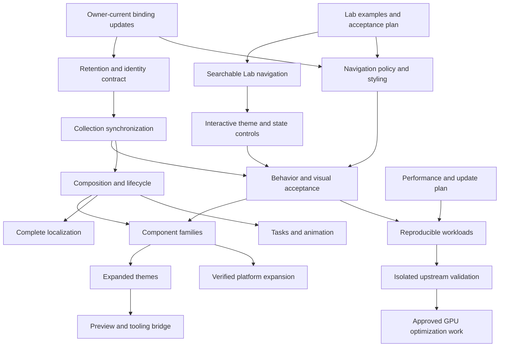

# RustUI implementation roadmap

This roadmap reflects the current repository rather than the original scaffold.
Work proceeds by coherent capabilities; an authorized capability may update all
related files required for implementation, validation and documentation.

| Stage | Capability | Completion outcome |
| --- | --- | --- |
| 0 | Architectural truth | Documentation, file registry, public API status, Lab roles and zero-Allui boundary match the source. |
| 1 | Runtime ownership | ComponentHost, correct root lowering, application bootstrap, window bootstrap, GPUI Components initialization and root mounting. |
| 2 | State and identity | Stable component identity, state access, binding, actions, observation, invalidation, environment and lifecycle contracts backed by GPUI. |
| 3 | Lab story system | Canonical catalog, isolated stories, variants, state controls, event log, source examples and verification status. |
| 4 | First component contracts | Harden Text, Button, VStack and HStack with identity, layout, focus, keyboard, accessibility and documented macro grammar. |
| 5 | Typed theme resolution | Resolve macOS 27 component styles, beginning with Button; support state and variant metrics with explicit material fallbacks. |
| 6 | Localization foundation | Locale identifiers, initial catalog subset, messages, fallback, logical direction, GPUI Components synchronization and redraw/layout invalidation. |
| 7 | Inputs and selection | TextField, SecureField, TextEditor, SearchField, Toggle, Checkbox, Radio, Slider, Stepper, Picker and ComboBox with persistent entities. |
| 8 | Collections and navigation | Keyed content, upstream virtualization, lists, tables, trees, navigation, tabs, sidebars, menus and overlays. |
| 9 | Framework capabilities | Async tasks, animation, accessibility tooling, preview, live data reload, serialization bridge and UI Studio integration. |
| 10 | Measurement and optimization | Reproducible RGPE workloads, profiling, approved optimizations and correct fallbacks. |
| 11 | Platform expansion | Separately verified platform adapters, themes and presentation behavior. |

## Roadmap ID naming

- **Stages 0–11** are broad capability areas. A stage can contain multiple implementation and acceptance milestones.
- **M-numbers** (for example, M121) are chronological, evidence-backed delivery milestones; they do not identify roadmap stages.
- **R/L/F/C/I/T/D/P/X IDs** identify workstreams and dependency-ordered work items. P1–P4 are the performance workstream: plan, reproducible workloads, isolated upstream candidate validation, then separately approved GPU/rendering optimization.
- **P3** is the performance workstream's isolated upstream-candidate validation design (`docs/tasks/P3_PATCH_VALIDATION_DESIGN.md`). Legacy cache/diagnostics tasks also use P3-prefixed IDs, so the prefix alone does not identify that workflow. Use each full title or filename:
  - **P3A** — opt-in host lowering diagnostics (`P3A_HOST_DIAGNOSTICS.md`).
  - **P3B** — an existing ID collision: fixed-bounds retained-child cache pilot (`P3B_CACHED_CHILD.md`) and native drag/reorder correctness probe (`P3B_CACHE_DRAG_PROBE.md`). Always include the full title/filename.
  - **P3C** — cache workload CPU/RSS calibration (`P3C_CACHE_CALIBRATION.md`).
  - **P3D** — paired retained-subtree comparison (`P3D_CACHE_COMPARISON.md`).
  - **P3E** — read-only patch-plan manifest validator (`P3E_PATCH_PLAN_VALIDATOR.md`).

## Current verified status (2026-10-19)

The milestone sections below are chronological records; later executed evidence
supersedes earlier pending labels for the same bounded case. They do not imply
that the entire stage or framework is accepted.

| Area | Latest evidence and remaining work |
| --- | --- |
| Tests | Current locked workspace all-targets run after M118 passed 328 tests across 18 result groups (`target/headstart/roadmap-workspace-all-targets-tests-20261019-m118-rerun.log`). The workspace `--lib` run after M127 passed 335 tests across six result groups (`target/headstart/roadmap-workspace-library-tests-20261019.log`). The default `cargo test --workspace --locked` also attempted rustdoc and failed there: the installed Headstart tree has no stage1 `rustdoc`, so Cargo used Homebrew rustdoc 1.97.1 against Headstart-built artifacts. Doctests were not part of the latest run. |
| P3D comparison validation | 24 focused Python tests passed after the probe fix; Headstart check/build passed. Finder/CUA 32-leaf session completed 12 processes (one warmup pair plus five measured pairs); all correctness checks passed with AX/drag false. Median paired cached/uncached attached CPU ratio 0.0729 (range 0.0718–0.0759); median max-sampled RSS ratio 0.9873. Process-level evidence only, not frame/GPU or visual acceptance. The prior 8-leaf result remains documented separately. See `docs/tasks/P3D_CACHE_COMPARISON.md`. |
| P3 diagnostics overhead | The two earlier rejected captures remain preserved and excluded. A fresh current-source 32-leaf Finder/CUA session completed 12 processes (one warmup pair, five measured pairs); correctness passed in all runs, PIDs were unique, and AX/drag stayed false. Median paired diagnostics-on/off ratios: attached CPU 0.995855 (range 0.982688–1.002083), elapsed 0.990446 (0.989967–1.000772), maximum sampled RSS 1.000000 (0.994326–1.002659), median sampled RSS 0.999155 (0.994317–1.000242). CPU spread crosses 1.0, so the observed small difference is inconclusive; this is process-level evidence, not a general overhead or performance claim. Details and evidence: `docs/tasks/P3_DIAGNOSTICS_OVERHEAD_RESULTS.md`. |
| Workspace check | Current post-M118 `./scripts/cargo-headstart check --workspace --all-targets --locked --offline` exited 0 (`target/headstart/roadmap-workspace-all-targets-check-20261019-m118.log`). Earlier milestone logs remain historical evidence. |
| Builds and dependency reuse | Latest M78 Playground build exited 0 (`target/headstart/milestone78-final-playground-build.log`). Earlier M66–M68 and M69–M71 builds passed with all three pinned GPUI dependencies fresh. P3D example build passed with all three dependencies fresh; freshness is reuse evidence, not a performance claim. |
| Focus/editor | M52 FocusScope and M53 CodeEditor bounded native interactions are recorded; focus removal policy, parser-feature approval, syntax highlighting, and full accessibility remain open. |
| Layout | M74 Frame native acceptance verified retained text in Center/Stretch/Baseline, Stretch background expansion, Undo across mode change, cycle retention, and framed button action. Inner width 160 with horizontal Stretch fixed Input percent-width collapse; outer alignment cycle unchanged. Limits: no exact pixels/caret-selection/full keyboard-AX/RTL/platform acceptance, and no peer-baseline claim. See `target/headstart/milestone74-frame-gui.json`. M54/M55/M58/M61/M62/M63/M64 bounded results and their remaining limits are in the task contracts. |
| Collections | M75 Tree native checks covered replacement expansion retention/change, branch removal/restoration, stable-ID selection through reorder, selection clearing on removal, and selected-descendant auto-expansion. M76 Table checks covered invalid-index normalization, index-based reorder/removal, native row selection, repeat-click, and clear. M126 additionally observed Escape preserving selection for non-selectable source List and KeyedList, visible virtualized KeyedList row names, and DataGrid Table/Row semantics with controlled row selection. Limits: full keyboard/AX/screen-reader, RTL, cross-platform, and performance acceptance; Table notification counts and ABA provenance were not measured. See `docs/tasks/R3A_COLLECTION_SYNC.md` and `target/headstart/evidence/r3-list-datagrid-acceptance-20261019.json`. |
| Interaction | M56 scoped keyboard shortcuts and M59 HoverRegion received bounded native acceptance; shortcut conflict precedence, pointer-only hover dwell, AppAction, nested scopes/regions, and full keyboard/screen-reader coverage remain open. |
| Animation | M57 child-retention identity passed bounded native sibling-gallery checks (bundle SHA-256 `bc184cdda3d2e0f0e3d134f288a3e808153ee4febc74ac2defbe6410826f8dbd`). M60 normal and reduced-motion SpringProbe verification passed; counts are RustUI root host lowerings, not GPUI frames, alpha, or velocity continuity. Exact alpha, animation trajectory, velocity continuity, and performance remain unmeasured. |
| Ownership/tasks | M72 native owner-task acceptance passed restart/cancel/error/same-ID terminal restart and pending-child removal/restore. The removed worker finished but delivered no result; restore was Idle with two mounts. Arbitrary blocking-work interruption and private registry allocation cleanup were not established; cross-platform, keyboard-only and full screen-reader acceptance remain. See `target/headstart/milestone72-owner-tasks-gui.json`. |
| Display controls | Link/Badge/Avatar and feedback native slices accepted; Icon/Spinner artwork awaits asset-source dependency approval. |
| Inputs | M78 bounded ComboBox native checks fixed the options-replacement popup mismatch and covered selection, disabled blocking, owner updates, and missing-option rendering. M121 Picker native acceptance confirmed owner writeback, disabled popup blocking, external Kotlin updates while disabled, and correct selection after re-enable (`target/headstart/evidence/picker-acceptance-20261019.json`). Full keyboard/focus, VoiceOver, pixel, cross-platform, and performance acceptance remain open. The pinned DatePicker builder cannot name its focused trigger; see `docs/tasks/DATE_PICKER_ACCESSIBILITY.md`. Slider AX SetValue remains focused native evidence only. See `docs/tasks/C10_COMBO_BOX_SELECT.md`. |
| Navigation | M78 bounded native routing checks passed: None/unknown hide the detail while preserving the sidebar and allowing native Settings/Files recovery; bound Files updates, reorder, selected-item removal, and restoration were observed. M125 native AX inspection also observed the `Workspace navigation` outline and `Files details`/`Settings details` containers as selection changed. Resize dragging, keyboard navigation, locale switching, full accessibility review, and direct allocation-release instrumentation remain pending. See `target/headstart/milestone78-navigation-gui.json` and `target/headstart/evidence/d1b-preview-host-acceptance-20261019.json`. |
| Cache pilot | Three no-AX fixed-bounds workloads proved reuse and self-invalidation; environment/removal/locale/theme logical scenarios passed; drag, reorder and broader visual cases remain. No frame/GPU speed claim. |
| Themes/tooling | Validated normalized theme JSON export and read-only Playground inspection accepted. M65 observed opt-in polling apply a valid edit, preserve the last good theme on invalid JSON, recover after repair, respect outer appearance selection, stop while disabled, and cease activation after story removal. Exact counters/quiescence, performance, missing-file/permission and multi-root cases remain unverified. D1a's versioned preview descriptor schema/codec is implemented and focused-tested; it does not serialize arbitrary Rust views or mount previews. D1b now has a signal-only in-process compiled host source implementation; focused tests were added but not run. Bounded native checks passed for typed edits, action dispatch, teardown/remount, rejection probes and NavigationSplit naming; caret/selection retention across rerender remains unverified. |
| Upstream | Pins unchanged; GPUI Fast remains disabled. Isolated quad-sort harness passed 9 tests (7 algorithm, 2 integration), and baseline/candidate production builds succeeded. The upstream full-library test build remains failed; paired probes are building, with native visual and performance validation pending. Candidate promotion is not approved. See `docs/tasks/QUAD_SORT_PATCH_PROPOSAL.md`. |
| Dialog candidate | M77a manual native checks on the isolated revised tracked-Dialog patch observed keyed middle removal/focus retention, callback-opened dialogs, deferred-confirm rebase, bottom removal, Escape focus restoration, and backdrop/native Close focus restoration. The updated counter capture shows 15/15 weak probe `InputState` entities retired/released, not every allocation. This remains partial evidence: automated/race variants, stale IDs, broader entity-release/callback counts, and baseline native comparison remain; no normal dependency promotion or full Dialog acceptance. See `docs/tasks/O7_DIALOG_KEYED_FOCUS_REBASE_REVIEW.md` and `target/headstart/candidates/dialog-focus-rebase-20261018-a/evidence/milestone77a-native-dialog.json`. |

**M66–M68 closeout:** source contracts and Playground examples are present. The suite passed 221 tests across 12 binaries and the M66–M68 build succeeded with all three pinned GPUI dependencies fresh. M66's bounded native pointer evidence is recorded in `target/headstart/milestone66-drag-drop-gui.json`; keyboard-only acceptance and actual owner destruction during an in-flight drag remain pending. Bounded M67 native acceptance is recorded in `target/headstart/milestone67-shadow-gui.json`: Dark and Light appearance, independent retained A/B values, style/offset/parent changes, owner action, omission/restoration, and Arabic RTL/English restoration were observed. Exact pixels, native shadow-disable behavior, full keyboard/AX speech, and performance remain unverified. Bounded M68 native acceptance is recorded in `target/headstart/milestone68-card-gui.json`: equal 260-point gallery widths, independently editable same-ID children, custom style and parent updates, omission/restoration, Light appearance, and Arabic RTL/English restoration were observed. Gallery width is not intrinsic Card sizing; exact pixels/padding, undo, full accessibility/keyboard, and performance remain unverified.

## M83 — Collection keyboard decision tests

Added a focused regression test for Collection navigation, Escape clearing, Enter gating, and ignored key inputs. The RustUI all-targets check passed. This is helper-level coverage only; native key dispatch, focus/IME behavior, and assistive-technology acceptance remain open. See `docs/tasks/M83_COLLECTION_KEYBOARD.md`.

## M84 — bounded Collection keyboard acceptance

The existing Playground Collection demo passed bounded native arrow/Home/End navigation, Escape clearing, and Enter confirmation-gating checks. Its accessibility tree exposes the list and named selectable rows. Screen-reader speech, IME filtering, modified shortcuts, cross-platform behavior, and performance remain open. The test app and app-specific build outputs were removed after testing. Evidence: `target/headstart/milestone84-collection-keyboard-gui.json`.

## Implemented baseline

- Cargo workspace and locked, vendored GPUI stack
- Persistent Headstart build cache and dependency reuse evidence
- `View` and `ViewHost`
- `#[component]`, `VStack!`, and `HStack!`
- `Text`, `Button`, `VStack`, and `HStack`
- Basic component actions and whole-host notification
- macOS 27 theme parsing, validation and global GPUI Components application
- Locale/catalog validation, fallback, localized text, RTL stack behavior and runtime switching
- Live Lab Button demo
- Playground catalog, search, appearance switching and reference comparison shell

## Dependency order

Runtime entity ownership precedes state handles. State and identity precede
stateful controls. The Lab story contract precedes a broad component catalog.
Typed component theme resolution follows stable component public APIs.
Localization follows environment and invalidation. Performance work follows
functional behavior and reproducible workloads.

## Current milestone

Stages 0–7 have baseline implementations; this is not full behavioral, visual,
accessibility, or performance acceptance. Stage 8 has baseline implementations
through 8G. The next delivery focuses on correctness and acceptance readiness.

Milestone 7A established retained GPUI entity ownership and the controlled
`TextField`, `SecureField`, and `SearchField` path. Milestone 7B adds retained
multiline `TextEditor` plus controlled `Toggle`, `Checkbox`, and `Radio`.
Milestone 7C adds retained `Slider` and bounded numeric `Stepper`. The Lab input
story exposes all nine controls through live RustUI bindings. Milestone 7D adds
controlled string `Picker` and searchable `ComboBox` backed by retained upstream
selection entities; the Lab story now exposes all eleven controls. Milestone 7E adds
retained single-date and color selection; the Lab story now exposes all thirteen
controls.

The Stage 7 component baseline is implemented. Interaction and visual acceptance
remain pending.

Milestone 8A adds a retained, searchable, virtualized string `List` with controlled
source-index selection and a dedicated Lab story. Milestone 8B adds a retained,
virtualized string `Table` with validated row shape, controlled row selection, and a
dedicated Lab story. Milestone 8C adds a retained, virtualized `Tree` with unique node
IDs, hierarchy expansion, and controlled stable-ID selection. General keyed row
builders, sidebars, menus, and overlays remain pending. Milestone
8D adds `TabView` with unique stable IDs, controlled selection, upstream tab behavior,
and selected RustUI child composition. Milestone 8E adds ordered `Breadcrumb` items
with optional RustUI component actions over the upstream breadcrumb control.

Milestone 8F adds RustUI-owned `AnyView` erasure and uses it in `TabItem`, allowing
heterogeneous tab content while keeping GPUI elements behind the lowering boundary.
Milestone 8G adds `NavigationStack`, `NavigationDestination`, and `NavigationLink`
with a bound string route path, heterogeneous destinations, and back navigation.

**M75–M76 collection closeout:** bounded native Tree and Table interaction checks
are recorded in `docs/tasks/R3A_COLLECTION_SYNC.md`. Tree expansion survives
replacement when the declaration is unchanged, explicit changes apply, and a
selected descendant causes GPUI to expand ancestors. Table selection remains
source-index based and invalid indices normalize to `None`. The combined workspace
run passed 248 tests across 12 binaries; the final Headstart build exited 0 with
GPUI and GPUI Components fresh. Exact pixels, complete keyboard/AX/screen-reader,
RTL, platform, and performance acceptance remain open.

## Coding delivery plan — 2026-10-18

The existing baseline is retained. Work is split into independent workstreams,
with dependencies between later tasks made explicit. A task is not accepted merely
because its files exist. No additional component expansion precedes the runtime
and Lab acceptance work below.

### Model and coordination policy

- Use `gpt-6-luna`, low effort, for bounded inventory, documentation, and mechanical
  example corrections. This is the available budget model choice; no exact price
  comparison is claimed because the tools expose no billing rates.
- Use `gpt-6-sol`, medium effort, for Rust ownership, type-erased callbacks, retained
  entity behavior, and integration defects. Use Luna for smaller follow-up edits
  once the contract is settled. Escalate only a concrete unresolved problem.
- High effort is reserved for a demonstrated need in lifecycle, invalidation, or
  rendering correctness. Astra is not assigned to this delivery.
- Root coordinates and reviews. The available tools cannot change the running
  root chat's model/effort mid-turn; agent assignments explicitly set both.
- At most three agents work alongside root. Each owns disjoint files. Root owns
  this roadmap, shared registry/public documentation integration, and compilation.
- Future task assignments below are queues, not claims that agents are already
  implementing the entire framework. Dependent tasks start after their inputs
  and architectural decisions are resolved.

### Wave 1: dispatched independent tasks

| ID / agent | Deliverable and owned files | Dependency | Model / effort | Risk | Status |
| --- | --- | --- | --- | --- | --- |
| R1 / `runtime_binding` | Owner-current binding mutation; NavigationLink push and Back pop. Owns `crates/rustui-core/src/binding.rs`, `crates/rustui/src/view.rs`, `crates/rustui/src/components/navigation/navigation_stack.rs`, `docs/tasks/R1_BINDING_UPDATES.md`. | Existing Binding and GPUI host updater | Sol / medium | Medium | Implemented; formatting and workspace check passed; interaction pending |
| L1 / `lab_readiness` | Correct displayed API examples and define Lab acceptance work. Owns `apps/rustui-lab/src/code_preview.rs`, `docs/tasks/L1_LAB_ACCEPTANCE.md`. | Existing Lab stories and public API | Luna / low | Low | Delivered; formatting and workspace check passed; snippets are display strings |
| P1 / `performance_plan` | Evidence-based RGPE and upstream candidate pipeline task plan. Owns `docs/tasks/P1_PERFORMANCE_PLAN.md` only. | Existing build scripts, audit and patch records | Luna / low | Low for planning | Plan delivered; implementation gated |

R1 acceptance: navigation mutations read the owner's current value when invoked,
preserve constructor signatures, and route through existing GPUI ownership and
notification. Inspect the shared mutation path and compile the workspace. Rapid
interaction behavior remains pending until executed in Lab.

L1 acceptance: displayed examples match supported action syntax, and the task
document distinguishes source inspection, compilation, manual interaction,
visual comparison, and accessibility evidence. Documentation is not GUI acceptance.

P1 acceptance: all claimed existing infrastructure has source references; unknown
capabilities remain unknown; approval gates and last-validated fallback are explicit.
No optimization, upstream upgrade, or automated promotion is enabled by this task.

### Wave 2: correctness and a usable acceptance application

| ID / responsible agent | Work and candidate files | Depends on | Acceptance outcome | Model / effort |
| --- | --- | --- | --- | --- |
| R1a / runtime_binding | Reuse owner-current mutation for `components/input/stepper.rs`, preserving bounds and disabled semantics. | R1 | Repeated callbacks compose with intervening owner updates; bounds are evaluated consistently. | Luna / low for the bounded change; Sol / medium if range semantics require redesign |
| R2 / runtime_binding + collection_sync | Implement scoped retained entity/subscription ownership in `runtime/component_host.rs` and `view.rs`; integrate tabs and navigation. | R1; mixed retention policy approved | Inactive declared tabs and covered pages retain controls; removed controls/pages release registry ownership; same local ID allowed in distinct scopes. Source and workspace check complete; GUI acceptance pending. | Sol / medium for both agents |
| R3 / runtime_binding | Review controlled collection synchronization in `components/data/{list,table,tree}.rs`; eliminate event feedback and document stable IDs for dynamic data. | R2 | External selection changes and user events converge without update loops; reorder/delete behavior is specified. | Sol / medium |
| L2 / lab_readiness | Reuse useful Playground shell behavior for searchable, scrollable Lab story navigation; edit `component_catalog.rs`, `main.rs`, and `canvas.rs` as needed. Keep the current visual metrics. | L1 | Every implemented story is reachable in a small window; unsupported stories are explicitly unavailable. | Luna / low initially; Sol / medium only if GPUI integration requires it |
| L3 / lab_readiness | Implement theme/appearance selection, state/property controls and evidence display using existing Lab panels. | L2; current theme resolver | Demonstrations expose normal, hover, pressed, disabled and focus states; theme/locale selections persist as designed. | Sol / medium |
| N1 / runtime_binding | Set explicit unknown-route behavior, localized Back label, and navigation theme policy in `navigation_stack.rs`; clarify action examples in Breadcrumb. | R1; L1; agreed route policy | Unknown routes are observable and recoverable; navigation controls obey the selected RustUI theme and locale. | Sol / medium |
| A1 / lab_readiness | Perform manual component acceptance and record evidence through existing Lab status/reporting modules. | R3, L3, N1; user-requested verification | Click, repeated action, keyboard, focus, disabled, locale/RTL and appearance checks have reproducible steps and actual outcomes. Visual comparisons use Playground metrics. | Sol / medium for diagnosis; Luna / low for evidence indexing |

R2 and L2 can proceed independently. R3 and N1 share the runtime owner and run in
sequence. L3 and N1 must agree on the existing theme contract before changing shared
theme code. Root alone integrates cross-workstream public exports and documentation.

### Later dependent deliveries

| ID / queued owner | Scope and principal paths | Prerequisites / decisions | Acceptance contract | Minimum suitable starting model |
| --- | --- | --- | --- | --- |
| F1 / runtime_binding | Conditional/repeated content, nested component identity/lifecycle, environment and observation; `view.rs`, `runtime/`, `rustui-core/`, `rustui-macros/`. | R2–R3; explicit nested ownership design | State survives supported reorder; unmount and subscription cleanup have defined behavior; invalidation uses GPUI. | Sol / medium; escalate design only if needed |
| C1 / runtime_binding | Remaining core layouts/controls, then sidebars, menus and overlays; `components/`, `layout/`, `modifiers/`. | F1, A1; per-component upstream audit | Each component has public syntax, stable identity, theme/localization integration and a Lab story. Implement one coherent family at a time. | Luna / low for mechanical wrappers; Sol / medium for retained controls |
| I1 / lab_readiness | Complete translation/formatting/fallback/font/bidi contracts; `rustui-i18n/`, `rustui/src/localization/`, `text/`, `locales/`. | F1; catalog and formatting dependency decisions | Parameterized/plural messages, formatting, runtime locale switching and RTL are validated; distinguish GPUI shaping from translation responsibilities. | Sol / medium |
| T1 / lab_readiness | Expand semantic themes, component variants and live theme data reload; `theme/`, `themes/`, Lab selectors. | C1 by component family; versioned schema decision | Runtime packs validate, apply consistently and report unsupported effects; platform labels do not imply platform support. | Sol / medium |
| F2 / runtime_binding | Async tasks, cancellation, derived state, navigation expansion and animation; `runtime/tasks.rs`, `rustui-core/`, `animation/`, navigation modules. | F1; scheduling/ownership decisions | Background results enter GPUI safely; dropped owners cancel or ignore work; animation uses GPUI scheduling. | Sol / medium |
| D1 / lab_readiness | Preview, live data/theme updates, serialization bridge and UI Studio integration contracts. Candidate paths chosen after schema/API design. | F1, T1; serialization boundary decision | General-purpose external tooling works without Chorus dependencies; data reload is distinguished from Rust recompilation. | Sol / medium for design; Luna / low for documented adapters |
| P2 / performance_plan | Workload and artifact provenance records, dependency reuse reporting, per-optimization inventory. | P1; A1 provides reproducible functional workloads | Compiler/dependency/features/profile/cache inputs accompany measurements; benchmark conclusions follow evidence. | Luna / low for inventory; Sol / medium for measurement code |
| P3 / performance_plan | Isolated upstream candidate and patch validation workflow; `patches/`, `scripts/`. | P1–P2; approved pipeline design and candidate revisions | Failed candidates cannot replace validated sources or cache; promotion requires explicit approval. | Sol / medium |
| P4 / performance_plan | GPUI Fast integration, drag-aware retention, damage/surface/presentation optimizations and native composition. | P2–P3; separate phase approval and verified upstream compatibility | Independently configurable optimizations, correctness/visual/performance evidence and safe full-frame fallback. | Specialist model/effort selected after audit; not dispatched |
| X1 / performance_plan | Platform expansion and backend capability matrix. | Accepted framework baseline; per-platform scope approval | Build/runtime/accessibility evidence exists on each claimed target; future backends remain proposals. | Luna / low for inventory; implementation difficulty assessed later |

All source paths above are relative to this workspace; ownership is assigned before
each queued task starts. Do not pre-create speculative modules. Shared paths such as
`view.rs`, `prelude.rs`, `main.rs` and theme resolution must never have concurrent
writers. Cross-cutting tasks are serialized when their ownership overlaps.

### Evidence and milestone reporting

Report each completed milestone with changed files, actual checks, known limits,
and its next dependency. Root serializes compilation using
`./scripts/cargo-headstart check --workspace --all-targets --locked` and preserves
the persistent cache. No new tests or test execution is included in this dispatch;
test cases are planned for a requested verification pass. No GUI acceptance or
benchmark success is inferred from compilation. Only the executing agent/root may
mark its delivered task complete after reviewing actual output.

Git metadata is absent in this workspace as inspected on 2026-10-18. Do not
initialize a repository or manufacture a commit baseline. Record file scope and
evidence directly and preserve pre-existing work.

### Wave 1 integration evidence

- All three dispatched agents completed their bounded assignments. Root reviewed
  the changed callback path, matched the Breadcrumb fragment to the Lab source,
  and corrected a performance-plan source attribution.
- `rustfmt --check --edition 2024 crates/rustui-core/src/binding.rs crates/rustui/src/view.rs crates/rustui/src/components/navigation/navigation_stack.rs apps/rustui-lab/src/code_preview.rs`: exit 0.
- `./scripts/cargo-headstart check --workspace --all-targets --locked`: exit 0,
  finished in 2.83 seconds. Raw output: `target/headstart/roadmap-wave1-check.log`.
- Cargo reported the existing future-incompatibility warning for `block 0.1.6`.
- No test execution, native-window interaction, accessibility, visual comparison,
  or benchmark was performed. `check --all-targets` type-checks test targets but
  does not run them. This evidence does not prove dependency artifact reuse or
  end-to-end interaction correctness.

## Milestone 2 — current-value controls, Lab navigation, build evidence

Implementation authorized by the user's request to proceed with the roadmap.
The three tasks below can run independently and have exclusive file ownership.

| Task | Agent / model / effort | Owned files | Status |
| --- | --- | --- | --- |
| R1a | `stepper_updates` / Luna / low | `components/input/stepper.rs`, `docs/tasks/R1A_STEPPER_UPDATES.md` | Implemented; formatting and workspace check passed |
| L2 | `lab_readiness` / Luna / low | Lab `main.rs`, `docs/tasks/L2_STORY_BROWSER.md` | Implemented; formatting and workspace check passed; GUI pending |
| P2a | `performance_plan` / Luna / low | `scripts/record_build_provenance.py`, `docs/tasks/P2A_BUILD_PROVENANCE.md` | Implemented; help/syntax checks passed; actual build evidence recorded |

P2a implements evidence capture only. Benchmark workloads and performance claims
still depend on functional acceptance; this preparatory utility does not enable
GPU work, GPUI Fast or dependency promotion. Root owns integration and the shared
compile check. R2's inactive-control retention choice has been presented to the
user; no retention semantics change is included in this milestone.

### Milestone 2 integration evidence

- Initial check failed with E0308 on Stepper's reference-valued `clamp` calls;
  both were corrected to clamp `(*value)`. Review also restored pre-existing
  accessibility labels, control order and spacing. Initial diagnostics remain in
  `target/headstart/roadmap-milestone2-check.log`.
- The Lab list uses canonical `StoryId::label()` strings and source-index selection;
  all ten story bodies and their bindings remain wired.
- Final `./scripts/cargo-headstart check --workspace --all-targets --locked`:
  exit 0; output in `target/headstart/roadmap-milestone2-check-final.log`.
  Only the existing `block 0.1.6` future-compatibility warning remains.
- Owned Rust files passed `rustfmt --check --edition 2024 --config skip_children=true`.
  The initial unscoped Lab rustfmt invocation may have reordered an import in
  `locale_selector.rs`; no baseline Git metadata exists to establish its origin.
  Subsequent formatting explicitly avoids recursive module traversal.
- `record_build_provenance.py --help` and Python syntax compilation passed.
  The recorder was used on the final successful check, producing
  `target/headstart/evidence/build-provenance-20261018T031827.922751Z-15919.json`.
  The record labels workspace hashes as capture-time observations, and build
  command/exit/profile as caller-supplied facts. Compiler strings remain unknown;
  dependency reuse was not evaluated by this utility.
- No tests, GUI interactions, accessibility checks, visual comparisons or
  performance benchmarks were executed.

## Milestone 3 — navigation presentation and collection synchronization

| Task | Agent / model / effort | Exclusive files | Status |
| --- | --- | --- | --- |
| N1 | `runtime_binding` / Sol / medium | `navigation_stack.rs`, framework en/fr/ar catalogs, `docs/tasks/N1_NAVIGATION_POLICY.md` | Implemented; formatting and workspace check passed; GUI pending |
| L3a | `lab_readiness` / Luna / low | Lab `main.rs`, `theme_selector.rs`, `docs/tasks/L3A_APPEARANCE_CONTROLS.md` | Implemented; formatting and workspace check passed; GUI pending |
| R3a | `collection_sync` / Sol / medium | Data `list.rs`, `table.rs`, `tree.rs`, `docs/tasks/R3A_COLLECTION_SYNC.md` | Bounded selection guards implemented; formatting and workspace check passed; interaction checks pending |

N1 uses RustUI Button for navigation controls and shows an explicit unavailable
destination instead of silently displaying the root for an unknown route. Back
remains available and the path is unchanged until an action mutates it. L3a exposes
light/dark modes of the existing macos27 runtime pack only. R3a handles confirmed
selection feedback independently of retention lifetime; identity/pruning and
expansion policy changes remain in R2 and the remaining R3 work.

### Milestone 3 integration evidence

- NavigationLink and Back now lower through RustUI Button and its existing
  AppAction bridge. English, French and Arabic framework catalogs include Back
  and unavailable-destination messages. Unknown routes preserve the path and
  display the missing route instead of displaying the root.
- Lab Light/Dark buttons reuse the same parsed macos27 document as startup.
  Existing theme activation refreshes windows through GPUI Components. Activation
  errors are reported to stderr. Additional theme packs, active-mode indication,
  and in-window error presentation are not implemented by L3a.
- List/Table/Tree event handlers compare with the current bound owner before
  writing. Table also records the last reconciled owner value and ignores an event
  whose payload no longer matches TableState or whose owner changed before event
  delivery. Newer external owner state wins until reconciliation. Value-only
  selection still cannot distinguish an owner value that changed away and back
  before delivery; R3a does not introduce state revision tracking.
- Final `./scripts/cargo-headstart check --workspace --all-targets --locked`:
  exit 0, 2.80 seconds. Log: `target/headstart/roadmap-milestone3-check-final.log`.
  Existing `block 0.1.6` future-compatibility warning remains.
- All six changed Rust files passed non-recursive edition-2024 rustfmt checking.
- Evidence record:
  `target/headstart/evidence/build-provenance-20261018T032518.564526Z-20070.json`.
- No tests, GUI interactions, visual comparisons, accessibility checks or
  performance measurements were executed. These are implementation milestones,
  not acceptance of the full runtime or complete optimization roadmap.

## Milestone 4 — scoped control retention (R2)

The user approved the mixed retention policy. Two Sol / medium agents completed
independent runtime and composition tasks:

- `runtime_binding`: scoped entity/subscription keys, per-render visitation,
  duplicate identity detection, and pruning after successful root lowering.
- `collection_sync`: inactive-tab preservation and navigation page scopes keyed
  by the full route prefix, including repeated routes at different depths.

Switching tabs preserves controls in currently declared inactive tabs. Pushing a
page preserves earlier pages still in the path. Popping/replacing a page, removing
a tab, or removing a control from rendered content releases its registry entry.
Bound root component values remain independent of those entries. An inactive
subtree is reconciled when rendered again. GPUI/frame references may delay actual
entity destruction after registry removal.

Dynamic containers require stable explicit IDs; sibling containers must have
unique IDs. Root mount/unmount callbacks remain root-only. Arbitrary repeated-row
composition and nested component lifecycle callbacks remain future work.

### Milestone 4 integration evidence

- `./scripts/cargo-headstart check --workspace --all-targets --locked`: exit 0,
  3.09 seconds. Log: `target/headstart/roadmap-milestone4-check.log`.
- Non-recursive edition-2024 rustfmt checking passed for the four changed Rust files.
- Evidence: `target/headstart/evidence/build-provenance-20261018T034731.380295Z-29320.json`.
- Existing `block 0.1.6` future-compatibility warning remains.
- No tests, GUI interactions, accessibility checks, or benchmarks were run.
  Runtime behavior acceptance remains pending; compilation does not establish it.

Details: `tasks/R2_RUNTIME_RETENTION.md` and `tasks/R2_COMPOSITION_RETENTION.md`.
The retention decision is resolved. Subsequent nested identity/lifecycle work must
preserve this policy. Advanced GPU/native-composition and upstream revision gates
remain intact.

## Milestone 5 — Lab retention exercises and dependency evidence

Two independent tasks were delegated at the lowest suitable starting settings:

- **L3b / lab_retention_controls / Sol medium:** separate root-bound text editors
  in Tabs and NavigationStack; remove/restore the Details tab; show/hide an extra
  editor on the visible Overview/root page; contextual controls and event records.
  Stable container IDs and repeated local editor IDs exercise R2 scope isolation.
- **P2b / dependency_reuse_report / Luna low:** optional structured JSON report
  from the existing Cargo reuse checker, with log SHA-256, artifact metadata,
  missing/rebuilt/fresh package status, and source-log overwrite protection.

Integration made editors compact, disabled show/hide controls on covered pages,
kept Button property controls specific to the Button story, and supplied concrete
public API examples. Bound text persistence is distinct from retained cursor/undo
state. Entity retention does not promise automatic keyboard focus restoration.

### Milestone 5 integration evidence

- Initial workspace check failed on bare local variables inside the current stack
  macro. Supported method-call expressions now compose those controls and apply
  their spacing. An intermediate block-expression workaround compiled with brace
  warnings; it was replaced rather than suppressing diagnostics.
- `./scripts/cargo-headstart check --workspace --all-targets --locked --message-format=json`
  passed with exit 0 in 2.33 seconds. Final logs:
  `target/headstart/roadmap-milestone5-check-accepted.{jsonl,log}`.
- Non-recursive edition-2024 rustfmt checking passed for the four changed Rust
  source files. Python syntax parsing and the report CLI help completed successfully.
- The reporter executed against that final Cargo log with exit 0. All five recorded
  artifacts for `gpui-pre`, `gpui-pre-platform`, and `gpui-component` were fresh.
  Report: `target/headstart/evidence/roadmap-milestone5-reuse.json`.
- Provenance: `target/headstart/evidence/build-provenance-20261018T035827.188846Z-35201.json`.
- This proves reuse of check artifacts only. No executable build-cache claim,
  benchmark, or Headstart speedup is inferred. The existing `block 0.1.6`
  future-compatibility warning remains.
- No tests or GUI/accessibility interactions were run. L3/A1 behavior acceptance,
  general property inspection, and the Lab root scrolling limitation remain open.

Task notes: `tasks/L3B_RETENTION_CONTROLS.md` and
`tasks/P2B_DEPENDENCY_REUSE_REPORT.md`. F1 nested identity/lifecycle design and
advanced RGPE phases remain separate roadmap work.

## Milestone 6 — vertical viewport and next ownership design

Three independently owned tasks were delegated:

- **C1a / scroll_view_primitive / Luna low:** the minimal `ScrollView(content)`
  adapter over GPUI's native vertical overflow, with stable identity, bounded size,
  optional validated height, non-shrinking content, and public exports.
- **L3c / lab_scroll_host / Luna low:** wrap the current Lab root in that viewport,
  retaining its internal layout, bindings, story browser and contextual controls.
- **F1 design / nested_ownership_design / Sol medium:** inspect existing ownership
  and propose the next conditional/keyed composition slice. No F1 source change.

C1a is the narrow layout prerequisite for L3, not completion of the broader C1
component catalog. Custom scrollbars, horizontal modes and virtualization remain
outside this baseline. F1 requires coordinated retained-control and native GPUI
identity boundaries; independent child state/props/actions/lifecycle remains a
later, explicitly designed slice.

### Milestone 6 integration evidence

- Root review corrected ID conversion, viewport sizing and generated style-method
  assumptions before compilation. The initial check then identified missing GPUI
  interactive trait imports; these were added without suppressing diagnostics.
- `./scripts/cargo-headstart check --workspace --all-targets --locked --message-format=json`
  passed with exit 0 in 1.87 seconds. Evidence:
  `target/headstart/roadmap-milestone6-check-final.{jsonl,log}`.
- Non-recursive edition-2024 rustfmt checking passed for all four changed Rust files.
- Reuse reporting completed with exit 0; required GPUI/Platform/Components artifacts
  were all fresh. Report: `target/headstart/evidence/roadmap-milestone6-reuse.json`.
- Provenance: `target/headstart/evidence/build-provenance-20261018T040733.267910Z-40261.json`.
- These are check artifacts, not a full executable rebuild or speed benchmark.
  Existing upstream `block 0.1.6` future-compatibility warning remains.
- No tests or GUI/accessibility checks ran. Small-window reachability, wheel/trackpad
  scrolling, nested scrolling, and keyboard/focus acceptance remain pending.

Next foundation proposal: `tasks/F1_NESTED_OWNERSHIP_DESIGN.md`. Resolve layout
semantics and identity boundaries for the first keyed composition slice before
implementing independently stateful child hosts. Advanced RGPE gates remain intact.

## Milestone 7 — optional and keyed composition

Completed the first F1 implementation slice through three independent tasks:

- **keyed_runtime / Sol medium:** `Keyed`, optional views, duplicate-key rejection,
  and a GPUI element identity wrapper that reuses the child's layout node.
- **keyed_composition / Luna low:** eager stack `.children(...)` and paired native
  identity/retention scopes for tabs and navigation pages.
- **keyed_lab / Luna low:** reorder/remove/restore demonstration with independent
  root-bound editor values and repeated local editor IDs.

The layout-boundary decision from Milestone 6 is resolved: the wrapper adds no
layout box. Duplicate keys are scoped to logical retention paths, not unkeyed
stack containers. R2 pruning and inactive tab/page retention remain in place.
Independent child component state, props and lifecycle are still pending in F1.

### Milestone 7 integration evidence

- First workspace check failed because Lab omitted the `Keyed` import; corrected.
  Preserved logs: `target/headstart/roadmap-milestone7-check.{jsonl,log}`.
- Final command: `./scripts/cargo-headstart check --workspace --all-targets --locked
  --message-format=json`; **exit 0**, **0.82s**. Logs:
  `target/headstart/roadmap-milestone7-check-final.{jsonl,log}`.
- Scoped `rustfmt --check` passed for all 13 owned Rust files.
- Existing upstream `block 0.1.6` future-incompatibility warning remains.
- Reuse report: `target/headstart/evidence/roadmap-milestone7-reuse.json` confirms
  GPUI, platform and Components check artifacts fresh; no speedup claim.
- Provenance: `target/headstart/evidence/build-provenance-20261018T043037.119724Z-51587.json`.
- No tests, GUI acceptance, accessibility checks or performance measurements ran.

GPUI Fast remains queued at **P4**, after reproducible functional/performance
workloads (P2) and an isolated patch validation/fallback workflow (P3), with separate
phase approval and pinned-revision compatibility review. The audit is complete;
Fast patches and advanced GPU/native composition changes remain disabled. The
remaining component catalog is not a prerequisite for starting that approved phase.

## Milestone 8 — retained child components

Completed the initialized-child baseline of F1 through three independent tasks:

- **child_host_runtime / Sol medium:** explicit `Component(key, initializer)`,
  retained GPUI child hosts, duplicate-key rejection, type replacement, R2 pruning,
  child-local actions/bindings and existing host lifecycle integration.
- **child_owner_diagnostics / Luna low:** wrong-type action and binding writes now
  fail clearly; no-change updates and optional read probes preserve their semantics.
- **child_host_lab / Luna low:** labeled Alpha/Beta child counters/editors, using
  existing Layout reorder/remove controls beside the root-bound keyed example.

Initializer captures and inherited environment are creation-time values. Live
props, environment reconciliation and parent-target operations remain pending.
No vendor/dependency changes, GPUI Fast enablement or advanced RGPE work occurred.

### Milestone 8 integration evidence

- `./scripts/cargo-headstart check --workspace --all-targets --locked
  --message-format=json`: **exit 0**, **3.48s**.
- Logs: `target/headstart/roadmap-milestone8-check.{jsonl,log}`.
- Scoped `rustfmt --check` passed for the 10 owned Rust files.
- Existing upstream `block 0.1.6` future-incompatibility warning remains.
- `target/headstart/evidence/roadmap-milestone8-reuse.json` confirms all requested
  GPUI/Components/platform check artifacts fresh; this is not a speedup benchmark.
- Provenance: `target/headstart/evidence/build-provenance-20261018T043755.007227Z-56067.json`.
- No tests, GUI/focus/lifecycle acceptance or performance benchmarks ran.

F1 remains open for live props/environment contracts and runtime acceptance.
P2/P3 preparation can progress independently; P4 requires the separately approved
performance phase and verified patch compatibility.

## Milestone 9 — live child props and Fast pipeline design

Completed three independent tasks:

- **child_props_runtime / Sol medium:** explicit `.props(value, reconcile)`,
  initial projection before mount, equality-based updates and child notification,
  comparison metadata cleanup and props/type transition behavior.
- **child_props_lab / Luna low:** parent-driven title changes beside independently
  owned child counters and notes in the Layout story.
- **fast_pipeline_design / Luna low:** P3 candidate-validation design, reviewed for
  immutable input records versus append-only outcomes, copied workspace isolation,
  candidate-only patched path sources and preservation of pristine vendor checksums.

P3 is a concrete design, not an implemented pipeline. The P2 workload and numerical
acceptance thresholds remain to be defined; no benchmark was run. GPUI Fast,
upstream patch application, dependency changes and advanced GPU work remain off.
See `tasks/P3_PATCH_VALIDATION_DESIGN.md` for proposed script/layout and gates.

### Milestone 9 integration evidence

- `./scripts/cargo-headstart check --workspace --all-targets --locked
  --message-format=json`: **exit 0**, **4.24s**.
- Logs: `target/headstart/roadmap-milestone9-check.{jsonl,log}`.
- Scoped `rustfmt --check` passed for all eight owned Rust files.
- Existing upstream `block 0.1.6` future-incompatibility warning remains.
- `target/headstart/evidence/roadmap-milestone9-reuse.json` confirms requested
  GPUI/Components/platform check artifacts fresh; no speedup is inferred.
- Provenance: `target/headstart/evidence/build-provenance-20261018T044343.530398Z-59513.json`.
- No tests, GUI/focus/lifecycle acceptance or benchmarks ran.

F1 live props are now implemented. Environment reconciliation, explicit
parent-target operations and runtime acceptance remain open. Fast integration
still depends on the baseline, implemented validation workflow and separate phase
approval; finishing the whole component catalog is not a prerequisite.

## Milestone 10 — scoped environments and workload proposal

Completed three independent tasks:

- **environment_runtime / Sol medium:** `Environment` and `EnvironmentReader`,
  scoped typed overrides without a layout box or owner, and inherited child
  snapshots refreshed during parent lowering without unconditional notifications.
- **environment_lab / Luna low:** shared typed display-mode demo alongside child
  counters, notes, props, reorder and removal controls.
- **fast_workload_plan / Luna low:** P2 native macOS workload proposal based on
  existing Lab state/props/reorder, editing and virtual-list scenarios. It identifies
  missing measurement instrumentation and separates runtime metrics from build reuse.

P2 workload thresholds are proposals requiring baseline calibration, not measured
results. P3 remains a design; GPUI Fast, patches and advanced GPU work remain off.
Neither finishing the component catalog nor inventing benchmark results is required
before preparing this instrumentation. Source: `tasks/P2_WORKLOAD_PLAN.md`.

### Milestone 10 integration evidence

- Initial shared check failed on a missing `Environment` import in Lab canvas;
  corrected. Failure logs retained at
  `target/headstart/roadmap-milestone10-check.{jsonl,log}`.
- Final `./scripts/cargo-headstart check --workspace --all-targets --locked
  --message-format=json`: **exit 0**, **2.30s**.
- Final logs: `target/headstart/roadmap-milestone10-check-final.{jsonl,log}`.
- Scoped `rustfmt --check` passed on all eight owned Rust files. Lab's earlier
  invalid `--skip-children` invocation failed before formatting; the corrected
  `--config skip_children=true` invocation completed.
- Existing upstream `block 0.1.6` future-incompatibility warning remains.
- `target/headstart/evidence/roadmap-milestone10-reuse.json` confirms requested
  GPUI/Components/platform check artifacts fresh; no runtime speedup is inferred.
- Provenance: `target/headstart/evidence/build-provenance-20261018T045549.644024Z-66339.json`.
- No tests, GUI/lifecycle/focus checks or benchmarks ran.

Environment propagation now follows parent renders. Fine-grained observation,
explicit cross-owner callbacks/bindings and runtime acceptance remain open.
Next performance preparation can implement the scoped workload-recording harness;
actual measurements and Fast integration retain their respective authorization and
evidence requirements.

## Milestone 11 — restore Playground as the canonical app

Corrected the app direction to match the user's original Playground request and
explicit requirement that it use only the new RustUI framework.

- **playground_stories / Sol medium:** moved all ten story implementations and
  locale catalogs from Lab into `apps/rustui-playground/src/stories/` and `locales/`;
  embedded their host in Playground and removed duplicate navigation/theme shells.
- **playground_catalog / Luna low:** preserved all 41 catalog rows and SVG mappings,
  corrected baseline coverage notes, updated current docs and launch defaults.
- **playground_framework_layout / Sol medium:** added generic Container/surface
  styling, stack fill/grow and window size/title/material builders within RustUI.
- **Root integration:** rebuilt Playground's existing three-column shell with the
  public RustUI View API, connected both catalog and framework-demo selection, and
  reduced Lab to a compatibility launcher for the same implementation.

Playground's only direct Rust dependency is now `rustui`. Direct GPUI, GPUI platform,
Components and serde_json dependencies were removed from its manifest. The local
Lab-to-Playground launcher dependency changed; all external package identities and
checksums in Cargo.lock remain unchanged. No vendor sources were modified.

The macos27 JSON theme, 1320×820 logical window, 250px sidebar, 300px reference panel,
41 catalog keys and 31 original SVG reference files are retained. This does not
claim pixel-perfect equivalence. Unsupported catalog items have explicit messages.
`playground` and `dev` launch the canonical app; `lab` launches its compatibility
entry point. Canonical and compatibility macOS bundles were updated atomically,
without replacing executable bytes in place while older instances were running.

### Milestone 11 evidence

- Final check: `./scripts/cargo-headstart check --workspace --all-targets --locked
  --offline --message-format=json`, exit 0, **3.56s**;
  `target/headstart/playground-consolidation-check-final.{jsonl,log}`.
- Playground build: `./scripts/cargo-headstart build -p rustui-playground --offline
  --locked --message-format=json`, exit 0, **5.68s**;
  `target/headstart/playground-consolidation-build.{jsonl,log}`.
- `./scripts/cargo-headstart test -p rustui-playground --lib --offline --locked`:
  **5 passed, 0 failed**; `target/headstart/playground-consolidation-tests.log`.
- Compatibility package build exited 0; scoped formatting, shell syntax and locale
  validation passed. The existing upstream `block 0.1.6` warning remains.
- Dependency/source boundary evidence:
  `target/headstart/evidence/playground-consolidation-boundary.json`.
- GPUI/Components/platform check artifacts fresh:
  `target/headstart/evidence/playground-consolidation-reuse.json`.
- Provenance:
  `target/headstart/evidence/build-provenance-20261018T051212.689368Z-76298.json`.
- Native CUA smoke record:
  `target/headstart/evidence/playground-consolidation-native.json`. Observed Button
  count update, story selection, child title/environment update and reorder with
  Alpha count 1 and Beta count 0 retained, plus central preview scrolling.
- GUI observations are a smoke check only: full keyboard/accessibility, all story
  interactions, editing/removal, theme/locale switching and visual equivalence
  remain pending. No performance measurement or Fast enablement occurred.

A before-change source/config snapshot is retained at
`target/headstart/playground-consolidation-before/`. Earlier Lab milestone records
refer to the implementation's historical location; current work belongs in
Playground. See `RUSTUI_PLAYGROUND.md` for current usage.

# Milestone 12 — External runtime process measurements

Completed 2026-10-18. Three independent tasks delivered the standard-library
process collector (Sol Medium), per-run summarizer (Luna Low), and pinned GPUI
timing-hook review (Luna Low).

- `scripts/collect_runtime_metrics.py` samples an existing PID with native `ps`,
  checks process identity, and preserves complete or partial JSON evidence.
- `scripts/runtime_metrics.py` supplies shared validation and exclusive output
  creation. Existing files and symlinks are rejected.
- `scripts/summarize_runtime_metrics.py` validates records and reports process CPU,
  RSS, and sampling overhead separately for each run.
- Final Python integration log: `target/headstart/runtime-metrics-tests-accepted.log`;
  **17 tests passed**. Both CLI help commands succeeded.
- Live collector smoke: five samples from the running Playground, recorded in
  `target/headstart/performance/process-milestone12-idle.json`; final report in
  `target/headstart/performance/summary-milestone12-idle-final.json`.

The one-second idle smoke validates collection, not a calibrated baseline or W1.
CPU is limited by `ps` display precision; RSS is not physical footprint or GPU
memory. Frame, cycle, and main-thread timings remain unavailable. A supplied
build-provenance hash is a reference, not proof of process/binary correspondence.
The hook review found callback cadence and submission timings, not confirmation
that a frame reached the display. See `docs/tasks/P2C_GPUI_TIMING_HOOKS.md`.

No Rust source, manifest, dependency, or vendor changes were required; Cargo was
not rerun. Next: deterministic W1 reset/action recording, repeated accepted
baseline, and calibrated comparison thresholds. P3 remains a design; GPUI Fast
remains disabled and upstream patches require separate approval.

## Milestone 13 — Manually paced W1 scenario runner

Implemented 2026-10-18 in Playground's Layout story. Sol Medium implemented the
initial runner; after a model capacity failure the coordinator completed its
integration. Luna Low performed the independent read-only review.

- Reset starts a fresh child-key epoch; six Next Step actions request Alpha/Beta
  increments, toggle the title prefix, then reverse and restore keyed order.
- Existing public `Component.props` reconciliation delivers idempotent one-shot
  increments. Child keys stay stable within the run; normal manual controls remain.
- The UI displays expected counts and parent-state checks. Event-panel and stdout
  JSON records describe dispatch. Operator visual pass/fail is explicit manual
  attestation; it is not child readback or presentation confirmation.
- Exact files/semantics: `docs/tasks/P2D_W1_WORKLOAD.md`.

Validation: the initial Cargo check found a stack-expression parser error; fixed.
Final `./scripts/cargo-headstart check -p rustui-playground --locked --offline`
exited 0 (`target/headstart/w1-workload-check-accepted.log`). Scoped Rust 1.97.1
rustfmt exited 0 (`target/headstart/w1-workload-format.log`). A source import scan
found no direct GPUI/Components imports in the three changed story files.
Read-only review found the sequence, epoch reset, and idempotence coherent.
No new tests, GUI interaction, or benchmark ran for this slice. Cargo retains an
upstream future-incompatibility warning for `block 0.1.6`; no dependency changed.

This closes the scenario-runner slice, not the complete P2 performance gate.
Automatic scheduling, child readback, a measured completion boundary, repeated
baseline, and calibrated comparison thresholds remain pending. GPUI Fast stays
disabled; candidate patches and advanced GPU/native composition remain gated.

## Milestone 14 — W1 native acceptance and calibrated baseline

Completed 2026-10-18. W1 native screenshot acceptance passed for reset, counters,
title changes, notes, keyed ordering, and operator-result controls. A compact W1
view keeps both children visible; their accessible control labels expose mounted
state for repeated assertions.

Three fresh launches of the same dev binary each ran three warm-up cycles and
30 measured cycles. All **90 measured cycles / 630 state observations passed**.
CPU totals were **33.64, 34.12 and 34.73 seconds**; median RSS was approximately
**124 MiB**. The observed gross CPU range was **3.19%** of the median; the separately
labeled idle-adjusted estimate had a **1.17%** range. This is a same-build CPU/RSS
calibration, not frame timing, a speedup claim, or an automatic acceptance threshold.

Evidence, protocol, limits and exact commands: `docs/tasks/P2E_W1_ACCEPTANCE_BASELINE.md`.
Machine-readable result: `target/headstart/performance/w1-calibration-report-final.json`.
GUI record: `target/headstart/performance/w1-gui-acceptance.json`.

Validation: final native build and scoped formatting exited 0; **18 metric tests
passed**; driver JS syntax checked; all six live captures/report generation passed;
three rejection probes caught altered child traces, source hashes and PID evidence.
Canonical bundle updated; isolated verification window remains available. No
upstream dependency, vendor source or optimization patch changed.

This supersedes Milestone 13's pending W1 GUI/CPU-RSS baseline status. Frame,
main-thread, GPU and presented-frame measurements remain separate future work.
The GPUI Fast fork is not a dependency: planned optimization features belong in
RustUI or controlled versioned upstream patches, with their own implementation gates.

## Milestone 15 — Owner callbacks, theme reload, and logical layout

Implemented and checked on 2026-10-18. Explicit `OwnerAction` targets distinguish same-type parents; native per-click observations verified independent parent/local counts. ThemeFile retains its last successful document, supports explicit transactional reload, and skips unchanged bytes/mode. Playground demonstrated first Light activation, unchanged Light, and Dark switching using canonical `themes/macos27.json`. Spacer and horizontal/vertical Divider were visually inspected. LogicalInsets validates and resolves start/end during lowering; bidi isolation is opt-in; explicit locale scripts override primary-language direction.

Evidence: `target/headstart/milestone15-owner-callback-gui.json`, `milestone15-theme-layout-gui.json`, focused tests and workspace checks. Native verification does not establish full multilingual input/shaping acceptance, automatic filesystem watching, or stale escaped owner callback acceptance. Playground presents independent additions in foundation tabs, excluding compact W1 runs.

## Milestone 16 — Cancellable owner background tasks

`OwnerTaskReader` and `AsyncState` use existing GPUI hosts and executors. Start/restart/cancel uses exact weak owners and monotonic generations; host-owned handles are dropped on release. Deferred terminal cleanup removes finished registry entries without dropping a currently polling task. Unit and workspace runtime tests cover task generations and terminal cleanup.

M16 native evidence covers Loading/success/error/cancel/restart and stale-result suppression. M72 native acceptance on a rebuilt binary passed restart, cancel, error, restart after a completed ID, pending-child removal, and restoration to Idle. On removal the pending worker finished, delivered no completion, and unmounted once; restore showed two mounts. `target/headstart/milestone72-build.log` exited 0; detailed interactions are in `target/headstart/milestone72-owner-tasks-gui.json` and `docs/tasks/F2_OWNER_TASKS.md`.

The observed delivery suppression does not prove interruption of arbitrary blocking work, and private registry allocation cleanup was not directly observed. Cross-platform, keyboard-only, and full screen-reader acceptance remain open. Switching tabs retains owners and is not evidence of release. Documentation tests fail because the installed Headstart compiler has no matching rustdoc; see `docs/tasks/HEADSTART_RUSTDOC.md`. Full runtime-test command uses `--lib --tests` and is reported separately from doctests.

## Next integration — Grid and ZStack

Real native GPUI Grid/ZStack implementations and exports added; workspace all-targets check and focused runtime tests executed. Native examples/visual acceptance are being integrated. LazyGrid virtualization is still pending and must not be inferred from Grid support. No upstream revision, vendored source, GPUI Fast fork, or advanced GPU optimization changed.

## Milestone 17 — Fixed Grid and ZStack native acceptance

Grid and ZStack reuse GPUI's Taffy layout, with validated gap/index bounds and logical RTL column placement. Workspace unit/integration tests passed: **35 tests across 12 test binaries**, zero failures (`target/headstart/milestone17-runtime-tests.log`). Native M17 Grid Review verified three-column/two-row placement in English and Arabic, and centered back-to-front overlay painting. Final Playground build exited 0 (`target/headstart/milestone17-grid-demo-build-accepted.log`).

This supersedes the preceding pending native-example status for the fixed-grid/centered-overlay slice. It does not establish LazyGrid virtualization, custom grid tracks/spans, every overlay alignment, or full roadmap completion. Evidence: `target/headstart/milestone17-grid-overlay-gui.json` and `docs/tasks/C2_GRID_ZSTACK.md`. Basic Icon/Label work has been assigned next; Fluent/ICU additions await dependency approval.

## Milestone 18 — Basic display and feedback components (in progress)

Icon, Label, Image, Progress and Spinner implementations/exports are integrated. Workspace all-targets check and 47 unit/integration tests passed; native M18 Review verified PNG file rendering, Label text/secondary content, image accessibility name and determinate Progress transitions 25/50/75/100/0 with matching AX numeric values.

M73 added and verified the indeterminate `Progress(id, value).indeterminate(true)` mode, which delegates to the pinned GPUI Components loading mode and defaults to determinate. Three focused tests passed; the expanded workspace suite passed 237 passed, 0 failed across 12 binaries (Cargo exit 0), the locked/offline all-targets check exited 0, and the M73 build exited 0. Native CUA screenshots showed visibly different moving-fill positions; the same review changed determinate value from 25 to 50 and observed labels for both modes. Reduced motion was checked in upstream source only; no OS/UI toggle was tested. Exact pixels, cross-platform behavior, animation timing/performance, keyboard-only interaction and full screen-reader acceptance remain unverified. Evidence: `target/headstart/milestone73-progress-gui.json`, `target/headstart/milestone73-progress-tests.log`, `target/headstart/milestone73-build.log`.

**Not finished:** named Icon and Spinner pixels are blank because the application has no upstream icon asset source. `RustUI::assets` supports custom GPUI asset registration. Direct access to the already-pinned `gpui-kit-assets 0.7.3` awaits dependency approval; no manifest/lock/vendor change has been made. Native node presence alone is not visual acceptance. Earlier evidence: `target/headstart/milestone18-partial-gui.json`.

## Milestone 19 — Link, Badge and Avatar native acceptance

Completed 2026-10-18 for the exercised native interaction slice. Avatar initials
“AL” and its image name appeared; the count badge “7” preserved the child button
action from 0 to 1. Enabled Link mouse activation advanced 0→1→2; clicking the
disabled Link left the count at 1 and Safari unchanged. Shift+Tab focused the enabled
Link and skipped the disabled Link; Enter advanced 2→3 and Space 3→4, matching the
pinned GPUI Components Button Link behavior. A local file fixture opened in Safari
with the expected title.

Evidence: `target/headstart/milestone19-links-gui.json`, `docs/tasks/C6_LINK_DESIGN.md`,
and `docs/tasks/C7_BADGE_AVATAR.md`. External navigation, screen-reader announcements,
other badge variants, and broader avatar image/loading behavior remain unverified.

## Milestone 20 — Opt-in host lowering diagnostics

Completed the recording/snapshot/clear slice using a GPUI App global, with no second runtime or background timer. Native checks verified disabled-by-default, enabled per-type counts/durations, and no continued collection after disable and clear. Workspace unit/integration suite passed 61 tests at this integration point; doctests retain the previously recorded matching-rustdoc limitation.

Evidence: `target/headstart/milestone20-host-diagnostics-gui.json`, `milestone19-tests.log`, `docs/tasks/P3A_HOST_DIAGNOSTICS.md`. Timing excludes layout, paint, GPU and presentation; raw microseconds are verification observations, not calibrated performance claims. Milestone 18's icon asset source approval remains pending.

## Milestone 21 — Feedback and loading visuals

The M22 native Review verified that EmptyState rendered its title and detail,
with AX name “Saved items are empty” and Help “Saved items will appear here.”
ErrorState rendered a red title and detail, with AX name “Item loading failed”
and Help “Check your connection and retry.” The retry count changed from 0 to
1. In the dark third card, Skeleton bars were visible and the accessibility tree
contained two ProgressIndicator nodes named “Loading item title” and “Loading
item details.”

The final unit/integration run passed 77 tests across 12 binaries;
`target/headstart/milestone21-22-tests-final.log`. C8 and C9 details are recorded
in `docs/tasks/C8_EMPTY_ERROR.md` and `docs/tasks/C9_SKELETON.md`. M21 evidence:
`target/headstart/milestone21-feedback-gui.json`. The M22 native observations
above do not claim VoiceOver announcements or announcement cadence.

## Milestone 23 — Playground Quit controls

Completed native Quit Review. The Playground built successfully
(`target/headstart/milestone23-quit-build.log`). Cmd+Q terminated owned PID 51285
and the menu Quit command terminated owned PID 51464; both were confirmed absent
with `ps` exit status 1. Theme and locale controls were present. Evidence:
`target/headstart/milestone23-quit-gui.json`. Other platforms and close-window
behavior remain unverified.

## Milestone 22 — Fixed-bounds cache pilot (in progress)

The opt-in `cached_fixed(width, height)` path reuses official GPUI's cached
entity API, with uncached fallbacks for typed environments, active native drags,
and active accessibility. The accessibility fallback was checked natively: both
child buttons stayed in the AX tree, and the cached-pilot child counter changed
from 0 to 1 while the control stayed at 0. This is fallback acceptance, not proof
of cache reuse. Equal lowering counts in the earlier active-AX workload do not
establish a performance gain. A controlled non-AX workload and invalidation
acceptance remain pending. No GPUI Fast fork or upstream patch was introduced.

Evidence: `target/headstart/milestone22-cache-partial-gui.json`,
`target/headstart/milestone22-23-tests.log`, and
`docs/tasks/P3B_CACHED_CHILD.md`.

## Milestone 24 — Direct catalog access to existing display demos

Link, Label, Icon and Image catalog rows now open their existing RustUI galleries
instead of the pending-demo placeholder. This reuses the same demos available
under the foundation layout page. Native clicks verified all four routes; the
workspace unit/integration suite passed 78 tests across 12 binaries.

Evidence: `target/headstart/milestone24-catalog-gui.json`,
`target/headstart/milestone24-catalog-tests.log`, and
`target/headstart/milestone24-catalog-build.log`. Icon/Spinner pixels remain
pending the separately requested icon asset dependency approval; routing does
not imply new component acceptance.

## Cache workload validation — three isolated repetitions

The opt-in `cache_benchmark` example completed three fresh process runs without
active accessibility: each used 10 warmups followed by 100 parent updates,
recording cached lowering count 0 versus uncached 100. Mutating the cached child
then re-lowered it once; both children ultimately rendered logical value 1.
Each run exited through GPUI and emitted its own JSON record. This validates
cache reuse and local invalidation for this fixed-bounds workload; full P3B
interaction/theme/locale/removal acceptance remains pending. Counts are not
CPU, frame, GPU, or presentation speed measurements.

Evidence: `target/headstart/milestone22-cache-workload-repetitions.json` and
`target/headstart/evidence/milestone22-cache-workload-build.json`.

## Milestone 26 — Validated theme-document JSON export

`theme::serialize_theme` validates a typed ThemeDocument before pretty JSON
export. All 36 schema model types now support serialization. Four executed
tests verify typed round-trip, arbitrary JSON metadata preservation, invalid
document rejection, and unknown typed-field rejection. Normalization can change
whitespace, object ordering and explicit optional fields; this is not byte-wise
source preservation or a general UI/state serialization bridge.

The workspace unit/integration run passed 82 tests across 12 binaries
(`target/headstart/milestone25-26-tests.log`). API details and limits:
`docs/tasks/T1B_THEME_SERIALIZATION.md`. No dependencies or vendor code changed.

## Milestone 25 — Owner-release task acceptance

The native conditional-removal exercise released a child while its task ran.
After background completion, its result was not delivered (started 1 / results
1 / delivered 0, releases 1). Restoration created a fresh Idle owner; a new
task then completed normally (started 2 / results 2 / delivered 1). The blocking
worker itself was not preempted. This closes the M16 owner-release result
suppression gap, not a guarantee of canceling external effects.

Evidence: `target/headstart/milestone25-owner-release-gui.json` and
`docs/tasks/M16_OWNER_RELEASE_ACCEPTANCE.md`. The public RustUI `App` re-export
allows lifecycle hook signatures without a Playground GPUI dependency.

## Milestone 28 — ComboBox accessible search and confirmation

The single-selection ComboBox now adapts the pinned searchable Select API while
retaining RustUI's public constructors and controlled binding. Its trigger
exposes a name and selected value; native search to Skia and Enter confirmation
changed GPUI to Skia. Evidence: `target/headstart/milestone28-combobox-gui.json`
and `docs/tasks/C10_COMBO_BOX_SELECT.md`. Disabled/external replacement cases
remain unverified; DatePicker naming remains unresolved; Slider AX SetValue is implemented and focused-tested, with native accessibility acceptance pending.

## Milestone 27 — Read-only Playground theme inspector

The Theme foundation page loads the on-disk macos27 theme through public RustUI
APIs, shows normalized JSON preview and Light/Dark resolved Button metrics, and
provides explicit read-only reload. Native layout and data checks passed.
The latest unit/integration suite passed 83 tests across 12 binaries. Evidence:
`target/headstart/milestone27-theme-inspector-gui.json` and
`target/headstart/milestone27-28-tests-final.log`. This is a theme-document
consumer, not general view serialization or UI Studio integration.

## Milestone 29 — Navigation retention and pointer locale checks

Confirmed root and Details notes survived covered-page navigation in the native
app. Direct pointer French selection changed Locales to Langues and Back to
Retour. Earlier indexed accessibility clicks did not activate locale controls;
that discrepancy remains unisolated and is not evidence of a localization
runtime failure. Unknown-route recovery, native keyboard locale activation and
full cursor/undo/removal acceptance remain pending. Evidence:
`target/headstart/milestone29-navigation-locale-gui.json`.

## Milestone 30 — Menu action adapter

Menu now uses the pinned upstream dropdown with RustUI-owned labels and actions,
explicit trigger identity, unique action IDs and separators. Native keyboard and
pointer Increment, Reset, disabled callback suppression and ordinary Button
smoke checks passed. Workspace unit/integration validation passed 86 tests
across 12 binaries, zero failures. Evidence:
`target/headstart/milestone30-menu-gui.json` and
`target/headstart/milestone30-menu-tests-accepted.log`.

This completes the bounded action-menu slice. Disabled rows can still receive
keyboard selection and dismiss on Enter; callbacks are suppressed. Upstream row
identity is positional. Open-popup owner removal, live label refresh, submenus
and full accessibility acceptance remain pending. See `docs/tasks/O1_MENU_DROPDOWN.md`.

## Milestone 32 — Theme-reference validation

Format-v1 document validation now resolves Button styles for both Light and Dark before accepting parse/export. Missing token aliases, missing appearance rules and metric mismatches are covered by executed rejection tests. Workspace validation passed 90 tests across 12 binaries, zero failures (`target/headstart/milestone31-32-tests-fixed.log`). Arbitrary custom-component metadata remains supported. Scope: `docs/tasks/T1C_THEME_REFERENCE_VALIDATION.md`.

## Milestone 31 — Tooltip implementation; hover acceptance pending

`Tooltip(text, content).id(...)` composes arbitrary RustUI content using GPUI tooltip state. The Menu catalog page contains text, clickable Button and disabled Button examples. Native layout and child click (0 to 1) passed; hover popup display/dismissal and assistive descriptions remain unverified because available pointer actions do not provide mouse-move dwell. Click and mouse-drag attempts are inconclusive for this GPUI path. This milestone remains open.

## Milestone 33 — Repeatable cache CPU/RSS workload baseline

Added a stdlib macOS runner for the existing fixed workload, one excluded warmup process plus five measured fresh processes. All runs validated cache reuse and self-invalidation with AX inactive. Whole-process CPU median 0.452508 s (10.41% min/max range relative to median); peak RSS median 114868224 bytes. Raw samples, workload JSON and binary/input hashes are retained in `target/headstart/milestone33-cache-calibration.json`. This establishes an initial dev-profile baseline, not cached-vs-uncached CPU causality, frame latency or GPU/presentation performance. Details: `docs/tasks/P3C_CACHE_CALIBRATION.md`.

## Milestone 34 — Stable-ID virtualized string selection

`KeyedList` adds controlled string-ID selection without changing the existing index-based List API. Native 1000-row checks preserved selection through reversal, prepend, filtering and offscreen/back scrolling; removing the selected source item normalized the owner binding. Keyboard confirmation selected the filtered ID. Both string List adapters now expose readable text in native accessibility rows. Per-binary evidence: `target/headstart/milestone34-keyed-list-gui.json`. Tests passed 97 across12 binaries, zero failures (`target/headstart/milestone34-35-tests-accepted.log`).

This accepts stable string selection and observed native naming, not arbitrary stateful cell virtualization or a rendering speed claim. Upstream outer row paths remain position-based; exact rendering-call bounds and full screenreader testing remain pending.

## Milestone 35 — Opacity bridge implemented; frame acceptance pending

`AnimatedOpacity::new` validates opacity endpoints/duration and uses GPUI's one-shot animation scheduling. The Playground Menu page offers restart by new keyed identity and app-level motion controls. Unit validation/interpolation tests passed with the 97-test suite. Native restart and normal/reduced-motion endpoint captures were observed; CUA waits for UI stability, so intermediate frame progression was not captured or accepted. Evidence: `target/headstart/milestone35-opacity-gui.json`. Dynamic target transitions, springs, OS preference synchronization and full animation acceptance remain roadmap work.

## M36–M39 continuation (2026-10-18)

- M36 Popover: native text entry including literal Space, controlled actions, inherited state, live locale updates, close/reopen release, Escape/outside dismissal, owner removal/restoration accepted in the final review binary. Full keyboard/focus and screen-reader acceptance remain pending.
- M37 Sidebar: pointer selection, owner-driven selection, reorder/relabel, disabled suppression, remove/restore ID rematching accepted. Keyboard navigation remains pending.
- M35 animation probe: initial execution failed; startup measurement and verifier corrections are in progress. No presented-frame or GPU performance claim.
- M38 Disclosure and M39 Toast: implemented; compilation and native acceptance in progress.
- Last completed workspace suite for M36/M37: 102 passed, 0 failed across 12 test binaries (`target/headstart/milestone36-37-tests.log`). Later integration compile failures remain recorded in their original logs.

## Milestones 35–44 continuation evidence

- M35 scheduling acceptance: final verifier `target/headstart/opacity-probe-verification-31323-1792319071087036000.json` passed normal and reduced-motion fresh processes. Static startup stabilizes before animation mount; samples never request frames. This proves host-lowering progress/quiescence, not GPU/presented-frame timing or pixel alpha. Initial failed runs remain retained.
- M38 Disclosure bounded native lifecycle/disabled/external-control checks accepted; see `target/headstart/milestone38-disclosure-gui.json`. Keyboard and screen-reader acceptance remain pending.
- M39 Toast bounded action/body separation and visible action naming accepted; see `target/headstart/milestone39-toast-gui.json`. Upstream close naming, variants/replacement and keyboard acceptance remain pending.
- M40 Toolbar bounded pointer action/reorder/disabled checks accepted; see `target/headstart/milestone40-toolbar-gui.json`. Keyboard, locale and full accessibility acceptance remain pending.
- M41 inline Alert: upstream close div replaced by an adapter-owned localized focusable Button. Bounded native observations confirmed named Close dismissal, French `Fermer`, external Hide/Show, and green Success/amber Warning/red Error appearance; see `target/headstart/milestone41-alert-gui.json`. Default/Info appearance, icon pixels, keyboard focus/activation, and full alert screen-reader announcement remain pending.
- M42 Text font fallback: caller-owned ordered policy implemented on Text and LocalizedText; invalid lists rejected. API tests pass; new multilingual Playground sample awaits native inspection. No installed-font or cross-platform fallback guarantee.
- M43 ContextMenu: shared MenuItem validation/lowering, distinct retention scope, weak owner callbacks and Playground owner-removal story implemented. Source passes the 119-test suite; right-click, disabled and owner-removal native checks pending.
- M44 cache drag/reorder correctness probe: separate opt-in example implemented; compile/native acceptance pending. AX-active execution must be excluded from cache reuse claims. GPUI Fast, advanced GPU work and native composition remain separately gated.

## Latest continuation status (M43–M45)

- Current source suite: 120 passed, 0 failed across 12 binaries; `target/headstart/milestone43-45-tests.log`.
- GPUI dependency artifact reuse confirmed for all three pinned packages by `target/headstart/milestone43-45-reuse-report.json`. No speedup claim.
- M41 bounded close/hide/show, French Close label, and Success/Warning/Error appearance checks accepted; `target/headstart/milestone41-alert-gui.json`. Remaining Default/Info/icon/keyboard/screen-reader gates stay open.
- M42 bounded ordered-font-policy API and Latin/Arabic/Chinese/French sample checks accepted; `target/headstart/milestone42-text-fallback-gui.json`. Actual per-glyph platform font provenance and wider platform coverage are unverified.
- M43 bounded ContextMenu actions, disabled suppression, reorder, in-popup owner removal, and fresh owner restoration accepted; `target/headstart/milestone43-context-menu-gui.json`. Detached stale-action calls, long press, and full keyboard/accessibility coverage remain pending.
- M45 static Container opacity API validation and native 1.0/0.5 comparison accepted; `target/headstart/milestone45-static-opacity-gui.json`. No exact pixel-alpha measurement or hit-test claim.
- M44 real drag/drop preserved the mutated A value, final B/A/C order, and one mount per ID under AX; `target/headstart/milestone44-cache-drag-gui.json`. Overall cache evidence is excluded_ax_active. No-AX active-drag fallback, sampled native movements, and post-drag cache reuse remain pending.
- D1a descriptor schema/codec is implemented; the local compiled preview host (D1b) remains a proposed boundary awaiting the user's architecture decision. `docs/tasks/SERIALIZATION_BRIDGE_PROPOSAL.md` records the current status; arbitrary view/state serialization and UI Studio integration remain unfinished.

## Milestones 46–50 — resizable layout, effects, actions and animation cadence

- M46 SplitView: keyed child owner retention, remove/reinsert, orientation changes,
  native vertical resizing and parent-update persistence observed. Range-only
  changes now rebuild/clamp native sizes; narrowed/restored A kept its counter and
  mount count. Horizontal/post-range drag continuity and keyboard/screenreader
  acceptance remain pending. Evidence: `target/headstart/milestone46-split-view-gui.json`.
- M47 Container shadow: validated native outer shadow and bounded Light visual
  comparison accepted. Exact pixel geometry, clipping and cross-platform coverage
  remain pending. Evidence: `target/headstart/milestone47-container-shadow-gui.json`.
- M48 Text accessibility: duplicate literal labels, multilingual labels and live
  locale updates accepted in the earlier native binary; screenreader announcement
  acceptance remains pending. Evidence: `target/headstart/milestone48-text-accessibility-gui.json`.
- M49 public runtime actions: reduced motion, explicit window refresh and named
  diagnostics actions use existing GPUI app context. Native Enable/Clear/Sample/
  Disable and targeted owner refresh accepted; no cache gain inferred with AX
  active. Evidence: `target/headstart/milestone49-runtime-actions-gui.json`.
- M50 optional native animation update limit: all four isolated normal/reduced/
  limited/limited-reduced probes completed and quiesced. Host-lowering deltas were
  40 unrestricted and 10 limited in this workload. These are not presented FPS or
  GPU/CPU gains. Evidence: `target/headstart/opacity-probe-verification-90647-1792326980117436000.json`.
- Current suite: 135 passed, zero failed across 12 binaries in
  `target/headstart/milestone46-50-tests.log`. Final Playground build succeeded;
  pinned dependency reuse confirmed in `target/headstart/milestone46-50-final-reuse-report.json`.
- M51 accessibility grouping is the next implementation. General serialization,
  Fluent/ICU dependency choices, asset dependency and isolated upstream patch
  validation still await their previously requested decisions. No approval inferred.

## Milestone 51 — structural accessibility groups

`Semantics(id, child)` supports Group/Region/Section metadata with literal and
localized labels/descriptions. Child layout, native roles and names remain
independent. Dedicated identity scopes reject duplicate siblings. No metadata
means no new AX node. Native group naming/description, child Increment, locale
updates and passthrough observed in `target/headstart/milestone51-semantics-gui.json`.
143 tests passed, zero failed, final build and pinned dependency reuse passed.
Screenreader/keyboard and coordinated accessibility-hiding/focus remain pending.
The SplitView measurement-readiness guard also passed: prepaint placeholders
are not treated as measured preferences; genuine measured100 remains valid.

## Milestones 52–55 — focus scopes, CodeEditor, LazyGrid, and Frame

### Milestone 52 — native focus scopes

`FocusScope(id, focused, child)` retains a GPUI focus handle, uses a named native
Group, and binds scope focus in/out to the caller's Boolean binding. Bounded native
interactions covered requesting A and B, descendant text entry, pointer focus,
conditional blur, child state reset on removal/restoration, and preservation of
bound text. Evidence: `target/headstart/milestone52-focus-scope-gui.json`; reviewed
binary SHA-256 `05fabb23fc5780056a01adeca40eab671a2704a740ba428638aab531d027ab9a`.
The report observed a transient A=true/B=true state before the following native
focus event settled it. Removing a scope does not clear the caller binding; the
gallery clears it explicitly. Optional tab-stop and screen-reader acceptance,
focus-removal binding policy, and targeting private focus handles inside child
controls remain open. Contract: `docs/tasks/FOCUS_SCOPE.md`.

### Milestone 53 — controlled native CodeEditor

`CodeEditor(id, Binding<String>)` retains upstream `EditorState`, synchronizes
changed values/settings, and exposes language, placeholder, line-number, height,
disabled, readonly, tab-index, and accessibility-label settings. Native editing
observed binding updates, language/line-number changes without buffer loss,
readonly and disabled suppression, external replacement, and remove/remount.
Evidence: `target/headstart/milestone53-code-editor-gui.json`; same reviewed
binary hash as M52. Syntax grammars remain disabled pending parser-feature
approval; no syntax highlighting or LSP support is accepted. Undo coalescing,
history across remount, large-file behavior, and full accessibility remain
unverified. Contract: `docs/tasks/CODE_EDITOR.md`.

### Milestone 54 — corrected LazyGrid row width and native acceptance

`LazyGrid` virtualizes rows through pinned GPUI `uniform_list`; columns remain
eager equal-width cells with logical RTL order. The first native review exposed
AX cells while the viewport painted blank. The accepted correction makes each
row full-width before distributing zero-basis cells. The corrected native run
painted three columns for a 2,400-item snapshot and observed stable cell state
through scrolling, reverse, prepend, removal/restoration, and grid removal. Arabic
placement and live French locale updates were also observed. Evidence:
`target/headstart/milestone54-lazy-grid-gui.json` (accepted binary hash
`316b268732146400e3f6efecb788317a509f3f11c8b48bff6dd764afd30bea7f`); the
earlier blank-viewport binary hash remains in the report. Factory counts include
measurement/repeated renders and make no overscan or benchmark claim. Positional
native IDs, keyboard/screen-reader coverage, visited-cell memory growth,
environment/task propagation, and stale detached callbacks remain limitations.
Contract: `docs/tasks/LAZY_GRID_IMPLEMENTATION.md`.

### Milestone 55 — bounded Frame acceptance

The public `Frame` modifier forwards finite nonnegative fixed/min/max dimensions
and child alignment to native GPUI layout. Native screenshots showed LTR Start
left and End right, Arabic Start right and End left, centered content, a visibly
narrower requested-240/max-160 sample, a zero-width sample without a crash, and
a framed child button changing 0→1 with its count retained across a locale
switch. Evidence: `target/headstart/milestone55-frame-gui.json`, reviewed with
the same M54–M55 binary hash. These are qualitative visual observations, not
exact dimension measurements. Stretch, Baseline, full keyboard, and screen-reader
acceptance remain open. Contract: `docs/tasks/FRAME_MODIFIER.md`.

### M74 — Frame stretch and retained editing state

Native CUA verification on the final Frame Review bundle showed Center retained typed text; Stretch expanded the background while preserving the value; Baseline rendered and retained text; Command-Z restored prior text across a mode change; returning to Center kept the value; and the framed button count changed 0→1. A stable inner Frame width of 160 with horizontal Stretch resolved the collapsed Input holder without changing the outer mode cycle. The initial tiny editor and width-160-only variants failed and remain documented as failed attempts, not accepted states. Build: `target/headstart/milestone74-inner-stretch-build.log` exited 0. The final workspace suite passed 238 tests, 0 failed across 12 binaries (Cargo exit 0); the locked/offline all-targets check exited 0. Evidence: `target/headstart/milestone74-frame-gui.json`, `target/headstart/milestone74-workspace-tests.log`, and `target/headstart/milestone74-all-targets-check.log`.

This single-child case establishes no peer-baseline placement. Exact pixels, caret/selection, full keyboard/AX/screen-reader, RTL and cross-platform acceptance remain unverified. Private identity lifetime counters were not added; Undo is bounded editing-state evidence only.

### Shared M54–M55 verification

The accepted paint suite reports 161 passed, 0 failed across 12 binaries in
`target/headstart/milestone54-55-paint-tests.log`. Artifact reuse for
`gpui-component 0.7.3`, `gpui-pre 0.3.9`, and `gpui-pre-platform 0.3.9` is
confirmed by `target/headstart/milestone54-55-paint-reuse-report.json`. The final workspace
all-targets check passed in `target/headstart/milestone55-all-targets-check.log`.
These results do not close the individual keyboard, screen-reader, measurement,
syntax, performance, or lifecycle limits listed above.

## Milestones 56–57 — scoped keyboard shortcuts and spring opacity

### Milestone 56 — bounded keyboard shortcut acceptance

`KeyboardShortcuts(id, child)` scopes single-stroke command/control actions to
focused descendants. The native Playground run observed Cmd-Shift-K and
Cmd-Shift-J activation inside the scope, optional-action suppression when disabled,
ordinary typing while focused, no activation from the outside field, and native
Cmd-Z editing without changing shortcut counts. Evidence:
`target/headstart/milestone56-keyboard-gui.json`. The reviewed M56/M57 Review.app
bundle SHA-256 is
`ede2a1525425256ab1d665c44165ebe50148bf0cf8fc62f7dcc03dc44f03c322`.

Acceptance is bounded. No competing built-in shortcut was defined, so conflict
precedence was not separately GUI-tested. AppAction execution, nested scopes,
repeat suppression, real IME, sibling retained-state isolation, and full platform
keyboard/screen-reader coverage remain unverified. This scoped single-chord API is
not an application menu keymap. See `docs/tasks/KEYBOARD_SHORTCUTS.md`.

### Milestone 57 — bounded SpringOpacity acceptance

The native Playground run observed the initial full-opacity target, visible changes
to the 0.15 target, a clickable child whose activity state advanced and remained
retained through retargeting, and a reduced-motion endpoint on a later observation.
Evidence: `target/headstart/milestone57-spring-gui.json`, reviewed with the same
bundle SHA-256 above. These observations are qualitative: exact alpha, frame samples,
latency, interruption velocity continuity, and scheduler quiescence were not
measured. Reduced-motion immediate timing is not proved, and not all custom physics,
`from`, or epsilon configurations were GUI-tested. No CPU/GPU performance claim is
made. See `docs/tasks/SPRING_OPACITY.md`.

### Shared M56–M57 verification

The Headstart test log reports 167 passed and 0 failed across 12 binaries in
`target/headstart/milestone56-57-tests.log`. Test compilation emitted an unused
`StatefulInteractiveElement` import warning in `crates/rustui/src/interaction/keyboard.rs`;
the warning did not fail the suite. The M56/M57 build passed in
`target/headstart/milestone56-57-build.log`; `target/headstart/milestone56-57-reuse-report.json`
confirms all three pinned GPUI dependencies were fresh. No GUI or performance
acceptance beyond the bounded observations above is implied.

## Milestones 58–59 — geometry reader and hover region

### Milestone 58 — bounded GeometryReader native acceptance

`GeometryReader` and `GeometrySize` are implemented and exported through the
public prelude. The size-only factory receives resolved logical container width
and height; the parent must provide bounds because generated content does not
establish intrinsic size. Zero dimensions are valid, and factories may run during
layout/prepaint even when dimensions do not change. Keep factories free of owner
mutations and give generated children stable IDs. This is not a position or
coordinate-space observer. The final GUI bundle observed readable input at
540×240; callbacks and typing; persistent state across the 280/540 width toggle;
wide-only branch release/remount; external bound-text replacement; Arabic
translation; and child-state release/remount when the reader was omitted and
reinserted. Evidence: `target/headstart/milestone58-geometry-gui.json`, SHA-256
`b71b44e00a76a4771eaeda22e0f89767c3d46950ca6250805caeb3f0e6346b39`.

Only explicit widths 280 and 540 and height 240 were GUI-tested. Intrinsic,
unbounded, and zero-size behavior, exact pixels, stale callback rejection,
sibling isolation, theme/environment/task propagation, keyboard/screen-reader
behavior, and performance remain unverified. The initial narrow-input failure is
preserved in `target/headstart/milestone58-geometry-initial-gui.json` (SHA-256
`639a9799d484394a7deee59a98e2cb896a4c151bd0717fe83e846997ff0084e5`). See
`docs/tasks/GEOMETRY_READER.md`.

### Milestone 59 — bounded HoverRegion native acceptance

`HoverRegion` wraps a RustUI child subtree and reports GPUI enter/exit transitions.
The Playground run observed pointer-click entry/exit, typing that changed native
keyboard modality and exited hover, child-button activation, text retained through
removal/restoration, and explicit owner hover-state clearing when removed while
hovered. Evidence: `target/headstart/milestone59-hover-gui.json`; reviewed M58/M59
bundle SHA-256
`639a9799d484394a7deee59a98e2cb896a4c151bd0717fe83e846997ff0084e5`.

Acceptance is bounded: CUA clicks moved the pointer, so pointer-only hover dwell
was not tested. No exit callback is promised on removal. AppAction callbacks,
nested regions, stale-owner callbacks, and full keyboard, screen-reader, and
platform coverage were not independently GUI-tested. Contract and details:
`docs/tasks/HOVER_REGION.md`.

### Shared M58–M59 verification

The repaired Headstart test log reports 180 passed and 0 failed across 12 binaries
in `target/headstart/milestone57-59-repairs-tests.log`. The earlier failed
compile, caused by the missing GPUI `InteractiveElement` trait for the hover
wrapper's `.id(...)`, remains preserved in `target/headstart/milestone58-59-tests.log`.
The build passed in `target/headstart/milestone57-59-repairs-build.log`; the reuse
report confirms all three pinned GPUI dependencies were fresh.

### M57 identity repair and M60 SpringOpacity probe

The M57 animation identity gallery passed bounded native sibling isolation in
`target/headstart/milestone57-animation-identity-gui.json`, bundle SHA-256
`bc184cdda3d2e0f0e3d134f288a3e808153ee4febc74ac2defbe6410826f8dbd`. Two
SpringOpacity and two AnimatedOpacity wrappers used the same explicit child
TextField ID. Edits stayed separate through parent updates; omitting/restoring A
and externally replacing A left B intact; native Undo/Redo in Spring B affected
only B. Undo grouping and per-field entity lifecycle counts were not measured.

The M60 SpringProbe verifier passed in
`target/headstart/spring-opacity-verification-63179-1792336863069682000.json`;
the final log is `target/headstart/milestone60-probe-verification-final.log`.
Normal-mode root host lowerings were `3, 13, 15, 26, 42, 42`, with growth in both
passive windows and a flat final quiescence window. Reduced-motion counts were
`1, 1, 2, 2, 2, 2`, with flat passive windows and final quiescence. The initial
exact-float verifier failure and run artifacts remain preserved in
`target/headstart/milestone60-probe-verification.log`,
`target/headstart/spring-opacity-scheduling-61162-1792336586290106000.json`, and
`target/headstart/spring-opacity-scheduling-61210-1792336591264139000.json`; the
final verifier accepts f32 values within tolerance. All four tests in
`scripts/test_verify_spring_probe.py` passed.

The four existing `AnimatedOpacity` modes (normal, reduced motion, limited, and
limited reduced motion) also passed after `--spring` integration and typed-scope
changes. Evidence: `target/headstart/milestone60-existing-opacity-regression.log`
and `target/headstart/opacity-probe-verification-69223-1792337724122695000.json`.
This regression result makes no performance or displayed-FPS claim.

These probes count RustUI root host lowerings only. They do not measure GPUI
frames, presented alpha, or velocity continuity. The latest Headstart build
passed and confirmed all three pinned dependencies fresh in
`target/headstart/milestone57-60-final-build.log` and
`target/headstart/milestone57-60-final-reuse-report.json`. The latest recorded
test suite remains 180 passed, 0 failed across 12 binaries. The final M57–M60
locked/offline all-targets check passed with exit 0 in
`target/headstart/milestone57-60-final-all-targets-check.log`; its warnings are
summarized in the current status table above.

### Milestone 61 — bounded Canvas native acceptance

The native CUA review observed the filled blue rectangle, amber outline and
diagonal line; the same scene clipped to a smaller canvas; clip-toggle motion
clipped cleanly at both canvas bounds; descriptive accessibility group labels;
and the outer preview scrolling to the gallery. Evidence:
`target/headstart/milestone61-canvas-gui.json`, bundle SHA-256
`ba2979d96f69ed94c6dc1edd1fba285c65e529d452f6154c5016acaf79f5ebce`. This
accepts the basic drawing, clipping and group-label slice only. Exact pixels,
scale-factor variation, screen-reader speech, per-shape accessibility and
performance remain unverified. The suite passed 190 tests with 0 failures across
12 binaries (`target/headstart/milestone61-62-tests-repaired.log`). Build/reuse
and all-targets evidence: `target/headstart/milestone61-62-reuse-report.json`
and `target/headstart/milestone61-62-all-targets-check.log`. See
`docs/tasks/CANVAS.md` and
`apps/rustui-playground/src/stories/canvas_gallery.rs`.

### Milestone 62 — ScrollView axes implementation

`ScrollView` now supports vertical, horizontal, and both-axis scrolling, bounded
width/height requests, retained native scroll handles, and optional upstream
overlay scrollbars. Axis sizing, wheel policy, content identity separation,
offset retention/clamping, and lifecycle rules are documented in
`docs/tasks/SCROLL_AXES.md`. The suite passed 191 tests with 0 failures across
12 binaries (`target/headstart/milestone62-sizing-tests.log`). Bounded native
observations in `target/headstart/milestone62-scroll-gui.json` include Both-axis
size 1100×560 and max offset (580, 360), vertical wheel content movement with
ancestor propagation, horizontal scrollbar drag, retained offsets across parent
updates and bar toggles, axis coordinate clearing, shrink clamping, bound text
through removal/restoration, and Arabic translation/logical order. CUA horizontal
wheel input emitted zero delta; horizontal trackpad input, standalone/nested
horizontal gestures, shell sidebar/reference-pane wheel regressions, diagonal
movement, and full keyboard/screen-reader acceptance remain unverified. Native
ancestor propagation is preserved. This is not virtualized, and no
platform-wide or performance claim is made. Build/reuse passed with all three
pinned dependencies fresh (`target/headstart/milestone62-final-reuse-report.json`);
the locked/offline all-targets check passed
(`target/headstart/milestone61-62-final-all-targets-check.log`). See
`apps/rustui-playground/src/stories/scroll_gallery.rs`.

### Milestones 63–65 — bounded acceptance recorded

- **M63 Group:** `Group` is an ordered child-list builder. `.group(...)` splices
  children directly into HStack, VStack, Grid, and ZStack. Nested groups flatten
  in order; Group is intentionally not a `View` and creates no layout or
  identity node. Dynamic children need `Keyed` when stable retention across
  reordering is required. Native review observed matching qualitative direct
  and grouped placement, keyed state across reorder, and B release/restoration
  counts. Exact pixels, macro grammar extension, RTL matrix, native undo and
  full accessibility remain unverified. See `docs/tasks/GROUP.md` and
  `apps/rustui-playground/src/stories/group_gallery.rs`.
- **M64 Background/Border:** public identity-scoped wrappers add native themed
  surface-fill and border boxes. They do not add padding, clipping, or event
  behavior; border width participates in layout, and corner rounding does not
  clip descendants. The FocusRing token is color only. Native review observed
  independent same-ID editor values across sibling scopes, style/theme/Arabic
  direction updates, a bordered Button action, and root-value preservation
  across removal/restoration. Exact pixels, layout impact, native undo, full
  keyboard and screen-reader speech remain unverified. See
  `docs/tasks/VIEW_DECORATION.md` and
  `apps/rustui-playground/src/stories/decoration_gallery.rs`.
- **M65 theme data polling:** Playground's Theme and Layout story has opt-in
  350 ms polling through GPUI's timer, transactional `ThemeFile` reload, current
  effective `ActiveTheme.mode`, last-good-theme preservation, explicit stop, and
  unmount cancellation. `RUSTUI_THEME_RELOAD_PATH` selects an isolated file for
  this story. Native review observed valid edit application, invalid JSON
  preservation, repair recovery, appearance-mode control, disabled behavior and
  no later activation after leaving the story. It reloads theme data only; this
  is not Rust code hot reload or a filesystem watcher. Exact activation counts,
  unchanged-poll quiescence, large-file latency/CPU, missing-file/permission
  native behavior, and multi-root isolation remain unverified. See
  `docs/tasks/AUTO_THEME_RELOAD.md`.

All three milestones share native bundle SHA-256
`e917a357fbe391eb428d0cb029d87fecb41cf7aba6e9dc128804618a4dd5d678`.
The M63–M65 suite passed 200 tests across 12 binaries; the build passed with all
three pinned dependencies fresh; and the locked/offline all-targets check exited
0. Evidence: `target/headstart/milestone63-65-final-tests.log`,
`target/headstart/milestone63-65-reuse-report.json`, and
`target/headstart/milestone63-65-all-targets-check.log`. These bounded outcomes
do not establish full accessibility, exact-pixel, performance or platform-wide
acceptance.

`docs/tasks/SERIALIZATION_BRIDGE_PROPOSAL.md` is a proposal awaiting the user's
architecture decision. It is not an accepted ADR and authorizes no schema,
runtime, dependency or application implementation.

### Milestones 66–68 — source contracts and bounded native observations

- **M66 typed same-process drag/drop:** `DragSource` and `DropTarget` use pinned GPUI typed drag events and an owner binding for `DropEvent<T>` with Copy/Transfer intent. Bounded native pointer evidence in `target/headstart/milestone66-drag-drop-gui.json` records copy/drop, transfer, reordering, disabled source/target, incompatible numeric payload, and target removal/restoration. Keyboard-only acceptance and actual owner destruction during an in-flight drag remain pending. AX unchanged on rejected drops is bounded negative evidence, not an event trace or broad accessibility result. This does not cover external files, cross-window payloads, touch, or GPU optimization. See `docs/tasks/DRAG_AND_DROP.md`.
- **M67 native Shadow:** bounded native acceptance is complete and recorded in `target/headstart/milestone67-shadow-gui.json` (bundle SHA-256 `a00fcb2482c3ac63122228d7b704e53a264763df078bd7aca1386f5f9848f4f4`). Dark and Light shadows, independent retained A/B fields, explicit style/offset/parent updates, owner action, omission/restoration, Arabic RTL, and English LTR restoration were observed. Exact pixels, native shadow-disable behavior, full keyboard/AX speech, and performance remain unverified. No inset or custom GPU path is included. See `docs/tasks/SHADOW_MODIFIER.md`.
- **M68 themed Card:** bounded native acceptance is complete and recorded in `target/headstart/milestone68-card-gui.json` (corrected bundle SHA-256 `c19a89cd2fe3597cf1cd487bcf352486afb6debc3c8c036c53a28a0c1661fe25`). Independently editable same-ID children, custom style and parent updates, omission/restoration, Light appearance, and Arabic RTL were observed. The equal 260-point width is gallery layout, not intrinsic Card sizing. Exact pixels/padding, cursor/undo, full keyboard/AX speech, and performance remain unverified. See `docs/tasks/CARD.md`.

M66 retains its separate native gaps: keyboard-only acceptance and actual owner destruction during an in-flight drag remain pending. M67 and M68 bounded native acceptance is complete with the limits listed above. Their test, build, and dependency-reuse evidence is recorded above. The initial M66–M68 all-targets check failed on M69 macro errors; the later M69–M71 check exited 0. M63–M65 evidence is historical and does not cover these changes.

### Milestones 69–71 — bounded native acceptance complete

The expanded M69–M71 workspace test run passed 236 tests across 12 binaries
(`target/headstart/milestone71-expanded-tests.log`). The locked/offline
all-targets check exited 0 (`target/headstart/milestone69-71-all-targets-check.log`).
The Headstart build succeeded and all three pinned GPUI dependencies were fresh
(`target/headstart/milestone71-expanded-build.log`,
`target/headstart/milestone71-expanded-reuse-report.json`). M69 conditional
branches and M70 TapRegion pointer behavior have bounded native acceptance
records in `target/headstart/milestone69-conditional-stacks-gui.json` and
`target/headstart/milestone70-tap-region-gui.json`; their accessibility,
keyboard, visual, and performance limits remain as stated in their task pages.
M71 PropertyInspector bounded native acceptance is recorded in
`target/headstart/milestone71-property-inspector-gui.json`: the Name TextField's
row label was exposed as its native accessibility name; sibling identity
isolation, binding updates, reorder, disabled guards, and resumed editing were
observed. Native cursor/undo, inspector removal, full
keyboard/AX speech, locale/theme coverage, and performance remain unverified.
These checks provide no benchmark result.

### Isolated quad-sort validation checkpoint

The corrected standalone harness passed 9 tests: 7 quad algorithm tests and 2
Scene integration tests (`target/headstart/candidates/quad-stable-sort-20261018-a/evidence/harness-tests-rerun.log`). Baseline and candidate production builds both succeeded; their raw logs are registered under the isolated candidate root. The upstream full-library test build remains failed and executed zero quad tests. Paired probes are still building. This is a correctness/build checkpoint only: native visual review and performance measurement remain pending, and candidate promotion is not approved. Workspace pins and normal dependency resolution remain unchanged.

### M77a — isolated tracked-Dialog native checkpoint

Manual CUA checks on the isolated revised Dialog patch observed that closing middle
dialog B in A→B→C left C usable with its text selection/focus intact; closing C and
then A restored typing to A and the background. B's native OK and Cancel callbacks
could open C without C being closed by B's dismissal. Deferred Confirm on B followed
by ordinary close of A and opening C left C usable, and closing C restored background
typing. Removing bottom A preserved C; Escape on B restored background typing. The
native screenshots and primary structured record are under
`target/headstart/candidates/dialog-focus-rebase-20261018-a/evidence/`.

This remains partial isolated-patch evidence, not full acceptance or promotion.
Automated correctness and race variants, stale/repeated IDs, entity release and
callback counts, baseline native comparison, and other dismissal paths remain open.
Normal dependency resolution and vendor sources are unchanged.

### M78 — bounded ComboBox and NavigationSplit routing closeout

The M77 ComboBox before-fix probe showed that after selecting Skia and replacing
the options with `[Skia, Metal, CoreGraphics]`, the binding and closed trigger
remained Skia while the open popup incorrectly selected CoreGraphics at the old
source index 2. On the M78 binary, the popup selected Skia after replacement.
Native checks also observed Metal selection updating the binding, disabled state
blocking popup open, an external owner update changing the disabled trigger to
Skia, and re-enabling opening the popup on Skia. Removing the selected option
left the binding at CoreGraphics and the popup blank; restoring options and
selecting Skia recovered. This adds no missing-option normalization contract.
`Picker` shares the corrected source path but was not separately checked in the
native app. Full keyboard/focus, accessibility, and broad visual acceptance
remain open. The source binary and packaged review executable have matching
SHA-256 `df0d1e92f50d116aef04478fe1363c77d0444d14f1e5a0aa25596a1629d71025`.
The M78 workspace run passed 252 tests across 12 binaries; the final viewport
all-targets check and Playground build exited 0. Evidence: `target/headstart/milestone77-combobox-before-fix.json`,
`target/headstart/milestone77-combobox-popup-mismatch.png`,
`target/headstart/milestone78-combobox-gui.json`,
`target/headstart/milestone78-combobox-popup-fixed.png`,
`target/headstart/milestone78-final-workspace-tests.log`,
`target/headstart/milestone78-viewport-all-targets.log`,
`target/headstart/milestone78-final-playground-build.log`, and
`target/headstart/verification/milestone78-navigation-combo-box-review.json`.

The initial NavigationSplit probe with an unbounded gallery parent found that
`None` or an unknown selection collapsed the entire split, including its
sidebar. The final gallery uses the bounded 560×300 parent required by
`SplitView`, and bounded native routing checks then passed: None/unknown hid the
detail but retained the sidebar; native Settings/Files selection restored a
detail; bound Files text/count updates and reorder preserved state; removing
selected Files kept the owner selection, emptied the detail, and left the
sidebar available; restoration recovered the bound text/count. The earlier
routing and disabled-item observations remain valid for the same framework
source. Resize dragging, keyboard navigation, locale switching, full
accessibility review and direct native allocation-release instrumentation
remain pending; adaptive single-column collapse is not implemented. This does
not close the full component acceptance gate. Evidence:
`target/headstart/milestone78-navigation-before-fix.json`,
`target/headstart/milestone78-navigation-empty-collapsed.png`,
`target/headstart/milestone78-navigation-gui.json`,
`target/headstart/milestone78-navigation-final.png`,
`target/headstart/verification/M78 Final Navigation Review.app`, and
`target/headstart/verification/milestone78-final-navigation-review.json`.

## Milestone 81 — dependency-reuse verifier event ordering

The dependency-reuse verifier now rejects any nonblank Cargo JSON event after `build-finished`. This prevents a malformed log from confirming artifact freshness using events that could not belong to the completed build. Two focused fixture tests passed: a fresh artifact before `build-finished` confirms reuse, and an artifact after it fails verification. The existing accepted Cargo log still confirms fresh artifacts for `gpui-component`, `gpui-pre`, and `gpui-pre-platform`; this is not a speedup claim. Evidence: `target/headstart/milestone81-dependency-reuse-tests.log`, `target/headstart/milestone81-dependency-reuse-verifier.log`, and `target/headstart/milestone81-dependency-reuse-report.json`.

## Milestone 82 - Collection mutation and restoration

Fixed the Playground catalog filter so each query receives a fresh virtualized List viewport; a filtered match remains visible after searching from a prior scroll position. Collection removal now saves stable neighboring row IDs and the current order direction, allowing restore to place the row correctly after reversing the remaining records. The row's caller-owned note and counter remain associated with its stable ID. Native acceptance observed selection clear on removal, row count change from 1,000 to 999 and back, correct placement after reversal, and preserved row values. Lifecycle counters recorded row release and remount during the sequence.

Validation: three focused Collection gallery tests passed; Playground all-targets check passed; Playground built and launched. Native evidence was captured through the standalone RustUI Playground accessibility tree. Source/package executable SHA-256: f44b6120476b8d0ed6df360dd6aa46a9bb42ce62690cb38255b3e8aa3eb6dbb7. Evidence: target/headstart/milestone82-collection-tests.log, target/headstart/milestone82-collection-check.log, target/headstart/milestone82-collection-playground-build.log, and target/headstart/milestone82-collection-mutation-gui.json.

Limits: this milestone does not establish keyboard-only acceptance, screen-reader announcements, cross-platform behavior, or performance. The standalone test window and app bundle were closed and removed after the run; shared GPUI dependencies remain cached.

## Milestone 85 — standalone dependency boundary guard

Added `scripts/verify_dependency_boundary.py` to check Cargo metadata for forbidden Allui dependencies and local path dependencies outside this standalone workspace. The check traverses resolved workspace dependency graphs and inspects each reachable package's declarations, including inactive optional dependencies; vendored crates inside RustUI remain allowed. Four focused Python tests passed, and the checker passed against the current locked workspace. See `docs/tasks/M85_DEPENDENCY_BOUNDARY.md`. This milestone protects repository independence and does not diagnose or change theming.

## Milestone 86 — roadmap status reconciliation

Corrected stale completion records in `docs/tasks/ROADMAP_COMPLETION_GATES.md` and
`docs/tasks/ROADMAP_REMAINING_AUDIT.md` using current source, task notes, and
recorded evidence. M65 theme-file reload is implemented. The trigger-driven Dialog
wrapper and Playground story are implemented; native GUI acceptance remains pending.
The selected render-observed Table precedence contract has bounded evidence, while
broader accessibility, keyboard, platform, and performance limits remain open.
`Collection` and `NavigationSplitView` are implemented; `DataGrid` and `Outline`
remain candidates requiring a concrete use case. M72 owner-task GUI evidence is
bounded and does not establish private registry cleanup.

DatePicker native popup accessible naming remains unresolved and appears to require
the proposed upstream patch, which has not been applied. Slider AX SetValue was
unresolved at this milestone; see M87 for implementation and focused checks.

This milestone changed roadmap documentation only. No source implementation, Cargo
check, test, or GUI run was performed for the reconciliation.

## Milestone 87 — Slider accessibility SetValue

Implemented Slider accessibility SetValue in the RustUI adapter. Disabled sliders
now expose a disabled AccessKit node and omit SetValue, Increment, and Decrement
actions. Focused tests cover disabled-node state and rejection of disabled or invalid
SetValue payloads. `rustfmt --edition 2024 --check
crates/rustui/src/components/input/slider.rs`,
`./scripts/cargo-headstart check -p rustui`, and the focused Slider test filter
passed (5 passed, 0 failed; 273 filtered). Native screen-reader acceptance remains
pending. No vendored code or dependency revisions changed; no GUI was launched.

## Milestone 88 — macOS 27 muted foreground role

Corrected the RustUI GPUI Components theme adapter so `muted_foreground` resolves to the macOS 27 `secondary_foreground` palette color. The previous mapping used `disabled_text`, which made Label secondary text and other GPUI Components consumers appear disabled. Added a focused regression test using the actual macOS 27 theme profile.

Validation: `rustfmt --edition 2024 --check crates/rustui/src/adapters/themes.rs` passed; `./scripts/cargo-headstart test -p rustui --lib adapters::themes::tests::muted_foreground_matches_macos27_secondary_foreground_role -- --exact` passed (1 test); `./scripts/cargo-headstart check -p rustui --locked` exited 0. No GUI was launched, so visual acceptance remains pending. This corrects one shared color-role mismatch; the separate `blend_mode`/`filter` limitations and uncovered theme-rule coverage still require follow-up.

## Milestone 90 -- quad-sort isolated native resize recheck
Rechecked the isolated baseline and V1 candidate bundles. At their initial sizes both showed matching translucent overlaps, nested clipped layers, mixed paths/quads, and text. Full-screen mode retained the same artwork, but is not ordinary resize evidence. Corner-drag attempts did not prove the window dimensions changed; resize-clipping acceptance remains unverified. No patch promotion or dependency-source change occurred.

Evidence: `target/headstart/candidates/quad-stable-sort-20261018-a/evidence/0008-native-resize-recheck.json`. Cleanup recorded both disposable app bundles and embedded executables removed, source snapshots and shared Cargo cache preserved, and no Cargo command run.

## Milestone 91 -- NavigationSplitView accessibility label
Added an optional `NavigationSplitView::accessibility_label` builder and forwarded it to its Sidebar tree, reusing the existing Sidebar accessibility-label API. A focused unit test covers unset and explicit labels. Source audit also confirmed the existing sidebar handles Up/Down, Home/End, and Enter, skips disabled entries, and exposes Tree/TreeItem roles, row names, and selected state through the pinned GPUI Components implementation. Native keyboard and screen-reader acceptance remain unverified; the builder also requires applications to provide a localized label when they need a named tree.

Validation: `rustfmt --edition 2024 --check crates/rustui/src/components/navigation/navigation_split.rs` passed. An initial test invocation placed `--locked` after the test-harness separator and failed; the corrected command `./scripts/cargo-headstart test -p rustui --lib --locked --quiet components::navigation::navigation_split::tests::accessibility_label_is_optional_and_can_be_set_for_navigation_tree -- --exact` exited 0. No GPUI/vendor changes or GUI run for this milestone.

## Milestone 92 -- Dialog bounded native interaction recheck
Built and launched the canonical RustUI Playground, reached the `save_dialog` story, and observed the accessibility-tree result change to `Confirmed: action accepted.` after Return and `Cancelled: no action taken.` after Escape. The screenshot remained on the Button story while the accessibility tree changed, so the Dialog's visible rendering, modal focus behavior, accessibility semantics, theme appearance, and locale behavior remain unverified. This is partial interaction evidence, not full Dialog GUI acceptance.

Evidence: `target/headstart/dialog-gui-acceptance.json` (Playground build exited 0). The disposable bundle and standalone executable were removed, shared Cargo cache was preserved, and no Playground process remained.

## Milestone 93 — Build provenance records Cargo feature selection

Extended `scripts/record_build_provenance.py` with `--features`, recorded under
`build_facts_declared_by_caller.features`. This lets a provenance record include
the Cargo feature selection associated with a build while keeping it clearly
separate from values captured from the current workspace. It is caller-reported
metadata and does not prove which flags produced an existing build log.

Validation: `python3 -m unittest scripts.tests.test_record_build_provenance`
passed (1 test). No Cargo build, benchmark, or GUI run was part of this change.
Details: `docs/tasks/P2A_BUILD_PROVENANCE.md`.

## Milestone 94 — Dialog bounded Playground acceptance

On the canonical `dev.rustui.playground` bundle, the `save_dialog` story visibly
rendered the Dialog and its result states. Confirm and Cancel clicks worked;
Return confirmed and Escape cancelled. Tab moved a visible focus outline to
Cancel. The accessibility snapshot listed the prompt and buttons but did not
expose a dialog role/container and still reported the root window as focused.
The displayed appearance was dark with English text; theme and locale switching
were not exercised. This is bounded native acceptance, not full accessibility,
focus, theme, or locale acceptance.

Evidence: `target/headstart/evidence/dialog-gui-acceptance-20261019.json`.
The canonical disposable app bundle and standalone executable were removed, and
no Playground process remained. No source change or Cargo build was part of
this milestone.

## Milestone 95 — Trigger-opened Sheet foundation

Implemented `Sheet` as a RustUI adapter over the pinned GPUI Components side
sheet. It uses the upstream default placement and supports a trigger, optional
title, and arbitrary RustUI body content. The public prelude exports `Sheet` and
`SheetView`; the canonical Playground has a public-API story and catalog entry.
The implementation does not add controlled visibility or claim Drawer behavior.

Validation passed: `rustfmt --edition 2024 --check` on the five changed files;
`./scripts/cargo-headstart test -p rustui --lib sheet::tests` (2 passed); and
`./scripts/cargo-headstart check -p rustui-playground --locked` (exit 0). Existing
warnings remain in unrelated modules. No GUI run has verified the Sheet story.
Source: `crates/rustui/src/components/overlay/sheet.rs` and
`apps/rustui-playground/src/stories/sheet_gallery.rs`.

## Milestone 96 — Cache benchmark workload matrix

Added actual workload variation to `crates/rustui/examples/cache_benchmark.rs`:
`small`, `medium`, and `large` render 1, 8, and 32 keyed cached children per side,
with an equal uncached set. The JSON evidence records scenario and child count;
calibration validates expected lowering counts per scenario. The Python runner
now defaults to the full matrix and accepts a single-scenario selection.

Validation passed: focused Python tests (4 passed), Python syntax compilation,
calibrator `--help`, `rustfmt --edition 2024 --check`, and
`./scripts/cargo-headstart build -p rustui --example cache_benchmark` (exit 0).
No measurement or GUI run occurred; the prior one-workload CPU/RSS results remain
the only performance evidence. Details: `docs/tasks/P3C_CACHE_CALIBRATION.md`.

## Milestone 97 — Sheet bounded Playground acceptance

The canonical Playground built and launched with the new `sheet` story. The
panel appeared at the right edge with title “Details” and its RustUI body text;
Escape dismissed it. The accessibility snapshot exposed the body but omitted
the visible title and Sheet role/container. This is a bounded visual and
keyboard check, not full accessibility, theme, locale, or platform acceptance.

Evidence: `target/headstart/evidence/sheet-gui-acceptance-20261019.json`.
The canonical disposable bundle and executable were removed, no Playground
process remained, and the shared Cargo cache was preserved.

## Milestones M98–M99 — calibrated workloads and keyboard acceptance

- **M98:** Fixed the cache benchmark's missing active-theme setup. The calibrated small, medium, and large scenarios completed 18/18 valid records. Whole-process CPU medians were 0.462208 s, 0.665370 s, and 1.329313 s; peak-RSS medians were 124,747,776 B, 125,353,984 B, and 126,746,624 B. These are mixed-workload process baselines, not cached-versus-uncached speedup or frame/GPU results. See `docs/tasks/P3C_CACHE_CALIBRATION.md` and `target/headstart/evidence/cache-calibration-scenario-matrix-20261019-fixed.json`.
- **M99:** Canonical Playground keyboard acceptance for NavigationSplitView passed the bounded path. Up/Down and Home/End selected enabled destinations; keyboard movement and a click skipped disabled Archive; Return preserved the current selected ID and detail as specified in the public contract. Evidence: `target/headstart/evidence/navigation-split-keyboard-acceptance-20261019.md`.

## M100 — Menu owner removal and dependency boundaries

The canonical Playground Menu check confirmed that removing the owner while its popup is open removes the Menu and popup from the accessibility tree immediately. The stale-action callback was not activatable in the observed state; component-entity destruction was not instrumented. Evidence: `target/headstart/evidence/menu-owner-removal-20261019.json`.

A read-only workspace audit found no Allui or Chorus package in workspace manifests or resolved dependencies; Playground uses the public `rustui` crate, GPUI dependencies remain in the framework crate, and `rustui-lab` delegates to Playground. This source/metadata audit is bounded to the inspected workspace.

## Milestones M101–M103 — isolated patch review and build gates

- **M101:** Prepared a review-only PopupMenu disabled-confirmation patch for the pinned `gpui-component 0.7.3` source. Exact-context `git apply --check` passed; no vendored code or dependency pin changed. Proposal and patch are recorded in `docs/tasks/POPUP_MENU_DISABLED_CONFIRM_PROPOSAL.md` and `patches/proposed/`; applying it remains unapproved. Commit `3ce99ade` was pushed to `origin/main`.
- **M102:** Reconciled the already completed isolated Dialog-focus validation: candidate package check, 19 scripted focus/ownership assertions, and native scenario observations are recorded under `target/headstart/candidates/dialog-focus-rebase-20261018-a/evidence/`. Broader race, cross-window, accessibility, and release-count coverage remain open; no dependency promotion. No app was launched for this review.
- **M103:** Approved isolated Quad-sort V1 candidate passed `./scripts/cargo-headstart check --workspace --all-targets --locked --offline` and `./scripts/cargo-headstart build -p rustui-playground --locked --offline`, using its candidate-only target. Raw logs are in `target/headstart/candidates/quad-stable-sort-20261018-a/evidence/20261019-{workspace-all-targets-check,playground-build}.log`. The upstream quad test build still fails before running tests; native resize acceptance remains open and the five largest release workloads regressed. V1 remains isolated; no promotion or V2 validation occurred. No application was launched.
- **M104:** Reopened the isolated V1 candidate visual probe. The initial rendering showed the expected translucent overlaps, borders, clipped layers, paths, and text. Ordinary resize was not verified: control actions entered full-screen mode without establishing dimensions. The process and disposable app bundle were removed. Record: `target/headstart/candidates/quad-stable-sort-20261018-a/evidence/20261019-native-resize-attempt.md`. V1 remains unpromoted.

## Milestone 105 — Collection contract audit

List and Table source matched their documented contracts; neither audit established a code defect. Tree already rejected duplicate IDs, but nested duplicates lacked a focused regression check, so added `duplicate_ids_are_rejected_across_nested_nodes`. The exact Headstart test exited 0 and `git diff --check` passed. No GUI acceptance was run. List search, scroll, pointer, keyboard, focus, and accessibility behavior, plus broader collection keyboard, screen-reader, RTL, platform, and performance acceptance, remain open. Merged and pushed to `main` as `e4ff4497`.

## M106 — Native List acceptance

The canonical Playground List story passed bounded native checks for visible rows, viewport scrolling, filtering, source-index selection mapping, and Up/Down selection. Accessibility exposed a named list, settable search field, and named selectable rows. Exact child focus, screen-reader speech, Home/End behavior, RTL, cross-platform, pixel-comparison, and performance acceptance remain open. No Rust source changed. Evidence: `target/headstart/evidence/list-native-acceptance-20261019.md`. The Playground process was closed; its disposable app bundle and standalone executable were removed while shared Cargo caches were preserved.

## M107 — Native Tree acceptance

The canonical Playground Tree story passed bounded native checks for visible hierarchy rows, controlled selection/binding, Up/Down traversal, and Left/Right collapse/expand of a nested folder. The CUA accessibility snapshot exposed named selectable rows under outline controls. Direct pointer disclosure behavior, expanded-state reporting, focused-row reporting, screen-reader speech, RTL, cross-platform, pixel-comparison, theme/locale switching, and performance acceptance remain unverified. No Rust source changed. Evidence: `target/headstart/evidence/tree-native-acceptance-20261019.md`. The Playground process was quit and its disposable canonical bundle and standalone executable were removed; shared Cargo caches were preserved.

## Milestone 108 — Dialog accessibility source trace

The missing Dialog node is traced to the pinned `gpui-base 0.7.3` `FocusTrapContainer<E>` wrapper. Dialog assigns a role before `focus_trap`, but the wrapper forwards layout, prepaint, and paint without forwarding its three accessibility hooks. GPUI defaults to no role and no node properties, so the host Dialog node is skipped while child buttons remain. Dialog naming is a separate gap: its title text element has neither an accessibility ID nor a label.

Prepared a review-only candidate forwarding role, node properties, and synthetic children in `patches/proposed/gpui-base-focus-trap-accessibility-v1.patch`; source and patch hashes and constraints are in `docs/tasks/FOCUS_TRAP_ACCESSIBILITY_PROPOSAL.md`. No vendor source or dependency lock changed. Zero-fuzz isolated application, candidate `gpui-base` check, Playground build, and bounded native probe passed. The tree exposed a Dialog node, title text, and action buttons; Escape dismissed it and recorded cancellation. Explicit accessible-name semantics, focus containment/restoration, nested dialogs, synthetic-child behavior, and patch promotion remain open. The disposable process, bundle, and standalone executable were removed; shared caches were preserved.

## M109 — Native List Escape cancellation

The canonical Playground List story passed a bounded native check: after selecting `TextField` (bound source index `Some(2)`), Escape cleared the owner-bound selection to `None` and the row was no longer selected. This covered no active search query. Search-field focus behavior, repeated Escape on an empty selection, child-focus ownership, screen-reader announcements, RTL, cross-platform, pixel comparison, and performance remain unverified. No source or dependency pin changed. Evidence: `target/headstart/evidence/list-escape-acceptance-20261019.md`. The Playground was quit and the disposable bundle and standalone executable were removed; shared Cargo caches were preserved.

## M110 — Sheet accessible title and dialog content semantics

RustUI now exposes the visible Sheet title as a labeled GPUI element and wraps Sheet body content in a uniquely identified, named `Dialog` accessibility node. Focused Sheet unit tests passed (3/3), the canonical Playground check and build/package steps exited 0, and a native accessibility snapshot exposed `dialog Details` containing the body text. Escape removed the Sheet and its semantic node. The native screenshot showed the title and body in the right-side panel. This is bounded RustUI-level semantics: GPUI Components does not expose the actual Sheet host element, so the dialog node is inside the body and the upstream close button remains unnamed. Focus restoration, screen-reader speech, theme/locale, RTL, cross-platform, and pixel comparison remain unverified. Evidence: `target/headstart/evidence/sheet-accessibility-rustui-20261019.json`. The Playground process was quit; its disposable bundle and standalone executable were removed, preserving shared Cargo caches.

## M111 — Preview descriptor schema/codec status reconciliation

The versioned `rustui.preview` descriptor and component-catalog schema/codec are already implemented and publicly exported by `rustui::preview`; this corrects the stale D1 proposal and completion-gate entries that described D1a as unimplemented. The focused preview test filter passed 10 tests (0 failed). This slice validates descriptor data only: it does not mount compiled components, serialize arbitrary Rust views/state/closures, or provide UI Studio integration. D1b, a local compiled preview host, remains a separate architecture decision. No source or dependency changes were made for this status reconciliation.

## M112 — Dialog visual and action-routing acceptance

The canonical Playground build and package command exited 0. In `save_dialog`, the modal rendered visibly over a dimmed window; the AX tree exposed its visible title/body and Cancel, Confirm and Close controls. Confirm and Escape each dismissed it and displayed the corresponding story result. The AX tree still lacked a Dialog role/name. After opening and pressing Tab, CUA continued to report the root window as focused, so dialog focus entry/containment/restoration are not accepted. Screen-reader speech, theme/locale and cross-platform behavior remain unverified. Evidence: `target/headstart/evidence/dialog-a11y-native-20261019.json`. The app was quit, its disposable bundle and executable removed, and shared Cargo caches preserved. No source or dependency changed.

## M113 — Props-driven fixed-bounds cache freshness

Fixed a stale first-frame result when changed props were reconciled during parent lowering after GPUI's pending invalidations had already been drained. Changed-props frames now lower through a fixed-size `div`; GPUI subtree caching resumes while props remain unchanged. The `small`, `medium`, and `large` no-AX workloads each passed: parent-only cached/uncached child lowerings were `0/100`, `0/800`, and `0/3200`; changed-props lowerings were `100/100`, `800/800`, and `3200/3200`; both paths observed every value from 1 through 100. This is host-lowering and freshness evidence only, not a frame/GPU/presentation or performance-speedup claim. Validation: `rustfmt --edition 2024 --check` and `./scripts/cargo-headstart check -p rustui --example cache_benchmark --locked --offline`, plus the three instrumented workload runs after `./scripts/cargo-headstart build -p rustui --example cache_benchmark --locked --offline`. Evidence: `target/headstart/evidence/props-cache-acceptance-20261019.json` and the raw JSON records referenced by `docs/tasks/P3B_CACHED_CHILD.md`. No GPUI dependency, vendored source, or GPUI Fast change. The benchmark app processes exited, its disposable executable was removed, and shared Cargo caches were preserved. Broader P3B acceptance remains open for keyboard/focus/accessibility, theme/locale/font changes, reordering/removal/restoration, native drag behavior, and performance comparison.

## M114 — Paired cache comparison workload sizing
Extended the existing paired retained-subtree comparison with a selectable `32-leaf` workload while preserving `8-leaf` as the default. Both keep four columns, twelve text views per leaf, 210 × 220 logical-pixel leaf bounds, ten warmup updates, one hundred measured updates, and one mutation per leaf. Plans, per-run configs, summaries, and correctness checks now include the selected workload and scale leaf counts accordingly. The focused comparison/calibration Python suite passed 28 tests, Rust formatting and Python syntax checks passed, and `./scripts/cargo-headstart check -p rustui --example cache_comparison --locked --offline` exited 0. Existing native CPU/RSS measurements still cover only the eight-leaf case; the new 32-leaf option has not been measured or visually accepted. No app was launched, and no dependency or vendored source changed.

## M115 — 32-leaf retained-subtree comparison acceptance

The standalone cache comparison now activates the bundled macOS 27 theme before
rendering RustUI components. This fixes the probe's startup panic; the shared
framework theme contract remains unchanged. Rust formatting, 24 focused Python
comparison tests, and `./scripts/cargo-headstart build -p rustui --example
cache_comparison --locked --offline` passed. A fresh immutable plan then drove
12 Finder/CUA launches: one correctness-only warmup pair and five measured
cached/uncached pairs. All correctness checks passed; AX and native drag were
not observed. Cached runs lowered no children during the 100 parent updates;
uncached runs lowered 3,200. Both modes lowered 32 children after local
mutation and produced 32 expected values and mounts.

Median paired attached CPU ratio was 0.0729 (range 0.0718–0.0759); median
maximum-sampled RSS ratio was 0.9873. The CPU ratio spread was 5.6% of its
median. These measurements cover this opt-level-0 process workload only. They
do not establish frame/GPU performance, visual acceptance, or generalized
speedup. Raw plan, summary, build log, and provenance are recorded in
`docs/tasks/P3D_CACHE_COMPARISON.md`. The temporary app bundle and copied
executable were removed; shared Cargo caches were preserved. No dependency or
vendored source changed.

## M116 — Playground story verification status

The Playground status panel now distinguishes stories with some bounded native
observations, stories with a recorded bounded native check, and stories still
awaiting interaction and visual verification. The mapping follows the recorded
Button, Input, Layout, List, Table, Tree, and Navigation evidence. Every
non-pending label states that broader acceptance remains pending. A focused
mapping test passed; no GUI acceptance was claimed by this source change.

## M117 — Stepper boundary arithmetic coverage

Extracted the existing owner-current clamp and saturating step calculation to
one private helper and added focused coverage for out-of-range owner values,
normal increments/decrements, configured bounds, and `i32` limits. The two
Stepper tests passed. The change verifies the helper's current behavior; native
keyboard, focus, and accessibility acceptance remain separate.

## M118 — Localized NavigationSplit accessibility name

Added `NavigationSplitView::localized_accessibility_label` alongside the
literal label builder. The localized key resolves through the active RustUI
message catalog during lowering, matching localized destination labels. The
focused `navigation_split` unit filter passed 4 tests; rustfmt passed. This
validates builder selection and routing, not native rendering, locale switching,
screen-reader speech, or broader accessibility acceptance. No GPUI or vendored
source changed.

## M119 — Explicit Dialog accessible name

Added literal and localized accessible-name builders to `DialogView`. The
semantic Dialog body now prefers the explicit name, then the visible title,
then the trigger label. The canonical Playground story demonstrates an
explicit name, and the public API guide documents the fallback order. Four
focused Dialog unit tests passed and the Playground package check passed.
The canonical macOS Playground story rendered the modal; its accessibility
tree exposed a named `dialog` node, title, body, and actions. Focus entry,
containment, restoration, screen-reader speech, theme, and locale acceptance
remain open. Evidence: `target/headstart/evidence/dialog-name-m119-20261019.json`.

## M120 — Sheet accessible-name builders

Added literal and localized accessible-name builders for the semantic Dialog
node inside `SheetView`, with explicit name → visible title → trigger label
fallback. The Playground Sheet story demonstrates an explicit name without
changing its visible title or trigger. Four focused Sheet tests, Rust formatting,
the Playground package check, and scoped whitespace checks passed. The canonical
macOS Playground exposed a `dialog` node named “Details and sheet contents,” its
visible title and body; closing it removed the node. Focus, screen-reader,
locale switching, theme, RTL, and cross-platform acceptance remain open. Evidence:
`target/headstart/evidence/roadmap-m120-m123-native-20261019.json`.

## M121 — Preview event-contract wording correction

Clarified that D1a `EventSchema` declares payload-property shapes. The missing
decision is whether event instances carry values and how they reach runtime
actions; the descriptor and runtime action model do not provide a per-event
payload dispatch contract. D1b remained gated at this point in the chronology;
M125 records the resolved signal-only design and source implementation,
superseding this pending status. No preview implementation or public API changed.

## M122 — KeyedList non-selectable Escape behavior

Escape now preserves owner-controlled requested selection when `KeyedListView`
is configured with `.selectable(false)`; selectable lists retain the existing
cancellation behavior. Two focused tests cover both paths, and the KeyedList
unit filter passed five tests. Rust formatting and scoped diff checks passed.
Native acceptance was not run at M122; M126 later verified the disabled List
and KeyedList Escape paths and named DataGrid row selection. Broader keyboard,
screen-reader, RTL, cross-platform and performance acceptance remain open.
See `docs/tasks/R3B_KEYED_LIST.md` and
`target/headstart/evidence/r3-list-datagrid-acceptance-20261019.json`.

## M123 — SpringOpacity initial-value remount example

Added a public-API Playground sample using `.from(0.0)` and a changing `Keyed`
identity to demonstrate initial opacity on remount while preserving the
existing stable-identity retargeting sample. Focused SpringOpacity tests passed
3/3, the Playground all-targets check and build passed, and formatting and
whitespace checks passed. Native Playground observation confirmed the identity
increments on remount, target changes preserve identity, targets visibly
retarget, and a reduced-motion remount shows the target. Exact alpha, velocity,
and presented-frame timing remain unmeasured. Evidence:
`target/headstart/evidence/roadmap-m120-m123-native-20261019.json`.

## M124 — source-index List non-selectable Escape behavior

Escape now preserves the controlled owner selection and pending request when
`ListView` is configured with `.selectable(false)`; selectable Lists retain the
existing cancel behavior. Focused List unit tests passed 4/4, formatting and
scoped whitespace checks passed. No GUI was run. See
`docs/tasks/R3A_COLLECTION_SYNC.md`.

## M125 — D1b preview host and accessibility slices

This later chronological entry supersedes M121's then-pending D1b architecture gate and assigns this work M125; the separate SpringOpacity example retains M123. Implemented the signal-only compiled preview registry/host, stamped property edits and action dispatch, stale callback rejection, and a Playground specimen gallery for Text, Button and TextField. Added captured-context binding and owner-action helpers through existing GPUI ownership. Added a named Table role wrapper with a caller-settable stable identity and integrated its controlled-selection story; NavigationSplit names its selected detail region and Playground navigation tree. Workspace library tests later passed 335 tests across six result groups (`target/headstart/roadmap-workspace-library-tests-20261019.log`). Rust formatting, scoped diff checks, the earlier workspace all-targets check, and the post-identity targeted check passed; the workspace library tests later passed; doctests were not part of that run. Playground build and packaging succeeded. Native checks verified typed edits and binding feedback; the retained TextField accepted two successive edits in generation 1 (revision 0→14→29), and rejected a 201-character value at the 200-character schema limit while owner and field both showed the accepted 200-character value. The recorded generation change was not isolated to the parent-rerender action; allowlisted Button activation, teardown/remount generations, stale/type rejection, and NavigationSplit's named tree/detail containers. M128 observed caret-position retention across the parent rerender plus keyboard blur/refocus sequence; selection, IME composition, and no-blur retention remain unverified. DataGrid column/cell semantics and resizable-divider accessibility remain unavailable through the pinned upstream APIs. See `docs/tasks/D1B_COMPILED_PREVIEW_HOST.md`, `docs/tasks/DATA_GRID_ACCESSIBILITY.md`, `docs/tasks/NAVIGATION_SPLIT_ACCESSIBILITY.md` and `target/headstart/evidence/d1b-preview-host-acceptance-20261019.json`.
## M126 — R3 List Escape and DataGrid native checks

The canonical Playground catalog route `list · Partial` mounted the KeyedList gallery. With row 2 preselected and selection disabled on both the source-index List and stable-ID KeyedList, clicking the selected East/EAST rows and pressing Escape preserved owner values `Some(1)` and `east`; AX retained the selected rows and exposed North/East/South/West and NORTH/EAST/SOUTH/WEST row labels. The 1,000-row KeyedList exposed visible AX row names `Item row-0000` through `Item row-0013`. The Table framework story exposed a native Table named `Quarterly revenue` with row nodes; clicking the first DataGrid row changed owner selection from `None` to `Some(0)`. Evidence: `target/headstart/evidence/r3-list-datagrid-acceptance-20261019.json`. This is bounded macOS evidence, not full screen-reader, RTL, cross-platform or performance acceptance; pinned GPUI Components still lacks explicit DataGrid `ColumnHeader` and `Cell` roles.

## M127 — bounded Dialog focus observation

The existing `save_dialog` route received a bounded macOS keyboard-focus probe. Tab cycled visible focus through Cancel, Confirm, Close, and back to Cancel without an outside Playground control receiving focus. Reverse Shift+Tab wrapped from Cancel to Close, then moved through Confirm and Cancel with visible focus rings. Escape dismissed the dialog and reported cancellation; pressing Return immediately without Tab or pointer input reopened it, showing keyboard activation returned to the Open dialog trigger. The accessibility API did not identify a focused child control. Screen-reader speech remains unverified. Evidence: `target/headstart/evidence/dialog-focus-m127-20261019.json`; see `docs/tasks/DIALOG_PLAYGROUND_STORY.md`.

## M128 — D1b TextField caret position across parent rerender

In the canonical macOS Playground, the compiled preview TextField contained
`abcdef`; Home and three Right presses placed the insertion point between `c`
and `d`. The Rerender preview parent action was activated through keyboard
focus traversal. After Tab traversal returned to the field, typing `X` produced
`abcXdef` in both the field and owner value (generation 1, revision 13; one
parent rerender). This is bounded evidence that the insertion position
survived the parent action and blur/refocus sequence. It does not verify text
selection, IME composition, or retention without focus leaving the field.
The Playground process exited and its disposable app bundle and executable
were removed; absence checks passed. Evidence:
`target/headstart/evidence/d1b-caret-m128-20261019.json`.
