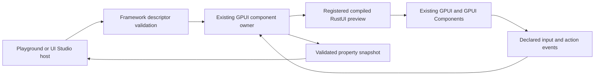

# Serialization and UI Studio bridge proposal

**Status: D1a and D1b source implementations are present.** The selected D1b
contract is signal-only (2026-10-19). The versioned descriptor schema, codec,
compiled registry and local preview host are publicly exported under
`rustui::preview`. D1b focused tests were included in the workspace `--lib` run
of 335 tests across six result groups. M125 native checks covered typed edits and
binding feedback, action dispatch, lifecycle generations, stale/type rejection
and NavigationSplit labels; M128 observed caret-position retention across parent
rerender plus keyboard blur/refocus. Text selection, IME composition, and
retention without blur remain open. See `D1B_COMPILED_PREVIEW_HOST.md` for the
implemented boundary and limits.

This task document records the design rationale and current status; it is not an
ADR. D1a and D1b are implemented. D1c Playground inspector work and D1d external
host integration remain separate roadmap work. Creating an individual ADR still
follows `docs/adr/README.md`.

## Decision and scope

The selected D1b boundary is an in-process host for explicitly registered,
compiled components, using the existing versioned descriptor, declared editable
properties and host-bound action references. D1b events are signal-only: a
`PreviewSignal` carries an event ID and exact mount/revision stamp. The registry
rejects event schemas with payload properties; typed values remain in
owner-controlled RustUI state and flow through validated property feedback.
`PreviewDocument` binds event IDs to allowlisted action references, which the
owner resolves and invokes locally. External transport and full visual
composition remain separate deliverables.

This boundary supports useful editable native previews without attempting to
serialize arbitrary Rust views, closures or component memory. It is a foundation
for the full UI Studio goal, not completion of it.

## Current evidence

| Current source | What it establishes |
|---|---|
| `crates/rustui/src/theme/loader.rs`: `parse_theme`, `serialize_theme` | Validated, typed theme-document JSON import/export. Export normalizes JSON; it does not preserve source bytes or describe a view tree. |
| `crates/rustui/src/preview/{model,schema,codec,registry,host}.rs`; `crates/rustui/src/preview/mod.rs` | Implemented and publicly exported versioned catalog/preview descriptors, scalar properties, validation, allowlisted actions, atomic property batches, JSON codec and signal-only compiled preview host. |
| `docs/tasks/T1B_THEME_SERIALIZATION.md`; `apps/rustui-playground/src/stories/theme_inspector.rs` | Existing theme export and read-only inspection have a bounded theme-only purpose. |
| `crates/rustui/src/view.rs`: `View`, `RenderContext`, `AnyView`, `Component`, `ComponentPropsView` | Views are Rust descriptions lowered to native elements. `body` returns `impl View`; the interface is not a serializable object graph. Retained components accept explicit `Clone + PartialEq + 'static` props and a typed reconciler. |
| `crates/rustui-macros/src/component.rs` | The component macro generates state accessors/bindings, defaults and action constructors. It does not generate a component catalog, property schema or serialization contract. |
| `crates/rustui-core/src/state.rs`, `binding.rs`, `actions.rs` | State contains a borrowed value and Binding; Binding carries typed runtime accessors; Action carries a runtime dispatcher over the actual owner. Their runtime values are not document data. |
| `crates/rustui/src/runtime/component_host.rs`; `view.rs`: `OwnerAction`, `OwnerActionReader` | GPUI entities own components, subscriptions and invalidation. Explicit owner targets exist for callbacks; type names alone are not owner identities. |
| `crates/rustui/src/theme/registry.rs`; `localization/mod.rs` | Active theme/localization use application globals. Independent appearance/locale in simultaneous previews is not established by adding document fields. |
| `docs/ARCHITECTURE.md`; `AGENTS.md` | RustUI must remain independent of Allui and Chorus. GPUI owns entities, scheduling, layout and rendering; another reactive/rendering runtime is excluded. Playground is the public-API-only canonical development app. |
| `docs/IMPLEMENTATION_ROADMAP.md`: D1 and framework capabilities | D1a/D1b are implemented; general view/state serialization and UI Studio integration remain planned. Theme export is not general view/state serialization. |

The existing theme exporter validates the current theme-document contract; it
preserves arbitrary metadata/non-Button records as JSON data without establishing
semantic component-descriptor support for those records. The proposed preview
catalog must declare its own validation coverage explicitly.

The local compiled preview host is implemented under
`crates/rustui/src/preview/host.rs`. Source and unit tests establish its bounded
mount, edit, signal dispatch and stale-revision behavior. Native checks cover the
recorded Playground cases; they do not establish full native accessibility or
UI Studio integration.

## Alternatives

| Boundary | Strength | Cost/limit | Recommendation |
|---|---|---|---|
| Serialize arbitrary `View`, `State<T>`, Binding and closures | Superficially resembles a complete application snapshot | Rust ownership, executable functions, native entities and opaque state have no stable portable representation. Blanket serde bounds would break existing APIs and still not define restoration semantics. | Reject. |
| Extract/edit Rust source or its AST first | Can eventually preserve arbitrary authored program structure and generate source edits | Requires source mapping, macro expansion policy, parser/toolchain integration, formatting, conflict handling and recompilation. Runtime identity and editable-state projection still need a contract. | Later source-authoring project, not the first bridge. |
| Make a complete serializable composition language first | Can express insert/reorder/layout editing directly | Requires a component/slot catalog, constraints, identity rules, migrations and an interpreter/adapter. Risk of building a second ownership/reactivity system before native hosting is proven. | Separate composition milestone after the descriptor boundary. |
| Registered compiled component descriptors | Known, validated properties drive actual RustUI components; native ownership remains intact | Only registered properties/components are inspectable/editable. Arbitrary Rust source or private state cannot round-trip. | Adopt first. |
| Put a UI Studio/Chorus schema inside RustUI | Could match a particular existing host quickly | Reverses dependency ownership and violates standalone boundaries. | Reject; a host adapter may depend on the framework contract. |

## Recommended v1 data boundary

### Persistent preview document

A saved document selects one compiled component preview and its declared inputs:

```json
{
  "format": "rustui.preview",
  "format_version": 1,
  "preview_id": "primary-button-example",
  "component_id": "rustui.button",
  "component_version": 1,
  "properties": {
    "label": "Run",
    "disabled": false
  },
  "actions": {
    "activate": "host.preview.report"
  }
}
```

Proposed framework model names:

- `PreviewDocument`, with a format discriminator and explicit envelope version.
- `ComponentId`, `PropertyId`, `EventId`, `ActionRef`: explicit stable identifiers,
  not Rust type names, addresses, GPUI entity IDs or function pointers.
- `PropertyValue`: initially string, bool and finite number. Enumeration values
  are strings validated against the property's allowed IDs. No generic opaque
  JSON object, Rust type payload, serialized closure, task or subscription.
- `ComponentSchema`, containing component ID/version, display metadata, declared
  properties and declared events.
- `PropertySchema`, containing value kind, default/required policy, editability,
  numeric/string bounds and allowed enumeration IDs where applicable.
- `EventSchema`, declaring its supported payload properties. `ActionRef` links an
  event to an explicitly registered host action; it is data, not executable code.

Semantic style values use known enumeration IDs, such as surface names, rather
than exporting private native style objects. A component can expose a derived
read-only property, but must declare that projection explicitly. Private
component fields remain private; a preview's editable values are an opt-in input
model, not a dump of that component's internal state.

The v1 document selects **one compiled root preview**. That root may be a rich
composition authored in Rust, including layouts, modifiers and retained children.
There is no reserved `children` field implying that arbitrary composition editing
already works. A future composition format can reuse this component/property
catalog while separately defining slots, tree identities and structural edits.

### Validation and compatibility

1. Parse with explicit format/version checks and bounded document/property/string
   sizes. Reject duplicate property IDs, unknown properties, undeclared events,
   nonfinite/out-of-range values and unresolved action references. Parsing and
   validation do not execute actions or invoke component factories.
2. Resolve defaults against the exact component schema version. Produce an owned
   `ValidatedPreview`/`ValidatedProps`, so rendering does not reinterpret unchecked
   JSON or guess property types.
3. Validate a whole proposed property batch, including the component's pure
   cross-property validator, before applying it. A rejected batch changes nothing.
4. Serialize deterministically, using ordered property/action maps. Promise typed
   value round-trip, not source formatting, comments or original bytes.
5. Unknown envelope or component versions fail with a useful error. Schema
   migration must be explicit; no automatic coercion of a future document.
6. Keep preview and theme document versions independent. A format-v1 theme file
   is not a format-v1 preview file.

Exact limits and error shapes belong in the D1a schema review. No new parser,
JSON-schema generator, networking dependency or upstream change is needed for
the proposed scalar model: `rustui` already uses serde and serde_json.

## Compiled component registry and native hosting

The following API sketch and protocol operations preserve the original design
proposal for context. They are not the shipped API contract; see
`D1B_COMPILED_PREVIEW_HOST.md` for actual methods and guarantees. In particular,
the selected signal-only design rejects payload schemas and has no remote action
invocation protocol.

Historical API sketch, superseded by the implemented API described in
`D1B_COMPILED_PREVIEW_HOST.md`:

```rust,ignore
let mut registry = PreviewRegistry::new();
registry.register(button_schema(), button_preview_factory)?;
registry.register(text_field_schema(), text_field_preview_factory)?;

let preview = registry.parse_and_validate(json)?;
// A later host receives this validated data and local host action bindings.
```

A proposed erased factory shape is:

```rust,ignore
type PreviewFactory = fn(ValidatedProps, PreviewActionBindings)
    -> Result<AnyView, PreviewError>;
```

This avoids treating the non-object-safe `View` contract as `dyn View` or adding
serde to every view. Factories are ordinary locally compiled Rust functions.
`PreviewActionBindings` contains local runtime handlers and is **not serializable**.
A host resolves wire action IDs to those handlers using its declared allowlist and
an explicit current owner target. Loading a file cannot discover arbitrary Rust
functions or call an action merely because its string is present.

The host owns the current descriptor/validated props in an ordinary GPUI-backed
component. Factories compose public RustUI views. Existing `Component(...).props`
reconciliation applies changed typed props to the retained compiled specimen;
`Binding` and explicit `OwnerAction` targets keep input/events attached to their
actual owners. Use stable preview/component identities for property edits;
changing the component type/version remounts deliberately. Unchanged controlled
values must not be written back on every render and reset native editing state.

User edits in a registered controlled TextField update its declared preview
property through the same GPUI owner. This makes that projection exportable;
it does not make arbitrary native input selection, undo state, navigation or
unexposed application fields serializable. Task/subscription teardown stays with
existing component lifecycle. Stored factories/callbacks must not retain a strong
cycle to their host.



There is no separate scheduler, retained entity store, renderer, general binding
graph or executable JSON runtime in this path.

## Host/protocol boundary

D1b starts with in-process methods, not a socket service. Keep a later transport
adapter outside core validation and rendering. Proposed operations are:

| Operation | Meaning |
|---|---|
| Describe catalog | Read schemas and capabilities of this compiled host. |
| Open preview | Validate a document, resolve registered actions, mount a specimen. |
| Read snapshot | Export declared values, component schema version and host session metadata. |
| Apply property batch | Validate and apply against the expected mounted instance/revision. |
| Close preview | Unmount through normal GPUI ownership/lifecycle. |

Session/instance generations and opaque revisions are host metadata, not saved
component memory or serialized GPUI IDs. Property updates use expected revision
and mount generation checks so stale requests do not edit a remounted preview.
The host serializes mutation onto its existing GPUI context. A no-op update does
not notify; a real accepted update uses ordinary GPUI invalidation. This is not
a second event loop. Declared action events identify the current preview and
mounted generation; stale events are rejected rather than routed by Rust type.

External `InvokeAction`, screenshot streaming, source editing, subprocess
management and filesystem access are not implicitly authorized by this protocol
sketch. Native user activation can run locally bound preview actions. Any remote
invocation capability needs its own explicit host policy and acceptance slice.

Theme/locale are host preview-context settings, not private component state.
Reuse existing validated theme documents and locale catalogs. Because current
active theme/localization are app globals, v1 must describe their application-wide
scope. Do not promise different simultaneous appearances/locales in one GPUI App.
A host needing that isolation must approve a later context/isolation design.
No theme-file path or source-code path becomes executable merely by import.

UI Studio is a consumer of the framework contract. A Chorus-hosted adapter may
exist elsewhere, but RustUI does not import it, depend on its applications or
require local Chorus paths. Protocol compatibility is based on format and
capabilities, not the name of a particular host application.

## Incremental deliverables and proposed files

All paths below are proposals, not created placeholders.

| Slice | Proposed ownership/files | Reviewable outcome and validation |
|---|---|---|
| D1a — schema and codec | Implemented in `crates/rustui/src/preview/{mod.rs,model.rs,schema.rs,codec.rs}` and exported by `rustui::preview` | Focused test filter passed 10 tests. Provides versioned scalar descriptor/catalog data, validation errors, defaults, deterministic export, duplicate-key rejection and whole-batch validation. No host/runtime behavior. |
| D1b — local compiled preview host | `preview/{registry.rs,host.rs}` plus public exports; small existing owner/props adapters only if proved necessary | Register Text, Button and TextField specimens; keep one native ownership path. Verify typed prop edits, explicit action target, binding feedback, stale mount/revision rejection, native input state on parent rerender, teardown and remount. No transport. |
| D1c — canonical Playground inspector | Dedicated Playground story/panel using public `rustui::preview` API; task documentation and fixtures | Show schema-derived controls, edit known properties, read action events, import/export normalized descriptors and retain specimen identity. Native theme/locale/lifecycle/keyboard/accessibility checks recorded separately. Theme JSON remains a separate document. |
| D1d — external host adapter | Consumer-owned adapter/module chosen after an actual host and transport are specified | Capability/version negotiation, request/reply/error behavior, stale revisions, host disconnect/close, explicit action policy and owner-safe dispatch. No framework dependency on UI Studio or Chorus. |

Keep the first model in `rustui::preview`, using its existing serde dependencies;
do not add serde/preview assumptions to `rustui-core`, blanket bounds to `View`
or automatic serialization to `#[component]`. A later lightweight schema crate
or opt-in schema-generating macro can be proposed if real consumers need it.
Neither is necessary to prove the descriptor boundary.

## Full intended UI Studio work still to deliver

The descriptor-first path is intentionally incremental. Full visual tooling
still needs explicit work for:

- Composition documents: component slots, insert/remove/reorder, layout/modifier
  editing, stable structural identities and document migrations.
- Catalog coverage and authored schema adapters for real framework/application
  components, not an assertion that every Rust generic/private field is editable.
- Source association and optional Rust source generation/edits, conflict handling,
  build diagnostics and recompilation. Data/descriptor reload is not Rust hot code
  replacement.
- Asset references, theme/token and locale authoring, navigation/interaction
  scenarios, responsive preview contexts and task/lifecycle inspection.
- Host transport/process policy, native image/interaction integration and
  independent appearance/locale previews where required.
- Accessibility inspection and reproducible native acceptance, including state
  retention while inspecting/editing and observable failure recovery.

Those broader goals remain on the roadmap. D1a/D1b provide a reusable descriptor
contract and compiled preview host; they do not complete general view/state
serialization, D1c's canonical Playground inspector, or D1d UI Studio/external
host integration.

## Selected D1b boundary (2026-10-19)

The selected boundary is implemented: preview events remain signal-only; typed
values stay in owner-controlled RustUI state and are validated through D1a.
Arbitrary Rust source editing, general view or state serialization, external
transport, and full visual composition remain separate work.
